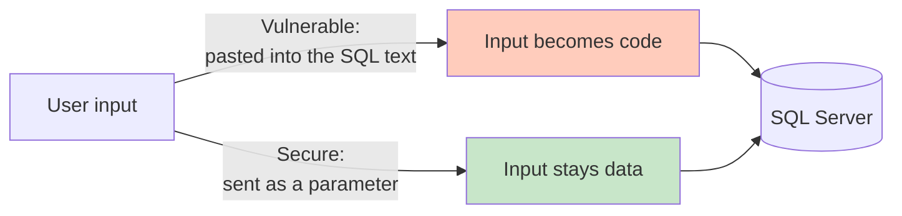
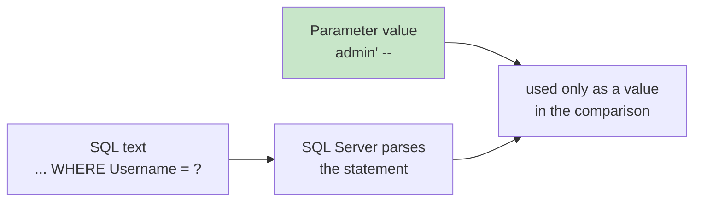
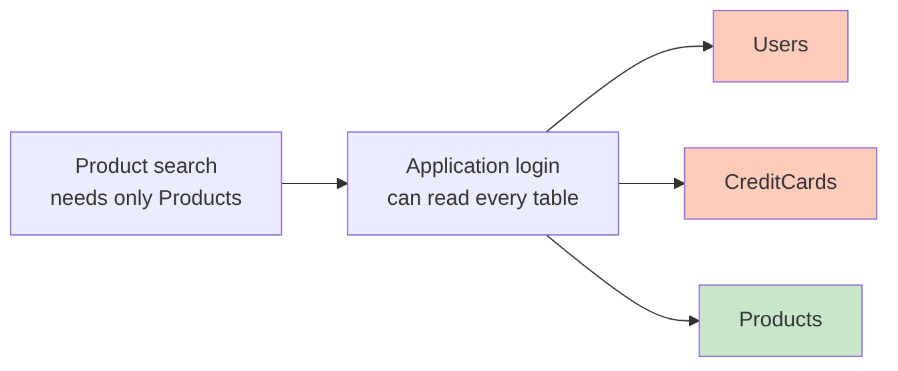

# Cyber Lab — Classroom Walkthrough

Pairs with [Lab 8 – Complex Parameters](../../labs/lab08-complex-parameters.md),
**Section 2 (Method 1 — Client-Side Query Building)**.

## Topic

How to design the data access of an application so that SQL injection
**cannot happen**.

The demo has two pages — a login and a product search — and each page has
a red **Vulnerable** and a green **Secure** button. The attacks are shown
only to explain **why** each design rule exists. Students do not need to
remember a single payload; they need to remember the rules.

> [!IMPORTANT]
> **The focus is design, not attack.** Every demonstration in this
> walkthrough ends with the same question: *what should the developer have
> done?* Spend most of the time on the answer.



---

# Goals

After the demonstration, students should be able to name and explain five
design rules:

1. **Parameters, never string concatenation.** User input is sent as a
   parameter value, so it can never become part of the SQL statement.
2. **Generic error messages.** The user sees "something went wrong"; the
   details of a database error stay in the log.
3. **Least privilege.** The application connects to SQL Server with a login
   that can reach only what the application needs.
4. **Passwords are hashed, never stored.** A database must not contain
   passwords in a readable form.
5. **Hiding the output is not protection.** A page that shows nothing can
   still leak data; only the rules above protect it.

---

# Preparation before the lab

## Start SQL Server

## Reset the data

```bash
sqlcmd -S localhost\SQLEXPRESS -E -C -i database\init.sql
sqlcmd -S localhost\SQLEXPRESS -E -C -i database\seed.sql
```

This resets `CyberLab` to 3 users, 3 credit cards, and 8 products — safe
to re-run at any point.

## Start the application

```bash
uvicorn app.main:app --reload
```

## Open

```
http://127.0.0.1:8000/
```

Keep SSMS open too. Under every result the application shows a gray
**"Behind the scenes"** panel with the SQL that actually ran. Tell the
students that this panel exists only for the classroom — a real application
never shows it.

---

# Part 1 — The Bug: Input Becomes SQL

## 1.1 Both versions look the same

Open **Login**. Type `admin` / `12345` and click **Vulnerable**, then
**Secure**. Both say *Welcome, Administrator*.

> Ask: if both buttons behave the same, how would a tester ever notice the
> difference?

(They would not — not with normal input. A vulnerable application looks
correct until someone sends input the developer did not expect.)

## 1.2 The unexpected input

Click the payload **`admin' --`**, then **Vulnerable**. You are logged in
as Administrator without the password. Show the panel:

```text
WHERE Username = 'admin' --' AND Password = 'x'
```

The quote ended the string, and `--` turned the password check into a
comment. **The user's input changed the meaning of the query.**

Now click the same payload with **Secure**: *Incorrect username or
password*.

## 1.3 Design rule 1 — parameters

Show the two versions in [app/routes/login.py](app/routes/login.py):

```python
# Vulnerable: the input is pasted into the SQL text
query = f"SELECT FullName FROM Users WHERE Username = '{username}' AND Password = '{password}'"
cursor.execute(query)
```

```python
# Secure: the input is sent separately, as parameter values
query = "SELECT FullName FROM Users WHERE Username = ? AND Password = ?"
cursor.execute(query, (username, password))
```



With a parameter, SQL Server parses the statement **before** it sees the
value. The value `admin' --` is then only a username to compare — there is
no user with that name, so the login fails. The input cannot change the
query, whatever characters it contains.

> [!IMPORTANT]
> **Rule 1:** Never build SQL by joining strings with user input. Send the
> input as parameters — `?` placeholders in the application, or the
> parameters of a stored procedure ([Lab 3](../../labs/lab03-stored-procedures.md)).
> This is the solution from [Lab 8, Section 2.3](../../labs/lab08-complex-parameters.md#the-solution--parameterized-queries).

> Ask: a colleague suggests removing every `'` from the input instead.
> Why is that worse than parameters?

(Escaping and blacklists try to guess every dangerous character, in every
place, for every database. A parameter does not need to guess anything —
the value simply never becomes SQL.)

---

# Part 2 — "But My Page Shows Nothing"

A common belief: *our login only says welcome or wrong password, so even if
someone injects SQL, they cannot see any data.* This part shows briefly why
that is wrong. Do not go into the details of each technique — the point is
the conclusion.

## 2.1 Data leaks through the one thing the page shows

The login page shows exactly one value: the name in the welcome message.
Click **`welcome = a credit card number`**, then **Vulnerable**:

```text
Welcome, 4539-1488-0343-6467
```

The injected `UNION SELECT` replaced the name with a value from another
table. The page did exactly what it was designed to do — print one name —
but the "name" was a secret.

## 2.2 Data leaks through an error message

Click **`card number inside an error`**, then **Vulnerable**. The page
prints a SQL Server error, and the card number is part of the error text.

## 2.3 Data leaks even through yes/no

Mention, without going into detail: even if the page showed no name and no
error — only *welcome* or *wrong password* — an attacker could still ask
yes/no questions ("does the card number start with 4?") and rebuild the
data one character at a time. The two **blind** buttons on the page show
one question answered *yes* and one answered *no*. This is slow and is
done with scripts, but it works.

## 2.4 Design rule 2 — generic error messages

Of these three leaks, one is caused by a second design mistake: the
vulnerable path prints the database error to the user. The secure paths do
not.

> [!IMPORTANT]
> **Rule 2:** Show the user a general message ("Login failed", "Something
> went wrong, please try again"). Write the details of the database error to
> a log that only developers and administrators can read. An error message
> can reveal table names, column names, and — as here — the data itself.

## 2.5 Design rule 5 — hiding the output is not protection

> Ask: the page showed the attacker less and less — first a name, then an
> error, then only yes or no. Did the data stop leaking?

(No. It only leaked more slowly.)

> [!IMPORTANT]
> **Rule 5:** Hiding the output does not fix SQL injection. As long as the
> input becomes part of the SQL text, the attacker controls the query. Only
> Rule 1 removes the cause.

---

# Part 3 — Limiting the Damage

Rule 1 removes the cause. The next two rules make sure that **if** a
mistake ever slips through — one forgotten query in a large application —
the damage is small.

## 3.1 One mistake, the whole database

Open **Product search**. Click **`Logitech (normal)`** — two products.

Now click **`UNION → user passwords`**, then **`UNION → credit cards`**.
The product table lists usernames, passwords, and card numbers.



The search page needs only `Products`. It could read `Users` and
`CreditCards` because the application connects to SQL Server with an
account that can read **every** table.

## 3.2 Design rule 3 — least privilege

The application should connect with its own login that has only the
permissions it needs:

```sql
CREATE LOGIN cyberlab_app WITH PASSWORD = 'Str0ng!Passw0rd';
GO
USE CyberLab;
GO
CREATE USER cyberlab_app FOR LOGIN cyberlab_app;

-- The search page may read products.
GRANT SELECT ON dbo.Products TO cyberlab_app;

-- The login check runs only through a procedure; the application
-- gets no direct access to the Users table.
GRANT EXECUTE ON dbo.usp_CheckLogin TO cyberlab_app;

-- No permission on dbo.Users or dbo.CreditCards.
```

With this login, the same `UNION` attack on the vulnerable search page
fails:

```text
The SELECT permission was denied on the object 'CreditCards',
database 'CyberLab', schema 'dbo'.
```

> [!NOTE]
> This demo does not include `usp_CheckLogin` or the `cyberlab_app` login —
> the application connects with your own account, so that every attack can
> be shown. The script above shows how a real application would be set up.

> [!IMPORTANT]
> **Rule 3:** An application login gets only the permissions the
> application needs. Stored procedures help: the application gets
> `EXECUTE` on the procedure, and the procedure reads the tables. The
> application itself has no access to the tables. This is the
> **encapsulation** argument from [Lab 3](../../labs/lab03-stored-procedures.md#why-use-stored-procedures),
> seen from the security side.

## 3.3 Design rule 4 — passwords are hashed

> Ask: look at the passwords the search page just leaked. What else is
> wrong here, besides the injection?

(The passwords are stored as plain text. Anyone who reads the table —
an attacker, but also a backup, a report, or an administrator — can read
them.)

> [!IMPORTANT]
> **Rule 4:** A database stores a **hash** of the password (with a salt),
> never the password itself. The login check hashes the entered password
> and compares the hashes. Even a stolen `Users` table then does not
> reveal the passwords. In this demo the passwords are stored as plain text
> on purpose, so that the leak is visible.

---

# Part 4 — Summary: The Design Checklist

Put this table on screen at the end. It is the only thing students need to
take away.

| Rule | Prevents | Seen in the demo |
|---|---|---|
| 1. Parameters, never string concatenation | the attack itself — input cannot become SQL | Secure buttons on both pages |
| 2. Generic error messages | leaking data and structure through errors | error message on the vulnerable login |
| 3. Least privilege | one mistake exposing the whole database | `UNION` reaching `Users` and `CreditCards` |
| 4. Hashed passwords | readable passwords in a stolen or copied table | passwords in the search results |
| 5. Hiding output is not protection | false confidence | welcome message, error, yes/no — all leaked |

Rule 1 removes the cause. Rules 2–4 limit the damage if a mistake slips
through. Rule 5 is a warning against a fix that does not work.

---

# Connection to Lab 8

[Lab 8, Section 2](../../labs/lab08-complex-parameters.md#section-2--method-1-client-side-query-building)
lists three reasons not to build SQL in the application: **SQL injection**,
**no query-plan reuse**, and **many separate database calls**. This demo
shows the first one. The fix for the first two is the same — parameters:

> Ask: the vulnerable search sends a different SQL text for every search
> term. What does that do to SQL Server's plan cache, even when nobody
> attacks the application?

---

# Questions for students

1. Why is a parameter safe, regardless of which characters the user types?
2. A colleague wants to protect the login by removing all `'` characters
   from the input. Why is that not a good solution?
3. The login page shows only a welcome message. Why is the application
   still not safe?
4. Why should the user see "Something went wrong" instead of the database
   error message?
5. The search page needs only the `Products` table. Which permissions
   should the application login have, and what would that change in the
   `UNION` attack?
6. How do stored procedures help with least privilege?
7. Why does a database store a password hash instead of the password?
8. Rule 1 alone prevents injection. Why do we still need rules 2–4?

---

# Closing message

SQL injection is not a clever attack — it is a **design mistake**: the
application lets user input become part of a SQL statement.

A well-designed application sends input only as parameters, shows the user
general error messages, connects with a login that can reach only what it
needs, and never stores readable passwords. With these rules, the attacks
in this demo either do nothing or reach nothing of value.
