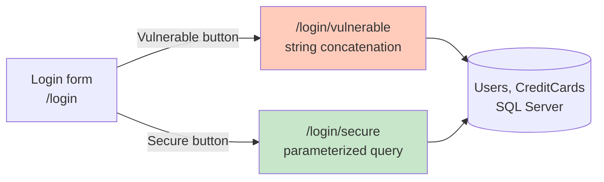
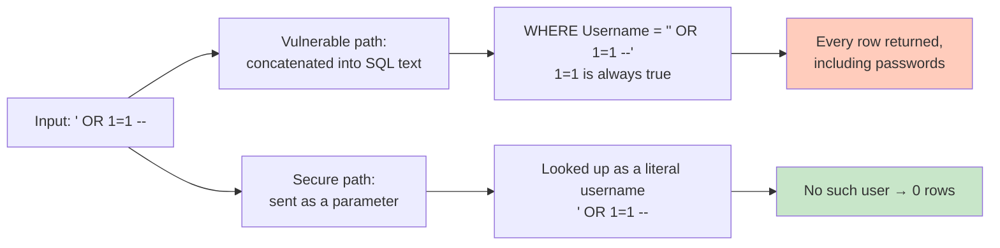
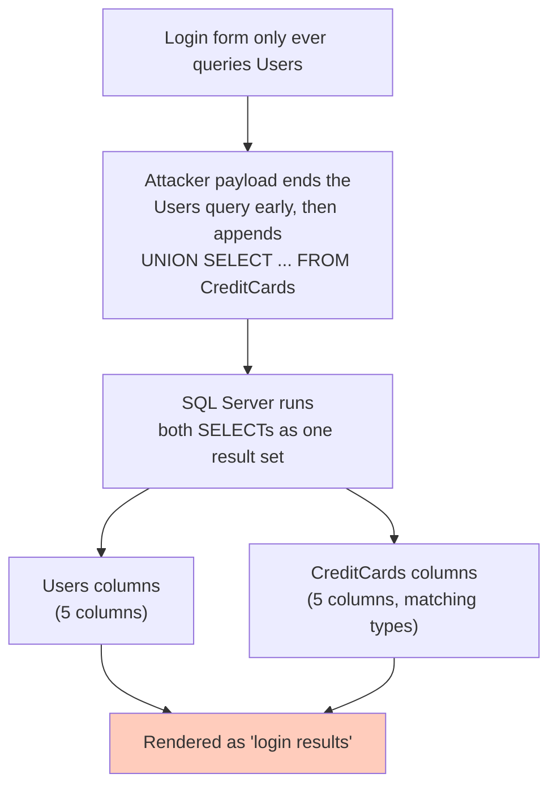
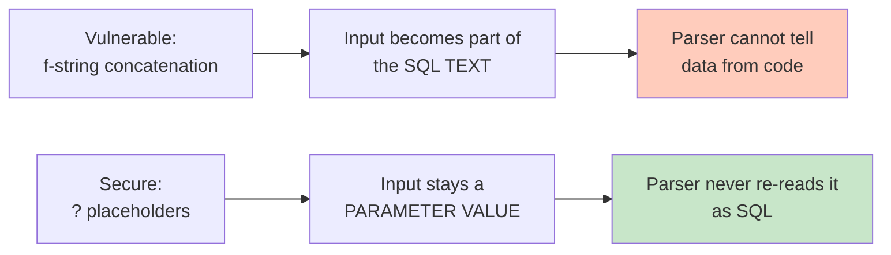

# Cyber Lab — Classroom Walkthrough

Pairs with [Lab 8 – Complex Parameters](../../labs/lab08-complex-parameters.md),
**Section 2 (Method 1 — Client-Side Query Building)**.

## Topic

Demonstration of why building SQL by string concatenation is dangerous —
the exact anti-pattern taught in Lab 8, Section 2 — but against a real,
running login form instead of a hypothetical.



Same form, same fields, same database behind both buttons. Only the
code path differs — that is the entire point of the demo.

---

# Goals

After the demonstration, students should understand:

* how user input becomes part of the SQL text in the vulnerable path
* why `' OR 1=1 --` returns every row, and why `--` matters
* the difference between an **authentication bypass** and **data
  exfiltration** — the `UNION SELECT` payload is not "a wrong password",
  it reads a completely unrelated table
* why parameterized queries are **structurally** safe, not just
  "safer" — the input never re-enters the SQL parser
* why input sanitization (escaping, blacklists) is a weaker, bypassable
  substitute for parameterization

Emphasize that this is one of the three concrete problems from Lab 8,
Section 2 (SQL injection, no plan reuse, network traffic) — the one you
can actually *watch happen*.

---

# Preparation before the lab

## Start SQL Server

## Reset the data

```bash
sqlcmd -S localhost -E -C -i database\init.sql
sqlcmd -S localhost -E -C -i database\seed.sql
```

This resets `CyberLab` to 3 users and 3 credit cards — safe to re-run
at any point if the demo gets messy.

## Start the application

```bash
uvicorn app.main:app --reload
```

## Open

```
http://127.0.0.1:8000/login
```

---

# Demonstration

## 1. Baseline — a normal login

Fill in `admin` / `12345`. Click **Vulnerable**, then reload and click
**Secure** with the same input.

Explain:

* both succeed
* both look the same to the user
* nothing about the vulnerability is visible yet — that is exactly the
  danger: a vulnerable endpoint behaves identically to a safe one until
  someone sends it the wrong input

Ask the students:

> If both buttons do the same thing for a normal login, what does the
> word "vulnerable" even mean here?

---

## 2. Payload 1 — `' OR 1=1 --`

Click the payload button, then **Vulnerable**.

Explain what the server actually received:



`--` comments out everything after it, so the dangling `' AND Password
= 'x'` never executes. `1=1` is always true, so the `WHERE` clause
matches every row.

Now click **Secure** with the exact same input. Explain why it returns
0 rows: the ODBC driver sends `' OR 1=1 --` as a parameter value, not
as SQL text. The parser never gets a second chance to interpret it.

---

## 3. Payload 2 — `admin' --`

Click the payload button, then **Vulnerable**.

Explain:

```text
WHERE Username = 'admin' --' AND Password = 'x'
```

The password check is commented out entirely. The attacker is logged
in as `admin` without ever knowing the password.

Ask the students:

> Payload 1 returned every user. This payload returns exactly one. Why
> would an attacker prefer this version?

(Targeted access, less noisy, looks like a normal single-row login —
harder to notice in a log file.)

---

## 4. Payload 4 — `' UNION SELECT ... FROM CreditCards --`

This is the one to slow down for.

Explain **before** clicking:



Now click the payload button, then **Vulnerable**. Point out: the login
page just displayed credit card numbers. The endpoint never mentions
credit cards anywhere in its own code.

Explain:

* `UNION` requires the two `SELECT`s to have the same number of columns,
  with compatible types — that's why the payload lists exactly 5
  columns to match `Users`
* this is a **qualitatively different** attack from payloads 1–2: it is
  not about getting past a login check, it is about reading a table
  that has nothing to do with login at all

Ask the students:

> If this endpoint had never selected from `Users` at all — say, it
> only checked `EXISTS (...)` and returned true/false — would the
> `UNION` attack still work? Why or why not?

(No — `UNION` needs a result set to attach to. A boolean-only query
gives the attacker nothing to piggyback on. This is why even a
"vulnerable-looking" query can be lower-risk depending on what it
returns — though the fix is still always parameterization, never
relying on this.)

---

## 5. Code comparison

Open [app/routes/login.py](app/routes/login.py) side by side with the
page's "SQL being executed" panel still showing the last payload.



```python
# Vulnerable
query = (
    "SELECT Id, Username, FullName, Department, Password "
    "FROM Users "
    f"WHERE Username = '{username}' AND Password = '{password}'"
)
cursor.execute(query)
```

```python
# Secure
query = """
    SELECT Id, Username, FullName, Department
    FROM Users
    WHERE Username = ? AND Password = ?
"""
cursor.execute(query, (username, password))
```

Point out the second detail hiding in plain sight: the secure query
doesn't even `SELECT` the `Password` column. Even if someone found a
way to make it return extra rows, the password couldn't leak through
it — a second, independent layer of safety on top of parameterization.

---

# Connection to Lab 8

Recall **Lab 8, Section 2** — client-side query building fails in three
concrete ways: SQL injection, no query plan reuse, and network traffic.

This demo makes the first one visible and clickable. The other two
don't show up on screen — ask the students to explain them from memory:

> Why would `app.main` sending a slightly different SQL string for
> every login attempt be bad for SQL Server's query plan cache, even if
> none of those strings were malicious?

---

# Questions for students

1. Why does `' OR 1=1 --` return every row in the vulnerable path but
   zero rows in the secure path?

2. What is the difference between payload 2 (`admin' --`) and payload 4
   (`UNION SELECT`) in terms of *what* is being attacked?

3. Why does `UNION SELECT` require knowing the number and types of
   columns in the original query?

4. The secure query doesn't `SELECT` the `Password` column at all. Why
   does that matter, independently of parameterization?

5. Why is "sanitizing" input (stripping quotes, blacklisting words like
   `UNION` or `DROP`) not a reliable substitute for parameterized
   queries?

6. Lab 8 names two other reasons never to concatenate SQL in the
   client, besides injection. What are they, and why doesn't this demo
   show them directly?

---

# Closing message

A vulnerable and a secure endpoint can look **identical** for every
normal input. The difference only appears the moment someone sends
input the developer didn't expect — and by then, in a vulnerable
system, it's too late.

**Never build SQL by string concatenation.** Parameterized queries are
not a best practice among several reasonable options — they are the
only approach where the database structurally cannot confuse data for
code.
