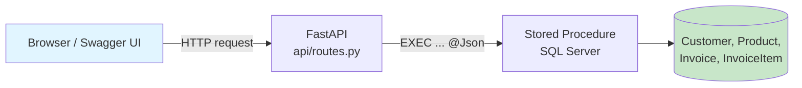
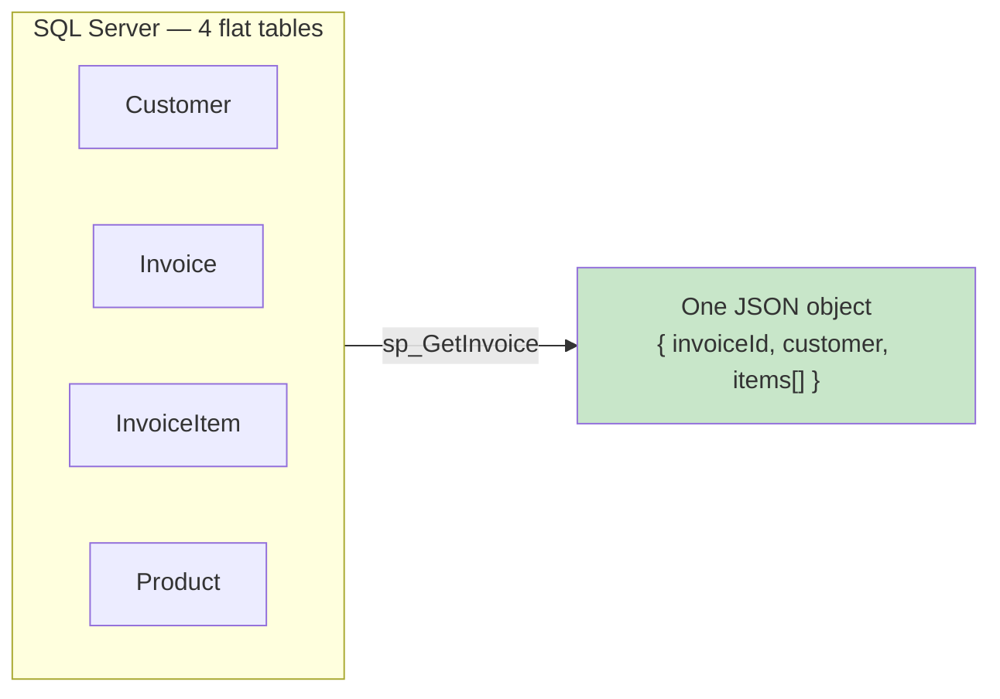
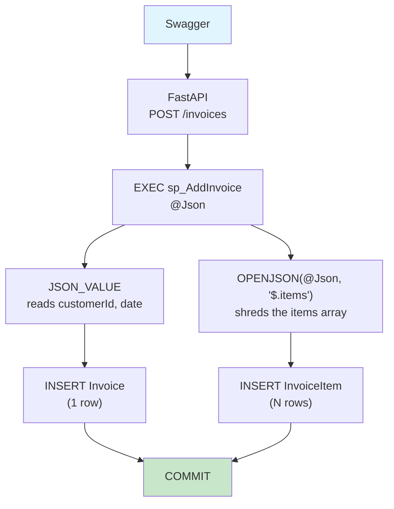
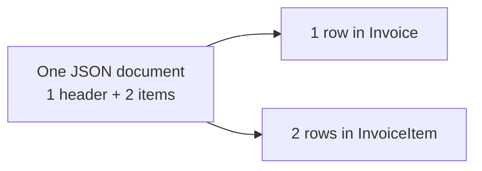
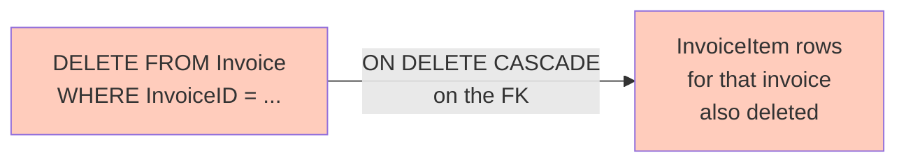
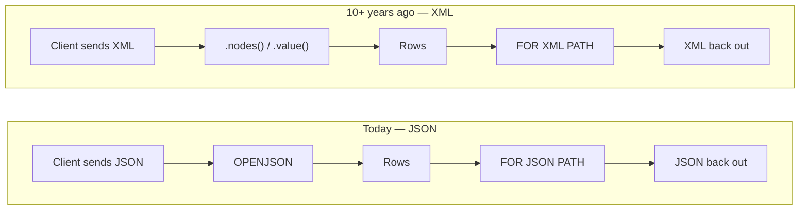

# OBP REST Demo — Classroom Walkthrough

Pairs with [Lab 8 – Complex Parameters](../../../labs/lab08-complex-parameters.md),
**Section 6 (JSON Parameters)**.

## Topic

Demonstration of how a modern application communicates with a SQL Server database.

The project shows the same `OPENJSON` pattern taught in Lab 8, Section 6 —
but driven by a real HTTP request instead of a JSON literal typed into SSMS.



Keep this picture on screen (or on the whiteboard) for the whole demo —
every step below is one arrow in it.

---

# Goals

After the demonstration, students should understand:

* the relational model
* the 1:N relationship
* hierarchical JSON
* stored procedures
* OPENJSON
* REST API
* ON DELETE CASCADE

Emphasize that REST is only a tool for demonstration. The focus of the lab remains on SQL Server.

---

# Preparation before the lab

## Start SQL Server

## In SSMS run

```
02_SeedData.sql
```

## Start the REST API

```bash
uvicorn api.app:app --reload
```

## Open

```
http://localhost:8000/docs
```

Also open SSMS.

---

# Demonstration

## 1. GET /customers

Explain:

* REST endpoint
* JSON response
* data comes from SQL Server
* FastAPI does not know about the Customer table, it only calls the procedure

---

## 2. GET /invoices

Show the list of invoices.

Explain:

* one invoice
* one customer
* total amount

Ask the students:

> What do you expect GET /invoices/{id} to return?

---

## 3. GET /invoices/{id}

Call a single invoice.

Explain:

In SQL Server there are four tables:

* Customer
* Invoice
* InvoiceItem
* Product

But REST returns a single object.

Show:

* the customer
* the items
* the products

Emphasize:



Four separate tables, joined by foreign keys, become **one nested
document**. The client never sees the joins — it sees the shape it
asked for.

---

## 4. SSMS

Show

```sql
SELECT *
FROM Invoice;
```

and

```sql
SELECT *
FROM InvoiceItem;
```

Ask:

> How many tables does this JSON use?

---

## 5. POST /invoices

Send:

```json
{
  "customerId": 1,
  "date": "2025-06-27",
  "items": [
    {
      "productId": 1,
      "quantity": 2,
      "unitPrice": 1450
    },
    {
      "productId": 2,
      "quantity": 1,
      "unitPrice": 109
    }
  ]
}
```

Explain — trace this exact path for the JSON you just sent:



One header value is read with `JSON_VALUE`; the nested array is shredded
with `OPENJSON`. Both land in the same transaction — either the whole
invoice is saved, or none of it is.

---

## 6. SSMS

Run again:

```sql
SELECT *
FROM Invoice;

SELECT *
FROM InvoiceItem;
```

Show the new invoice.

Show the new items.

Explain:



One document in, one header row plus one row per array element out —
count the `items` in the request body against the rows in `InvoiceItem`.

---

## 7. PUT /invoices/{id}

Change the date or the customer.

Show that only the invoice header is changed.

Explain:

We do not touch the items.

---

## 8. DELETE /invoices/{id}

Delete the invoice.

Run again:

```sql
SELECT *
FROM Invoice;

SELECT *
FROM InvoiceItem;
```

Ask the students:

> Who deleted the items?

Explain:



Nobody issued a second `DELETE`. The foreign key itself is declared
`ON DELETE CASCADE` in [sql/01_CreateDatabase.sql](../sql/01_CreateDatabase.sql) — SQL Server removes the
children automatically when the parent row goes.

---

# Closing part

Show the same JSON.

Explain:

This is the way the same problem is most commonly solved today.

---

# Connection to XML

Ask the students:

> How would we have sent the same invoice to SQL Server ten or more years ago?

Recall **Lab 8, Section 4** — the XML type, `.nodes()`, `.value()`, `FOR XML PATH`.

Explain:

JSON and XML solve the same problem. The difference is in the format,
not the idea:



Same shape, same shred-into-rows-then-build-back-out idea, on both sides
— only the envelope and the function names change. `OPENJSON`/`FOR JSON
PATH` here mirror `.nodes()`/`.value()`/`FOR XML PATH` from Lab 8,
Section 4.

Emphasize that XML will still be encountered in existing business systems and integrations.

---

# Questions for students

1. Why are the invoice and the items not in the same table?

2. Why do we store the price on the invoice item?

3. Why do we use stored procedures?

4. What does OPENJSON do?

5. What would happen if there were no ON DELETE CASCADE?

6. Why does REST return a single object, while SQL Server uses four tables?

7. How would you solve the same problem using XML?

---

# Closing message

The relational model and hierarchical JSON are not competitors.

The relational model is used to store data.

JSON is used to exchange data between applications.

XML solves the same problem as JSON and that is why it is important to understand both approaches.
