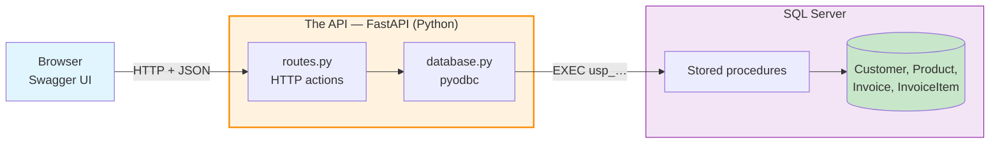
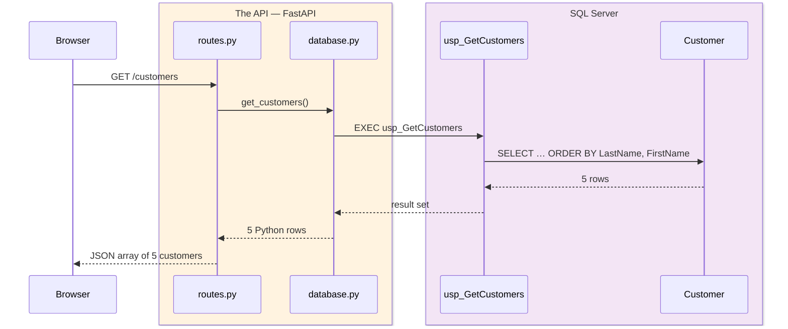
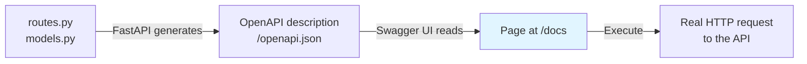
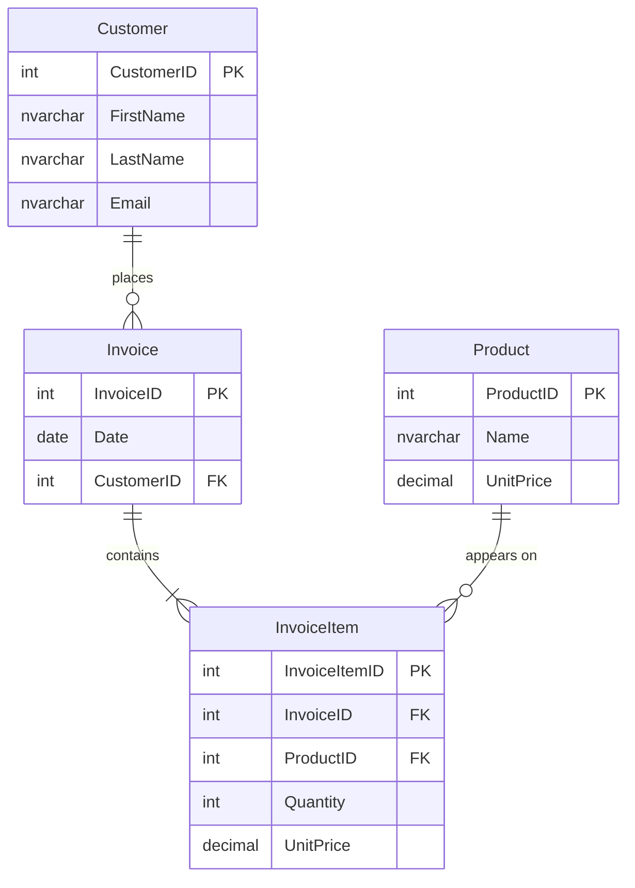
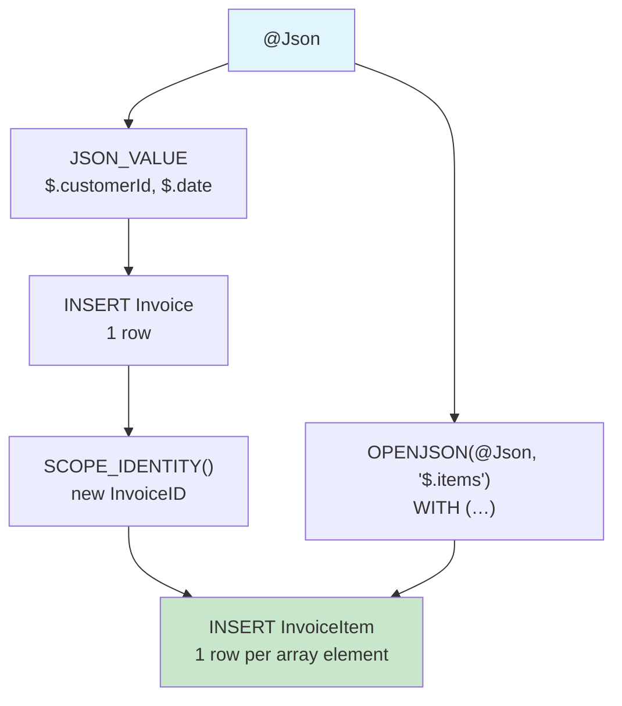
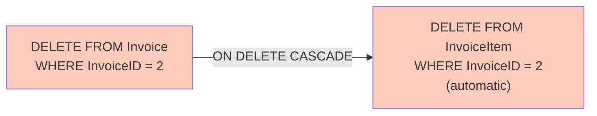

# OBP REST Demo – How It Works

**Database:** `OBPRestDemo`

The [OBP REST Demo](README.md) is a small invoicing application: a browser sends an invoice as JSON, and SQL Server stores it in four related tables. In class, we use it to watch the ideas from the labs work inside a real application.

This document is **optional reading** for anyone who wants to know what happens behind each click. It follows one request at a time from the browser down to the tables, and at every step points to the lab where that idea is taught:

- [Lab 7 – CRUD Operations](../../labs/lab07-crud-operations.md) — how an application creates, reads, updates, and deletes data through stored procedures;
- [Lab 8 – Complex Parameters](../../labs/lab08-complex-parameters.md) — how one JSON document becomes rows in several tables, and back;
- [Lab 9 – Transactions](../../labs/lab09-transactions.md) — why an invoice is saved completely or not at all.

> [!IMPORTANT]
> **Core idea:** A REST API is just another caller of stored procedures. Every HTTP action in this application is one CRUD operation, and every CRUD operation is one stored procedure. The Python code only translates between HTTP and `EXEC` — all the rules about the data live in SQL Server.

---

## What you will understand

After reading this document, you should be able to:

- describe the path of a request from the browser to the tables and back;
- explain what Swagger UI is and where its page comes from;
- map each HTTP action (`GET`, `POST`, `PUT`, `DELETE`) to a CRUD operation and a stored procedure;
- explain how `usp_AddInvoice` turns one JSON document into one `Invoice` row and many `InvoiceItem` rows;
- explain why the invoice is written inside a transaction;
- explain how flat result rows become one nested JSON object;
- recognize which outcomes the demo reports clearly, and which ones it does not.

> [!NOTE]
> **Prerequisites:** The demo is set up and running as described in the [README](README.md). You do not need to know Python — every Python file is short, and this document explains what each one does.

---

# Section 1 – The Big Picture

## 1.1 The layers

A request passes through four layers. Each layer has one job and lives in its own file:



The orange box is the API: the two Python files that turn an HTTP request into an `EXEC` and the result back into JSON. The browser on the left is just one possible client, and everything on the right runs inside SQL Server.

| Layer | File | Job |
|---|---|---|
| Client | the browser (Swagger UI at `/docs`) | sends HTTP requests and shows the JSON responses |
| HTTP actions | [api/routes.py](api/routes.py) | receives a request, calls a procedure, returns JSON |
| Request shapes | [api/models.py](api/models.py) | describes what a valid invoice looks like |
| Database access | [api/database.py](api/database.py) | opens the connection and runs `EXEC` |
| Data and rules | [sql/03_StoredProcedures.sql](sql/03_StoredProcedures.sql) | the six `usp_` procedures |
| Storage | [sql/01_CreateDatabase.sql](sql/01_CreateDatabase.sql) | four tables, keys, and constraints |

## 1.2 One request, step by step

Here is `GET /customers`, the simplest request in the application:



Notice what the Python code does **not** know: the table name, the columns used for sorting, or how the query is written. It knows only the procedure name and the columns it receives back. This is the **stable interface** from [Lab 7, Section 1](../../labs/lab07-crud-operations.md#the-procedure-reports-the-outcome) — the query inside the procedure can change without changing the application.

## 1.3 What is Swagger UI?

During the demo, you work in the page at <http://127.0.0.1:8000/docs>. That page is **Swagger UI**, and nobody wrote it by hand.



1. FastAPI reads the code — every route in [api/routes.py](api/routes.py) and every model in [api/models.py](api/models.py) — and generates a description of the API in a standard format called **OpenAPI**. You can see it as plain JSON at `/openapi.json`.
2. Swagger UI reads that description and draws a page with one block for every HTTP action.
3. When you click **Try it out**, fill in the values, and click **Execute**, Swagger UI sends a **real HTTP request**, exactly as any other client would.

After **Execute**, each block shows:

| Part | What it tells you |
|---|---|
| **Request body** / **Schema** | the JSON the action expects — generated from `InvoiceRequest` in `models.py` |
| **Request URL** | the address that was called, e.g. `http://127.0.0.1:8000/invoices/1` |
| **Curl** | the same request as a command you could run in a terminal |
| **Code** | the HTTP status: `200` OK, `404` not found, `422` invalid JSON shape, `500` server error |
| **Response body** | the JSON that came back |

Because the page is generated from the code, a new route appears in Swagger UI as soon as the application is restarted — and the page always matches what the API really accepts.

> [!NOTE]
> Swagger UI is only **one of many clients**. Postman, a mobile app, a web shop, or another server would send the same HTTP requests and receive the same JSON. SQL Server cannot tell who the caller is — it only sees `EXEC usp_…`.

---

# Section 2 – The Database

## 2.1 Four tables, two relationships per invoice



An invoice is a classic **1:N relationship**: one row in `Invoice` (the header) and one row in `InvoiceItem` for every line on the invoice. This is exactly the "inserting related data" problem from [Lab 8, Section 1.2](../../labs/lab08-complex-parameters.md#12-problem-2--inserting-related-data).

> [!NOTE]
> **Why does `InvoiceItem` have its own `UnitPrice`?** `Product.UnitPrice` is today's price. `InvoiceItem.UnitPrice` is the price **at the moment of sale**. If the price of a laptop changes next month, invoices that were already issued must not change.

## 2.2 The constraints do part of the work

Several rules are enforced by the tables themselves, so no procedure has to check them:

| Constraint | Rule | What happens when it is broken |
|---|---|---|
| `FK_Invoice_Customer` | an invoice belongs to an existing customer | error 547 |
| `FK_InvoiceItem_Product` | an item refers to an existing product | error 547 |
| `FK_InvoiceItem_Invoice` with `ON DELETE CASCADE` | an item belongs to an existing invoice; deleting the invoice deletes its items | error 547 on insert; automatic delete of items |
| `CK_InvoiceItem_Quantity` | `Quantity > 0` | error 547 |
| `CK_InvoiceItem_Price`, `CK_Product_Price` | prices are not negative | error 547 |

Deciding which rules belong in a constraint and which in a procedure is the topic of [Lab 7, Section 6](../../labs/lab07-crud-operations.md#section-6--data-integrity-and-business-rules).

---

# Section 3 – From HTTP to CRUD

## 3.1 Each HTTP action is one CRUD operation

[Lab 7, Section 1](../../labs/lab07-crud-operations.md#section-1--what-crud-means) introduced the four CRUD operations. A REST API names the same four operations with HTTP methods:

| HTTP request | CRUD | Stored procedure | Python function |
|---|---|---|---|
| `GET /customers` | Read | `usp_GetCustomers` | `customers()` |
| `GET /invoices` | Read | `usp_GetInvoices` | `invoices()` |
| `GET /invoices/{id}` | Read | `usp_GetInvoice` | `get_invoice_by_id()` |
| `POST /invoices` | Create | `usp_AddInvoice` | `add_invoice()` |
| `PUT /invoices/{id}` | Update | `usp_UpdateInvoice` | `update_invoice()` |
| `DELETE /invoices/{id}` | Delete | `usp_DeleteInvoice` | `delete_invoice()` |

The demo uses **one procedure per operation**, the same design as [Lab 7, Section 2](../../labs/lab07-crud-operations.md#section-2--crud-for-state-and-city). [Lab 7, Section 4](../../labs/lab07-crud-operations.md#section-4--one-procedure-for-multiple-operations) shows the alternatives — for example, one "save" procedure that both inserts and updates.

## 3.2 Thin API, fat procedure

Look at the whole Python code behind `POST /invoices`:

```python
json_data = json.dumps(invoice.model_dump())
cursor.execute("EXEC usp_AddInvoice ?", json_data)
conn.commit()
```

The route does not open the JSON, does not know the tables, and does not insert anything itself. It forwards the document to SQL Server. Everything else — reading the header, reading the items, linking them, keeping the data consistent — happens in the procedure.

The `?` is a **parameter placeholder**. The JSON is sent separately from the SQL text, so it can never become part of the SQL statement. This is the parameterized query from [Lab 8, Section 2.2](../../labs/lab08-complex-parameters.md#22-sql-injection); the [cyber-lab](../cyber-lab/README.md) demo shows what happens without it.

---

# Section 4 – JSON In: Writing an Invoice

## 4.1 The JSON document

The client sends one document for the whole invoice:

```json
{
  "customerId": 1,
  "date": "2025-06-27",
  "items": [
    { "productId": 1, "quantity": 2, "unitPrice": 1450 },
    { "productId": 2, "quantity": 1, "unitPrice": 109 }
  ]
}
```

Before the document reaches SQL Server, FastAPI checks it against `InvoiceRequest` in [api/models.py](api/models.py): `customerId` must be a whole number, `items` must be a list, and so on. A document with the wrong shape is rejected with HTTP **422** and never reaches the database.

## 4.2 `usp_AddInvoice` – one document, two tables



The procedure works in three steps:

1. **Read the header** with `JSON_VALUE` — one scalar value per call ([Lab 8, Section 5.2](../../labs/lab08-complex-parameters.md#52-reading-a-single-value--json_value)):

   ```sql
   DECLARE @CustomerID AS INT = JSON_VALUE(@Json, '$.customerId');
   DECLARE @Date AS DATE = JSON_VALUE(@Json, '$.date');
   ```

2. **Insert the header and keep its new ID.** `InvoiceID` is an `IDENTITY` column, so SQL Server generates it. `SCOPE_IDENTITY()` returns the ID that was just created:

   ```sql
   INSERT INTO Invoice (Date, CustomerID) VALUES (@Date, @CustomerID);
   SET @InvoiceID = SCOPE_IDENTITY();
   ```

3. **Turn the `items` array into rows** with `OPENJSON ... WITH` and insert them all with one `INSERT ... SELECT` ([Lab 8, Section 5.3](../../labs/lab08-complex-parameters.md#53-converting-json-arrays-into-rows--openjson)):

   ```sql
   INSERT INTO InvoiceItem (InvoiceID, ProductID, Quantity, UnitPrice)
   SELECT @InvoiceID, j.ProductID, j.Quantity, j.UnitPrice
   FROM   OPENJSON(@Json, '$.items')
   WITH  (ProductID INT '$.productId',
          Quantity  INT '$.quantity',
          UnitPrice DECIMAL(10, 2) '$.unitPrice') AS j;
   ```

This is the same pattern as [Lab 8, Section 5.6 – Inserting Related Records from JSON](../../labs/lab08-complex-parameters.md#56-inserting-related-records-from-json). The only difference is who calls the procedure: in the lab it is you in SSMS, here it is an HTTP request.

> [!TIP]
> [Lab 8, Section 6.4](../../labs/lab08-complex-parameters.md#64-practical-example--inserting-an-invoice-with-multiple-items) solves the **same invoice problem** with a Table-Valued Parameter. Compare the two procedures: the idea — header first, then all items with one `INSERT ... SELECT` — is identical. Only the envelope changes. [Lab 8, Section 7.3, Scenario 3](../../labs/lab08-complex-parameters.md#scenario-3--receiving-data-from-a-rest-api) explains why JSON is the natural choice when the data comes from a REST API.

## 4.3 All or nothing – the transaction

Saving an invoice takes two `INSERT` statements. What if the first succeeds and the second fails — for example, because one item has `"quantity": 0`? Without protection, the database would keep an invoice header with no items.

`usp_AddInvoice` prevents this by running both statements in one transaction:

```sql
SET XACT_ABORT ON;
BEGIN TRY
    BEGIN TRANSACTION;
    -- INSERT Invoice ...
    -- INSERT InvoiceItem ...
    COMMIT TRANSACTION;
END TRY
BEGIN CATCH
    IF @@TRANCOUNT > 0
        ROLLBACK;
    THROW;
END CATCH
```

Either both inserts are saved (`COMMIT`), or neither is (`ROLLBACK`). Transactions are the topic of the next lab: this exact pattern is explained in [Lab 9, Section 3 – Handling Errors Inside a Transaction](../../labs/lab09-transactions.md#section-3--handling-errors-inside-a-transaction).

## 4.4 `usp_UpdateInvoice` – replace the items

An update can change anything: the customer, the date, the quantities, add a line, or remove one. Working out the difference between the old and the new items line by line would be complicated. The procedure takes the simple route:

1. update the header;
2. delete **all** existing items of the invoice;
3. insert the items from the JSON, exactly as `usp_AddInvoice` does.

The three steps run in one transaction, so if the new items are invalid, the old ones are not lost.

---

# Section 5 – JSON Out: Reading an Invoice

## 5.1 Flat rows in, one nested object out

SQL Server returns tables. `usp_GetInvoice` joins the four tables and returns **one row per invoice item** — the invoice and customer columns repeat in every row:

| InvoiceID | Date | CustomerID | FirstName | LastName | Email | ProductID | Name | Quantity | UnitPrice |
|---|---|---|---|---|---|---|---|---|---|
| 1 | 2025-06-01 | 1 | John | Smith | john.smith@… | 1 | Dell Latitude 5540 | 1 | 1450.00 |
| 1 | 2025-06-01 | 1 | John | Smith | john.smith@… | 2 | Logitech MX Master 3S | 1 | 109.00 |
| 1 | 2025-06-01 | 1 | John | Smith | john.smith@… | 7 | USB-C cable | 2 | 12.00 |

`get_invoice_by_id()` in [api/routes.py](api/routes.py) takes the header and customer from the **first** row and builds the `items` list from **all** rows:

```json
{
  "invoiceId": 1,
  "date": "2025-06-01",
  "customer": { "customerId": 1, "firstName": "John", "lastName": "Smith", "email": "john.smith@gmail.com" },
  "items": [
    { "productId": 1, "name": "Dell Latitude 5540", "quantity": 1, "unitPrice": 1450.0 },
    { "productId": 2, "name": "Logitech MX Master 3S", "quantity": 1, "unitPrice": 109.0 },
    { "productId": 7, "name": "USB-C cable", "quantity": 2, "unitPrice": 12.0 }
  ]
}
```

If the procedure returns no rows, the invoice does not exist, and the API answers with HTTP **404 – Invoice not found**.

## 5.2 Another option – let SQL Server build the JSON

The nesting can also happen in SQL Server, with `FOR JSON PATH` and dotted aliases from [Lab 8, Section 5.7](../../labs/lab08-complex-parameters.md#57-generating-json-with-for-json-path). This query returns the same document as above:

```sql
SELECT i.InvoiceID   AS invoiceId,
       i.Date        AS date,
       c.CustomerID  AS [customer.customerId],
       c.FirstName   AS [customer.firstName],
       c.LastName    AS [customer.lastName],
       c.Email       AS [customer.email],
       (SELECT ii.ProductID AS productId,
               p.Name       AS name,
               ii.Quantity  AS quantity,
               ii.UnitPrice AS unitPrice
        FROM   InvoiceItem AS ii
               INNER JOIN Product AS p ON p.ProductID = ii.ProductID
        WHERE  ii.InvoiceID = i.InvoiceID
        FOR JSON PATH) AS items
FROM   Invoice AS i
       INNER JOIN Customer AS c ON c.CustomerID = i.CustomerID
WHERE  i.InvoiceID = 1
FOR JSON PATH, WITHOUT_ARRAY_WRAPPER;
```

Both designs are common. The demo returns flat rows so that the result is easy to inspect in SSMS and the mapping to JSON is visible in the Python code. Building JSON in SQL Server keeps the application even thinner.

## 5.3 The invoice list

`usp_GetInvoices` returns one row per invoice with a calculated total — `SUM(ii.Quantity * ii.UnitPrice)` with `GROUP BY` on the invoice and customer columns. The total is not stored anywhere; it is calculated from the items every time the list is read, so it can never disagree with them.

---

# Section 6 – Deleting an Invoice

`usp_DeleteInvoice` contains a single statement:

```sql
DELETE FROM Invoice
WHERE  InvoiceID = @InvoiceID;
```

There is no `DELETE FROM InvoiceItem`, yet the items disappear too. The foreign key `FK_InvoiceItem_Invoice` is declared with `ON DELETE CASCADE`, so SQL Server deletes the child rows automatically together with the parent.



Compare this with `FK_Invoice_Customer`, which has **no** cascade: deleting a customer who still has invoices fails with error 547. The [opening example of Lab 7](../../labs/lab07-crud-operations.md#what-can-happen-when-you-delete-a-row) shows this behavior on `AdventureWorksENG`. Whether children should be deleted automatically or protect their parent is a design decision, made once in the foreign key.

---

# Section 7 – What the Demo Does Not Do

The demo is built to show the main path clearly, so it skips several things a real application would need. Each gap below is a topic from the labs:

| Situation | What the demo does | What a real application would do | Where it is taught |
|---|---|---|---|
| `DELETE /invoices/999` — the invoice does not exist | deletes 0 rows and still answers *"Invoice deleted."* | check `@@ROWCOUNT` or a return code and answer 404 | [Lab 7, Sections 2.5–2.7](../../labs/lab07-crud-operations.md#27-summary--how-does-the-caller-learn-what-happened) |
| `POST /invoices` with an unknown `customerId` | error 547 (`FK_Invoice_Customer`) reaches Python as an exception — HTTP 500 | check the customer first and report a clear reason | [Lab 7, Section 1](../../labs/lab07-crud-operations.md#the-procedure-reports-the-outcome) and [Section 5](../../labs/lab07-crud-operations.md#section-5--error-handling-in-crud-operations) |
| `PUT /invoices/999` — the invoice does not exist | the item insert fails with error 547 (`FK_InvoiceItem_Invoice`) — HTTP 500 | detect the missing invoice before changing anything | [Lab 7, Section 5.4](../../labs/lab07-crud-operations.md#54-which-mechanism-detects-which-outcome) and [Lab 9, Section 4](../../labs/lab09-transactions.md#section-4--when-sql-succeeds-but-the-business-operation-fails) |
| An item with `"quantity": 0` | the `CHECK` constraint rejects it, the transaction is rolled back — HTTP 500 | report which item is invalid | [Lab 7, Section 6.1](../../labs/lab07-crud-operations.md#61-database-constraints) |
| The client sends `unitPrice` | the price from the request is stored as it is | read the current price from `Product` inside the procedure — a client must not choose its own price | [Lab 7, Section 6.3](../../labs/lab07-crud-operations.md#63-what-should-be-enforced-where) |
| Who may call the API? | anyone who can open the page | authentication and permissions | — |

> [!IMPORTANT]
> In every row of the table, **the data stays correct** — no constraint is violated and no invoice is half-saved. What is missing is a **clear answer to the caller**. This is the main lesson of Lab 7: protecting the data and reporting the outcome are two different jobs.

---

# Section 8 – The Python Files in Brief

| File | What it contains |
|---|---|
| [api/app.py](api/app.py) | creates the FastAPI application and attaches the routes |
| [api/routes.py](api/routes.py) | one function per HTTP action (Section 3.1) |
| [api/models.py](api/models.py) | the expected shape of requests and responses |
| [api/database.py](api/database.py) | builds the connection string, connects with pyodbc, and runs the read procedures |
| [api/config.py](api/config.py) | reads the connection settings from `.env` |
| [run.py](run.py) | entry point of the packaged `.exe`: reads `config.env`, checks the connection, starts the API |

---

## Check your understanding

1. Which stored procedure runs when you click **Execute** on `PUT /invoices/{id}` in Swagger, and which CRUD operation is it?
2. `usp_AddInvoice` uses both `JSON_VALUE` and `OPENJSON`. Why is one function not enough?
3. Why does `usp_AddInvoice` need `SCOPE_IDENTITY()`?
4. A request contains three items, and the second one has `"quantity": 0`. How many rows are added to `Invoice` and to `InvoiceItem`? Why?
5. `usp_GetInvoice` returns three rows for invoice 1. Why does the API return only one JSON object?
6. Who deletes the rows in `InvoiceItem` when an invoice is deleted?
7. `DELETE /invoices/999` answers *"Invoice deleted."* Is that true? How could the procedure tell the caller what really happened?
8. Why should the price of an item be read from `Product` rather than taken from the request?
9. Who wrote the Swagger UI page, and what happens to it when a new route is added to `routes.py`?

---

# What You Should Know After Reading This

- A REST API is one more caller of stored procedures. HTTP methods map to CRUD operations: `GET` – Read, `POST` – Create, `PUT` – Update, `DELETE` – Delete.
- The application stays thin: it validates the shape of the request and forwards it as one parameter. The rules about the data live in procedures and constraints.
- One JSON document can create rows in several tables: `JSON_VALUE` reads single values, `OPENJSON ... WITH` turns an array into rows, `SCOPE_IDENTITY()` links the children to the new parent.
- A transaction makes a multi-step write all or nothing.
- Data can leave SQL Server as flat rows (and be nested by the application) or as finished JSON built with `FOR JSON PATH`.
- `ON DELETE CASCADE` moves a delete rule from the procedure into the foreign key.
- Keeping the data correct and telling the caller what happened are two separate jobs — the demo does the first and leaves room to improve the second.
