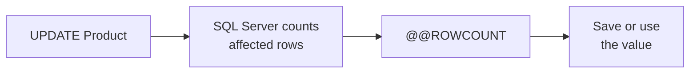

# Lab 0 – T-SQL Essentials

**Database:** `AdventureWorksENG`

This lab introduces a small set of T-SQL building blocks that will be
used throughout the course:

1. Batches and `GO`
2. Variables
3. Table variables
4. `IF / ELSE`
5. `SCOPE_IDENTITY()`
6. Inline type conversion with `CAST`
7. `WHILE` loops
8. `CASE WHEN`

These concepts are prerequisites for **Triggers (Lab 2)**, **Stored
Procedures (Lab 3)**, and **Functions (Lab 4)**.\
**Lab 7 – T-SQL Programming** continues with `CONVERT`, `FORMAT`, and
`TRY/CATCH`, building on the `WHILE` and `CASE` patterns introduced
here.

## Learning objectives

After completing this lab, you should be able to:

- explain what a batch is and what `GO` does;
- declare and assign T-SQL variables;
- declare and use table variables;
- use `IF / ELSE` with `BEGIN / END`;
- retrieve an identity value generated by an `INSERT`;
- convert numeric values to strings when building messages;
- repeat statements with `WHILE`, including `BREAK` and `CONTINUE`;
- compute a value based on conditions with `CASE WHEN`.

Start by selecting the database used in the exercises:

```sql
USE AdventureWorksENG;
GO
```

------------------------------------------------------------------------

## Section 1 – Batches and GO

A SQL script can contain many statements. Client tools such as SQL
Server Management Studio (SSMS) can divide those statements into
**batches**.

A batch is a group of T-SQL statements sent to SQL Server for execution
as one unit.

`GO` marks the end of a batch in tools such as SSMS.

> \[!IMPORTANT]
> `GO` is **not** a T-SQL statement. It is a batch
> separator recognized by client tools such as SSMS and `sqlcmd`.

### Identifying batches

Before running the following script, try to answer:

- How many batches are there?
- What separates one batch from the next?

```sql
SELECT TOP 3 *
FROM Customer;
GO

SELECT TOP 3 *
FROM Product;
GO

PRINT 'This is the third batch.';
GO
```

There are **three batches**.

Each `GO` marks the end of the current batch.

### Rules to remember

- `GO` ends the current batch.
- `GO` is not a T-SQL statement.
- Statements such as `CREATE VIEW`, `CREATE TRIGGER`, `CREATE PROCEDURE`, and `CREATE FUNCTION` have batch-placement rules. In our course scripts, we will separate these definitions into their own batches with `GO`.
- An error in one batch does not automatically mean that SSMS will stop sending later batches.

### Independent batches

Consider this safe example:

```sql
SELECT TOP 3 * FROM Customer;
GO
-- Batch 1: works

SELECT NonExistentColumn
FROM Customer;
GO
-- Batch 2: fails

PRINT 'Batch 3 still runs.';
GO
-- Batch 3: still runs
```

Batch 2 fails because the column does not exist, but SSMS can still
submit Batch 3.

> **Why this matters:** Do not assume that an error earlier in a
> multi-batch script automatically protects later statements from
> running.

### Check your understanding

1. Is `GO` a T-SQL statement?
2. What does `GO` do in SSMS?
3. If one batch fails, can a later batch still run?

<details>
<summary>Show answers</summary>

1. **No.** `GO` is a batch separator recognized by tools such as SSMS.
2. It marks the end of the current batch, which SSMS then sends to SQL Server.
3. **Yes.** A failure in one batch does not automatically prevent SSMS from submitting later batches.

</details>

------------------------------------------------------------------------

## Section 2 – Variables

Variables let us store a value and use it later in the same batch.

T-SQL variable names start with `@`.

Basic syntax:

```sql
DECLARE @VariableName data_type;
```

For example:

```sql
DECLARE @FirstName nvarchar(50);
```

Immediately after declaration, `@FirstName` contains `NULL` because no
value has been assigned yet.

You can also initialize a variable when declaring it:

```sql
DECLARE @FirstName nvarchar(50) = 'Ana';

PRINT @FirstName;
GO
```

### Variables and batch boundaries

Now that variables have been introduced, we can see an important consequence of `GO`:

```sql
DECLARE @Name nvarchar(50) = 'Ana';

PRINT @Name;
GO

PRINT @Name;
-- ERROR: @Name was declared in the previous batch
```

A local variable exists only in the batch in which it was declared.

### 1. Assign a value with SET

```sql
DECLARE @FirstName nvarchar(50);

SET @FirstName = 'Ana';

PRINT @FirstName;
GO
```

Use `SET` when you want to assign a value explicitly.

### 2. Assign a value from a scalar subquery

```sql
DECLARE @TotalSold int;

SET @TotalSold = (
    SELECT SUM(Quantity)
    FROM InvoiceItem
);

PRINT @TotalSold;
GO
```

The subquery used in this form must return **at most one value**:

- no rows -> the scalar subquery evaluates to `NULL`;
- one row -> the value is assigned;
- more than one row -> SQL Server raises an error.

Aggregate functions such as `SUM()` return a single result row, which
makes them convenient here.

### 3. Assign variables with SELECT

`SELECT` can assign several variables at once:

```sql
DECLARE @Name  nvarchar(50);
DECLARE @Color nvarchar(15);

SELECT
    @Name  = Name,
    @Color = Color
FROM Product
WHERE IDProduct = 999;

PRINT @Name;
PRINT @Color;
GO
```

> \[!WARNING]
This is convenient, but there are two important traps.

### Trap 1 – No rows

If a `SELECT` used for variable assignment returns **no rows**, the
variable keeps its previous value.

```sql
DECLARE @FirstName nvarchar(50) = 'Unknown';

SELECT @FirstName = FirstName
FROM Customer
WHERE IDCustomer = -1;

PRINT @FirstName;
GO
```

Assuming there is no customer with `IDCustomer = -1`, the result is:

```text
Unknown
```

The `SELECT` did **not** assign anything, so the previous value remained
unchanged.

If the variable had only been declared and never assigned, its previous
value would have been `NULL`.

### Trap 2 – Multiple rows

What happens here?

```sql
DECLARE @FirstName nvarchar(50);

SELECT @FirstName = FirstName
FROM Customer;

PRINT @FirstName;
GO
```

The variable is assigned repeatedly as rows are processed. After the
statement finishes, it contains the value assigned from the last row
processed.

However, SQL Server does **not** guarantee a useful row-processing order
here. Therefore, do not use this technique when the query may return
multiple rows and you care which row supplies the value.

> \[!IMPORTANT]
> **Rule of thumb:** When using `SELECT` to load variables, design the
> query so that it returns the single row you actually need.

### Common mistakes

- Forgetting the `@` prefix.
- Declaring a variable before `GO` and trying to use it after `GO`.
- Assuming that a `SELECT` returning no rows automatically sets a
    variable to `NULL`.
- Assuming that a multi-row `SELECT` gives a predictable row's value.

### Check your understanding

1. How do you declare an integer variable named `@Count`?
2. What value does a newly declared variable contain before assignment?
3. What happens if a scalar subquery returns more than one row?
4. What happens to an existing variable value if `SELECT @x = ...`
    returns no rows?

<details>
<summary>Show answers</summary>

1. `DECLARE @Count int;`
2. `NULL`.
3. SQL Server raises an error.
4. The variable keeps its previous value.

</details>

------------------------------------------------------------------------

## Section 3 – Table Variables

A normal variable stores a single value.

A **table variable** stores a set of rows and columns.

Its name also starts with `@`, but its type is defined using `TABLE`.

Basic syntax:

```sql
DECLARE @VariableName TABLE
(
    Column1 data_type,
    Column2 data_type
);
```

For example:

```sql
DECLARE @SelectedProducts TABLE
(
    IDProduct int,
    Name      nvarchar(100),
    Color     nvarchar(30)
);
```

The table variable now has a structure, but it does not contain any rows yet.

### Insert rows into a table variable

You can insert rows just as you would insert them into a regular table:

```sql
DECLARE @SelectedProducts TABLE
(
    IDProduct int,
    Name      nvarchar(100),
    Color     nvarchar(30)
);

INSERT INTO @SelectedProducts
(
    IDProduct,
    Name,
    Color
)
SELECT
    IDProduct,
    Name,
    Color
FROM Product
WHERE Color = 'Crna';

SELECT *
FROM @SelectedProducts;
GO
```

The result of the query is stored temporarily in `@SelectedProducts`.

You can then query the table variable again without repeating the original
query.

### Table variables and scope

Like scalar variables, table variables exist only within their scope.

For the examples in this lab, that means the current batch.

```sql
DECLARE @Numbers TABLE
(
    Value int
);

INSERT INTO @Numbers (Value)
VALUES (10), (20), (30);

SELECT *
FROM @Numbers;
GO

SELECT *
FROM @Numbers;
-- ERROR: @Numbers was declared in the previous batch
```

The `GO` starts a new batch, so the table variable no longer exists.

This is the same scope rule you already saw with scalar variables.

### Why use a table variable?

A table variable is useful when procedural T-SQL needs to work with a small
intermediate result set.

Typical uses include:

- storing rows temporarily inside a batch;
- collecting intermediate results;
- processing a set of values in a stored procedure;
- building the result of some user-defined functions.

Later, in **Lab 4 – Functions**, you will see this idea again when a function
builds and returns a table result.

> **Key idea:** A scalar variable stores one value. A table variable stores rows.

### Table variable or temporary table?

SQL Server also supports temporary tables such as:

```sql
CREATE TABLE #SelectedProducts
(
    IDProduct int,
    Name      nvarchar(100)
);
```

Both can store temporary rows, but they are different database objects and
have different capabilities.

For now, remember only this distinction:

```text
@TableVariable
    -> declared like a variable
    -> limited scope

#TemporaryTable
    -> created as a table
    -> covered later when needed
```

A table variable should not be thought of as a special "memory-only table".
SQL Server may still use `tempdb` internally.

### Check your understanding

1. What is the main difference between a scalar variable and a table variable?
2. Which symbol starts the name of a table variable?
3. Can a table variable contain multiple rows?
4. Can you use a table variable after the `GO` that ends its batch?
5. In which later lab will table variables appear again?

<details>
<summary>Show answers</summary>

1. A scalar variable stores one value, while a table variable stores rows and columns.
2. `@`.
3. Yes.
4. No. The new batch cannot access the table variable declared in the previous batch.
5. **Lab 4 – Functions**.

</details>

------------------------------------------------------------------------

## Section 4 – IF / ELSE

T-SQL supports conditional execution with `IF`, `ELSE IF`, and `ELSE`.

General structure:

```sql
IF condition
BEGIN
    – statements
END
ELSE IF another_condition
BEGIN
    – statements
END
ELSE
BEGIN
    – statements
END
```

Example:

```sql
DECLARE @CustomerCount int;

SELECT @CustomerCount = COUNT(*)
FROM Customer;

IF @CustomerCount >= 20000
BEGIN
    PRINT 'We have at least 20000 customers.';
END
ELSE
BEGIN
    PRINT 'We are still under 20000 customers.';
END
GO
```

### Why use BEGIN and END?

For a branch containing only one statement, T-SQL technically allows
this:

```sql
IF @CustomerCount >= 20000
    PRINT 'Large customer table';
```

However, using `BEGIN ... END` consistently is safer:

```sql
IF @CustomerCount >= 20000
BEGIN
    PRINT 'Large customer table';
END
```

Without `BEGIN ... END`, only the **next statement** belongs to the
`IF`. Adding another statement later can silently change the intended
logic.

> \[!TIP]
> **Recommended habit:** Always use `BEGIN ... END` for `IF / ELSE`
> branches.

### Check your understanding

1. What do `BEGIN` and `END` do in an `IF` statement?
2. Are they required when a branch contains only one statement?
3. Why is it still a good idea to use them?

<details>
<summary>Show answers</summary>

1. They group multiple statements into one branch.
2. No, not when the branch contains only one statement.
3. They make the structure explicit and prevent bugs if more statements
    are added later.

</details>

------------------------------------------------------------------------

## Section 5 – SCOPE_IDENTITY()

Tables often use an `IDENTITY` column to generate IDs automatically.

For example, when we insert a new state, SQL Server generates its
`IDState`:

```sql
INSERT INTO State (Name)
VALUES ('India');
```

But what if the next statement needs the ID that SQL Server generated?

That is a common use case for `SCOPE_IDENTITY()`.

### Basic example

```sql
DECLARE @StateID int;

INSERT INTO State (Name)
VALUES ('India');

SET @StateID = SCOPE_IDENTITY();

PRINT @StateID;

-- Cleanup
DELETE FROM State
WHERE Name = 'India';
```

`SCOPE_IDENTITY()` returns the most recent identity value generated in
the **current session and current scope**.

Storing it immediately makes the code clear and ensures that later work
in the same scope does not replace the identity value you intended to
keep.

### Using the generated ID

The new ID can now be used as a foreign key:

```sql
DECLARE @StateID int;

INSERT INTO State (Name)
VALUES ('India');

SET @StateID = SCOPE_IDENTITY();

INSERT INTO City (Name, StateID)
VALUES
    ('Agra',  @StateID),
    ('Delhi', @StateID);

SELECT *
FROM City
WHERE StateID = @StateID;

-- Cleanup
DELETE FROM City
WHERE StateID = @StateID;

DELETE FROM State
WHERE IDState = @StateID;
GO
```

Both cities reference exactly the state inserted by this batch.

> \[!IMPORTANT]
> This example demonstrates how to reuse a generated ID.
> It does not by itself make the statements one atomic transaction.
> Transactions are covered separately.

### Scope and concurrent sessions

Imagine two users inserting rows at nearly the same time:

```text
Session A                         Session B
---------                         ---------
INSERT new State
generated ID = 10

                                  INSERT new State
                                  generated ID = 11

SCOPE_IDENTITY() -> 10            SCOPE_IDENTITY() -> 11
```

Session B does not change what Session A sees through
`SCOPE_IDENTITY()`.

That is because `SCOPE_IDENTITY()` is limited to the **current session
and scope**.

### Similar identity functions

SQL Server also provides other identity functions:

- `@@IDENTITY` returns the most recent identity generated in the
    current session, across scopes. A trigger can therefore affect its
    result.
- `IDENT_CURRENT('TableName')` returns the most recent identity
    generated for a specific table, regardless of session or scope.

For the parent-row/child-row pattern used here, `SCOPE_IDENTITY()` is
the appropriate choice.

> \[!TIP]
> **Good practice:** Capture the value immediately after the `INSERT`
> whose generated identity you need.

### Check your understanding

1. What does `SCOPE_IDENTITY()` return?
2. Can another user's session change the value returned by your
    `SCOPE_IDENTITY()`?
3. Why can `@@IDENTITY` produce an unexpected value when triggers are
    involved?
4. Does using `SCOPE_IDENTITY()` automatically create a transaction?

<details>
<summary>Show answers</summary>

1. The most recent identity value generated in the current session and
    current scope.
2. No.
3. `@@IDENTITY` can see identity values generated in another scope in
    the same session, including a trigger.
4. No. `SCOPE_IDENTITY()` retrieves an identity value; it does not
    provide transaction handling.

</details>

------------------------------------------------------------------------

## Section 6 – Inline Type Conversion

Soon we will build messages that combine text with numeric values.

Consider this example:

```sql
DECLARE @Count int = 42;

PRINT 'Row count: ' + @Count;
```

This fails.

Why?

SQL Server applies **data type precedence** when an expression contains
different data types. `int` has higher precedence than `varchar`, so SQL
Server tries to convert the text `'Row count: '` to an integer.

That conversion is impossible, so the statement fails.

### The fix – CAST

Convert the integer to a string explicitly:

```sql
DECLARE @Count int = 42;

PRINT 'Row count: ' + CAST(@Count AS nvarchar(10));
GO
```

Result:

```text
Row count: 42
```

General syntax:

```sql
CAST(value AS data_type)
```

A pattern you will see in later labs is:

```sql
PRINT 'Something happened: ID = '
    + CAST(@SomeInt AS nvarchar(10));
```

### CAST, CONVERT, and FORMAT

For now, `CAST` is enough for the examples used in Labs 2--4.

You should also know that SQL Server provides:

- `CAST(value AS type)` – standard SQL type conversion;
- `CONVERT(type, value, style)` – SQL Server conversion function that
    also supports style codes, useful for dates;
- `FORMAT(value, pattern)` – formatting based on .NET format
    patterns.

Examples:

```sql
SELECT CAST(42 AS nvarchar(10));

SELECT CONVERT(nvarchar(23), GETDATE(), 121);
-- Example: 2026-10-01 19:30:15.123

SELECT FORMAT(GETDATE(), 'dd.MM.yyyy');
-- Example: 01.10.2026
```

### Check your understanding

1. Why does `PRINT 'ID = ' + @SomeInt` fail?
2. How can you fix it with `CAST`?
3. Which function supports SQL Server style codes for date/time
    conversion?

<details>
<summary>Show answers</summary>

1. Because SQL Server follows data type precedence and attempts an
    incompatible implicit conversion.
2. Convert the integer first:
    `PRINT 'ID = ' + CAST(@SomeInt AS nvarchar(10));`
3. `CONVERT`.

</details>

------------------------------------------------------------------------

## Section 7 – WHILE Loops

T-SQL supports repetition with `WHILE`. The statements inside the loop
run as long as the condition is `TRUE`.

> \[!NOTE]
> **No `FOR` loop:** Unlike many programming languages, T-SQL has no
> `FOR` loop. `WHILE` is the only general-purpose loop construct.

General structure:

```sql
WHILE condition
BEGIN
    -- statements
END
```

### Basic example

```sql
DECLARE @Counter int = 1;

WHILE @Counter <= 5
BEGIN
    PRINT @Counter;
    SET @Counter = @Counter + 1;
END
GO
```

This prints the numbers 1 through 5.

> \[!IMPORTANT]
> Something inside the loop must eventually make the
> condition `FALSE`. If `@Counter` were never incremented, the loop
> would run forever.

### BREAK and CONTINUE

- `BREAK` exits the loop immediately, skipping any remaining
    statements in the loop body.
- `CONTINUE` skips the rest of the current iteration and jumps back to
    re-evaluate the `WHILE` condition.

```sql
DECLARE @Counter int = 0;

WHILE @Counter < 10
BEGIN
    SET @Counter = @Counter + 1;

    IF @Counter = 3
    BEGIN
        CONTINUE;
    END

    IF @Counter = 7
    BEGIN
        BREAK;
    END

    PRINT @Counter;
END
GO
```

This prints `1, 2, 4, 5, 6`. `3` is skipped because of `CONTINUE`, and
the loop stops before printing `7` because of `BREAK`.

### Combining WHILE with a table variable

`WHILE` is sometimes combined with a table variable to process rows
one at a time:

```sql
DECLARE @Products TABLE
(
    RowID     int IDENTITY(1,1),
    IDProduct int,
    Name      nvarchar(100)
);

INSERT INTO @Products (IDProduct, Name)
SELECT TOP 5
    IDProduct,
    Name
FROM Product
ORDER BY IDProduct;

DECLARE @Counter    int = 1;
DECLARE @RowCount   int;
DECLARE @CurrentName nvarchar(100);

SELECT @RowCount = MAX(RowID)
FROM @Products;

WHILE @Counter <= @RowCount
BEGIN
    SELECT @CurrentName = Name
    FROM @Products
    WHERE RowID = @Counter;

    PRINT @CurrentName;

    SET @Counter = @Counter + 1;
END
GO
```

> \[!NOTE]
> A plain `SELECT` is normally the better tool for working
> with a set of rows. `WHILE` becomes useful when the task is genuinely
> iterative (for example, generating a sequence of values, or repeating
> an action until a condition changes), not as a row-by-row replacement
> for set-based queries.

### A realistic (but uncommon) use case – batch deletes

Deleting a very large number of rows with a single `DELETE` statement
can hold locks for a long time and cause the transaction log to grow
significantly. A common technique is to delete the rows in small
batches instead:

```sql
-- Illustrative pattern – do not run against AdventureWorksENG
DECLARE @RowsDeleted int = 1;

WHILE @RowsDeleted > 0
BEGIN
    DELETE TOP (1000)
    FROM SomeLargeTable
    WHERE SomeCondition;

    SET @RowsDeleted = @@ROWCOUNT;
END
```

`@@ROWCOUNT` returns the number of rows affected by the previous
statement. Each iteration deletes at most 1000 rows; the loop stops
once a batch deletes zero rows, meaning nothing matching the condition
is left.

This is one of the few situations where reaching for `WHILE` is
standard practice. It is still the exception rather than the rule —
most day-to-day T-SQL work remains set-based.

### Check your understanding

1. What must happen inside a `WHILE` loop to avoid an infinite loop?
2. What does `BREAK` do?
3. What does `CONTINUE` do?
4. Should `WHILE` normally be your first choice for processing the rows
    of a table?
5. Does T-SQL have a `FOR` loop?
6. In the batch-delete pattern above, how does the loop know when to
    stop?

<details>
<summary>Show answers</summary>

1. Something in the loop body must eventually make the condition
    `FALSE`.
2. It exits the loop immediately.
3. It skips the rest of the current iteration and jumps back to the
    `WHILE` condition.
4. No. A set-based `SELECT` is normally preferred; `WHILE` is for tasks
    that are inherently iterative.
5. No. `WHILE` is the only general-purpose loop construct in T-SQL.
6. `@@ROWCOUNT` is checked after each `DELETE`; once a batch deletes
    zero rows, the condition `@RowsDeleted > 0` becomes `FALSE` and the
    loop stops.

</details>

------------------------------------------------------------------------

## Section 8 – CASE Expressions

In SQL, we often need to return different values depending on certain conditions.

For example, we might want to:

- convert stored codes into readable descriptions;
- classify products into price categories;
- calculate discounts based on product prices;
- count rows that satisfy specific conditions;
- sort results according to custom business rules.

T-SQL provides the `CASE` expression for these situations.

> [!IMPORTANT]
> **`CASE` is an expression, not a control-of-flow statement.**
>
> It evaluates conditions and returns a value.
>
> This makes it particularly useful inside SQL queries.

---

### 1. Simple CASE

The simplest form of `CASE` compares one expression against a list of possible values.

General syntax:

```sql
CASE expression
    WHEN value1 THEN result1
    WHEN value2 THEN result2
    ELSE default_result
END
```

Consider the `Product` table.

Products have a `Color` column containing values such as `'Crna'` and `'Žuta'`.

Suppose we want to display a more general color category.

```sql
SELECT
    Name,
    Color,
    CASE Color
        WHEN 'Crna' THEN 'Dark'
        WHEN 'Žuta' THEN 'Light'
        ELSE 'Other'
    END AS ColorGroup
FROM Product;
```

SQL Server compares the value of `Color` with each `WHEN` value.

For example:

| Color | ColorGroup |
|---|---|
| Crna | Dark |
| Žuta | Light |
| Crvena | Other |

The original value stored in the table does not change.

`CASE` only determines the value returned by the query.

> [!TIP]
> This is a common reporting technique.
>
> Databases often store short codes, while reports display more meaningful descriptions.

---

### 2. Searched CASE

The second form is called **searched CASE**.

Instead of comparing one expression with fixed values, each `WHEN` contains its own condition.

General syntax:

```sql
CASE
    WHEN condition1 THEN result1
    WHEN condition2 THEN result2
    ELSE default_result
END
```

This is particularly useful when working with numeric ranges.

#### Example – Product price categories

Suppose we want to classify products according to their prices.

```sql
SELECT
    IDProduct,
    Name,
    PriceWithoutVAT,
    CASE
        WHEN PriceWithoutVAT < 10 THEN 'Cheap'
        WHEN PriceWithoutVAT < 100 THEN 'Medium'
        ELSE 'Expensive'
    END AS PriceCategory
FROM Product;
```

The query assigns a category to each product:

| PriceWithoutVAT | PriceCategory |
|---:|---|
| 5.00 | Cheap |
| 45.00 | Medium |
| 150.00 | Expensive |

Notice that the `CASE` expression is evaluated separately for each returned row.

> [!IMPORTANT]
> **The order of `WHEN` conditions matters.**
>
> SQL Server uses the result associated with the first satisfied condition.
>
> Once a matching condition is found, later conditions do not determine the result.

Consider this example:

```sql
SELECT
    Name,
    PriceWithoutVAT,
    CASE
        WHEN PriceWithoutVAT < 100 THEN 'Below 100'
        WHEN PriceWithoutVAT < 10 THEN 'Below 10'
        ELSE '100 or more'
    END AS PriceCategory
FROM Product;
```

What happens when the price is `5`?

The result is `'Below 100'`.

The second condition is never selected because the first condition already matches.

> [!WARNING]
> When conditions overlap, their order can change the result.
>
> Always place more specific conditions before more general ones when necessary.

---

### 3. Conditional Calculations

`CASE` does not have to return text.

It can also return numbers or the results of calculations.

#### Example – Applying a discount

Suppose products costing at least 100 receive a 10% discount.

```sql
SELECT
    Name,
    PriceWithoutVAT,
    CASE
        WHEN PriceWithoutVAT >= 100
            THEN PriceWithoutVAT * 0.90
        ELSE PriceWithoutVAT
    END AS DiscountedPrice
FROM Product;
```

The expression returns:

- 90% of the original price when the product costs at least 100;
- the original price otherwise.

For example:

| PriceWithoutVAT | DiscountedPrice |
|---:|---:|
| 50.00 | 50.00 |
| 100.00 | 90.00 |
| 200.00 | 180.00 |

> [!NOTE]
> This query does not update product prices.
>
> The discount is calculated only in the query result.

#### Multiple discount levels

We can extend the example:

```sql
SELECT
    Name,
    PriceWithoutVAT,
    CASE
        WHEN PriceWithoutVAT >= 500 THEN PriceWithoutVAT * 0.80
        WHEN PriceWithoutVAT >= 100 THEN PriceWithoutVAT * 0.90
        ELSE PriceWithoutVAT
    END AS DiscountedPrice
FROM Product;
```

The discount now depends on the price:

| Price | Discount |
|---|---|
| 500 or more | 20% |
| 100–499.99 | 10% |
| Below 100 | No discount |

Notice that the highest price range is checked first.

---

### 4. CASE with Aggregate Functions

Another common use of `CASE` is **conditional aggregation**.

Suppose we want to count how many products belong to different price categories.

We can combine `CASE` with `SUM()`:

```sql
SELECT
    COUNT(*) AS TotalProducts,

    SUM(
        CASE
            WHEN PriceWithoutVAT < 100 THEN 1
            ELSE 0
        END
    ) AS ProductsBelow100,

    SUM(
        CASE
            WHEN PriceWithoutVAT >= 100 THEN 1
            ELSE 0
        END
    ) AS Products100OrMore

FROM Product;
```

How does this work?

Consider the following expression:

```sql
CASE
    WHEN PriceWithoutVAT < 100 THEN 1
    ELSE 0
END
```

For each product:

- it returns `1` if the price is below 100;
- otherwise, it returns `0`.

`SUM()` then adds these values.

For example:

| Product | Price | CASE result |
|---|---:|---:|
| A | 50 | 1 |
| B | 150 | 0 |
| C | 75 | 1 |
| D | 200 | 0 |

The sum is `2`.

Therefore, two products cost less than 100.

> [!TIP]
> Conditional aggregation is extremely common in SQL reports.
>
> It allows us to calculate several statistics in a single query.

---

### 5. CASE in ORDER BY

Normally, SQL sorts results using the values of one or more columns.

However, sometimes we need a custom sorting order.

For example, suppose we want to display:

1. Expensive products first.
2. Medium-priced products second.
3. Cheap products last.

We can use `CASE` inside `ORDER BY`.

```sql
SELECT
    Name,
    PriceWithoutVAT
FROM Product
ORDER BY
    CASE
        WHEN PriceWithoutVAT >= 100 THEN 1
        WHEN PriceWithoutVAT >= 10 THEN 2
        ELSE 3
    END,
    PriceWithoutVAT DESC;
```

The `CASE` expression produces a sorting priority.

| Price | Sorting priority |
|---:|---:|
| 150 | 1 |
| 50 | 2 |
| 5 | 3 |

SQL Server sorts by this priority first.

Within each category, products are sorted by price in descending order.

> [!NOTE]
> `CASE` can be used in many places where SQL expects an expression, including `SELECT`, `ORDER BY`, and expressions within other SQL statements.

---

### 6. CASE vs. IF...ELSE

Both `CASE` and `IF...ELSE` evaluate conditions, but they serve different purposes.

The distinction is important:

**`CASE` returns a value.**

**`IF...ELSE` controls which SQL statements are executed.**

#### CASE – Choosing a value

```sql
SELECT
    Name,
    PriceWithoutVAT,
    CASE
        WHEN PriceWithoutVAT < 100 THEN 'Affordable'
        ELSE 'Expensive'
    END AS PriceCategory
FROM Product;
```

Here, `CASE` calculates a value for every product returned by the query.

#### IF...ELSE – Choosing which code executes

```sql
DECLARE @ProductCount int;

SELECT @ProductCount = COUNT(*)
FROM Product;

IF @ProductCount > 100
BEGIN
    PRINT 'The database contains more than 100 products.';
END
ELSE
BEGIN
    PRINT 'The database contains 100 products or fewer.';
END;
GO
```

Here, `IF...ELSE` determines which `PRINT` statement executes.

#### Where are they commonly used?

| CASE | IF...ELSE |
|---|---|
| Returns a value | Controls execution |
| Commonly used inside queries | Commonly used in procedural T-SQL |
| Can calculate a result for each row | Evaluates a condition to choose statements |
| Useful in reports and calculations | Useful in procedures, functions, triggers, and scripts |

> [!IMPORTANT]
> **Need to choose a value? Use `CASE`.**
>
> **Need to choose which SQL statements execute? Use `IF...ELSE`.**

Stored procedures, functions, and triggers can use both constructs.

For example, a stored procedure might use `IF...ELSE` to decide whether to perform an operation and `CASE` inside a query to calculate values.

---

### 7. CASE and NULL

There is one more important rule.

The `ELSE` branch is optional.

If no `WHEN` condition matches and `ELSE` is omitted, `CASE` returns `NULL`.

```sql
SELECT
    CASE
        WHEN 1 = 2 THEN 'Yes'
    END AS Result;
```

Result:

```text
NULL
```

We can provide a default value using `ELSE`:

```sql
SELECT
    CASE
        WHEN 1 = 2 THEN 'Yes'
        ELSE 'No'
    END AS Result;
```

Result:

```text
No
```

> [!TIP]
> Including `ELSE` makes the intended default behavior explicit.
>
> It is especially useful when unexpected or missing values may occur.

---

### Check your understanding

1. What is the main difference between `CASE` and `IF...ELSE`?
2. What is the difference between simple `CASE` and searched `CASE`?
3. Why does the order of `WHEN` conditions matter?
4. Can `CASE` return a numeric value?
5. Can `CASE` be used inside `ORDER BY`?
6. What does `CASE` return when no condition matches and `ELSE` is omitted?
7. Why might we combine `CASE` with `SUM()`?

<details>
<summary>Show answers</summary>

1. `CASE` returns a value, while `IF...ELSE` controls which SQL statements execute.
2. Simple `CASE` compares one expression against possible values. Searched `CASE` evaluates separate conditions.
3. The first satisfied condition determines the result.
4. Yes. `CASE` can return numbers, text, dates, or other compatible values.
5. Yes. It can define custom sorting priorities.
6. `NULL`.
7. To count or sum values that satisfy specific conditions.

</details>

---

### Key takeaways

- `CASE` is an expression that returns a value.
- Simple `CASE` compares one expression with possible values.
- Searched `CASE` evaluates multiple conditions.
- The order of `WHEN` conditions matters.
- `CASE` can return calculated values, not just text.
- `CASE` is commonly used in `SELECT`, `ORDER BY`, and conditional aggregation.
- `CASE` and `IF...ELSE` serve different purposes.
- `CASE` returns `NULL` when no condition matches and no `ELSE` is provided.

--

## Section 9 - `SET NOCOUNT ON` and `@@ROWCOUNT`

When SQL Server executes a statement that affects data, it keeps track of how many rows were affected.

By default, SQL Server also sends this information to the client.

For example:

```sql
UPDATE Product
SET PriceWithoutVAT = PriceWithoutVAT * 1.10
WHERE IDProduct <= 5;
```

In the **Messages** tab, you will see something similar to:

```text
(4 rows affected)
```

This tells us that the `UPDATE` statement affected 5 rows.

---

### `@@ROWCOUNT`

SQL Server also makes the number of rows affected by the previous statement available through the system variable `@@ROWCOUNT`.

For example:

```sql
UPDATE Product
SET PriceWithoutVAT = PriceWithoutVAT * 1.10
WHERE IDProduct <= 5;

SELECT @@ROWCOUNT AS RowsAffected;
```

Example result:

| RowsAffected |
|---:|
| 4 |

`@@ROWCOUNT` is automatically updated by SQL Server after a statement executes.

It can be used after statements such as:

```sql
SELECT
INSERT
UPDATE
DELETE
```

For example, after a `DELETE`:

```sql
DELETE FROM Product
WHERE MinimumQuantityInStock = 45;

SELECT @@ROWCOUNT AS DeletedRows;
```

If three products were deleted, the result is:

| DeletedRows |
|---:|
| 5 |

This can be useful when our SQL code needs to know whether a statement actually affected any rows.

For example:

```sql
UPDATE Product
SET MinimumQuantityInStock = MinimumQuantityInStock * 1.10
WHERE IDProduct = 99999;

IF @@ROWCOUNT = 0
    PRINT 'No product was updated.';
```

### Read `@@ROWCOUNT` immediately

There is one important rule:

> **Read or save `@@ROWCOUNT` immediately after the statement you are interested in.**

Other statements can change its value.

For example, this is correct:

```sql
UPDATE Product
SET PriceWithoutVAT = PriceWithoutVAT * 1.10
WHERE IDProduct <= 5;

DECLARE @RowsUpdated int = @@ROWCOUNT;

SELECT @RowsUpdated AS RowsUpdated;
```

We save the value immediately after the `UPDATE`.

Conceptually:



---

### `SET NOCOUNT ON`

Although SQL Server keeps track of the affected rows, we do not always need the `(n rows affected)` message to be sent to the client.

We can suppress these messages using:

```sql
SET NOCOUNT ON;
```

Try the following:

```sql
SET NOCOUNT ON;

UPDATE Product
SET PriceWithoutVAT = PriceWithoutVAT
WHERE IDProduct <= 5;
```

The `(5 rows affected)` message is no longer sent to the client.

This is particularly useful in **stored procedures and triggers**, which may execute several SQL statements. Sending a row-count message after every statement is usually unnecessary.

> \[!IMPORTANT]
> `SET NOCOUNT ON` does not stop SQL Server from counting affected rows. It only prevents the `(n rows affected)` message from being sent to the client.

Therefore, `@@ROWCOUNT` still works:

```sql
SET NOCOUNT ON;

UPDATE Product
SET PriceWithoutVAT = PriceWithoutVAT
WHERE IDProduct <= 5;

SELECT @@ROWCOUNT AS RowsAffected;
```

Example result:

| RowsAffected |
|---:|
| 4 |

The difference is:

| Feature | Purpose |
|---|---|
| `@@ROWCOUNT` | Tells our SQL code how many rows were affected by the previous statement |
| `SET NOCOUNT ON` | Prevents SQL Server from sending `(n rows affected)` messages to the client |

These two features are therefore independent:

```text
UPDATE affects 5 rows
        |
        +--> @@ROWCOUNT = 5
        |
        +--> "(5 rows affected)" message
                    |
                    └── suppressed by SET NOCOUNT ON
```

---

### Why will we use `SET NOCOUNT ON`?

You will frequently see the following pattern in later labs:

```sql
CREATE OR ALTER PROCEDURE ...
AS
BEGIN
    SET NOCOUNT ON;

    -- procedure code
END;
```

The same pattern is commonly used in triggers.

The procedure or trigger can still use `@@ROWCOUNT` when it needs to know how many rows were affected.

### Turn `NOCOUNT` back off

`SET NOCOUNT` applies to the current session.

For the remaining examples in this lab, turn the row-count messages back on:

```sql
SET NOCOUNT OFF;
```

This allows you to continue seeing `(n rows affected)` messages while experimenting with SQL statements.

### Key takeaways

- SQL Server keeps track of how many rows are affected by a statement.
- `@@ROWCOUNT` provides the number of rows affected by the previous statement.
- Read or save `@@ROWCOUNT` immediately after the statement you want to check.
- `SET NOCOUNT ON` suppresses the `(n rows affected)` messages sent to the client.
- `SET NOCOUNT ON` does **not** affect the value of `@@ROWCOUNT`.
- `SET NOCOUNT ON` is commonly used in stored procedures and triggers.

------------------------------------------------------------------------

# Exercises

Try each exercise before opening the solution.

## Exercise 1 – Variables from a table

Declare `@FirstName` and `@LastName`.

Load their values from `Customer` for `IDCustomer = 1`, then print both
values.

<details>
<summary>Show solution</summary>

```sql
DECLARE @FirstName nvarchar(50);
DECLARE @LastName  nvarchar(50);

SELECT
    @FirstName = FirstName,
    @LastName  = LastName
FROM Customer
WHERE IDCustomer = 1;

PRINT @FirstName;
PRINT @LastName;
GO
```

</details>

------------------------------------------------------------------------

## Exercise 2 – The no-row trap

What will the following script print if no customer has
`IDCustomer = -1`?

Try to predict the result before running it.

```sql
DECLARE @FirstName nvarchar(50) = 'Unknown';

SELECT @FirstName = FirstName
FROM Customer
WHERE IDCustomer = -1;

PRINT @FirstName;
GO
```

<details>
<summary>Show answer</summary>

It prints:

```text
Unknown
```

The `SELECT` returned no rows, so no assignment took place. The variable
kept its previous value.

</details>

------------------------------------------------------------------------

## Exercise 3 – The multi-row trap

Modify Exercise 1 by removing the `WHERE` clause so that the query reads
all customers.

What happens to `@FirstName` and `@LastName`?

Can you safely predict which customer's values will remain in the
variables?

<details>
<summary>Show solution</summary>

```sql
DECLARE @FirstName nvarchar(50);
DECLARE @LastName  nvarchar(50);

SELECT
    @FirstName = FirstName,
    @LastName  = LastName
FROM Customer;

PRINT @FirstName;
PRINT @LastName;
GO
```

The variables are assigned repeatedly as rows are processed.

The final values come from the last row processed, but you should **not
rely on which row that will be**. If you need one specific customer,
write the query so that it identifies that row explicitly.

</details>

------------------------------------------------------------------------

## Exercise 4 – Table variable

Declare a table variable named `@Products`.

It should contain:

- `IDProduct`;
- `Name`;
- `Color`.

Insert all black products from `Product` into the table variable.

Then return the rows from `@Products`.

<details>
<summary>Show solution</summary>

```sql
DECLARE @Products TABLE
(
    IDProduct int,
    Name      nvarchar(100),
    Color     nvarchar(30)
);

INSERT INTO @Products
(
    IDProduct,
    Name,
    Color
)
SELECT
    IDProduct,
    Name,
    Color
FROM Product
WHERE Color = 'Black';

SELECT *
FROM @Products;
GO
```

</details>

------------------------------------------------------------------------

## Exercise 5 – IF / ELSE

Count the rows in `Customer`.

If there are more than `20000` customers, print:

```text
Big database
```

Otherwise print:

```text
Still growing
```

<details>
<summary>Show solution</summary>

```sql
DECLARE @Count int;

SELECT @Count = COUNT(*)
FROM Customer;

IF @Count > 20000
BEGIN
    PRINT 'Big database';
END
ELSE
BEGIN
    PRINT 'Still growing';
END
GO
```

</details>

------------------------------------------------------------------------

## Exercise 6 – SCOPE_IDENTITY()

Insert a new state named `'India'`.

1. Capture its generated ID in `@StateID`.
2. Insert two cities, `'Agra'` and `'Delhi'`, that reference the new
    state.
3. Select the two cities to verify the result.
4. Clean up the inserted data.

<details>
<summary>Show solution</summary>

```sql
DECLARE @StateID int;

INSERT INTO State (Name)
VALUES ('India');

SET @StateID = SCOPE_IDENTITY();

INSERT INTO City (Name, StateID)
VALUES
    ('Agra',  @StateID),
    ('Delhi', @StateID);

SELECT *
FROM City
WHERE StateID = @StateID;

-- Cleanup
DELETE FROM City
WHERE StateID = @StateID;

DELETE FROM State
WHERE IDState = @StateID;
GO
```

</details>

------------------------------------------------------------------------

## Exercise 7 – Put it together

Create a small script that combines several concepts from this lab.

1. Declare `@StateID`.
2. Insert a state named `'Portugal'`.
3. Store the generated ID in `@StateID`.
4. If `@StateID` is not `NULL`, print:

```text
New state ID: X
```

where `X` is the generated ID.

5. Insert `'Lisbon'` into `City` using the new `@StateID`.
6. Select the new state and city.
7. Clean up.

<details>
<summary>Show solution</summary>

```sql
DECLARE @StateID int;

INSERT INTO State (Name)
VALUES ('Portugal');

SET @StateID = SCOPE_IDENTITY();

IF @StateID IS NOT NULL
BEGIN
    PRINT 'New state ID: '
        + CAST(@StateID AS nvarchar(10));

    INSERT INTO City (Name, StateID)
    VALUES ('Lisbon', @StateID);
END

SELECT
    s.IDState,
    s.Name AS StateName,
    c.Name AS CityName
FROM State AS s
LEFT JOIN City AS c
    ON c.StateID = s.IDState
WHERE s.IDState = @StateID;

-- Cleanup
DELETE FROM City
WHERE StateID = @StateID;

DELETE FROM State
WHERE IDState = @StateID;
GO
```

</details>

------------------------------------------------------------------------

## Exercise 8 – WHILE loop

Use a `WHILE` loop to print the square of each number from 1 to 5
(`1, 4, 9, 16, 25`).

<details>
<summary>Show solution</summary>

```sql
DECLARE @Counter int = 1;

WHILE @Counter <= 5
BEGIN
    PRINT CAST(@Counter * @Counter AS nvarchar(10));
    SET @Counter = @Counter + 1;
END
GO
```

</details>

------------------------------------------------------------------------

## Exercise 9 – CASE WHEN

Write a query against `Product` that returns `IDProduct`, `Name`, and
`Color`, together with a new column `ColorGroup`:

- `'Black'` or `'Silver'` -> `'Neutral'`
- `'Red'` or `'Blue'` -> `'Bold'`
- anything else -> `'Other'`

<details>
<summary>Show solution</summary>

```sql
SELECT
    IDProduct,
    Name,
    Color,
    CASE
        WHEN Color IN ('Black', 'Silver') THEN 'Neutral'
        WHEN Color IN ('Red', 'Blue')     THEN 'Bold'
        ELSE 'Other'
    END AS ColorGroup
FROM Product;
GO
```

</details>

------------------------------------------------------------------------

# What you should know after this lab

You should now be able to recognize and use these patterns:

```sql
-- Batch boundary
GO

-- Variable
DECLARE @ID int;

-- Assignment
SET @ID = 10;

-- Assignment from a query
SELECT @ID = IDState
FROM State
WHERE Name = 'Example';

-- Table variable
DECLARE @IDs TABLE
(
    ID int
);

INSERT INTO @IDs (ID)
VALUES (1), (2), (3);

-- Conditional logic
IF @ID IS NOT NULL
BEGIN
    PRINT 'ID = ' + CAST(@ID AS nvarchar(10));
END

-- Capture a generated identity
INSERT INTO State (Name)
VALUES ('Example');

SET @ID = SCOPE_IDENTITY();

-- Loop
DECLARE @Counter int = 1;

WHILE @Counter <= 5
BEGIN
    PRINT @Counter;
    SET @Counter = @Counter + 1;
END

-- CASE expression
SELECT
    CASE
        WHEN @ID IS NULL THEN 'Unknown'
        ELSE 'Known'
    END AS Status;
```

You do not need to memorize every detail. You should understand what
each construct does and be able to recognize it when it appears in later
labs.

# Where to go next

These building blocks will reappear throughout the course:

- **Lab 2 – Triggers**: batches, variables, `IF / ELSE`, and `CAST`
    in messages;
- **Lab 3 – Stored Procedures**: batches, variables, control flow,
    identity handling, and type conversion;
- **Lab 4 – Functions**: variables, table variables, control flow, and
    type handling;
- **Lab 7 – T-SQL Programming**: `CONVERT`, `FORMAT`, `TRY/CATCH`, and
    more complete procedural T-SQL, building on the `WHILE` and `CASE`
    patterns from this lab.

If any of these concepts becomes unclear later, return to this lab and
run the examples again.
