# Lab 3 – Stored Procedures

**Database:** `AdventureWorksENG`

A stored procedure is a named program stored in the database. Unlike a view, which represents a query, a stored procedure can accept parameters, execute multiple SQL statements, modify data, and return information to the caller.

Stored procedures are especially useful when several SQL statements together represent a single database operation.

> [!IMPORTANT]
> **Core idea:** A stored procedure packages a database operation behind a name and parameters.

---

## Learning objectives

After completing this lab, you should be able to:

- explain when stored procedures are useful;
- create, execute, modify, and remove stored procedures;
- define and use input parameters;
- return values using result sets, output parameters, and `RETURN`;
- use several SQL statements to implement one logical database operation.

Start by selecting the training database:

```sql
USE AdventureWorksENG;
GO
```

> [!NOTE]
> **Prerequisites:** This lab assumes that you are already familiar with batches and `GO`, variables, `IF / ELSE`, `SCOPE_IDENTITY()`, and basic `CAST` expressions from Lab 00.

---

# Section 1 – What is a Stored Procedure?

A **stored procedure** is a named block of T-SQL code stored inside the database and executed explicitly by a user or an application.

A useful way to compare the database objects introduced so far is:

| Object | Main idea | How it is used |
|---|---|---|
| View | reusable query | queried with `SELECT` |
| Trigger | automatic reaction | executed automatically after an event |
| Stored procedure | callable database operation | executed with `EXEC` |

A procedure can contain multiple statements and can use variables, conditions, `SELECT`, `INSERT`, `UPDATE`, `DELETE`, and other T-SQL constructs.

```text
Views answer.
Triggers react.
Procedures do.
```

## Why use stored procedures?

Imagine that an application needs to transfer money from one account to another.

The operation may require several steps:

```text
Transfer money
    |
    +-- check the source account
    +-- check the destination account
    +-- validate the amount
    +-- subtract money from the source account
    +-- add money to the destination account
```

Without a stored procedure, some or all of these SQL statements may be issued separately by the application.

With a stored procedure, the application can request the complete operation with one call:

```sql
EXEC dbo.usp_TransferMoney
    @FromAccount = 100,
    @ToAccount   = 101,
    @Amount      = 3000;
```

The implementation remains inside the database.

This gives us several practical benefits.

### Encapsulation

A stored procedure hides the implementation details of a database operation behind a name and a set of parameters.

For example, an application requests a money transfer by providing the source account, destination account, and amount. It does not need to know which tables to read, how to check the balance, or which `UPDATE` statements to execute. These steps are implemented inside the procedure.

The caller needs to know how to call the procedure and interpret its result. The implementation can change without requiring changes to the caller, as long as the parameters and expected behavior remain compatible.

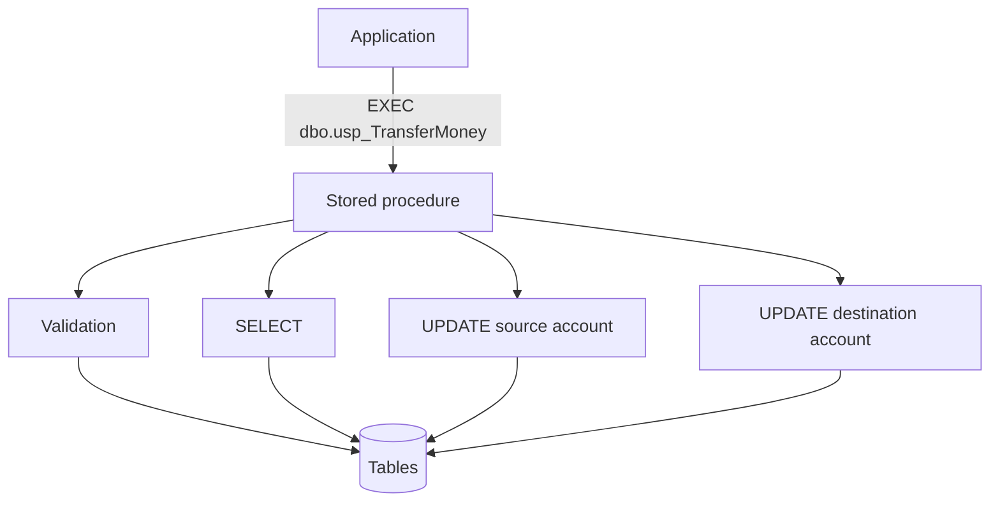

### Reusability

Once a stored procedure is created, the same operation can be reused wherever it is needed.

For example, a money transfer procedure can be called by a mobile banking app, a web application, or an internal banking system. Each caller provides the account numbers and the amount, while the procedure performs the same validation and updates.

This avoids duplicating SQL logic across applications. If the operation needs to change, its implementation can be updated in one place.

### Fewer network round-trips

If an application sends several SQL statements one after another, each request and response may require communication between the application and SQL Server.

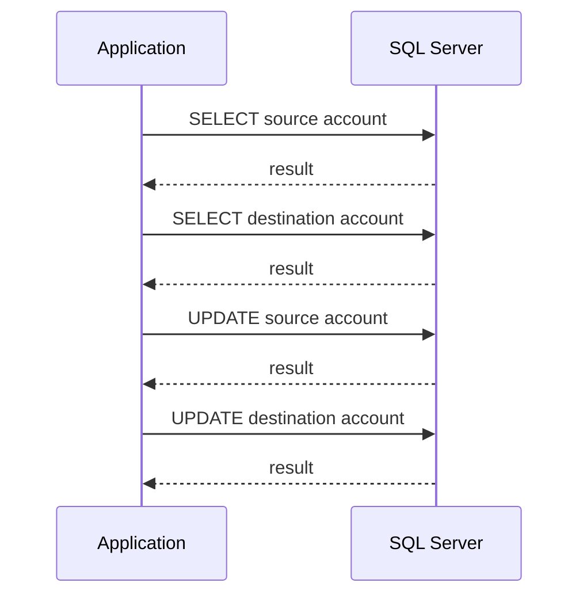

A procedure can execute those statements on the database server after a single call:

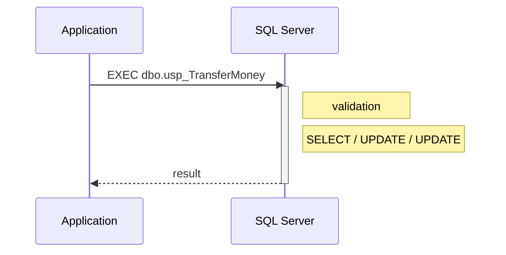

This can reduce network round-trips.

> [!IMPORTANT]
> A stored procedure is not automatically faster than equivalent SQL. The performance benefit here comes from reducing communication between the application and the database when one operation requires several statements.

### A database interface

Stored procedures can provide a defined interface through which applications work with the database. Each procedure exposes an operation with a name, input parameters, and expected results.

For example, an application can call `dbo.usp_TransferMoney` to request a transfer. The procedure defines what information the application must provide and how the outcome is reported.

Database permissions can also allow an application to execute selected procedures without granting it direct access to the underlying tables. This helps control which operations the application is allowed to perform.

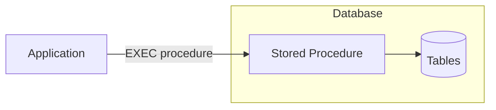

> **Key idea:** Think of a stored procedure as a **callable database operation**.

---

## Check your understanding

1. What is the main difference between a trigger and a stored procedure?
2. Why can a stored procedure reduce network round-trips?
3. Does putting a query inside a stored procedure automatically make the query faster?

<details>
<summary>Show answers</summary>

1. A trigger runs automatically in response to an event, while a stored procedure is explicitly called.
2. One procedure call can execute several SQL statements on the database server instead of requiring a separate application request for every statement.
3. No. A stored procedure does not automatically make equivalent SQL faster.

</details>

---

# Section 2 – Creating and Executing Procedures

The simplest stored procedure does not have any parameters.

## Example

```sql
CREATE OR ALTER PROCEDURE dbo.usp_ListStates
AS
BEGIN
    SELECT *
    FROM State;
END
GO
```

Execute the procedure with `EXEC`:

```sql
EXEC dbo.usp_ListStates;
```

`EXECUTE` is the full form of the same command:

```sql
EXECUTE dbo.usp_ListStates;
```

The result appears as a normal result set.

Notice that the procedure is **not** queried like a view:

```sql
-- This is not valid:
SELECT *
FROM dbo.usp_ListStates;
```

A view is queried. A procedure is executed.

## Modifying a procedure

`CREATE OR ALTER` is convenient because the same statement works whether the procedure already exists or not.

```sql
CREATE OR ALTER PROCEDURE dbo.usp_ListStates
AS
BEGIN
    SELECT *
    FROM State
    ORDER BY Name;
END
GO
```

Run it again:

```sql
EXEC dbo.usp_ListStates;
```

## Removing a procedure

```sql
DROP PROCEDURE IF EXISTS dbo.usp_ListStates;
GO
```

Dropping the procedure removes the procedure itself. It does not remove the underlying tables or data.

> [!TIP]
> Use `EXEC` to call a procedure. In this lab, use `CREATE OR ALTER` so that your procedure definition can easily be run again while you are developing it.

---

## Check your understanding

1. Which statement executes a stored procedure?
2. Why is `CREATE OR ALTER` useful while developing a procedure?
3. Does dropping a procedure delete data from the tables it uses?

<details>
<summary>Show answers</summary>

1. `EXEC` or `EXECUTE`.
2. The same script can create a new procedure or modify an existing one.
3. No. It removes only the stored procedure.

</details>

---

# Section 3 – Input Parameters

A procedure becomes much more reusable when the caller can provide input values.

Parameters are declared after the procedure name and before `AS`.

## One input parameter

```sql
CREATE OR ALTER PROCEDURE dbo.usp_GetProduct
    @IDProduct int
AS
BEGIN
    SELECT *
    FROM Product
    WHERE IDProduct = @IDProduct;
END
GO
```

The parameter behaves like a variable inside the procedure.

Call the procedure:

```sql
EXEC dbo.usp_GetProduct @IDProduct = 1;
```

The value `1` is the **argument** supplied to the `@IDProduct` parameter.

You can also pass it positionally:

```sql
EXEC dbo.usp_GetProduct 1;
```

For procedures with several parameters, named arguments are usually easier to read and less error-prone.

## Multiple input parameters

```sql
CREATE OR ALTER PROCEDURE dbo.usp_ProductsByPrice
    @MinPrice money,
    @MaxPrice money
AS
BEGIN
    SELECT Name, PriceWithoutVAT
    FROM Product
    WHERE PriceWithoutVAT BETWEEN @MinPrice AND @MaxPrice
    ORDER BY PriceWithoutVAT;
END
GO
```

Call it using named arguments:

```sql
EXEC dbo.usp_ProductsByPrice
    @MinPrice = 100,
    @MaxPrice = 500;
```

When arguments are named, their order does not have to match the declaration:

```sql
EXEC dbo.usp_ProductsByPrice
    @MaxPrice = 500,
    @MinPrice = 100;
```

### Common mistake

> [!WARNING]
> Do not call a stored procedure like a function:

```sql
-- Incorrect:
EXEC dbo.usp_GetProduct(1);
```

Use:

```sql
EXEC dbo.usp_GetProduct @IDProduct = 1;
```

> **Key idea:** Input parameters make one procedure reusable for many different inputs.

---

## Check your understanding

1. Where are procedure parameters declared?
2. What is the difference between a parameter and an argument?
3. Why are named arguments useful when a procedure has several parameters?

<details>
<summary>Show answers</summary>

1. After the procedure name and before `AS`.
2. A parameter is declared by the procedure; an argument is the value supplied by the caller.
3. They make calls easier to read and make it clear which value belongs to which parameter.

</details>

---

# Section 4 – Returning Data

A stored procedure can send information back to its caller in several ways.

The three mechanisms used in this lab are:

| Need | Mechanism |
|---|---|
| Return rows | result set |
| Return one or more individual values | `OUTPUT` parameters |
| Return an integer status code | `RETURN` |

Understanding the difference between these mechanisms is important.

## Result sets

You have already used the simplest form:

```sql
CREATE OR ALTER PROCEDURE dbo.usp_GetProduct
    @IDProduct int
AS
BEGIN
    SELECT *
    FROM Product
    WHERE IDProduct = @IDProduct;
END
GO
```

The `SELECT` produces a result set for the caller.

```sql
EXEC dbo.usp_GetProduct @IDProduct = 1;
```

Use a result set when the caller needs rows.

---

## Output parameters

An output parameter sends an individual value back to the caller.

```sql
CREATE OR ALTER PROCEDURE dbo.usp_GetProductColor
    @IDProduct int,
    @Color     nvarchar(15) OUTPUT
AS
BEGIN
    SET @Color = NULL;

    SELECT @Color = Color
    FROM Product
    WHERE IDProduct = @IDProduct;
END
GO
```

The caller must first declare a variable:

```sql
DECLARE @MyColor nvarchar(15);

EXEC dbo.usp_GetProductColor
    @IDProduct = 742,
    @Color     = @MyColor OUTPUT;

SELECT @MyColor AS ProductColor;
```

Notice that `OUTPUT` appears in **two places**:

```text
Procedure declaration  -> @Color nvarchar(15) OUTPUT
Procedure call         -> @Color = @MyColor OUTPUT
```

The caller needs a variable because the procedure needs somewhere to store the returned value.

The procedure initializes `@Color` to `NULL`. If the product does not exist, the output remains `NULL` instead of retaining a value supplied by the caller.

### Common mistake

> [!WARNING]
> Forgetting `OUTPUT` in the call lets the procedure execute normally, but the returned value is silently lost.

```sql
DECLARE @MyColor nvarchar(15);

-- The procedure executes, but the value is not returned
-- to @MyColor because OUTPUT is missing in the call.
EXEC dbo.usp_GetProductColor
    @IDProduct = 742,
    @Color     = @MyColor;
```

---

## RETURN values

`RETURN` provides a different output channel.

A procedure can return one integer value, commonly used as a status code.

```sql
CREATE OR ALTER PROCEDURE dbo.usp_CheckCustomerExists
    @FirstName nvarchar(50),
    @LastName  nvarchar(50)
AS
BEGIN
    IF EXISTS
    (
        SELECT 1
        FROM Customer
        WHERE FirstName = @FirstName
          AND LastName = @LastName
    )
        RETURN 0;

    RETURN 1;
END
GO
```

Capture the return value:

```sql
DECLARE @Result int;

EXEC @Result = dbo.usp_CheckCustomerExists
    @FirstName = 'Ada',
    @LastName  = 'Lovelace';

SELECT @Result AS ReturnCode;
```

A common convention is:

```text
0       -> success
nonzero -> another status
```

> [!NOTE]
> **`RETURN` also immediately ends execution of the procedure.**

Do not use `RETURN` to return normal application data such as names, dates, or prices. Use a result set or an output parameter for those values.

> [!IMPORTANT]
> `OUTPUT` returns data. `RETURN` is normally used for an integer status code.

---

## Check your understanding

1. Which mechanism should you use to return a table of matching products?
2. Which mechanism can return a product color to a variable in the caller?
3. What data type can a procedure return using `RETURN`?
4. Where must the `OUTPUT` keyword appear?

<details>
<summary>Show answers</summary>

1. A result set.
2. An output parameter.
3. An integer.
4. In the procedure parameter declaration and in the `EXEC` call that receives the value.

</details>

---

# Section 5 – Putting It Together: Bank Transfer

The real value of stored procedures becomes clearer when one request requires several SQL statements.

Return to the example from the beginning of the lab:

> Transfer money from one bank account to another.

From the application's point of view, this should be **one operation**:

```sql
EXEC dbo.usp_TransferMoney
    @FromAccount = 100,
    @ToAccount   = 101,
    @Amount      = 3000;
```

The database, however, must perform several steps.

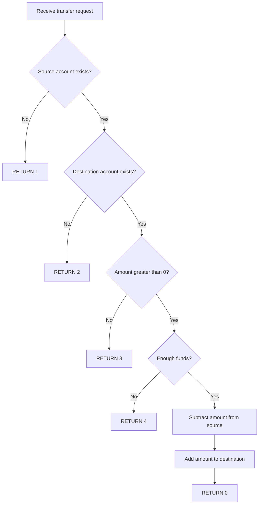

## Example data

For this example, create a small table that is independent of the rest of `AdventureWorksENG`:

```sql
CREATE TABLE dbo.BankAccount
(
    AccountNumber int PRIMARY KEY,
    Balance       decimal(10,2) NOT NULL
);
GO

INSERT INTO dbo.BankAccount (AccountNumber, Balance)
VALUES
    (100, 5000.00),
    (101, 2000.00);
GO
```

Check the initial balances:

```sql
SELECT *
FROM dbo.BankAccount;
```

Expected state:

| AccountNumber | Balance |
|---:|---:|
| 100 | 5000.00 |
| 101 | 2000.00 |

---

## The procedure

```sql
CREATE OR ALTER PROCEDURE dbo.usp_TransferMoney
    @FromAccount int,
    @ToAccount   int,
    @Amount      decimal(10,2)
AS
BEGIN
    -- Source account must exist
    IF NOT EXISTS
    (
        SELECT 1
        FROM dbo.BankAccount
        WHERE AccountNumber = @FromAccount
    )
        RETURN 1;

    -- Destination account must exist
    IF NOT EXISTS
    (
        SELECT 1
        FROM dbo.BankAccount
        WHERE AccountNumber = @ToAccount
    )
        RETURN 2;

    -- Transfer amount must be positive
    IF @Amount IS NULL OR @Amount <= 0
        RETURN 3;

    -- Source account must have enough funds
    IF
    (
        SELECT Balance
        FROM dbo.BankAccount
        WHERE AccountNumber = @FromAccount
    ) < @Amount
        RETURN 4;

    UPDATE dbo.BankAccount
    SET Balance = Balance - @Amount
    WHERE AccountNumber = @FromAccount;

    UPDATE dbo.BankAccount
    SET Balance = Balance + @Amount
    WHERE AccountNumber = @ToAccount;

    RETURN 0;
END
GO
```

The return codes describe the outcome:

| Return code | Meaning |
|---:|---|
| `0` | transfer completed |
| `1` | source account does not exist |
| `2` | destination account does not exist |
| `3` | invalid amount |
| `4` | insufficient funds |

Notice the role of `RETURN`: it does not return account data. It reports the **status of the operation**.

---

## Execute the transfer

Capture the return value in a variable:

```sql
DECLARE @Result int;

EXEC @Result = dbo.usp_TransferMoney
    @FromAccount = 100,
    @ToAccount   = 101,
    @Amount      = 3000;

SELECT @Result AS ReturnCode;
```

If the transfer succeeds, the return code is `0`.

Check the balances:

```sql
SELECT *
FROM dbo.BankAccount;
```

Expected result:

| AccountNumber | Balance |
|---:|---:|
| 100 | 2000.00 |
| 101 | 5000.00 |

The application requested one operation, while the procedure performed validation and multiple SQL statements inside the database.

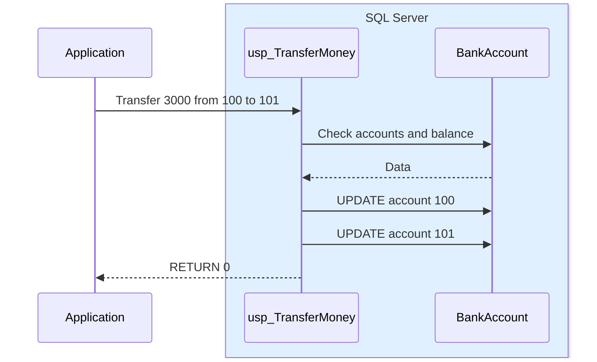

This example demonstrates several reasons for using a stored procedure:

- **encapsulation** — the application requests a transfer without implementing every SQL statement;
- **reusability** — different applications, such as internet banking and mobile banking apps, can call the same procedure with different accounts and amounts;
- **validation** — invalid requests can be rejected before data is modified;
- **fewer network round-trips** — the application sends one procedure call instead of coordinating each SQL statement separately;
- **one logical database operation** — the related statements are grouped behind one meaningful name.

---

## Test an unsuccessful transfer

Account `100` now contains `2000.00`.

Try to transfer more than the available balance:

```sql
DECLARE @Result int;

EXEC @Result = dbo.usp_TransferMoney
    @FromAccount = 100,
    @ToAccount   = 101,
    @Amount      = 5000;

SELECT @Result AS ReturnCode;
```

The expected return code is:

```text
4 -> insufficient funds
```

Because the procedure returns before either `UPDATE`, the balances remain unchanged.

---

## One important problem remains

Consider what could happen during a valid transfer:

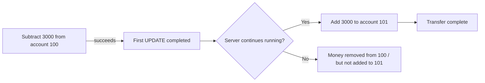

The two updates logically belong together.

What happens if the first `UPDATE` succeeds, but the server crashes or loses power before the second `UPDATE` is executed?

```text
Account 100: -3000  ✓

        ⚡ power failure

Account 101: +3000  ✗
```

Money has been removed from one account but has not been added to the other.

What we really want is:

```text
BOTH updates succeed
        OR
NEITHER update happens
```

This is exactly the problem that **transactions** solve.

Transactions are outside the scope of this lab, but this example shows why they are important when several data modifications form one logical operation.

> [!NOTE]
> A stored procedure can group several statements into one callable operation. A correctly managed transaction makes the related changes atomic: either all are committed or none are.
>
> This simplified example assumes one user and no concurrent changes. With simultaneous transfers, another session could change the balance between the check and the `UPDATE`. A production implementation also needs suitable concurrency control. Transactions and concurrency control are covered separately.

---

## Check your understanding

1. What does the stored procedure in this example encapsulate that the application would otherwise have to implement itself?
2. Why does `usp_TransferMoney` check both accounts and the balance before performing either `UPDATE`?
3. What does a `RETURN` code of `4` mean in this procedure, and does it change any data?
4. Why doesn't the stored procedure alone guarantee that both updates succeed or fail together?

<details>
<summary>Show answers</summary>

1. The sequence of validations and the two related `UPDATE` statements that together make up one transfer operation.
2. So that an invalid request (missing account, invalid amount, insufficient funds) is rejected with a `RETURN` code before any data is modified.
3. Insufficient funds. No data is changed — the procedure returns before either `UPDATE` runs.
4. A stored procedure only groups statements behind one call; it does not by itself protect against a failure between the two `UPDATE` statements. That guarantee requires a transaction.

</details>

---

# Section 6 – Real-world example: Calculating a loyalty discount

Stored procedures are often used to implement **business rules**.

Consider a simple loyalty program.

When a customer is making a purchase, the application needs to determine whether the customer is eligible for a discount.

The discount depends on how much the customer spent during a specified period:

| Total spent | Discount |
|---:|---:|
| Less than €500 | 0% |
| €500 – €999.99 | 5% |
| €1,000 – €1,999.99 | 10% |
| €2,000 or more | 15% |

The application provides:

- the customer,
- the beginning of the period,
- the end of the period.

The stored procedure calculates the customer's total spending and returns the appropriate discount percentage.

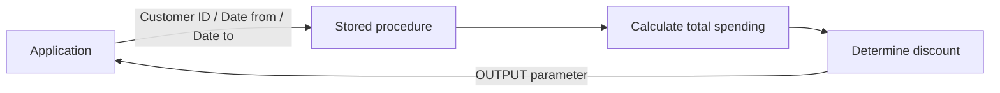

This example demonstrates three different ways of working with values inside a stored procedure:

| Value | Type | Purpose |
|---|---|---|
| `@CustomerID` | Input parameter | Customer to check |
| `@DateFrom` | Input parameter | Beginning of the period |
| `@DateTo` | Input parameter | End of the period |
| `@TotalSpent` | Local variable | Stores the calculated spending |
| `@DiscountPercent` | Output parameter | Returns the discount to the caller |

---

> [!NOTE]
> For this example, assume a valid customer ID and non-NULL dates with `@DateFrom <= @DateTo`. The end date is inclusive. Input validation can be added as an extension.

### Calculating the customer's spending

First, let's calculate how much customer `100` spent during 2003:

```sql
USE AdventureWorksENG;
GO
```

```sql
SELECT SUM(ii.TotalPrice)
FROM Invoice i
JOIN InvoiceItem ii
    ON ii.InvoiceID = i.IDInvoice
WHERE i.CustomerID = 100
  AND i.InvoiceDate >= '20030101'
  AND i.InvoiceDate < '20040101';
```

The result is:

```text
1728.510000
```

According to our loyalty rules, this customer should receive a **10% discount**.

However, there is one small problem.

If the customer has no purchases during the selected period, `SUM()` returns `NULL`.

We want the total spending to be `0` instead:

```sql
SELECT COALESCE(SUM(ii.TotalPrice), 0)
FROM Invoice i
JOIN InvoiceItem ii
    ON ii.InvoiceID = i.IDInvoice
WHERE i.CustomerID = 100
  AND i.InvoiceDate >= '20030101'
  AND i.InvoiceDate < '20040101';
```

The date range includes the beginning of the first day and stops before the beginning of the next year. This also includes invoices with a time component on December 31.

Now we can use this calculation inside a stored procedure.

---

### Creating the procedure

```sql
CREATE OR ALTER PROCEDURE dbo.usp_GetLoyaltyDiscount
    @CustomerID int,
    @DateFrom date,
    @DateTo date,
    @DiscountPercent decimal(5,2) OUTPUT
AS
BEGIN
    SET NOCOUNT ON;

    DECLARE @TotalSpent decimal(19,2);

    SELECT @TotalSpent =
        COALESCE(SUM(ii.TotalPrice), 0)
    FROM Invoice i
    JOIN InvoiceItem ii
        ON ii.InvoiceID = i.IDInvoice
    WHERE i.CustomerID = @CustomerID
      AND i.InvoiceDate >= @DateFrom
      AND i.InvoiceDate < DATEADD(day, 1, @DateTo);

    IF @TotalSpent >= 2000
        SET @DiscountPercent = 15;
    ELSE IF @TotalSpent >= 1000
        SET @DiscountPercent = 10;
    ELSE IF @TotalSpent >= 500
        SET @DiscountPercent = 5;
    ELSE
        SET @DiscountPercent = 0;
END;
GO
```

`SET NOCOUNT ON` suppresses row-count messages such as `(5 rows affected)`. It does not hide query results or prevent `@@ROWCOUNT` from being updated. The [Stored Procedure Exercises](../exercises/procedures.md) use `@@ROWCOUNT` to return the number of rows a query found.

The condition `i.InvoiceDate < DATEADD(day, 1, @DateTo)` includes the entire final day, even when `InvoiceDate` contains a time component.

The procedure receives three **input parameters**:

```sql
@CustomerID int,
@DateFrom date,
@DateTo date,
```

These values come from the caller.

The procedure also declares a **local variable**:

```sql
DECLARE @TotalSpent decimal(19,2);
```

This variable exists only while the procedure is executing.

The query calculates the customer's spending and stores the result in that variable:

```sql
SELECT @TotalSpent =
    COALESCE(SUM(ii.TotalPrice), 0)
FROM Invoice i
JOIN InvoiceItem ii
    ON ii.InvoiceID = i.IDInvoice
WHERE i.CustomerID = @CustomerID
  AND i.InvoiceDate >= @DateFrom
  AND i.InvoiceDate < DATEADD(day, 1, @DateTo);
```

The procedure then applies the loyalty rules:

```sql
IF @TotalSpent >= 2000
    SET @DiscountPercent = 15;
ELSE IF @TotalSpent >= 1000
    SET @DiscountPercent = 10;
ELSE IF @TotalSpent >= 500
    SET @DiscountPercent = 5;
ELSE
    SET @DiscountPercent = 0;
```

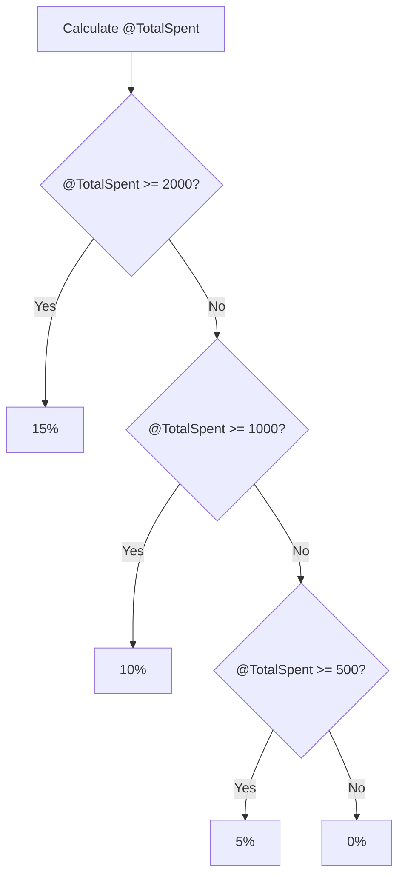

Finally, `@DiscountPercent` is an **OUTPUT parameter**:

```sql
@DiscountPercent decimal(5,2) OUTPUT
```

This allows the procedure to return the calculated discount to the caller.

---

### Calling the procedure

The caller first needs a variable that will receive the returned value:

```sql
DECLARE @Discount decimal(5,2);
```

We can then execute the procedure:

```sql
EXEC dbo.usp_GetLoyaltyDiscount
    @CustomerID = 100,
    @DateFrom = '20030101',
    @DateTo = '20031231',
    @DiscountPercent = @Discount OUTPUT;
```

Finally, we can inspect the returned value:

```sql
SELECT @Discount AS DiscountPercent;
```

The complete call is:

```sql
DECLARE @Discount decimal(5,2);

EXEC dbo.usp_GetLoyaltyDiscount
    @CustomerID = 100,
    @DateFrom = '20030101',
    @DateTo = '20031231',
    @DiscountPercent = @Discount OUTPUT;

SELECT @Discount AS DiscountPercent;
```

The result should be:

| DiscountPercent |
|---:|
| 10.00 |

The procedure calculated that customer `100` spent **€1,728.51** during the selected period and therefore returned a **10% discount**.

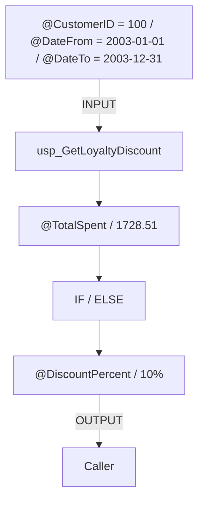

---

### Input, local, and output values

It is important to understand the different roles of the values used in this example.

**Input parameters** bring values into the procedure:

```sql
@CustomerID
@DateFrom
@DateTo
```

A **local variable** stores an intermediate result inside the procedure:

```sql
@TotalSpent
```

An **OUTPUT parameter** sends a value back to the caller:

```sql
@DiscountPercent
```

Conceptually:

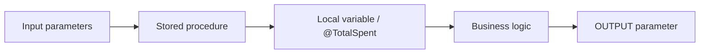

### Check your understanding

1. Why does the procedure use `COALESCE(SUM(ii.TotalPrice), 0)` instead of just `SUM(ii.TotalPrice)`?
2. Why is `@TotalSpent` declared as a local variable instead of a parameter?
3. Why is `@DiscountPercent` declared as an `OUTPUT` parameter instead of being returned through a result set?
4. What would happen to the caller's variable if `OUTPUT` were omitted from the `EXEC` call?

<details>
<summary>Show answers</summary>

1. If the customer has no purchases in the period, `SUM()` returns `NULL`. `COALESCE` makes the total spending `0` instead, so the discount logic still works correctly.
2. `@TotalSpent` is not supplied by the caller — it is calculated inside the procedure from the input parameters, so it is a local variable rather than a parameter.
3. An `OUTPUT` parameter lets the caller receive the percentage directly into a variable. A result set containing one value would also be possible; this example uses `OUTPUT` to demonstrate that interface.
4. The procedure would still calculate the discount internally, but the caller's variable would not receive the value — the same mistake shown in Section 4's "Common mistake".

</details>

### Key takeaways

- Stored procedures can implement business rules.
- Input parameters allow the caller to provide values to the procedure.
- Local variables can store intermediate results inside the procedure.
- `IF` and `ELSE` can be used to make decisions based on calculated values.
- An `OUTPUT` parameter allows a stored procedure to return a value to the caller.
- The caller must specify `OUTPUT` when receiving the value.
- A procedure can combine queries, variables, control flow, and parameters into a reusable database operation.

---

# Section 7 – Practical Example: Validating a Card Number

In this example, you will combine input validation, `OUTPUT` parameters, variables, conditions, and a `WHILE` loop to solve a practical problem.

### Background

The **Luhn algorithm**, also called the **modulus 10 algorithm**, checks whether a numerical identifier has a valid checksum. It helps detect common typing errors.

It is used for credit and debit card numbers and for the check digit of **IMEI numbers**, which identify mobile devices. [stripe.com](https://stripe.com/resources/more/how-to-use-the-luhn-algorithm-a-guide-in-applications-for-businesses)

The final digit is called the **check digit**. It is calculated from the preceding digits.

> [!NOTE]
> Check digits are used in many identification systems.
>
> For example, the Croatian **OIB** includes a check digit calculated using **ISO 7064 MOD 11,10**. A Croatian **student card number (iksica)** also includes a check digit, in addition to the JMBAG contained within it. [regos.hr](https://regos.hr/app/uploads/2018/07/KONTROLA-OIB-a.pdf)
>
> These systems share the same idea: calculating a check value from the other digits helps detect typing errors. However, **different identifiers may use different algorithms**. The Luhn algorithm cannot be used to validate every identification number.

> [!IMPORTANT]
> Passing the Luhn check does **not** prove that a card exists, is active, or has sufficient funds. The algorithm checks only the checksum. It is not an encryption or authentication mechanism.

### How the algorithm works

Process the complete number, including its check digit:

1. Start with the **rightmost digit**.
2. Moving left, **double every second digit**, beginning with the second digit from the right.
3. If a doubled value is greater than `9`, subtract `9`.
4. Add all the resulting values.
5. The checksum is valid if the total is divisible by `10`.

Consider the demonstration sequence `12345674`:

| Step / Position from the right | 8 | 7 | 6 | 5 | 4 | 3 | 2 | 1 |
|---|---:|---:|---:|---:|---:|---:|---:|---:|
| Original digits | 1 | 2 | 3 | 4 | 5 | 6 | 7 | 4 |
| Double digits at even positions | 2 | 2 | 6 | 4 | 10 | 6 | 14 | 4 |
| Subtract 9 from values greater than 9 | 2 | 2 | 6 | 4 | 1 | 6 | 5 | 4 |

The total is:

```text
2 + 2 + 6 + 4 + 1 + 6 + 5 + 4 = 30
30 % 10 = 0
```

Therefore, this sequence passes the Luhn check.

> [!NOTE]
> This short sequence demonstrates the calculation. It is not a payment card number.

### Procedure requirements

We will create a stored procedure named `dbo.usp_ValidateCardNumber` with these parameters:

| Parameter | Type | Purpose |
|---|---|---|
| `@CardNumber` | `varchar(100)` | Number to check |
| `@IsValid` | `bit OUTPUT` | Result: `1` if the input meets the example rules and passes the checksum; otherwise `0` |

Apply the following rules:

1. Use `SET NOCOUNT ON`.
2. Set `@IsValid` to `0` at the beginning.
3. Reject `NULL` and empty input.
4. Accept only digits from `0` to `9`. Reject spaces, letters, and punctuation.
5. Use a `WHILE` loop to implement the Luhn algorithm.
6. Set `@IsValid` to `1` only if the input meets these rules and its checksum is valid.

> [!NOTE]
> The Luhn algorithm is not restricted to 16-digit numbers. This example accepts different input lengths within the capacity of the parameter. It does not enforce card-brand-specific lengths or prefixes.

Store the input as text because it is an **identifier**, not a numerical quantity. Convert individual digits to `int` only when performing calculations.

### T-SQL features used

The implementation uses the following T-SQL features:

| Feature | Purpose |
|---|---|
| `IF` and `RETURN` | Reject invalid input and exit the procedure |
| `DATALENGTH(@CardNumber)` | Detect empty input and determine the starting position |
| `CHARINDEX(' ', @CardNumber)` | Explicitly detect spaces, including trailing spaces |
| `COLLATE Latin1_General_100_BIN2` with `LIKE '%[^0-9]%'` | Restrict the accepted characters to ASCII digits |
| `SUBSTRING(@CardNumber, @Position, 1)` | Extract one digit |
| `CAST(... AS int)` | Convert the extracted digit to an integer |
| `WHILE` | Process the digits one at a time |
| `%` | Calculate the remainder after division |

For the accepted ASCII digits in this `varchar` parameter, each character occupies one byte.

Check the input **before** converting its characters to integers.

### Creating the procedure

```sql
CREATE OR ALTER PROCEDURE dbo.usp_ValidateCardNumber
    @CardNumber varchar(100),
    @IsValid bit OUTPUT
AS
BEGIN
    SET NOCOUNT ON;

    SET @IsValid = 0;

    -------------------------------------------------------
    -- Validate the input
    -------------------------------------------------------
    IF @CardNumber IS NULL
        RETURN;

    IF DATALENGTH(@CardNumber) = 0
        RETURN;

    -- Reject spaces explicitly and allow only ASCII digits.
    -- The binary collation makes the digit range unambiguous.
    IF CHARINDEX(' ', @CardNumber) > 0
       OR @CardNumber COLLATE Latin1_General_100_BIN2 LIKE '%[^0-9]%'
        RETURN;

    -------------------------------------------------------
    -- Calculate the Luhn checksum
    -------------------------------------------------------
    DECLARE @Position int = DATALENGTH(@CardNumber);
    DECLARE @Digit int;
    DECLARE @Total int = 0;
    DECLARE @ShouldDouble bit = 0;

    WHILE @Position >= 1
    BEGIN
        SET @Digit = CAST(
            SUBSTRING(@CardNumber, @Position, 1) AS int
        );

        IF @ShouldDouble = 1
        BEGIN
            SET @Digit = @Digit * 2;

            IF @Digit > 9
                SET @Digit = @Digit - 9;
        END;

        SET @Total = @Total + @Digit;

        -- Alternate between keeping and doubling a digit.
        IF @ShouldDouble = 0
            SET @ShouldDouble = 1;
        ELSE
            SET @ShouldDouble = 0;

        SET @Position = @Position - 1;
    END;

    -------------------------------------------------------
    -- Return the result through the OUTPUT parameter
    -------------------------------------------------------
    IF @Total % 10 = 0
        SET @IsValid = 1;
END;
GO
```

### Understanding the procedure

- `@IsValid` starts at `0`, so every early `RETURN` leaves the output value at `0`.
- Empty input is rejected before the calculation. Otherwise, the initial total of `0` would incorrectly pass the final divisibility check.
- `CHARINDEX(' ', @CardNumber)` explicitly rejects spaces, including trailing spaces.
- `LIKE '%[^0-9]%'` with a binary collation rejects characters outside ASCII `0`–`9`, independently of the database's default collation.
- `@Position` starts at the input length, so the loop processes the number from right to left regardless of its length.
- `DATALENGTH` includes trailing spaces. The explicit space check rejects such input before the loop.
- `@ShouldDouble` starts at `0`, because the rightmost digit—the check digit—is **not doubled**.
- After each iteration, `@ShouldDouble` switches between `0` and `1`.
- `@Total % 10 = 0` checks whether the final sum is divisible by `10`.

### Testing the procedure

Use the following published test card number: [docs.stripe.com](https://docs.stripe.com/testing?numbers-or-method-or-token=tokens)

```sql
DECLARE @Result bit;

EXEC dbo.usp_ValidateCardNumber
    @CardNumber = '4242424242424242',
    @IsValid = @Result OUTPUT;

SELECT @Result AS IsValid;
-- Expected: 1
GO
```

Change the last digit and test again:

```sql
DECLARE @Result bit;

EXEC dbo.usp_ValidateCardNumber
    @CardNumber = '4242424242424241',
    @IsValid = @Result OUTPUT;

SELECT @Result AS IsValid;
-- Expected: 0
GO
```

Now test the shorter demonstration sequence used earlier:

```sql
DECLARE @Result bit;

EXEC dbo.usp_ValidateCardNumber
    @CardNumber = '12345674',
    @IsValid = @Result OUTPUT;

SELECT @Result AS IsValid;
-- Expected: 1
GO
```

This confirms that the calculation does not require exactly 16 digits.

Also verify these cases:

| Input | Expected result | Reason |
|---|---:|---|
| `NULL` | 0 | Missing input |
| `''` | 0 | Empty input |
| `'4242'` | 1 | Valid checksum; no card-length requirement |
| `'12345674'` | 1 | Valid checksum |
| `'12345675'` | 0 | Incorrect checksum |
| `'424242424242424A'` | 0 | Contains a letter |
| `'4242 4242 4242 4242'` | 0 | Contains spaces |
| `'424242424242424 '` | 0 | Contains a trailing space |

### Check your understanding

1. Why does this procedure use a `varchar` parameter?
2. Why is the rightmost digit not doubled?
3. How does the procedure determine where to start processing?
4. What does `@Total % 10 = 0` check?
5. Why must the caller also specify `OUTPUT`?
6. Can a number pass the Luhn check even if no corresponding card exists?

<details>
<summary>Show answers</summary>

1. The value is an identifier, not a numerical quantity. Text also preserves leading zeros.
2. It is the check digit. When validating the complete number, doubling starts with the second digit from the right.
3. It sets `@Position` to `DATALENGTH(@CardNumber)`. After validation, the input contains only ASCII digits, so this is also the number of digits.
4. It checks whether the calculated total is divisible by 10.
5. Without `OUTPUT` in the call, the modified value is not copied back to the caller's variable.
6. Yes. A valid checksum does not prove that a card exists or is usable.

</details>

> [!NOTE]
> A nonempty sequence containing only zeros also passes these rules and the Luhn checksum. This illustrates why a checksum alone cannot confirm that a payment card number is actually issued or usable.

> [!TIP]
> In [Exercise 8 of the Stored Procedure Exercises](../exercises/procedures.md#exercise-8--validate-all-stored-card-numbers-advanced), you can reuse this procedure inside a `WHILE` loop to validate all card numbers stored in the `CreditCard` table.

> [!TIP]
> The additional reading in [Lab 4 – Functions](lab04-functions.md) shows how to move this Luhn calculation into a scalar function and reuse it from a procedure, a query, and a trigger.


---

# What You Should Know After This Lab

The most important ideas are:

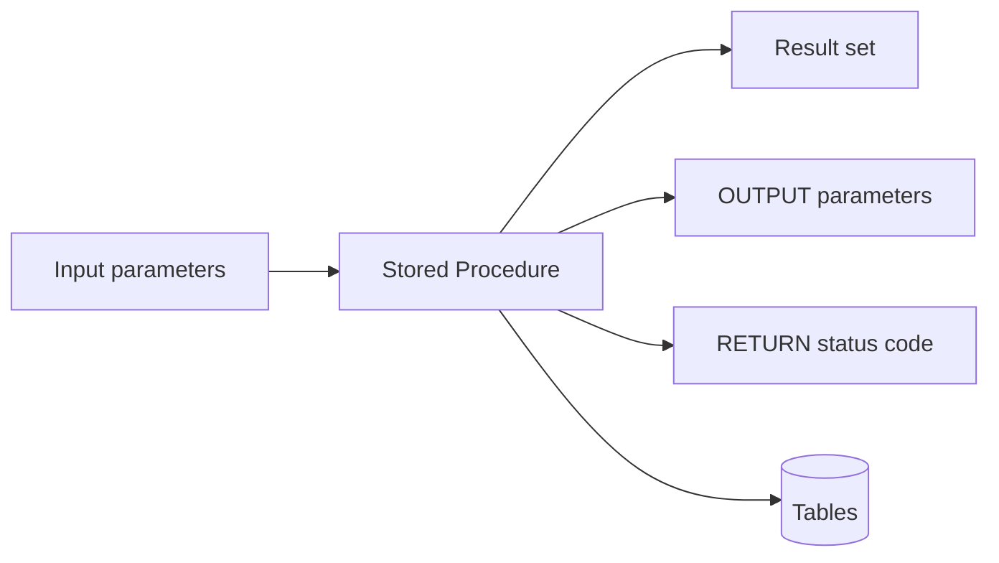

```text
Stored Procedure
    -> a named, callable database operation
```

```text
Input parameters
    -> send values into the procedure
```

```text
Result set
    -> returns rows
```

```text
OUTPUT parameter
    -> returns individual values
```

```text
RETURN
    -> returns an integer status code
```

And remember:

> **Views answer. Triggers react. Procedures do.**

A stored procedure is particularly useful when **one logical database operation requires several SQL statements**.

It can also reduce **network round-trips** by allowing those statements to execute on the database server after a single procedure call.

---

## Additional practice

Exercises for this lab are in [Stored Procedure Exercises](../exercises/procedures.md). They cover input parameters, `OUTPUT` parameters, return status codes, inserting related rows, and reusing the card-number validation procedure from Section 7.
