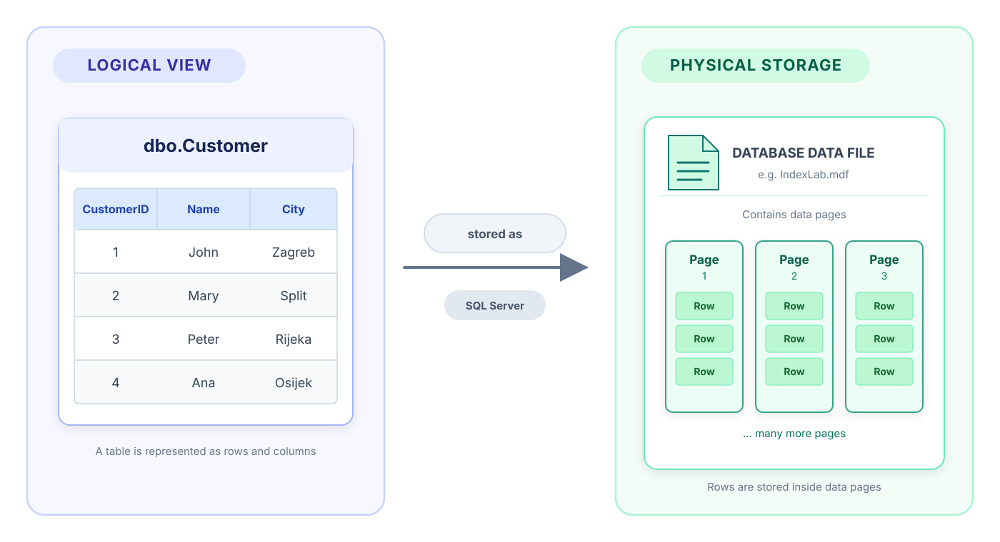
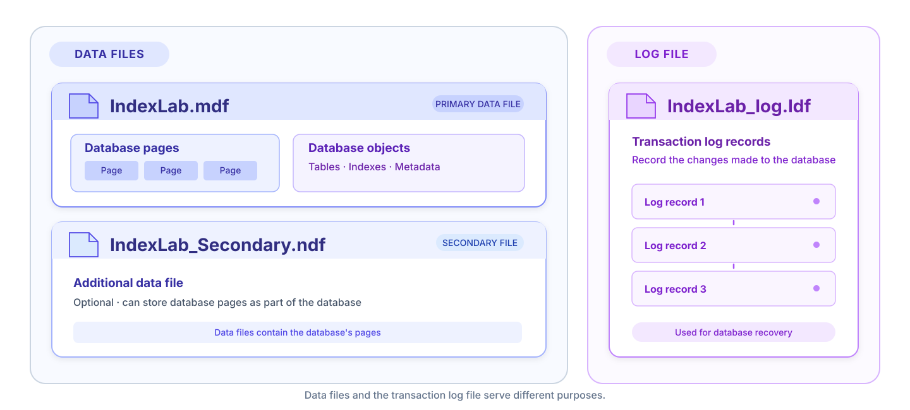
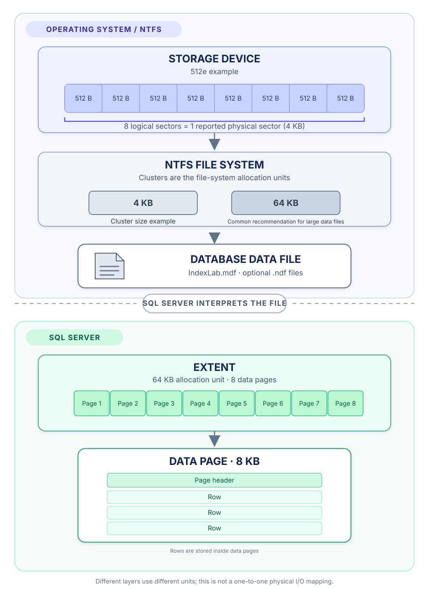
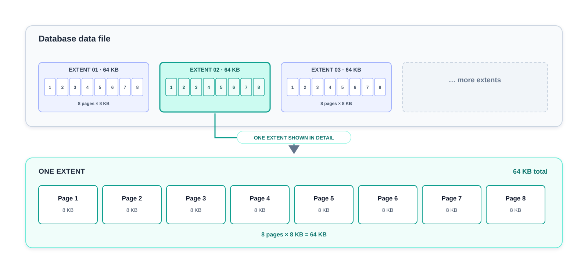
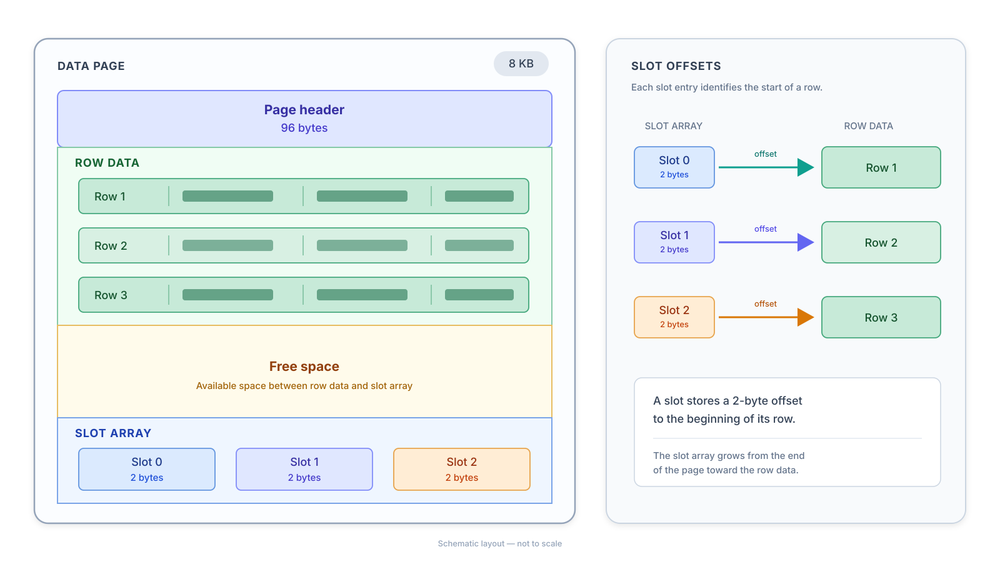
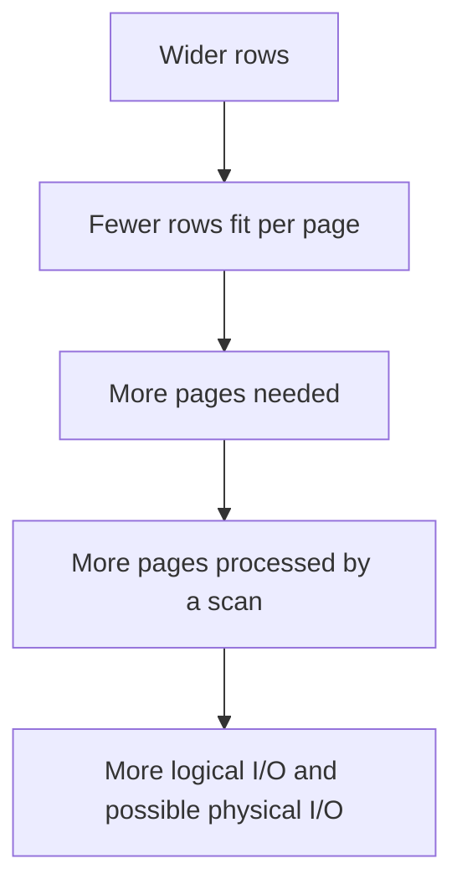
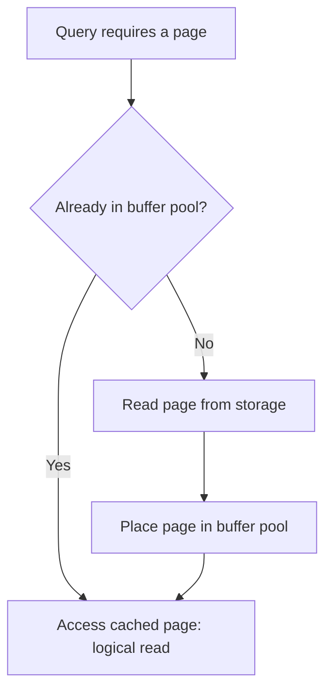
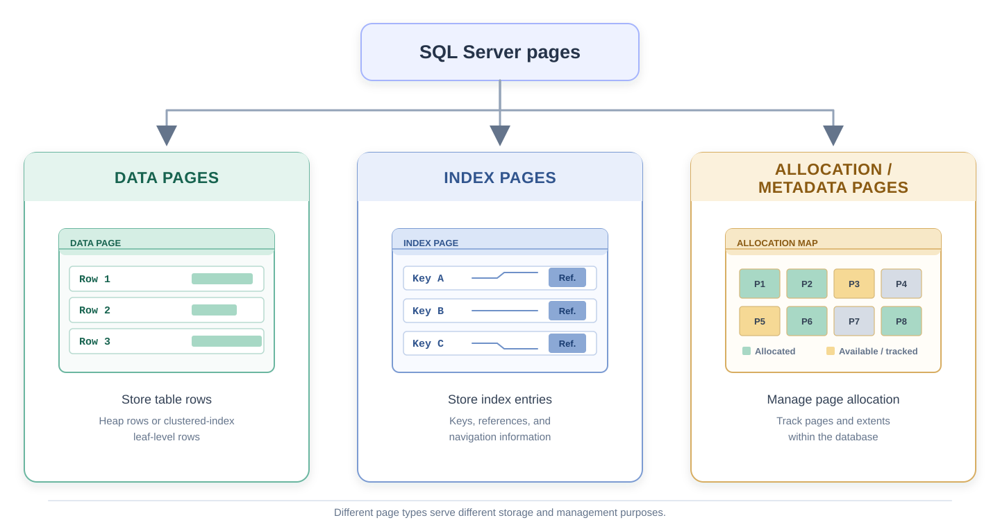
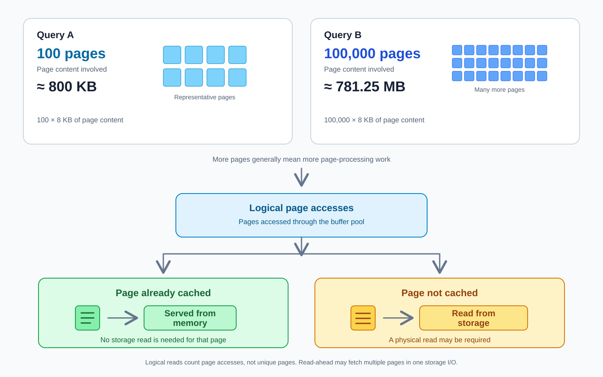
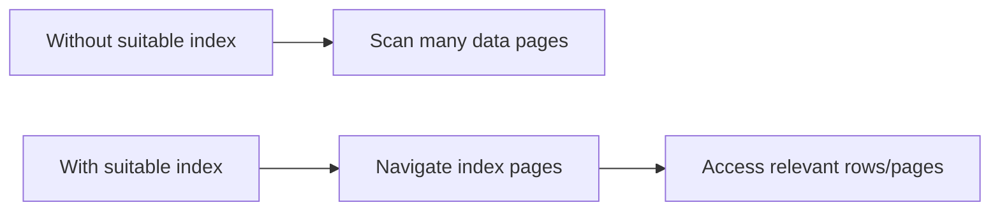

# Lab 05 – Physical Storage in SQL Server

> Database Design Laboratory  
> Student Lab Manual

---

# Learning goals

By the end of this lab, you should be able to:

- explain how SQL Server stores databases in files,
- distinguish disk sectors, NTFS clusters, SQL Server extents, and pages,
- explain the roles of `.mdf`, `.ndf`, and `.ldf` files,
- describe the structure of an 8 KB SQL Server data page,
- explain why row width influences page count and query cost,
- distinguish logical reads from physical reads and explain the buffer pool,
- inspect table pages using `DBCC IND` and `DBCC PAGE`,
- interpret simple page-count and I/O measurements,
- explain why indexes can reduce the amount of data SQL Server must read.

This lab involves relatively little coding. Its goal is to build a **mental model** of where data lives and how SQL Server accesses it. You will use this model in **Lab 06 – Indexes**.

> [!NOTE]
> **Demo Database – IndexLab**
>
> In this lab, you will create a demonstration database called `IndexLab`, containing several tables with millions of records.
>
> We will use this database to explore how SQL Server physically stores data, inspect data pages, and investigate disk I/O.
>
> The database will be created using the [IndexLab setup script](setup/index-lab-data-setup.md). 
>
> **Keep this database after completing the lab!** We will use it again in **Lab 06 – Indexes** to investigate query performance and demonstrate how indexes can reduce the number of pages SQL Server needs to read.

---

# 1. From logical data to physical storage

Until now, we have mainly worked at the **logical level**: tables, views, triggers, procedures, and functions.

```sql
SELECT *
FROM dbo.Customer;
```

This query looks as though SQL Server simply retrieves rows from a table. In reality, those rows are stored inside **pages** in database files.



> [!IMPORTANT]
> A **row** is a logical unit of table data. An **8 KB page** is the fundamental unit SQL Server uses to organize that data in database files and the buffer pool.

---

# 2. Create the IndexLab database

We will use the same generated database in Labs 05 and 06.

Run the [IndexLab setup script](setup/index-lab-data-setup.md) in SSMS. It creates the following tables:

- `Category`
- `Product`
- `Customer`
- `SalesOrder`
- `SalesOrderItem`

The two largest tables contain approximately **10,000,000 orders** and **40,000,000 order items**. Generation may take several minutes.

```sql
USE IndexLab;
GO

SELECT 'Category' AS TableName, COUNT(*) AS RowCnt FROM dbo.Category
UNION ALL
SELECT 'Product', COUNT(*) FROM dbo.Product
UNION ALL
SELECT 'Customer', COUNT(*) FROM dbo.Customer
UNION ALL
SELECT 'SalesOrder', COUNT(*) FROM dbo.SalesOrder
UNION ALL
SELECT 'SalesOrderItem', COUNT(*) FROM dbo.SalesOrderItem;
```

> [!TIP]
> You only need to run the setup once. Do **not** recreate the database before Lab 06: we want to study indexing on the same data.

Our question is not merely *how many rows exist?* It is **how are those rows stored, and what does SQL Server have to read to find them?**

---

# 3. Database files

A SQL Server database consists of one or more operating-system files. The usual extensions are:

| Extension | Role |
|---|---|
| `.mdf` | Primary data file |
| `.ndf` | Optional secondary data file |
| `.ldf` | Transaction log file |

## 3.1 Primary and secondary data files

Every database has **exactly one primary data file**, usually with the `.mdf` extension. It belongs to the primary filegroup.

Additional data files (commonly `.ndf`) can hold tables, indexes, and other database structures.

Their use and placement are configuration choices; more files do not automatically make a database faster.

## 3.2 Transaction log

The transaction log records changes needed for transaction recovery.

SQL Server uses **write-ahead logging (WAL)**: the relevant log records must be written to durable storage **before the corresponding modified data pages are written to disk**.

A modified page can therefore remain in memory after a transaction commits. If SQL Server stops unexpectedly, recovery uses log records to restore a consistent database state.

We will explore transactions in a later lab.

A simplified layout:



## 3.3 Exploring database storage in SSMS

Now that we have created the `IndexLab` database, let's examine how much disk space it occupies.

SQL Server Management Studio (SSMS) provides built-in reports that allow us to explore database storage without writing SQL queries.

### Step 1 – Database disk usage

Let's examine how much disk space our `IndexLab` database occupies.

1. In Object Explorer, right-click the `IndexLab` database.
2. Select **Reports → Standard Reports → Disk Usage**.
3. Examine the information displayed in the report.

The report shows the total reserved space, the sizes of the data and transaction log files, and how much space is currently used.

In our example:

| Description | Size |
|---|---:|
| Total Space Reserved | 4.5 GB |
| Data Files Space Reserved | 4096 MB (4 GB) |
| Transaction Log Space Reserved | 512 MB |

#### Understanding the results

When we created the `IndexLab` database, we specified the initial sizes of its files: **4096 MB for the data file** and **512 MB for the transaction log**.

These values determine how much disk space SQL Server initially reserves for the database.

However, notice that approximately **half of the data file is still unallocated**.

> [!IMPORTANT]
> **File size is not the same as used space.**
>
> Although the data file occupies 4 GB on disk, SQL Server has allocated only about 2 GB to database structures. The remaining space is available for future allocations without increasing the file size.

#### Why is choosing the right file size important?

Choosing appropriate file sizes is an important part of **database capacity planning**.

- **If files are too small**, SQL Server may need to grow them frequently, introducing additional overhead and potentially affecting performance.
- **If files are unnecessarily large**, they reserve disk space that could otherwise be used for other purposes.

SQL Server supports **autogrowth**, allowing database files to grow automatically when additional space is required.

> [!NOTE]
> Autogrowth is a useful safety mechanism, but it should not replace proper capacity planning.
>
> Also, larger database files do not automatically make queries faster. The goal is to allocate sufficient space while avoiding unnecessary file growth.

### Step 2 – Disk usage by table

1. Right-click the `IndexLab` database again.
2. Select **Reports → Standard Reports → Disk Usage by Table**.
3. Compare the number of records and disk space used by different tables.

Pay attention to these columns:

| Column | Description |
|---|---|
| Records | Number of rows in the table. |
| Reserved (KB) | Total space reserved for the table and its indexes. |
| Data (KB) | Space occupied by table data. |
| Indexes (KB) | Space occupied by index structures. |
| Unused (KB) | Reserved space not currently used. |

For example, our database contains:

| Table | Records | Data (KB) |
|---|---:|---:|
| Category | 100 | 8 |
| Customer | 100,000 | 5,856 |
| Product | 30,000 | 1,272 |
| SalesOrder | 10,000,000 | 457,144 |
| SalesOrderItem | 40,000,000 | 1,584,160 |

Notice that `SalesOrderItem` contains four times as many rows as `SalesOrder` and occupies considerably more space.

> [!NOTE]
> A table's storage requirements depend on the number of rows, the size of each row, and additional storage overhead.
>
> We will explore how SQL Server physically organizes this data in the following sections.

## Check your understanding

1. What is the difference between a table and the database file containing it?
2. What is the purpose of a transaction log?
3. Does a database always need secondary `.ndf` files?
4. Why can a database file occupy 4 GB on disk even when only about 2 GB has been allocated internally?
5. Does a table with twice as many rows necessarily require twice as much storage space?

<details>
<summary>Show answers</summary>

1. A table is a logical database object. Its data resides in pages stored in database data files.
2. It records the information required for transaction recovery. Write-ahead logging ensures relevant log records become durable before modified data pages are written to disk.
3. No. Secondary data files are optional.
4. SQL Server can reserve file space in advance. Space that has not yet been allocated internally remains available for future use.
5. No. Storage requirements also depend on row size and additional overhead.

</details>

---

# 4. From the storage device to SQL Server

SQL Server works with pages, but the storage layers beneath it use different units. Let us inspect them before examining SQL Server pages.

Open **Command Prompt** or **PowerShell** and run:

```text
fsutil fsinfo ntfsinfo C:
```

If the database files are stored on another NTFS volume, use its drive letter. Find these entries (their exact names and values may differ):

```text
Bytes Per Sector          : 512
Bytes Per Physical Sector : 4096
Bytes Per Cluster         : 4096
```

## 4.1 Sectors: 512 B and 4 KB

Older hard disk drives traditionally used **512-byte sectors**. The value persists for compatibility even on many modern storage devices.

- **Logical sector (512 B in this example):** the unit in which the device exposes addresses to the operating system.
- **Reported physical sector (4096 B in this example):** the device's reported physical sector granularity.

A **512e** device presents 512-byte logical sectors while reporting 4096-byte physical sectors. Eight logical sectors therefore correspond to one reported 4 KB physical sector.

> [!NOTE]
> **What about SSDs?** SSDs do not have rotating platters or magnetic tracks. They still expose logical sectors, but internally organize NAND flash memory differently. A reported 4 KB physical sector is **not necessarily** the internal NAND page size.

## 4.2 NTFS clusters

A **cluster** (allocation unit) is the amount of space the NTFS file system allocates as a unit to a file. This is **not** the same concept as a disk sector.

If the cluster size is **4096 bytes**, then a small file may require:

| File size | Clusters allocated | Allocated space |
|---:|---:|---:|
| 1000 B | 1 | 4096 B |
| 5000 B | 2 | 8192 B |
| 10000 B | 3 | 12288 B |

This is a simplified example of ordinary allocated file data; special NTFS features, including resident data, can behave differently.

For large SQL Server data files, **64 KB NTFS allocation units are commonly recommended** in Microsoft storage guidance. This is a file-system configuration recommendation, not a change to SQL Server's page size.

## 4.3 Different layers, different units



| Layer | Example unit |
|---|---|
| Device interface | 512 B logical sector |
| Device-reported physical sector | 4 KB |
| NTFS | 4 KB or 64 KB cluster |
| SQL Server | 8 KB page; 64 KB extent |

> [!IMPORTANT]
> **One SQL Server page does not imply one physical disk I/O operation.** The buffer pool, read-ahead, operating-system cache, storage controller, and device can change how I/O requests are carried out. These sizes describe different layers, not a fixed count of hardware operations.

---

# 5. Files, extents, and pages

A SQL Server **data file** is organized into **8 KB pages** (8192 bytes). Eight consecutive pages form a **64 KB extent**.

| Unit | Size | Main role |
|---|---:|---|
| Page | 8 KB | Stores rows, index entries, or metadata |
| Extent | 8 pages = 64 KB | Allocates groups of pages |



An **extent** is primarily an allocation concept. A **page** is the important unit for the I/O measurements used later in this lab.

> [!NOTE]
> An extent and a 64 KB NTFS cluster may have the same size, but they belong to **different layers** and are not interchangeable.

---

# 6. Inside a data page

A regular SQL Server data page contains a **96-byte page header**, row data, free space, and a **slot array**.



- The **page header** contains metadata about the page.
- The **rows** contain record data, including row-format overhead.
- The **slot array** stores a 2-byte offset for each record, allowing SQL Server to locate rows within the page.

## 6.1 A simple row-count estimate

Start with the available bytes after the page header:

`8192 - 96 = 8096 bytes`

Suppose each stored row, **including its row-format overhead**, occupies approximately **100 bytes**. The slot array needs another **2 bytes per row**.

`8096 / (100 + 2) ≈ 79 rows per page`

For one million rows:

`1,000,000 / 79 ≈ 12,659 pages` (rounded up).

This is **only an estimate**. Real page utilization also depends on row formats, variable-length columns, allocation, and partially filled pages.

> [!NOTE]
> Wider rows usually mean fewer rows per page. Some large values may also be stored outside the main in-row record.

## Check your understanding

1. How many SQL Server pages form an extent?
2. Why is the full 8192-byte page not available exclusively for row data?
3. Why might two rows in the same table have different physical sizes?

<details>
<summary>Show answers</summary>

1. Eight pages, totaling 64 KB.
2. Pages have a 96-byte header, slot-array entries, and record-format overhead.
3. Variable-length values and storage features can change row size.

</details>

---

# 7. Why pages matter

This is the central idea of the lab.

Imagine two tables, both containing **1,000,000 rows**:

| | Table A | Table B |
|---|---:|---:|
| Rows per page | 100 | 50 |
| Approximate pages | 10,000 | 20,000 |
| Data pages to process for a full scan | ~10,000 | ~20,000 |

The tables have the same row count, but a scan of Table B must process roughly twice as many data pages.



> [!IMPORTANT]
> The **number of rows returned** is not the same as the **number of rows or pages examined**. A query returning ten rows may still scan thousands of pages to find them.

Not all page accesses have equal costs, and elapsed time also depends on CPU, memory, and the execution plan. But page count is an excellent starting point for understanding database performance.

---

# 8. Buffer pool, logical reads, and physical reads

SQL Server processes database pages in memory, using a cache called the **buffer pool**.



### Logical read

A **logical read** is an access to an 8 KB page in the buffer pool. **The same page can be accessed more than once**, so logical-read counts are not necessarily counts of distinct pages.

### Physical read

A **physical read** is needed when SQL Server must obtain a page from storage rather than finding it in its buffer pool. Read-ahead can also bring in pages proactively.

A second execution of the same query may be faster because the needed pages have already been cached. But a first execution **does not necessarily** produce physical reads: another query may have cached those pages earlier.

We can inspect some of this activity with:

```sql
SET STATISTICS IO ON;
GO

SELECT *
FROM dbo.Product;
GO

SET STATISTICS IO OFF;
GO
```

In SSMS, inspect the **Messages** tab. Find the `logical reads`, `physical reads`, and `read-ahead reads` values.

> [!TIP]
> `read-ahead reads` describe pages read in advance of immediate demand. They are reported separately from `physical reads` by `SET STATISTICS IO`, and both are relevant when discussing storage activity.

---

# 9. Page types

SQL Server uses different page types for different purposes. In this lab, focus on:

| Type | What it stores |
|---|---|
| Data page | Rows in a heap or leaf-level rows of a clustered index |
| Index page | Index entries and navigation information |
| Allocation/metadata page | Information used to manage pages and extents |



A **heap** is a table without a clustered index. We will study heaps and index structures in Lab 06.

## Check your understanding

1. Does every logical read correspond to a physical read?
2. Why might the second execution of a query show fewer physical reads?
3. Is a scan necessarily inefficient?

<details>
<summary>Show answers</summary>

1. No. Cached pages can be accessed without physical storage reads.
2. Needed pages may already be present in the buffer pool.
3. No. Scanning a small table or a large proportion of a table can be efficient.

</details>

---

# 10. Inspecting physical pages

Now we will inspect the actual pages behind the `Category`, `Product`, and `Customer` tables.

The purpose is **not to memorize diagnostic syntax**. We want to answer two questions:

- Which pages are allocated to a table?
- What is inside one of those pages?

> [!WARNING]
> `DBCC IND` and `DBCC PAGE` are **undocumented diagnostic commands**. Use them only in this teaching database. Their output and behavior are not a stable interface for application code or production monitoring.

To print the diagnostic output to the SSMS session, run:

```sql
USE IndexLab;
GO
DBCC TRACEON(3604);
GO
```

This enables the trace flag for the **current session**. Run it again if you open a new query window.

---

# 11. DBCC IND – Which pages belong to a table?

Start with a small table:

```sql
DBCC IND('IndexLab', 'dbo.Category', -1);
GO
```

Focus on these columns:

| Column | Meaning |
|---|---|
| `PageFID` | Database file ID |
| `PagePID` | Page ID within that file |
| `PageType` | Internal type of page |
| `IndexID` | Heap or index identifier |

For a **heap**, the ordinary in-row data pages typically have `PageType = 1` and `IndexID = 0`.

> [!NOTE]
> Actual page IDs vary between databases. Do not copy the example IDs from this manual into your commands.

Do not attempt to understand every field. Start by locating the data pages for `Category`.

---

# 12. DBCC PAGE – Look inside one page

From `DBCC IND`, select a row representing a data page (`PageType = 1`). Copy its **PageFID** and **PagePID** values.

The syntax is:

```text
DBCC PAGE('IndexLab', file_id, page_id, 3) WITH TABLERESULTS;
```

For example, **only if those IDs actually appear in your output**:

```sql
DBCC PAGE('IndexLab', 1, 123, 3)
WITH TABLERESULTS;
GO
```

Look for:

- `PAGE HEADER` and page metadata,
- `Slot` entries and their relationship to rows,
- `Record Size` values.


Compare the diagnostic output with the ordinary logical view:

```sql
SELECT TOP (10) *
FROM dbo.Category;
```

The SQL query shows rows and columns. `DBCC PAGE` reveals part of the storage format behind them.

## Check your understanding

1. What does `DBCC IND` tell you?
2. Which two identifiers are needed for `DBCC PAGE`?
3. Why should you use a page ID obtained from your own database?

<details>
<summary>Show answers</summary>

1. It shows pages associated with a table or index, including their file IDs, page IDs, and types.
2. File ID (`PageFID`) and page ID (`PagePID`).
3. SQL Server chooses page locations during allocation, so IDs can differ between database instances and rebuilds.

</details>

---

# 13. Guided investigation 1 – Category

`Category` is our smallest example.

1. Run `DBCC IND('IndexLab', 'dbo.Category', -1);`.
2. Identify its ordinary in-row data pages (`PageType = 1`, `IndexID = 0` for a heap).
3. Choose one and inspect it using `DBCC PAGE`.

Answer:

1. How many data pages did you find?
2. What are the `PageFID` and `PagePID` values for the selected page?
3. How many rows are stored on that page?
4. What is the approximate record size?
5. Why might scanning this table be very cheap?

> [!NOTE]
> **A scan is not automatically bad.** Reading a few pages may cost less than navigating a more complicated access path.

---

# 14. Guided investigation 2 – Product

```sql
DBCC IND('IndexLab', 'dbo.Product', -1);
GO
```

Inspect two or three ordinary data pages using `DBCC PAGE`.

Answer:

1. Approximately how many data pages are allocated to `Product`?
2. Record the first three data page IDs from your results.
3. How many rows are on one selected page?
4. Compare the sizes of several records. Are they identical?
5. Which variable-length columns might explain differences?

### Estimate rows per page

If the selected page contains rows averaging `R` bytes **including row-format overhead**, estimate:

`Rows per page ≈ floor(8096 / (R + 2))`

The extra `2` accounts for one slot-array entry per row. Compare your estimate with the inspected page and explain why it may differ. Do not expect an exact match on partially filled pages.

---

# 15. Guided investigation 3 – Customer

```sql
DBCC IND('IndexLab', 'dbo.Customer', -1);
GO
```

Using `DBCC IND` and `DBCC PAGE`, answer:

1. Approximately how many data pages does `Customer` use?
2. What are the first five data page IDs shown in your result?
3. How many rows occupy one selected page?
4. What sizes do the first few records have?
5. Why might records in the same table occupy different amounts of space?

Compare your observations with `Category` and `Product`.

## Check your understanding

1. Why can two tables with the same number of rows occupy different numbers of pages?
2. Why can two records from the same table have different lengths?
3. Why is a row-count estimate only approximate?

<details>
<summary>Show answers</summary>

1. Row width, overhead, free space, and allocation patterns differ.
2. Variable-length columns can store values of different lengths.
3. Pages contain headers, slot arrays, row overhead, and sometimes free space; not all pages are equally full.

</details>

---

# 16. From page count to I/O cost

Suppose Query A processes **100 pages**, while Query B processes **100,000 pages**.

- Query A processes roughly `100 × 8 KB = 800 KB` of page content.
- Query B processes roughly `100,000 × 8 KB = 781.25 MB` of page content.

This represents the **amount of page data involved in the comparison**, not a prediction of the exact bytes read from the storage device. Cached pages and repeated logical reads can change the observed I/O.



**Important:** logical reads count page accesses, not necessarily unique pages. A storage device may service multiple pages in one I/O request, and an already cached page may need no physical storage access at all.

Query time also depends on joins, predicates, CPU cost, memory, and the execution plan. Nevertheless, reducing unnecessary page access is a major goal of query optimization.

---

# 17. Large tables and the problem we need to solve

Recall the two large tables:

- `SalesOrder` – approximately 10 million rows,
- `SalesOrderItem` – approximately 40 million rows.

Imagine that you need orders from one specific day. Without a suitable access path, SQL Server might need to examine many pages to find a relatively small set of matching rows.


> **Can SQL Server find the relevant rows without scanning most of the table?**

This question leads directly to indexing.

---

# 18. Bridge to Lab 06 – Indexes

An index provides another way to locate rows. For a selective query, SQL Server may navigate index pages and access only the relevant data pages instead of scanning a large table.



But indexes are not always the fastest option. A scan can be efficient for small tables or queries that need most rows.

Lab 06 will explore:

- B-tree index structures,
- clustered and nonclustered indexes,
- table scans, index scans, and index seeks,
- execution plans and logical I/O,
- when an index helps, and when it does not.

> [!IMPORTANT]
> **Lab 05 explains what SQL Server reads. Lab 06 explains how it can avoid reading unnecessary pages.**

---

# Practice exercises

Try each task before opening its solution. The first two use calculations and observation; the third uses a system view instead of generating a very large diagnostic result.

## Exercise 1 – Page math

A table contains **2,000,000 rows** and fits **40 rows per page**.

1. How many pages are required?
2. If wider rows reduce capacity to **25 rows per page**, how many pages are now required?
3. By what percentage does the number of pages increase?

<details>
<summary>Show solution</summary>

1. `2,000,000 / 40 = 50,000 pages`.
2. `2,000,000 / 25 = 80,000 pages`.
3. `(80,000 - 50,000) / 50,000 × 100 = 60%`.

</details>

---

## Exercise 2 – Logical versus physical reads

In SSMS, execute the following **twice**, and inspect the **Messages** tab after each run:

```sql
USE IndexLab;
GO
SET STATISTICS IO ON;
GO
SELECT * FROM dbo.Product;
GO
SELECT * FROM dbo.Product;
GO
SET STATISTICS IO OFF;
GO
```

1. Record logical reads and physical reads for each execution.
2. Did the physical-read count change?
3. Why might both executions report zero physical reads?
4. Can you conclude that the query accessed zero pages if `physical reads = 0`?

> [!NOTE]
> Pages may have been cached before you started this exercise. Do not expect the first query to show a nonzero physical-read count. **Do not clear the SQL Server buffer pool** just to force a difference on a shared classroom server.

<details>
<summary>Show solution</summary>

1. Values depend on the server and cache state.
2. They may differ: pages read from storage can remain cached for subsequent executions.
3. Another query or an earlier operation may already have loaded the required pages into memory.
4. No. Inspect **logical reads** to see page accesses in the buffer pool. Also consider `read-ahead reads` when studying storage activity.

</details>

---

## Exercise 3 – Investigate SalesOrder without listing every page

`SalesOrder` is much larger than the tables we inspected with `DBCC IND`. Producing an individual row for every allocated page could overwhelm the SSMS result window.

Instead, use the documented `sys.dm_db_partition_stats` view:

```sql
USE IndexLab;
GO

SELECT
    i.name AS IndexName,
    i.index_id,
    SUM(ps.row_count) AS RowCount,
    SUM(ps.in_row_data_page_count) AS InRowDataPages,
    SUM(ps.used_page_count) AS UsedPages
FROM sys.dm_db_partition_stats AS ps
JOIN sys.indexes AS i
    ON i.object_id = ps.object_id
   AND i.index_id = ps.index_id
WHERE ps.object_id = OBJECT_ID('dbo.SalesOrder')
  AND i.index_id IN (0, 1)
GROUP BY i.name, i.index_id;
```

`in_row_data_page_count` counts in-row data (leaf) pages. `used_page_count` includes other pages allocated to that index or heap and can be higher.

1. What are the reported row count and in-row data page count?
2. Estimate the **average rows per in-row data page**.
3. Compare the estimate with `Category`, `Product`, and `Customer`.
4. Why is this query better suited to counting pages in a very large table than displaying `DBCC IND` output?

<details>
<summary>Show solution</summary>

1. Results depend on the generated database.
2. Divide `RowCount` by `InRowDataPages`, provided the latter is nonzero. This is an average, not the exact occupancy of each page.
3. Different row sizes and storage layouts lead to different page densities.
4. The system view returns summary counts without producing a huge row-by-row list of page identifiers. Some environments may require `VIEW DATABASE STATE` or related DMV permissions.

</details>

---

## Exercise 4 – Predict the effect of wider rows

A table contains **1,000,000 rows** and currently fits **16 rows per page**. After adding a populated variable-length column, it fits only **10 rows per page**.

1. How many pages were needed before the change?
2. How many pages are needed afterward?
3. What is the percentage increase?
4. What happens to the page-access cost of a full scan, assuming similar execution conditions?

<details>
<summary>Show solution</summary>

1. `1,000,000 / 16 = 62,500 pages`.
2. `1,000,000 / 10 = 100,000 pages`.
3. `(100,000 - 62,500) / 62,500 × 100 = 60%`.
4. A scan generally needs to process more pages, increasing logical I/O and potentially physical I/O. Elapsed time is not determined by page count alone.

</details>

---

# Key takeaways

- A SQL Server database is stored in **data and log files**.
- **Logical sectors**, **physical sectors**, **NTFS clusters**, and **SQL Server pages** belong to different storage layers.
- SQL Server pages are **8 KB**; eight consecutive pages form one **64 KB extent**.
- A data page includes a header, records, free space, and a slot array.
- Wider rows usually require more pages to store the same number of rows.
- SQL Server uses the **buffer pool** to cache pages.
- **Logical reads** count page accesses in memory; **physical reads** involve obtaining pages from storage. Read-ahead activity may be reported separately.
- More pages processed generally mean more work, but **one page is not equivalent to one physical I/O operation**.
- `DBCC IND` and `DBCC PAGE` are useful laboratory tools for examining page allocation and contents.
- **A scan is not automatically bad**; its cost depends partly on how many pages must be processed.
- Indexes provide alternative access paths that can reduce unnecessary page processing.

> **The key performance question is often not how many rows a query returns, but how many pages SQL Server has to examine to produce the result.**
