# Lab 05 – Physical Storage in SQL Server

> Database Design Laboratory  
> Student Lab Manual

---

# Learning goals

By the end of this lab, you should be able to:

- explain how SQL Server stores databases in files,
- distinguish disk sectors, NTFS clusters, SQL Server extents, and pages,
- explain the roles of `.mdf`, `.ndf`, and `.ldf` files,
- describe the structure of an 8 KB SQL Server data page,
- explain why row width influences page count and query cost,
- distinguish logical reads from physical reads and explain the buffer pool,
- inspect table pages using `DBCC IND` and `DBCC PAGE`,
- interpret simple page-count and I/O measurements,
- explain why indexes can reduce the amount of data SQL Server must read.

This lab involves relatively little coding. Its goal is to build a **mental model** of where data lives and how SQL Server accesses it. You will use this model in **Lab 06 – Indexes**.

> [!NOTE]
> **Demo Database – IndexLab**
>
> In this lab, you will create a demonstration database called `IndexLab`, containing several tables with millions of records.
>
> We will use this database to explore how SQL Server physically stores data, inspect data pages, and investigate disk I/O.
>
> The database will be created using the [IndexLab setup script](setup/index-lab-data-setup.md). 
>
> **Keep this database after completing the lab!** We will use it again in **Lab 06 – Indexes** to investigate query performance and demonstrate how indexes can reduce the number of pages SQL Server needs to read.

---

# 1. From logical data to physical storage

Until now, we have mainly worked with SQL Server at the **logical level**: tables, views, triggers, stored procedures, and functions.

For example, consider the following query:

```sql
SELECT *
FROM dbo.Customer;
```

From a logical perspective, we simply request all rows from the `Customer` table.

But how does SQL Server actually retrieve these rows?

The data is not stored as a simple collection of independent rows. SQL Server organizes table data into **8 KB pages**, which are stored inside database files.

We can distinguish two perspectives:

| Perspective | What it describes |
|---|---|
| **Logical** | Tables, columns, rows, relationships, and SQL queries |
| **Physical** | Database files, pages, records, and how data is organized and accessed |

The following illustration shows the relationship between logical data and physical storage.

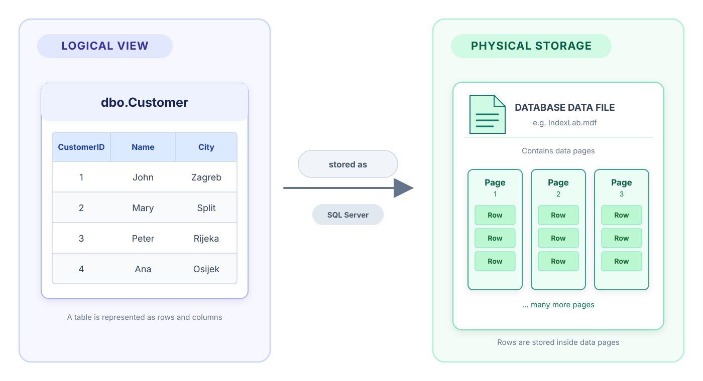

A single page can contain many rows, while a large table may require thousands or even millions of pages.

> [!IMPORTANT]
> A **row** is a logical unit of table data. An **8 KB page** is the fundamental unit SQL Server uses to organize that data in database files and the buffer pool.

### Why does physical storage matter?

Consider two queries that return the same number of rows.

One query may locate the required rows by accessing only a few pages, while another may need to examine thousands of pages.

Even though both queries return the same amount of data, the work required to find that data can be very different.

This leads to an important question:

**How many pages must SQL Server access to execute a query?**

Throughout this lab, we will explore how data is physically stored, how SQL Server accesses pages, and why these concepts matter for query performance.

In Lab 06, we will use this knowledge to understand how indexes can reduce unnecessary page accesses.

---

# 2. Create the IndexLab database

We will use the same generated database in Labs 05 and 06.

Run the [IndexLab setup script](setup/index-lab-data-setup.md) in SSMS. It creates the following tables:

- `Category`
- `Product`
- `Customer`
- `SalesOrder`
- `SalesOrderItem`

The two largest tables contain approximately **10,000,000 orders** and **40,000,000 order items**. Generation may take several minutes.

```sql
USE IndexLab;
GO

SELECT 'Category' AS TableName, COUNT(*) AS RowCnt FROM dbo.Category
UNION ALL
SELECT 'Product', COUNT(*) FROM dbo.Product
UNION ALL
SELECT 'Customer', COUNT(*) FROM dbo.Customer
UNION ALL
SELECT 'SalesOrder', COUNT(*) FROM dbo.SalesOrder
UNION ALL
SELECT 'SalesOrderItem', COUNT(*) FROM dbo.SalesOrderItem;
```

> [!TIP]
> You only need to run the setup once. Do **not** recreate the database before Lab 06: we want to study indexing on the same data.

Our question is not merely *how many rows exist?* It is **how are those rows stored, and what does SQL Server have to read to find them?**

---

# 3. Database files

A SQL Server database consists of one or more operating-system files. The usual extensions are:

| Extension | Role |
|---|---|
| `.mdf` | Primary data file |
| `.ndf` | Optional secondary data file |
| `.ldf` | Transaction log file |

## 3.1 Primary and secondary data files

Every database has **exactly one primary data file**, usually with the `.mdf` extension. It belongs to the primary filegroup.

Additional data files (commonly `.ndf`) can hold tables, indexes, and other database structures.

Their use and placement are configuration choices; more files do not automatically make a database faster.

## 3.2 Transaction log

The transaction log records changes needed for transaction recovery.

SQL Server uses **write-ahead logging (WAL)**: the relevant log records must be written to durable storage **before the corresponding modified data pages are written to disk**.

A modified page can therefore remain in memory after a transaction commits. If SQL Server stops unexpectedly, recovery uses log records to restore a consistent database state.

We will explore transactions in a later lab.

A simplified layout:

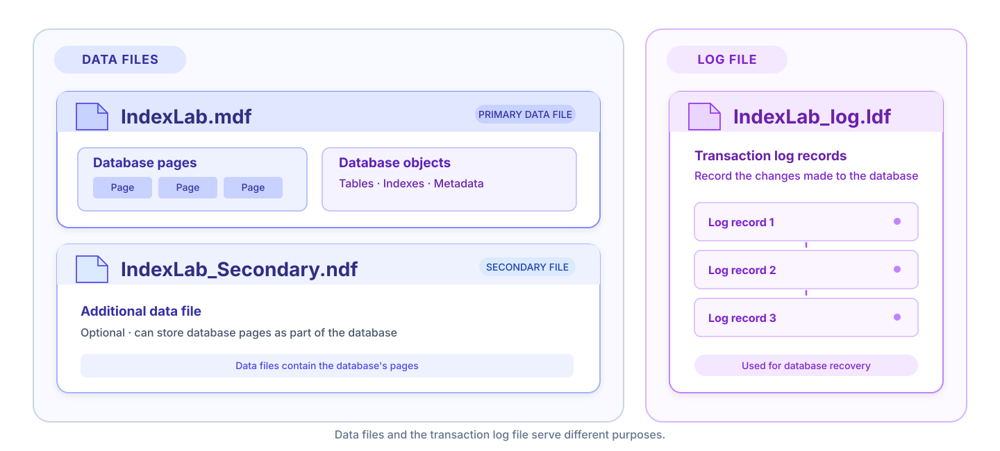

## 3.3 Exploring database storage in SSMS

Now that we have created the `IndexLab` database, let's examine how much disk space it occupies.

SQL Server Management Studio (SSMS) provides built-in reports that allow us to explore database storage without writing SQL queries.

### Step 1 – Database disk usage

Let's examine how much disk space our `IndexLab` database occupies.

1. In Object Explorer, right-click the `IndexLab` database.
2. Select **Reports → Standard Reports → Disk Usage**.
3. Examine the information displayed in the report.

The report shows the total reserved space, the sizes of the data and transaction log files, and how much space is currently used.

In our example:

| Description | Size |
|---|---:|
| Total Space Reserved | 4.5 GB |
| Data Files Space Reserved | 4096 MB (4 GB) |
| Transaction Log Space Reserved | 512 MB |

#### Understanding the results

When we created the `IndexLab` database, we specified the initial sizes of its files: **4096 MB for the data file** and **512 MB for the transaction log**.

These values determine how much disk space SQL Server initially reserves for the database.

However, notice that approximately **half of the data file is still unallocated**.

> [!IMPORTANT]
> **File size is not the same as used space.**
>
> Although the data file occupies 4 GB on disk, SQL Server has allocated only about 2 GB to database structures. The remaining space is available for future allocations without increasing the file size.

#### Why is choosing the right file size important?

Choosing appropriate file sizes is an important part of **database capacity planning**.

- **If files are too small**, SQL Server may need to grow them frequently, introducing additional overhead and potentially affecting performance.
- **If files are unnecessarily large**, they reserve disk space that could otherwise be used for other purposes.

SQL Server supports **autogrowth**, allowing database files to grow automatically when additional space is required.

> [!NOTE]
> Autogrowth is a useful safety mechanism, but it should not replace proper capacity planning.
>
> Also, larger database files do not automatically make queries faster. The goal is to allocate sufficient space while avoiding unnecessary file growth.

### Step 2 – Disk usage by table

1. Right-click the `IndexLab` database again.
2. Select **Reports → Standard Reports → Disk Usage by Table**.
3. Compare the number of records and disk space used by different tables.

Pay attention to these columns:

| Column | Description |
|---|---|
| Records | Number of rows in the table. |
| Reserved (KB) | Total space reserved for the table and its indexes. |
| Data (KB) | Space occupied by table data. |
| Indexes (KB) | Space occupied by index structures. |
| Unused (KB) | Reserved space not currently used. |

For example, our database contains:

| Table | Records | Data (KB) |
|---|---:|---:|
| Category | 100 | 8 |
| Customer | 100,000 | 5,856 |
| Product | 30,000 | 1,272 |
| SalesOrder | 10,000,000 | 457,144 |
| SalesOrderItem | 40,000,000 | 1,584,160 |

Notice that `SalesOrderItem` contains four times as many rows as `SalesOrder` and occupies considerably more space.

> [!NOTE]
> A table's storage requirements depend on the number of rows, the size of each row, and additional storage overhead.
>
> We will explore how SQL Server physically organizes this data in the following sections.

## Check your understanding

1. What is the difference between a table and the database file containing it?
2. What is the purpose of a transaction log?
3. Does a database always need secondary `.ndf` files?
4. Why can a database file occupy 4 GB on disk even when only about 2 GB has been allocated internally?
5. Does a table with twice as many rows necessarily require twice as much storage space?

<details>
<summary>Show answers</summary>

1. A table is a logical database object. Its data resides in pages stored in database data files.
2. It records the information required for transaction recovery. Write-ahead logging ensures relevant log records become durable before modified data pages are written to disk.
3. No. Secondary data files are optional.
4. SQL Server can reserve file space in advance. Space that has not yet been allocated internally remains available for future use.
5. No. Storage requirements also depend on row size and additional overhead.

</details>

---

# 4. From the storage device to SQL Server

SQL Server stores data in database files, but these files ultimately reside on storage devices managed by the operating system.

Different layers of the storage system use different units. Understanding these units will help us see how SQL Server's 8 KB pages relate to the underlying storage.

Let's first examine the storage configuration of your computer.

Open **Command Prompt** or **PowerShell** and run:

```text
fsutil fsinfo ntfsinfo C:
```

If your database files are stored on another NTFS volume, use that volume's drive letter instead.

Look for entries similar to these (the exact names and values may differ):

```text
Bytes Per Sector          : 512
Bytes Per Physical Sector : 4096
Bytes Per Cluster         : 4096
```

These values describe different storage units. Let's examine what each one means.

## 4.1 Sectors: 512 B and 4 KB

A **sector** is a unit of storage addressing exposed by a storage device to the operating system.

Older hard disk drives traditionally used 512-byte sectors. Modern storage devices commonly use 4 KB physical sectors, although they may still expose 512-byte logical sectors for compatibility.

Two important concepts are:

- **Logical sector:** The smallest addressable unit exposed by the storage device to the operating system.
- **Physical sector:** The physical sector granularity reported by the device.

Modern storage devices commonly use the following configurations:

| Configuration | Logical sector | Physical sector |
|---|---:|---:|
| 512n | 512 B | 512 B |
| 512e | 512 B | 4096 B |
| 4Kn | 4096 B | 4096 B |

### Understanding 512e

A **512e (512-byte emulation)** device uses 4 KB physical sectors but presents 512-byte logical sectors to the operating system.

Therefore:

$$
4096 \div 512 = 8
$$

Eight logical sectors correspond to one reported 4 KB physical sector.

This distinction matters because a write that updates only part of a physical sector may require the device to perform a **read-modify-write operation**.

The device may need to read the entire physical sector, modify the relevant portion, and write it back.

> [!NOTE]
> **What about SSDs?**
>
> SSDs do not have rotating platters or magnetic tracks. They still expose logical sectors to the operating system, but internally organize NAND flash memory using different structures.
>
> A reported 4 KB physical sector is not necessarily the same as an internal NAND flash page.

The following illustration provides a conceptual overview of how logical table data relates to SQL Server data pages and physical storage.

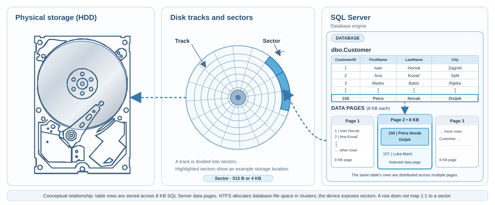

The arrows illustrate conceptual relationships, not a direct one-to-one mapping between table rows, SQL Server pages, and physical disk sectors.

## 4.2 NTFS clusters

A **cluster**, also called an *allocation unit*, is the basic unit of disk space that the NTFS file system normally allocates to a file.

A cluster consists of one or more logical sectors.

For example, if a volume uses 512-byte logical sectors and 4096-byte clusters:

$$
4096 \div 512 = 8
$$

One NTFS cluster contains eight logical sectors.

### How cluster size affects file allocation

Suppose the NTFS cluster size is **4096 bytes (4 KB)**.

Consider three files:

| File size | Clusters allocated | Allocated space |
|---:|---:|---:|
| 1000 B | 1 | 4096 B |
| 5000 B | 2 | 8192 B |
| 10000 B | 3 | 12288 B |

A file containing 1000 bytes normally requires one 4096-byte cluster, leaving part of the allocated space unused.

Similarly, a 5000-byte file requires two clusters because it cannot fit into one.

This unused space within the final allocated cluster is sometimes called **slack space**.

> [!NOTE]
> This is a simplified example of ordinary file allocation. NTFS has additional features, such as resident data, that can store very small files differently.

### Why are 64 KB clusters often recommended for SQL Server?

For many SQL Server database storage configurations, **64 KB NTFS allocation units** are commonly recommended.

Larger allocation units can reduce file-system allocation overhead when working with large database files.

However, this does not mean that SQL Server starts using 64 KB data pages.

SQL Server still organizes its database data into **8 KB pages**, regardless of the NTFS cluster size.

The two units belong to different layers:

- NTFS clusters determine how the file system allocates space to files.
- SQL Server pages determine how the database engine organizes data inside those files.

> [!IMPORTANT]
> A 64 KB NTFS cluster does not automatically make SQL queries faster.
>
> The appropriate allocation unit size depends on the workload, storage configuration, and applicable SQL Server recommendations. Cluster size is normally selected when the volume is formatted.

## 4.3 Different layers, different units

We have now encountered several storage units: sectors, clusters, and SQL Server pages.

The following illustration shows how these layers relate to each other.

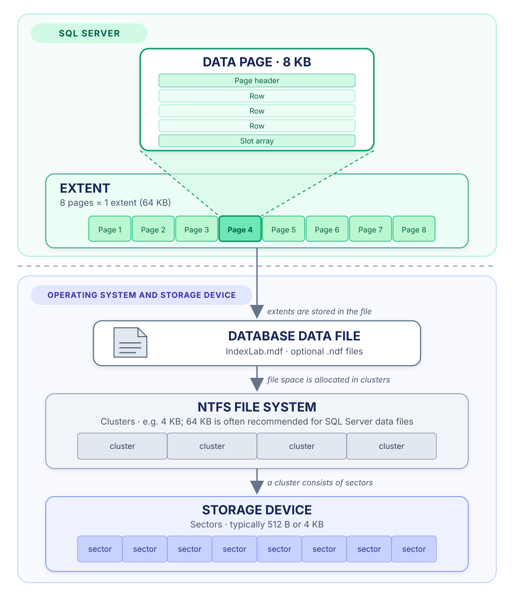

Each layer has its own responsibilities.

| Layer | Unit | Example size | Purpose |
|---|---|---|---|
| Storage device | Logical sector | 512 B | Addressable unit exposed to the operating system |
| Storage device | Reported physical sector | 4 KB | Reported physical sector granularity |
| NTFS file system | Cluster | 4 KB | File-space allocation unit |
| SQL Server | Page | 8 KB | Basic unit of database storage |
| SQL Server | Extent | 64 KB | Group of eight consecutive database pages |

### Comparing the sizes

Consider a system with:

- 512-byte logical sectors
- 4096-byte physical sectors
- 4096-byte NTFS clusters
- 8192-byte SQL Server pages

In terms of size:

**One NTFS cluster:**

$$
4096 \div 512 = 8 \text{ logical sectors}
$$

**One SQL Server page:**

$$
8192 \div 4096 = 2 \text{ NTFS clusters}
$$

**One SQL Server extent:**

$$
8 \times 8192 = 65536 \text{ bytes} = 64 \text{ KB}
$$

These calculations compare the sizes of different storage units.

They do not imply that each SQL Server page is always stored in exactly two specific NTFS clusters or that accessing one page requires a fixed number of hardware operations.

> [!IMPORTANT]
> **One SQL Server page does not necessarily mean one physical disk I/O operation.**
>
> SQL Server can read multiple consecutive pages in a single I/O request. The operating system and storage hardware may also process I/O requests differently from the logical page accesses performed by SQL Server.
>
> Furthermore, if a page is already available in the buffer pool, SQL Server can access it without reading it from storage again.

### From storage units to I/O performance

Understanding these storage units helps explain how SQL Server interacts with the underlying storage system.

However, the number of database pages accessed by a query and the number of physical storage operations are **not the same measurement**.

In Section 8, we will examine how SQL Server uses the **buffer pool**, distinguish **logical reads** from **physical reads**, and explain how **read-ahead** can load pages before they are needed.

Before that, let's take a closer look at how SQL Server organizes its database files into **pages and extents**.

---

# 5. Files, extents, and pages

SQL Server stores database data inside data files (`.mdf` and `.ndf`). These files are organized into fixed-size **8 KB pages**.

A page is the fundamental unit SQL Server uses to store and access database data. Pages can contain table rows, index entries, or internal metadata.

To manage storage allocation, SQL Server groups eight consecutive pages into an **extent**.

| Unit | Size | Main purpose |
|---|---:|---|
| Page | 8 KB (8,192 bytes) | Stores rows, index entries, or metadata |
| Extent | 8 pages = 64 KB | Groups pages for storage allocation |

The following illustration shows how database files, extents, and pages relate to each other.

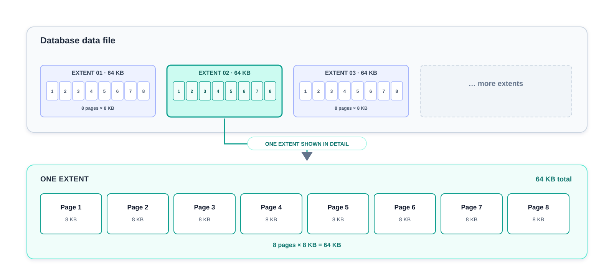

## 5.1 Understanding pages

A SQL Server data file is divided into pages of **8,192 bytes**.

Each page has an identifier within its database file, allowing SQL Server to locate it.

A single page may contain many table rows. Larger tables require many pages, potentially distributed across different parts of the database file.

Pages also store index structures and allocation metadata, not only user data.

> [!IMPORTANT]
> SQL Server uses pages as its fundamental unit of database storage and buffer-pool access. However, one page does not necessarily correspond to one physical disk I/O operation.

## 5.2 Understanding extents

An **extent** is a group of eight physically consecutive SQL Server pages within a database file.

Therefore:

$$
8 \times 8192 = 65536 \text{ bytes} = 64 \text{ KB}
$$

SQL Server uses extents to manage the allocation of storage space.

There are two types of extents:

| Extent type | Description |
|---|---|
| **Uniform extent** | All eight pages are allocated to the same allocation unit. |
| **Mixed extent** | Individual pages may be allocated to different allocation units. |

Modern SQL Server versions normally use uniform extents for new allocations, although mixed extents are still supported.

For this lab, the important concept is that **extents help SQL Server manage storage allocation**, while pages contain the actual database structures.

> [!NOTE]
> An extent and a 64 KB NTFS cluster may have the same size, but they belong to different layers. An extent is a SQL Server allocation concept, while an NTFS cluster is a file-system allocation unit.

## 5.3 Example – How many pages fit into a database file?

Imagine a SQL Server data file with a size of **64 MB**.

Because each page occupies 8 KB:

$$
64 \times 1024 = 65536 \text{ KB}
$$

$$
65536 \div 8 = 8192 \text{ pages}
$$

Each extent contains eight pages:

$$
8192 \div 8 = 1024 \text{ extents}
$$

Therefore, a 64 MB data file contains space for:

- **8,192 pages**
- **1,024 extents**

This does not mean that all pages contain user data. Some pages store internal metadata, while others may not yet be allocated to database objects.

## 5.4 Why does this matter?

Understanding pages and extents helps us distinguish two important concepts:

- **Storage allocation:** How SQL Server manages space within database files.
- **Data access:** How SQL Server reads and processes pages when executing queries.

Extents are primarily relevant to storage allocation.

Pages are particularly important when analyzing query performance because SQL Server reports **logical reads** as page accesses.

For example, a query that accesses 1,000 pages performs substantially more page-access work than one that accesses only 10 pages, assuming comparable access patterns.

In the following sections, we will examine what a data page contains and why the number of pages accessed can significantly affect query performance.

## Check your understanding

1. How many bytes does a SQL Server page contain?
2. How many pages form an extent?
3. What is the difference between a page and an extent?
4. How many pages fit into a 64 MB data file?
5. Does every page in a database file necessarily contain user data?

<details>
<summary>Show answers</summary>

1. A SQL Server page contains **8,192 bytes (8 KB)**.
2. An extent contains **eight consecutive pages**, totaling 64 KB.
3. A page stores database data or metadata, while an extent groups eight pages for storage allocation.
4. A 64 MB file contains space for **8,192 pages**.
5. No. Some pages contain internal metadata, and others may not yet be allocated to database objects.

</details>

---

# 6. Inside a data page

We have learned that SQL Server organizes database data into **8 KB pages (8,192 bytes)**.

But what is actually stored inside a data page?

A regular SQL Server data page contains four main components:

- **Page header** – metadata describing the page.
- **Records** – the actual stored rows, including internal record overhead.
- **Free space** – space available for additional records.
- **Slot array** – information used to locate individual records within the page.

The following illustration shows the internal structure of a SQL Server data page.

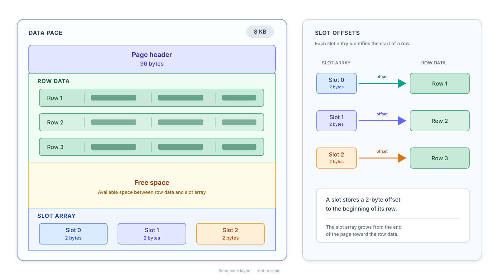

## 6.1 Page header

Every regular SQL Server data page begins with a **96-byte header**.

The header contains information such as:

- The page identifier (file ID and page ID).
- The page type.
- The number of record slots.
- Information about available space.

SQL Server uses this metadata to manage the page and locate its contents.

Therefore, the full 8,192 bytes are not available exclusively for storing rows.

After the header, the remaining space is:

$$
8192 - 96 = 8096 \text{ bytes}
$$

However, some of this space is also required for the slot array.

## 6.2 Records and row overhead

A data page stores multiple records, provided they fit into the available space.

Each record contains the column values and additional internal information required by SQL Server.

For example, a table might contain:

```sql
CategoryId INT,
CategoryName VARCHAR(50)
```

The `int` value requires 4 bytes, while the `varchar` value uses space according to the actual stored text.

However, the physical record is larger than the sum of these values because SQL Server also stores internal record metadata.

This can include information about the record format, null bitmap, and variable-length columns.

> [!NOTE]
> The physical size of a record depends on its column definitions and stored values. Two rows in the same table may occupy different amounts of space.

We will examine real record sizes in Section 13 using the `Category` table.

## 6.3 The slot array

At the end of a regular data page, SQL Server maintains a **slot array**.

Each slot array entry occupies **2 bytes** and stores the offset of a record within the page.

For example, if a page contains 100 records:

$$
100 \times 2 = 200 \text{ bytes}
$$

The slot array occupies 200 bytes.

Why does SQL Server need a slot array?

Records are not necessarily stored in the same physical order in which they are logically accessed. The slot array allows SQL Server to locate individual records using their offsets.

If records are moved within the page, SQL Server can update their slot offsets.

> [!IMPORTANT]
> A slot number is not the same as a table's primary key. It identifies a record position within a particular page and should not be treated as a permanent logical row identifier.

## 6.4 A simple row-count estimate

Let's estimate how many rows can fit into one 8 KB page.

Start with the available space after the page header:

$$
8192 - 96 = 8096 \text{ bytes}
$$

Suppose each stored record, **including its internal overhead**, occupies approximately 100 bytes.

Each record also requires a 2-byte slot array entry.

Therefore, the approximate space required per record is:

$$
100 + 2 = 102 \text{ bytes}
$$

The estimated number of records per page is:

$$
\left\lfloor \frac{8096}{102} \right\rfloor = 79
$$

This means approximately **79 records fit into one page**.

Now imagine a table containing one million records.

The estimated number of data pages is:

$$
\left\lceil \frac{1{,}000{,}000}{79} \right\rceil = 12{,}659
$$

Therefore, the table would require approximately **12,659 data pages**.

This is only an estimate. Actual page utilization depends on factors such as record sizes, variable-length data, page splits, and partially filled pages.

> [!NOTE]
> This estimate assumes ordinary in-row records of approximately equal size and relatively full pages. Some large values may be stored outside the main data page.

## 6.5 Why does this matter?

The number of records that fit into a page directly influences the number of pages required to store a table.

For the same number of records:

- **Smaller records** generally mean more records per page and fewer data pages.
- **Larger records** generally mean fewer records per page and more data pages.

More pages can mean more work for queries that scan the table.

In Section 7, we will examine this relationship and explain how page count affects query performance.

Later, in Sections 12 and 13, we will inspect a real SQL Server data page and compare these estimates with actual storage measurements.

## Check your understanding

1. How many bytes does a SQL Server data page contain?
2. Why are all 8,192 bytes not available exclusively for record data?
3. What is the purpose of the slot array?
4. How many bytes does a slot array with 100 entries occupy?
5. Why might two records from the same table have different physical sizes?

<details>
<summary>Show answers</summary>

1. **8,192 bytes (8 KB).**
2. Because the page also contains a 96-byte header and a slot array. Individual records also contain internal overhead.
3. The slot array stores offsets that allow SQL Server to locate records within the page.
4. **200 bytes**, because each entry occupies 2 bytes.
5. Because variable-length column values and other record-format characteristics can affect the physical size of each record.

</details>

---

# 7. Why pages matter

We have learned that SQL Server stores data in 8 KB pages and that the number of rows fitting into a page depends on their physical size.

But why does this matter for query performance?

The key idea is that **SQL Server accesses data through pages, not as independent rows stored directly on disk**.

When a query needs to examine many rows, the number of pages containing those rows can significantly affect the amount of work required.

## 7.1 How row size affects page count

Imagine two tables, both containing **1,000,000 rows**.

Table A contains relatively narrow rows, while Table B contains wider rows.

Because wider rows occupy more space, fewer of them can fit into each 8 KB page.

| Property | Table A – Narrow rows | Table B – Wider rows |
|---|---:|---:|
| Number of rows | 1,000,000 | 1,000,000 |
| Average rows per page | 100 | 50 |
| Approximate data pages | 10,000 | 20,000 |

We can estimate the number of pages required.

**Table A:**

$$
\frac{1{,}000{,}000}{100} = 10{,}000 \text{ pages}
$$

**Table B:**

$$
\frac{1{,}000{,}000}{50} = 20{,}000 \text{ pages}
$$

Although both tables contain the same number of rows, Table B requires approximately **twice as many data pages**.

This illustrates an important relationship:

**Wider rows → Fewer rows per page → More data pages**

The actual number of pages also depends on page utilization, variable-length data, and other storage characteristics.

> [!IMPORTANT]
> Even a small increase in average record size can significantly increase the number of pages required by a large table.

## 7.2 How page count affects I/O cost

Now let's consider a separate example that focuses on the amount of page data accessed during a full table scan.

Imagine two tables with very different storage requirements:

- **Table A:** 100 data pages.
- **Table B:** 100,000 data pages.

Each SQL Server page occupies 8,192 bytes.

| Property | Table A | Table B |
|---|---:|---:|
| Data pages | 100 | 100,000 |
| Page size | 8 KB | 8 KB |
| Total page data | 800 KiB | 781.25 MiB |

We can calculate the total page data.

**Table A:**

$$
100 \times 8192 = 819{,}200 \text{ bytes} = 800 \text{ KiB}
$$

**Table B:**

$$
100{,}000 \times 8192 = 819{,}200{,}000 \text{ bytes} = 781.25 \text{ MiB}
$$

The following illustration shows how page count affects the amount of data accessed during a full scan.

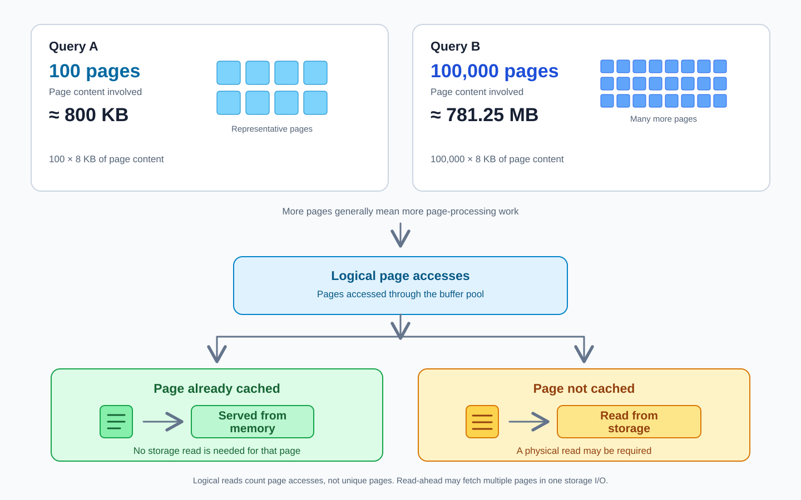

Table B contains **1,000 times more data pages** than Table A.

A full scan of Table B therefore involves approximately 1,000 times as much page data as a full scan of Table A.

However, this does not necessarily mean that SQL Server transfers all these bytes from physical storage during every execution.

Some or all of the required pages may already be cached in memory.

> [!IMPORTANT]
> **Page data accessed is not necessarily the same as data physically read from storage.**
>
> SQL Server may access pages already in memory, and a single storage I/O request may transfer multiple pages.

We will examine this distinction in Section 8.

## 7.3 Why more pages can mean more work

When a query scans a table, SQL Server must access the pages containing the required records.

More pages generally mean:

- More page accesses in the buffer pool.
- More work examining records and evaluating query conditions.
- Potentially more physical storage reads when pages are not cached.
- Greater memory requirements to cache the same proportion of the table.

For example, even if all pages are already in memory, scanning 20,000 pages generally requires more page-processing work than scanning 10,000 pages under comparable conditions.

This is why reducing unnecessary page accesses is an important part of query optimization.

However, **twice as many pages does not automatically mean twice the execution time**. Performance also depends on CPU work, caching, I/O patterns, parallelism, and the execution plan.

## 7.4 Rows returned vs. pages examined

Consider the following query:

```sql
SELECT *
FROM dbo.Customer
WHERE CustomerName = 'Customer 50000';
```

The query may return only one row.

But does that mean SQL Server needs to examine only one page?

Not necessarily.

If SQL Server cannot efficiently locate the requested row using an appropriate access path, it may need to scan many pages before finding it.

Therefore, we must distinguish:

- **Rows returned:** The number of rows produced by the query.
- **Rows examined:** The number of rows SQL Server processes while evaluating the query.
- **Pages accessed:** The number of page accesses required during execution.

A query returning one row can still perform thousands of logical reads.

> [!NOTE]
> The number of logical reads is not necessarily the number of distinct pages. SQL Server may access the same page more than once during query execution.

## 7.5 Key takeaways

- SQL Server organizes data into 8 KB pages.
- Wider rows generally mean fewer rows per page.
- More pages are required to store the same number of rows when the average row size increases.
- More pages can increase the amount of work required by a full scan.
- Logical page accesses do not necessarily require physical storage I/O.
- The number of rows returned does not tell us how many pages were examined.
- Query performance depends on both the physical organization of data and the way SQL Server accesses it.

**Check your understanding**

1. Why can two tables with the same number of rows require different numbers of pages?
2. If one million rows fit at 50 rows per page, how many data pages are required?
3. How much page data is represented by 100,000 SQL Server pages?
4. Does scanning twice as many pages always take twice as long?
5. Can a query returning one row still access thousands of pages?
6. Does accessing 1,000 pages always mean performing 1,000 physical disk I/O operations?

<details>
<summary>Show answers</summary>

1. Because their rows may have different physical sizes, resulting in different numbers of rows per page. Page utilization can also affect the total.
2. **20,000 pages**, assuming an average of 50 rows per page.
3. **781.25 MiB**, assuming 8,192 bytes per page.
4. **No.** Execution time also depends on caching, CPU work, I/O patterns, parallelism, and other factors.
5. **Yes.** Without an efficient access path, SQL Server may need to scan many pages to find a matching row.
6. **No.** Pages may already be cached in memory, and a single physical I/O request can transfer multiple pages.

</details>

---

# 8. Buffer pool, logical reads, and physical reads

In Section 7, we learned that the number of database pages can significantly affect the amount of work required to execute a query.

But does accessing 1,000 pages mean that SQL Server must perform 1,000 physical disk reads?

**Not necessarily.**

SQL Server uses an area of RAM called the **buffer pool** to cache database pages and reduce the need for repeated storage access.

Understanding how SQL Server accesses these pages is essential for interpreting query performance.

## 8.1 The buffer pool

SQL Server stores table and index data in **8 KB pages**.

When a query needs a page, SQL Server checks whether that page is already available in the buffer pool.

- **If the page is in memory**, SQL Server can access it without reading it from storage.
- **If the page is not in memory**, SQL Server must load it from storage into the buffer pool before accessing it.

Once a page has been loaded, it may remain in memory and be reused by subsequent queries.

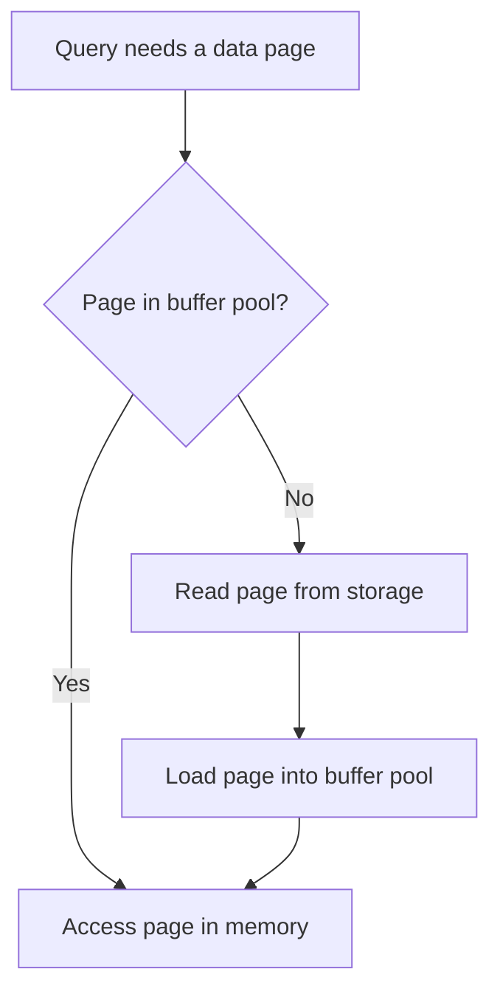

For example, imagine that the first query accesses 500 pages that are not currently cached.

SQL Server may need to load those pages from storage.

If another query accesses the same pages shortly afterward, they may already be available in the buffer pool, avoiding additional storage reads.

> [!NOTE]
> The buffer pool caches database pages, not complete query results. Even when all required pages are already in memory, SQL Server still needs to access and process them.

### What if a page is modified?

SQL Server also uses the buffer pool when modifying data.

When a query changes a row, SQL Server modifies the corresponding page in memory. Such a page is called a **dirty page** until its changes are written to the database file.

SQL Server uses transaction logging and background writing mechanisms to ensure that changes can be recovered and eventually persisted.

For this lab, the important point is that **the buffer pool is used for both reading and modifying database pages**.

## 8.2 Logical, physical, and read-ahead reads

SQL Server distinguishes between several types of page reads.

| Type | Description |
|---|---|
| **Logical read** | Access to a database page in the buffer pool. |
| **Physical read** | A page read from storage on demand because it was not already available in memory. |
| **Read-ahead read** | A page read from storage in advance because SQL Server expects to need it soon. |

### How read-ahead works

When SQL Server scans a large table, it may predict which pages will be needed next.

Instead of waiting until each page is requested, SQL Server can **load upcoming pages into the buffer pool in advance**.

This allows SQL Server to overlap storage activity with query processing, reducing the time spent waiting for pages.

For example, imagine a query scanning a table containing thousands of pages.

While SQL Server processes the current pages, the read-ahead mechanism may already be loading additional pages that the query will need shortly.

> [!IMPORTANT]
> Read-ahead reads also involve physical storage access. However, `SET STATISTICS IO` reports them separately from on-demand `physical reads`.

### Example – Cached and uncached pages

Imagine a query that performs 1,000 logical reads.

**Scenario A – All required pages are cached**

| Metric | Value |
|---|---:|
| Logical reads | 1,000 |
| Physical reads | 0 |
| Read-ahead reads | 0 |

All required pages are already available in memory.

**Scenario B – Some pages must be loaded**

| Metric | Value |
|---|---:|
| Logical reads | 1,000 |
| Physical reads | 100 |
| Read-ahead reads | 300 |

SQL Server performs 1,000 logical page accesses, while some required pages are loaded from storage either on demand or through read-ahead.

These are illustrative values. Physical and read-ahead reads are separate counters, and their sum does not necessarily equal the number of distinct pages accessed by the query.

Also, logical reads do not necessarily represent the number of **unique pages**. The same page may be accessed multiple times during query execution.

## 8.3 Measuring I/O with STATISTICS IO

SQL Server provides the `SET STATISTICS IO` command to display information about page reads performed by a query.

Let's examine the `Product` table in our `IndexLab` database.

Execute:

```sql
USE IndexLab;
GO

SET STATISTICS IO ON;

SELECT *
FROM dbo.Product;

SET STATISTICS IO OFF;
```

After executing the query, open the **Messages** tab in SQL Server Management Studio (SSMS).

On our reference database, the relevant output was:

```text
Table 'Product'. Scan count 1,
logical reads 161,
physical reads 0,
read-ahead reads 0.
```

*Only the relevant metrics are shown. Your results may differ.*

Let's interpret the values:

| Metric | Value | Interpretation |
|---|---:|---|
| `scan count` | 1 | One scan was started for the table. |
| `logical reads` | 161 | SQL Server performed 161 page accesses in the buffer pool. |
| `physical reads` | 0 | No on-demand storage reads were reported. |
| `read-ahead reads` | 0 | No read-ahead storage reads were reported. |

The query returned **30,000 product rows**.

Although SQL Server performed 161 logical reads, it did not need to load additional pages from storage during this execution.

The required pages were already available in memory.

> [!NOTE]
> Physical and read-ahead read counts may differ between executions because the buffer pool contents change over time.
>
> Logical reads are often useful when comparing query access methods, but they can also change if SQL Server selects a different execution plan.

## 8.4 Why logical reads matter

It may seem that logical reads are unimportant because they access memory rather than storage.

However, accessing and processing pages in memory still requires system resources.

Even when physical reads are zero, SQL Server must perform work to access pages, examine records, and evaluate query conditions.

Consider two hypothetical queries returning the same result:

| Metric | Query A | Query B |
|---|---:|---:|
| Logical reads | 10,000 | 100 |
| Physical reads | 0 | 0 |

Both queries access only cached pages.

However, Query A performs **100 times as many logical page reads**.

This may require more CPU processing, memory access, and buffer management work.

Therefore, **reducing unnecessary logical reads can improve query performance even when physical reads are zero**.

### Connection to physical storage

Recall from Section 7:

**Wider rows → Fewer rows per page → More pages required**

For a full table scan, more pages generally mean more logical page accesses.

However, the number of pages accessed also depends on **how SQL Server locates the required data**.

A query that scans an entire table may access hundreds or thousands of pages, while a query using a suitable index may need only a few.

We will investigate this in Sections 14 and 15 and explore index optimization in greater detail in Lab 06.

## 8.5 Compare two queries

Let's compare the I/O statistics of two queries against the same table.

Execute:

```sql
SET STATISTICS IO ON;

-- Query A: Retrieve all products
SELECT *
FROM dbo.Product;

-- Query B: Retrieve one product
SELECT *
FROM dbo.Product
WHERE ProductId = 500;

SET STATISTICS IO OFF;
```

On our reference database, we obtained:

| Metric | Query A: All products | Query B: One product |
|---|---:|---:|
| Rows returned | 30,000 | 1 |
| Scan count | 1 | 0 |
| Logical reads | 161 | 2 |
| Physical reads | 0 | 0 |
| Read-ahead reads | 0 | 0 |

Notice the difference:

- Query A performs **161 logical reads**.
- Query B performs only **2 logical reads**.

Both queries report zero physical reads, but the number of logical page accesses is very different.

Why?

The second query can use the clustered index on `ProductId` to locate the requested row efficiently, rather than scanning the entire table.

We will examine the physical structure of this index in Section 14.

> [!IMPORTANT]
> These queries return different amounts of data: 30,000 rows versus one row.
>
> This comparison demonstrates different data-access patterns, not the isolated performance benefit of adding an index. We will perform controlled index comparisons in Lab 06.

### Does a WHERE condition always reduce logical reads?

No.

Adding a `WHERE` condition does not automatically mean that SQL Server can access fewer pages.

If there is no suitable index, SQL Server may still need to scan the entire table to find matching rows.

The number of logical reads depends on the available indexes and the execution plan selected by SQL Server.

## 8.6 Key takeaways

- SQL Server uses the buffer pool to cache database pages in memory.
- Logical reads represent accesses to pages in the buffer pool.
- Physical reads load pages from storage on demand.
- Read-ahead reads load pages in advance to reduce waiting for storage.
- A query can perform many logical reads even when physical reads are zero.
- Reducing unnecessary logical reads can improve query performance.
- The number of pages accessed depends on both physical storage and the query execution plan.

**Check your understanding**

1. What is the purpose of the buffer pool?
2. Why can a query perform 1,000 logical reads but zero physical reads?
3. What is the difference between an on-demand physical read and a read-ahead read?
4. Does a logical read always correspond to a different database page?
5. Why can reducing logical reads improve performance even when all pages are cached?
6. Does adding a `WHERE` condition always reduce logical reads?

<details>
<summary>Show answers</summary>

1. **The buffer pool caches database pages in RAM**, reducing the need to repeatedly read them from storage.

2. Because all required pages may already be cached in the buffer pool. SQL Server can access them without performing additional storage reads.

3. **An on-demand physical read** loads a page when it is needed and not cached. **A read-ahead read** loads a page in advance because SQL Server expects to need it soon.

4. **No.** The same page may be accessed multiple times, and each access can contribute to the logical-read count.

5. Because accessing and processing pages in memory still consumes CPU and memory resources. Reducing unnecessary page accesses can reduce this work.

6. **No.** Without a suitable index, SQL Server may still need to scan many or all data pages to evaluate the condition.

</details>

---

# 9. Page types

SQL Server uses different types of **8 KB pages**, depending on what information they store.

Some pages contain actual table rows, others help navigate indexes, and some are used to manage storage allocation.

The following page types are particularly important for this lab:

| PageType | Name | Purpose |
|---|---|---|
| `1` | **Data page** | Stores table rows, including the leaf-level rows of a clustered index. |
| `2` | **Index page** | Stores index entries used to navigate index structures. |
| `10` | **IAM page** | Tracks extents allocated to a particular allocation unit. |

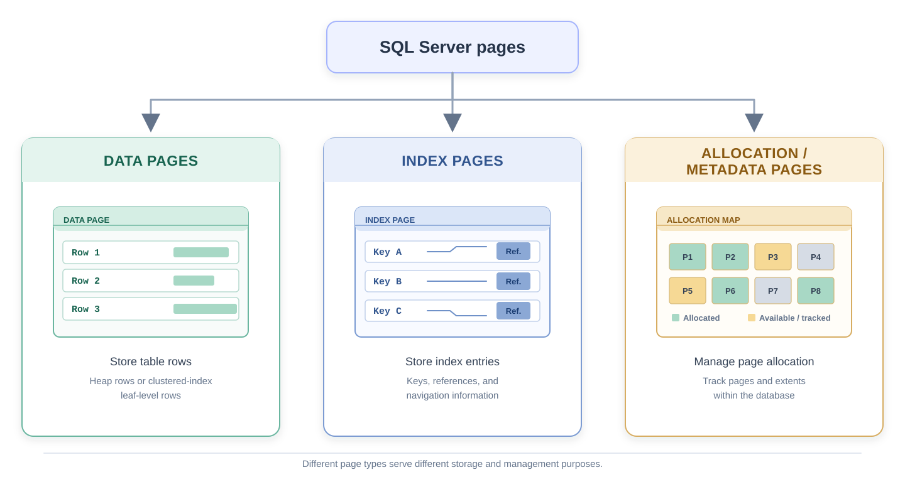

For example, a small table may fit into a single data page, while a larger table may require hundreds of data pages and additional index pages.

SQL Server also uses other internal page types, such as **PFS, GAM, and SGAM**, to manage storage allocation. We will not examine these in detail.

> [!NOTE]
> IAM pages contain allocation information, not ordinary table rows. They are not part of the index navigation hierarchy.

In the following sections, we will use `DBCC IND` to identify these page types in our `IndexLab` database.

**Check your understanding**

1. What is the purpose of a data page?
2. What is the difference between a data page and an index page?
3. What does an IAM page track?

<details>
<summary>Show answers</summary>

1. A data page stores table rows, including the leaf-level rows of a clustered index.
2. A data page stores actual table rows, while an index page contains entries used to navigate an index.
3. An IAM page tracks extents allocated to a particular allocation unit.

</details>

---

# 10. Inspecting physical pages

So far, we have learned how SQL Server organizes data into pages and how different page types serve different purposes.

But can we actually examine these pages?

SQL Server provides diagnostic commands that allow us to inspect its internal storage structures.

In this lab, we will use two commands:

| Command | Purpose |
|---|---|
| `DBCC IND` | Lists the pages associated with a table and its indexes. |
| `DBCC PAGE` | Displays the internal contents of a specific database page. |

**DBCC** stands for *Database Console Commands*. SQL Server provides DBCC commands for diagnostics, maintenance, and consistency checks.

> [!WARNING]
> `DBCC IND` and `DBCC PAGE` are undocumented diagnostic commands. They are useful for learning and troubleshooting but should not be relied upon as stable, supported interfaces in production applications.

## Preparing the session

Before inspecting pages, enable diagnostic output for the current session:

```sql
USE IndexLab;
GO

DBCC TRACEON(3604);
GO
```

Trace flag `3604` directs diagnostic output to the client session rather than the SQL Server error log.

Because we have not specified the `-1` global option, this setting applies only to the current session.

> [!NOTE]
> The page identifiers and diagnostic output shown in the following sections may differ on your computer. SQL Server determines how pages are allocated, so always use the page identifiers returned by your own database.

We are now ready to examine the physical pages belonging to our tables.

In **Section 11**, we will use `DBCC IND` to locate pages.

In **Section 12**, we will use `DBCC PAGE` to inspect their contents.

---

# 11. DBCC IND – Which pages belong to a table?

When we execute SQL queries, we work with logical objects such as tables and rows. However, SQL Server physically stores these rows in **8 KB pages** inside database files.

A table may occupy one page or thousands of pages, depending on its size and structure.

The undocumented diagnostic command `DBCC IND` allows us to examine **which pages are allocated to a table or its indexes**.

Let's start with our smallest table, `Category`.

```sql
DBCC IND('IndexLab', 'dbo.Category', -1);
GO
```

The command accepts three parameters:

| Parameter | Meaning |
|---|---|
| `'IndexLab'` | Database to inspect |
| `'dbo.Category'` | Table to inspect |
| `-1` | Include all indexes belonging to the table |

The result contains several columns describing the pages associated with the table.

## 11.1 Understanding the output

For this lab, focus on the following columns:

| Column | Meaning |
|---|---|
| `PageFID` | Identifies the database file containing the page. |
| `PagePID` | Identifies the page within that file. |
| `PageType` | Identifies the type and purpose of the page. |
| `IndexID` | Identifies the heap or index to which the page belongs. |

### PageFID and PagePID

SQL Server identifies a database page using two values:

- **PageFID (File ID)** identifies the data file.
- **PagePID (Page ID)** identifies the page within that file.

Together, these values uniquely identify a page within the database.

For example:

```text
PageFID = 1
PagePID = 113736
```

This means page 113736 in database file 1.

Remember that a database can contain multiple data files, so a page number alone is not sufficient to identify a page.

> [!NOTE]
> Page IDs depend on how SQL Server allocates storage. Your values may differ from those shown in this manual.

### PageType – What kind of page is this?

As discussed in Section 9, SQL Server uses different page types for different purposes.

The most important values for this lab are:

| PageType | Meaning |
|---|---|
| `1` | **Data page** – contains table rows, including leaf-level rows of a clustered index. |
| `2` | **Index page** – contains navigation entries in the non-leaf levels of an index. |
| `10` | **IAM page** – tracks allocated extents associated with an allocation unit. |

For example, a small table may require only one data page and one IAM page.

Larger tables may contain hundreds or thousands of data pages. If they have a sufficiently large clustered index, they will also have index pages used to navigate its structure.

> [!IMPORTANT]
> An IAM page does not contain ordinary table rows. It contains allocation information that helps SQL Server track where pages belonging to an allocation unit are located.

### IndexID – Which index does the page belong to?

The `IndexID` column tells us which table storage structure or index is associated with the page.

| IndexID | Meaning |
|---|---|
| `0` | Heap – a table without a clustered index |
| `1` | Clustered index |
| `2` or higher | Nonclustered index |

Our `Category`, `Product`, and `Customer` tables have a **clustered primary key**.

Therefore, their ordinary data pages belong to the clustered index and have `IndexID = 1`.

This may seem unusual at first: why do the actual table rows belong to an index?

In SQL Server, a clustered index organizes the table's rows at its leaf level. In other words, **the leaf level of a clustered index contains the actual table data**.

We will explore clustered and nonclustered indexes in more detail in Lab 06.

## 11.2 Interpreting the Category results

On our reference SQL Server instance, `DBCC IND` returned two pages for `Category`:

| PageFID | PagePID | PageType | IndexID |
|---|---:|---:|---:|
| 1 | 119 | 10 | 1 |
| 1 | 113736 | 1 | 1 |

Let's interpret these results.

**Page 119 – IAM page**

- `PageType = 10` identifies an Index Allocation Map (IAM) page.
- SQL Server uses this page to track allocated extents for the table's allocation unit.
- It does not contain ordinary table rows.

**Page 113736 – Data page**

- `PageType = 1` identifies a data page.
- `IndexID = 1` indicates that it belongs to the clustered index.
- This page contains the actual rows of the `Category` table.

Because `Category` is very small, all **100 rows fit into a single data page**.

This illustrates an important concept: **a table containing 100 rows does not necessarily require 100 pages**. Multiple rows are stored together inside the same 8 KB page.

For larger tables such as `Product` and `Customer`, you will find many more data pages.

## 11.3 From page location to page contents

We now know that the `Category` table has a data page identified by:

```text
File ID: 1
Page ID: 113736
```

But what does this page actually contain?

How many records are stored inside it? How much space do they occupy? How much free space remains?

To answer these questions, we need another diagnostic command: **`DBCC PAGE`**.

In Section 12, we will use it to examine the internal structure of a data page, including its header, records, and slot array.

## Check your understanding

1. What information does `DBCC IND` provide?
2. Why do we need both `PageFID` and `PagePID` to identify a page?
3. What is the difference between `PageType = 1` and `PageType = 10`?
4. Why do the data pages of `Category` have `IndexID = 1`?
5. Can a table containing 100 rows fit into a single data page?

<details>
<summary>Show answers</summary>

1. It lists pages associated with a table or its indexes, including their locations, types, and index identifiers.
2. Because page numbers are unique only within a database file. Together, the file ID and page ID identify a page within the database.
3. `PageType = 1` contains data rows, while `PageType = 10` contains IAM allocation information.
4. Because `Category` has a clustered index, and its actual table rows are stored at the leaf level of that index.
5. Yes. A single 8 KB page can contain many rows, depending on their sizes.

</details>

---

# 12. DBCC PAGE – Look inside a data page

In Section 11, we used `DBCC IND` to locate the pages associated with the `Category` table. Our reference database contains one data page for its 100 rows:

- **File ID (`PageFID`):** `1`
- **Page ID (`PagePID`):** `113736`

We can now inspect the physical layout of that page using the undocumented diagnostic command `DBCC PAGE`.

## 12.1 Inspecting the page

```sql
USE IndexLab;
GO

DBCC TRACEON(3604);
GO

DBCC PAGE('IndexLab', 1, 113736, 3)
WITH TABLERESULTS;
GO
```

| Argument | Purpose |
|---|---|
| `'IndexLab'` | Database name |
| `1` | File ID (`PageFID`) |
| `113736` | Page ID (`PagePID`) |
| `3` | Detailed output including interpreted records |
| `WITH TABLERESULTS` | Return diagnostic output in a tabular format |

`DBCC TRACEON(3604)` directs diagnostic output to the client for the current session.

> [!WARNING]
> `DBCC IND` and `DBCC PAGE` are undocumented diagnostic commands. Use them only for learning and controlled diagnostics, not as a supported application interface.

> [!NOTE]
> Your page IDs may differ. Use the `PageFID` and `PagePID` returned by `DBCC IND` for a page with `PageType = 1`.

## 12.2 Reading the page header

Every SQL Server data page has a **96-byte header** (see Section 6). The `DBCC PAGE` output contains the following values for our `Category` data page:

| Field | Reference value | Meaning |
|---|---:|---|
| `m_slotCnt` | 100 | Number of record slots on the page |
| `m_freeCnt` | 5,304 | Available free bytes on the page |
| `m_freeData` | 2,688 | Offset of the end of the used record-data area |

**`m_slotCnt` and the slot array.** The page contains 100 record slots, corresponding to the 100 `Category` rows in this example. Each slot-array entry occupies 2 bytes and holds the offset of a record. Therefore, the slot array occupies:

$$
100 \times 2 = 200 \text{ bytes}
$$

**`m_freeCnt` and available space.** The page has 5,304 free bytes. Its occupied space, including the page header and slot array, is:

$$
8192 - 5304 = 2888 \text{ bytes}
$$

**`m_freeData` is an offset, not a byte count.** On this particular compactly populated page, the records begin immediately after the 96-byte header and end at offset 2,688. Their combined size is therefore:

$$
2688 - 96 = 2592 \text{ bytes}
$$

> [!IMPORTANT]
> This last calculation works for **our specific page**, where the record-data area is compactly populated. On pages with deleted, moved, or otherwise fragmented records, `m_freeData - 96` does **not necessarily equal the total size of active records**. `m_freeData` identifies a position within the page; it is not a general-purpose record-size total.

## 12.3 Visualizing the 8 KB page

The following diagram shows the measured space distribution of our `Category` data page. The widths are proportional to the number of bytes occupied by each component.

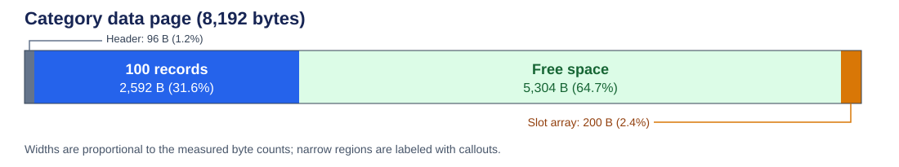

| Component | Size | Share of page |
|---|---:|---:|
| Page header | 96 B | 1.2% |
| Stored records | 2,592 B | 31.6% |
| Free space | 5,304 B | 64.7% |
| Slot array | 200 B | 2.4% |
| **Total** | **8,192 B** | **100%** |

The byte counts add up exactly:

$$
96 + 2592 + 5304 + 200 = 8192 \text{ bytes}
$$

The occupied portion of the page is approximately:

$$
\frac{2888}{8192} \times 100 \approx 35.3 \text{ % }
$$

This is **physical page occupancy**, including internal structures, not just user data. The page still has substantial room for additional records, subject to SQL Server's insertion and storage rules.

## 12.4 Inspecting individual records

`DBCC PAGE` also reports individual record locations and sizes. Our reference output includes:

```text
Slot 0  Offset 0x60   Length 25
Slot 9  Offset 0x141  Length 26
Slot 99 Offset 0xa65  Length 27
```

| Element | Meaning |
|---|---|
| `Slot` | Entry in the page's slot array |
| `Offset` | Byte offset of the record within the page |
| `Length` | Physical size of the record in bytes |

For example, `0x60` is hexadecimal for 96, so the record referenced by slot 0 starts immediately after the page header. Its length is 25 bytes.

The different record lengths are not an error. The `Category` table contains a variable-length `varchar(50)` column, so records can occupy different amounts of space. We will investigate the actual row sizes in Section 13.

> [!NOTE]
> A slot number is not a permanent row identifier. The physical position of a record and its slot assignment can change as SQL Server modifies pages.

## 12.5 Logical rows versus physical records

Compare the page diagnostics with an ordinary query:

```sql
SELECT TOP (10)
    CategoryId,
    CategoryName
FROM dbo.Category
ORDER BY CategoryId;
```

The `SELECT` statement shows the **logical view**: columns and values. `DBCC PAGE` shows the **physical representation**: page metadata, record offsets, record sizes, and slot-array information.

Do not assume that slot order always matches the order of rows returned by a query. The `ORDER BY` clause defines the result order in the example above.

## 12.6 Key takeaways

- `DBCC PAGE` reveals the internal layout of an individual database page.
- A data page is 8,192 bytes, including a 96-byte header.
- The slot array uses 2 bytes per slot to locate records.
- `m_freeCnt` measures free bytes; `m_freeData` is an offset.
- Record sizes can differ within the same table.
- The page's physical layout helps explain how multiple rows fit into one 8 KB page.

**Check your understanding**

1. What is the purpose of `DBCC PAGE`?
2. What does `m_slotCnt = 100` tell us?
3. How many bytes does a slot array with 100 entries occupy?
4. What is the difference between `m_freeCnt` and `m_freeData`?
5. Why can two rows from the same table occupy different amounts of storage?

<details>
<summary>Show answers</summary>

1. **DBCC PAGE** allows us to inspect the internal structure of a database page, including its header, stored records, and slot array.

2. **`m_slotCnt = 100`** means that the page contains 100 record slots. In our example, these correspond to the 100 rows of the `Category` table.

3. Each slot array entry occupies 2 bytes. Therefore, 100 entries require **200 bytes**.

4. **`m_freeCnt`** indicates the amount of free space on the page, measured in bytes. **`m_freeData`** identifies the offset where the used record-data area ends. It is a position within the page, not a measure of free space.

5. Rows may contain variable-length columns such as `varchar`. For example, `Category 1` requires fewer bytes than `Category 100`, so their physical records have different sizes.

</details>


---

# 13. Practical example – How much space does a row occupy?

In the previous sections, we examined the physical pages belonging to the `Category` table and discovered that all **100 rows fit into a single 8 KB data page**.

We also observed that individual records occupy different amounts of space.

But why?

In this section, we will connect the **logical structure of a table** with the **actual storage space used by its records**.

## 13.1 Examine the table structure

Our `Category` table contains two columns:

| Column | Data type | Description |
|---|---|---|
| `CategoryId` | `int` | Fixed-length integer |
| `CategoryName` | `varchar(50)` | Variable-length character data |

The `int` data type always occupies **4 bytes**.

The `varchar(50)` declaration allows up to 50 bytes of character data, but it does not mean that every value occupies 50 bytes.

For example:

- `Category 1` contains 10 characters.
- `Category 10` contains 11 characters.
- `Category 100` contains 12 characters.

For these ASCII strings, each character occupies one byte.

Therefore, the actual storage required for the text depends on its length.

> [!IMPORTANT]
> The declared maximum length of a `varchar` column is not the same as the actual storage used by each value.

## 13.2 Measure the actual data length

SQL Server provides the `DATALENGTH()` function, which returns the number of bytes used to represent a value.

Execute:

```sql
SELECT
    CategoryId,
    CategoryName,
    DATALENGTH(CategoryName) AS NameBytes
FROM dbo.Category
WHERE CategoryId IN (1, 9, 10, 99, 100)
ORDER BY CategoryId;
```

On our reference database, the result is:

| CategoryId | CategoryName | NameBytes |
|---:|---|---:|
| 1 | Category 1 | 10 |
| 9 | Category 9 | 10 |
| 10 | Category 10 | 11 |
| 99 | Category 99 | 11 |
| 100 | Category 100 | 12 |

Notice that `DATALENGTH()` measures the actual bytes of the stored value, not the maximum declared size of the column.

For comparison, `LEN()` returns the number of characters, excluding trailing spaces. For some character encodings, the number of characters and bytes may differ.

## 13.3 Compare logical data with physical record size

In Section 12, we used `DBCC PAGE` to inspect the actual records stored in the `Category` data page.

The diagnostic output showed:

```text
Slot 0  Offset 0x60   Length 25
Slot 9  Offset 0x141  Length 26
Slot 99 Offset 0xa65  Length 27
```

Let's compare these physical record sizes with the logical data.

| CategoryName | `int` | Text bytes | Physical record size |
|---|---:|---:|---:|
| Category 1 | 4 B | 10 B | 25 B |
| Category 10 | 4 B | 11 B | 26 B |
| Category 100 | 4 B | 12 B | 27 B |

The physical record is larger than the sum of the column values.

For example, `Category 1` contains:

- `CategoryId`: 4 bytes
- `CategoryName`: 10 bytes
- Internal record overhead: 11 bytes

Therefore:

$$
4 + 10 + 11 = 25 \text{ bytes}
$$

SQL Server needs additional bytes to describe the internal structure of each record.

This overhead includes information such as record metadata, the null bitmap, and variable-length column information.

For our `Category` records, the overhead is consistently **11 bytes**.

> [!NOTE]
> Record overhead depends on the table structure and storage format. The 11-byte overhead shown here applies to our particular example and should not be treated as a universal constant.

## 13.4 How much space do all 100 records occupy?

The `Category` table contains:

- 9 records of 25 bytes (`Category 1` through `Category 9`)
- 90 records of 26 bytes (`Category 10` through `Category 99`)
- 1 record of 27 bytes (`Category 100`)

We can calculate the total record storage:

$$
(9 \times 25) + (90 \times 26) + (1 \times 27)
$$

$$
= 225 + 2340 + 27 = 2592 \text{ bytes}
$$

This matches the result we obtained from `DBCC PAGE` in Section 12.

The 100 records occupy only **2,592 bytes**, leaving substantial space available on the 8 KB page.

However, remember that the page also contains a header and slot array, so the total occupied page space is larger than the sum of record sizes.

## 13.5 Why does this matter?

Consider a table containing one million rows.

If each row requires only one additional byte, the table needs approximately one million additional bytes for its records.

That may not sound significant, but larger rows mean that **fewer rows fit into each 8 KB page**.

For queries that scan the entire table, this can lead to:

- More data pages to access.
- More logical reads.
- Potentially more physical I/O.
- Greater memory usage for cached pages.

This connects directly to the concepts discussed in Sections 7 and 8.

It also explains why choosing appropriate data types and avoiding unnecessarily large records can improve database efficiency.

> [!TIP]
> The effect becomes especially important in large tables. Even small differences in average row size can influence the number of pages required to store millions of records.

## 13.6 Key takeaways

- Fixed-length data types such as `int` occupy a predictable amount of storage.
- Variable-length types such as `varchar` use space according to the actual stored value.
- `DATALENGTH()` measures the number of bytes used by a value.
- A physical record contains both column values and internal metadata.
- Larger records generally reduce the number of rows that fit into a data page.
- Row size influences page count, logical reads, and potentially query performance.

**Check your understanding**

1. Does `varchar(50)` always occupy 50 bytes?
2. What is the difference between `LEN()` and `DATALENGTH()`?
3. Why does `Category 1` occupy 25 bytes when its column values require only 14 bytes?
4. How many bytes do all 100 `Category` records occupy?
5. Why can increasing the average row size affect query performance?

<details>
<summary>Show answers</summary>

1. **No.** `varchar(50)` specifies a maximum of 50 bytes for the stored character data. The actual storage depends on the value.
2. **`LEN()`** returns the number of characters, excluding trailing spaces. **`DATALENGTH()`** returns the number of bytes used to represent the value.
3. Because SQL Server stores additional internal record metadata. In this example, the record has 11 bytes of overhead.
4. **2,592 bytes**, calculated as `(9 × 25) + (90 × 26) + (1 × 27)`.
5. Larger rows generally mean fewer rows per page, potentially increasing the number of pages, logical reads, and physical I/O required by queries.

</details>

---

# 14. Guided investigation – Product: From pages to query performance

In the previous sections, we examined the `Category` table and discovered that all 100 rows fit into a single 8 KB data page.

But what happens when a table contains thousands of rows?

In this investigation, we will examine the `Product` table, which contains **30,000 rows**, and discover how SQL Server organizes its pages and efficiently locates individual records.

We will also connect physical storage with the concepts of **logical reads and query performance** introduced in Section 8.

## 14.1 Examine the table's physical storage

First, verify the number of rows:

```sql
SELECT COUNT(*) AS TotalRows
FROM dbo.Product;
```

Our reference database contains:

```text
TotalRows
---------
30000
```

Now examine the pages associated with the table:

```sql
DBCC IND('IndexLab', 'dbo.Product', -1);
GO
```

The command returns many rows. Focus on the `PageType`, `IndexID`, and `IndexLevel` columns.

On our reference database, we obtained:

| PageType | Number of pages | Purpose |
|---|---:|---|
| `1` | 159 | Data pages containing the actual product rows |
| `2` | 1 | Index page used to navigate the clustered index |
| `10` | 1 | IAM page tracking allocated storage |
| **Total** | **161** | |

Unlike `Category`, the `Product` table requires many data pages.

However, notice something interesting: **SQL Server also uses an index page**.

Why is this necessary?

## 14.2 Understanding the clustered index structure

The `Product` table has a clustered primary key on `ProductId`.

As discussed in Section 11, a clustered index stores the actual table rows at its **leaf level**.

When a clustered index becomes large enough, SQL Server introduces additional levels containing navigation information.

Our `Product` clustered index has two levels:

| IndexLevel | PageType | Pages | Purpose |
|---|---|---:|---|
| `1` | `2` | 1 | Root page containing navigation entries |
| `0` | `1` | 159 | Leaf pages containing actual product rows |

The root page helps SQL Server locate the appropriate leaf page without examining every data page.

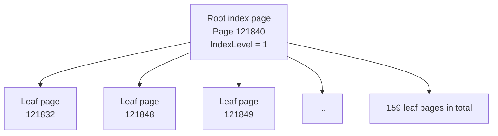

The diagram is simplified. The root page contains navigation entries pointing to all 159 leaf pages.

> [!NOTE]
> The IAM page (page 120) tracks allocated storage but is not part of the clustered index's navigation hierarchy.

We will explore the internal structure of clustered and nonclustered indexes in more detail in Lab 06.

## 14.3 Inspecting the root page

From `DBCC IND`, we identified the root page:

| Property | Value |
|---|---:|
| PageFID | 1 |
| PagePID | 121840 |
| PageType | 2 |
| IndexID | 1 |
| IndexLevel | 1 |

Let's inspect it:

```sql
DBCC PAGE('IndexLab', 1, 121840, 3)
WITH TABLERESULTS;
GO
```

The page header reports:

```text
m_slotCnt = 159
```

This means the root page contains **159 record slots**.

In our example, these correspond to navigation entries pointing to the 159 leaf pages.

The diagnostic output includes:

| ProductId (key) | ChildPageId | Row size |
|---|---:|---:|
| NULL | 121832 | 11 B |
| 201 | 121848 | 11 B |
| 398 | 121849 | 11 B |
| 595 | 121850 | 11 B |
| 792 | 121851 | 11 B |
| 989 | 121852 | 11 B |
| 1182 | 121853 | 11 B |
| 1374 | 121854 | 11 B |

Each navigation entry contains a child-page reference and information used to determine which child page to follow.

The first entry has a `NULL` key in this diagnostic output. It represents the leftmost branch of the index, not a product with a NULL `ProductId`.

Notice that the navigation entries are small. In our example, each occupies **11 bytes**.

This allows a single root page to contain references to many leaf pages.

## 14.4 How SQL Server finds a specific product

Consider the following query:

```sql
SELECT ProductId, ProductName
FROM dbo.Product
WHERE ProductId = 500;
```

SQL Server can use the clustered index to locate the row efficiently.

Let's follow the navigation using the actual root-page entries.

The relevant key boundaries are:

| ProductId (key) | ChildPageId |
|---|---:|
| 398 | 121849 |
| 595 | 121850 |

Because:

$$
398 \leq 500 < 595
$$

SQL Server can follow the pointer associated with key `398`, leading to **leaf page 121849**.

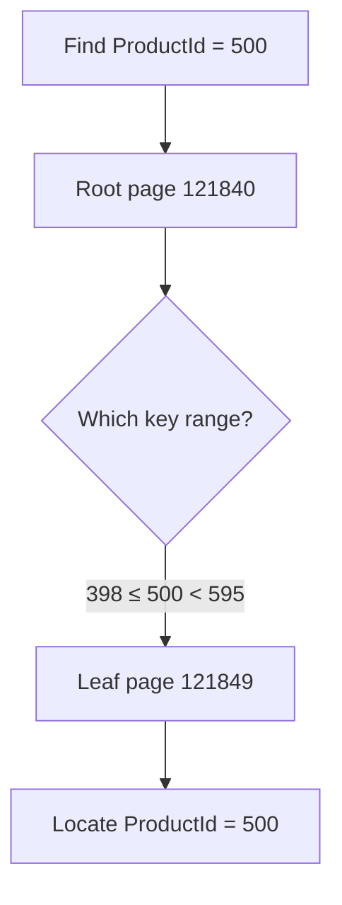

Instead of examining all 159 leaf pages, SQL Server can navigate directly to the relevant page.

This is the basic idea behind a **B-tree index**, which we will study in Lab 06.

### Verify the execution plan

In SSMS, enable **Include Actual Execution Plan** (`Ctrl + M`) and execute the query again.

On our reference database, SQL Server selected:

**Clustered Index Seek – PK_Product**

This confirms that SQL Server used the clustered index to locate the requested row.

> [!NOTE]
> The execution plan shows the access method, but it does not display the actual physical page IDs. We identified those separately using `DBCC PAGE`.

## 14.5 Measuring the I/O cost

We can now measure how many page accesses SQL Server performs when retrieving all products compared with retrieving a single product.

Execute:

```sql
SET STATISTICS IO ON;

-- Query A: Retrieve all products
SELECT *
FROM dbo.Product;

-- Query B: Retrieve one product
SELECT *
FROM dbo.Product
WHERE ProductId = 500;

SET STATISTICS IO OFF;
```

Open the **Messages** tab in SSMS.

Our reference database produced the following results:

| Metric | Query A: All products | Query B: One product |
|---|---:|---:|
| Rows returned | 30,000 | 1 |
| Scan count | 1 | 0 |
| Logical reads | 161 | 2 |
| Physical reads | 0 | 0 |
| Read-ahead reads | 0 | 0 |

*Only the relevant I/O metrics are shown.*

### Query A – Reading all products

SQL Server retrieves all 30,000 rows.

The query performs **161 logical reads**.

Although the table contains 159 data pages, logical reads count page accesses rather than distinct physical pages. Additional page accesses may occur during execution.

### Query B – Finding one product

SQL Server uses a `Clustered Index Seek`.

The query performs only **2 logical reads**.

This is consistent with the two-level clustered index structure:

1. Access the root page to determine which leaf page contains the requested key.
2. Access the leaf page to locate the row.

Both queries report zero physical reads because the required pages were already available in the buffer pool.

This confirms an important concept from Section 8: **a query can perform many logical reads even when no physical reads are required**.

## 14.6 Comparing logical reads

Let's compare the results:

| Query | Logical reads |
|---|---:|
| Retrieve all products | 161 |
| Retrieve one product | 2 |

The reduction in logical reads is:

$$
\text{Reduction} = \frac{161 - 2}{161} \times 100
$$

**Reduction ≈ 98.76%**

The targeted lookup performs approximately **80 times fewer logical reads**.

However, these queries do not return the same amount of data. The first retrieves 30,000 rows, while the second retrieves only one.

Therefore, this comparison demonstrates the difference between **reading an entire table and performing a targeted index lookup**. It does not isolate the performance benefit of adding an index.

We will make more controlled comparisons in Lab 06.

## 14.7 Why does this matter?

The `Category` and `Product` examples illustrate how physical storage changes as a table grows.

| Property | Category | Product |
|---|---:|---:|
| Rows | 100 | 30,000 |
| Data pages | 1 | 159 |
| Root index pages | 0 | 1 |
| Clustered index levels | 1 | 2 |

For a very small table, SQL Server can store all rows in one page.

For a larger table, the clustered index may require additional levels to navigate efficiently between pages.

As tables grow, the number of pages and the way SQL Server accesses them become increasingly important for query performance.

This is why understanding physical storage is essential before studying indexes.

## 14.8 Key takeaways

- Larger tables generally require more data pages.
- A clustered index stores actual table rows at its leaf level.
- Additional index levels contain navigation information.
- `DBCC IND` identifies index and data pages, while `DBCC PAGE` reveals their internal contents.
- A `Clustered Index Seek` can locate a specific row without scanning every data page.
- Logical reads measure page accesses, even when all required pages are cached.
- Index structure and query access methods strongly influence I/O costs.

**Check your understanding**

1. Why does `Product` require more data pages than `Category`?
2. What is the difference between the root and leaf levels of a clustered index?
3. Why does the root page contain navigation entries instead of complete product rows?
4. How can SQL Server locate `ProductId = 500` without scanning all 159 data pages?
5. Why did the index seek require only two logical reads?
6. Why does the 98.76% reduction not represent a controlled comparison of indexed and non-indexed queries?

<details>
<summary>Show answers</summary>

1. **Product contains more rows.** Its 30,000 records require 159 data pages, while all 100 Category records fit into one page.

2. **The root level** contains navigation entries pointing to lower-level pages. **The leaf level** of a clustered index contains the actual table rows.

3. Navigation entries are much smaller than complete rows. This allows one root page to reference many leaf pages and makes searches more efficient.

4. SQL Server uses the root page to identify the key range containing `ProductId = 500`, then follows the corresponding child-page pointer.

5. The clustered index has two levels. In our measured execution, the seek required one logical read at the root level and one at the leaf level.

6. The queries return different amounts of data: 30,000 rows versus one row. The comparison demonstrates different access patterns, not the isolated effect of adding an index.

</details>

---

# 15. Guided investigation – Customer: A three-level clustered index

In Section 14, we examined the `Product` table with 30,000 rows and discovered that its clustered index has two levels: a root page and 159 leaf pages.

But what happens when a table becomes even larger?

In this investigation, we will examine the `Customer` table, which contains **100,000 rows**, and discover how SQL Server organizes a larger clustered index.

We will also measure how many logical reads are required to retrieve all customers compared with locating a single customer.

## 15.1 Examine the table's physical storage

First, verify the number of rows:

```sql
SELECT COUNT(*) AS TotalRows
FROM dbo.Customer;
```

Our reference database contains:

```text
TotalRows
---------
100000
```

Now examine the pages associated with the table:

```sql
DBCC IND('IndexLab', 'dbo.Customer', -1);
GO
```

Focus on the `PageType`, `IndexID`, and `IndexLevel` columns.

On our reference database, we obtained:

| PageType | IndexLevel | Number of pages | Purpose |
|---|---:|---:|---|
| `1` | `0` | 732 | Leaf pages containing customer rows |
| `2` | `1` | 2 | Intermediate index pages |
| `2` | `2` | 1 | Root index page |
| `10` | – | 1 | IAM page tracking allocated storage |
| **Total** | | **736** | |

Unlike `Product`, the `Customer` clustered index has **three levels**.

The additional level allows SQL Server to navigate between a larger number of leaf pages.

## 15.2 Understanding the three-level structure

The `Customer` table has a clustered primary key on `CustomerId`.

Its clustered index contains:

- **Root level (2):** One page containing navigation entries.
- **Intermediate level (1):** Two pages containing references to leaf pages.
- **Leaf level (0):** 732 pages containing the actual customer rows.

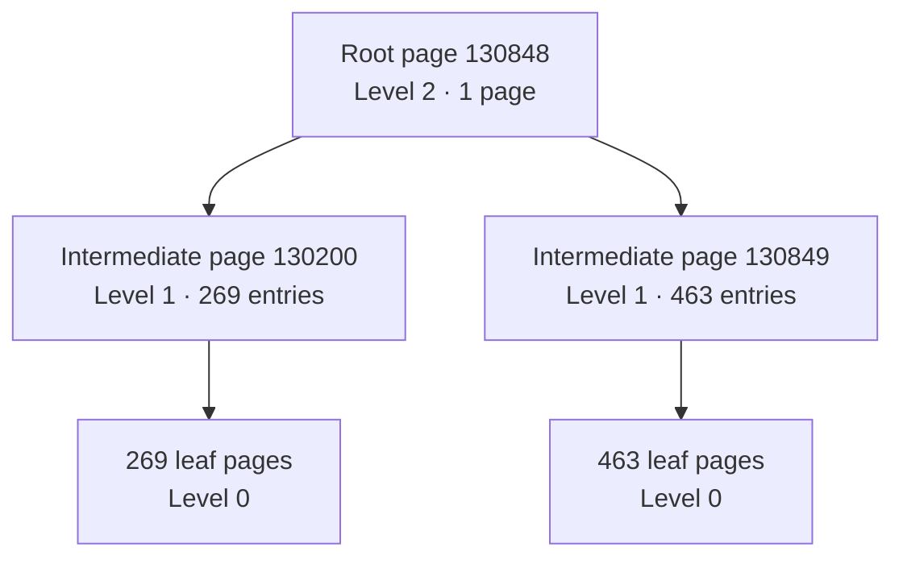

The root page directs SQL Server to the appropriate intermediate page. The intermediate page then directs the search to a specific leaf page.

The IAM page (page 121) tracks allocated storage but does not participate in the index navigation hierarchy.

> [!NOTE]
> The number of index levels depends on factors such as the number of data pages, index key size, record size, and page utilization. A larger row count does not automatically imply an additional index level.

## 15.3 Inspecting the root page

From `DBCC IND`, we identified the root page:

| Property | Value |
|---|---:|
| PageFID | 1 |
| PagePID | 130848 |
| PageType | 2 |
| IndexID | 1 |
| IndexLevel | 2 |

Inspect the page:

```sql
DBCC PAGE('IndexLab', 1, 130848, 3)
WITH TABLERESULTS;
GO
```

The page header reports:

```text
m_slotCnt = 2
```

The root page contains only **two navigation entries**:

| CustomerId (key) | ChildPageId | Row size |
|---|---:|---:|
| NULL | 130200 | 11 B |
| 36803 | 130849 | 11 B |

These entries divide the search into two branches:

- `CustomerId < 36803` → Intermediate page `130200`
- `CustomerId >= 36803` → Intermediate page `130849`

The `NULL` value represents the leftmost branch of the index, not a customer with a NULL identifier.

Notice that the root page contains only two small navigation records, yet it provides access to all 732 leaf pages through the intermediate level.

## 15.4 Inspecting the intermediate pages

Let's inspect both intermediate pages:

```sql
DBCC PAGE('IndexLab', 1, 130200, 3)
WITH TABLERESULTS;
GO

DBCC PAGE('IndexLab', 1, 130849, 3)
WITH TABLERESULTS;
GO
```

The page headers report:

| Intermediate page | IndexLevel | m_slotCnt |
|---|---:|---:|
| 130200 | 1 | 269 |
| 130849 | 1 | 463 |
| **Total** | | **732** |

Each navigation entry points to a child page at the leaf level.

Therefore:

$$
269 + 463 = 732
$$

This matches the number of leaf pages returned by `DBCC IND`.

The two intermediate pages do not contain the same number of navigation entries. SQL Server does not necessarily distribute child pages evenly between intermediate pages.

The distribution can depend on index construction, subsequent insertions, and page splits.

## 15.5 How SQL Server finds a specific customer

Consider the following query:

```sql
SELECT CustomerId, CustomerName
FROM dbo.Customer
WHERE CustomerId = 50000;
```

We can follow the search through all three levels using the actual page contents.

**Step 1 – Root page**

The root page contains the following boundary:

```text
CustomerId = 36803 → ChildPageId = 130849
```

Because:

$$
50000 \geq 36803
$$

SQL Server follows the pointer to intermediate page `130849`.

**Step 2 – Intermediate page**

On page `130849`, we found these navigation entries:

| CustomerId (key) | ChildPageId |
|---|---:|
| 49934 | 130572 |
| 50072 | 130573 |

Because:

$$
49934 \leq 50000 < 50072
$$

SQL Server follows the pointer to leaf page `130572`.

**Step 3 – Leaf page**

The leaf page contains the actual customer records.

SQL Server locates the row with `CustomerId = 50000`.

The complete navigation path is:

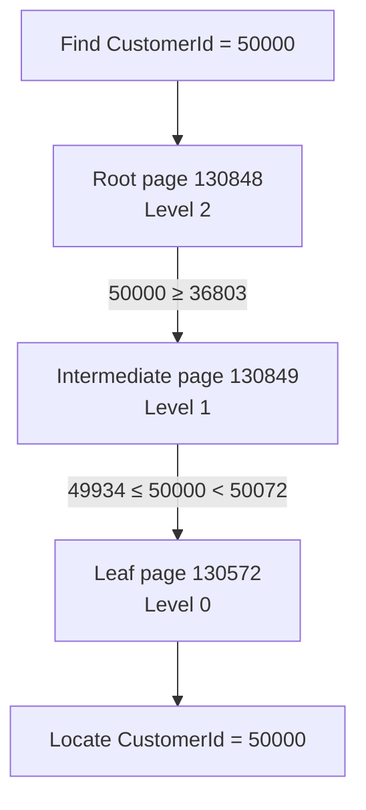

Instead of scanning all 732 leaf pages, SQL Server can navigate directly to the appropriate page.

This is the fundamental advantage of a hierarchical index structure.

## 15.6 Measuring the I/O cost

Let's compare retrieving all customers with retrieving a single customer.

Execute:

```sql
SET STATISTICS IO ON;

-- Query A: Retrieve all customers
SELECT *
FROM dbo.Customer;

-- Query B: Retrieve one customer
SELECT *
FROM dbo.Customer
WHERE CustomerId = 50000;

SET STATISTICS IO OFF;
```

Our reference database produced:

| Metric | Query A: All customers | Query B: One customer |
|---|---:|---:|
| Rows returned | 100,000 | 1 |
| Scan count | 1 | 0 |
| Logical reads | 736 | 3 |
| Physical reads | 0 | 0 |
| Read-ahead reads | 0 | 0 |

*Only the relevant I/O metrics are shown.*

### Query A – Reading all customers

SQL Server retrieves all 100,000 rows.

The query performs **736 logical reads**.

Although the clustered index contains 732 leaf pages, the logical-read count includes page accesses performed during execution, not just the number of distinct leaf pages.

### Query B – Finding one customer

SQL Server uses the clustered index to locate a specific customer.

The query performs only **3 logical reads**.

This is consistent with the three-level index structure:

1. Access the root page.
2. Access the intermediate page.
3. Access the leaf page containing the requested row.

Both queries report zero physical reads because the required pages were already cached in the buffer pool.

> [!IMPORTANT]
> The three logical reads observed in this example correspond to the three index levels. However, logical-read counts are not universally equal to index depth. More complex queries may access additional pages.

## 15.7 Comparing logical reads

Let's compare the results:

| Query | Logical reads |
|---|---:|
| Retrieve all customers | 736 |
| Retrieve one customer | 3 |

The reduction in logical reads is:

```math
\mathrm{Reduction} = \frac{736 - 3}{736} \times 100

```

```math
\boxed{\mathrm{Reduction} \approx 99.59\,\%}

```

The targeted lookup performs approximately **245 times fewer logical reads**.

However, these queries return different amounts of data: 100,000 rows versus one row.

Therefore, the comparison demonstrates the difference between a full-table retrieval and a targeted index lookup. It does not isolate the performance benefit of adding an index.

We will perform more controlled index experiments in Lab 06.

## 15.8 Comparing Category, Product, and Customer

We have now examined three tables of different sizes.

| Property | Category | Product | Customer |
|---|---:|---:|---:|
| Rows | 100 | 30,000 | 100,000 |
| Leaf/data pages | 1 | 159 | 732 |
| Intermediate pages | 0 | 0 | 2 |
| Root index pages | 0 | 1 | 1 |
| Clustered index levels | 1 | 2 | 3 |
| IAM pages | 1 | 1 | 1 |

Notice how the clustered index structure changes as the number of data pages increases.

- `Category` fits into a single leaf page.
- `Product` uses a root page and 159 leaf pages.
- `Customer` introduces an intermediate level between the root and 732 leaf pages.

The important lesson is that **SQL Server can locate a specific row by navigating through a small number of index levels**, even when the table contains many thousands of records.

For our measured queries:

| Table | Full retrieval logical reads | Single-row seek logical reads |
|---|---:|---:|
| Product | 161 | 2 |
| Customer | 736 | 3 |

Although `Customer` contains more than three times as many rows as `Product`, locating a single row required only one additional logical read in our examples.

This illustrates why hierarchical indexes are so effective for targeted lookups.

## 15.9 Key takeaways

- A clustered index may contain multiple levels.
- The root and intermediate levels store navigation entries.
- The leaf level contains the actual table rows.
- Each additional index level introduces another navigation step.
- A targeted index seek can locate a row without scanning all leaf pages.
- Logical reads depend on the access method and execution plan.
- Understanding physical page organization helps explain why indexes improve query performance.

**Check your understanding**

1. Why does the `Customer` clustered index have three levels?
2. What is the purpose of an intermediate index page?
3. How many leaf pages are referenced by intermediate pages `130200` and `130849`?
4. Which pages does SQL Server navigate through when searching for `CustomerId = 50000`?
5. Why did the targeted lookup require only three logical reads?
6. Why is comparing 736 and 3 logical reads not a controlled experiment measuring the benefit of adding an index?

<details>
<summary>Show answers</summary>

1. **Because its index structure requires an additional navigation level.** The 732 leaf pages are organized beneath two intermediate pages and one root page. Index depth depends on storage structure and page utilization, not only row count.

2. **An intermediate page** contains navigation entries that direct SQL Server from the root level toward the appropriate leaf page.

3. Page `130200` references **269 leaf pages**, while page `130849` references **463 leaf pages**, for a total of 732.

4. SQL Server navigates through **root page 130848 → intermediate page 130849 → leaf page 130572**.

5. The index has three levels. In this execution, SQL Server accessed one page at each level.

6. The queries return different amounts of data: 100,000 rows versus one row. The comparison demonstrates different access patterns rather than isolating the effect of adding an index.

</details>

---


# 16. From physical storage to query optimization

Throughout this lab, we have explored how SQL Server physically stores data and how the organization of database pages affects query performance.

We started with a small table containing 100 rows and gradually examined larger tables with more complex storage structures.

We also discovered that **the number of pages SQL Server needs to access can be much more important than the number of rows returned by a query**.

Now let's consider what happens when tables contain millions of records.

## 16.1 The challenge of large tables

Our `IndexLab` database contains two particularly large tables:

| Table | Approximate number of rows |
|---|---:|
| `SalesOrder` | 10,000,000 |
| `SalesOrderItem` | 40,000,000 |

These tables are significantly larger than the `Category`, `Product`, and `Customer` tables we examined earlier.

Imagine that an application needs to retrieve a small number of orders belonging to a particular customer.

```sql
SELECT *
FROM dbo.SalesOrder
WHERE CustomerId = 50000;
```

Although the query may return only a small number of rows, SQL Server still needs to **find those rows among millions of records**.

If there is no suitable index for the search condition, SQL Server may need to scan a large portion of the table.

As we learned in Sections 7 and 8, scanning more pages generally means more logical reads and potentially more physical I/O.

> [!IMPORTANT]
> The number of rows returned by a query does not tell us how many pages SQL Server had to examine to find them.

## 16.2 Different ways to access data

In Sections 14 and 15, we observed how clustered indexes allow SQL Server to locate individual records efficiently.

Our actual measurements were:

| Table | Full retrieval | Single-row lookup |
|---|---:|---:|
| `Product` | 161 logical reads | 2 logical reads |
| `Customer` | 736 logical reads | 3 logical reads |

These results demonstrate the difference between reading an entire table and navigating an index to locate a specific record.

However, our searches used the **clustered index key**.

What happens when we search using another column?

Consider the following simplified comparison:

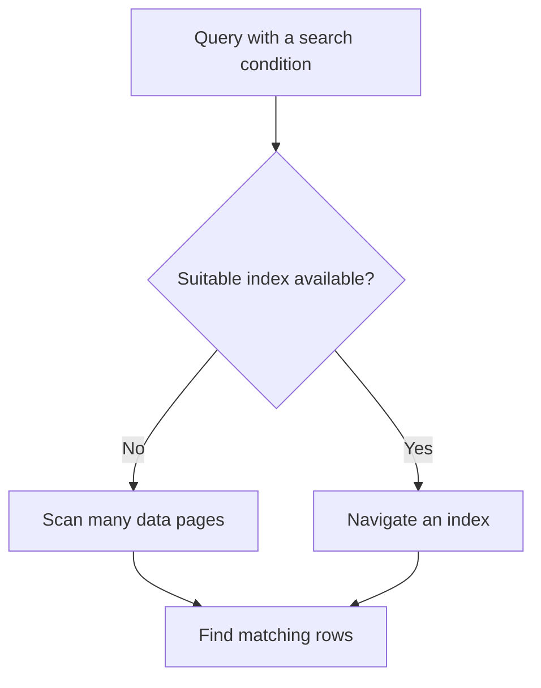

The diagram illustrates two possible access strategies.

**Scanning data pages**

SQL Server examines rows across the pages it needs to scan, checking which rows satisfy the search condition.

This can be expensive for large tables when only a small number of rows are required.

**Using an index**

A suitable index can help SQL Server locate matching rows without scanning the entire table.

However, indexes are not always the best choice. When a query needs a large proportion of a table, a scan may be more efficient.

The SQL Server query optimizer decides which access method to use based on available indexes, statistics, and estimated costs.

> [!NOTE]
> Creating an index does not guarantee that SQL Server will use it. The optimizer chooses an execution plan based on the estimated cost of the available alternatives.

## 16.3 What comes next – Lab 06: Indexes

We now understand several important concepts:

- Data is stored in 8 KB pages.
- The size and number of records influence how many pages a table requires.
- Logical reads measure accesses to pages in the buffer pool.
- Clustered indexes organize table rows and provide navigation structures.
- Query performance depends partly on how many pages SQL Server must access.

But several important questions remain:

- What happens when we search by a column that is not the clustered index key?
- How can a nonclustered index improve query performance?
- Why does SQL Server sometimes choose an index seek and sometimes a scan?
- How can we measure whether an index actually improves a query?
- Why can having too many indexes also be a problem?

These are the questions we will investigate in **[Lab 06 – Indexes](lab06-indexes.md)**.

In the next lab, we will use the same `IndexLab` database to create indexes, examine execution plans, and compare logical reads before and after indexing.

The goal is not simply to create indexes, but to understand **when and why they improve query performance**.

> [!TIP]
> Keep your `IndexLab` database. We will continue using its large tables in Lab 06 to investigate query optimization under more realistic conditions.

---

**Final takeaway**

Physical storage and query optimization are closely connected.

Understanding how SQL Server organizes and accesses database pages provides the foundation for understanding why some queries are efficient while others require significantly more work.

---

# Practice exercises

Try each task before opening its solution. The first two use calculations and observation; the third uses a system view instead of generating a very large diagnostic result.

## Exercise 1 – Page math

A table contains **2,000,000 rows** and fits **40 rows per page**.

1. How many pages are required?
2. If wider rows reduce capacity to **25 rows per page**, how many pages are now required?
3. By what percentage does the number of pages increase?

<details>
<summary>Show solution</summary>

1. `2,000,000 / 40 = 50,000 pages`.
2. `2,000,000 / 25 = 80,000 pages`.
3. `(80,000 - 50,000) / 50,000 × 100 = 60%`.

</details>

---

## Exercise 2 – Logical versus physical reads

In SSMS, execute the following **twice**, and inspect the **Messages** tab after each run:

```sql
USE IndexLab;
GO
SET STATISTICS IO ON;
GO
SELECT * FROM dbo.Product;
GO
SELECT * FROM dbo.Product;
GO
SET STATISTICS IO OFF;
GO
```

1. Record logical reads and physical reads for each execution.
2. Did the physical-read count change?
3. Why might both executions report zero physical reads?
4. Can you conclude that the query accessed zero pages if `physical reads = 0`?
5. Compare `logical reads` with the **159 data pages** you counted for `Product` in Guided investigation 2 (Section 14). Are the two numbers the same? If not, why not?

> [!NOTE]
> Pages may have been cached before you started this exercise. Do not expect the first query to show a nonzero physical-read count. **Do not clear the SQL Server buffer pool** just to force a difference on a shared classroom server.

<details>
<summary>Show solution</summary>

1. Values depend on the server and cache state.
2. They may differ: pages read from storage can remain cached for subsequent executions.
3. Another query or an earlier operation may already have loaded the required pages into memory.
4. No. Inspect **logical reads** to see page accesses in the buffer pool. Also consider `read-ahead reads` when studying storage activity.
5. No — `logical reads` is **161**, not 159. A full scan also has to visit the clustered index's root page and its IAM page to find the data pages in the first place, so `logical reads` counts **every** page type touched (data, root/intermediate, and IAM), not just the leaf-level data pages you counted with `DBCC IND`.

</details>

---

## Exercise 3 – Investigate SalesOrder without listing every page

`SalesOrder` is much larger than the tables we inspected with `DBCC IND`. Producing an individual row for every allocated page could overwhelm the SSMS result window.

Instead, use the documented `sys.dm_db_partition_stats` view:

```sql
USE IndexLab;
GO

SELECT
    i.name AS IndexName,
    i.index_id,
    SUM(ps.row_count) AS [RowCount],
    SUM(ps.in_row_data_page_count) AS InRowDataPages,
    SUM(ps.used_page_count) AS UsedPages
FROM sys.dm_db_partition_stats AS ps
JOIN sys.indexes AS i
    ON i.object_id = ps.object_id
   AND i.index_id = ps.index_id
WHERE ps.object_id = OBJECT_ID('dbo.SalesOrder')
  AND i.index_id IN (0, 1)
GROUP BY i.name, i.index_id;
```

`in_row_data_page_count` counts in-row data (leaf) pages. `used_page_count` includes other pages allocated to that index or heap and can be higher.

1. What are the reported row count and in-row data page count?
2. Estimate the **average rows per in-row data page**.
3. Compare the estimate with `Category`, `Product`, and `Customer`.
4. Why is this query better suited to counting pages in a very large table than displaying `DBCC IND` output?

<details>
<summary>Show solution</summary>

1. Results depend on the generated database.
2. Divide `RowCount` by `InRowDataPages`, provided the latter is nonzero. This is an average, not the exact occupancy of each page.
3. Different row sizes and storage layouts lead to different page densities.
4. The system view returns summary counts without producing a huge row-by-row list of page identifiers. Some environments may require `VIEW DATABASE STATE` or related DMV permissions.

</details>

---

## Exercise 4 – Predict the effect of wider rows

A table contains **1,000,000 rows** and currently fits **16 rows per page**. After adding a populated variable-length column, it fits only **10 rows per page**.

1. How many pages were needed before the change?
2. How many pages are needed afterward?
3. What is the percentage increase?
4. What happens to the page-access cost of a full scan, assuming similar execution conditions?

<details>
<summary>Show solution</summary>

1. `1,000,000 / 16 = 62,500 pages`.
2. `1,000,000 / 10 = 100,000 pages`.
3. `(100,000 - 62,500) / 62,500 × 100 = 60%`.
4. A scan generally needs to process more pages, increasing logical I/O and potentially physical I/O. Elapsed time is not determined by page count alone.

</details>

---

# Key takeaways

- A SQL Server database is stored in **data and log files**.
- **Logical sectors**, **physical sectors**, **NTFS clusters**, and **SQL Server pages** belong to different storage layers.
- SQL Server pages are **8 KB**; eight consecutive pages form one **64 KB extent**.
- A data page includes a header, records, free space, and a slot array.
- Wider rows usually require more pages to store the same number of rows.
- SQL Server uses the **buffer pool** to cache pages.
- **Logical reads** count page accesses in memory; **physical reads** involve obtaining pages from storage. Read-ahead activity may be reported separately.
- More pages processed generally mean more work, but **one page is not equivalent to one physical I/O operation**.
- `DBCC IND` and `DBCC PAGE` are useful laboratory tools for examining page allocation and contents.
- **A scan is not automatically bad**; its cost depends partly on how many pages must be processed.
- Indexes provide alternative access paths that can reduce unnecessary page processing.

> **The key performance question is often not how many rows a query returns, but how many pages SQL Server has to examine to produce the result.**

---

## Additional practice

More physical storage exercises, using `AdventureWorksENG` instead of `IndexLab`, are available in [Physical Storage Exercises](../exercises/physical-storage.md).
