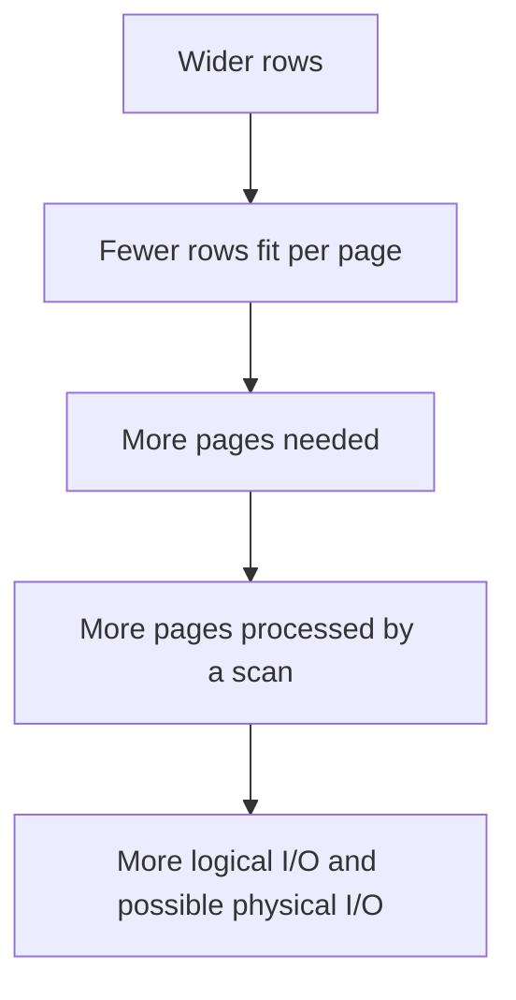
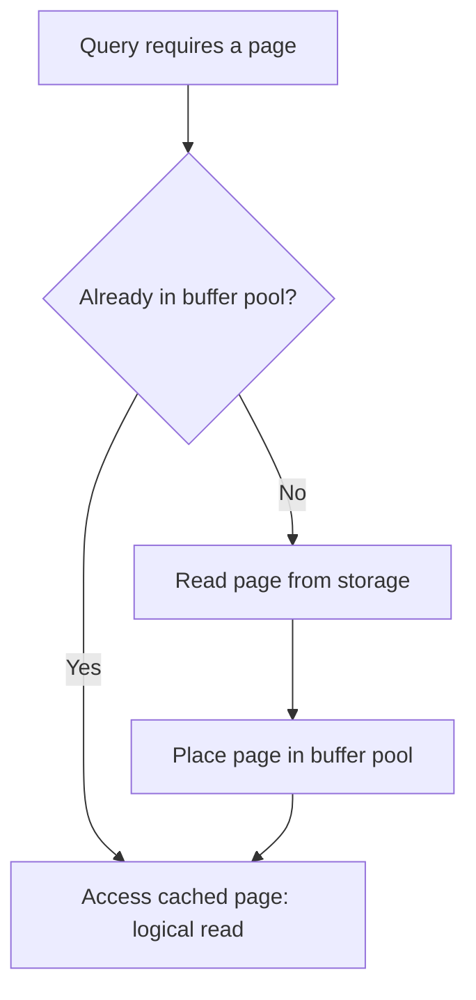
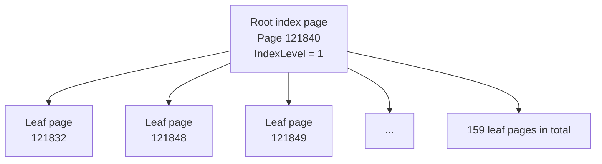
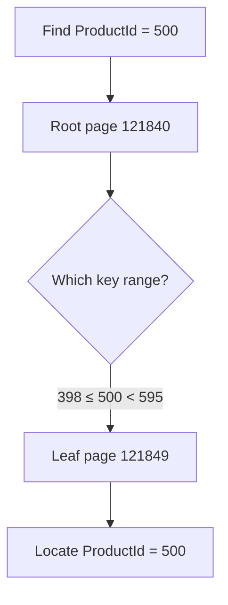
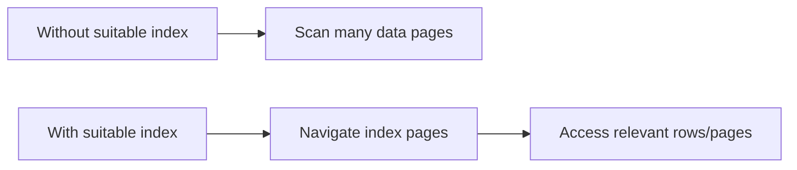

# Lab 05 – Physical Storage in SQL Server

> Database Design Laboratory  
> Student Lab Manual

---

# Learning goals

By the end of this lab, you should be able to:

- explain how SQL Server stores databases in files,
- distinguish disk sectors, NTFS clusters, SQL Server extents, and pages,
- explain the roles of `.mdf`, `.ndf`, and `.ldf` files,
- describe the structure of an 8 KB SQL Server data page,
- explain why row width influences page count and query cost,
- distinguish logical reads from physical reads and explain the buffer pool,
- inspect table pages using `DBCC IND` and `DBCC PAGE`,
- interpret simple page-count and I/O measurements,
- explain why indexes can reduce the amount of data SQL Server must read.

This lab involves relatively little coding. Its goal is to build a **mental model** of where data lives and how SQL Server accesses it. You will use this model in **Lab 06 – Indexes**.

> [!NOTE]
> **Demo Database – IndexLab**
>
> In this lab, you will create a demonstration database called `IndexLab`, containing several tables with millions of records.
>
> We will use this database to explore how SQL Server physically stores data, inspect data pages, and investigate disk I/O.
>
> The database will be created using the [IndexLab setup script](setup/index-lab-data-setup.md). 
>
> **Keep this database after completing the lab!** We will use it again in **Lab 06 – Indexes** to investigate query performance and demonstrate how indexes can reduce the number of pages SQL Server needs to read.

---

# 1. From logical data to physical storage

Until now, we have mainly worked at the **logical level**: tables, views, triggers, procedures, and functions.

```sql
SELECT *
FROM dbo.Customer;
```

This query looks as though SQL Server simply retrieves rows from a table. In reality, those rows are stored inside **pages** in database files.


> [!IMPORTANT]
> A **row** is a logical unit of table data. An **8 KB page** is the fundamental unit SQL Server uses to organize that data in database files and the buffer pool.

---

# 2. Create the IndexLab database

We will use the same generated database in Labs 05 and 06.

Run the [IndexLab setup script](setup/index-lab-data-setup.md) in SSMS. It creates the following tables:

- `Category`
- `Product`
- `Customer`
- `SalesOrder`
- `SalesOrderItem`

The two largest tables contain approximately **10,000,000 orders** and **40,000,000 order items**. Generation may take several minutes.

```sql
USE IndexLab;
GO

SELECT 'Category' AS TableName, COUNT(*) AS RowCnt FROM dbo.Category
UNION ALL
SELECT 'Product', COUNT(*) FROM dbo.Product
UNION ALL
SELECT 'Customer', COUNT(*) FROM dbo.Customer
UNION ALL
SELECT 'SalesOrder', COUNT(*) FROM dbo.SalesOrder
UNION ALL
SELECT 'SalesOrderItem', COUNT(*) FROM dbo.SalesOrderItem;
```

> [!TIP]
> You only need to run the setup once. Do **not** recreate the database before Lab 06: we want to study indexing on the same data.

Our question is not merely *how many rows exist?* It is **how are those rows stored, and what does SQL Server have to read to find them?**

---

# 3. Database files

A SQL Server database consists of one or more operating-system files. The usual extensions are:

| Extension | Role |
|---|---|
| `.mdf` | Primary data file |
| `.ndf` | Optional secondary data file |
| `.ldf` | Transaction log file |

## 3.1 Primary and secondary data files

Every database has **exactly one primary data file**, usually with the `.mdf` extension. It belongs to the primary filegroup.

Additional data files (commonly `.ndf`) can hold tables, indexes, and other database structures.

Their use and placement are configuration choices; more files do not automatically make a database faster.

## 3.2 Transaction log

The transaction log records changes needed for transaction recovery.

SQL Server uses **write-ahead logging (WAL)**: the relevant log records must be written to durable storage **before the corresponding modified data pages are written to disk**.

A modified page can therefore remain in memory after a transaction commits. If SQL Server stops unexpectedly, recovery uses log records to restore a consistent database state.

We will explore transactions in a later lab.

A simplified layout:


## 3.3 Exploring database storage in SSMS

Now that we have created the `IndexLab` database, let's examine how much disk space it occupies.

SQL Server Management Studio (SSMS) provides built-in reports that allow us to explore database storage without writing SQL queries.

### Step 1 – Database disk usage

Let's examine how much disk space our `IndexLab` database occupies.

1. In Object Explorer, right-click the `IndexLab` database.
2. Select **Reports → Standard Reports → Disk Usage**.
3. Examine the information displayed in the report.

The report shows the total reserved space, the sizes of the data and transaction log files, and how much space is currently used.

In our example:

| Description | Size |
|---|---:|
| Total Space Reserved | 4.5 GB |
| Data Files Space Reserved | 4096 MB (4 GB) |
| Transaction Log Space Reserved | 512 MB |

#### Understanding the results

When we created the `IndexLab` database, we specified the initial sizes of its files: **4096 MB for the data file** and **512 MB for the transaction log**.

These values determine how much disk space SQL Server initially reserves for the database.

However, notice that approximately **half of the data file is still unallocated**.

> [!IMPORTANT]
> **File size is not the same as used space.**
>
> Although the data file occupies 4 GB on disk, SQL Server has allocated only about 2 GB to database structures. The remaining space is available for future allocations without increasing the file size.

#### Why is choosing the right file size important?

Choosing appropriate file sizes is an important part of **database capacity planning**.

- **If files are too small**, SQL Server may need to grow them frequently, introducing additional overhead and potentially affecting performance.
- **If files are unnecessarily large**, they reserve disk space that could otherwise be used for other purposes.

SQL Server supports **autogrowth**, allowing database files to grow automatically when additional space is required.

> [!NOTE]
> Autogrowth is a useful safety mechanism, but it should not replace proper capacity planning.
>
> Also, larger database files do not automatically make queries faster. The goal is to allocate sufficient space while avoiding unnecessary file growth.

### Step 2 – Disk usage by table

1. Right-click the `IndexLab` database again.
2. Select **Reports → Standard Reports → Disk Usage by Table**.
3. Compare the number of records and disk space used by different tables.

Pay attention to these columns:

| Column | Description |
|---|---|
| Records | Number of rows in the table. |
| Reserved (KB) | Total space reserved for the table and its indexes. |
| Data (KB) | Space occupied by table data. |
| Indexes (KB) | Space occupied by index structures. |
| Unused (KB) | Reserved space not currently used. |

For example, our database contains:

| Table | Records | Data (KB) |
|---|---:|---:|
| Category | 100 | 8 |
| Customer | 100,000 | 5,856 |
| Product | 30,000 | 1,272 |
| SalesOrder | 10,000,000 | 457,144 |
| SalesOrderItem | 40,000,000 | 1,584,160 |

Notice that `SalesOrderItem` contains four times as many rows as `SalesOrder` and occupies considerably more space.

> [!NOTE]
> A table's storage requirements depend on the number of rows, the size of each row, and additional storage overhead.
>
> We will explore how SQL Server physically organizes this data in the following sections.

## Check your understanding

1. What is the difference between a table and the database file containing it?
2. What is the purpose of a transaction log?
3. Does a database always need secondary `.ndf` files?
4. Why can a database file occupy 4 GB on disk even when only about 2 GB has been allocated internally?
5. Does a table with twice as many rows necessarily require twice as much storage space?

<details>
<summary>Show answers</summary>

1. A table is a logical database object. Its data resides in pages stored in database data files.
2. It records the information required for transaction recovery. Write-ahead logging ensures relevant log records become durable before modified data pages are written to disk.
3. No. Secondary data files are optional.
4. SQL Server can reserve file space in advance. Space that has not yet been allocated internally remains available for future use.
5. No. Storage requirements also depend on row size and additional overhead.

</details>

---

# 4. From the storage device to SQL Server

SQL Server works with pages, but the storage layers beneath it use different units. Let us inspect them before examining SQL Server pages.

Open **Command Prompt** or **PowerShell** and run:

```text
fsutil fsinfo ntfsinfo C:
```

If the database files are stored on another NTFS volume, use its drive letter. Find these entries (their exact names and values may differ):

```text
Bytes Per Sector          : 512
Bytes Per Physical Sector : 4096
Bytes Per Cluster         : 4096
```

## 4.1 Sectors: 512 B and 4 KB

Older hard disk drives traditionally used **512-byte sectors**. The value persists for compatibility even on many modern storage devices.

- **Logical sector (512 B in this example):** the unit in which the device exposes addresses to the operating system.
- **Reported physical sector (4096 B in this example):** the device's reported physical sector granularity.

A **512e** device presents 512-byte logical sectors while reporting 4096-byte physical sectors. Eight logical sectors therefore correspond to one reported 4 KB physical sector.

> [!NOTE]
> **What about SSDs?** SSDs do not have rotating platters or magnetic tracks. They still expose logical sectors, but internally organize NAND flash memory differently. A reported 4 KB physical sector is **not necessarily** the internal NAND page size.

The following illustration provides a conceptual overview of how logical table data relates to SQL Server data pages and physical disk storage. The individual storage layers are examined in more detail in the following sections.


From a logical table row to SQL Server data pages and physical disk storage. The arrows illustrate conceptual relationships, not a direct one-to-one mapping between rows and disk sectors.

## 4.2 NTFS clusters

A **cluster** (allocation unit) is the amount of space the NTFS file system allocates as a unit to a file. This is **not** the same concept as a disk sector.

If the cluster size is **4096 bytes**, then a small file may require:

| File size | Clusters allocated | Allocated space |
|---:|---:|---:|
| 1000 B | 1 | 4096 B |
| 5000 B | 2 | 8192 B |
| 10000 B | 3 | 12288 B |

This is a simplified example of ordinary allocated file data; special NTFS features, including resident data, can behave differently.

For large SQL Server data files, **64 KB NTFS allocation units are commonly recommended** in Microsoft storage guidance. This is a file-system configuration recommendation, not a change to SQL Server's page size.

## 4.3 Different layers, different units


| Layer | Example unit |
|---|---|
| Device interface | 512 B logical sector |
| Device-reported physical sector | 4 KB |
| NTFS | 4 KB or 64 KB cluster |
| SQL Server | 8 KB page; 64 KB extent |

> [!IMPORTANT]
> **One SQL Server page does not imply one physical disk I/O operation.** The buffer pool, read-ahead, operating-system cache, storage controller, and device can change how I/O requests are carried out. These sizes describe different layers, not a fixed count of hardware operations.

---

# 5. Files, extents, and pages

A SQL Server **data file** is organized into **8 KB pages** (8192 bytes). Eight consecutive pages form a **64 KB extent**.

| Unit | Size | Main role |
|---|---:|---|
| Page | 8 KB | Stores rows, index entries, or metadata |
| Extent | 8 pages = 64 KB | Allocates groups of pages |


An **extent** is primarily an allocation concept. A **page** is the important unit for the I/O measurements used later in this lab.

> [!NOTE]
> An extent and a 64 KB NTFS cluster may have the same size, but they belong to **different layers** and are not interchangeable.

---

# 6. Inside a data page

A regular SQL Server data page contains a **96-byte page header**, row data, free space, and a **slot array**.


- The **page header** contains metadata about the page.
- The **rows** contain record data, including row-format overhead.
- The **slot array** stores a 2-byte offset for each record, allowing SQL Server to locate rows within the page.

## 6.1 A simple row-count estimate

Start with the available bytes after the page header:

`8192 - 96 = 8096 bytes`

Suppose each stored row, **including its row-format overhead**, occupies approximately **100 bytes**. The slot array needs another **2 bytes per row**.

`8096 / (100 + 2) ≈ 79 rows per page`

For one million rows:

`1,000,000 / 79 ≈ 12,659 pages` (rounded up).

This is **only an estimate**. Real page utilization also depends on row formats, variable-length columns, allocation, and partially filled pages.

> [!NOTE]
> Wider rows usually mean fewer rows per page. Some large values may also be stored outside the main in-row record.

## Check your understanding

1. How many SQL Server pages form an extent?
2. Why is the full 8192-byte page not available exclusively for row data?
3. Why might two rows in the same table have different physical sizes?

<details>
<summary>Show answers</summary>

1. Eight pages, totaling 64 KB.
2. Pages have a 96-byte header, slot-array entries, and record-format overhead.
3. Variable-length values and storage features can change row size.

</details>

---

# 7. Why pages matter

This is the central idea of the lab.

Imagine two tables, both containing **1,000,000 rows**:

| | Table A | Table B |
|---|---:|---:|
| Rows per page | 100 | 50 |
| Approximate pages | 10,000 | 20,000 |
| Data pages to process for a full scan | ~10,000 | ~20,000 |

The tables have the same row count, but a scan of Table B must process roughly twice as many data pages.



> [!IMPORTANT]
> The **number of rows returned** is not the same as the **number of rows or pages examined**. A query returning ten rows may still scan thousands of pages to find them.

Not all page accesses have equal costs, and elapsed time also depends on CPU, memory, and the execution plan. But page count is an excellent starting point for understanding database performance.

---

# 8. Buffer pool, logical reads, and physical reads

SQL Server processes database pages in memory, using a cache called the **buffer pool**.



### Logical read

A **logical read** is an access to an 8 KB page in the buffer pool. **The same page can be accessed more than once**, so logical-read counts are not necessarily counts of distinct pages.

### Physical read

A **physical read** is needed when SQL Server must obtain a page from storage rather than finding it in its buffer pool. Read-ahead can also bring in pages proactively.

A second execution of the same query may be faster because the needed pages have already been cached. But a first execution **does not necessarily** produce physical reads: another query may have cached those pages earlier.

We can inspect some of this activity with:

```sql
SET STATISTICS IO ON;
GO

SELECT *
FROM dbo.Product;
GO

SET STATISTICS IO OFF;
GO
```

In SSMS, inspect the **Messages** tab. Find the `logical reads`, `physical reads`, and `read-ahead reads` values.

> [!TIP]
> `read-ahead reads` describe pages read in advance of immediate demand. They are reported separately from `physical reads` by `SET STATISTICS IO`, and both are relevant when discussing storage activity.

---

# 9. Page types

SQL Server uses different page types for different purposes. In this lab, focus on:

| Type | What it stores |
|---|---|
| Data page | Rows in a heap or leaf-level rows of a clustered index |
| Index page | Index entries and navigation information |
| Allocation/metadata page | Information used to manage pages and extents — for example, an **IAM (Index Allocation Map)** page, which tracks which extents belong to one table or index |


You will see an IAM page in the output of almost every query you run in Section 11 (`DBCC IND`) — every table or index has at least one.

A **heap** is a table without a clustered index. We will study heaps and index structures in Lab 06.

## Check your understanding

1. Does every logical read correspond to a physical read?
2. Why might the second execution of a query show fewer physical reads?
3. Is a scan necessarily inefficient?

<details>
<summary>Show answers</summary>

1. No. Cached pages can be accessed without physical storage reads.
2. Needed pages may already be present in the buffer pool.
3. No. Scanning a small table or a large proportion of a table can be efficient.

</details>

---

# 10. Inspecting physical pages

Now we will inspect the actual pages behind the `Category`, `Product`, and `Customer` tables.

The purpose is **not to memorize diagnostic syntax**. We want to answer two questions:

- Which pages are allocated to a table?
- What is inside one of those pages?

> [!WARNING]
> `DBCC IND` and `DBCC PAGE` are **undocumented diagnostic commands**. Use them only in this teaching database. Their output and behavior are not a stable interface for application code or production monitoring.

To print the diagnostic output to the SSMS session, run:

```sql
USE IndexLab;
GO
DBCC TRACEON(3604);
GO
```

This enables the trace flag for the **current session**. Run it again if you open a new query window.

---

# 11. DBCC IND – Which pages belong to a table?

When we execute SQL queries, we work with logical objects such as tables and rows. However, SQL Server physically stores these rows in **8 KB pages** inside database files.

A table may occupy one page or thousands of pages, depending on its size and structure.

The undocumented diagnostic command `DBCC IND` allows us to examine **which pages are allocated to a table or its indexes**.

Let's start with our smallest table, `Category`.

```sql
DBCC IND('IndexLab', 'dbo.Category', -1);
GO
```

The command accepts three parameters:

| Parameter | Meaning |
|---|---|
| `'IndexLab'` | Database to inspect |
| `'dbo.Category'` | Table to inspect |
| `-1` | Include all indexes belonging to the table |

The result contains several columns describing the pages associated with the table.

## 11.1 Understanding the output

For this lab, focus on the following columns:

| Column | Meaning |
|---|---|
| `PageFID` | Identifies the database file containing the page. |
| `PagePID` | Identifies the page within that file. |
| `PageType` | Identifies the type and purpose of the page. |
| `IndexID` | Identifies the heap or index to which the page belongs. |

### PageFID and PagePID

SQL Server identifies a database page using two values:

- **PageFID (File ID)** identifies the data file.
- **PagePID (Page ID)** identifies the page within that file.

Together, these values uniquely identify a page within the database.

For example:

```text
PageFID = 1
PagePID = 113736
```

This means page 113736 in database file 1.

Remember that a database can contain multiple data files, so a page number alone is not sufficient to identify a page.

> [!NOTE]
> Page IDs depend on how SQL Server allocates storage. Your values may differ from those shown in this manual.

### PageType – What kind of page is this?

As discussed in Section 9, SQL Server uses different page types for different purposes.

The most important values for this lab are:

| PageType | Meaning |
|---|---|
| `1` | **Data page** – contains table rows, including leaf-level rows of a clustered index. |
| `2` | **Index page** – contains navigation entries in the non-leaf levels of an index. |
| `10` | **IAM page** – tracks allocated extents associated with an allocation unit. |

For example, a small table may require only one data page and one IAM page.

Larger tables may contain hundreds or thousands of data pages. If they have a sufficiently large clustered index, they will also have index pages used to navigate its structure.

> [!IMPORTANT]
> An IAM page does not contain ordinary table rows. It contains allocation information that helps SQL Server track where pages belonging to an allocation unit are located.

### IndexID – Which index does the page belong to?

The `IndexID` column tells us which table storage structure or index is associated with the page.

| IndexID | Meaning |
|---|---|
| `0` | Heap – a table without a clustered index |
| `1` | Clustered index |
| `2` or higher | Nonclustered index |

Our `Category`, `Product`, and `Customer` tables have a **clustered primary key**.

Therefore, their ordinary data pages belong to the clustered index and have `IndexID = 1`.

This may seem unusual at first: why do the actual table rows belong to an index?

In SQL Server, a clustered index organizes the table's rows at its leaf level. In other words, **the leaf level of a clustered index contains the actual table data**.

We will explore clustered and nonclustered indexes in more detail in Lab 06.

## 11.2 Interpreting the Category results

On our reference SQL Server instance, `DBCC IND` returned two pages for `Category`:

| PageFID | PagePID | PageType | IndexID |
|---|---:|---:|---:|
| 1 | 119 | 10 | 1 |
| 1 | 113736 | 1 | 1 |

Let's interpret these results.

**Page 119 – IAM page**

- `PageType = 10` identifies an Index Allocation Map (IAM) page.
- SQL Server uses this page to track allocated extents for the table's allocation unit.
- It does not contain ordinary table rows.

**Page 113736 – Data page**

- `PageType = 1` identifies a data page.
- `IndexID = 1` indicates that it belongs to the clustered index.
- This page contains the actual rows of the `Category` table.

Because `Category` is very small, all **100 rows fit into a single data page**.

This illustrates an important concept: **a table containing 100 rows does not necessarily require 100 pages**. Multiple rows are stored together inside the same 8 KB page.

For larger tables such as `Product` and `Customer`, you will find many more data pages.

## 11.3 From page location to page contents

We now know that the `Category` table has a data page identified by:

```text
File ID: 1
Page ID: 113736
```

But what does this page actually contain?

How many records are stored inside it? How much space do they occupy? How much free space remains?

To answer these questions, we need another diagnostic command: **`DBCC PAGE`**.

In Section 12, we will use it to examine the internal structure of a data page, including its header, records, and slot array.

## Check your understanding

1. What information does `DBCC IND` provide?
2. Why do we need both `PageFID` and `PagePID` to identify a page?
3. What is the difference between `PageType = 1` and `PageType = 10`?
4. Why do the data pages of `Category` have `IndexID = 1`?
5. Can a table containing 100 rows fit into a single data page?

<details>
<summary>Show answers</summary>

1. It lists pages associated with a table or its indexes, including their locations, types, and index identifiers.
2. Because page numbers are unique only within a database file. Together, the file ID and page ID identify a page within the database.
3. `PageType = 1` contains data rows, while `PageType = 10` contains IAM allocation information.
4. Because `Category` has a clustered index, and its actual table rows are stored at the leaf level of that index.
5. Yes. A single 8 KB page can contain many rows, depending on their sizes.

</details>

---

# 12. DBCC PAGE – Look inside a data page

In Section 11, we used `DBCC IND` to locate the pages associated with the `Category` table. Our reference database contains one data page for its 100 rows:

- **File ID (`PageFID`):** `1`
- **Page ID (`PagePID`):** `113736`

We can now inspect the physical layout of that page using the undocumented diagnostic command `DBCC PAGE`.

## 12.1 Inspecting the page

```sql
USE IndexLab;
GO

DBCC TRACEON(3604);
GO

DBCC PAGE('IndexLab', 1, 113736, 3)
WITH TABLERESULTS;
GO
```

| Argument | Purpose |
|---|---|
| `'IndexLab'` | Database name |
| `1` | File ID (`PageFID`) |
| `113736` | Page ID (`PagePID`) |
| `3` | Detailed output including interpreted records |
| `WITH TABLERESULTS` | Return diagnostic output in a tabular format |

`DBCC TRACEON(3604)` directs diagnostic output to the client for the current session.

> [!WARNING]
> `DBCC IND` and `DBCC PAGE` are undocumented diagnostic commands. Use them only for learning and controlled diagnostics, not as a supported application interface.

> [!NOTE]
> Your page IDs may differ. Use the `PageFID` and `PagePID` returned by `DBCC IND` for a page with `PageType = 1`.

## 12.2 Reading the page header

Every SQL Server data page has a **96-byte header** (see Section 6). The `DBCC PAGE` output contains the following values for our `Category` data page:

| Field | Reference value | Meaning |
|---|---:|---|
| `m_slotCnt` | 100 | Number of record slots on the page |
| `m_freeCnt` | 5,304 | Available free bytes on the page |
| `m_freeData` | 2,688 | Offset of the end of the used record-data area |

**`m_slotCnt` and the slot array.** The page contains 100 record slots, corresponding to the 100 `Category` rows in this example. Each slot-array entry occupies 2 bytes and holds the offset of a record. Therefore, the slot array occupies:

$$
100 \times 2 = 200 \text{ bytes}
$$

**`m_freeCnt` and available space.** The page has 5,304 free bytes. Its occupied space, including the page header and slot array, is:

$$
8192 - 5304 = 2888 \text{ bytes}
$$

**`m_freeData` is an offset, not a byte count.** On this particular compactly populated page, the records begin immediately after the 96-byte header and end at offset 2,688. Their combined size is therefore:

$$
2688 - 96 = 2592 \text{ bytes}
$$

> [!IMPORTANT]
> This last calculation works for **our specific page**, where the record-data area is compactly populated. On pages with deleted, moved, or otherwise fragmented records, `m_freeData - 96` does **not necessarily equal the total size of active records**. `m_freeData` identifies a position within the page; it is not a general-purpose record-size total.

## 12.3 Visualizing the 8 KB page

The following diagram shows the measured space distribution of our `Category` data page. The widths are proportional to the number of bytes occupied by each component.


| Component | Size | Share of page |
|---|---:|---:|
| Page header | 96 B | 1.2% |
| Stored records | 2,592 B | 31.6% |
| Free space | 5,304 B | 64.7% |
| Slot array | 200 B | 2.4% |
| **Total** | **8,192 B** | **100%** |

The byte counts add up exactly:

$$
96 + 2592 + 5304 + 200 = 8192 \text{ bytes}
$$

The occupied portion of the page is approximately:

$$
\frac{2888}{8192} \times 100 \approx 35.3\%
$$

This is **physical page occupancy**, including internal structures, not just user data. The page still has substantial room for additional records, subject to SQL Server's insertion and storage rules.

## 12.4 Inspecting individual records

`DBCC PAGE` also reports individual record locations and sizes. Our reference output includes:

```text
Slot 0  Offset 0x60   Length 25
Slot 9  Offset 0x141  Length 26
Slot 99 Offset 0xa65  Length 27
```

| Element | Meaning |
|---|---|
| `Slot` | Entry in the page's slot array |
| `Offset` | Byte offset of the record within the page |
| `Length` | Physical size of the record in bytes |

For example, `0x60` is hexadecimal for 96, so the record referenced by slot 0 starts immediately after the page header. Its length is 25 bytes.

The different record lengths are not an error. The `Category` table contains a variable-length `varchar(50)` column, so records can occupy different amounts of space. We will investigate the actual row sizes in Section 13.

> [!NOTE]
> A slot number is not a permanent row identifier. The physical position of a record and its slot assignment can change as SQL Server modifies pages.

## 12.5 Logical rows versus physical records

Compare the page diagnostics with an ordinary query:

```sql
SELECT TOP (10)
    CategoryId,
    CategoryName
FROM dbo.Category
ORDER BY CategoryId;
```

The `SELECT` statement shows the **logical view**: columns and values. `DBCC PAGE` shows the **physical representation**: page metadata, record offsets, record sizes, and slot-array information.

Do not assume that slot order always matches the order of rows returned by a query. The `ORDER BY` clause defines the result order in the example above.

## 12.6 Key takeaways

- `DBCC PAGE` reveals the internal layout of an individual database page.
- A data page is 8,192 bytes, including a 96-byte header.
- The slot array uses 2 bytes per slot to locate records.
- `m_freeCnt` measures free bytes; `m_freeData` is an offset.
- Record sizes can differ within the same table.
- The page's physical layout helps explain how multiple rows fit into one 8 KB page.

**Check your understanding**

1. What is the purpose of `DBCC PAGE`?
2. What does `m_slotCnt = 100` tell us?
3. How many bytes does a slot array with 100 entries occupy?
4. What is the difference between `m_freeCnt` and `m_freeData`?
5. Why can two rows from the same table occupy different amounts of storage?

<details>
<summary>Show answers</summary>

1. **DBCC PAGE** allows us to inspect the internal structure of a database page, including its header, stored records, and slot array.

2. **`m_slotCnt = 100`** means that the page contains 100 record slots. In our example, these correspond to the 100 rows of the `Category` table.

3. Each slot array entry occupies 2 bytes. Therefore, 100 entries require **200 bytes**.

4. **`m_freeCnt`** indicates the amount of free space on the page, measured in bytes. **`m_freeData`** identifies the offset where the used record-data area ends. It is a position within the page, not a measure of free space.

5. Rows may contain variable-length columns such as `varchar`. For example, `Category 1` requires fewer bytes than `Category 100`, so their physical records have different sizes.

</details>


---

# 13. Practical example – How much space does a row occupy?

In the previous sections, we examined the physical pages belonging to the `Category` table and discovered that all **100 rows fit into a single 8 KB data page**.

We also observed that individual records occupy different amounts of space.

But why?

In this section, we will connect the **logical structure of a table** with the **actual storage space used by its records**.

## 13.1 Examine the table structure

Our `Category` table contains two columns:

| Column | Data type | Description |
|---|---|---|
| `CategoryId` | `int` | Fixed-length integer |
| `CategoryName` | `varchar(50)` | Variable-length character data |

The `int` data type always occupies **4 bytes**.

The `varchar(50)` declaration allows up to 50 bytes of character data, but it does not mean that every value occupies 50 bytes.

For example:

- `Category 1` contains 10 characters.
- `Category 10` contains 11 characters.
- `Category 100` contains 12 characters.

For these ASCII strings, each character occupies one byte.

Therefore, the actual storage required for the text depends on its length.

> [!IMPORTANT]
> The declared maximum length of a `varchar` column is not the same as the actual storage used by each value.

## 13.2 Measure the actual data length

SQL Server provides the `DATALENGTH()` function, which returns the number of bytes used to represent a value.

Execute:

```sql
SELECT
    CategoryId,
    CategoryName,
    DATALENGTH(CategoryName) AS NameBytes
FROM dbo.Category
WHERE CategoryId IN (1, 9, 10, 99, 100)
ORDER BY CategoryId;
```

On our reference database, the result is:

| CategoryId | CategoryName | NameBytes |
|---:|---|---:|
| 1 | Category 1 | 10 |
| 9 | Category 9 | 10 |
| 10 | Category 10 | 11 |
| 99 | Category 99 | 11 |
| 100 | Category 100 | 12 |

Notice that `DATALENGTH()` measures the actual bytes of the stored value, not the maximum declared size of the column.

For comparison, `LEN()` returns the number of characters, excluding trailing spaces. For some character encodings, the number of characters and bytes may differ.

## 13.3 Compare logical data with physical record size

In Section 12, we used `DBCC PAGE` to inspect the actual records stored in the `Category` data page.

The diagnostic output showed:

```text
Slot 0  Offset 0x60   Length 25
Slot 9  Offset 0x141  Length 26
Slot 99 Offset 0xa65  Length 27
```

Let's compare these physical record sizes with the logical data.

| CategoryName | `int` | Text bytes | Physical record size |
|---|---:|---:|---:|
| Category 1 | 4 B | 10 B | 25 B |
| Category 10 | 4 B | 11 B | 26 B |
| Category 100 | 4 B | 12 B | 27 B |

The physical record is larger than the sum of the column values.

For example, `Category 1` contains:

- `CategoryId`: 4 bytes
- `CategoryName`: 10 bytes
- Internal record overhead: 11 bytes

Therefore:

$$
4 + 10 + 11 = 25 \text{ bytes}
$$

SQL Server needs additional bytes to describe the internal structure of each record.

This overhead includes information such as record metadata, the null bitmap, and variable-length column information.

For our `Category` records, the overhead is consistently **11 bytes**.

> [!NOTE]
> Record overhead depends on the table structure and storage format. The 11-byte overhead shown here applies to our particular example and should not be treated as a universal constant.

## 13.4 How much space do all 100 records occupy?

The `Category` table contains:

- 9 records of 25 bytes (`Category 1` through `Category 9`)
- 90 records of 26 bytes (`Category 10` through `Category 99`)
- 1 record of 27 bytes (`Category 100`)

We can calculate the total record storage:

$$
(9 \times 25) + (90 \times 26) + (1 \times 27)
$$

$$
= 225 + 2340 + 27 = 2592 \text{ bytes}
$$

This matches the result we obtained from `DBCC PAGE` in Section 12.

The 100 records occupy only **2,592 bytes**, leaving substantial space available on the 8 KB page.

However, remember that the page also contains a header and slot array, so the total occupied page space is larger than the sum of record sizes.

## 13.5 Why does this matter?

Consider a table containing one million rows.

If each row requires only one additional byte, the table needs approximately one million additional bytes for its records.

That may not sound significant, but larger rows mean that **fewer rows fit into each 8 KB page**.

For queries that scan the entire table, this can lead to:

- More data pages to access.
- More logical reads.
- Potentially more physical I/O.
- Greater memory usage for cached pages.

This connects directly to the concepts discussed in Sections 7 and 8.

It also explains why choosing appropriate data types and avoiding unnecessarily large records can improve database efficiency.

> [!TIP]
> The effect becomes especially important in large tables. Even small differences in average row size can influence the number of pages required to store millions of records.

## 13.6 Key takeaways

- Fixed-length data types such as `int` occupy a predictable amount of storage.
- Variable-length types such as `varchar` use space according to the actual stored value.
- `DATALENGTH()` measures the number of bytes used by a value.
- A physical record contains both column values and internal metadata.
- Larger records generally reduce the number of rows that fit into a data page.
- Row size influences page count, logical reads, and potentially query performance.

**Check your understanding**

1. Does `varchar(50)` always occupy 50 bytes?
2. What is the difference between `LEN()` and `DATALENGTH()`?
3. Why does `Category 1` occupy 25 bytes when its column values require only 14 bytes?
4. How many bytes do all 100 `Category` records occupy?
5. Why can increasing the average row size affect query performance?

<details>
<summary>Show answers</summary>

1. **No.** `varchar(50)` specifies a maximum of 50 bytes for the stored character data. The actual storage depends on the value.
2. **`LEN()`** returns the number of characters, excluding trailing spaces. **`DATALENGTH()`** returns the number of bytes used to represent the value.
3. Because SQL Server stores additional internal record metadata. In this example, the record has 11 bytes of overhead.
4. **2,592 bytes**, calculated as `(9 × 25) + (90 × 26) + (1 × 27)`.
5. Larger rows generally mean fewer rows per page, potentially increasing the number of pages, logical reads, and physical I/O required by queries.

</details>

---

# 14. Guided investigation – Product: From pages to query performance

In the previous sections, we examined the `Category` table and discovered that all 100 rows fit into a single 8 KB data page.

But what happens when a table contains thousands of rows?

In this investigation, we will examine the `Product` table, which contains **30,000 rows**, and discover how SQL Server organizes its pages and efficiently locates individual records.

We will also connect physical storage with the concepts of **logical reads and query performance** introduced in Section 8.

## 14.1 Examine the table's physical storage

First, verify the number of rows:

```sql
SELECT COUNT(*) AS TotalRows
FROM dbo.Product;
```

Our reference database contains:

```text
TotalRows
---------
30000
```

Now examine the pages associated with the table:

```sql
DBCC IND('IndexLab', 'dbo.Product', -1);
GO
```

The command returns many rows. Focus on the `PageType`, `IndexID`, and `IndexLevel` columns.

On our reference database, we obtained:

| PageType | Number of pages | Purpose |
|---|---:|---|
| `1` | 159 | Data pages containing the actual product rows |
| `2` | 1 | Index page used to navigate the clustered index |
| `10` | 1 | IAM page tracking allocated storage |
| **Total** | **161** | |

Unlike `Category`, the `Product` table requires many data pages.

However, notice something interesting: **SQL Server also uses an index page**.

Why is this necessary?

## 14.2 Understanding the clustered index structure

The `Product` table has a clustered primary key on `ProductId`.

As discussed in Section 11, a clustered index stores the actual table rows at its **leaf level**.

When a clustered index becomes large enough, SQL Server introduces additional levels containing navigation information.

Our `Product` clustered index has two levels:

| IndexLevel | PageType | Pages | Purpose |
|---|---|---:|---|
| `1` | `2` | 1 | Root page containing navigation entries |
| `0` | `1` | 159 | Leaf pages containing actual product rows |

The root page helps SQL Server locate the appropriate leaf page without examining every data page.



The diagram is simplified. The root page contains navigation entries pointing to all 159 leaf pages.

> [!NOTE]
> The IAM page (page 120) tracks allocated storage but is not part of the clustered index's navigation hierarchy.

We will explore the internal structure of clustered and nonclustered indexes in more detail in Lab 06.

## 14.3 Inspecting the root page

From `DBCC IND`, we identified the root page:

| Property | Value |
|---|---:|
| PageFID | 1 |
| PagePID | 121840 |
| PageType | 2 |
| IndexID | 1 |
| IndexLevel | 1 |

Let's inspect it:

```sql
DBCC PAGE('IndexLab', 1, 121840, 3)
WITH TABLERESULTS;
GO
```

The page header reports:

```text
m_slotCnt = 159
```

This means the root page contains **159 record slots**.

In our example, these correspond to navigation entries pointing to the 159 leaf pages.

The diagnostic output includes:

| ProductId (key) | ChildPageId | Row size |
|---|---:|---:|
| NULL | 121832 | 11 B |
| 201 | 121848 | 11 B |
| 398 | 121849 | 11 B |
| 595 | 121850 | 11 B |
| 792 | 121851 | 11 B |
| 989 | 121852 | 11 B |
| 1182 | 121853 | 11 B |
| 1374 | 121854 | 11 B |

Each navigation entry contains a child-page reference and information used to determine which child page to follow.

The first entry has a `NULL` key in this diagnostic output. It represents the leftmost branch of the index, not a product with a NULL `ProductId`.

Notice that the navigation entries are small. In our example, each occupies **11 bytes**.

This allows a single root page to contain references to many leaf pages.

## 14.4 How SQL Server finds a specific product

Consider the following query:

```sql
SELECT ProductId, ProductName
FROM dbo.Product
WHERE ProductId = 500;
```

SQL Server can use the clustered index to locate the row efficiently.

Let's follow the navigation using the actual root-page entries.

The relevant key boundaries are:

| ProductId (key) | ChildPageId |
|---|---:|
| 398 | 121849 |
| 595 | 121850 |

Because:

$$
398 \leq 500 < 595
$$

SQL Server can follow the pointer associated with key `398`, leading to **leaf page 121849**.



Instead of examining all 159 leaf pages, SQL Server can navigate directly to the relevant page.

This is the basic idea behind a **B-tree index**, which we will study in Lab 06.

### Verify the execution plan

In SSMS, enable **Include Actual Execution Plan** (`Ctrl + M`) and execute the query again.

On our reference database, SQL Server selected:

**Clustered Index Seek – PK_Product**

This confirms that SQL Server used the clustered index to locate the requested row.

> [!NOTE]
> The execution plan shows the access method, but it does not display the actual physical page IDs. We identified those separately using `DBCC PAGE`.

## 14.5 Measuring the I/O cost

We can now measure how many page accesses SQL Server performs when retrieving all products compared with retrieving a single product.

Execute:

```sql
SET STATISTICS IO ON;

-- Query A: Retrieve all products
SELECT *
FROM dbo.Product;

-- Query B: Retrieve one product
SELECT *
FROM dbo.Product
WHERE ProductId = 500;

SET STATISTICS IO OFF;
```

Open the **Messages** tab in SSMS.

Our reference database produced the following results:

| Metric | Query A: All products | Query B: One product |
|---|---:|---:|
| Rows returned | 30,000 | 1 |
| Scan count | 1 | 0 |
| Logical reads | 161 | 2 |
| Physical reads | 0 | 0 |
| Read-ahead reads | 0 | 0 |

*Only the relevant I/O metrics are shown.*

### Query A – Reading all products

SQL Server retrieves all 30,000 rows.

The query performs **161 logical reads**.

Although the table contains 159 data pages, logical reads count page accesses rather than distinct physical pages. Additional page accesses may occur during execution.

### Query B – Finding one product

SQL Server uses a `Clustered Index Seek`.

The query performs only **2 logical reads**.

This is consistent with the two-level clustered index structure:

1. Access the root page to determine which leaf page contains the requested key.
2. Access the leaf page to locate the row.

Both queries report zero physical reads because the required pages were already available in the buffer pool.

This confirms an important concept from Section 8: **a query can perform many logical reads even when no physical reads are required**.

## 14.6 Comparing logical reads

Let's compare the results:

| Query | Logical reads |
|---|---:|
| Retrieve all products | 161 |
| Retrieve one product | 2 |

The reduction in logical reads is:

$$
\text{Reduction} = \frac{161 - 2}{161} \times 100
$$
>
$$
\boxed{\text{Reduction} \approx 98.76\%}
$$

The targeted lookup performs approximately **80 times fewer logical reads**.

However, these queries do not return the same amount of data. The first retrieves 30,000 rows, while the second retrieves only one.

Therefore, this comparison demonstrates the difference between **reading an entire table and performing a targeted index lookup**. It does not isolate the performance benefit of adding an index.

We will make more controlled comparisons in Lab 06.

## 14.7 Why does this matter?

The `Category` and `Product` examples illustrate how physical storage changes as a table grows.

| Property | Category | Product |
|---|---:|---:|
| Rows | 100 | 30,000 |
| Data pages | 1 | 159 |
| Root index pages | 0 | 1 |
| Clustered index levels | 1 | 2 |

For a very small table, SQL Server can store all rows in one page.

For a larger table, the clustered index may require additional levels to navigate efficiently between pages.

As tables grow, the number of pages and the way SQL Server accesses them become increasingly important for query performance.

This is why understanding physical storage is essential before studying indexes.

## 14.8 Key takeaways

- Larger tables generally require more data pages.
- A clustered index stores actual table rows at its leaf level.
- Additional index levels contain navigation information.
- `DBCC IND` identifies index and data pages, while `DBCC PAGE` reveals their internal contents.
- A `Clustered Index Seek` can locate a specific row without scanning every data page.
- Logical reads measure page accesses, even when all required pages are cached.
- Index structure and query access methods strongly influence I/O costs.

**Check your understanding**

1. Why does `Product` require more data pages than `Category`?
2. What is the difference between the root and leaf levels of a clustered index?
3. Why does the root page contain navigation entries instead of complete product rows?
4. How can SQL Server locate `ProductId = 500` without scanning all 159 data pages?
5. Why did the index seek require only two logical reads?
6. Why does the 98.76% reduction not represent a controlled comparison of indexed and non-indexed queries?

<details>
<summary>Show answers</summary>

1. **Product contains more rows.** Its 30,000 records require 159 data pages, while all 100 Category records fit into one page.

2. **The root level** contains navigation entries pointing to lower-level pages. **The leaf level** of a clustered index contains the actual table rows.

3. Navigation entries are much smaller than complete rows. This allows one root page to reference many leaf pages and makes searches more efficient.

4. SQL Server uses the root page to identify the key range containing `ProductId = 500`, then follows the corresponding child-page pointer.

5. The clustered index has two levels. In our measured execution, the seek required one logical read at the root level and one at the leaf level.

6. The queries return different amounts of data: 30,000 rows versus one row. The comparison demonstrates different access patterns, not the isolated effect of adding an index.

</details>

---

# 15. Guided investigation 3 – Customer

```sql
DBCC IND('IndexLab', 'dbo.Customer', -1);
GO
```

Using `DBCC IND` and `DBCC PAGE`, answer:

1. Approximately how many data pages does `Customer` use?
2. What are the first five data page IDs shown in your result?
3. How many rows occupy one selected page?
4. What sizes do the first few records have?
5. Why might records in the same table occupy different amounts of space?

Compare your observations with `Category` and `Product`.

Answer the five questions above before expanding the reference results below.

<details>
<summary>Show reference results from one computer</summary>

Measured on one SQL Server 2025 Express instance:

1. **732** in-row data pages (plus a root page at index level 1 and an IAM page).
2. The first five leaf data page IDs were `130192`, `130208`, `130209`, `130210`, `130211` (note the gap between the first and second — the root page sits in between in page-ID order, though not in the leaf chain).
3. **138** rows on the first leaf page (`130192`); the table-wide average is `100,000 / 732 ≈ 137`, so this page was close to typical.
4. Record sizes on that page ranged from **52 to 62 bytes**.
5. `FirstName`, `LastName`, and `City` are all variable-length (`varchar`) columns, and the generated values have different lengths — e.g., `FirstName1` through `FirstName5000` vary in digit count, and city names like `Zagreb` and `Rijeka` differ in length.

`Category` (1 page), `Product` (159 pages), and `Customer` (732 pages) confirm that the same row count would not necessarily need the same number of pages — row width and total row count both matter. Your own page IDs will differ — page allocation is instance-specific.

</details>

## Check your understanding

1. Why can two tables with the same number of rows occupy different numbers of pages?
2. Why can two records from the same table have different lengths?
3. Why is a row-count estimate only approximate?

<details>
<summary>Show answers</summary>

1. Row width, overhead, free space, and allocation patterns differ.
2. Variable-length columns can store values of different lengths.
3. Pages contain headers, slot arrays, row overhead, and sometimes free space; not all pages are equally full.

</details>

---

# 16. From page count to I/O cost

Suppose Query A processes **100 pages**, while Query B processes **100,000 pages**.

- Query A processes roughly `100 × 8 KB = 800 KB` of page content.
- Query B processes roughly `100,000 × 8 KB = 781.25 MB` of page content.

This represents the **amount of page data involved in the comparison**, not a prediction of the exact bytes read from the storage device. Cached pages and repeated logical reads can change the observed I/O.


**Important:** logical reads count page accesses, not necessarily unique pages. A storage device may service multiple pages in one I/O request, and an already cached page may need no physical storage access at all.

Query time also depends on joins, predicates, CPU cost, memory, and the execution plan. Nevertheless, reducing unnecessary page access is a major goal of query optimization.

---

# 17. Large tables and the problem we need to solve

Recall the two large tables:

- `SalesOrder` – approximately 10 million rows,
- `SalesOrderItem` – approximately 40 million rows.

Imagine that you need orders from one specific day. Without a suitable access path, SQL Server might need to examine many pages to find a relatively small set of matching rows.


> **Can SQL Server find the relevant rows without scanning most of the table?**

This question leads directly to indexing.

---

# 18. Bridge to Lab 06 – Indexes

An index provides another way to locate rows. For a selective query, SQL Server may navigate index pages and access only the relevant data pages instead of scanning a large table.



But indexes are not always the fastest option. A scan can be efficient for small tables or queries that need most rows.

Lab 06 will explore:

- B-tree index structures,
- clustered and nonclustered indexes,
- table scans, index scans, and index seeks,
- execution plans and logical I/O,
- when an index helps, and when it does not.

> [!IMPORTANT]
> **Lab 05 explains what SQL Server reads. Lab 06 explains how it can avoid reading unnecessary pages.**

---

# Practice exercises

Try each task before opening its solution. The first two use calculations and observation; the third uses a system view instead of generating a very large diagnostic result.

## Exercise 1 – Page math

A table contains **2,000,000 rows** and fits **40 rows per page**.

1. How many pages are required?
2. If wider rows reduce capacity to **25 rows per page**, how many pages are now required?
3. By what percentage does the number of pages increase?

<details>
<summary>Show solution</summary>

1. `2,000,000 / 40 = 50,000 pages`.
2. `2,000,000 / 25 = 80,000 pages`.
3. `(80,000 - 50,000) / 50,000 × 100 = 60%`.

</details>

---

## Exercise 2 – Logical versus physical reads

In SSMS, execute the following **twice**, and inspect the **Messages** tab after each run:

```sql
USE IndexLab;
GO
SET STATISTICS IO ON;
GO
SELECT * FROM dbo.Product;
GO
SELECT * FROM dbo.Product;
GO
SET STATISTICS IO OFF;
GO
```

1. Record logical reads and physical reads for each execution.
2. Did the physical-read count change?
3. Why might both executions report zero physical reads?
4. Can you conclude that the query accessed zero pages if `physical reads = 0`?
5. Compare `logical reads` with the **159 data pages** you counted for `Product` in Guided investigation 2 (Section 14). Are the two numbers the same? If not, why not?

> [!NOTE]
> Pages may have been cached before you started this exercise. Do not expect the first query to show a nonzero physical-read count. **Do not clear the SQL Server buffer pool** just to force a difference on a shared classroom server.

<details>
<summary>Show solution</summary>

1. Values depend on the server and cache state.
2. They may differ: pages read from storage can remain cached for subsequent executions.
3. Another query or an earlier operation may already have loaded the required pages into memory.
4. No. Inspect **logical reads** to see page accesses in the buffer pool. Also consider `read-ahead reads` when studying storage activity.
5. No — `logical reads` is **161**, not 159. A full scan also has to visit the clustered index's root page and its IAM page to find the data pages in the first place, so `logical reads` counts **every** page type touched (data, root/intermediate, and IAM), not just the leaf-level data pages you counted with `DBCC IND`.

</details>

---

## Exercise 3 – Investigate SalesOrder without listing every page

`SalesOrder` is much larger than the tables we inspected with `DBCC IND`. Producing an individual row for every allocated page could overwhelm the SSMS result window.

Instead, use the documented `sys.dm_db_partition_stats` view:

```sql
USE IndexLab;
GO

SELECT
    i.name AS IndexName,
    i.index_id,
    SUM(ps.row_count) AS [RowCount],
    SUM(ps.in_row_data_page_count) AS InRowDataPages,
    SUM(ps.used_page_count) AS UsedPages
FROM sys.dm_db_partition_stats AS ps
JOIN sys.indexes AS i
    ON i.object_id = ps.object_id
   AND i.index_id = ps.index_id
WHERE ps.object_id = OBJECT_ID('dbo.SalesOrder')
  AND i.index_id IN (0, 1)
GROUP BY i.name, i.index_id;
```

`in_row_data_page_count` counts in-row data (leaf) pages. `used_page_count` includes other pages allocated to that index or heap and can be higher.

1. What are the reported row count and in-row data page count?
2. Estimate the **average rows per in-row data page**.
3. Compare the estimate with `Category`, `Product`, and `Customer`.
4. Why is this query better suited to counting pages in a very large table than displaying `DBCC IND` output?

<details>
<summary>Show solution</summary>

1. Results depend on the generated database.
2. Divide `RowCount` by `InRowDataPages`, provided the latter is nonzero. This is an average, not the exact occupancy of each page.
3. Different row sizes and storage layouts lead to different page densities.
4. The system view returns summary counts without producing a huge row-by-row list of page identifiers. Some environments may require `VIEW DATABASE STATE` or related DMV permissions.

</details>

---

## Exercise 4 – Predict the effect of wider rows

A table contains **1,000,000 rows** and currently fits **16 rows per page**. After adding a populated variable-length column, it fits only **10 rows per page**.

1. How many pages were needed before the change?
2. How many pages are needed afterward?
3. What is the percentage increase?
4. What happens to the page-access cost of a full scan, assuming similar execution conditions?

<details>
<summary>Show solution</summary>

1. `1,000,000 / 16 = 62,500 pages`.
2. `1,000,000 / 10 = 100,000 pages`.
3. `(100,000 - 62,500) / 62,500 × 100 = 60%`.
4. A scan generally needs to process more pages, increasing logical I/O and potentially physical I/O. Elapsed time is not determined by page count alone.

</details>

---

# Key takeaways

- A SQL Server database is stored in **data and log files**.
- **Logical sectors**, **physical sectors**, **NTFS clusters**, and **SQL Server pages** belong to different storage layers.
- SQL Server pages are **8 KB**; eight consecutive pages form one **64 KB extent**.
- A data page includes a header, records, free space, and a slot array.
- Wider rows usually require more pages to store the same number of rows.
- SQL Server uses the **buffer pool** to cache pages.
- **Logical reads** count page accesses in memory; **physical reads** involve obtaining pages from storage. Read-ahead activity may be reported separately.
- More pages processed generally mean more work, but **one page is not equivalent to one physical I/O operation**.
- `DBCC IND` and `DBCC PAGE` are useful laboratory tools for examining page allocation and contents.
- **A scan is not automatically bad**; its cost depends partly on how many pages must be processed.
- Indexes provide alternative access paths that can reduce unnecessary page processing.

> **The key performance question is often not how many rows a query returns, but how many pages SQL Server has to examine to produce the result.**

---

## Additional practice

More physical storage exercises, using `AdventureWorksENG` instead of `IndexLab`, are available in [Physical Storage Exercises](../exercises/physical-storage.md).
