# Lab 05 – Physical Storage in SQL Server

> Database Design Laboratory  
> Student Lab Manual

---

# Learning goals

By the end of this lab, you should be able to:

- explain how a SQL Server database is represented by physical files,
- connect physical storage, NTFS, database files, extents, pages, and rows,
- explain the role of `.mdf`, `.ndf`, and `.ldf` files,
- explain why SQL Server works with **8 KB pages**,
- explain the difference between a logical read and a physical read,
- explain the role of the buffer pool,
- explain why row size affects page count,
- explain why processing more pages usually means more I/O work,
- inspect real table pages using `DBCC IND`,
- inspect the contents of an individual page using `DBCC PAGE`,
- connect physical page access with the need for indexes in Lab 06.

This lab contains relatively little coding. The main goal is to build a correct mental model of how SQL Server physically stores and accesses data.

---

# 1. From logical data to physical storage

Until now, most of our work has been at the **logical level**:

- tables
- views
- triggers
- procedures
- functions

A query such as:

```sql
SELECT *
FROM dbo.Customer;
```

looks as if SQL Server simply reads rows from a table.

Physically, however, SQL Server works with files and pages.

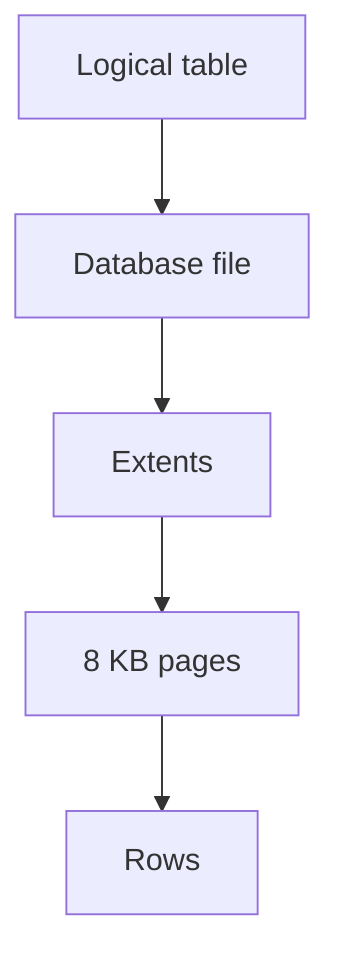

The key idea for this lab is:

> [!IMPORTANT]
> Rows are logical objects. Pages are the physical units SQL Server works with.

---

# 2. Create the IndexLab database

We will use the same generated database in both Lab 05 and Lab 06.

Run the [setup script](setup/index-lab-data-setup.md) in SQL Server Management Studio.

The setup creates:

- `Category`
- `Product`
- `Customer`
- `SalesOrder`
- `SalesOrderItem`

The largest tables contain approximately:

- `SalesOrder` – 10,000,000 rows
- `SalesOrderItem` – 40,000,000 rows

Generation may take a few minutes depending on the computer.

After the script completes:

```sql
USE IndexLab;
GO
```

Verify the row counts:

```sql
SELECT COUNT(*) AS CategoryRows
FROM dbo.Category;

SELECT COUNT(*) AS ProductRows
FROM dbo.Product;

SELECT COUNT(*) AS CustomerRows
FROM dbo.Customer;

SELECT COUNT(*) AS SalesOrderRows
FROM dbo.SalesOrder;

SELECT COUNT(*) AS SalesOrderItemRows
FROM dbo.SalesOrderItem;
```

The important point is not only that the database contains many rows.

The important question is:

> **How are those rows physically stored?**

---

# 3. Database files

A SQL Server database is represented by physical files.

The main file types are:

| Extension | Purpose |
|---|---|
| `.mdf` | Primary data file |
| `.ndf` | Optional secondary data file |
| `.ldf` | Transaction log file |

A simplified `IndexLab` layout is:

```text
IndexLab
│
├── IndexLab.mdf
│      tables
│      indexes
│      metadata
│
└── IndexLab_log.ldf
       transaction log
```

The data file contains database pages.

The log file records changes and supports transaction recovery.

Additional `.ndf` files can be used in larger database layouts, but they are not important for this lab.

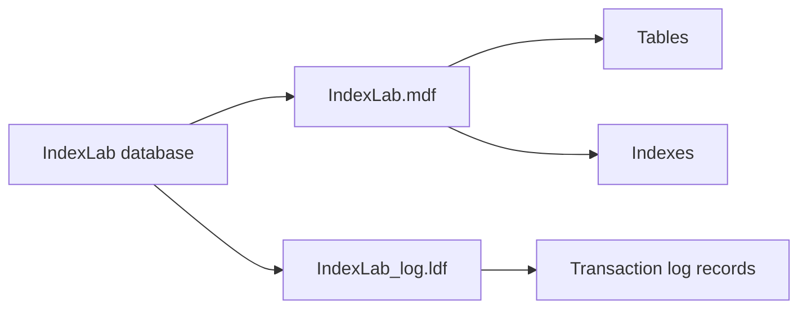

---

## Check your understanding

1. What is the difference between the logical view of a table and how SQL Server physically stores it?
2. Name the three main SQL Server database file types and what each is used for.
3. Which file records changes and supports transaction recovery?

<details>
<summary>Show answers</summary>

1. A query like `SELECT * FROM dbo.Customer` looks as if it simply reads rows, but physically SQL Server reads and writes fixed-size pages inside database files.
2. `.mdf` – primary data file; `.ndf` – optional secondary data file; `.ldf` – transaction log file.
3. The `.ldf` transaction log file.

</details>

---

# 4. From the physical disk to a SQL Server page

Before looking at SQL Server pages, inspect the storage layer underneath SQL Server.

Open **Command Prompt** or **PowerShell** and run:

```text
fsutil fsinfo ntfsinfo C:
```

If the SQL Server data files are stored on another drive, use that drive instead.

Look for:

- `Bytes Per Sector`
- `Bytes Per Physical Sector`
- `Bytes Per Cluster`

A typical system may show something similar to:

```text
Bytes Per Sector          : 512
Bytes Per Physical Sector : 4096
Bytes Per Cluster         : 4096
```

Your values may be different.

## 4.1 Different layers use different units

At the physical and filesystem levels, storage is also block-based.

A simplified hierarchy is:

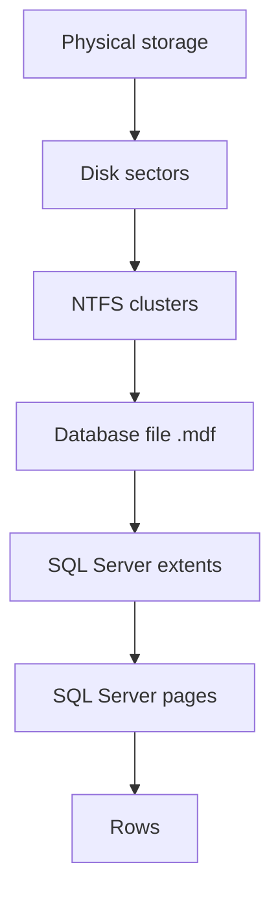

For example:

| Layer | Typical size |
|---|---|
| NTFS cluster | commonly 4 KB |
| SQL Server page | always 8 KB |

These are different layers.

An NTFS cluster is a filesystem allocation unit.

A SQL Server page is a database storage and I/O unit.

> [!NOTE]
> SQL Server always organizes its data into 8 KB pages, regardless of the NTFS cluster size underneath.

Do not assume `1 SQL Server page = 1 physical disk I/O`.

The operating system, SQL Server, storage controller, SSD cache, and read-ahead mechanisms can combine or cache I/O.

The important principle is:

> [!IMPORTANT]
> More pages to process means more I/O work, even though the exact number of physical storage operations can vary.

---

# 5. Files, extents, and pages

A SQL Server data file is divided into fixed-size pages.

A page is always `8 KB` (`8192 bytes`).

Eight pages form one extent: `8 × 8 KB = 64 KB`.

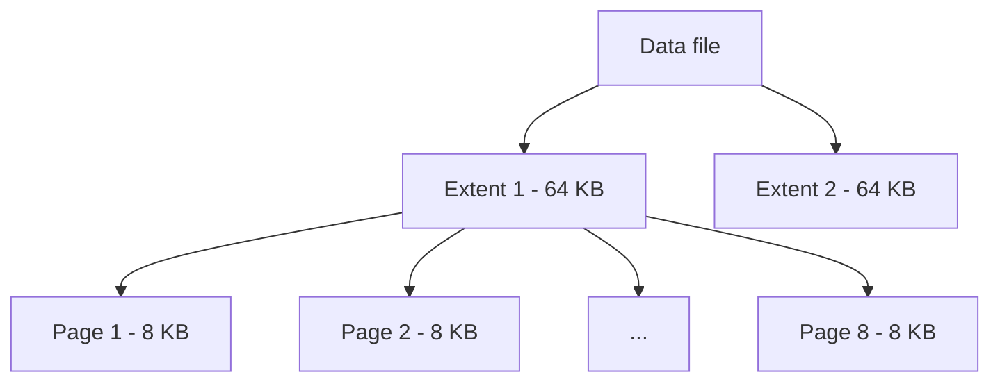

For this lab:

- **extent** is mainly an allocation concept,
- **page** is the key unit for understanding query I/O.

---

# 6. Inside a data page

A data page contains a header, rows, free space, and a slot array.

```text
+-----------------------------+
| Page Header - 96 bytes      |
+-----------------------------+
| Row 1                       |
+-----------------------------+
| Row 2                       |
+-----------------------------+
| Row 3                       |
+-----------------------------+
| ...                         |
| Free space                  |
+-----------------------------+
| Slot array                  |
+-----------------------------+
```

The **page header** stores metadata about the page.

The **rows** contain the actual record data.

The **slot array** contains offsets that tell SQL Server where each row begins inside the page.

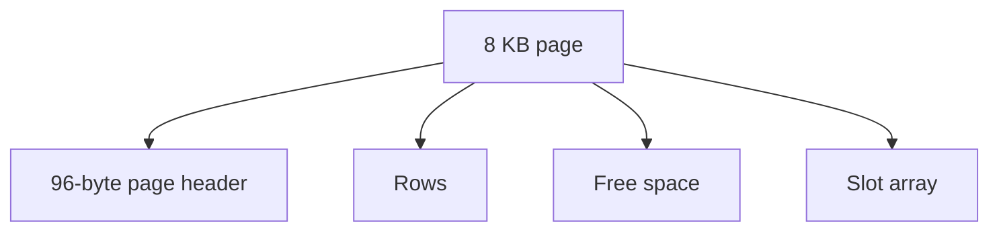

Important values:

- Page size = `8192 bytes`
- Page header = `96 bytes`
- Extent = `8 pages = 64 KB`

The usable area for regular in-row records is therefore slightly smaller than the full 8192 bytes.

Large variable-length values may be moved outside the main row when required.

For this lab, remember:

> [!NOTE]
> Smaller rows usually mean more rows per page.

---

## Check your understanding

1. What is the difference between an NTFS cluster and a SQL Server page?
2. Why shouldn't you assume that one SQL Server page equals exactly one physical disk I/O operation?
3. How many pages make up one extent, and how large is an extent in total?
4. What does a data page contain besides the actual row data?

<details>
<summary>Show answers</summary>

1. An NTFS cluster is a filesystem allocation unit (commonly 4 KB); a SQL Server page is always a fixed 8 KB database storage and I/O unit, independent of the underlying filesystem.
2. The operating system, SQL Server, storage controller, SSD cache, and read-ahead mechanisms can combine or cache I/O, so the mapping isn't 1:1.
3. Eight pages form one 64 KB extent.
4. A page header (96 bytes), free space, and a slot array that stores offsets telling SQL Server where each row begins.

</details>

---

# 7. Why pages matter

This is the most important conceptual section of the lab.

SQL Server does not normally retrieve one isolated row directly from storage.

It works with pages.

Suppose two tables both contain `1,000,000 rows`.

Table A stores about `100 rows per page`. It therefore needs approximately `1,000,000 / 100 = 10,000 pages`.

Table B stores about `50 rows per page`. It therefore needs approximately `1,000,000 / 50 = 20,000 pages`.

Both tables contain the same number of rows.

But scanning Table B requires SQL Server to process roughly twice as many pages.

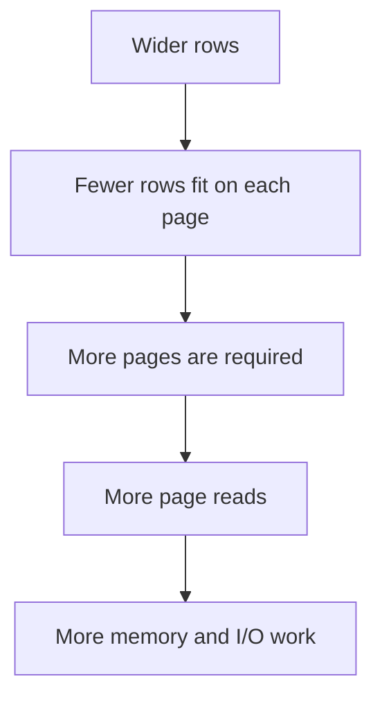

This gives us an important rule:

> [!IMPORTANT]
> Query performance is often strongly related to the number of pages SQL Server must process.

The number of rows returned by a query does not tell the whole story.

A query may return only 100 rows while still reading thousands of pages to find them.

That distinction becomes extremely important in Lab 06.

---

# 8. Buffer pool, logical reads, and physical reads

SQL Server normally processes pages in memory.

The main memory area used to cache database pages is called the **buffer pool**.


When a query needs a page, two situations are possible.

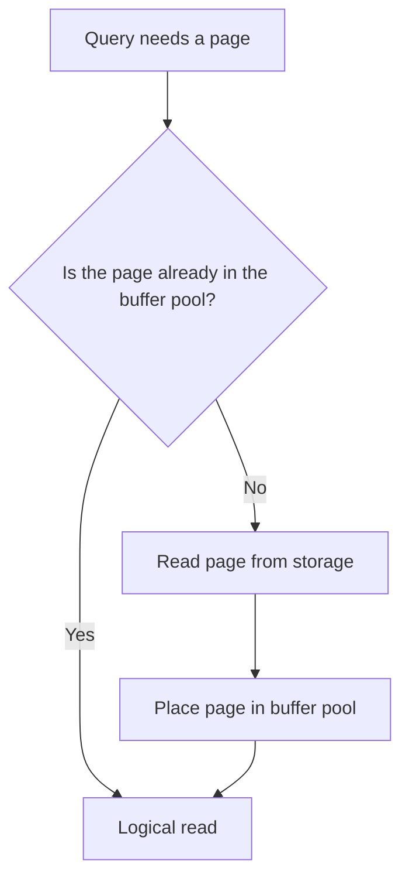

## Logical read

A **logical read** means that SQL Server accessed a page in the buffer pool.

The page may already have been in memory.

## Physical read

A **physical read** occurs when the required page is not already available in memory and must be brought in from storage.

Therefore, every page SQL Server processes contributes to logical I/O, but not every logical read requires a physical storage read.

This also explains why the first execution of a query can sometimes be slower than later executions: some required pages may already be cached.

> [!IMPORTANT]
> More pages processed means more logical I/O and increases the potential amount of physical I/O.

In Lab 06 we will measure this using:

```sql
SET STATISTICS IO ON;
```

---

# 9. Page types

SQL Server uses different page types for different purposes.

For this lab, focus on two:

| Page type | Purpose |
|---|---|
| Data page | Stores table rows |
| Index page | Stores index structure |

Other page types exist for allocation and internal bookkeeping, but they are not the focus here.

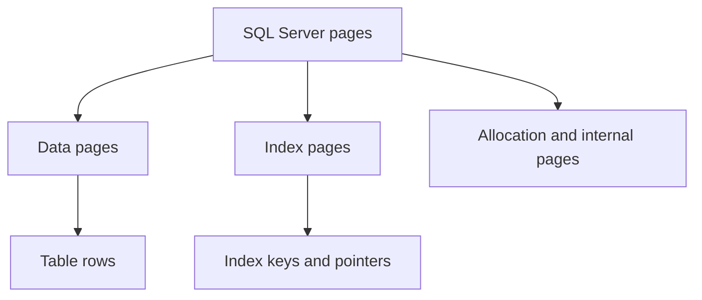

The distinction between data pages and index pages creates the bridge to Lab 06.

---

## Check your understanding

1. Why can two tables with the same number of rows require very different numbers of pages?
2. What is the difference between a logical read and a physical read?
3. Why can the first execution of a query be slower than later executions of the same query?
4. What are the two page types this lab focuses on?

<details>
<summary>Show answers</summary>

1. If one table has wider rows, fewer rows fit per page, so it needs more pages to store the same number of rows.
2. A logical read accesses a page already in the buffer pool; a physical read is needed when the page is not already cached and must be brought in from storage.
3. The first run may need physical reads to bring pages into the buffer pool; later runs can reuse those cached pages through logical reads only.
4. Data pages (store table rows) and index pages (store index structure).

</details>

---

# 10. Inspecting the physical reality

Until now, `Category`, `Product`, and `Customer` looked like logical tables.

Physically, each table occupies a collection of pages.

We will now use SQL Server diagnostic commands to see those pages directly.

The goal is not to memorize DBCC syntax.

The goal is to answer:

> **Which pages belong to this table, and what is actually stored inside one of those pages?**

First enable DBCC output in the current session:

```sql
DBCC TRACEON(3604);
GO
```

If you open a new query window, run it again.

---

# 11. DBCC IND – Which pages belong to a table?

Start with:

```sql
DBCC IND('IndexLab', 'dbo.Category', -1);
GO
```

The result contains many columns.

Focus on:

| Column | Meaning |
|---|---|
| `PageFID` | file identifier |
| `PagePID` | page identifier |
| `PageType` | page type |
| `IndexID` | heap/index identifier |

Conceptually:

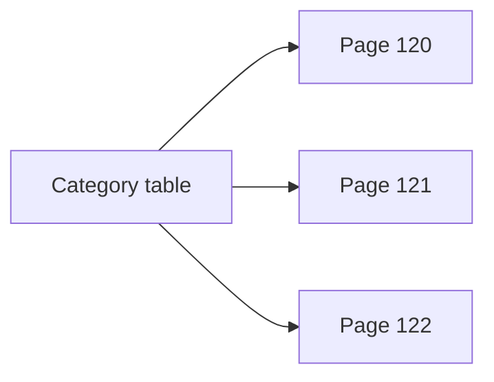

The page IDs are the physical units SQL Server uses to store that object.

You do not need to understand every column returned by `DBCC IND`.

---

# 12. DBCC PAGE – Look inside one page

Choose one data page from `DBCC IND`.

Then run:

```sql
DBCC PAGE('IndexLab', <PageFID>, <PagePID>, 3)
WITH TABLERESULTS;
GO
```

Example:

```sql
DBCC PAGE('IndexLab', 1, 123, 3)
WITH TABLERESULTS;
GO
```

Replace `123` with a real page ID from your database.

Look for information such as:

- `PAGE HEADER`
- `Slot`
- `Record Size`

This is the low-level physical representation of data that is normally hidden behind:

```sql
SELECT *
FROM dbo.Category;
```

Think of `DBCC PAGE` as a microscope:


---

## Check your understanding

1. What must you run once per session before using `DBCC IND` and `DBCC PAGE`?
2. What does `DBCC IND` tell you about a table?
3. What does `DBCC PAGE` let you inspect that `DBCC IND` does not?
4. Do you need to understand every column returned by `DBCC IND`?

<details>
<summary>Show answers</summary>

1. `DBCC TRACEON(3604);` to enable DBCC output in the current session.
2. Which pages belong to a given table, identified by `PageFID`, `PagePID`, `PageType`, and `IndexID`.
3. The actual physical contents of one specific page — the page header, slots, and record size — the low-level representation normally hidden behind a `SELECT`.
4. No. The lab only asks you to focus on a handful of key columns.

</details>

---

# 13. Exercise 1 – Category

Investigate `dbo.Category`.

Use:

```sql
DBCC IND('IndexLab', 'dbo.Category', -1);
```

and `DBCC PAGE`.

Answer:

1. How many data pages does the table use?
2. What are the `PageFID` and `PagePID` values?
3. How many rows are stored on one selected data page?
4. What is the approximate size of a row?
5. Does the entire table fit into a small number of pages?

### Discussion

If the whole table occupies only a very small number of pages, scanning those pages may be extremely cheap.

This is important because:

> [!NOTE]
> A scan is not automatically bad.

We will return to this idea in Lab 06.

---

# 14. Exercise 2 – Product

Investigate `dbo.Product`.

Run:

```sql
DBCC IND('IndexLab', 'dbo.Product', -1);
GO
```

Inspect several pages using `DBCC PAGE`.

Answer:

1. Approximately how many data pages are used?
2. What are the first three data page IDs?
3. How many rows fit on one selected page?
4. What are the sizes of several rows?
5. Do all rows have exactly the same size?
6. Which variable-length columns could explain any differences?

## Estimate rows per page

Choose an approximate row size.

Estimate `8060 / approximate row size`.

Compare this estimate with the actual number of rows on a page.

The result may differ because SQL Server also stores row overhead and slot-array entries.

---

# 15. Exercise 3 – Customer

Investigate `dbo.Customer`.

Run:

```sql
DBCC IND('IndexLab', 'dbo.Customer', -1);
GO
```

Answer:

1. Approximately how many data pages does the table use?
2. What are the first five data page IDs?
3. How many rows are stored on one selected page?
4. What are the sizes of the first few rows?
5. Why can rows from the same table have different physical sizes?

Compare the result with `Category` and `Product`.

---

## Check your understanding

1. If a whole table fits into only a few data pages, why might scanning it be perfectly efficient?
2. Why might two rows from the same table have different physical sizes?
3. How can you roughly estimate how many rows fit on one page, and why might the real number differ from your estimate?

<details>
<summary>Show answers</summary>

1. Because scanning a small number of pages is cheap regardless of access method — a scan is not automatically bad when the table itself is small.
2. Variable-length columns can store different amounts of data per row, so row sizes vary even within the same table.
3. Estimate ≈ 8060 / approximate row size. The real count may differ because SQL Server also stores row overhead and slot-array entries on each page.

</details>

---

# 16. From page count to I/O cost

Now connect everything.

Suppose a query needs to inspect `100 pages` and another query needs to inspect `100,000 pages`.

Even when many pages are cached, the second query creates much more work:

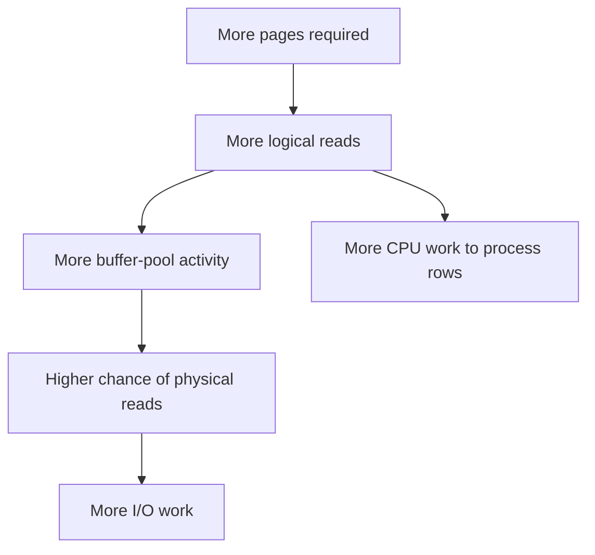

This does not mean that elapsed time is determined only by page count.

Queries also use CPU, memory, joins, sorting, aggregation, and other operations.

But page count is one of the most important physical concepts for understanding why a large scan can be expensive.

---

# 17. Large tables and the problem we need to solve

Now consider:

- `SalesOrder` – ~10,000,000 rows
- `SalesOrderItem` – ~40,000,000 rows

These objects occupy a very large number of pages.

Imagine that a query needs order items for only one day.

A table scan may still need to process a large part of the table to locate a small result set.


The problem is now clear:

> **How can SQL Server find the relevant rows without processing all those pages?**

---

# 18. Bridge to Lab 06 – Indexes

An index provides another physical access path.

Instead of scanning a large number of data pages, SQL Server may be able to navigate through a small number of index pages and reach only the relevant part of the data.

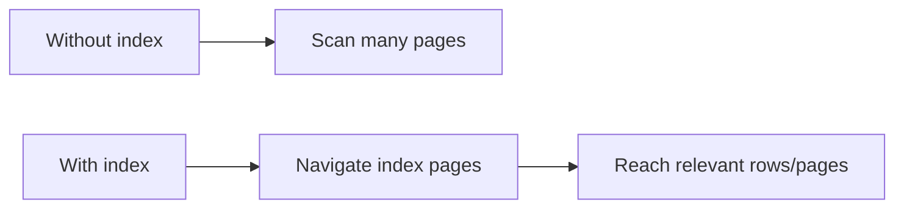

Lab 06 will investigate:

- B+-tree structure
- clustered indexes
- nonclustered indexes
- table scans
- index seeks
- execution plans
- logical reads

The core connection between the two labs is:

> [!NOTE]
> Lab 05 explains what SQL Server reads. Lab 06 explains how SQL Server can avoid reading what it does not need.

---

## Check your understanding

1. Does more I/O work always mean a query is automatically slow? What else does elapsed time depend on?
2. Why can a table scan on `SalesOrderItem` be especially expensive compared to one on `Category`?
3. How does an index change the number of pages SQL Server has to process for a selective query?

<details>
<summary>Show answers</summary>

1. No. Page count is one of the most important factors, but elapsed time also depends on CPU, memory, joins, sorting, aggregation, and other work.
2. `SalesOrderItem` has roughly 40 million rows spread across many pages, so a scan must process far more pages than scanning a small table like `Category`.
3. Instead of scanning all data pages, SQL Server can navigate through a small number of index pages and go straight to the relevant rows/pages, avoiding the need to read irrelevant data.

</details>

---

# Key takeaways

- SQL Server databases are represented by physical files.
- The filesystem and SQL Server both organize storage into fixed-size units.
- SQL Server uses fixed-size **8 KB pages**.
- Eight pages form a **64 KB extent**.
- Rows live inside pages.
- SQL Server processes pages in memory using the buffer pool.
- A logical read is an access to a page in the buffer pool.
- A physical read is required when a needed page must be brought from storage.
- More pages to process means more logical I/O and potentially more physical I/O.
- Wider rows usually mean fewer rows per page and therefore more pages.
- `DBCC IND` shows which pages belong to an object.
- `DBCC PAGE` lets us inspect the contents of an individual page.
- Small scans may be cheap.
- Large scans may require processing huge numbers of pages.
- Indexes provide alternative access paths that can reduce page processing.

> **SQL Server performance is often about how many pages must be processed, not simply how many rows a query returns.**
