# Lab 06 – Indexes in SQL Server

> Database Design Laboratory  
> Student Lab Manual

---

# Learning goals

By the end of this lab, you should be able to:

- explain how indexes reduce unnecessary page access,
- explain the basic structure of a B+-tree,
- distinguish a heap, clustered index, and nonclustered index,
- explain what happens when a primary key is created,
- read the most important operators in an Actual Execution Plan,
- recognize `Table Scan`, `Clustered Index Scan`, `Index Seek`, `Hash Match`, `Nested Loops`, `Compute Scalar`, and `Sort`,
- design indexes for common filters and joins,
- explain the purpose of included columns,
- explain why column order matters in composite indexes,
- explain selectivity,
- understand why too many indexes can hurt write performance,
- inspect index depth, page count, and leaf-level rows in SSMS.

---

# 1. From Lab 05 to Lab 06

In Lab 05 we learned:

- SQL Server stores data in pages.
- Queries process pages.
- More pages processed means more I/O work.

Now we ask:

> **How can SQL Server avoid processing pages that are irrelevant to a query?**

The answer is:

> **Indexes.**

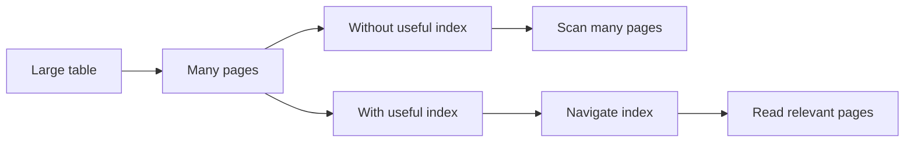

---

# 2. The B+-tree idea

SQL Server rowstore indexes use a balanced tree structure.

A simplified B+-tree:

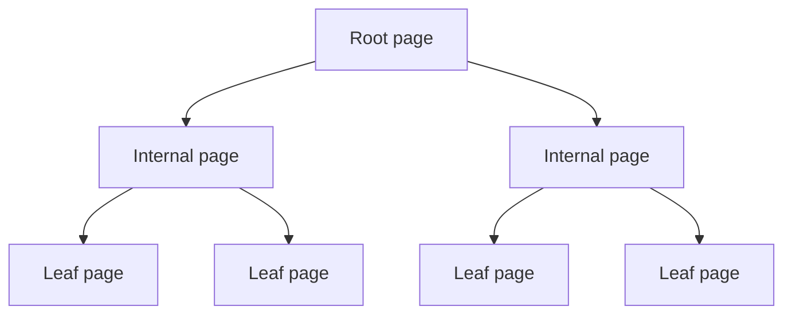

The tree contains:

- root level
- internal levels
- leaf level

There is another important detail this picture doesn't show: leaf pages are also linked directly to each other, in both directions:


Once SQL Server reaches the first relevant leaf page, it can walk directly to neighboring leaf pages without going back up through the tree. This is what makes range scans and the `Index Scan` operator efficient, and is one reason a query can sometimes return rows in index order without a separate `Sort` operator.

To search for a key, SQL Server follows one path through the tree.

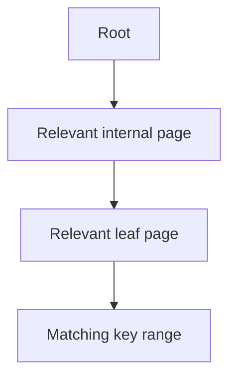

The key benefit is that SQL Server does not need to examine every index entry sequentially.

A very large index can still be only a few levels deep.

---

# 3. Heap, clustered index, and nonclustered index

## Heap

A table without a clustered index is called a `heap`.

The rows still live on data pages, but there is no clustered index key that defines the leaf-level order.

At the beginning of this lab, the large tables are intentionally left without primary-key indexes so that we can observe the effect of adding them.

---

## Clustered index

A clustered index contains the actual table rows at its leaf level.

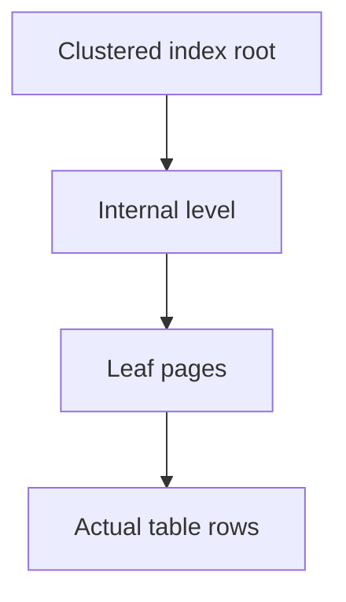

A table can have only one clustered index.

---

## Nonclustered index

A nonclustered index is a separate structure.

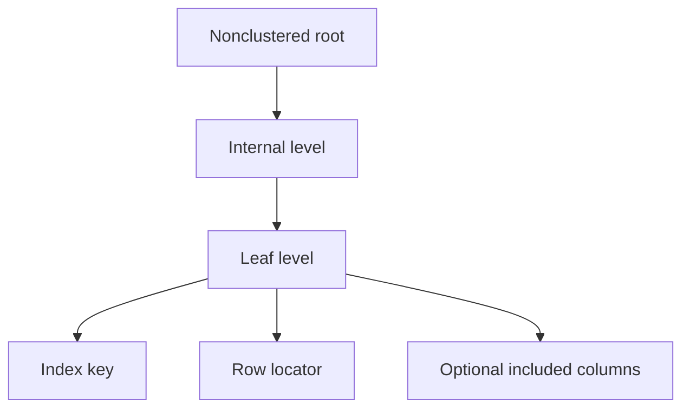

A table can have multiple nonclustered indexes.

Each one provides a different access path.

---

# 4. Primary keys and indexes

A primary key is a logical constraint.

It guarantees that:

- values are unique
- values are not `NULL`

SQL Server enforces the primary key using a unique index.

If the table has no clustered index and the primary key is not explicitly declared `NONCLUSTERED`, SQL Server creates a clustered primary-key index by default.

We will explicitly create:

```sql
PRIMARY KEY CLUSTERED
```

later in the lab so the physical choice is clear.

> [!IMPORTANT]
> A primary key creates an index, but one index cannot efficiently support every possible access pattern.

---

## Check your understanding

1. What is the key benefit of a B+-tree that lets SQL Server avoid examining every index entry sequentially?
2. Why are leaf pages also linked to each other, not just reachable from the tree above them?
3. What is the difference between a heap, a clustered index, and a nonclustered index?
4. How many clustered indexes can one table have? How many nonclustered indexes?
5. Does creating a primary key automatically give SQL Server an efficient access path for every query against that table?

<details>
<summary>Show answers</summary>

1. SQL Server follows one path from the root through internal pages to the relevant leaf page, so a very large index can still be only a few levels deep.
2. So that once the first relevant leaf page is found, SQL Server can walk directly to neighboring leaf pages for a range scan, instead of going back up through the tree for every page.
3. A heap is a table without a clustered index — rows live on data pages with no defined leaf-level order. A clustered index stores the actual table rows at its leaf level, sorted by the index key. A nonclustered index is a separate structure with its own key, a row locator, and optional included columns.
4. Only one clustered index, but multiple nonclustered indexes.
5. No. It enforces uniqueness and gives one efficient access path (by the primary key), but other filters and joins may still need their own indexes.

</details>

---

# 5. Main performance demo – prepare SSMS

Use:

```sql
USE IndexLab;
GO
```

Enable:

```text
Query
→ Include Actual Execution Plan
```

or press `Ctrl + M`.

Also enable:

```sql
SET STATISTICS IO ON;
SET STATISTICS TIME ON;
GO
```

Lab 05 introduced the meaning of page reads.

Now `STATISTICS IO` will show the amount of logical I/O performed by the query.

---

# 6. Run the query before indexes

Run:

```sql
SELECT
    p.CategoryId,
    COUNT_BIG(*) AS ItemCount,
    SUM
    (
        CAST(soi.Quantity AS decimal(18,2))
        * soi.UnitPrice
    ) AS Revenue
FROM dbo.SalesOrder AS so
JOIN dbo.SalesOrderItem AS soi
    ON soi.SalesOrderId = so.SalesOrderId
JOIN dbo.Product AS p
    ON p.ProductId = soi.ProductId
WHERE so.OrderDate >= '20250601'
  AND so.OrderDate <  '20250602'
GROUP BY
    p.CategoryId
ORDER BY
    Revenue DESC;
GO
```

On SQL Server Express, the first execution took around 15–17 seconds on the reference machine.

Exact time depends on hardware and caching.

> [!NOTE]
> **About the reference numbers in this lab:** every timing and I/O figure here comes from one specific machine — SQL Server 2025 (build 17.0.1135.8), 31 GB RAM, running Developer edition and Express edition as two separate instances on the same computer. Your own numbers will be different, possibly by a lot, depending on your CPU, RAM, storage, and what else is running at the time. What should stay consistent across machines is the *direction* and rough *scale* of the change — scans getting replaced by seeks, and a large drop in rows processed and time taken — not the exact seconds or read counts.

> [!NOTE]
> SQL Server Express limits parallelism, so this query normally runs on a single CPU core. In the `STATISTICS TIME` output, that means `CPU time` and `elapsed time` stay close to each other — there is no second core to absorb extra work. (On an edition that allows more parallelism, you might instead see `CPU time` reported much higher than `elapsed time`, since several cores can share the work.)

> [!TIP]
> Do not focus only on elapsed time.

Inspect:

- Execution Plan
- Messages
- `STATISTICS IO`
- `STATISTICS TIME`

---

# 7. Reading the execution plan

Execution plans are usually read `right → left`.

Start with the operators that access tables or indexes.

For this lab, focus on:

| Operator | Meaning |
|---|---|
| `Table Scan` | Read rows from a heap |
| `Clustered Index Scan` | Scan a clustered index |
| `Index Scan` | Scan a nonclustered index |
| `Index Seek` | Navigate directly to a relevant key range |
| `Key Lookup` | For each row found via a nonclustered index, fetch additional columns from the clustered index (`RID Lookup` is the equivalent on a heap) |
| `Nested Loops` | For each outer row, find matching inner rows |
| `Hash Match` | Hash-based join or aggregation |
| `Compute Scalar` | Calculate an expression |
| `Sort` | Sort rows |


> [!NOTE]
> The plan is not a list of "good" and "bad" operators.

The important questions are:

- How many rows were read?
- How many rows were returned?
- Which access paths were available?
- How much I/O was required?

---

# 8. Why SalesOrder is expensive

The query filters:

```sql
WHERE so.OrderDate >= '20250601'
  AND so.OrderDate <  '20250602'
```

`SalesOrder` contains approximately `10,000,000 rows`, but only about `5,477 rows` match one day in the reference data.

Without an index on `OrderDate`, SQL Server cannot navigate directly to those rows.

Inspect the operator properties:

- Actual Number of Rows
- Estimated Number of Rows
- Number of Rows Read
- Predicate

The important pattern is:


---

# 9. SalesOrderItem – the main bottleneck

The join is:

```sql
soi.SalesOrderId = so.SalesOrderId
```

`SalesOrderItem` contains approximately `40,000,000 rows`, but only about `21,908 rows` are relevant on the reference database.

Without a suitable index on `SalesOrderId`, SQL Server must process a very large input.


This is the main performance problem.

---

## Check your understanding

1. What two things should you enable before running the demo query so you can observe its performance?
2. In which direction are execution plans usually read?
3. Why does filtering `SalesOrder` by `OrderDate` require processing a large amount of data even though only about 5,477 rows match?
4. Why is `SalesOrderItem` described as the main bottleneck in this query?

<details>
<summary>Show answers</summary>

1. The Actual Execution Plan (`Ctrl+M`) and `SET STATISTICS IO ON; SET STATISTICS TIME ON;`.
2. Right to left, starting with the operators that access tables or indexes.
3. Without an index on `OrderDate`, SQL Server has no access path to navigate directly to the matching rows, so it must process a large part of the 10 million rows to find them.
4. It contains about 40 million rows but only about 21,908 are relevant to the join; without a suitable index on `SalesOrderId`, SQL Server must process the entire large input to find the matches.

</details>

---

# 10. Why Hash Match?

Without useful indexes, the plan may use `Hash Match (Inner Join)`.

Conceptually:

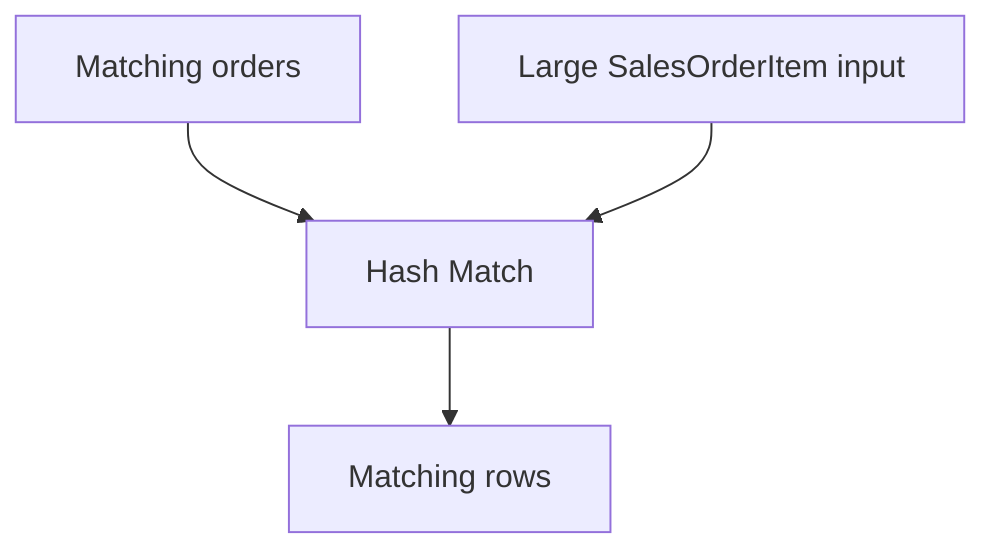

> [!NOTE]
> A `Hash Match` is not automatically bad.

With a large unsorted input and no efficient lookup path, it can be a reasonable strategy.

The problem is primarily the size of the data flowing into the join.

---

# 11. Why the Product scan is not a problem

The plan may still scan `Product`, which contains only about `30,000 rows`.

A scan of a small object may be extremely cheap.

Therefore:

> [!NOTE]
> Seek is not always good, and scan is not always bad.

Always consider scale.

---

# 12. Compute Scalar, Aggregate, and Sort

`Compute Scalar` corresponds to:

```sql
CAST(soi.Quantity AS decimal(18,2))
* soi.UnitPrice
```

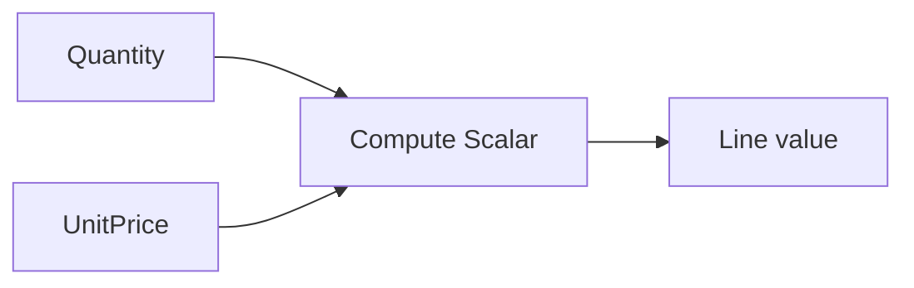

`Hash Match (Aggregate)` implements:

```sql
GROUP BY p.CategoryId
```

and the aggregate expressions.

`Sort` implements:

```sql
ORDER BY Revenue DESC
```

These operators are not the main bottleneck in this query because they process a much smaller amount of data than the original large scans.

---

# 13. Missing Index recommendation

The plan may suggest something similar to:

```sql
CREATE NONCLUSTERED INDEX ...
ON dbo.SalesOrder (OrderDate)
INCLUDE (SalesOrderId)
```

Treat this as:

> [!WARNING]
> A useful hint, not an instruction.

SQL Server is considering the current query.

It is not designing the complete indexing strategy for the database.

Consider:

- existing indexes
- other queries
- storage
- write overhead
- redundant indexes

before accepting any missing-index recommendation.

---

## Check your understanding

1. Is a `Hash Match` always a bad sign in an execution plan?
2. Why is scanning the `Product` table not a performance concern in this query?
3. What does `Compute Scalar` do in this query's execution plan?
4. Should you automatically create every index that SQL Server's "Missing Index" feature suggests?

<details>
<summary>Show answers</summary>

1. No. With a large unsorted input and no efficient lookup path, a `Hash Match` can be a reasonable strategy — the problem is usually the size of the data flowing into the join, not the join type itself.
2. `Product` only contains about 30,000 rows, so scanning it is very cheap compared to processing the much larger `SalesOrder`/`SalesOrderItem` tables.
3. It calculates an expression for each row — in this query, `CAST(soi.Quantity AS decimal(18,2)) * soi.UnitPrice`.
4. No. It is a useful hint based only on the current query; you should consider existing indexes, other queries, storage, write overhead, and redundancy before accepting it.

</details>

---

# 14. Create the clustered primary keys

Create:

```sql
ALTER TABLE dbo.SalesOrder
ADD CONSTRAINT PK_SalesOrder
PRIMARY KEY CLUSTERED (SalesOrderId);
GO

ALTER TABLE dbo.SalesOrderItem
ADD CONSTRAINT PK_SalesOrderItem
PRIMARY KEY CLUSTERED (SalesOrderItemId);
GO
```

Refresh the `Indexes` folder in SSMS.

You should see `PK_SalesOrder` and `PK_SalesOrderItem`.


The primary-key indexes provide efficient access by `SalesOrderId` and `SalesOrderItemId`, but our query also needs other access paths.

---

# 15. Create an index for the date filter

Create:

```sql
CREATE NONCLUSTERED INDEX IX_SalesOrder_OrderDate
ON dbo.SalesOrder (OrderDate);
GO
```

Why?

Because the query searches by `OrderDate`.


Because `SalesOrder` now has a clustered index on `SalesOrderId`, the clustered key is also available as the row locator in the nonclustered index.

That is enough for the join in this query.

> [!IMPORTANT]
> A table's clustering key is always present at the leaf level of **every** nonclustered index on that table — it is the row locator SQL Server uses to find the full row if it ever needs to. You never need to add it with `INCLUDE`; it is already there for free. This is exactly why `IX_SalesOrder_OrderDate` needs no `INCLUDE (SalesOrderId)` of its own.

---

# 16. Create an index for the order-item join

Before creating the index we will actually keep, it is worth seeing why `INCLUDE` matters, instead of taking it on faith.

Create an index on **only** the join column:

```sql
CREATE NONCLUSTERED INDEX IX_SalesOrderItem_SalesOrderId
ON dbo.SalesOrderItem (SalesOrderId);
GO
```

Run a small, isolated query against just this one table — not the full multi-table demo query:

```sql
SELECT ProductId, Quantity, UnitPrice
FROM dbo.SalesOrderItem
WHERE SalesOrderId = 1;
GO
```

Look at the plan. You should see `Index Seek` on `IX_SalesOrderItem_SalesOrderId`, followed by a `Key Lookup` — one extra operation per matching row, needed only because `ProductId`, `Quantity`, and `UnitPrice` are not part of this index.

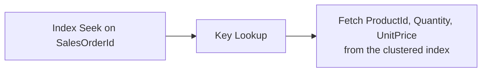

Now rebuild the index with the columns this query — and the main demo query — actually need:

```sql
DROP INDEX IX_SalesOrderItem_SalesOrderId ON dbo.SalesOrderItem;
GO

CREATE NONCLUSTERED INDEX IX_SalesOrderItem_SalesOrderId
ON dbo.SalesOrderItem (SalesOrderId)
INCLUDE
(
    ProductId,
    Quantity,
    UnitPrice
);
GO
```

Run the isolated query again. The `Key Lookup` is gone.

Why is `SalesOrderId` the key?

Because the query joins by:

```sql
soi.SalesOrderId = so.SalesOrderId
```

Why include:

- `ProductId`
- `Quantity`
- `UnitPrice`

Because they are needed by the rest of the query — and, as just demonstrated, leaving any of them out brings the `Key Lookup` back.

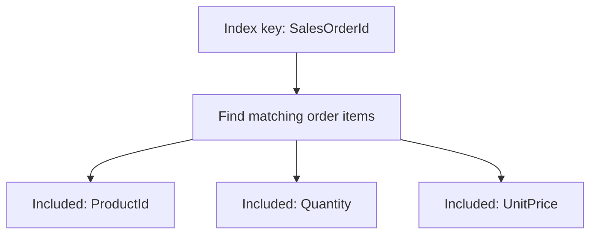

This index covers everything this query needs from `SalesOrderItem`.

---

# 17. Run the same query again

Run exactly the same SQL statement.

The SQL did not change.

Only the available physical access paths changed.

Compare:

- elapsed time
- logical reads
- execution plan

---

# 18. New plan – Index Seek and Nested Loops

The new plan should contain operators such as `Index Seek → Nested Loops → Index Seek`.

Conceptually:

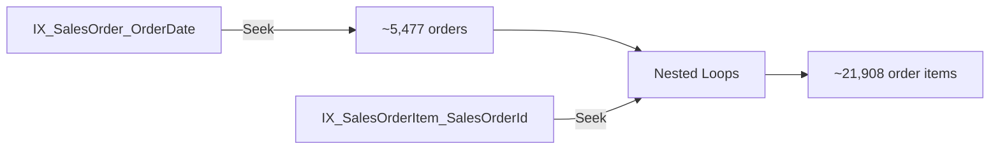

Instead of processing huge inputs, SQL Server can navigate directly to relevant rows.

---

## Check your understanding

1. Why doesn't creating the clustered primary keys alone fully solve the performance problem?
2. Why is `OrderDate` chosen as the key for the new index on `SalesOrder`, and why is `SalesOrderId` included?
3. Why is `SalesOrderId` the key for the new index on `SalesOrderItem`, and why are `ProductId`, `Quantity`, and `UnitPrice` included?
4. What operator appeared when `IX_SalesOrderItem_SalesOrderId` existed without its `INCLUDE` columns, and what made it disappear?
5. After creating the new indexes, did the SQL query itself change?

<details>
<summary>Show answers</summary>

1. The primary-key indexes provide efficient access by `SalesOrderId`/`SalesOrderItemId`, but the query filters by `OrderDate` and joins by `SalesOrderId` — different access patterns that the primary keys alone do not support.
2. `OrderDate` is the key because the query filters by it; `SalesOrderId` is included because the join needs it afterward.
3. `SalesOrderId` is the key because the join searches by it; `ProductId`, `Quantity`, and `UnitPrice` are included because the rest of the query needs them, letting the index cover everything required from `SalesOrderItem`.
4. A `Key Lookup`, because the index without `INCLUDE` could find matching rows but not supply `ProductId`, `Quantity`, or `UnitPrice` from its own leaf level. Adding those columns to `INCLUDE` removed it.
5. No. The SQL did not change — only the available physical access paths changed.

</details>

---

# 19. Why Nested Loops now makes sense

A simplified mental model is:

```text
for each matching order
    find its matching order items using the index
```

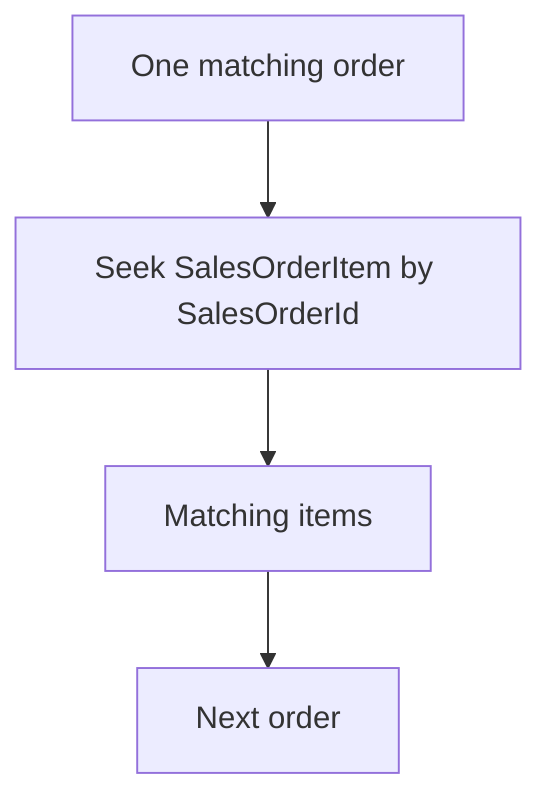

This becomes efficient only because the inner side has a suitable index.

This demonstrates an important principle:

> [!IMPORTANT]
> An index can change the strategy of the entire execution plan, not only one access operator.

---

# 20. Before and after

| | Before indexes | After indexes |
|---|---:|---:|
| `SalesOrder` access | Table Scan | Index Seek |
| Relevant orders | ~5,477 | ~5,477 |
| `SalesOrderItem` access | Table Scan | Index Seek |
| Large item input | ~40,000,000 rows | ~21,908 relevant rows |
| Main join | Hash Match | Nested Loops |
| Logical reads, `SalesOrderItem`* | ~198,000 | ~54,000 |
| Logical reads, `SalesOrder`* | ~57,000 | ~15 |
| Elapsed time* | ~17 s | ~0.5 s |

\* One reference run on SQL Server Express — the edition used in this lab. Your own numbers will differ with hardware, cache state, and data distribution, but expect the *before* numbers to look dramatically worse on Express than on an edition with parallel query execution (such as Developer or Enterprise), since Express runs this query on a single core. The important part is the direction and scale of the change, not the exact figures.

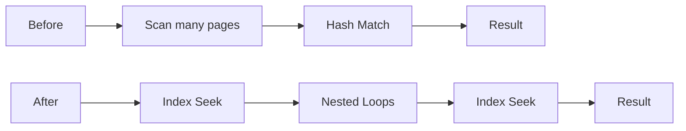

The key lesson is:

> [!IMPORTANT]
> The indexes did not make SQL Server faster at processing tens of millions of rows. They helped SQL Server avoid processing most of those rows.

---

## Edition matters too, not just hardware

The numbers above come from SQL Server Express. The same database, same query, and same missing indexes behave very differently on an edition that allows parallel query execution, such as Developer or Enterprise:

| | Express | Developer / Enterprise |
|---|---:|---:|
| Execution, before indexes | Serial (one core) | Parallel (several cores) |
| Elapsed time, before indexes* | ~17 s | ~1.3 s |
| Elapsed time, after indexes* | ~0.5 s | ~0.17 s |
| Speedup from adding the indexes | ~33× | ~8× |

\* Same reference measurements as above, run on identical data and the identical query on both editions.

Edition alone accounts for roughly a 13× difference in elapsed time here — before any index existed — with no change to hardware, data, or query. Express is restricted to a lower degree of parallelism (and a smaller memory grant for operations like the hash join), so it cannot compensate for a bad plan by spreading the work across cores the way Developer or Enterprise can.

> [!NOTE]
> A missing index is not forgiven by weaker hardware or a more limited edition — it is punished more severely. The gap between editions shrinks sharply once the indexes exist, because there is simply much less work left to parallelize or wait for.

This matters beyond the classroom: many production environments run on licensing tiers or cloud SKUs (such as Standard edition or a smaller Azure SQL Database tier) with similar parallelism and memory ceilings to Express. A query that "runs fine" on a developer's workstation can be far more painful for actual users if the indexing problem was never fixed.

---

# 21. Inspect a real index in SSMS

Inspect `IX_SalesOrderItem_SalesOrderId`.

In SSMS:

```text
Databases
→ IndexLab
→ Tables
→ dbo.SalesOrderItem
→ Indexes
→ IX_SalesOrderItem_SalesOrderId
→ Properties
→ Fragmentation
```

Inspect:

- Index type
- Depth
- Pages
- Leaf-level rows
- Average row size
- Page fullness
- Fragmentation

A large index can contain tens of millions of leaf-level entries while remaining only a few levels deep.

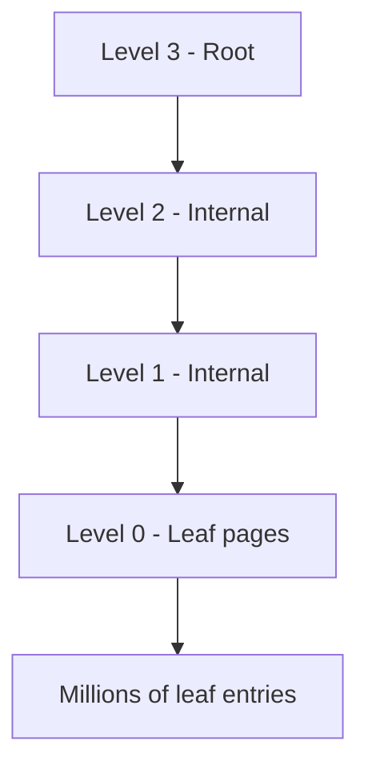

This is the physical reason an index can provide a short navigation path through a very large data set.

Do not interpret `Depth = 4` as exactly four physical disk I/O operations.

Pages may already be cached, and storage I/O can be combined.

---

## Check your understanding

1. Why does `Nested Loops` become an efficient strategy only after the new indexes are created?
2. In the "before and after" comparison, what actually changed about the number of relevant rows retrieved from `SalesOrder` and `SalesOrderItem`?
3. Why is the *before-indexes* elapsed time so much worse on Express than on Developer or Enterprise, given identical data and queries?
4. How can an index with tens of millions of leaf-level entries still have a depth of only a few levels?
5. Should `Depth = 4` be interpreted as exactly four physical disk reads?

<details>
<summary>Show answers</summary>

1. `Nested Loops` works by finding matching inner rows for each outer row. This is efficient only when the inner side (`SalesOrderItem`) has a suitable index to seek into, instead of being scanned in full for every outer row.
2. The number of relevant rows did not change (~5,477 orders, ~21,908 items) — what changed was how SQL Server reached them: `Index Seek` instead of a large scan, and far less data processed overall.
3. Express is limited to serial (single-core) execution, so it cannot spread a bad plan's work across several cores the way Developer or Enterprise can. The missing indexes are the real problem either way; weaker editions just make the cost of that problem more visible.
4. Each index page contains many key values and pointers, so each internal page can direct SQL Server toward a large part of the tree; a seek follows just one path from root to leaf rather than examining entries sequentially.
5. No. Pages may already be cached in the buffer pool, and storage I/O can be combined, so depth does not map directly to a physical I/O count.

</details>

---

# 22. Composite indexes

Create:

```sql
CREATE NONCLUSTERED INDEX IX_SalesOrder_CustomerId_OrderDate
ON dbo.SalesOrder
(
    CustomerId,
    OrderDate
);
GO
```

The index is ordered first by `CustomerId` and then by `OrderDate`.

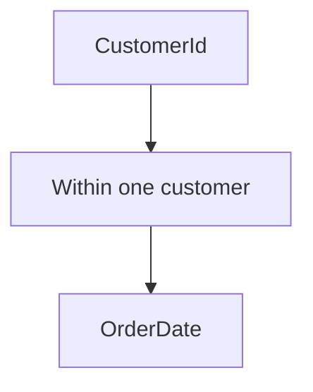

Test:

```sql
SELECT
    SalesOrderId,
    CustomerId,
    OrderDate
FROM dbo.SalesOrder
WHERE CustomerId = 500;
GO
```

Then:

```sql
SELECT
    SalesOrderId,
    CustomerId,
    OrderDate
FROM dbo.SalesOrder
WHERE CustomerId = 500
  AND OrderDate >= '20250101';
GO
```

Then:

```sql
SELECT
    SalesOrderId,
    CustomerId,
    OrderDate
FROM dbo.SalesOrder
WHERE OrderDate >= '20250101';
GO
```

The first two access patterns align naturally with the leading key.

The third does not specify `CustomerId`.

> [!IMPORTANT]
> Column order in a composite index matters.

The written order of predicates in the `WHERE` clause does not define index key order.

---

# 23. Selectivity

Inspect the distribution:

```sql
SELECT
    Status,
    COUNT(*) AS NumberOfOrders
FROM dbo.SalesOrder
GROUP BY Status
ORDER BY NumberOfOrders DESC;
GO
```

Create:

```sql
CREATE NONCLUSTERED INDEX IX_SalesOrder_Status
ON dbo.SalesOrder(Status);
GO
```

Compare:

```sql
SELECT
    SalesOrderId,
    Status
FROM dbo.SalesOrder
WHERE Status = 'Completed';
GO
```

with:

```sql
SELECT
    SalesOrderId,
    Status
FROM dbo.SalesOrder
WHERE Status = 'Review';
GO
```

```mermaid
flowchart TD
    A[Predicate value] --> B{How much of the table matches?}
    B -->|Large percentage| C[Index may be less attractive]
    B -->|Small percentage| D[Index may be more attractive]
```

This is **selectivity**.

> [!NOTE]
> A column with only a few distinct values is not automatically a bad index candidate.

Distribution matters.

---

# 24. Covering indexes and INCLUDE

Our order-item index is:

```sql
CREATE NONCLUSTERED INDEX IX_SalesOrderItem_SalesOrderId
ON dbo.SalesOrderItem (SalesOrderId)
INCLUDE
(
    ProductId,
    Quantity,
    UnitPrice
);
```

The key determines the search order: `SalesOrderId`.

The included columns provide additional values at the leaf level.

```mermaid
flowchart LR
    A[Seek by SalesOrderId] --> B[Leaf entry]
    B --> C[ProductId]
    B --> D[Quantity]
    B --> E[UnitPrice]
```

A **covering index** contains everything a particular query needs from that table.

This can avoid an additional lookup to the clustered index.

But wider indexes:

- consume more storage
- require more maintenance

So do not try to cover every query.

"Everything a query needs" is broader than just the `SELECT` list:

- An included column can also be filtered on. If a query added `AND ProductId = 500` to its `WHERE` clause, SQL Server could check that condition directly at the leaf level, as a **residual predicate** — no lookup needed, because `ProductId` is already sitting right there.
- Coverage applies to `GROUP BY` and aggregate expressions just as much as to `SELECT` and `WHERE`. A query that groups by `ProductId` needs `ProductId` to be in the key or `INCLUDE`, exactly like a query that merely returns it.

> [!NOTE]
> A column counts as "covered" the moment it is part of the index — as a key column or an included column — regardless of which clause of the query actually uses it.

---

## Check your understanding

1. In a composite index on `(CustomerId, OrderDate)`, which queries can use the index efficiently via a seek on the leading column?
2. Does the order of predicates written in a `WHERE` clause determine index key order?
3. What is selectivity, and why isn't a column with few distinct values automatically a bad index candidate?
4. What does it mean for an index to "cover" a query, and what is the trade-off of making an index wider to cover more?
5. Can an included column be used for anything besides appearing in the `SELECT` list?

<details>
<summary>Show answers</summary>

1. Queries that filter on `CustomerId` alone, or on `CustomerId` and `OrderDate` together — because the index is sorted first by `CustomerId`. A query filtering only by `OrderDate` cannot use the leading key efficiently.
2. No. The index's own column definition order determines its key order, regardless of how predicates are written in the query.
3. Selectivity measures how much of the table matches a given predicate value. A column with few distinct values can still be a good index candidate if the distribution is skewed — a rare value can be highly selective even when the column overall has few distinct values.
4. A covering index contains everything a particular query needs from that table, avoiding an extra lookup to the clustered index. The trade-off is that wider indexes consume more storage and require more maintenance.
5. Yes. SQL Server can evaluate an additional `WHERE` condition on an included column directly at the leaf level (a residual predicate), and an included column can support a `GROUP BY` or aggregate just as well as a `SELECT` column — coverage isn't limited to columns that are merely returned.

</details>

---

# 25. Why not index every column?

Every index is a real physical structure made of pages.

More indexes mean:

- more storage
- more pages
- more maintenance

When a row is inserted, updated, or deleted, SQL Server may need to update several index structures.

```mermaid
flowchart TD
    A[INSERT / UPDATE / DELETE] --> B[Clustered index]
    A --> C[Nonclustered index 1]
    A --> D[Nonclustered index 2]
    A --> E[Nonclustered index 3]
```

This creates a trade-off:

```text
more indexes
→ potentially faster reads
→ potentially slower writes
→ more storage
```

Good index design is therefore not:

> create as many indexes as possible

but:

> [!TIP]
> create indexes that support important access patterns.

---

# 26. Small tables and scans

Return to `Product`.

It contains only about `30,000 rows`.

The optimizer may still choose a scan.

That can be correct.

```mermaid
flowchart TD
    A[Small table] --> B[Only a small number of pages]
    B --> C[Scan may be cheap]
```

Do not use:

- Seek = always good
- Scan = always bad

Use:

> [!NOTE]
> The best access method depends on how much data must be processed.

---

# 27. Practical index design checklist

When considering an index, ask:

1. How is the table filtered?
2. How is it joined?
3. Which columns must the query return?
4. How selective is the predicate?
5. Does a similar index already exist?
6. How often is the table modified?
7. How much additional storage will the index require?

Examples:

| Pattern | Key candidate |
|---|---|
| `WHERE OrderDate ...` | `OrderDate` |
| `JOIN ... ON SalesOrderId` | `SalesOrderId` |
| `WHERE CustomerId ... AND OrderDate ...` | `(CustomerId, OrderDate)` |

Indexes should reflect real access patterns.

---

## Check your understanding

1. What is the cost side of adding more indexes to a table?
2. Why might the optimizer still choose a scan on `Product` even though useful indexes exist elsewhere in the database?
3. Name three questions from the practical index design checklist you should ask before creating an index.

<details>
<summary>Show answers</summary>

1. More indexes mean more storage, more pages, and more write-maintenance — every `INSERT`/`UPDATE`/`DELETE` may need to update several index structures, trading faster reads for slower writes.
2. `Product` only has about 30,000 rows and therefore occupies a small number of pages, so a scan can already be cheap enough that an index-based plan isn't needed.
3. Any three of: how the table is filtered, how it is joined, which columns the query must return, how selective the predicate is, whether a similar index already exists, how often the table is modified, how much storage the index would require.

</details>

---

# Exercises

Try each exercise before opening the solution.

---

## Exercise 1 – Index for a filtered, sorted query

Run this query with the actual execution plan enabled, before creating any new index:

```sql
SELECT
    SalesOrderId,
    CustomerId,
    OrderDate,
    TotalAmount
FROM dbo.SalesOrder
WHERE Status = 'Processing'
ORDER BY OrderDate DESC;
```

Design and create a nonclustered index that lets this query avoid a full scan. Explain your choice of key column(s), key order, and any included columns. Re-run the query and confirm the plan improved.

<details>
<summary>Show solution</summary>

```sql
CREATE NONCLUSTERED INDEX IX_SalesOrder_Status_OrderDate
ON dbo.SalesOrder (Status, OrderDate DESC)
INCLUDE (CustomerId, TotalAmount);
GO
```

`Status` is the leading key because the query filters on it. `OrderDate DESC` is part of the key, not just included, because the query also needs the matching rows in that order — storing it in the key can let SQL Server avoid a separate `Sort`. `CustomerId` and `TotalAmount` are included because the query returns them but does not filter or sort by them.

</details>

---

## Exercise 2 – Composite index column order

The lab created `IX_SalesOrder_CustomerId_OrderDate` on `(CustomerId, OrderDate)`. For each query below, decide whether it can use that index via a seek on the full key, a seek on just the leading column, or not efficiently at all — then verify with an actual execution plan.

```sql
-- A
SELECT * FROM dbo.SalesOrder WHERE OrderDate >= '20250101';

-- B
SELECT * FROM dbo.SalesOrder WHERE CustomerId = 500 ORDER BY OrderDate;

-- C
SELECT * FROM dbo.SalesOrder
WHERE CustomerId = 500
  AND OrderDate >= '20250101'
  AND OrderDate <  '20250201';
```

<details>
<summary>Show solution</summary>

- **A** – Not efficiently. `OrderDate` is not the leading key column, so the index cannot be seeked on it alone.
- **B** – Seek on the leading column (`CustomerId`). Because `OrderDate` is the second key column, the matching rows for that customer are already stored in `OrderDate` order, so the `ORDER BY` may be satisfied without an extra `Sort`.
- **C** – Seek on the full key (`CustomerId` and `OrderDate` together) — the most selective use of the index of the three, and typically the cheapest.

</details>

---

## Exercise 3 – Covering index design

Write a query that returns `ProductId`, `Quantity`, and `UnitPrice` from `SalesOrderItem` for one specific `SalesOrderId`. Confirm with an actual execution plan that it does not need a `Key Lookup` back to the clustered index.

```sql
SELECT
    ProductId,
    Quantity,
    UnitPrice
FROM dbo.SalesOrderItem
WHERE SalesOrderId = 12345;
```

<details>
<summary>Show solution</summary>

`IX_SalesOrderItem_SalesOrderId`, created earlier in the lab with `INCLUDE (ProductId, Quantity, UnitPrice)`, already covers this query — the key supports the `WHERE` clause, and every returned column is either the key or an included column. If any of those three columns were missing from the index, the plan would show a `Key Lookup` to fetch them from the clustered index.

</details>

---

## Exercise 4 – Evaluate a Missing Index suggestion

Run this query and look at any "Missing Index" recommendation SQL Server offers:

```sql
SELECT
    SalesOrderId,
    OrderDate
FROM dbo.SalesOrder
WHERE Status = 'Review'
ORDER BY OrderDate;
```

Before creating anything, answer:

1. Does a similar index already exist? (Check `IX_SalesOrder_Status` from Section 23.)
2. Would a newly suggested index overlap or duplicate that existing one?
3. Should you create a new index, extend the existing one, or do nothing? Justify your decision.

<details>
<summary>Show solution</summary>

1. `IX_SalesOrder_Status` exists, but only on `Status` — it does not include `OrderDate`.
2. A suggested index on `(Status, OrderDate)` would not be a pure duplicate; it supports both the filter and the sort, which the existing index does not.
3. In a real workload, the better choice is usually to extend or replace `IX_SalesOrder_Status` with a `(Status, OrderDate)` version rather than keep two overlapping single-purpose indexes — fewer, well-designed indexes are easier to maintain than many narrow, overlapping ones.

</details>

---

# Key takeaways

- SQL Server indexes are physical structures made of pages.
- A heap is a table without a clustered index.
- A clustered index contains table rows at the leaf level.
- A table can have only one clustered index.
- A table can have multiple nonclustered indexes.
- A primary key is enforced by a unique index.
- A primary-key index does not support every query.
- `Index Seek` is useful when the index matches the access pattern.
- A scan is not automatically bad.
- A `Hash Match` is not automatically bad.
- `Nested Loops` can become efficient when the inner side has a useful index.
- Composite-index column order matters.
- `WHERE` predicate order does not determine index key order.
- Selectivity affects whether using an index is attractive.
- A table's clustering key is always present at the leaf of every nonclustered index, for free — no `INCLUDE` needed.
- A `Key Lookup` (or `RID Lookup` on a heap) fetches columns a nonclustered index doesn't have; missing `INCLUDE` columns bring it back.
- Included columns can help an index cover a query — not just for `SELECT`, but also for extra `WHERE` predicates and for `GROUP BY`/aggregates.
- Missing-index recommendations should be evaluated, not accepted automatically.
- Every index consumes pages and adds write-maintenance cost.
- Good index design reduces unnecessary page processing.

> **A good index gives SQL Server a shorter physical path to the data it actually needs.**

---

## Additional practice

More index exercises, using `AdventureWorksENG` instead of `IndexLab`, are available in [Index Exercises](../exercises/indexes.md).
