# Lab 06 – Indexes in SQL Server

> [!TIP]
> How to use this lab
>
> Your instructor will demonstrate the main concepts and the indexing process during the laboratory session.
>
> You are not expected to memorize every detail or complete every section during class. Use this manual to follow the demonstrations, explore the SQL examples independently, and review the explanations at your own pace.
>
> You can also return to the exercises and detailed explanations after the laboratory session.

---

# Learning goals

By the end of this lab, you should be able to:

- explain why an index can reduce unnecessary page reads;
- identify root, intermediate, and leaf levels in a balanced B+ tree;
- follow an index search and explain what happens when a key is inserted;
- distinguish a heap, a nonclustered index on a heap, and a clustered index;
- explain RID Lookup, Key Lookup, and the relationship between primary keys and indexes;
- interpret relevant operators in an Actual Execution Plan;
- compare query performance using `STATISTICS IO` and `STATISTICS TIME`;
- design useful nonclustered, composite, and covering indexes;
- explain selectivity, index maintenance, and the cost of additional indexes.

> [!NOTE]
> **Prerequisite:** Complete Lab 05 (Physical Storage) and create the `IndexLab` database as described in [Lab 05, Section 2](lab05-physical-storage.md#2-create-the-indexlab-database), using the [IndexLab setup script](setup/index-lab-data-setup.md), before starting the SQL exercises below. This lab assumes the reference data and table names from that script.

---

# 1. Why do we need indexes?

In Lab 05, we saw that SQL Server stores data in **8 KB pages**. The database engine always reads whole pages; it never reads an individual row from storage on its own. If a query needs only a few rows from a very large table, reading many unrelated pages is wasted work.

Imagine a library with thousands of books. If books are not arranged by author, finding a particular book could require inspecting many shelves.

**Before computerized library catalogs became common, libraries used alphabetical card catalogs.** Each card contained information about a book, including its location on the shelves.

By searching the catalog, a librarian could quickly find where a book was stored without examining every shelf.

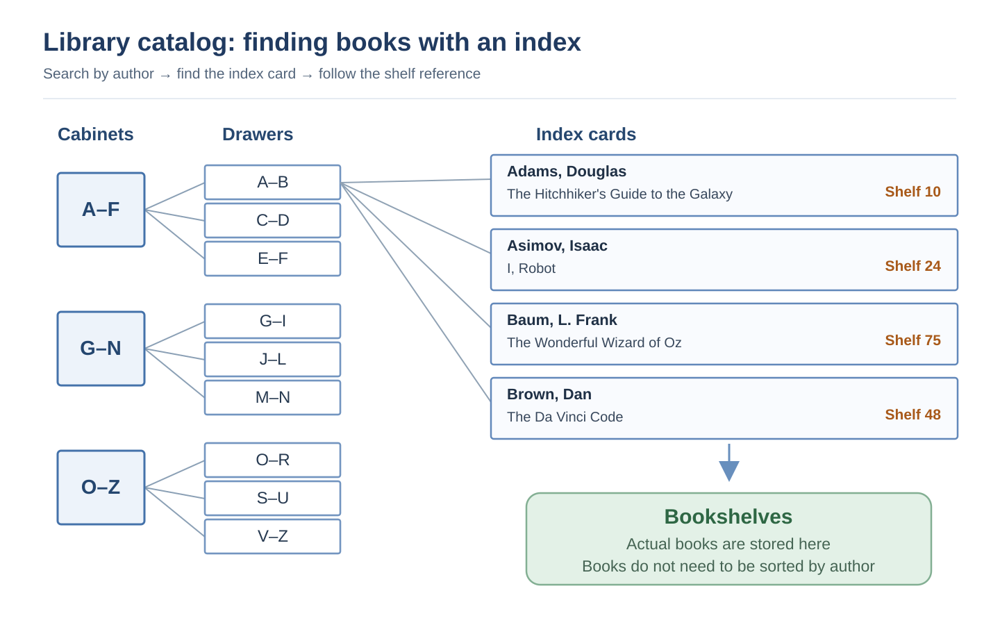

A typical search is:

1. Select the cabinet and drawer for the author's name.
2. Find the card in alphabetical order.
3. Read the shelf location.
4. Go to that shelf and retrieve the book.

**The catalog is separate from the books.** Its entries are ordered even if the books themselves are not. Another catalog could be organized by title instead of author, without moving any books.

If the library instead arranged the books themselves on the shelves by author, no separate catalog would be needed to search by author, but the books could be arranged in only one order at a time. This corresponds to a **clustered index**, which we will meet in Section 4.

This is the central idea of a database index: an additional structure helps locate relevant data without examining the whole table.

| Library | Database analogy |
|---|---|
| Book | Data row |
| Shelf | Data page or location (simplified) |
| Author's name on the card | Index key |
| Alphabetical catalog | Index structure |
| Reference to a shelf | Row locator |
| Search every shelf | Table/clustered index scan, depending on table structure |
| Search catalog then find book | Index seek, optionally followed by a lookup |
| Books arranged on shelves by author | Clustered index (rows ordered by the key) |

> [!NOTE]
> **Is using an index always faster?**
>
> Not necessarily. Imagine that a librarian needs to find just one book. Using the catalog is much faster than checking every shelf.
>
> But what if the librarian needs to examine almost every book in the library? In that case, searching the catalog and following individual shelf references may involve more work than simply going through the shelves.
>
> SQL Server faces a similar decision. For a query that returns only a small number of rows, using an index may be very efficient. However, when a query needs a large portion of a table, scanning the data may be more efficient.
>
> SQL Server's **query optimizer** evaluates different execution strategies and chooses the one with the lowest estimated cost. We will investigate these decisions later when analyzing execution plans.

**Think about it:** If a library already has an author catalog, why might it also need a title catalog?

<details>
<summary>Show answer</summary>

People search for books in different ways. Sometimes they know the author, but sometimes they only know the title.

An author catalog is organized by author names, so it is not efficient for searching by title alone. A separate title catalog allows books to be found quickly by title.

Similarly, a database can have **multiple indexes on the same table**, each supporting different search patterns without duplicating the actual data rows.

</details>

## From library catalogs to database indexes

The library catalog helps us understand **why an index is useful**. However, there is another important question:

**How can a database efficiently search an index containing millions of entries?**

A sorted list can be searched with binary search, but when the list is stored across thousands of pages, each step of the search may jump to a different page. Inserting a new entry into a sorted list would also require shifting all the entries that follow it. We need a structure that narrows the search to a small part of the index in very few page reads and that can absorb new entries locally.

SQL Server uses a tree-based structure for this purpose.

In the next section, we will first learn the basic terminology of trees and then explore how a **B+ tree** organizes index entries for efficient searching.

---

# 2. Trees and the B+ tree

## 2.1 Tree terminology

A tree is a hierarchy of nodes connected by links. Database rowstore indexes use a balanced B+ tree-like organization in which nodes correspond conceptually to **index pages**.

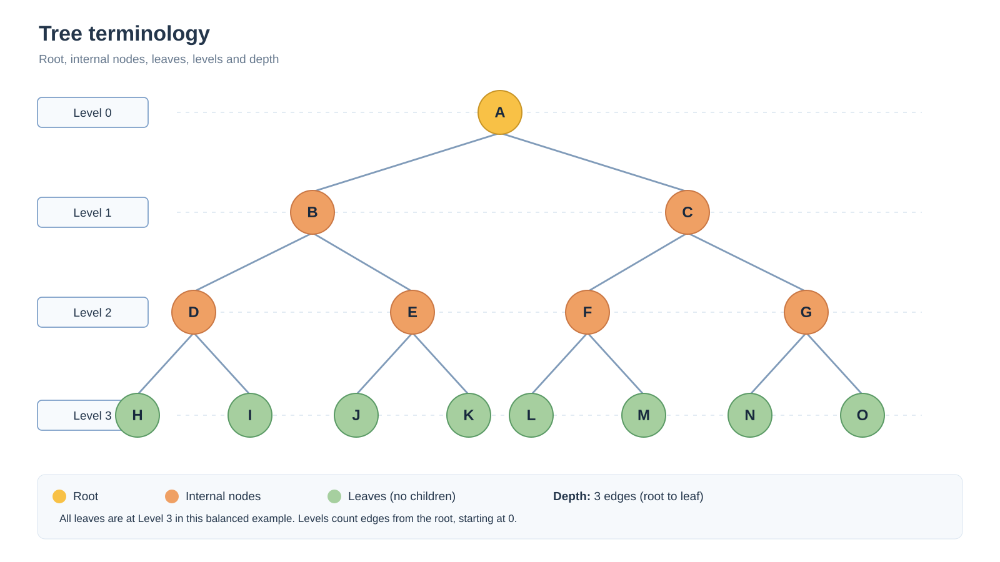

- **Root:** the entry point to the tree.
- **Internal (intermediate) nodes:** contain separator keys and links to child pages.
- **Leaf level:** the bottom level containing index entries (or full rows for clustered indexes).
- **Tree depth:** how many steps it takes to get from the root down to a leaf. In our diagrams, the root is at Level 0, so a leaf at Level 3 has a depth of 3.

> [!NOTE]
> SQL Server numbers the levels the other way round: the leaf level is 0 and the root has the highest number. You saw this in Lab 05, where `DBCC IND` reported `IndexLevel = 0` for leaf pages.

An index may consist of a single page; it does not always need three levels. The search examples in Sections 3 and 4 use three levels (root, intermediate, leaf) so that navigation is visible.

## 2.2 Why balanced trees?

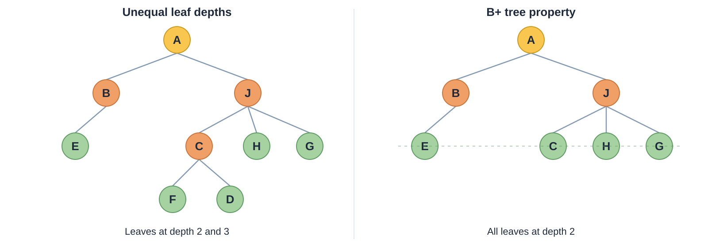

For a B+ tree, **all leaves are at the same depth**. Therefore, finding any key requires traversing the same number of levels. Because each internal page can direct the search to many child pages, even a large index can have relatively few levels.

> [!NOTE]
> “All leaves are at the same depth” describes the B+ tree property illustrated here, not every possible definition of a balanced tree.

## 2.3 Keys, pointers, and leaf pages

Now that we understand the basic structure of a tree, let's see how a B+ tree helps a database find information.
A B+ tree organizes data using **keys** and **pointers**.

### Keys

A **key** is a value used to organize and search the index.
For example, imagine a table containing information about library members. Each member has a unique `MemberID`.
If we create an index on `MemberID`, the index organizes its entries by these values.
The tree structure lets the engine skip whole groups of entries at each step instead of examining them.

### Pointers

A **pointer** tells the database engine where to continue searching.
In the upper levels of a B+ tree, pointers lead to pages at the next level.
The database engine uses key values to decide which pointer to follow.
This process repeats until the search reaches the leaf level.

**The important idea is that the database does not need to visit every branch of the tree.** It follows only the branch that can contain the requested key.

### Leaf pages

The **leaf level** is the bottom level of the B+ tree.
Leaf pages contain index entries arranged in logical key order.

What these entries contain depends on the type of index:

- In a **nonclustered index**, leaf entries contain index keys, row locators, and possibly additional columns.
- In a **clustered index**, leaf pages contain the actual table rows.

We will explore this difference in Sections 3 and 4.

### Linked leaf pages

Leaf pages are also linked to neighboring leaf pages.
This is particularly useful for **range queries**, where the database needs multiple consecutive key values rather than just one.
Instead of starting a completely new tree search for every matching key, SQL Server can locate the beginning of a range and continue reading the relevant leaf pages.

In SQL Server, each leaf page stores links to both its previous and its next page. The engine can therefore read a range in ascending or descending key order. This will be useful when a query sorts in the opposite direction from the index.

### Free space in index pages

In the following diagrams, some nodes contain empty slots.
These empty slots are a simplified way to illustrate that an index page may have free space available for new entries.

In SQL Server, index pages are 8 KB in size, and their actual capacity depends on the size of the stored records. Empty slots in our diagrams are not a literal representation of SQL Server's internal page format.

If an index page does not have enough space for a new entry, SQL Server may need to perform a **page split**. We will explore this later in the lab.

> [!TIP]
> Remember these three concepts:
>
> - **Keys** help determine where to search.
> - **Pointers** lead to the next page.
> - **Leaf pages** contain the information needed to locate or retrieve the data.
>
> In Section 3.2, we will follow a real example and search for `MemberID = 61`.

---

# 3. Heap tables and nonclustered indexes

## 3.1 What is a heap?

Before exploring how a nonclustered index works, we first need to understand how SQL Server stores table rows **without a clustered index**.

A **heap** is a table that does not have a clustered index.

As we learned in Lab 05, SQL Server stores table data in **8 KB pages**. A heap also uses these data pages, but its rows are not organized in a logical order defined by a clustered key.

Consider a simple `Member` table containing member IDs, first names, and last names.

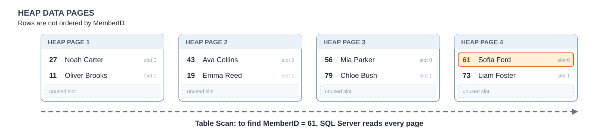

Notice that the rows are **not arranged by `MemberID`**. For example, a row with a larger ID may appear on an earlier page than a row with a smaller ID.

This is perfectly valid. A heap does not require rows to be stored in any particular key order.

### How does SQL Server locate a row in a heap?

Each heap row has a physical location identified by a **RID (Row Identifier)**.

A RID consists of three components:

| Component | Meaning |
|---|---|
| File ID | Identifies the database file |
| Page ID | Identifies the page within that file |
| Slot ID | Identifies the row slot within the page |

Together, these values allow SQL Server to locate a particular row.

However, knowing that a row has a physical location is not the same as knowing **which location contains a particular `MemberID`**.

### What happens when we search without an index?

Suppose we want to find one member:

```sql
-- Illustrative example (Member is not part of IndexLab)
SELECT *
FROM dbo.Member
WHERE MemberID = 61;
```

If no suitable index exists, SQL Server may need to perform a **Table Scan**.

This means reading the heap's data pages and examining rows to find those that satisfy the condition.

For a small table, this may be inexpensive. But for a table containing millions of rows, scanning many pages can require substantial I/O work.

> [!NOTE]
> A heap does not guarantee that rows will be returned in any particular order. Neither does a clustered index. If a query requires a specific result order, use `ORDER BY`.

### Can we search a heap efficiently?

Yes. We can create a **nonclustered index** on `MemberID` without changing the heap into a clustered table.

The index provides an ordered search structure, while the actual data rows remain in the heap.

**This is what we will explore in the next section.**

## 3.2 A nonclustered index on a heap

A nonclustered index is a separate structure that organizes index entries by their key values. In a heap table, each index entry also contains a **RID (Row Identifier)** that identifies the corresponding data row.

This gives us two separate structures:

- **Nonclustered index:** stores ordered keys and information needed to locate rows.
- **Heap:** stores the actual data rows, which are not organized by the index key.

### Understanding the diagram

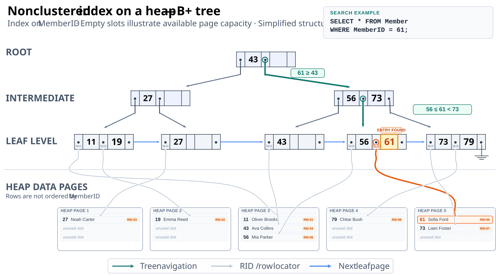

The diagram illustrates a nonclustered index on `MemberID`.
Let's identify its main components.

**1. Root level**

The root is the starting point of the search.
It contains separator keys and pointers that direct the search to the appropriate branch of the tree.
The root does not need to contain every `MemberID`. Its purpose is to help SQL Server decide where to search next.

**2. Intermediate level**

Intermediate pages further divide the possible key values into smaller ranges.
Each page contains separator keys and pointers to child pages.
By following the appropriate pointer, SQL Server can eliminate entire branches of the tree without examining their entries.

**3. Leaf level**

The leaf level contains the actual nonclustered index entries, organized in key order.
In our example, each entry contains:

- The indexed key (`MemberID`).
- A RID that identifies the corresponding row in the heap.

Notice that the leaf pages are connected by horizontal pointers. These connections allow SQL Server to continue reading consecutive index entries.

**4. Heap data pages**

At the bottom of the diagram, the data pages contain the actual member records.
Unlike the index entries, the heap rows are not organized by `MemberID`.
The orange arrow shows how the RID stored with entry `61` points to its row: heap page 4, slot 0. Every other leaf entry also has a RID; the diagram omits those arrows for clarity. The heap pages are the same as in Section 3.1.

**5. Empty spaces**

As explained in Section 2.3, empty slots illustrate free space available for new entries; they are not SQL Server's literal page layout.

### Finding MemberID = 61

Suppose we execute the following query:

```sql
-- Illustrative example (Member is not part of IndexLab)
SELECT *
FROM dbo.Member
WHERE MemberID = 61;
```

SQL Server can use the nonclustered index to locate the requested member.

**Step 1 – Start at the root**

The search starts at the root page, which contains the separator key `43`.
We are searching for `61`.
Because `61 >= 43`, we follow the right pointer.
There is no need to examine the left subtree because it contains smaller key values.

**Step 2 – Follow the intermediate pointer**

The next index page contains the separator keys `56` and `73`.
Our value falls into this range:

`56 <= 61 < 73`

Therefore, we follow the middle pointer.
Again, we eliminate the other branches without reading their leaf pages.

**Step 3 – Find the entry at the leaf level**

We reach a leaf page containing the keys `56` and `61`.
The entry for `61` contains a RID that identifies the location of the corresponding member row.
At this point, SQL Server has found the matching **index entry**, but it may not yet have all the columns requested by the query.

**Step 4 – Retrieve the actual row**

Our query uses `SELECT *`, so SQL Server needs the complete member row.
If the nonclustered index does not contain all the required columns, SQL Server follows the RID to the corresponding heap data page.
This additional operation is called a **RID Lookup**.

The important distinction is:

- **Index Seek:** locates the matching index entry.
- **RID Lookup:** retrieves missing columns from the actual heap row.

> [!IMPORTANT]
> A RID Lookup is not always required.
>
> If the nonclustered index already contains all columns needed by the query, SQL Server can return the result directly from the index.
>
> Such an index is called a **covering index**. We will explore covering indexes and `INCLUDE` columns later in the lab.

### Searching for a range of values

Indexes are useful not only when searching for a single value.

Consider this query:

```sql
-- Illustrative example (Member is not part of IndexLab)
SELECT *
FROM dbo.Member
WHERE MemberID BETWEEN 40 AND 70;
```

SQL Server can use the index to locate the beginning of the range.
Because leaf pages are logically ordered and linked to their neighbors, the engine can continue reading subsequent index entries until it reaches the end of the requested range.
This avoids starting a completely new tree search for every individual key.
However, because this query uses `SELECT *`, SQL Server may also need additional heap lookups for the matching rows.

If the range contains a large portion of the table, the optimizer may decide that a Table Scan is more efficient.

> [!NOTE]
> A nonclustered index is not limited to heap tables.
>
> When a table has a clustered index, a nonclustered index generally uses the **clustered key** as its row locator instead of a heap RID.
>
> If additional columns must be retrieved from the clustered index, SQL Server may use a **Key Lookup** instead of a RID Lookup.

### Check your understanding

1. Why are the index entries ordered while the heap rows are not?
2. Why does the root contain only separator keys rather than every `MemberID`?
3. What happens when we search for `MemberID = 61`?
4. What is the difference between Index Seek and RID Lookup?
5. Why are the leaf pages linked?
6. When can SQL Server avoid a RID Lookup?

<details>
<summary>Show answers</summary>

1. A nonclustered index organizes entries by its key, independently of the heap's row organization.
2. Separator keys guide the search into the correct subtree without storing every key at the root.
3. SQL Server navigates through the appropriate index pages, finds key 61, and retrieves the heap row if additional columns are required.
4. Index Seek locates index entries; RID Lookup retrieves missing data from a heap row.
5. Linked leaf pages support efficient traversal of consecutive key ranges.
6. When the index contains all columns required by the query.

</details>

## 3.3 Why is an index so efficient?

The previous example showed **how** SQL Server finds `MemberID = 61`. But why is navigating a B+ tree so much better than searching a large heap?

Imagine a table with **1,000,000 rows**. For a simplified calculation, assume that a data page holds 100 rows, a leaf index page holds 100 index entries, and each internal index page can point to 100 child pages.

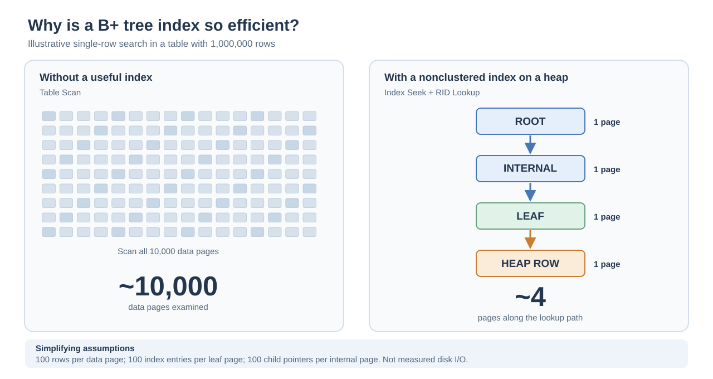

**Without a useful index**, finding one row may require scanning approximately:

```text
1,000,000 rows / 100 rows per data page = 10,000 data pages
```

**With a nonclustered index on a heap**, the index can have a three-level structure:

| Level | Approximate pages in that level | What happens during one seek? |
|---|---:|---|
| Root | 1 | Read the root page. |
| Intermediate | 100 | Follow one pointer to the relevant intermediate page. |
| Leaf | 10,000 | Follow one pointer to the relevant leaf page and find the key. |
| Heap data | 10,000 | Use the RID to access the page containing the row, if necessary. |

Only **one page at each index level** is needed along the search path, followed by **one heap data page** to retrieve a row not covered by the index. In this illustrative model, that is **about 4 page accesses instead of examining 10,000 data pages**.

> [!IMPORTANT]
> The power of a B+ tree comes from **fan-out**: each navigation page directs the search toward many possible pages. The engine follows one relevant path rather than reading every page.

> [!NOTE]
> This is a simplified comparison for finding **one matching row**. The page capacities are assumptions, not fixed SQL Server values. Logical page accesses are not the same as physical disk I/O; many pages may already be in memory. A range query returning many rows may favor a scan, and an index does not guarantee a particular execution plan or speedup.
>
> In practice, an index page with a small key such as an `int` can hold several hundred entries, so even three levels can address hundreds of millions of rows.

**Check your understanding:** Why does adding millions of index entries not necessarily add many new levels to a B+ tree?

<details>
<summary>Show answer</summary>

Because an internal page can point to many child pages. Each extra level greatly increases the number of entries the tree can represent, so tree depth grows slowly compared with the number of indexed rows.

</details>

---

# 4. Clustered indexes

A **clustered index** also has root and intermediate pages, but its **leaf level contains the actual data rows**. The data rows are logically ordered by the clustered key. They are not stored in a second heap that must be reached through an RID.

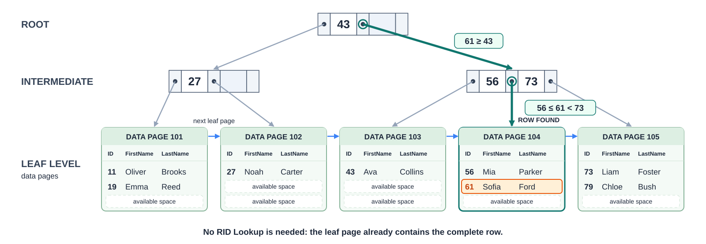

## 4.1 Finding `MemberID = 61` in a clustered index

The search still follows the appropriate pointers from the root to a leaf page. But once the leaf entry for 61 is reached, **the full row is already there**.

| Characteristic | Nonclustered index on a heap | Clustered index |
|---|---|---|
| Root and internal pages | Navigation keys and page pointers | Navigation keys and page pointers |
| Leaf level | Index keys + RID row locators (and possibly included columns) | Actual table rows |
| Additional fetch for missing columns | RID Lookup | No extra lookup when the clustered index itself supplies the row |
| How many per table? | Multiple nonclustered indexes possible | Only one clustered index |

A table cannot store its entire rowset in two different clustered-key orders at the same time. That is why a SQL Server table has **at most one clustered index**.

> [!WARNING]
> A clustered index defines a **logical ordering** by key. It does not guarantee adjacent physical positions on disk, and it does not guarantee output ordering without `ORDER BY`.

## 4.2 Nonclustered indexes on clustered tables

In our practical demo, we will create clustered primary keys and then add nonclustered indexes. A nonclustered index on a clustered table generally uses the clustered key as the row locator. If more columns are required, SQL Server may use a **Key Lookup** into the clustered index.

For example, a nonclustered index on `SalesOrder(OrderDate)` can already make its clustered key `SalesOrderId` available. We do not need to explicitly `INCLUDE (SalesOrderId)` when `SalesOrderId` is the clustered key.

Because every nonclustered index stores the clustered key in each of its entries, the choice of clustered key affects all indexes on the table. A good clustered key is usually **narrow** (a wide key makes every nonclustered index wider), **unique** (if it is not, SQL Server adds a hidden 4-byte *uniquifier* to duplicate key values), and **rarely changed** (changing it requires updating every nonclustered index). An **ever-increasing** key, such as an identity column, also places new rows at the end of the index, which reduces page splits (Section 11.2).

### Check your understanding

1. Where does a B+ tree search start?
2. Why does a query using `SELECT *` not need a RID Lookup or Key Lookup when it finds a row through the clustered index?
3. What does a heap lack?
4. What is the difference between RID Lookup and Key Lookup?
5. Why can a table have only one clustered index?

<details>
<summary>Show answers</summary>

1. At the root page. In a single-page index, that page is also the leaf.
2. The leaf level of the clustered index already contains the complete row.
3. A clustered index.
4. RID Lookup retrieves missing columns from a heap row via its RID; Key Lookup retrieves them from a clustered index using its clustering key.
5. The table's full rows form one clustered leaf-level organization.

</details>

---

# 5. Primary keys and indexes

A **primary key** is a logical constraint: values must be unique and non-NULL. SQL Server enforces it using a **unique index**. By default, if a table has no clustered index and you do not specify `NONCLUSTERED`, a primary key is created using a clustered index.

In this lab we will explicitly choose:

```sql
PRIMARY KEY CLUSTERED
```

This makes the physical design decision visible. A primary key is excellent for finding a row by its key, but it does not automatically make all other search patterns efficient.

A primary key does not have to be clustered. A table may use `PRIMARY KEY NONCLUSTERED` and place its clustered index on a different column (or columns) that better matches how the data is most often read.

Unlike primary keys and unique constraints, a **`FOREIGN KEY` constraint does not create an index**. Columns used to join a child table to its parent, such as `SalesOrderItem.SalesOrderId`, often need an index created explicitly. We will see exactly this situation in Section 8.3.

---

# 6. Prepare the main performance demonstration

This is the main practical part of the lab. We will execute **the same SQL query before and after adding indexes**, inspect both actual execution plans, and measure the work performed by SQL Server. The goal is to explain *why* a plan becomes faster, not simply to observe that its elapsed time decreases.

The `IndexLab` reference database contains approximately **10 million** rows in `SalesOrder`, **40 million** rows in `SalesOrderItem`, and **30,000** products. These figures are large enough to make inefficient access paths visible.

> [!NOTE]
> **Don't have `IndexLab` yet?** It is created in [Lab 05, Section 2 – Create the `IndexLab` database](lab05-physical-storage.md#2-create-the-indexlab-database) using the [IndexLab setup script](setup/index-lab-data-setup.md). This lab does not repeat that setup — it assumes the database already exists in its freshly generated state (heaps, no indexes beyond what the script creates).

> [!IMPORTANT]
> Complete the steps **in order**, using the database in its prepared initial state. Later sections create indexes that change the execution plan. If you already created these indexes in a previous attempt, restore the prepared lab state before repeating the *before indexes* measurement.

<details>
<summary>Show script: restore IndexLab to its prepared initial state</summary>

The script removes every index and primary key that this lab creates (Sections 8 and 10 and the exercises). Nonclustered indexes are dropped before the clustered primary keys.

```sql
USE IndexLab;
GO

DROP INDEX IF EXISTS IX_SalesOrder_Status_OrderDate     ON dbo.SalesOrder;
DROP INDEX IF EXISTS IX_SalesOrder_Review_OrderDate     ON dbo.SalesOrder;
DROP INDEX IF EXISTS IX_SalesOrder_Status               ON dbo.SalesOrder;
DROP INDEX IF EXISTS IX_SalesOrder_CustomerId_OrderDate ON dbo.SalesOrder;
DROP INDEX IF EXISTS IX_SalesOrder_OrderDate            ON dbo.SalesOrder;
DROP INDEX IF EXISTS IX_SalesOrderItem_SalesOrderId     ON dbo.SalesOrderItem;
GO

ALTER TABLE dbo.SalesOrder     DROP CONSTRAINT IF EXISTS PK_SalesOrder;
ALTER TABLE dbo.SalesOrderItem DROP CONSTRAINT IF EXISTS PK_SalesOrderItem;
GO
```

Dropping a clustered primary key turns the table back into a heap, but for 40 million rows this takes a while. Re-running the [IndexLab setup script](setup/index-lab-data-setup.md) (about two minutes on the reference computer) is an equally good option.

</details>

## 6.1 Prepare SSMS and collect useful measurements

Open a new query window in SSMS and select the database:

```sql
USE IndexLab;
GO

SET STATISTICS IO ON;
SET STATISTICS TIME ON;
GO
```

Enable **Query → Include Actual Execution Plan**, or press `Ctrl + M` before executing the query. After execution inspect the **Results**, **Messages**, and **Execution Plan** tabs.

| Instrument | What to look for | Why it matters |
|---|---|---|
| Actual Execution Plan | Operators, row counts, estimates, joins, warnings | Shows how SQL Server executed the query |
| `STATISTICS IO` | Logical reads, scan count, physical/read-ahead reads | Shows the data-access work performed |
| `STATISTICS TIME` | CPU time and elapsed time | Helps distinguish CPU work from total duration |
| Operator Properties | Predicate, Seek Predicates, Estimated/Actual rows, Number of Rows Read | Explains whether rows were found efficiently |

**Logical reads** count 8 KB pages read from the buffer pool (including pages previously cached); they are *not* the same thing as physical disk reads. A query can perform many logical reads even when physical reads are near zero. Conversely, timing can vary with buffer cache, CPU availability, concurrent activity, and the selected plan.

A simplified `STATISTICS IO` line looks like this:

```text
Table 'SalesOrder'. Scan count 1, logical reads 57000, physical reads 0, read-ahead reads 0.
```

Here SQL Server accessed about 57,000 pages, which corresponds to roughly 57,000 × 8 KB ≈ **445 MiB** processed through the buffer pool, even though nothing had to be read from disk. Recent SQL Server versions print additional counters on the same line, such as *page server reads* and *lob logical reads*; they are not relevant for this lab.

`STATISTICS TIME` prints two kinds of blocks: *parse and compile time* and *SQL Server Execution Times*. Record the CPU and elapsed time from the **Execution Times** block that follows the query.

> [!TIP]
> Hover over an execution-plan operator for its tooltip. For more detailed properties, click the operator and press **F4** (or right-click → **Properties**). In the plan, pay attention to **the arrows between operators**: thicker arrows usually represent larger row flows.

> [!NOTE]
> Reference timings come from the original lab's measurements on one computer running SQL Server 2025 (build 17.0.1135.8), 31 GB RAM, with separate Express and Developer instances. Your own numbers may be very different. Record your results; do not try to reproduce the exact timings.

Run each measured query **twice** and record the second execution. The first run may need to read pages from disk (physical and read-ahead reads); the second run usually finds them in the buffer pool, which makes the before/after comparisons fairer. The first run after creating an index can also report **more logical reads**, because SQL Server prefetches pages it expects to need.

> [!NOTE]
> SQL Server Express can use only about 1.4 GB of memory for its buffer pool, and `SalesOrderItem` alone occupies about 1.5 GB. As long as the plan scans `SalesOrderItem` (Sections 6–8.2), it cannot stay in memory, so every run shows read-ahead reads and similar timings. From Section 8.3 on, the plan reads only a small part of the table, and the second run is the representative one.

## 6.2 Run the baseline query before adding indexes

The query calculates the number of sold items and revenue per product category for one day, then orders categories by revenue:

```sql
SELECT
    p.CategoryId,
    SUM(soi.Quantity) AS ItemsSold,
    SUM(CAST(soi.Quantity AS decimal(18,2)) * soi.UnitPrice) AS Revenue
FROM dbo.SalesOrder AS so
JOIN dbo.SalesOrderItem AS soi
    ON soi.SalesOrderId = so.SalesOrderId
JOIN dbo.Product AS p
    ON p.ProductId = soi.ProductId
WHERE so.OrderDate >= '20250601'
  AND so.OrderDate <  '20250602'
GROUP BY p.CategoryId
ORDER BY Revenue DESC;
GO
```

Read the SQL statement before you execute it:

1. `WHERE so.OrderDate ...` restricts sales orders to **one day**.
2. The first `JOIN` finds the order items belonging to those orders.
3. The second `JOIN` obtains each product's `CategoryId`.
4. `Quantity * UnitPrice` calculates the value of each line; the `CAST` makes the decimal result type explicit.
5. `GROUP BY` calculates the totals for each category.
6. `ORDER BY Revenue DESC` sorts the final category totals.

This query is useful because it combines **filtering, joining, calculation, aggregation, and sorting**. Different plan operators can be linked directly to parts of the SQL statement.

In the reference Express instance, the baseline execution took approximately **18 seconds** (see the reference table at the beginning of Section 7). Do not focus on the time alone — Section 7 explains how to read the plan behind this number.

---

# 7. Investigate the execution plan before indexing

Keep the **Execution Plan** tab from the query you ran in Section 6.2 open — Sections 7.2 through 7.7 walk through that specific plan, operator by operator. If you closed it or ran anything else in between, re-run the Section 6.2 query with Actual Execution Plan enabled before continuing.

Record your own values now, before changing any index — you will compare them against the "after indexes" numbers in Section 9. The table below shows reference values measured on one SQL Server 2025 Express instance (`IndexLab` in its freshly generated state — heaps, no indexes beyond the setup script), so you can check your own results against them:

| Metric | Before indexes (reference) |
|---|---|
| Elapsed time | **18.1 s** |
| CPU time | **14.7 s** |
| `SalesOrder` logical reads | **57,143** |
| `SalesOrderItem` logical reads | **198,020** |
| `Product` logical reads | **161** |
| Access operator for `SalesOrder` | `Table Scan` (heap), with the `OrderDate` predicate applied during the scan — **5,477** rows returned out of 10,000,000 |
| Access operator for `SalesOrderItem` | `Table Scan` (heap) — all **40,000,000** rows scanned, **21,908** rows survive the join |
| Access operator for `Product` | `Clustered Index Scan` on `PK_Product` — all 30,000 rows scanned |
| Main join operator(s) | Two `Hash Match (Inner Join)` operators — one for `SalesOrder`/`SalesOrderItem`, one for the result joined with `Product` |
| Aggregation / sort | `Hash Match (Aggregate)` for `GROUP BY`, then `Sort` for `ORDER BY Revenue DESC` |

> [!NOTE]
> SQL Server Express has resource and parallelism limitations. The original lab's reference query used serial execution in Express. On instances using parallel execution, the sum of CPU time across workers can be larger than elapsed time. The observed plan depends on edition, configuration, statistics, and data distribution; neither serial execution nor a particular operator is guaranteed for every installation. Elapsed and CPU time will vary most with your hardware; row counts and logical reads should be close to the reference values, since they come from the same generated dataset and an unindexed heap scan.

The "Access operator" and "Main join operator" rows name things Section 7.1 has not introduced yet — that is intentional. Look at your own plan now (even informally), then come back and compare it with the vocabulary from 7.1 onward.

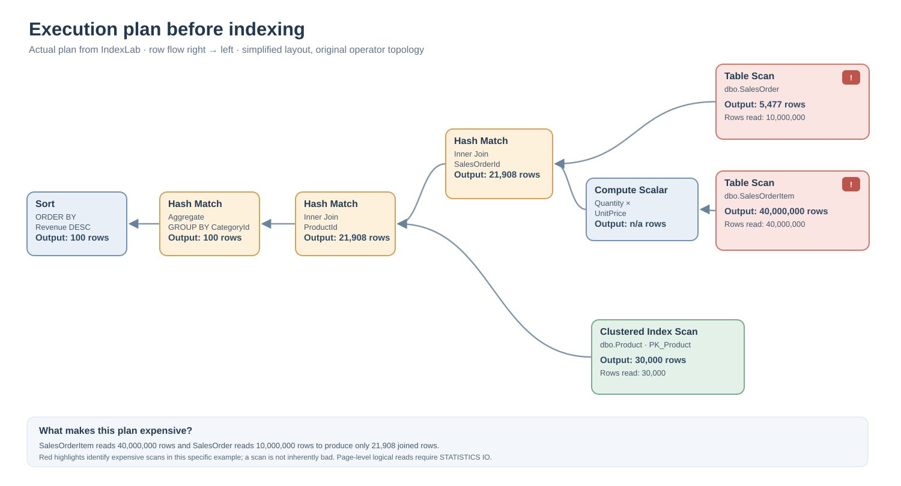

This is a simplified redrawing of the actual plan measured on one computer (the reference results above) — same operators and row counts, laid out for readability. Your plan may differ from this reference example. Focus on the access methods, row counts, and amount of work performed rather than expecting an identical plan shape. Icon style and layout may also differ by SSMS version.

Execution plans are often explained by reading **from right to left**, beginning with operators that access tables or indexes. This is a useful convention, but follow the **data-flow arrows** when tracing individual branches: a plan is a tree of operations, not simply a linear list.

**What makes this plan expensive?**

<details>
<summary>Show answer</summary>

`SalesOrderItem` reads 40,000,000 rows and `SalesOrder` reads 10,000,000 rows to produce only 21,908 joined rows. The red operators mark the expensive scans in this specific plan; a scan is not inherently bad.

</details>

## 7.1 Learn the essential plan operators

An execution plan consists of **operators**, each representing an operation performed by SQL Server.

Some operators retrieve data from tables or indexes. Others join rows, calculate values, group results, or sort data.

The following table introduces the most important operators you will encounter in this lab.

| Operator | What it does |
|---|---|
| `Table Scan` | Reads rows from a **heap** (a table without a clustered index). SQL Server examines the rows to find those matching the query conditions. If there is no suitable index, it may need to read the entire table. |
| `Clustered Index Scan` | Reads data from the **leaf level of a clustered index**, where the actual table rows are stored. It may read many or all rows, even when the query needs only a small number of them. |
| `Clustered Index Seek` | Uses the clustered index keys to navigate directly to specific rows or a range of rows. Because the leaf level contains complete rows, no additional lookup is needed. |
| `Index Scan` | Reads entries from a **nonclustered index**. Because an index may contain fewer and narrower columns than the table, scanning it can require less work than scanning the complete table. |
| `Index Seek` | Uses the **ordered index keys** to navigate directly to a specific value or range of values. This can avoid reading large parts of the index that are not relevant to the query. |
| `RID Lookup` | Uses a **Row Identifier (RID)** obtained from a nonclustered index to retrieve additional columns from a heap row. It is needed when the index does not contain all the required data. |
| `Key Lookup` | Retrieves additional columns from a **clustered index** after a nonclustered index has identified matching rows. It can become expensive when repeated for many rows. |
| `Nested Loops` | Takes rows from one input (the **outer input**) and repeatedly accesses another input (the **inner input**). It is often efficient when relatively few outer rows can quickly find matching inner rows using an index. |
| `Hash Match (Inner Join)` | Builds a **hash table** from one input and uses it to find matching rows from another input. It is often useful when joining large datasets without suitable indexes for repeated seeks. |
| `Hash Match (Aggregate)` | Uses a hash table to **group rows by one or more values** and calculate aggregates such as `SUM`, `COUNT`, or `AVG`. It does not require the input rows to be sorted by the grouping columns. |
| `Compute Scalar` | Defines a **calculated expression**, such as multiplication, addition, or data type conversion. For example, it may calculate `Quantity * UnitPrice` for each order item. |
| `Sort` | Arranges rows according to one or more columns or expressions. It is commonly used for `ORDER BY`, but may also be needed by other operations that require sorted input. |

> [!IMPORTANT]
> **An Index Seek is not always better than a Scan.**
>
> A seek is useful when SQL Server needs a relatively small portion of the data. However, when a query requires many rows, scanning the table or index may be more efficient than performing many separate index lookups.
>
> The goal is not to eliminate every scan, but to **reduce unnecessary work**.

## 7.2 Investigate the `SalesOrder` scan

Let's start with the `SalesOrder` table.

Our query contains the following filter:

```sql
WHERE so.OrderDate >= '20250601'
  AND so.OrderDate <  '20250602'
```

This condition selects orders from **June 1, 2025**.

Notice that we use a range rather than comparing the date with a single value. `OrderDate` is of type `date` in `IndexLab`, but a half-open range (`>=` start, `<` next day) also works correctly for columns that contain a time component.

Just as importantly, the condition compares the column directly with constants. A condition that applies a function to the column, such as `YEAR(so.OrderDate) = 2025` or `CAST(so.OrderDate AS varchar(10)) = ...`, usually prevents SQL Server from seeking in an index on `OrderDate`, because the index is ordered by the column values, not by the function results.

### Why does SQL Server scan the table?

The `SalesOrder` table contains approximately **10 million rows**, but only about **5,477 rows** match the selected date in our reference dataset.

Without a suitable index on `OrderDate`, SQL Server cannot directly locate the matching date range through an index seek.

In our initial execution plan, it therefore performs a **Table Scan**.

This means SQL Server examines the heap's data pages to find rows satisfying the filter.

### Inspect the Table Scan operator

In the Actual Execution Plan:

1. Find the `Table Scan` operator for `dbo.SalesOrder`.
2. Click the operator and press **F4** to open Properties.
3. Find the following values:

| Property | Reference value | Meaning |
|---|---:|---|
| Actual Number of Rows Read | 10,000,000 | Rows examined by the operator |
| Actual Number of Rows | 5,477 | Rows returned after filtering |
| Predicate | `OrderDate` range | Condition used to filter rows |

The exact property names may vary slightly depending on the SQL Server version.

**What does this tell us?**

SQL Server examines **10 million rows to return only 5,477**.
That means approximately **99.95% of the examined rows do not match the filter**.
This is the main inefficiency we want to address.

### Rows are not pages

Remember from Lab 05 that SQL Server stores data in **8 KB pages**.
The values above describe rows, not the number of pages read.

To measure page access, look at the `STATISTICS IO` output in the **Messages** tab.

For example, the original reference measurement reported approximately 57,000 logical reads for `SalesOrder`.

These are logical page accesses through the buffer pool, not necessarily physical disk reads.

> [!IMPORTANT]
> A query can return only a few rows while still reading a very large amount of data.
>
> **The number of rows returned does not tell us how much work SQL Server performed to find them.**

## 7.3 Investigate the `SalesOrderItem` scan — the main bottleneck

We have seen that SQL Server examines 10 million rows in `SalesOrder` to find approximately 5,477 orders for the selected date.

However, finding the orders is only the first part of the query.

We also need to find **all order items belonging to those orders**.

### How are orders and order items connected?

The query uses the following join condition:

```sql
soi.SalesOrderId = so.SalesOrderId
```

Each order can contain multiple order items. The `SalesOrderId` column in `SalesOrderItem` identifies the order to which each item belongs.

In our reference dataset:

| Description | Number of rows |
|---|---:|
| Total orders in `SalesOrder` | 10,000,000 |
| Orders matching the selected date | 5,477 |
| Total rows in `SalesOrderItem` | 40,000,000 |
| Order items belonging to the selected orders | 21,908 |

The query needs only 21,908 order items, but the `SalesOrderItem` table contains **40 million rows**.

### Why does SQL Server scan SalesOrderItem?

At this stage, there is no suitable index on `SalesOrderItem(SalesOrderId)`.

Although SQL Server knows the `SalesOrderId` values of the selected orders, it has no efficient index-based way to locate the corresponding order items.

In our initial execution plan, SQL Server therefore performs a **Table Scan** on `SalesOrderItem`.

The scan reads the order-item data and supplies rows to the join operator.

The join then identifies which items belong to the selected orders.

> [!IMPORTANT]
> **A JOIN condition does not automatically provide an efficient way to locate matching rows.**
>
> Without a suitable index, SQL Server may need to process a very large input even when only a small number of rows are relevant.

### Inspect the Table Scan operator

In the Actual Execution Plan:

1. Find the `Table Scan` operator for `dbo.SalesOrderItem`.
2. Select the operator and press **F4** to open Properties.
3. Examine the following values:

| Property | Reference value | Meaning |
|---|---:|---|
| Actual Number of Rows | 40,000,000 | Rows produced by the scan |
| Actual Number of Rows Read | 40,000,000 | Rows examined by the scan |
| Predicate | None | The scan does not filter rows by the selected order IDs |

Notice the difference compared with the `SalesOrder` scan.

For `SalesOrder`, the date condition filters 10 million examined rows down to 5,477.

For `SalesOrderItem`, the scan produces **all 40 million rows**. The filtering to matching orders happens later, during the join.

### What about logical reads?

Look at the `STATISTICS IO` output in the Messages tab.

In the original reference measurement, `SalesOrderItem` required approximately **198,000 logical reads**.

Remember that a logical read represents an 8 KB page access through the buffer pool.

This is a large amount of work, even when most pages are already cached in memory.

Compare the two large tables:

| Table | Logical reads (approximately) |
|---|---:|
| `SalesOrder` | 57,000 |
| `SalesOrderItem` | 198,000 |

The order-item table requires substantially more page accesses.

This helps explain why it is the main bottleneck in our initial execution plan.


## 7.4 Why `Hash Match (Inner Join)` may be chosen

In our initial execution plan, SQL Server uses **Hash Match (Inner Join)** to connect the selected orders with their order items.

A Hash Join works in two main phases:

1. **Build phase:** SQL Server reads one input and builds a hash table in memory using the join key.
2. **Probe phase:** SQL Server reads the other input and uses the hash table to find matching rows.

In our example, SQL Server can build a hash table from the approximately **5,477 selected orders** and use it to match rows from the much larger `SalesOrderItem` input.

This avoids comparing every order item with every selected order.

### Why is Hash Match useful here?

Without an index on `SalesOrderItem(SalesOrderId)`, SQL Server cannot efficiently locate the items belonging to each order.

A Hash Join allows SQL Server to process the large input and find matching rows without repeatedly scanning the entire table for each order.

However, **the Hash Join does not eliminate the expensive scan of 40 million order items**.

> [!IMPORTANT]
> **Hash Match is not a bad operator.** It is often an efficient choice for joining large datasets.
>
> In our example, the main performance problem is the amount of data that must be read, not the join algorithm itself.

### Inspect the Hash Match operator

In the Actual Execution Plan, find the `Hash Match (Inner Join)` connecting `SalesOrder` and `SalesOrderItem`.

Open its Properties and examine the join condition and the number of rows flowing through the operator.

In our reference plan, the join produces approximately **21,908 matching order items**.

*Note: The build/probe description is simplified. The actual input roles depend on the execution plan.*


## 7.5 Why scanning `Product` may be fine

Our query also joins the `Product` table, which contains approximately **30,000 rows**.

In the reference execution plan, SQL Server uses a **Clustered Index Scan** to read the `Product` table.

Although the table has a clustered index, SQL Server may still choose to scan it rather than perform individual index seeks.

Why?

Because scanning a relatively small table can be more efficient than performing many separate lookups, especially when a large proportion of its rows is needed.

**Compare the scans in the execution plan:**

- `SalesOrder`: approximately 10 million rows examined.
- `SalesOrderItem`: approximately 40 million rows examined.
- `Product`: approximately 30,000 rows examined.

All three operators read rows, but the amount of work is very different.

> [!TIP]
> **A Scan is not necessarily a performance problem.**
>
> Do not try to eliminate every scan in an execution plan. Focus on operations that read or process unnecessarily large amounts of data.

### Think about it

**Why might scanning 30,000 products be more efficient than performing thousands of individual index seeks?**

<details>
<summary>Show answer</summary>

A scan can read the required pages sequentially, while many individual seeks may involve repeated index navigation and page accesses.

When a large proportion of the table is needed, scanning it may require less total work.

In our reference plan, the full scan of `Product` costs only **161** logical reads. The clustered index on 30,000 rows has two levels, so a separate seek for each of the 21,908 order items would cost about 21,908 × 2 ≈ **44,000** logical reads — more than 250 times as much.

The optimizer compares the estimated costs of these alternatives.

</details>

## 7.6 `Compute Scalar`, aggregation, and sorting

After joining the tables, SQL Server still needs to **calculate revenue, group the results by product category, and sort the final output**.

Let's examine the operators responsible for these operations.

### Compute Scalar

The `Compute Scalar` operator defines calculated expressions.

In our query, each order item's revenue is calculated using:

```sql
CAST(soi.Quantity AS decimal(18,2)) * soi.UnitPrice
```

In the execution plan, select the `Compute Scalar` operator and inspect its **Defined Values** property.

You should find an expression corresponding to this calculation.

> [!NOTE]
> SQL Server may defer the actual evaluation of scalar expressions until another operator needs their values. Therefore, `Compute Scalar` does not necessarily mean that every calculation is performed immediately at that point in the plan.

### Hash Match (Aggregate)

Our query groups the results by product category:

```sql
GROUP BY p.CategoryId
```

The `Hash Match (Aggregate)` operator groups rows with the same `CategoryId` and calculates aggregate values such as `SUM`.

In our reference execution plan:

- Approximately **21,908 order items** contribute to the aggregation.
- The operator produces **100 groups**, one for each product category represented in the result.

Notice that the number of output rows is much smaller than the number of input rows.

**This is the purpose of aggregation:** many individual rows are combined into a smaller number of summary rows.

### Sort

Finally, the query sorts the aggregated results:

```sql
ORDER BY Revenue DESC
```

The `Sort` operator arranges the category totals from highest to lowest revenue.

In the execution plan, inspect the **Order By** property to see which expression determines the sorting order.

Because the aggregation produces only approximately **100 rows**, this final sort is relatively small compared with the earlier scans of millions of rows.

> [!NOTE]
> SQL Server does not always use these exact operators for calculations, grouping, or sorting. The optimizer chooses a physical execution strategy based on the query, available indexes, estimated row counts, and other factors.


## 7.7 Missing Index recommendations

A green missing-index suggestion may appear above the graphical plan. It may resemble:

```sql
-- Illustrative recommendation only, not a command to execute now
CREATE NONCLUSTERED INDEX ...
ON dbo.SalesOrder (OrderDate)
INCLUDE (SalesOrderId);
```

This recommendation is based on the optimizer's view of a **particular query**, not on the complete database workload. It does not fully account for existing overlapping indexes, maintenance overhead, storage costs, or other queries.

SSMS displays only the first suggestion above the plan, together with an estimated *Impact* percentage. A plan can contain several suggestions; right-click the plan and choose **Show Execution Plan XML** to see all of them in the `<MissingIndexes>` element. The Impact value is the optimizer's estimate for this single query, not a measured improvement.

Our baseline plan is a good example. In the reference plan, the XML contains **two** suggestions:

| Suggested index | Estimated impact |
|---|---:|
| `SalesOrder (OrderDate) INCLUDE (SalesOrderId)` — shown above the plan | 10.7% |
| `SalesOrderItem (SalesOrderId) INCLUDE (ProductId, Quantity, UnitPrice)` — visible only in the XML | 87.9% |

The suggestion SSMS displays is the less important one. The hidden one addresses the main bottleneck, and it is exactly the covering index we will build step by step in Sections 8.3 and 8.4.

> [!WARNING]
> **Do not create suggested indexes yet.** We will add indexes deliberately in Section 8. After introducing a clustered primary key on `SalesOrderId`, its clustered key is already available as the row locator in the nonclustered `OrderDate` index. Explicit `INCLUDE (SalesOrderId)` is unnecessary in that design.

### Check your understanding

1. What is the difference between **rows read**, **rows returned**, and **logical reads**?
2. Why does SQL Server examine 10 million orders even though only 5,477 of them are relevant?
3. Why is `SalesOrderItem` the main bottleneck, despite having a join predicate?
4. Why might `Hash Match` be a reasonable join strategy before adding indexes?
5. Why is a scan of `Product` not necessarily a problem?
6. Which SQL clauses correspond to `Compute Scalar`, `Hash Match (Aggregate)`, and `Sort`?
7. Why should you not blindly create every Missing Index recommendation?

<details>
<summary>Show answers</summary>

1. Rows read are examined by an access operator; rows returned pass its filter; logical reads count 8 KB page accesses through the buffer pool.
2. The date filter is selective, but without a suitable index the engine may still inspect the whole heap to find the matches.
3. The join key is not indexed for the needed access pattern, so the engine may process a 40-million-row input for roughly 21,908 matching items.
4. It can efficiently match large unsorted inputs when no suitable repeated seek path exists.
5. Its table is much smaller; the overall cost of the scan can be low.
6. Arithmetic expression; `GROUP BY` and aggregates; `ORDER BY`.
7. Suggestions are query-specific and may overlap indexes or add unnecessary write and storage costs.

</details>

---

# 8. Create indexes and observe the changing plan

## 8.1 Create clustered primary keys

Until now, `SalesOrder` and `SalesOrderItem` have been stored as **heaps**, without clustered indexes.

We will now create a clustered primary key on each table.

In a real design, both tables would have had primary keys from the start. We add them here as a separate step for two reasons: to show that a primary key alone does not support our query, and because the nonclustered indexes created next will then use the clustered key, rather than a heap RID, as their row locator.

```sql
ALTER TABLE dbo.SalesOrder
ADD CONSTRAINT PK_SalesOrder
PRIMARY KEY CLUSTERED (SalesOrderId);
GO

ALTER TABLE dbo.SalesOrderItem
ADD CONSTRAINT PK_SalesOrderItem
PRIMARY KEY CLUSTERED (SalesOrderItemId);
GO
```

### What changes when we create a clustered index?

Creating a clustered index changes how the table's rows are organized.

- The table is no longer a heap.
- The actual data rows become the **leaf level of the clustered index**.
- The rows are logically organized by the clustered key.
- SQL Server creates the necessary root and intermediate index pages for navigating the tree.

Remember that the clustered index defines a **logical key order**, not necessarily the physical order of pages on disk.

> [!NOTE]
> Creating a clustered index on a large heap can be an expensive operation because SQL Server must build the new index structure and organize the existing rows.

### Inspect the new indexes

In SSMS Object Explorer, expand the **Indexes** nodes under `SalesOrder` and `SalesOrderItem`.

Verify that the following indexes exist:

- `PK_SalesOrder` – clustered index on `SalesOrderId`.
- `PK_SalesOrderItem` – clustered index on `SalesOrderItemId`.

### Run the main query again

Execute **exactly the same query from Section 6.2**, with Actual Execution Plan enabled.

Compare the new plan with the original one.

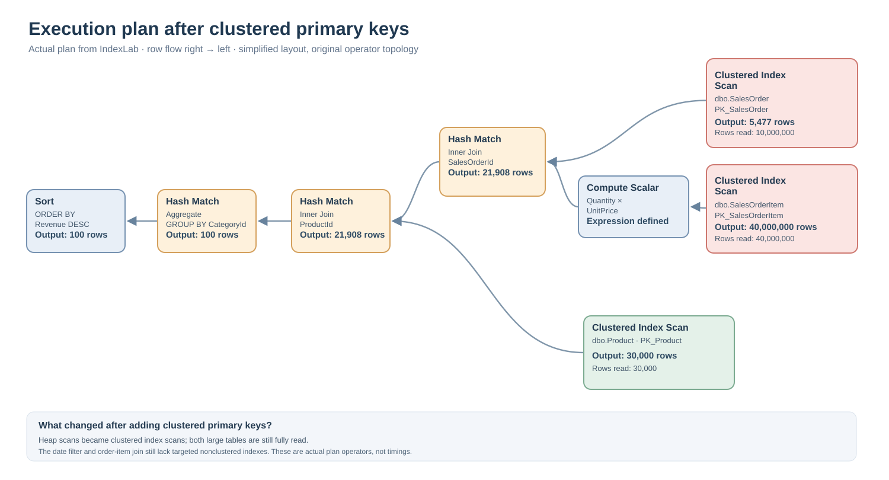

In our reference execution plan, the access operators change:

| Table | Before | After clustered PK |
|---|---|---|
| `SalesOrder` | Table Scan | Clustered Index Scan |
| `SalesOrderItem` | Table Scan | Clustered Index Scan |
| `Product` | Clustered Index Scan | Clustered Index Scan |

However, the important observation is that **the large scans remain**.

SQL Server still examines approximately:

- **10 million** rows from `SalesOrder`.
- **40 million** rows from `SalesOrderItem`.

The optimizer also continues to use `Hash Match` to join the large inputs.

### Why didn't the clustered indexes solve the problem?

The clustered indexes organize rows by:

- `SalesOrder.SalesOrderId`
- `SalesOrderItem.SalesOrderItemId`

However, our query uses different columns for filtering and joining:

```sql
WHERE so.OrderDate >= '20250601'
  AND so.OrderDate < '20250602'
```

```sql
soi.SalesOrderId = so.SalesOrderId
```

The clustered index on `SalesOrderId` does not provide an efficient way to locate orders by `OrderDate`.

Similarly, the clustered index on `SalesOrderItemId` does not provide an efficient way to locate order items by their `SalesOrderId`.

The indexes are useful for searches using their clustered keys, but they do not directly support the access patterns required by our query.

> [!IMPORTANT]
> **Creating an index does not automatically make every query faster.**
>
> An index is most useful when its key columns support the query's filtering, joining, or ordering requirements.

### Check your understanding

**Why does SQL Server still scan both large tables even after creating clustered primary keys?**

<details>
<summary>Show answer</summary>

Because the clustered indexes are organized by `SalesOrderId` and `SalesOrderItemId`, while our query filters orders by `OrderDate` and finds order items using `SalesOrderId`.

These access patterns are not efficiently supported by the new clustered indexes.

In the next sections, we will create nonclustered indexes specifically designed for these operations.

</details>

<details>
<summary>Show reference results from one computer</summary>

| Metric | Value |
|---|---|
| `SalesOrder` logical reads | 57,266 |
| `SalesOrderItem` logical reads | 198,439 |
| `Product` logical reads | 161 |
| CPU time | 13.25 s |
| Elapsed time | 14.1 s |

Logical reads remain very similar to the heap baseline (57,143 / 198,020 / 161, ~14.7 s CPU / ~18.1 s elapsed). Creating the clustered indexes changed the storage structure, but both large tables are still read in full. The total logical-read counts alone do not identify which pages account for the small difference.

</details>

## 8.2 Create an index for the `SalesOrder` date filter

In the previous step, we created clustered primary keys on `SalesOrder` and `SalesOrderItem`.

However, the execution plan still showed large scans because the clustered indexes did not directly support the query's filtering and joining conditions.

Let's address the first problem: **finding orders for a specific date**.

### Why index OrderDate?

Our main query filters orders using:

```sql
WHERE so.OrderDate >= '20250601'
  AND so.OrderDate < '20250602'
```

Without a suitable index, SQL Server must examine a large number of rows to identify the orders within this date range.

We can improve this by creating a nonclustered index on `OrderDate`.

```sql
CREATE NONCLUSTERED INDEX IX_SalesOrder_OrderDate
ON dbo.SalesOrder (OrderDate);
GO
```

The index organizes entries by `OrderDate`, allowing SQL Server to navigate directly to the relevant range instead of scanning the entire clustered index.

### Run the main query again

Execute **exactly the same query from Section 6.2**, with Actual Execution Plan enabled.

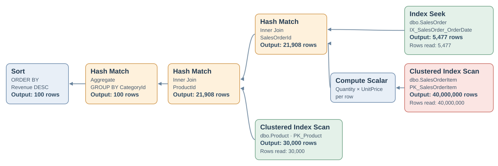

Compare the new execution plan with the previous one.

In our reference execution plan:

| Table | After clustered PK | After OrderDate index |
|---|---|---|
| `SalesOrder` | Clustered Index Scan | **Index Seek** |
| `SalesOrderItem` | Clustered Index Scan | Clustered Index Scan |
| Main join | Hash Match | Hash Match |

The most important change is the access to `SalesOrder`.

Before creating the index, SQL Server examined approximately **10 million rows** to find 5,477 orders.

After creating the index, it can locate the relevant date range through an **Index Seek**, examining approximately **5,477 matching index entries**.

### Inspect the Index Seek operator

In SSMS:

1. Select the `Index Seek` operator for `IX_SalesOrder_OrderDate`.
2. Press **F4** to open its Properties.
3. Find the **Seek Predicates** property.

You should see a condition corresponding to the requested `OrderDate` range.

Unlike the previous scan, SQL Server can use the index's ordered keys to locate the beginning of the range and read the matching entries.

Compare **Actual Number of Rows Read** and **Actual Number of Rows**. In our reference plan, these values are approximately equal because the seek reads the relevant entries.

Notice that the plan contains no Key Lookup for `SalesOrder`. From this table, the query needs only `OrderDate` (the index key) and `SalesOrderId` (the clustered key, stored in every nonclustered index entry). For the `SalesOrder` part of the query, this narrow index is therefore already **covering**. In Section 8.4, we will achieve the same effect deliberately for `SalesOrderItem`.

> [!IMPORTANT]
> **An Index Seek does not necessarily retrieve only one row.**
>
> It can efficiently locate a range of values and return many matching rows without scanning the entire index.

### What problem remains?

Although we have improved access to `SalesOrder`, the execution plan still contains a large `Clustered Index Scan` on `SalesOrderItem`.

SQL Server still processes approximately **40 million order items** to find those belonging to the selected orders.

The new `OrderDate` index helps SQL Server find orders, but it does not provide an efficient way to locate their items.

This demonstrates an important principle:

**An index can improve one part of an execution plan without solving every performance problem in the query.**

In the next section, we will create an index on `SalesOrderItem(SalesOrderId)` to address the remaining large scan.

### Check your understanding

**Why did the new index eliminate the SalesOrder scan but not the SalesOrderItem scan?**

<details>
<summary>Show answer</summary>

The new index is created on `SalesOrder(OrderDate)`, so it helps SQL Server find orders matching the requested date range.

However, `SalesOrderItem` is a separate table, and it does not yet have an index with `SalesOrderId` as its key.

SQL Server still needs to scan the large order-item table to find the matching items.

</details>

<details>
<summary>Show reference results from one computer</summary>

| Metric | Before `IX_SalesOrder_OrderDate` | After `IX_SalesOrder_OrderDate` |
|---|---:|---:|
| `SalesOrder` logical reads | 57,266 | **15** |
| `SalesOrderItem` logical reads | 198,439 | 198,439 (unchanged) |
| `Product` logical reads | 161 | 161 (unchanged) |
| CPU time | 13.25 s | 12.05 s |
| Elapsed time | 14.1 s | 13.1 s |

`SalesOrder`'s logical reads collapse from 57,266 to 15 — a seek through a handful of index pages instead of a full table read. The overall query is only modestly faster so far, because `SalesOrderItem` — the much larger table — is still scanned in full; that is the next bottleneck to address.

</details>


## 8.3 Create an index for the `SalesOrderItem` join

In the previous step, we created an index on `SalesOrder(OrderDate)`, allowing SQL Server to efficiently find the 5,477 orders for the selected date.

However, the execution plan still showed a large scan of approximately **40 million rows** in `SalesOrderItem`.

Let's address this problem by creating an index on the column used to join order items with their orders.

### Create the nonclustered index

Our query joins the tables using:

```sql
soi.SalesOrderId = so.SalesOrderId
```

We can support this operation with a nonclustered index:

```sql
CREATE NONCLUSTERED INDEX IX_SalesOrderItem_SalesOrderId
ON dbo.SalesOrderItem (SalesOrderId);
GO
```

The index organizes order-item entries by `SalesOrderId`.

This allows SQL Server to efficiently locate the items belonging to a particular order without scanning the entire `SalesOrderItem` table.

### Run the main query again

Execute **the same main query from Section 6.2**, with Actual Execution Plan enabled.

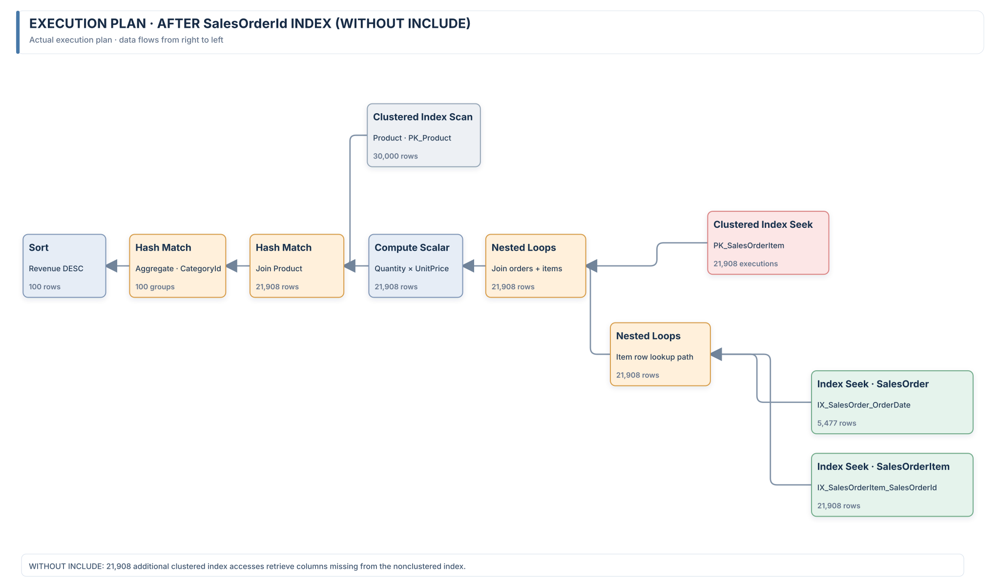

Compare this execution plan with the previous one.

In our reference execution plan:

| Operation | Before this index | After this index |
|---|---|---|
| `SalesOrder` access | Index Seek | Index Seek |
| `SalesOrderItem` access | Clustered Index Scan | **Index Seek** |
| Main order-item join | Hash Match | **Nested Loops** |
| Order items retrieved | 21,908 matching rows after the join | 21,908 matching index entries |
| Additional clustered index accesses | Not needed for the scan | **21,908** |

This is a major improvement.

Instead of scanning all 40 million order items, SQL Server performs approximately **5,477 index seeks**, one for each selected order, retrieving a total of **21,908 matching order items**.

However, the new plan also introduces additional work.

### Why are additional clustered index accesses needed?

The new nonclustered index contains `SalesOrderId` as its search key.

However, our query also needs other columns from `SalesOrderItem`:

- `ProductId` – to join with the `Product` table.
- `Quantity` – to calculate the number of items sold and revenue.
- `UnitPrice` – to calculate revenue.

These columns are not stored in our narrow nonclustered index.

Therefore, after finding the matching index entries, SQL Server must retrieve the missing columns from the clustered index.

In our reference execution plan, this requires approximately **21,908 additional clustered index accesses**.

> [!IMPORTANT]
> **An index can efficiently locate matching rows without containing all the data required by the query.**
>
> When additional columns are needed, SQL Server may have to retrieve them from the underlying table.

### Inspect the additional data retrieval

In the Actual Execution Plan, locate the `Key Lookup (Clustered)` operator on `PK_SalesOrderItem`.

Inspect its Properties and identify:

- **Object:** `PK_SalesOrderItem`.
- **Number of Executions:** approximately 21,908.
- **Output List:** the additional columns required by the query.

Notice that this operator is executed repeatedly, once for each matching order item in our reference plan.

This is a **Key Lookup**: SQL Server uses the clustered key obtained from the nonclustered index to retrieve the missing columns from the clustered index. Internally, a Key Lookup is a clustered index seek marked as a lookup; text-based plan output, such as `SET STATISTICS PROFILE`, shows it as `Clustered Index Seek ... LOOKUP`.

A small number of additional lookups may be inexpensive. However, thousands of repeated accesses can become a significant part of the query's total work.

### A smaller example

To observe this behavior more clearly, execute:

```sql
SELECT ProductId, Quantity, UnitPrice
FROM dbo.SalesOrderItem
WHERE SalesOrderId = 1;
GO
```

The nonclustered index helps SQL Server find the matching order items, but it does not contain the three selected columns.

Depending on the optimizer's choice, the execution plan may show an `Index Seek` followed by a `Key Lookup (Clustered)`, just like the main query.

Inspect the operators and compare the number of executions.

> [!NOTE]
> A Key Lookup is not guaranteed for every query. SQL Server may choose a different access path depending on the estimated cost.

### Check your understanding

**Why does SQL Server perform additional clustered index accesses even though it already found the matching order items using the nonclustered index?**

<details>
<summary>Show answer</summary>

The nonclustered index contains the `SalesOrderId` key and the clustered-key row locator, but it does not contain all the columns required by the query.

SQL Server uses the nonclustered index to find matching order items, then accesses the clustered index to retrieve the missing columns.

In the next section, we will modify the index so that these additional accesses are no longer necessary.

</details>

<details>
<summary>Show reference results from one computer</summary>

| Metric | After `IX_SalesOrder_OrderDate` only | After narrow `IX_SalesOrderItem_SalesOrderId` (no `INCLUDE`) |
|---|---:|---:|
| `SalesOrder` logical reads | 15 | 15 (unchanged) |
| `SalesOrderItem` logical reads | 198,439 | **90,533** |
| `SalesOrderItem` scan count | 1 | **5,477** (one seek per matching order) |
| `Product` logical reads | 161 | 161 (unchanged) |
| CPU time | 12.05 s | **0.20 s** |
| Elapsed time | 13.1 s | **0.21 s** |

This is already a dramatic speedup — Nested Loops with 5,477 cheap seeks beats a 40-million-row `Hash Match` input by a wide margin, even with an additional clustered index access for each of the 21,908 matching rows. `SalesOrderItem`'s logical reads (90,533) are still far higher than they need to be, though: each lookup costs extra page accesses that a covering index can avoid entirely — the point of Section 8.4.

The values in the right column come from the second run after creating the index. The first run reported about 106,000 logical reads for `SalesOrderItem` and took about 0.8 s, because SQL Server prefetched pages into memory (see Section 6.1).

</details>

## 8.4 Recreate the order-item index with `INCLUDE`

In the previous step, we created a nonclustered index on `SalesOrderItem(SalesOrderId)`.

This eliminated the expensive scan of 40 million order items. However, the execution plan still showed approximately **21,908 additional clustered index accesses** to retrieve columns missing from the nonclustered index.

Can we avoid these additional accesses?

Yes. We can extend the nonclustered index with **included columns**.

### What are included columns?

A nonclustered index can contain two types of explicitly defined columns:

- **Key columns:** determine the logical ordering of index entries and can be used to efficiently locate specific values or ranges.
- **Included columns:** store additional values at the leaf level without becoming part of the index's search key.

For our query, we need the following columns from `SalesOrderItem`:

| Column | Purpose | Index role |
|---|---|---|
| `SalesOrderId` | Find items belonging to selected orders | Key |
| `ProductId` | Join order items with products | Included |
| `Quantity` | Calculate items sold and revenue | Included |
| `UnitPrice` | Calculate revenue | Included |

By including the additional columns, SQL Server can retrieve all the required values directly from the nonclustered index.

### Recreate the index

First, remove the existing narrow index:

```sql
DROP INDEX IX_SalesOrderItem_SalesOrderId
ON dbo.SalesOrderItem;
GO
```

Now create it again with the additional columns:

```sql
CREATE NONCLUSTERED INDEX IX_SalesOrderItem_SalesOrderId
ON dbo.SalesOrderItem (SalesOrderId)
INCLUDE (ProductId, Quantity, UnitPrice);
GO
```

Notice that only `SalesOrderId` is the index key.

The included columns are stored at the leaf level, but they do not change the logical ordering of the index.

### Run the main query again

Execute **exactly the same query from Section 6.2**, with Actual Execution Plan enabled.

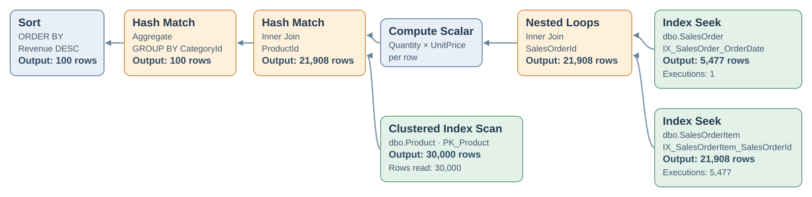

Compare this plan with the previous one, before adding `INCLUDE`.

| Operation | Without `INCLUDE` | With `INCLUDE` |
|---|---|---|
| `SalesOrder` access | Index Seek | Index Seek |
| `SalesOrderItem` access | Index Seek | Index Seek |
| Order-item index seeks | 5,477 | 5,477 |
| Matching order items | 21,908 | 21,908 |
| Additional clustered row fetches | **21,908** | **0** |
| Main order-item join | Nested Loops | Nested Loops |

The important difference is that **the additional clustered index accesses have disappeared**.

The nonclustered index now contains all the columns required from `SalesOrderItem`, so SQL Server no longer needs to retrieve them from the clustered index.

### What is a covering index?

An index is called a **covering index** when it contains all the columns required by a particular query, allowing SQL Server to satisfy that part of the query without additional row lookups.

Our index:

```sql
ON dbo.SalesOrderItem (SalesOrderId)
INCLUDE (ProductId, Quantity, UnitPrice)
```

is covering for the `SalesOrderItem` portion of the main query.

> [!IMPORTANT]
> **Covering is a property of an index relative to a query.**
>
> The same index may cover one query but not another query that requires additional columns.

### What about the clustered key?

There is one more detail worth understanding.

Our `SalesOrderItem` table has a clustered primary key on `SalesOrderItemId`.

In a nonclustered index on a clustered table, SQL Server also makes the clustered key available as a **row locator**.

Therefore, our nonclustered index effectively provides:

| Column | Role |
|---|---|
| `SalesOrderId` | Explicit index key |
| `ProductId` | Included column |
| `Quantity` | Included column |
| `UnitPrice` | Included column |
| `SalesOrderItemId` | Implicit clustered-key row locator |

We did not need to explicitly include `SalesOrderItemId`.

The same principle explains why our earlier index on `SalesOrder(OrderDate)` did not require `INCLUDE (SalesOrderId)`: `SalesOrderId` was already the clustered key of that table.

### The complete optimization process

We have now completed all five stages of our indexing demonstration.

The following table summarizes how SQL Server's access strategy changed as we introduced new indexes.

| Stage | `SalesOrder` access | `SalesOrderItem` access | Additional clustered row fetches |
|---|---|---|---|
| 1. Before indexing | Table Scan | Table Scan | — |
| 2. After clustered primary keys | Clustered Index Scan | Clustered Index Scan | — |
| 3. After `OrderDate` index | **Index Seek** | Clustered Index Scan | — |
| 4. After `SalesOrderId` index | Index Seek | **Index Seek** | **21,908** |
| 5. After `INCLUDE` | Index Seek | Index Seek | **0** |

Throughout all five stages:

- **The SQL query remained unchanged.**
- **The number of matching orders remained approximately 5,477.**
- **The number of matching order items remained approximately 21,908.**

What changed was **how SQL Server accessed and processed the data**.

Each new index introduced an access path that allowed the optimizer to choose a different execution strategy.

> [!IMPORTANT]
> **Creating indexes does not change which rows a query should return. It changes how SQL Server can find and process those rows.**
>
> A useful index allows SQL Server to avoid unnecessary work, but it does not guarantee that every query will use it.

**Think about it:** What if `SalesOrderItem` had been clustered on `(SalesOrderId, SalesOrderItemId)` instead of `SalesOrderItemId`?

<details>
<summary>Show answer</summary>

All items of an order would then be stored next to each other in the clustered index. A single clustered index seek per order would return complete rows, so no nonclustered index on `SalesOrderId` (and no extra storage for included columns) would be needed for our query. This is a common design for order-line tables, which are usually read together with their parent order.

The trade-off is a wider clustered key, which every nonclustered index on the table would carry, and the need for a separate nonclustered unique index or primary key if items are also looked up by `SalesOrderItemId` alone.

</details>

### Are included columns always a good idea?

Not necessarily.

Included columns make an index wider, which can increase storage requirements and the work needed to maintain it during `INSERT`, `UPDATE`, and `DELETE` operations.

They should be selected based on the columns required by important queries rather than added automatically.

### Check your understanding

**Why did adding `INCLUDE (ProductId, Quantity, UnitPrice)` eliminate the additional clustered index accesses?**

<details>
<summary>Show answer</summary>

The nonclustered index now contains all the columns required from `SalesOrderItem`.

SQL Server can locate matching order items using `SalesOrderId` and retrieve `ProductId`, `Quantity`, and `UnitPrice` directly from the index's leaf level.

There is no longer a need to access the clustered index to retrieve these values.

</details>

<details>
<summary>Show reference results from one computer</summary>

| Metric | Narrow `IX_SalesOrderItem_SalesOrderId` | With `INCLUDE (ProductId, Quantity, UnitPrice)` |
|---|---:|---:|
| `SalesOrder` logical reads | 15 | 15 (unchanged) |
| `SalesOrderItem` logical reads | 90,533 | **23,462** |
| `SalesOrderItem` scan count | 5,477 | 5,477 (unchanged) |
| `Product` logical reads | 161 | 161 (unchanged) |
| CPU time | 0.20 s | **0.09 s** |
| Elapsed time | 0.21 s | **0.10 s** |

The 5,477 seeks remain, but the 21,908 Key Lookups are gone, and with them about three quarters of the logical reads on `SalesOrderItem`. What remains is roughly four page accesses per seek: navigating the index from the root to the leaf level, plus an occasional neighboring leaf page.

As in Section 8.3, these are second-run values. The first run after creating the index reported about 52,000 logical reads and took about 0.4 s.

</details>

---

We have now seen how different indexes change the execution plan. In the next section, we will compare **logical reads, CPU time, and elapsed time** to measure how much performance actually improved.

---

# 9. Performance comparison

Throughout Section 8, the SQL query remained unchanged; only the available indexes changed. The following table brings together the reference measurements from all five stages, measured on the reference Express instance. Stages 4 and 5 show second-run values (see Section 6.1).

| Stage | `SalesOrder` logical reads | `SalesOrderItem` logical reads | CPU time | Elapsed time |
|---|---:|---:|---:|---:|
| 1. Before indexing (heaps) | 57,143 | 198,020 | 14.7 s | 18.1 s |
| 2. Clustered primary keys | 57,266 | 198,439 | 13.25 s | 14.1 s |
| 3. `IX_SalesOrder_OrderDate` | 15 | 198,439 | 12.05 s | 13.1 s |
| 4. `IX_SalesOrderItem_SalesOrderId` (narrow) | 15 | 90,533 | 0.20 s | 0.21 s |
| 5. The same index with `INCLUDE` | 15 | 23,462 | 0.09 s | 0.10 s |

`Product` required 161 logical reads in every stage, because its small clustered index was scanned each time.

Record your own measurements in the same table. Your times will differ, but the pattern should be the same.

### Reading the table

- **Stages 2 and 3 barely change the elapsed time.** As long as the 40-million-row `SalesOrderItem` table is scanned and joined with `Hash Match`, it dominates the cost of the query, even after `SalesOrder` drops to 15 logical reads.
- **Stage 4 is the decisive step.** Replacing the large scan with 5,477 index seeks reduces elapsed time from about 13 seconds to about 0.2 seconds, even though `SalesOrderItem`'s logical reads are only roughly halved. Scanning 40 million rows and building and probing a hash table costs CPU time far beyond the page reads themselves.
- **Stage 5 removes the remaining lookups.** The covering index eliminates the 21,908 Key Lookups, which cuts `SalesOrderItem`'s logical reads by a further three quarters and halves the remaining time.

### Overall improvement

Comparing the first and the last stage across the two large tables:

```math
\mathrm{Logical\text{-}read\ reduction} = \frac{255{,}163 - 23{,}477}{255{,}163} \times 100 \approx 90.8\%
```

```math
\mathrm{Speedup} = \frac{18.1\ \mathrm{s}}{0.1\ \mathrm{s}} \approx 180
```

Expressed as factors, the query performs about **11× fewer logical reads** but finishes about **180× faster**. The two numbers do not have to be proportional: logical reads count page accesses, while elapsed time also reflects CPU work (such as scanning rows and processing a large hash join), waiting, and caching.

> [!NOTE]
> **Editions and parallel execution**
>
> On the reference computer, the same baseline query took about **1.3 seconds** on a Developer edition instance, which executed it in parallel, compared with about 18 seconds on Express. Developer edition has the same feature set as Enterprise edition, but it is licensed only for development and testing.
>
> Parallel execution distributes the work across several CPU workers, so total CPU time can exceed elapsed time. It can make an inefficient query finish faster, but it does not reduce the amount of data the query must process. Indexing reduces the work itself: after indexing, the query finishes in a fraction of a second on both editions.

### Final question

**What is the most important lesson from this indexing demonstration?**

<details>
<summary>Show discussion</summary>

The most important lesson is that **effective indexing is about supporting the way queries access data**.

Creating indexes on arbitrary columns does not guarantee better performance.

By choosing index keys that support filtering and joining, and including additional columns when necessary, we allowed SQL Server to avoid processing millions of unnecessary rows.

The execution plan and performance measurements confirmed the improvement.

</details>

---

# 10. Index design principles

## 10.1 Composite indexes and column order

So far, we have created indexes on individual columns, such as `OrderDate` and `SalesOrderId`.

However, many queries filter or sort data using **more than one column**.

A **composite index** is an index that uses two or more columns as its key.

The order of these columns is important because it determines how the index entries are organized and which search patterns the index can efficiently support.

### How are composite index keys organized?

Consider an index on:

```sql
(CustomerId, OrderDate)
```

The index entries are logically ordered:

1. First by `CustomerId`.
2. Within each `CustomerId`, by `OrderDate`.

For example:

| CustomerId | OrderDate |
|---:|---|
| 100 | 2025-01-05 |
| 100 | 2025-02-12 |
| 100 | 2025-04-20 |
| 200 | 2025-01-10 |
| 200 | 2025-03-15 |
| 300 | 2025-02-01 |

Notice that all orders for the same customer are grouped together, and within each customer, the orders are sorted by date.

This makes it efficient to find orders for a particular customer, optionally restricted to a date range.

However, the index is **not globally sorted by `OrderDate`**. Dates are sorted only within each `CustomerId` group.

### Create the composite index

Execute:

```sql
CREATE NONCLUSTERED INDEX IX_SalesOrder_CustomerId_OrderDate
ON dbo.SalesOrder (CustomerId, OrderDate);
GO
```

Now compare the following queries with Actual Execution Plan enabled. The examples use customer `501`, which has 1,000 orders in `IndexLab`. (Because of the way the data is generated, some customer numbers have no orders at all; customer `500` is one of them.)

**Query A – Leading key only**

```sql
SELECT SalesOrderId, CustomerId, OrderDate
FROM dbo.SalesOrder
WHERE CustomerId = 501;
GO
```

SQL Server can use the leading key `CustomerId` to locate the matching entries.

**Query B – Leading key and second key**

```sql
SELECT SalesOrderId, CustomerId, OrderDate
FROM dbo.SalesOrder
WHERE CustomerId = 501
  AND OrderDate >= '20250101';
GO
```

SQL Server can use the equality condition on `CustomerId` and the range condition on `OrderDate` to efficiently locate matching entries.

**Query C – Second key only**

```sql
SELECT SalesOrderId, CustomerId, OrderDate
FROM dbo.SalesOrder
WHERE OrderDate >= '20250101';
GO
```

This query does not filter by the leading key, `CustomerId`.

Therefore, SQL Server generally cannot use this composite index to directly seek to one continuous date range across all customers.

Order dates in `IndexLab` cover 2021–2025, so this condition matches roughly **one fifth of the table** (about 2 million rows). The earlier `IX_SalesOrder_OrderDate` index can locate the date range, but it does not contain `CustomerId`, so using it would require about 2 million lookups. The composite index, on the other hand, contains every column this query needs (`CustomerId`, `OrderDate`, and the clustered key `SalesOrderId`) and is much narrower than the table. SQL Server therefore **scans the composite index** (`Index Scan`) rather than seeking in it.

### Compare the execution plans

For each query, inspect the access operator, its **Seek Predicates**, and the logical reads.

| Query | Predicate | Use of the composite index | Logical reads (reference) |
|---|---|---|---:|
| A | `CustomerId = 501` | `Index Seek` using the leading key | 6 |
| B | `CustomerId = 501 AND OrderDate >= ...` | `Index Seek` using both key columns | 3 |
| C | `OrderDate >= ...` | `Index Scan` of the whole composite index; `OrderDate` is checked as a predicate on every entry | 26,055 |

Query C reads every page of the composite index, because the dates it needs are spread across all customers.

> [!IMPORTANT]
> **The order of columns in a composite index matters.**
>
> An index on `(CustomerId, OrderDate)` is not equivalent to an index on `(OrderDate, CustomerId)`. Reordering conditions in the `WHERE` clause does not change the index's key order.
>
> Two rules of thumb follow from how the keys are organized:
>
> - **Equality first, then range or sort.** Put columns compared with equality (`=`) first, and columns used for ranges (`>`, `<`, `BETWEEN`) or for sorting after them. Once the seek reaches a range condition, the key columns that follow can no longer narrow it down; they can only be checked as residual predicates.
> - **The leftmost prefix.** An index on `(CustomerId, OrderDate)` also supports every search that an index on `(CustomerId)` alone would support. A separate single-column index on `CustomerId` is therefore usually redundant.

### Check your understanding

**Would an index on `(OrderDate, CustomerId)` be equally efficient for finding all orders belonging to `CustomerId = 501`?**

<details>
<summary>Show answer</summary>

Not necessarily.

With `OrderDate` as the leading key, the index is organized primarily by date. Orders for customer 501 may be spread across many different date ranges.

An index on `(CustomerId, OrderDate)` is generally better suited for queries that filter by `CustomerId` alone.

However, `(OrderDate, CustomerId)` may be more useful for queries that primarily filter by date.

The best column order depends on the queries the index needs to support.

</details>

## 10.2 Selectivity and statistics

When designing an index, an important consideration is **selectivity**.

Selectivity describes how effectively a search condition reduces the number of rows that need to be processed. A condition that matches 3% of a table is much more selective than one that matches 80%.

### Examine the data distribution

First, find out how frequently each status occurs:

```sql
SELECT Status, COUNT(*) AS NumberOfOrders
FROM dbo.SalesOrder
GROUP BY Status
ORDER BY NumberOfOrders DESC;
GO
```

In `IndexLab`, the result is:

| Status | Number of orders | Share of the table |
|---|---:|---:|
| `Completed` | 8,000,000 | 80% |
| `Processing` | 1,000,000 | 10% |
| `Cancelled` | 700,000 | 7% |
| `Review` | 300,000 | 3% |

The distribution matters because SQL Server estimates how many rows a query will return and uses that estimate when choosing an execution plan.

### Create an index on Status

Now create a nonclustered index:

```sql
CREATE NONCLUSTERED INDEX IX_SalesOrder_Status
ON dbo.SalesOrder (Status);
GO
```

The index organizes its entries by `Status`, allowing SQL Server to locate rows with a particular status.

However, **having an index does not guarantee that SQL Server will use it for every query on this column**.

### How does SQL Server know the distribution?

When SQL Server creates an index, it also creates **statistics** on the index key. Statistics include a **histogram**: a summary of how values are distributed in the column. The optimizer uses it to estimate how many rows a condition will match, without counting them.

You can display the histogram:

```sql
DBCC SHOW_STATISTICS ('dbo.SalesOrder', IX_SalesOrder_Status)
WITH HISTOGRAM;
GO
```

For `Status`, the histogram has one step per value:

| `RANGE_HI_KEY` | `EQ_ROWS` |
|---|---:|
| `Cancelled` | 700,000 |
| `Completed` | 8,000,000 |
| `Processing` | 1,000,000 |
| `Review` | 300,000 |

`EQ_ROWS` is the estimated number of rows equal to that value. Here it matches the `GROUP BY` result exactly, because SQL Server read every row while building the index. Statistics created or updated later from a sample of the rows may be approximate.

When you run the queries below with Actual Execution Plan enabled, compare **Estimated Number of Rows** with **Actual Number of Rows** for the access operator. Good estimates are the basis for good plan choices.

### Covered queries: both values use the index

Enable Actual Execution Plan and execute:

**Query A – Completed status**

```sql
SELECT SalesOrderId, Status
FROM dbo.SalesOrder
WHERE Status = 'Completed';
GO
```

**Query B – Review status**

```sql
SELECT SalesOrderId, Status
FROM dbo.SalesOrder
WHERE Status = 'Review';
GO
```

Query A asks for the most frequent value and Query B for the rarest one. Both queries are covered by `IX_SalesOrder_Status`, because `SalesOrderId` is the clustered key and is already available in the nonclustered index. Both therefore use an `Index Seek`, even though Query A returns 80% of the table:

| Query | Rows returned | Access operator | Logical reads (reference) |
|---|---:|---|---:|
| A – `Completed` | 8,000,000 | `Index Seek` on `IX_SalesOrder_Status` | 26,859 |
| B – `Review` | 300,000 | `Index Seek` on `IX_SalesOrder_Status` | 897 |

The seek for `Completed` reads most of the index, but the index is still narrower than the table, so reading it is cheaper than scanning the clustered index.

### A query that is not covered: the tipping point

Now add one column that the index does not contain:

**Query C – Review status, with `TotalAmount`**

```sql
SELECT SalesOrderId, Status, TotalAmount
FROM dbo.SalesOrder
WHERE Status = 'Review';
GO
```

Although `Review` matches only 3% of the rows, SQL Server does **not** use `IX_SalesOrder_Status`. The reference plan shows a `Clustered Index Scan` with **57,266** logical reads: the whole table is read.

Why? The index can find the 300,000 matching entries, but each of them would need a Key Lookup to fetch `TotalAmount`. To see what that would cost, force the index with a table hint:

```sql
-- For demonstration only: forces the use of IX_SalesOrder_Status
SELECT SalesOrderId, Status, TotalAmount
FROM dbo.SalesOrder WITH (INDEX (IX_SalesOrder_Status))
WHERE Status = 'Review';
GO
```

| Plan for Query C | Logical reads (reference) | Elapsed time (reference) |
|---|---:|---:|
| Chosen by the optimizer: `Clustered Index Scan` | 57,266 | 2.8 s |
| Forced: `Index Seek` + 300,000 Key Lookups | 1,393,642 | 5.6 s |

Each lookup navigates the clustered index from the root to a leaf page, so 300,000 lookups cost about **24 times** as many page accesses as reading the whole table once. The optimizer's choice is correct.

> [!IMPORTANT]
> **"Selective" is relative to the cost of the alternative.**
>
> Without a covering index, an index stops paying off at a surprisingly small fraction of the table: in this example, even 3% of the rows was too many lookups. With a covering index, there are no lookups, and the index can be useful even for large result sets, as Query A showed.
>
> Index hints such as `WITH (INDEX (...))` are useful for experiments like this one. In real code, they prevent the optimizer from adapting when the data changes and should be used only in exceptional cases.

### Selectivity vs. number of distinct values

A column with only a few different values is sometimes described as having **low cardinality**.

For example, `Status` in `IndexLab` contains only four values: `Completed`, `Processing`, `Cancelled`, and `Review`.

However, this does not automatically make an index on `Status` useless.

`Review` occurs in only about 3% of the rows, so searching for that value is far more selective than searching for `Completed`.

The important distinction is:

- **Cardinality:** how many distinct values a column contains (in this context).
- **Selectivity:** how narrowly a particular search condition filters the rows.

> [!NOTE]
> SQL Server documentation and execution plans also use the term *cardinality estimation*, which means something different: the optimizer's estimate of **how many rows** an operator will return.

### Check your understanding

**Why did SQL Server use `IX_SalesOrder_Status` for Query B but not for Query C, even though both search for `Status = 'Review'`?**

<details>
<summary>Show answer</summary>

Query B needs only `SalesOrderId` and `Status`, which are both in the index, so the index covers it.

Query C also needs `TotalAmount`. Using the index would require 300,000 Key Lookups, which cost far more page accesses than scanning the whole table once.

The usefulness of an index depends not only on the number of distinct values but also on their distribution and on the columns required by the query.

</details>

## 10.3 Key columns, included columns, and index width

In Section 8.4, we created a covering index on `SalesOrderItem`:

```sql
CREATE NONCLUSTERED INDEX IX_SalesOrderItem_SalesOrderId
ON dbo.SalesOrderItem (SalesOrderId)
INCLUDE (ProductId, Quantity, UnitPrice);
```

This allowed SQL Server to retrieve all the required columns directly from the nonclustered index, eliminating thousands of additional clustered index accesses.

### Key column or included column?

When designing an index for a query, decide for each column where it belongs:

- A column belongs in the **key** if the query **filters, joins, or sorts** by it. Only key columns determine the order of the index, so only they can be used to seek or to avoid a sort. (Remember from Section 7.2 that a key column helps only when the condition compares the column directly, without applying a function to it.)
- A column belongs in **`INCLUDE`** if the query only **returns** it or **calculates** with it. Included columns are stored only at the leaf level, so they do not widen the upper levels of the tree and do not change the order of the index.

In our index, `SalesOrderId` is used to join, so it is the key. `ProductId`, `Quantity`, and `UnitPrice` are only read once the matching entries have been found, so they are included.

However, **adding more columns to an index is not always beneficial**.

### Why does index width matter?

As we learned in Lab 05, SQL Server stores index data in **8 KB pages**.

When an index contains more columns, its leaf-level entries generally become wider.

This has several consequences:

- **Fewer entries per page:** wider entries reduce the number of index records that fit into an 8 KB page.
- **More pages:** the index may require more pages to store the same number of entries.
- **More I/O:** reading a larger portion of the index may require more page accesses.
- **More maintenance:** inserting or updating indexed values can require additional work.

For example, consider a simplified index with one million entries:

| Average entry size | Entries per page (approx.) | Pages needed (approx.) |
|---|---:|---:|
| 20 bytes | 400 | 2,500 |
| 40 bytes | 200 | 5,000 |
| 80 bytes | 100 | 10,000 |

These figures are illustrative and ignore page headers, record overhead, free space, and other internal structures.

The important observation is that **doubling the size of index entries can approximately double the number of leaf pages required**.

### Finding the right balance

A narrow index uses less storage and may require fewer page reads, but it might not contain all the columns required by a query.

A wider covering index can eliminate additional lookups, but it requires more storage and maintenance.

The best choice depends on the workload.

> [!IMPORTANT]
> **A covering index is not necessarily the best index for every situation.**
>
> Add included columns when the benefit of avoiding additional data lookups justifies the extra storage and maintenance cost.

### Check your understanding

**Why might a wider covering index be faster for one query but less efficient for the database overall?**

<details>
<summary>Show answer</summary>

A covering index can improve a query by providing all required columns without additional lookups.

However, wider index entries require more storage pages and can increase the work needed for data modifications.

The index may improve frequently executed queries while increasing storage and maintenance costs for the overall workload.

</details>

## 10.4 Filtered indexes

Suppose an application frequently displays the queue of orders waiting for review, oldest first:

```sql
SELECT SalesOrderId, OrderDate
FROM dbo.SalesOrder
WHERE Status = 'Review'
ORDER BY OrderDate;
GO
```

Run it with Actual Execution Plan enabled. `IX_SalesOrder_Status` does not help: it can find the 300,000 `Review` entries, but it does not contain `OrderDate`, so it would need a Key Lookup for every row. The reference plan therefore uses a `Clustered Index Scan` (57,266 logical reads) followed by a `Sort`.

An ordinary index on `(Status, OrderDate)` would solve this, but it would contain an entry for all 10 million orders, although the query only ever needs the 3% that are in review.

A **filtered index** contains only the rows that satisfy a `WHERE` condition:

```sql
CREATE NONCLUSTERED INDEX IX_SalesOrder_Review_OrderDate
ON dbo.SalesOrder (OrderDate)
WHERE Status = 'Review';
GO
```

Run the query again and compare:

| | Before | After `IX_SalesOrder_Review_OrderDate` |
|---|---|---|
| Access operator | `Clustered Index Scan` + `Sort` | `Index Scan` of the filtered index, no `Sort` |
| Logical reads (reference) | 57,266 | **635** |

The plan now reads the filtered index from beginning to end. This `Index Scan` is not a problem: the index contains **only** the rows the query needs, already ordered by `OrderDate`, and `SalesOrderId` is available as the clustered key.

The filtered index is also very small. Compare its size with the other indexes on `SalesOrder` in the reference database:

| Index | Rows | Pages | Size |
|---|---:|---:|---:|
| `PK_SalesOrder` (clustered, the table itself) | 10,000,000 | 57,266 | 447 MB |
| `IX_SalesOrder_Status` | 10,000,000 | 33,576 | 262 MB |
| `IX_SalesOrder_Review_OrderDate` (filtered) | 300,000 | 635 | 4 MB |

Because it contains only `Review` rows, the filtered index is cheaper to store and to maintain: inserting a `Completed` order does not touch it at all.

> [!NOTE]
> **Limitations of filtered indexes**
>
> - The optimizer uses a filtered index only when it can prove that the query's condition matches the filter. A query with `WHERE Status = 'Review'` qualifies. A query with `WHERE Status = @Status` usually does not, because the same plan must work for every possible parameter value.
> - The filter must be a simple comparison on columns of the table (for example `=`, `<>`, `>`, `IN`, `IS NULL`, combined with `AND`).
> - Creating a filtered index requires certain session settings, such as `QUOTED_IDENTIFIER ON`. SSMS uses the required settings by default.

### Check your understanding

**When is a filtered index a better choice than an ordinary index on the same columns?**

<details>
<summary>Show answer</summary>

When important queries always target the same small, well-defined subset of rows, such as orders in review, active records, or rows where a column is not `NULL`.

The filtered index contains only that subset, so it is smaller, cheaper to maintain, and faster to read than an index over the whole table. It is not useful for queries whose conditions vary or cannot be matched to the filter.

</details>

---

# 11. Inserts, page splits, and maintenance

So far, we have focused on how indexes help SQL Server find data efficiently.

However, database tables are not static. New rows are inserted, existing rows are updated, and rows are deleted.

**Every index must remain consistent with the data it represents.**

This means that indexes improve certain read operations, but they also introduce additional work when data changes.

## 11.1 Inserting entries into a B+ tree

As we learned earlier, SQL Server stores index entries in **8 KB pages**.

The entries at the leaf level are logically ordered by their index keys.

When a new row is inserted, SQL Server must place its index entry in the correct position according to the key.

Two situations are possible:

- **Enough free space:** the new entry can be inserted into the existing page.
- **Not enough free space:** SQL Server may need to split the page to make room for the new entry.

A page split can also require changes to separator keys and pointers in the upper levels of the B+ tree.

### Example: Inserting new keys

The following diagram illustrates the insertion of three new keys: `58`, `60`, and `75`.

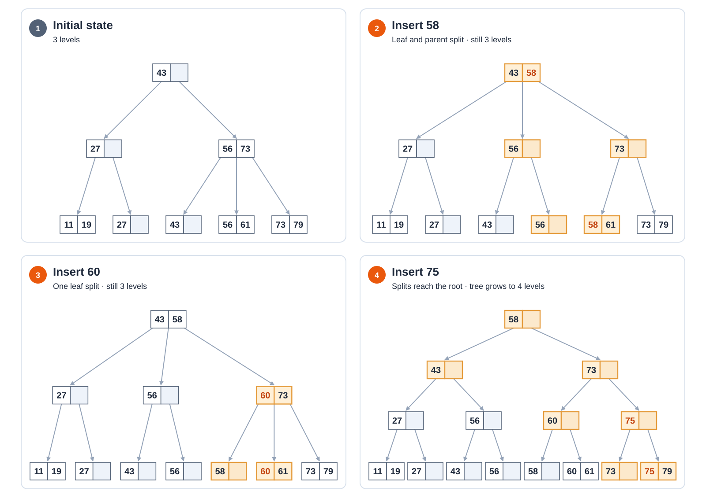

Follow the changes in the diagram:

In this simplified model, each page holds at most two keys. Pages changed in each step are highlighted in orange.

1. **Initial state:** three levels, five leaf pages, and a root containing the key `43`.
2. **Insert 58:** the key belongs in the full leaf page `[56, 61]`, so the leaf splits into `[56]` and `[58, 61]`, and the separator `58` must be added to the parent. The parent `[56, 73]` is also full, so it splits too, and `58` moves up into the root, which now contains `[43, 58]`. The tree still has three levels.
3. **Insert 60:** the key belongs in the full leaf page `[58, 61]`, which splits into `[58]` and `[60, 61]`. The separator `60` fits into its parent, which becomes `[60, 73]`. Only one split is needed this time.
4. **Insert 75:** the leaf `[73, 79]` splits into `[73]` and `[75, 79]`. The separator `75` does not fit into the full parent `[60, 73]`, so the parent splits and `73` moves up. The root `[43, 58]` is full as well, so it splits too, and `58` becomes the only key of a **new root**. The tree now has four levels.

> [!IMPORTANT]
> **A page split does not always increase the height of a B+ tree.**
>
> The tree grows in height only when splitting propagates all the way to the root and a new root is required.

### Final B+ tree

The following diagram shows the resulting structure after all three insertions.

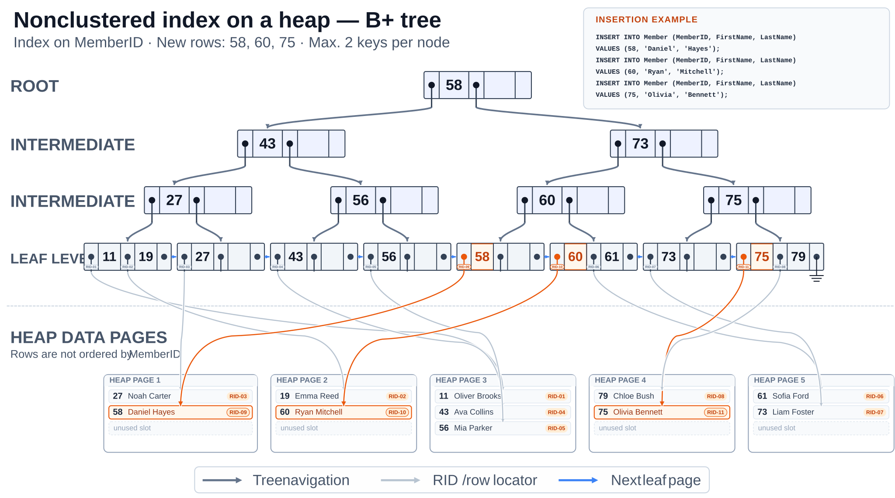

Notice that:

- All leaf pages remain at the same depth.
- The index entries remain logically ordered by key.
- Separator keys and child pointers have been updated.
- The tree now has an additional level.
- The new rows in the heap were simply stored wherever a heap page had free space; only the index had to be reorganized.

This illustrates how a B+ tree maintains its balanced structure even as new entries are inserted.

## 11.2 Inserting rows into a clustered index

In a **clustered index**, the leaf level contains the actual table rows.

Therefore, inserting a new row may require SQL Server to reorganize the data rows stored in the leaf pages.

The next diagram illustrates this process.

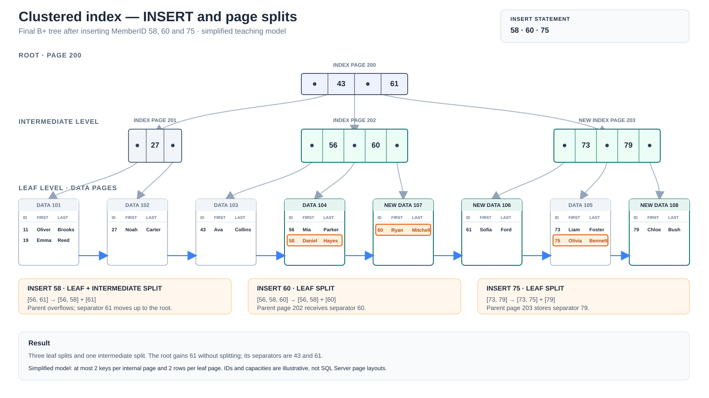

The same basic B+ tree principles apply:

- New rows must be placed according to the clustered key's logical order.
- If the target leaf page has enough free space, the row can be inserted there.
- If there is insufficient space, a page split may be necessary.
- Changes to the leaf pages may require updates to the upper index levels.

The key difference is that **clustered index leaf pages contain complete data rows**, not just nonclustered index entries.

This means that splitting a clustered index leaf page involves redistributing actual table rows. The diagram uses the same inserts and the same splits as Section 11.1, so the tree above the leaf level is identical. At the leaf level, each split created a new data page and moved existing rows into it: row 61 moved twice, and row 79 moved once.

### Ascending and random keys

The order in which new keys arrive has a large effect on page splits.

When new keys are always larger than existing ones, such as with an identity column, every new row goes to the last leaf page. When that page is full, SQL Server simply starts a new page instead of moving half of the rows, so no rows need to be relocated.

When keys arrive in random order, such as `uniqueidentifier` values generated by `NEWID()`, new rows land in the middle of the index, and full pages must be split repeatedly. The result is more page splits, more pages that are only half full, and more fragmentation.

This is one of the reasons why an ever-increasing column is often a good clustered key (Section 4.2).

## 11.3 Why do indexes require maintenance?

Every additional index must be updated when relevant data changes.

For example:

- **INSERT:** SQL Server adds entries to the indexes associated with the new row.
- **DELETE:** SQL Server must remove or logically delete the corresponding index entries.
- **UPDATE:** SQL Server may need to modify index entries, especially when indexed key or included column values change.

These operations require additional CPU, memory, logging, and page modifications.

### Page splits and fragmentation

Page splits can also contribute to **index fragmentation**.

In simplified terms, fragmentation occurs when the physical organization of index pages becomes less efficient for certain access patterns.

For example, logically neighboring leaf pages may no longer be stored close together in the physical file.

This can increase the cost of reading large ranges of index pages, particularly when physical I/O is involved.

However, fragmentation does not automatically mean that every query will become slower.

### Fill factor

When SQL Server builds or rebuilds an index, it normally fills the leaf pages almost completely. The **fill factor** option tells it to leave some free space on each leaf page instead:

```sql
-- Illustrative example: leave about 10% free space on each leaf page
ALTER INDEX IX_SalesOrder_CustomerId_OrderDate ON dbo.SalesOrder
REBUILD WITH (FILLFACTOR = 90);
```

The free space can absorb new entries without immediate page splits. The trade-off is that the index needs more pages from the start, so every scan of it reads more pages. A lower fill factor is useful mainly for indexes whose keys arrive in random order; for an ever-increasing key, new rows go to the end of the index anyway, and free space in the existing pages would remain unused.

### Reorganize and rebuild

SQL Server provides two index maintenance operations:

- `ALTER INDEX ... REORGANIZE` reorders and compacts the existing leaf pages in place. It is a lighter operation and can be interrupted without losing the work already done.
- `ALTER INDEX ... REBUILD` creates the index again from scratch, with the requested fill factor. It removes fragmentation completely and also updates the index statistics, but it requires more resources.

> [!NOTE]
> These operations should not be performed automatically on a fixed schedule without considering actual performance, page counts, fragmentation, and workload requirements.

## 11.4 The cost of additional indexes

Indexes are useful because they can reduce the amount of data SQL Server must examine when executing queries.

However, they also consume storage and increase the work required for data modifications.

| Benefit | Cost |
|---|---|
| Faster access to selected rows | Additional storage space |
| Efficient range searches | Extra work during INSERT, UPDATE, and DELETE |
| Reduced need for large scans | Possible page splits and fragmentation |
| Covering indexes can avoid lookups | Wider indexes require more pages |

The goal is not to create as many indexes as possible.

**The goal is to create indexes that provide the greatest benefit for the database workload.**

### Check your understanding

**Why can adding more indexes improve SELECT queries but make INSERT operations more expensive?**

<details>
<summary>Show answer</summary>

Additional indexes provide more access paths that SQL Server can use to locate data efficiently.

However, when a new row is inserted, SQL Server must also maintain the corresponding entries in each affected index.

This requires additional page modifications, logging, and potentially page splits.

Therefore, more indexes can improve read performance while increasing the cost of data modifications.

</details>

---

# 12. Practical checklist – Designing useful indexes

Before creating an index, consider how the database will use it.

An index should support **real query patterns**, not simply exist because a column appears in a table.

Use the following checklist when evaluating a new index.

| Step | Question | Why it matters |
|---|---|---|
| 1. Identify the query | Which queries are slow or frequently executed? | Focus on queries where optimization provides a meaningful benefit. |
| 2. Examine search conditions | Which columns appear in `WHERE`, `JOIN`, `ORDER BY`, and `GROUP BY`? Do the conditions compare columns directly, without applying functions to them (Section 7.2)? | These columns are potential candidates for index keys, but only direct comparisons allow an index seek. |
| 3. Choose key columns | Does the index have the appropriate leading key and column order? Are equality columns placed before range and sort columns (Section 10.1)? | Key order determines which search patterns the index can efficiently support. |
| 4. Consider required columns | Which additional columns are returned, calculated, or aggregated? Which columns belong in the key and which in `INCLUDE` (Section 10.3)? | Included columns may eliminate expensive additional lookups. |
| 5. Evaluate selectivity | How many rows does the query need compared with the total table size? Do the important queries always target the same small subset of rows? | A selective predicate may benefit from an index seek, while a scan can be cheaper for large result sets. A fixed small subset may call for a filtered index (Section 10.4). |
| 6. Check existing indexes | Does another index already support the query, for example through its leftmost key columns (Section 10.1)? What do the Missing Index suggestions propose (Section 7.7)? | Avoid creating unnecessary or overlapping indexes. Missing Index suggestions are a starting point, not a finished design. |
| 7. Consider maintenance costs | How frequently are rows inserted, updated, or deleted? Is the clustered key narrow, unique, and ever-increasing (Section 4.2)? Are foreign key columns used in joins indexed (Section 5)? | Additional indexes require storage and increase data modification costs. The clustered key is stored in every nonclustered index, and a `FOREIGN KEY` constraint does not create an index on its own. |
| 8. Measure the result | Did logical reads, CPU time, or elapsed time improve? | Use actual execution plans and measurements to verify the benefit. |

> [!IMPORTANT]
> **A good index is designed for a query, not just for a column.**
>
> The goal is to reduce unnecessary work while keeping storage and maintenance costs reasonable.

### A practical approach

Index tuning is a cycle: **measure** the query and read its Actual Execution Plan, **change one thing** (add, modify, or remove one index), and **measure again** with the same SQL statement. Changing one thing at a time is what allows you to explain which change caused which effect. Section 8 followed exactly this cycle, one index at a time.

Remember that an `Index Seek` is not automatically better than a `Scan`. The best execution strategy depends on the amount of data required and the available access paths.

**Always measure the results instead of assuming that a new index will improve performance.**

---

# Exercises

Try each exercise **before opening the solution**. Keep Actual Execution Plan enabled.

## Exercise 1 – Index for a filtered, sorted query

Run this query before creating a new index:

```sql
SELECT
    SalesOrderId,
    CustomerId,
    OrderDate,
    TotalAmount
FROM dbo.SalesOrder
WHERE Status = 'Processing'
ORDER BY OrderDate DESC;
```

Design and create a nonclustered index that supports the filter and sort. Explain the key column order and any included columns. Re-run the query to verify your result.

> [!TIP]
> The query returns about one million rows. Displaying them in the SSMS results grid takes longer than executing the query itself, so before measuring, enable **Query → Query Options → Results → Grid → Discard results after execution**.

<details>
<summary>Show solution</summary>

```sql
CREATE NONCLUSTERED INDEX IX_SalesOrder_Status_OrderDate
ON dbo.SalesOrder (Status, OrderDate DESC)
INCLUDE (CustomerId, TotalAmount);
GO
```

`Status` is the leading key because of the equality filter. `OrderDate` follows it, so within one status the entries are already in date order and no `Sort` is needed. `CustomerId` and `TotalAmount` are included to cover the selected data. `SalesOrderId` is already available as the clustered key.

Declaring `OrderDate DESC` matches the requested order, but it is not required: SQL Server can read an ascending index backward just as well (Exercise 4 relies on exactly this). The direction of a key column matters when `ORDER BY` mixes directions, for example `ORDER BY Status ASC, OrderDate DESC` without an equality filter on `Status`.

Reference results:

| | Before the index | With `IX_SalesOrder_Status_OrderDate` |
|---|---|---|
| Plan | `Clustered Index Scan` + `Sort` | `Index Seek`, no `Sort` |
| Logical reads | 57,266 | 5,462 |
| Elapsed time | about 4.9 s | about 0.5 s |

</details>

---

## Exercise 2 – Composite index column order

The lab created `IX_SalesOrder_CustomerId_OrderDate` on `(CustomerId, OrderDate)`. For each query below, predict whether the index supports a seek on both key columns, a seek on the leading column, or no efficient seek on the search condition. Verify your prediction in the plan.

```sql
-- A
SELECT * FROM dbo.SalesOrder WHERE OrderDate >= '20250101';

-- B
SELECT * FROM dbo.SalesOrder WHERE CustomerId = 501 ORDER BY OrderDate;

-- C
SELECT * FROM dbo.SalesOrder
WHERE CustomerId = 501
  AND OrderDate >= '20250101'
  AND OrderDate <  '20250201';
```

<details>
<summary>Show solution</summary>

- **A:** no efficient seek on `OrderDate` alone using this index because the first key (`CustomerId`) is missing.
- **B:** seek on `CustomerId`; rows for that customer are then in `OrderDate` order, potentially avoiding `Sort`.
- **C:** seek using the equality on `CustomerId` and the range on `OrderDate`.

Check the **Object** property to identify which index SQL Server actually used. For Query A, the separate `IX_SalesOrder_OrderDate` index could locate the date range, but the condition matches roughly one fifth of the table (about 2 million rows) and `SELECT *` would require a lookup for each of them. Expect a `Clustered Index Scan` instead. Neither outcome means that the composite index supports an efficient seek on `OrderDate` alone.

For Queries B and C, `SELECT *` requires a Key Lookup for every matching order. An actual plan may vary due to these lookup costs.

</details>

---

## Exercise 3 – Covering index design

Write and analyze a query that returns `ProductId`, `Quantity`, and `UnitPrice` for one `SalesOrderId`:

```sql
SELECT ProductId, Quantity, UnitPrice
FROM dbo.SalesOrderItem
WHERE SalesOrderId = 12345;
```

Confirm whether it needs a Key Lookup.

<details>
<summary>Show solution</summary>

The existing `IX_SalesOrderItem_SalesOrderId` index with `INCLUDE (ProductId, Quantity, UnitPrice)` covers the query. The engine should generally be able to use it without an extra Key Lookup.

</details>

---

## Exercise 4 – Evaluate a Missing Index suggestion

Run the following query with Actual Execution Plan enabled:

```sql
SELECT SalesOrderId, OrderDate
FROM dbo.SalesOrder
WHERE Status = 'Cancelled'
ORDER BY OrderDate;
```

If a Missing Index suggestion appears above the plan, look at it carefully before creating anything, and consider:

1. Which relevant indexes already exist, including `IX_SalesOrder_Status` from Section 10.2, the filtered index `IX_SalesOrder_Review_OrderDate` from Section 10.4, and `IX_SalesOrder_Status_OrderDate` if you completed Exercise 1?
2. Can an existing index support both the filter and the requested sort order?
3. Does the suggested index support both of them?
4. Is it better to create the suggested index, replace an overlapping index, or do nothing?

<details>
<summary>Show solution</summary>

**The filtered index is not used.** `IX_SalesOrder_Review_OrderDate` contains only `Review` orders, so it cannot answer a query for `Cancelled` orders (see the limitations in Section 10.4).

**If you completed Exercise 1**, no suggestion appears. `IX_SalesOrder_Status_OrderDate` already covers the query: with `Status` fixed by the equality condition, SQL Server reads the `Cancelled` part of the index backward (`Index Seek` with `ORDERED BACKWARD` in the plan properties) and returns the rows in ascending date order without a `Sort`. The reference run needed 3,751 logical reads. No new index is needed.

**If you skipped Exercise 1**, the reference plan uses a `Clustered Index Scan` followed by a `Sort` (57,266 logical reads), and SQL Server suggests an index similar to:

```sql
-- Missing Index suggestion (estimated impact about 41%)
CREATE NONCLUSTERED INDEX ...
ON dbo.SalesOrder (Status)
INCLUDE (OrderDate);
```

This suggestion has two weaknesses:

- `OrderDate` is only an included column, so it does not determine the order of the index. The index would find the cancelled orders, but the `Sort` would remain. Missing Index suggestions do not take `ORDER BY` into account.
- It is almost a duplicate of the existing `IX_SalesOrder_Status`, which has the same key.

A better design is an index on `(Status, OrderDate)`. It supports both the filter and the sort, and, following the leftmost-prefix rule from Section 10.1, it also supports every search on `Status` alone. It should therefore **replace** `IX_SalesOrder_Status` rather than be added next to it. In a real system, inspect the entire workload before making this change.

</details>

---

# Key takeaways

- SQL Server indexes use pages, and useful access paths can avoid unnecessary I/O.
- A B+ tree has navigation pages and a logically ordered leaf level.
- A **heap** has no clustered index.
- A nonclustered index on a heap uses **RID** locators; on a clustered table it generally uses the **clustered key** as the locator.
- A clustered index stores **complete rows in its leaf level**; a table can have only one.
- A primary key is a constraint enforced by a unique index; it does not replace all other indexes.
- `Index Seek`, `Index Scan`, `Hash Match`, and `Nested Loops` are access/processing choices, not labels for inherently good or bad plans.
- Composite key order, selectivity, and included columns determine which access patterns an index supports.
- Statistics tell the optimizer how values are distributed; without a covering index, even a small fraction of the table can be too many lookups.
- A filtered index covers only a well-defined subset of rows and can be much smaller than an ordinary index.
- Indexes cost space and maintenance as well as providing potential read benefits.
- Always validate an index against the **actual workload** using plans and I/O measurements.

---

## Additional practice

More index exercises, using `AdventureWorksENG` instead of `IndexLab`, are available in [Index Exercises](../exercises/indexes.md).
