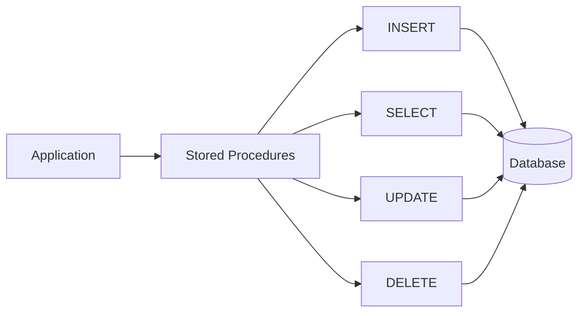
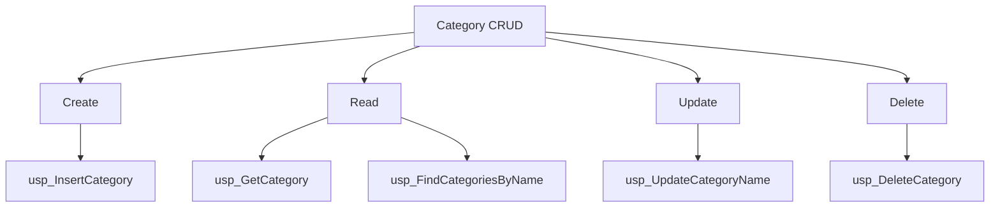
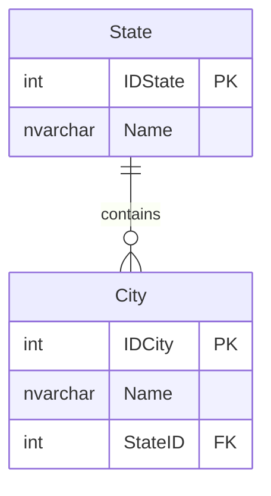
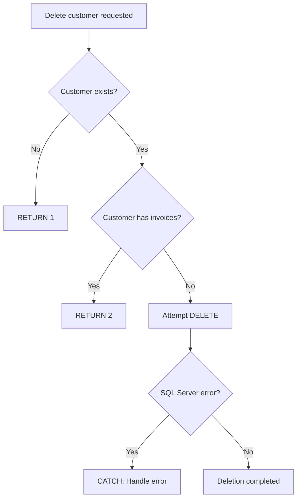
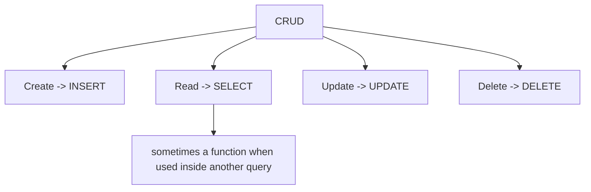

# Lab 7 – CRUD Operations

**Database:** `AdventureWorksENG`

This lab brings together concepts you have already learned in previous labs, including **stored procedures, functions, parameters, control flow, and error handling**.

You will apply these concepts to implement **Create, Read, Update, and Delete (CRUD)** operations against real database tables.

Rather than introducing new T-SQL syntax, the focus is on **combining existing knowledge to solve practical database problems**. You will implement CRUD operations, compare different ways of organizing stored procedures, and handle situations involving missing records, business rules, and referential integrity.

> [!IMPORTANT]
> **Midterm exam preparation**
>
> This lab also serves as a practical review of the topics covered so far. Many of the exercises combine concepts from several previous labs.
>
> Try to solve the exercises independently before looking at the solutions. This will help you identify which topics you may need to review before the midterm exam.

> [!WARNING]
> **This lab works on the real `AdventureWorksENG` data.**
>
> Read operations query the actual catalog — real categories, cities, customers, and products. Deletions that a business rule or a foreign key rejects are equally real, and safe: nothing is modified when an operation is refused.
>
> Two deletions in Section 8 **succeed and are permanent**: customer `16` (Lili Alameda, who has no invoices) and product `680` (HL Road Frame - Black, 58, which was never sold). After you run the lab, those rows are gone.
>
> This means the lab is not repeatable on the same database copy — a second run reports "does not exist" instead of "deleted". Restore `AdventureWorksENG` from a backup before another group runs the lab.

---

## Learning objectives

After completing this lab, you should be able to:

- organize Create, Read, Update, and Delete operations using stored procedures;
- choose between separate procedures and one procedure that supports several operations;
- implement a read operation as an inline table-valued function when that is appropriate;
- verify the result of an operation, including when zero rows are affected;
- distinguish a missing record, a rejected operation, and a SQL Server error;
- use a basic `TRY/CATCH` block to handle an error raised by a CRUD operation;
- explain how primary keys, foreign keys, and business rules constrain CRUD operations.

Start by selecting the training database:

```sql
USE AdventureWorksENG;
GO
```

> [!NOTE]
> **Prerequisites:** This lab builds directly on [Lab 3 – Stored Procedures](lab03-stored-procedures.md) (input parameters, `OUTPUT` parameters, `RETURN`, `CREATE OR ALTER`) and on the basic `TRY/CATCH` block from [Lab 0 – T-SQL Essentials](lab00-tsql-essentials.md). It also uses the inline table-valued function syntax from [Lab 4 – Functions](lab04-functions.md). None of these topics are re-explained in depth here — only applied.

---

# Section 1 – What CRUD Means

Most applications need to perform four basic operations on data: **Create, Read, Update, and Delete**. Together, these operations are known as **CRUD**.

For example, consider an application that manages customers. A user might need to:

- **Create** a new customer.
- **Read** customer information.
- **Update** an existing customer's details.
- **Delete** a customer who is no longer needed.

Each operation corresponds to a familiar SQL statement:

| CRUD | Operation | SQL statement |
|---|---|---|
| **C** | Create | `INSERT` |
| **R** | Read | `SELECT` |
| **U** | Update | `UPDATE` |
| **D** | Delete | `DELETE` |

You already know these SQL statements. In this lab, you will use stored procedures to organize them into a **reusable database interface**.

## CRUD with stored procedures

In Lab 3, you learned that stored procedures allow applications to execute predefined database operations.

The same approach can be used to implement CRUD.

For example, an application might call the following procedures:

| Procedure | Purpose |
|---|---|
| `usp_InsertCustomer` | Create a new customer |
| `usp_GetCustomer` | Retrieve customer information |
| `usp_UpdateCustomer` | Update customer details |
| `usp_DeleteCustomer` | Delete a customer |

The application calls a procedure, and the procedure executes the corresponding SQL statement.



This approach separates the application's operations from their SQL implementation.

It also provides a place to implement **business rules**. For example, a procedure might prevent deleting a customer who still has invoices.

> [!IMPORTANT]
> **CRUD describes four types of operations, not necessarily four stored procedures.**
>
> An application might use separate procedures for each operation or combine several operations into one procedure.
>
> Choosing how to organize CRUD operations is one of the main topics of this lab.

## Check your understanding

1. What does CRUD stand for?
2. Which SQL statement is typically used for each CRUD operation?
3. Does implementing CRUD require exactly four stored procedures?
4. Why might an application use a stored procedure instead of executing a `DELETE` statement directly?

<details>
<summary>Show answers</summary>

1. Create, Read, Update, Delete.
2. `INSERT`, `SELECT`, `UPDATE`, and `DELETE`.
3. No. CRUD describes four types of operations. They can be implemented using separate or combined procedures.
4. A stored procedure provides a reusable operation and can enforce business rules, such as preventing the deletion of a customer who still has invoices.

</details>

---

# Section 2 – CRUD with Separate Procedures

One way to implement CRUD is to create a **separate stored procedure for each operation**.

Each procedure has a specific responsibility: inserting, retrieving, updating, or deleting data.

In this section, we will implement CRUD operations for the `Category` table.

The table contains two columns:

| Column | Description |
|---|---|
| `IDCategory` | Primary key, automatically generated using `IDENTITY` |
| `Name` | Category name |

We will create five procedures:

| Procedure | Operation |
|---|---|
| `usp_InsertCategory` | Create |
| `usp_GetCategory` | Read one category |
| `usp_FindCategoriesByName` | Read multiple categories |
| `usp_UpdateCategoryName` | Update |
| `usp_DeleteCategory` | Delete |

Notice that we have **five procedures for four CRUD operations**. This is because reading one category and searching for multiple categories are different requirements.

## 2.1 Create – Insert a category

The first procedure inserts a new category and returns its generated ID through an `OUTPUT` parameter.

```sql
CREATE OR ALTER PROCEDURE dbo.usp_InsertCategory
    @Name          nvarchar(50),
    @NewCategoryID int OUTPUT
AS
BEGIN
    SET NOCOUNT ON;

    INSERT INTO Category (Name)
    VALUES (@Name);

    SET @NewCategoryID = SCOPE_IDENTITY();
END;
GO
```

Execute the procedure:

```sql
DECLARE @NewID int;

EXEC dbo.usp_InsertCategory
    @Name = N'ZZ_LabTestCategory',
    @NewCategoryID = @NewID OUTPUT;

SELECT @NewID AS NewCategoryID;
```

The procedure inserts a new row and returns its generated primary key.

Verify the result:

```sql
SELECT *
FROM Category
WHERE Name = N'ZZ_LabTestCategory';
```

> [!NOTE]
> The `OUTPUT` parameter and `SCOPE_IDENTITY()` were introduced in Lab 3. Here, we use them to return the ID of a newly created record.

## 2.2 Read – Retrieve one category

A common requirement is to retrieve a single record using its primary key.

```sql
CREATE OR ALTER PROCEDURE dbo.usp_GetCategory
    @IDCategory int
AS
BEGIN
    SET NOCOUNT ON;

    SELECT
        IDCategory,
        Name
    FROM Category
    WHERE IDCategory = @IDCategory;
END;
GO
```

Test the procedure against the real catalog. `AdventureWorksENG` contains four categories:

| IDCategory | Name |
|---:|---|
| 1 | Bicycles |
| 2 | Parts |
| 3 | Clothes |
| 4 | Accessories |

```sql
EXEC dbo.usp_GetCategory @IDCategory = 1;

EXEC dbo.usp_GetCategory @IDCategory = 999999;
```

The first call retrieves the real category `Bicycles`.

The second call returns an empty result set, because no category has that ID.

> [!IMPORTANT]
> A `SELECT` statement that finds no matching records does not raise an error.
>
> It simply returns **zero rows**.

## 2.3 Read – Search for multiple categories

Sometimes an application needs to search for records rather than retrieve one specific record.

For example, users might search for categories whose names start with a particular text.

```sql
CREATE OR ALTER PROCEDURE dbo.usp_FindCategoriesByName
    @NamePattern nvarchar(50)
AS
BEGIN
    SET NOCOUNT ON;

    SELECT
        IDCategory,
        Name
    FROM Category
    WHERE Name LIKE @NamePattern
    ORDER BY Name;
END;
GO
```

Execute the procedure against the real catalog:

```sql
-- Categories starting with 'B'
EXEC dbo.usp_FindCategoriesByName
    @NamePattern = N'B%';

-- Every category
EXEC dbo.usp_FindCategoriesByName
    @NamePattern = N'%';
```

The first call returns one row, `Bicycles`. The second returns all four categories, sorted by name:

| IDCategory | Name |
|---:|---|
| 4 | Accessories |
| 1 | Bicycles |
| 3 | Clothes |
| 2 | Parts |

Searching for a pattern that matches nothing, such as `N'Q%'`, returns zero rows rather than an error.

Compare the two Read procedures:

| Procedure | Result |
|---|---|
| `usp_GetCategory` | Zero or one record, identified by primary key |
| `usp_FindCategoriesByName` | Zero, one, or multiple records matching a search pattern |

Both procedures implement the **Read** operation, but they serve different purposes.

## 2.4 Update – Change a category name

The next procedure updates the name of an existing category.

It also returns the number of affected rows.

```sql
CREATE OR ALTER PROCEDURE dbo.usp_UpdateCategoryName
    @IDCategory int,
    @NewName    nvarchar(50)
AS
BEGIN
    SET NOCOUNT ON;

    UPDATE Category
    SET Name = @NewName
    WHERE IDCategory = @IDCategory;

    SELECT @@ROWCOUNT AS RowsUpdated;
END;
GO
```

First, retrieve the ID of the test category created in Section 2.1.

```sql
DECLARE @CategoryID int;

SELECT @CategoryID = IDCategory
FROM Category
WHERE Name = N'ZZ_LabTestCategory';

EXEC dbo.usp_UpdateCategoryName
    @IDCategory = @CategoryID,
    @NewName = N'ZZ_LabTestCategory_Renamed';
```

Expected result:

| RowsUpdated |
|---:|
| 1 |

Verify the change:

```sql
SELECT *
FROM Category
WHERE Name = N'ZZ_LabTestCategory_Renamed';
```

Now try updating a category that does not exist:

```sql
EXEC dbo.usp_UpdateCategoryName
    @IDCategory = 999999,
    @NewName = N'Unknown Category';
```

Expected result:

| RowsUpdated |
|---:|
| 0 |

> [!IMPORTANT]
> **Zero affected rows does not mean that the SQL statement failed.**
>
> The `UPDATE` executed successfully, but no record matched the specified ID.
>
> We use `@@ROWCOUNT`, introduced in Lab 0, to detect this situation.

## 2.5 Delete – Remove a category

The final procedure deletes a category using its primary key.

```sql
CREATE OR ALTER PROCEDURE dbo.usp_DeleteCategory
    @IDCategory int
AS
BEGIN
    SET NOCOUNT ON;

    DELETE FROM Category
    WHERE IDCategory = @IDCategory;

    SELECT @@ROWCOUNT AS RowsDeleted;
END;
GO
```

Delete the test category:

```sql
DECLARE @CategoryID int;

SELECT @CategoryID = IDCategory
FROM Category
WHERE Name = N'ZZ_LabTestCategory_Renamed';

EXEC dbo.usp_DeleteCategory
    @IDCategory = @CategoryID;
```

Expected result:

| RowsDeleted |
|---:|
| 1 |

Try deleting the same category again:

```sql
EXEC dbo.usp_DeleteCategory
    @IDCategory = @CategoryID;
```

Expected result:

| RowsDeleted |
|---:|
| 0 |

The second call affects zero rows because the category has already been deleted.

> [!WARNING]
> Not every category can be deleted successfully.
>
> The test category deleted cleanly because nothing referenced it. Every **real** category in `AdventureWorksENG` has subcategories — `Bicycles` has 3, `Parts` has 14, `Clothes` has 8, `Accessories` has 12 — so the foreign key constraint prevents deleting any of them.
>
> Section 6 runs exactly that deletion against the real `Bicycles` category and examines the error.

## 2.6 Summary – Complete CRUD interface

We have now implemented all four CRUD operations using five stored procedures.



Each procedure performs one clearly defined operation.

This makes the database interface straightforward to understand, test, and maintain.

However, separate procedures are not the only possible design. Later in this lab, we will explore how multiple CRUD operations can be combined into a single procedure.

## Check your understanding

1. Why did we create five procedures for four CRUD operations?
2. What is the purpose of the `OUTPUT` parameter in `usp_InsertCategory`?
3. What happens when `usp_GetCategory` receives an ID that does not exist?
4. What does `RowsUpdated = 0` mean?
5. Why might `usp_DeleteCategory` fail even when the category exists?

<details>
<summary>Show answers</summary>

1. Because we implemented two different Read operations: retrieving one category by ID and searching for multiple categories by name.
2. It returns the generated primary key of the newly inserted category.
3. The procedure returns an empty result set.
4. The `UPDATE` executed successfully but did not match any rows.
5. A foreign key constraint may prevent deletion if the category is referenced by existing subcategories.

</details>

---

# Section 3 – Practice: CRUD for `State` and `City`

In Section 2, we implemented CRUD operations for the `Category` table using separate stored procedures.

Now it is your turn.

In the following exercises, you will create stored procedures for the `State` and `City` tables.

These tables are connected through a foreign key:



The `City.StateID` column is nullable, meaning that a city can exist without being assigned to a state.

You will start with simple `INSERT` and `SELECT` operations, then implement a `DELETE` procedure that checks a business rule before removing data.

> [!NOTE]
> Use the patterns from Section 2 as a reference. The required T-SQL concepts, including `OUTPUT`, `SCOPE_IDENTITY()`, `IF`, and `RETURN`, were introduced in previous labs.

## Exercise 1 – Insert a state [BEGINNER]

Create a stored procedure named `dbo.usp_InsertState` that inserts a new state into the `State` table.

**Requirements:**

- Accept `@Name nvarchar(50)` as an input parameter.
- Accept `@NewStateID int OUTPUT` as an output parameter.
- Insert the new state.
- Return its generated ID through `@NewStateID`.

Test your procedure using:

```sql
DECLARE @NewID int;

EXEC dbo.usp_InsertState
    @Name = N'ZZ_LabTestState',
    @NewStateID = @NewID OUTPUT;

SELECT @NewID AS NewStateID;
```

Verify that the new state exists in the `State` table.

<details>
<summary>Hint</summary>

Use the same `INSERT`, `SCOPE_IDENTITY()`, and `OUTPUT` pattern as `usp_InsertCategory` in Section 2.

</details>

<details>
<summary>Solution</summary>

```sql
CREATE OR ALTER PROCEDURE dbo.usp_InsertState
    @Name       nvarchar(50),
    @NewStateID int OUTPUT
AS
BEGIN
    SET NOCOUNT ON;

    INSERT INTO State (Name)
    VALUES (@Name);

    SET @NewStateID = SCOPE_IDENTITY();
END;
GO
```

</details>

## Exercise 2 – Insert cities [BEGINNER]

Create a stored procedure named `dbo.usp_InsertCity` that inserts a new city into the `City` table.

**Requirements:**

- Accept `@Name nvarchar(50)` as an input parameter.
- Accept `@StateID int` as an input parameter.
- Accept `@NewCityID int OUTPUT` as an output parameter.
- Insert the city and associate it with the specified state.
- Return the generated city ID.

Use your procedure to insert two cities into the state created in Exercise 1:

- `ZZ_LabTestCity1`
- `ZZ_LabTestCity2`

<details>
<summary>Hint</summary>

The caller already knows the state's ID, so the procedure does not need to search for the state by name.

Insert the supplied `@StateID` directly into `City.StateID`.

</details>

<details>
<summary>Solution</summary>

```sql
CREATE OR ALTER PROCEDURE dbo.usp_InsertCity
    @Name      nvarchar(50),
    @StateID   int,
    @NewCityID int OUTPUT
AS
BEGIN
    SET NOCOUNT ON;

    INSERT INTO City (Name, StateID)
    VALUES (@Name, @StateID);

    SET @NewCityID = SCOPE_IDENTITY();
END;
GO
```

Test the procedure:

```sql
DECLARE @StateID int;

SELECT @StateID = IDState
FROM State
WHERE Name = N'ZZ_LabTestState';

DECLARE @City1 int, @City2 int;

EXEC dbo.usp_InsertCity
    N'ZZ_LabTestCity1', @StateID, @City1 OUTPUT;

EXEC dbo.usp_InsertCity
    N'ZZ_LabTestCity2', @StateID, @City2 OUTPUT;

SELECT
    @City1 AS City1ID,
    @City2 AS City2ID;
```

Verify the inserted cities:

```sql
SELECT *
FROM City
WHERE StateID = @StateID;
```

Run the verification query in the same batch as the preceding declarations.

</details>

## Exercise 3 – Read cities by state [INTERMEDIATE]

Create a stored procedure named `dbo.usp_GetCitiesByState`.

**Requirements:**

- Accept `@IDState int` as an input parameter.
- Return `IDCity` and `Name` for all cities belonging to the specified state.
- Sort the results alphabetically by city name.

Test the procedure twice: once against the real state `Croatia` (`IDState = 1`), and once against the state you created in Exercise 1.

**Expected result for Croatia:** five real cities — `Osijek`, `Pula`, `Rijeka`, `Split`, `Zagreb`.

**Expected result for the test state:** two rows containing `ZZ_LabTestCity1` and `ZZ_LabTestCity2`, assuming the test data was inserted once.

<details>
<summary>Hint</summary>

Use `SELECT` with a `WHERE` condition on `City.StateID`.

A `JOIN` is not required because the procedure already receives the state's ID.

</details>

<details>
<summary>Solution</summary>

```sql
CREATE OR ALTER PROCEDURE dbo.usp_GetCitiesByState
    @IDState int
AS
BEGIN
    SET NOCOUNT ON;

    SELECT
        IDCity,
        Name
    FROM City
    WHERE StateID = @IDState
    ORDER BY Name;
END;
GO
```

Test the procedure against the real state `Croatia`:

```sql
EXEC dbo.usp_GetCitiesByState
    @IDState = 1;
```

Expected result:

| IDCity | Name |
|---:|---|
| 2 | Osijek |
| 3 | Pula |
| 4 | Rijeka |
| 5 | Split |
| 1 | Zagreb |

Then test it against the state created in Exercise 1:

```sql
DECLARE @StateID int;

SELECT @StateID = IDState
FROM State
WHERE Name = N'ZZ_LabTestState';

EXEC dbo.usp_GetCitiesByState
    @IDState = @StateID;
```

Expected result:

| IDCity | Name |
|---|---|
| Generated ID | ZZ_LabTestCity1 |
| Generated ID | ZZ_LabTestCity2 |

</details>

## Exercise 4 – Delete a city with a business rule [ADVANCED]

A city may have customers associated with it through `Customer.CityID`.

Suppose our application has the following business rule:

**A city cannot be deleted if it has at least one customer.**

Create a stored procedure named `dbo.usp_DeleteCity` that implements this rule.

**Requirements:**

- Accept `@IDCity int` as an input parameter.
- Check whether the city exists.
- Check whether any customers belong to the city.
- Delete the city only when it exists and has no customers.
- Use `RETURN` to report the result.

Use the following return codes:

| Return code | Meaning |
|---:|---|
| `0` | City deleted successfully |
| `1` | City does not exist |
| `2` | City has customers; deletion rejected |

### Test your procedure

Test all three situations.

**Test 1 – Delete an existing city without customers**

Delete `ZZ_LabTestCity1`.

Expected return code: `0`.

**Test 2 – Delete the same city again**

Try deleting `ZZ_LabTestCity1` using the same ID.

Expected return code: `1`.

**Test 3 – Attempt to delete a city with customers**

No test data is needed here: every real city in `AdventureWorksENG` already has customers. `Zagreb` (`IDCity = 1`) has 1492 of them.

Try deleting `Zagreb`.

Expected return code: `2`.

Verify that `Zagreb` and its customers still exist — a rejected deletion changes nothing.

<details>
<summary>Hint</summary>

Use `IF NOT EXISTS` to check whether the city exists.

Then use `IF EXISTS` to check for related customers:

```sql
IF EXISTS (
    SELECT 1
    FROM Customer
    WHERE CityID = @IDCity
)
    RETURN 2;
```

Only execute the `DELETE` when both checks allow it.

</details>

<details>
<summary>Solution</summary>

```sql
CREATE OR ALTER PROCEDURE dbo.usp_DeleteCity
    @IDCity int
AS
BEGIN
    SET NOCOUNT ON;

    IF NOT EXISTS (
        SELECT 1
        FROM City
        WHERE IDCity = @IDCity
    )
        RETURN 1;

    IF EXISTS (
        SELECT 1
        FROM Customer
        WHERE CityID = @IDCity
    )
        RETURN 2;

    DELETE FROM City
    WHERE IDCity = @IDCity;

    RETURN 0;
END;
GO
```

Test the procedure:

```sql
DECLARE @City1 int, @Result int;

SELECT @City1 = IDCity
FROM City
WHERE Name = N'ZZ_LabTestCity1';

-- Test 1: Existing test city without customers
EXEC @Result = dbo.usp_DeleteCity @IDCity = @City1;
SELECT @Result AS DeleteTestCity_FirstTry;

-- Test 2: Same city again
EXEC @Result = dbo.usp_DeleteCity @IDCity = @City1;
SELECT @Result AS DeleteTestCity_SecondTry;

-- Test 3: Real city that has customers (Zagreb)
EXEC @Result = dbo.usp_DeleteCity @IDCity = 1;
SELECT @Result AS DeleteZagreb;

-- Verify that Zagreb is untouched
SELECT IDCity, Name, StateID
FROM City
WHERE IDCity = 1;

SELECT COUNT(*) AS ZagrebCustomers
FROM Customer
WHERE CityID = 1;
```

Expected results:

| Test | Return code |
|---|---:|
| Delete test city | 0 |
| Delete test city again | 1 |
| Delete Zagreb (1492 customers) | 2 |

`Zagreb` still exists and still has 1492 customers. The business rule stopped the operation before any `DELETE` ran.

> [!NOTE]
> The procedure checks the business rule before executing `DELETE`.
>
> However, a check followed by a `DELETE` is not automatically atomic. In a concurrent environment, another session could modify related data between these statements.
>
> Later sections discuss database constraints and error handling as additional protection.

</details>

## Check your understanding

1. Why does `usp_InsertCity` need a `@StateID` parameter?
2. What happens when `usp_GetCitiesByState` finds no matching cities?
3. Why does `usp_DeleteCity` check whether the city exists before deleting it?
4. What is the difference between return codes `1` and `2`?
5. Why should business rules be checked before modifying data?

<details>
<summary>Show answers</summary>

1. To associate the new city with an existing state.
2. The procedure returns an empty result set.
3. To distinguish a nonexistent city from a successful deletion.
4. Code `1` means the city does not exist; code `2` means the city exists but cannot be deleted because it has customers.
5. To prevent operations that violate application requirements and to return a meaningful result to the caller.

</details>

---

# Section 4 – Functions and Data Access

So far, we have implemented CRUD operations using stored procedures.

However, the **Read** operation can also be implemented using a function.

In Lab 4, you learned how inline table-valued functions (TVFs) return tables that can be used directly in SQL queries.

In this section, we will implement the same Read operation using both a stored procedure and an inline TVF, then compare how they can be used.

## 4.1 The data we will read

No test data is needed for this section. `AdventureWorksENG` already contains 13 cities with customers in each one, so we can read real records:

| City | Customers |
|---|---:|
| Zagreb | 1492 |
| Osijek | 1552 |
| Rijeka | 1601 |

We will use `Zagreb` throughout this section.

## 4.2 Read using a stored procedure

Create a procedure that retrieves customers by city name.

```sql
CREATE OR ALTER PROCEDURE dbo.usp_GetCustomersByCity
    @CityName nvarchar(50)
AS
BEGIN
    SET NOCOUNT ON;

    SELECT
        c.IDCustomer,
        c.FirstName,
        c.LastName,
        ci.Name AS City
    FROM Customer AS c
    JOIN City AS ci
        ON ci.IDCity = c.CityID
    WHERE ci.Name = @CityName
    ORDER BY c.LastName, c.FirstName;
END;
GO
```

Execute the procedure:

```sql
EXEC dbo.usp_GetCustomersByCity
    @CityName = N'Zagreb';
```

The procedure returns all 1492 customers who live in `Zagreb`, sorted by last name.

## 4.3 Read using an inline table-valued function

Now implement the same operation using an inline TVF.

```sql
CREATE OR ALTER FUNCTION dbo.fn_CustomersByCity
(
    @CityName nvarchar(50)
)
RETURNS TABLE
AS
RETURN
(
    SELECT
        c.IDCustomer,
        c.FirstName,
        c.LastName,
        ci.Name AS City
    FROM Customer AS c
    JOIN City AS ci
        ON ci.IDCity = c.CityID
    WHERE ci.Name = @CityName
);
GO
```

Execute the function:

```sql
SELECT *
FROM dbo.fn_CustomersByCity(N'Zagreb');
```

Both implementations return the same customer information.

The difference is **how their results can be used**.

## 4.4 Using a function in a larger query

Suppose we want to retrieve customers from a particular city together with their invoices.

Because an inline TVF can be used as a table source, we can join its result directly with the `Invoice` table.

To keep the output readable, we also filter by last name — something the function's own parameter does not support, but the surrounding query can add freely:

```sql
SELECT
    f.FirstName,
    f.LastName,
    i.IDInvoice,
    CONVERT(date, i.InvoiceDate) AS InvoiceDate
FROM dbo.fn_CustomersByCity(N'Zagreb') AS f
LEFT JOIN Invoice AS i
    ON i.CustomerID = f.IDCustomer
WHERE f.LastName = N'Beck'
ORDER BY f.FirstName, i.InvoiceDate;
```

Expected result:

| FirstName | LastName | IDInvoice | InvoiceDate |
|---|---|---:|---|
| Bradley | Beck | NULL | NULL |
| Calvin | Beck | 45004 | 2001-12-27 |
| Christy | Beck | 49558 | 2003-03-02 |
| Christy | Beck | 66272 | 2004-03-16 |

Three real customers from Zagreb share the last name `Beck`. Christy appears twice because she has two invoices.

Bradley appears with `NULL` invoice columns: the `LEFT JOIN` keeps him in the result even though he has no invoices at all.

We cannot use a stored procedure in the same way:

```sql
-- Invalid SQL: a stored procedure cannot be used in FROM

SELECT *
FROM dbo.usp_GetCustomersByCity(N'Zagreb');
```

A stored procedure is executed using `EXEC`, while an inline TVF can participate directly in a `SELECT`, `JOIN`, or subquery.

> [!IMPORTANT]
> **Stored procedures and inline TVFs can both retrieve data, but they are not interchangeable.**
>
> A procedure is executed as an operation, while an inline TVF provides a table result that can be combined with other SQL queries.

## 4.5 When should you use each approach?

| Stored procedure | Inline TVF |
|---|---|
| Executed using `EXEC` | Used in `FROM` |
| Can return result sets | Returns a table |
| Supports `OUTPUT` parameters and integer `RETURN` codes | Does not support `OUTPUT` parameters |
| Can execute `INSERT`, `UPDATE`, and `DELETE` | Cannot modify database tables |
| Useful for database operations and application interfaces | Useful for reusable, parameterized queries |

For CRUD operations:

- **Create, Update, Delete:** stored procedures can implement these operations.
- **Read:** both stored procedures and inline TVFs are possible choices.

> [!TIP]
> If the result needs to be joined with other tables or used inside a larger SQL query, an inline TVF is often a convenient choice.
>
> If the application needs to execute a defined database operation, a stored procedure may be more appropriate.

## Check your understanding

1. Can both a stored procedure and an inline TVF retrieve customer information?
2. Why can an inline TVF be used in a `JOIN`?
3. Can a stored procedure be used directly in the `FROM` clause of a `SELECT` statement?
4. Can an inline TVF update or delete rows in a database table?
5. When might an inline TVF be more convenient than a stored procedure?

<details>
<summary>Show answers</summary>

1. Yes. Both can retrieve data from database tables.
2. Because an inline TVF returns a table that SQL Server can use as a table source.
3. No. Stored procedures are executed using `EXEC` and cannot be used directly as table sources.
4. No. T-SQL user-defined functions cannot modify database tables.
5. When the returned data needs to participate in a larger query, such as a `JOIN` or subquery.

</details>

---

# Section 5 – One Procedure for Multiple Operations

In Section 2, we implemented CRUD using separate stored procedures. Each procedure performed one specific operation.

However, this is not the only possible design.

Sometimes, **multiple CRUD operations can be combined into a single stored procedure**.

For example, an application might use:

- One procedure for inserting and updating records.
- One procedure for reading and deleting records.
- One procedure supporting all four CRUD operations.

The choice depends on the application's requirements and how we want to organize the database interface.

## 5.1 Common approaches

Consider three possible designs for managing categories.

| Approach | Example | Description |
| --- | --- | --- |
| Separate procedures | `usp_InsertCategory`, `usp_UpdateCategoryName` | Each operation has its own procedure |
| Combined Create + Update | `usp_SaveCategory` | One procedure inserts or updates a record |
| Action-based procedure | `usp_ManageCategory` | An `@Action` parameter selects the operation |

A combined procedure usually needs a way to determine which operation to execute.

Two common techniques are:

- **Check whether an ID was provided:** insert a new record when the ID is `NULL`, otherwise update the existing record.
- **Use an action parameter:** select the operation explicitly using values such as `INSERT`, `UPDATE`, `GET`, or `DELETE`.

Let's examine both approaches.

## 5.2 Combining Create and Update – Save pattern

A common requirement in applications is to use the same form for creating a new record and editing an existing one.

For example, consider a form for managing states.

When the user creates a new state, the application does not yet have its ID.

When the user edits an existing state, the application already knows its ID.

We can support both operations using one procedure.

### Example – `usp_SaveState`

```sql
CREATE OR ALTER PROCEDURE dbo.usp_SaveState
    @IDState int OUTPUT,
    @Name    nvarchar(50)
AS
BEGIN
    SET NOCOUNT ON;

    IF @IDState IS NULL
    BEGIN
        INSERT INTO State (Name)
        VALUES (@Name);

        SET @IDState = SCOPE_IDENTITY();
    END
    ELSE
    BEGIN
        UPDATE State
        SET Name = @Name
        WHERE IDState = @IDState;
    END
END;
GO
```

The procedure uses the value of `@IDState` to determine which operation to perform.

| `@IDState` | Operation |
| --- | --- |
| `NULL` | Insert a new state |
| Existing ID | Update the state with that ID |
| Nonexistent ID | Update affects zero rows |

### Test 1 – Insert a new state

```sql
DECLARE @IDState int = NULL;

EXEC dbo.usp_SaveState
    @IDState = @IDState OUTPUT,
    @Name = N'ZZ_LabTestState_Saved';

SELECT @IDState AS NewStateID;
```

Because `@IDState` is `NULL`, the procedure inserts a new state and returns its generated ID.

### Test 2 – Update the same state

Execute the following together with Test 1 in the same batch, or declare `@IDState` again and assign the ID returned by Test 1:

```sql
EXEC dbo.usp_SaveState
    @IDState = @IDState OUTPUT,
    @Name = N'ZZ_LabTestState_SavedRenamed';

SELECT *
FROM State
WHERE IDState = @IDState;
```

The second call updates the existing state instead of inserting another one.

> [!IMPORTANT]
> The same `OUTPUT` parameter can be used to pass an ID into a procedure and return an ID to the caller.
>
> In this example, `NULL` means Create, while a supplied ID means Update.

This pattern is often called a **Save procedure**.

Notice that it does not automatically insert a new row when the supplied ID does not exist. In that case, the `UPDATE` simply affects zero rows.

## 5.3 Using an action parameter

Another approach is to let the caller explicitly specify which operation should be performed.

For example:

```sql
EXEC dbo.usp_ManageSubcategory
    @Action = N'GET',
    @IDSubcategory = 10;
```

Or:

```sql
EXEC dbo.usp_ManageSubcategory
    @Action = N'DELETE',
    @IDSubcategory = 10;
```

The `@Action` parameter determines which branch of the procedure runs.

### Prepare test data

To test the `DELETE` action we need two subcategories: one that has products and one that is empty.

A subcategory **with** products already exists in the real catalog — `Chains` (`IDSubcategory = 7`), which contains the product `Chain`. We will use it directly.

An **empty** subcategory does not exist: all 37 real subcategories contain at least one product. So we create one, attached to the real `Parts` category (`IDCategory = 2`):

```sql
INSERT INTO Subcategory (CategoryID, Name)
VALUES (2, N'ZZ_LabTestSubcategory_Unused');

SELECT SCOPE_IDENTITY() AS SubWithoutProduct;
```

### Example – `usp_ManageSubcategory`

The procedure supports two operations:

- `GET` – retrieve a subcategory.
- `DELETE` – delete a subcategory if it has no products.

```sql
CREATE OR ALTER PROCEDURE dbo.usp_ManageSubcategory
    @Action        nvarchar(10),
    @IDSubcategory int
AS
BEGIN
    SET NOCOUNT ON;

    IF @Action = N'GET'
    BEGIN
        SELECT
            IDSubcategory,
            CategoryID,
            Name
        FROM Subcategory
        WHERE IDSubcategory = @IDSubcategory;

        RETURN 0;
    END

    IF @Action = N'DELETE'
    BEGIN
        IF NOT EXISTS (
            SELECT 1
            FROM Subcategory
            WHERE IDSubcategory = @IDSubcategory
        )
            RETURN 1;

        IF EXISTS (
            SELECT 1
            FROM Product
            WHERE SubcategoryID = @IDSubcategory
        )
            RETURN 2;

        DELETE FROM Subcategory
        WHERE IDSubcategory = @IDSubcategory;

        RETURN 0;
    END

    RETURN 99;
END;
GO
```

The procedure uses these return codes:

| Return code | Meaning |
| ---: | --- |
| `0` | Operation completed |
| `1` | Subcategory does not exist (DELETE) |
| `2` | Subcategory has products; deletion rejected |
| `99` | Unknown action |

For `GET`, return code `0` indicates that the query executed, even if it returned no rows.

### Test the procedure

```sql
DECLARE @SubWithoutProduct int, @Result int;

SELECT @SubWithoutProduct = IDSubcategory
FROM Subcategory
WHERE Name = N'ZZ_LabTestSubcategory_Unused';

-- Read the real subcategory 'Chains'
EXEC @Result = dbo.usp_ManageSubcategory
    @Action = N'GET',
    @IDSubcategory = 7;

-- Delete a nonexistent subcategory
EXEC @Result = dbo.usp_ManageSubcategory
    @Action = N'DELETE',
    @IDSubcategory = 999999;

SELECT @Result AS DeleteMissing; -- 1

-- Try deleting 'Chains', which contains the product 'Chain'
EXEC @Result = dbo.usp_ManageSubcategory
    @Action = N'DELETE',
    @IDSubcategory = 7;

SELECT @Result AS DeleteChains; -- 2

-- Delete the empty subcategory
EXEC @Result = dbo.usp_ManageSubcategory
    @Action = N'DELETE',
    @IDSubcategory = @SubWithoutProduct;

SELECT @Result AS DeleteUnused; -- 0

-- 'Chains' and its product are untouched
SELECT IDSubcategory, CategoryID, Name FROM Subcategory WHERE IDSubcategory = 7;
SELECT IDProduct, Name FROM Product WHERE SubcategoryID = 7;
```

The `GET` action returns the real subcategory:

| IDSubcategory | CategoryID | Name |
|---:|---:|---|
| 7 | 2 | Chains |

The same procedure supports different operations, but the caller must supply the correct `@Action`.

## 5.4 Comparing the approaches

Both separate and combined procedures can implement CRUD operations.

However, they have different characteristics.

| Aspect | Separate procedures | Combined procedure |
| --- | --- | --- |
| Purpose | One clearly defined operation | Several related operations |
| Parameters | Specific to each operation | May need parameters used only by certain operations |
| Readability | Usually simpler | More branching logic |
| Maintenance | Operations can be modified independently | Several operations share one implementation |
| Calling | Different procedure names | One procedure with an action or ID-based decision |

> [!IMPORTANT]
> There is no requirement to combine CRUD operations into one procedure.
>
> **Separate procedures are often easier to understand and maintain**, especially when operations have different parameters or business rules.
>
> Combined procedures can be useful when operations are closely related, such as Create and Update in a Save procedure.

## 5.5 Exercise – Create, Update, and Delete combined \[ADVANCED\]

Create a stored procedure named `dbo.usp_ManageCategory` that combines three operations:

- `INSERT`
- `UPDATE`
- `DELETE`

The Read operations will remain in the separate procedures created in Section 2.

### Requirements

Create the procedure with these parameters:

```sql
@Action     nvarchar(10),
@IDCategory int OUTPUT,
@Name       nvarchar(50) = NULL
```

Implement the following behavior:

| Action | Behavior | Return code |
| --- | --- | --- |
| `INSERT` | Insert a category and return its ID | `0` |
| `UPDATE` | Update an existing category | `0` success, `1` not found |
| `DELETE` | Delete a category without subcategories | `0` deleted, `1` not found, `2` has subcategories |
| Other | Unknown action | `99` |

### Test your procedure

1. Insert a new category named `ZZ_LabTestCategory_Combined`.
2. Capture its generated ID.
3. Update its name to `ZZ_LabTestCategory_CombinedRenamed`.
4. Delete the category.
5. Try deleting the same category again.

Expected return codes: `0`, `0`, `0`, `1`.

<details>
<summary>Hint</summary>

Use `IF @Action = ...` to select the operation.

For `INSERT`, use `SCOPE_IDENTITY()` to return the generated ID.

For `UPDATE`, use `@@ROWCOUNT` to detect whether a row was updated.

For `DELETE`, check whether the category exists and whether it has any subcategories before deleting it.

</details>

<details>
<summary>Solution</summary>

```sql
CREATE OR ALTER PROCEDURE dbo.usp_ManageCategory
    @Action     nvarchar(10),
    @IDCategory int OUTPUT,
    @Name       nvarchar(50) = NULL
AS
BEGIN
    SET NOCOUNT ON;

    IF @Action = N'INSERT'
    BEGIN
        INSERT INTO Category (Name)
        VALUES (@Name);

        SET @IDCategory = SCOPE_IDENTITY();
        RETURN 0;
    END

    IF @Action = N'UPDATE'
    BEGIN
        UPDATE Category
        SET Name = @Name
        WHERE IDCategory = @IDCategory;

        IF @@ROWCOUNT = 0
            RETURN 1;

        RETURN 0;
    END

    IF @Action = N'DELETE'
    BEGIN
        IF NOT EXISTS (
            SELECT 1
            FROM Category
            WHERE IDCategory = @IDCategory
        )
            RETURN 1;

        IF EXISTS (
            SELECT 1
            FROM Subcategory
            WHERE CategoryID = @IDCategory
        )
            RETURN 2;

        DELETE FROM Category
        WHERE IDCategory = @IDCategory;

        RETURN 0;
    END

    RETURN 99;
END;
GO
```

Test the procedure:

```sql
DECLARE @IDCategory int = NULL;
DECLARE @Result int;

-- INSERT
EXEC @Result = dbo.usp_ManageCategory
    @Action = N'INSERT',
    @IDCategory = @IDCategory OUTPUT,
    @Name = N'ZZ_LabTestCategory_Combined';

SELECT @IDCategory AS CategoryID, @Result AS InsertResult;

-- UPDATE
EXEC @Result = dbo.usp_ManageCategory
    @Action = N'UPDATE',
    @IDCategory = @IDCategory OUTPUT,
    @Name = N'ZZ_LabTestCategory_CombinedRenamed';

SELECT @Result AS UpdateResult;

-- DELETE
EXEC @Result = dbo.usp_ManageCategory
    @Action = N'DELETE',
    @IDCategory = @IDCategory OUTPUT;

SELECT @Result AS DeleteResult;

-- DELETE again
EXEC @Result = dbo.usp_ManageCategory
    @Action = N'DELETE',
    @IDCategory = @IDCategory OUTPUT;

SELECT @Result AS DeleteAgainResult;
```

</details>

## Check your understanding

1. What determines whether `usp_SaveState` inserts or updates a record?
2. What is the purpose of the `@Action` parameter?
3. Why does `usp_ManageSubcategory` return `2` when a subcategory has products?
4. What is one advantage of separate CRUD procedures?
5. When might a combined procedure be useful?

<details>
<summary>Show answers</summary>

1. The value of `@IDState`. `NULL` means Insert; a supplied ID means Update.
2. It explicitly selects which operation the procedure should execute.
3. Because the procedure enforces a business rule that prevents deleting subcategories that still have products.
4. Each procedure has one clearly defined responsibility, making the interface easier to understand and maintain.
5. When operations are closely related, such as inserting and updating records through the same application form.

</details>

---

# Section 6 – Error Handling in CRUD Operations

In previous sections, we implemented CRUD procedures that check whether records exist and whether business rules allow an operation.

However, even a correctly written SQL statement can fail because of database constraints.

In Lab 0, you learned how to use `TRY/CATCH` to handle SQL Server errors. Now we will apply that knowledge to a real CRUD operation.

## 6.1 The problem – Deleting a referenced record

Consider the relationship between `Category` and `Subcategory`.

Each subcategory belongs to a category through the foreign key `Subcategory.CategoryID`.

No setup is required: the real category `Bicycles` (`IDCategory = 1`) already has three subcategories — `Mountain Bikes`, `Road Bikes`, and `Touring Bikes`.

Try deleting it using `usp_DeleteCategory` from Section 2.

```sql
EXEC dbo.usp_DeleteCategory
    @IDCategory = 1;
```

SQL Server rejects the `DELETE` because the category is still referenced by its subcategories.

The error is:

```text
Msg 547, Level 16
The DELETE statement conflicted with the REFERENCE constraint.
```

`Bicycles` and its three subcategories remain in the database.

> [!IMPORTANT]
> **A foreign key constraint protects referential integrity.**
>
> SQL Server does not allow a referenced category to be deleted while related subcategories still exist, assuming the foreign key uses the default `NO ACTION` behavior.

## 6.2 Handling the error with TRY/CATCH

We can modify `usp_DeleteCategory` to catch SQL Server errors.

```sql
CREATE OR ALTER PROCEDURE dbo.usp_DeleteCategory
    @IDCategory int
AS
BEGIN
    SET NOCOUNT ON;

    BEGIN TRY
        DELETE FROM Category
        WHERE IDCategory = @IDCategory;

        SELECT @@ROWCOUNT AS RowsDeleted;
    END TRY
    BEGIN CATCH
        SELECT
            ERROR_NUMBER()  AS ErrorNumber,
            ERROR_MESSAGE() AS ErrorMessage;
    END CATCH
END;
GO
```

Execute the same deletion again:

```sql
EXEC dbo.usp_DeleteCategory
    @IDCategory = 1;
```

Instead of propagating the original SQL Server error to the caller, the procedure catches it and returns information about the failure.

Expected result:

| ErrorNumber | ErrorMessage |
|---:|---|
| 547 | The DELETE statement conflicted with the REFERENCE constraint... |

Notice that `Bicycles` is **still not deleted**.

`TRY/CATCH` changes how the error is handled, not whether the database constraint is enforced.

## 6.3 Where should TRY/CATCH be placed?

So far, we placed `TRY/CATCH` inside the stored procedure.

However, error handling can also be implemented by the caller.

For this demonstration, first restore the original version of `usp_DeleteCategory` from Section 2. That version does not catch the error internally.

```sql
CREATE OR ALTER PROCEDURE dbo.usp_DeleteCategory
    @IDCategory int
AS
BEGIN
    SET NOCOUNT ON;

    DELETE FROM Category
    WHERE IDCategory = @IDCategory;

    SELECT @@ROWCOUNT AS RowsDeleted;
END;
GO
```

Now the caller can handle the error:

```sql
BEGIN TRY
    EXEC dbo.usp_DeleteCategory
        @IDCategory = 1;
END TRY
BEGIN CATCH
    SELECT
        ERROR_NUMBER()    AS ErrorNumber,
        ERROR_MESSAGE()   AS ErrorMessage,
        ERROR_PROCEDURE() AS FailedIn;
END CATCH;
```

The `ERROR_PROCEDURE()` function identifies the stored procedure in which the error occurred.

In this example, it returns `usp_DeleteCategory`. If the procedure still contained the internal `CATCH` from Section 6.2, the caller's `CATCH` would not run because the procedure would already have handled the error.

Both approaches are valid, but they have different characteristics.

| Aspect | TRY/CATCH inside procedure | TRY/CATCH at caller |
|---|---|---|
| Error handling | Centralized in the procedure | Handled by the caller |
| Consistency | All callers receive the same handling | Different callers may handle errors differently |
| Control | Procedure decides what to report | Caller decides how to react |
| Maintenance | Error handling maintained with the procedure | Error handling maintained by each caller |

> [!NOTE]
> A procedure can also catch an error and propagate it to the caller using `THROW`.
>
> We will explore `THROW` and more advanced error-handling techniques in Lab 9.

## 6.4 Different outcomes of a CRUD operation

Not every unsuccessful operation produces a SQL Server error.

Consider these situations from previous sections:

| Situation | Example | How to detect it |
|---|---|---|
| Record not found | `SELECT` for a nonexistent category | Empty result set |
| No rows updated | `UPDATE` with a nonexistent ID | `@@ROWCOUNT = 0` |
| Business rule rejected | Deleting a subcategory that has products | Explicit `RETURN` code |
| SQL Server error | Deleting a referenced category | `TRY/CATCH` |

These situations should not be treated as equivalent.

For example, an `UPDATE` that affects zero rows is not a SQL Server error.

```sql
UPDATE Category
SET Name = N'Unknown'
WHERE IDCategory = 999999;

SELECT @@ROWCOUNT AS RowsUpdated;
```

Expected result:

| RowsUpdated |
|---:|
| 0 |

The statement completed successfully, but no matching record was found.

By contrast, attempting to delete a referenced category raises a constraint violation.

> [!IMPORTANT]
> Use `@@ROWCOUNT` to determine how many rows a statement affected.
>
> Use explicit checks and `RETURN` codes to report business-rule outcomes.
>
> Use `TRY/CATCH` to handle SQL Server errors.
>
> These mechanisms serve different purposes and can be combined when necessary.

## Check your understanding

1. Why does SQL Server reject the deletion of a category that has subcategories?
2. What is SQL Server error 547?
3. Does adding `TRY/CATCH` allow the category to be deleted?
4. Can `TRY/CATCH` be placed outside a stored procedure?
5. What is the difference between `@@ROWCOUNT = 0` and a SQL Server error?
6. What does `ERROR_PROCEDURE()` return?

<details>
<summary>Show answers</summary>

1. Because existing subcategories reference the category through a foreign key.
2. Error 547 indicates a constraint conflict, such as a foreign key violation.
3. No. The foreign key constraint still prevents deletion.
4. Yes. The caller can wrap the procedure call in `TRY/CATCH`, provided the procedure propagates the error.
5. `@@ROWCOUNT = 0` means no rows were affected. A SQL Server error means the statement encountered a condition that prevented successful execution.
6. It returns the name of the procedure or trigger where the error occurred, or `NULL` when no such object is associated with the error.

</details>

---

# Section 7 – Data Integrity and Business Rules

In Section 6, we saw that SQL Server can reject a CRUD operation when it violates a database constraint.

However, database constraints are not the only rules that control how data can be modified.

Applications often have additional **business rules** that determine whether an operation is allowed.

In this section, we will compare these two types of protection and see how they work together.

## 7.1 Database constraints

Database constraints protect the integrity of stored data.

For example, a foreign key ensures that a non-NULL value in a referencing column points to an existing row in the referenced table.

Consider some relationships in `AdventureWorksENG`:

| Child table.column | Parent table.column | Foreign key required? |
|---|---|---|
| `City.StateID` | `State.IDState` | No |
| `Customer.CityID` | `City.IDCity` | No |
| `Invoice.CustomerID` | `Customer.IDCustomer` | Yes |
| `InvoiceItem.InvoiceID` | `Invoice.IDInvoice` | Yes |
| `InvoiceItem.ProductID` | `Product.IDProduct` | Yes |
| `Product.SubcategoryID` | `Subcategory.IDSubcategory` | No |
| `Subcategory.CategoryID` | `Category.IDCategory` | Yes |

A required foreign key column cannot contain `NULL`.

An optional foreign key column can contain `NULL`, allowing a child record to exist without referencing a parent.

### Does an optional foreign key allow deleting the parent?

Consider `Product.SubcategoryID`.

This column is nullable, so a product can exist without belonging to a subcategory.

However, if a product currently references a subcategory, SQL Server normally prevents that subcategory from being deleted.

A real example from `AdventureWorksENG`:

```text
Subcategory
------------
IDSubcategory = 7
Name = 'Chains'

Product
------------
IDProduct = 952
Name = 'Chain'
SubcategoryID = 7
```

Even though `Product.SubcategoryID` is nullable — and 209 real products do leave it `NULL` — deleting subcategory `7` would leave the product `Chain` pointing at a row that no longer exists.

With the default `NO ACTION` foreign key behavior, SQL Server rejects the deletion.

> [!IMPORTANT]
> **Nullable foreign key does not mean unrestricted deletion.**
>
> A nullable foreign key allows a child record to exist without a parent. It does not automatically allow deletion of a parent that is currently referenced.

Other foreign key configurations, such as `ON DELETE SET NULL` or `ON DELETE CASCADE`, can produce different behavior. These depend on how the relationship was defined.

## 7.2 Business rules

Database constraints enforce structural rules, such as primary key uniqueness and referential integrity.

Business rules describe what an application allows users to do.

For example:

- A customer cannot be deleted if they have invoices.
- A product cannot be deleted if it has been sold.
- A subcategory cannot be deleted if it contains products.

These rules can be implemented explicitly in stored procedures.

Consider the following check:

```sql
IF EXISTS (
    SELECT 1
    FROM Invoice
    WHERE CustomerID = @IDCustomer
)
    RETURN 2;
```

The procedure checks whether the customer has invoices before attempting to delete the customer.

If invoices exist, it returns a specific status code without executing `DELETE`.

This gives the caller a meaningful result that can be translated into an application message, such as:

```text
Customer cannot be deleted because invoices exist.
```

### When a business rule matches a database constraint

In our example, `Invoice.CustomerID` is a required foreign key.

With the default `NO ACTION` behavior, SQL Server would reject the deletion of a referenced customer even without the explicit check.

Why implement the check in the procedure?

Because the procedure can return a **specific business result** instead of requiring the caller to interpret a database error.

| Protection | Purpose |
|---|---|
| Foreign key constraint | Prevent invalid references |
| Business rule check | Decide whether the operation is allowed and report a meaningful outcome |
| `TRY/CATCH` | Handle SQL Server errors if the operation fails |

These mechanisms complement each other.

## 7.3 Combining business rules and database constraints

Consider a procedure that deletes a customer only when the customer has no invoices.

The intended sequence is:



The procedure first checks the business rule.

If the check passes, it attempts the `DELETE`.

The database constraint still protects referential integrity if the operation would create an invalid reference.

`TRY/CATCH` can handle errors that occur during the operation.

> [!NOTE]
> A business-rule check and the following `DELETE` are separate statements.
>
> In a concurrent environment, another session could insert a related record between the check and the deletion.
>
> Database constraints provide additional protection, but more advanced concurrency handling may require transactions and appropriate locking.

## 7.4 What should be enforced where?

A useful general guideline is:

| Requirement | Typical implementation |
|---|---|
| Primary key must be unique | `PRIMARY KEY` constraint |
| Foreign key must reference an existing row | `FOREIGN KEY` constraint |
| Required column must contain a value | `NOT NULL` constraint |
| Value must satisfy a simple condition | `CHECK` constraint |
| Deletion depends on application-specific rules | Stored procedure or application business logic |
| SQL Server rejects an operation | `TRY/CATCH` |

Some business rules can also be enforced directly through database constraints.

The important point is to understand **which mechanism guarantees data integrity and which mechanism provides application-specific behavior**.

> [!IMPORTANT]
> **Do not rely only on procedural checks to protect referential integrity.**
>
> Database constraints protect the data regardless of which application or procedure modifies it.

## Check your understanding

1. What is the purpose of a foreign key constraint?
2. What is the difference between a required and an optional foreign key?
3. Can a referenced parent always be deleted when the child's foreign key column is nullable?
4. Why might a stored procedure check for related invoices when the foreign key already prevents deleting the customer?
5. What is the role of `TRY/CATCH` when a CRUD operation violates a database constraint?

<details>
<summary>Show answers</summary>

1. It ensures that non-NULL foreign key values reference existing rows in the parent table.
2. A required foreign key column cannot contain `NULL`; an optional one can.
3. No. With the default `NO ACTION` behavior, SQL Server prevents deleting a parent that is still referenced, even when the foreign key column is nullable.
4. To return a meaningful business status instead of relying on the caller to interpret a database error.
5. It allows the procedure or caller to handle the SQL Server error and report the failure appropriately.

</details>

---

# Section 8 – Final Exercise: Get and Delete Without Breaking the Rules

In this final section, you will combine the concepts covered throughout the lab:

- Implementing CRUD operations using stored procedures and functions.
- Choosing between separate and combined procedures.
- Checking business rules before modifying data.
- Using `RETURN` codes to report operation results.
- Handling SQL Server errors with `TRY/CATCH`.

You will implement two scenarios using different approaches.

Both scenarios focus on **Read and Delete** operations, but the same principles apply to other CRUD operations.

## 8.1 Scenario A – Customer: Separate function and procedure

An application needs to retrieve customer information and delete customers who no longer have invoices.

Implement two database objects:

| Object | Purpose |
|---|---|
| `dbo.fn_GetCustomer` | Retrieve a customer by ID |
| `dbo.usp_DeleteCustomer` | Delete a customer if they have no invoices |

### Task 1 – Create a function

Create an inline table-valued function named `dbo.fn_GetCustomer`.

**Requirements:**

- Accept `@IDCustomer int`.
- Return the customer with the specified ID.
- Include `IDCustomer`, `FirstName`, `LastName`, `Email`, `PhoneNumber`, and `CityID`.
- Return an empty result set if the customer does not exist.

### Task 2 – Create a delete procedure

Create a stored procedure named `dbo.usp_DeleteCustomer`.

**Requirements:**

- Accept `@IDCustomer int`.
- Check whether the customer exists.
- Check whether the customer has invoices.
- Delete the customer only if no invoices exist.
- Use `TRY/CATCH` to handle SQL Server errors.
- Return an integer status code.

Use the following return codes:

| Return code | Meaning |
|---:|---|
| `0` | Customer deleted successfully |
| `1` | Customer does not exist |
| `2` | Customer has invoices; deletion rejected |
| `3` | SQL Server error occurred |

### The customers we will use

No test data is needed. `AdventureWorksENG` already contains both cases — 19119 customers have invoices and 853 do not:

| IDCustomer | Name | Invoices | Role in this exercise |
|---:|---|---:|---|
| 1 | Gustavo Achong | 7 | Deletion must be **rejected** |
| 16 | Lili Alameda | 0 | Deletion must **succeed** |

> [!WARNING]
> Deleting customer `16` is permanent. After this exercise, Lili Alameda no longer exists in the database.

### Test your implementation

Your implementation should produce the following results:

| Test | Expected result |
|---|---|
| Get customer `1` (Gustavo Achong) | One row |
| Get customer `999999` | Zero rows |
| Delete customer `16` (no invoices) | Return `0` |
| Delete customer `1` (7 invoices) | Return `2` |
| Delete customer `16` again | Return `1` |

Also verify that Gustavo Achong and his seven invoices still exist after the rejected deletion.

<details>
<summary>Hints</summary>

For the function, follow the inline TVF pattern from Section 4.

For the delete procedure:

1. Check whether the customer exists.
2. Check whether any invoices reference the customer.
3. Execute `DELETE` inside `TRY/CATCH`.
4. Return the appropriate status code.

The invoice check can use:

```sql
IF EXISTS (
    SELECT 1
    FROM Invoice
    WHERE CustomerID = @IDCustomer
)
    RETURN 2;
```

</details>

<details>
<summary>Solution</summary>

```sql
CREATE OR ALTER FUNCTION dbo.fn_GetCustomer
(
    @IDCustomer int
)
RETURNS TABLE
AS
RETURN
(
    SELECT
        IDCustomer,
        FirstName,
        LastName,
        Email,
        PhoneNumber,
        CityID
    FROM Customer
    WHERE IDCustomer = @IDCustomer
);
GO

CREATE OR ALTER PROCEDURE dbo.usp_DeleteCustomer
    @IDCustomer int
AS
BEGIN
    SET NOCOUNT ON;

    IF NOT EXISTS (
        SELECT 1
        FROM Customer
        WHERE IDCustomer = @IDCustomer
    )
        RETURN 1;

    IF EXISTS (
        SELECT 1
        FROM Invoice
        WHERE CustomerID = @IDCustomer
    )
        RETURN 2;

    BEGIN TRY
        DELETE FROM Customer
        WHERE IDCustomer = @IDCustomer;

        IF @@ROWCOUNT = 0
            RETURN 1;
    END TRY
    BEGIN CATCH
        RETURN 3;
    END CATCH

    RETURN 0;
END;
GO
```

Test the implementation:

```sql
DECLARE @Result int;

-- Read a real customer: Gustavo Achong
SELECT *
FROM dbo.fn_GetCustomer(1);

-- Read a nonexistent customer
SELECT *
FROM dbo.fn_GetCustomer(999999);

-- Delete Lili Alameda, who has no invoices
EXEC @Result = dbo.usp_DeleteCustomer
    @IDCustomer = 16;

SELECT @Result AS DeleteNoInvoices; -- 0

-- Attempt to delete Gustavo Achong, who has 7 invoices
EXEC @Result = dbo.usp_DeleteCustomer
    @IDCustomer = 1;

SELECT @Result AS DeleteWithInvoice; -- 2

-- Delete Lili Alameda again
EXEC @Result = dbo.usp_DeleteCustomer
    @IDCustomer = 16;

SELECT @Result AS DeleteAgain; -- 1

-- Gustavo Achong and his invoices are untouched
SELECT IDCustomer, FirstName, LastName FROM Customer WHERE IDCustomer = 1;
SELECT COUNT(*) AS AchongInvoices FROM Invoice WHERE CustomerID = 1;
```

Reading customer `1` returns the real record:

| IDCustomer | FirstName | LastName | Email | PhoneNumber | CityID |
|---:|---|---|---|---|---:|
| 1 | Gustavo | Achong | gustavo0@adventure-works.com | 398-555-0132 | 9 |

</details>

## 8.2 Scenario B – Product: Combined procedure

An application needs to retrieve product information and delete products that have never been sold.

This time, implement both operations using **one stored procedure**.

Create `dbo.usp_ManageProduct` with the following parameters:

```sql
@Action    nvarchar(10),
@IDProduct int
```

The procedure must support two actions.

### GET

When `@Action = N'GET'`:

- Retrieve the product identified by `@IDProduct`.
- Return `IDProduct`, `Name`, `ProductNumber`, `Color`, `PriceWithoutVAT`, and `SubcategoryID`.
- Return an empty result set if the product does not exist.

### DELETE

When `@Action = N'DELETE'`:

- Check whether the product exists.
- Check whether the product appears in `InvoiceItem`.
- Delete the product only if it has never been sold.
- Use `TRY/CATCH` to handle SQL Server errors.
- Return the appropriate status code.

| Return code | Meaning |
|---:|---|
| `0` | Operation completed successfully |
| `1` | Product does not exist (DELETE) |
| `2` | Product has been sold; deletion rejected |
| `3` | SQL Server error occurred |
| `99` | Unknown action |

For `GET`, return code `0` indicates successful execution, even when no product is found.

### The products we will use

Again, no test data is needed. Of the 504 real products, 266 have been sold at least once and 238 never have:

| IDProduct | Name | Times sold | Role in this exercise |
|---:|---|---:|---|
| 707 | Sport-100 Helmet, Red | 3083 | Deletion must be **rejected** |
| 680 | HL Road Frame - Black, 58 | 0 | Deletion must **succeed** |

> [!WARNING]
> Deleting product `680` is permanent. After this exercise, `HL Road Frame - Black, 58` no longer exists in the catalog.

### Test your implementation

| Test | Expected result |
|---|---|
| GET product `707` | One row |
| GET product `999999` | Zero rows |
| DELETE product `680` (never sold) | Return `0` |
| DELETE product `707` (sold 3083 times) | Return `2` |
| DELETE product `680` again | Return `1` |
| Unknown action | Return `99` |

<details>
<summary>Hints</summary>

Use the `@Action` pattern from Section 5.

For the DELETE operation, check whether the product has appeared on an invoice:

```sql
IF EXISTS (
    SELECT 1
    FROM InvoiceItem
    WHERE ProductID = @IDProduct
)
    RETURN 2;
```

Remember to check `@@ROWCOUNT` immediately after `DELETE`.

</details>

<details>
<summary>Solution</summary>

```sql
CREATE OR ALTER PROCEDURE dbo.usp_ManageProduct
    @Action    nvarchar(10),
    @IDProduct int
AS
BEGIN
    SET NOCOUNT ON;

    IF @Action = N'GET'
    BEGIN
        SELECT
            IDProduct,
            Name,
            ProductNumber,
            Color,
            PriceWithoutVAT,
            SubcategoryID
        FROM Product
        WHERE IDProduct = @IDProduct;

        RETURN 0;
    END

    IF @Action = N'DELETE'
    BEGIN
        IF NOT EXISTS (
            SELECT 1
            FROM Product
            WHERE IDProduct = @IDProduct
        )
            RETURN 1;

        IF EXISTS (
            SELECT 1
            FROM InvoiceItem
            WHERE ProductID = @IDProduct
        )
            RETURN 2;

        BEGIN TRY
            DELETE FROM Product
            WHERE IDProduct = @IDProduct;

            IF @@ROWCOUNT = 0
                RETURN 1;
        END TRY
        BEGIN CATCH
            RETURN 3;
        END CATCH

        RETURN 0;
    END

    RETURN 99;
END;
GO
```

Test the procedure:

```sql
DECLARE @Result int;

-- GET a real product: Sport-100 Helmet, Red
EXEC dbo.usp_ManageProduct
    @Action = N'GET',
    @IDProduct = 707;

-- GET nonexistent product
EXEC dbo.usp_ManageProduct
    @Action = N'GET',
    @IDProduct = 999999;

-- DELETE HL Road Frame - Black, 58, which was never sold
EXEC @Result = dbo.usp_ManageProduct
    @Action = N'DELETE',
    @IDProduct = 680;

SELECT @Result AS DeleteNeverSold; -- 0

-- DELETE Sport-100 Helmet, Red, which was sold 3083 times
EXEC @Result = dbo.usp_ManageProduct
    @Action = N'DELETE',
    @IDProduct = 707;

SELECT @Result AS DeleteSold; -- 2

-- DELETE the already deleted product
EXEC @Result = dbo.usp_ManageProduct
    @Action = N'DELETE',
    @IDProduct = 680;

SELECT @Result AS DeleteMissing; -- 1

-- Unknown action
EXEC @Result = dbo.usp_ManageProduct
    @Action = N'UNKNOWN',
    @IDProduct = 707;

SELECT @Result AS UnknownAction; -- 99

-- Sport-100 Helmet, Red and its invoice items are untouched
SELECT IDProduct, Name FROM Product WHERE IDProduct = 707;
SELECT COUNT(*) AS HelmetInvoiceItems FROM InvoiceItem WHERE ProductID = 707;
```

The `GET` action returns the real product:

| IDProduct | Name | ProductNumber | Color | PriceWithoutVAT | SubcategoryID |
|---:|---|---|---|---:|---:|
| 707 | Sport-100 Helmet, Red | HL-U509-R | Crvena | 34.9900 | 31 |

</details>

## 8.3 Compare the two approaches

Both scenarios implement Read and Delete operations, but they organize them differently.

| Aspect | Scenario A – Customer | Scenario B – Product |
|---|---|---|
| Read | Inline TVF | Stored procedure |
| Delete | Separate procedure | Combined with GET |
| Interface | Two database objects | One database object |
| Operation selection | Function or procedure name | `@Action` parameter |
| Business rule | Customer must have no invoices | Product must never have been sold |

Neither approach is universally better.

The appropriate design depends on the application's requirements, how the results will be used, and how the database interface should be organized.

## Final questions

1. Which approach did you find easier to implement: separate objects or one combined procedure?
2. Why can `fn_GetCustomer` be used in a `JOIN`, while `usp_ManageProduct` cannot?
3. Why do both DELETE procedures check related records before attempting deletion?
4. Why do the procedures still use `TRY/CATCH` after checking business rules?
5. What is the advantage of using consistent `RETURN` codes across multiple procedures?

<details>
<summary>Discussion</summary>

1. Both approaches are valid. Separate objects usually have clearer responsibilities, while combined procedures provide a single entry point.
2. An inline TVF returns a table that can participate directly in SQL queries. A stored procedure cannot be used directly as a table source.
3. To enforce business rules and return meaningful status codes instead of immediately attempting an operation that should be rejected.
4. Database errors may still occur, including constraint violations caused by concurrent changes or other unexpected conditions.
5. Consistent return codes make it easier for applications to handle operation results in a predictable way.

</details>
---

# Cleanup

Remove the procedures and functions created in this lab:

```sql
DROP PROCEDURE IF EXISTS dbo.usp_InsertCategory;
DROP PROCEDURE IF EXISTS dbo.usp_GetCategory;
DROP PROCEDURE IF EXISTS dbo.usp_FindCategoriesByName;
DROP PROCEDURE IF EXISTS dbo.usp_UpdateCategoryName;
DROP PROCEDURE IF EXISTS dbo.usp_DeleteCategory;
DROP PROCEDURE IF EXISTS dbo.usp_InsertState;
DROP PROCEDURE IF EXISTS dbo.usp_InsertCity;
DROP PROCEDURE IF EXISTS dbo.usp_GetCitiesByState;
DROP PROCEDURE IF EXISTS dbo.usp_DeleteCity;
DROP PROCEDURE IF EXISTS dbo.usp_SaveState;
DROP PROCEDURE IF EXISTS dbo.usp_GetCustomersByCity;
DROP FUNCTION  IF EXISTS dbo.fn_CustomersByCity;
DROP PROCEDURE IF EXISTS dbo.usp_ManageSubcategory;
DROP PROCEDURE IF EXISTS dbo.usp_ManageCategory;
DROP FUNCTION  IF EXISTS dbo.fn_GetCustomer;
DROP PROCEDURE IF EXISTS dbo.usp_DeleteCustomer;
DROP PROCEDURE IF EXISTS dbo.usp_ManageProduct;
GO
```

Most of this lab reads and deletes **real** `AdventureWorksENG` records, so there is little to clean up. Only the rows created to demonstrate `INSERT` remain, and several of them were already deleted by the exercises themselves.

Remove whatever is left, **children before parents**:

```sql
-- Subcategory created in Section 5 (deleted by the exercise if it ran to the end)
DELETE FROM Subcategory
WHERE Name = N'ZZ_LabTestSubcategory_Unused';

-- Categories created in Sections 2 and 5
DELETE FROM Category
WHERE Name IN (
    N'ZZ_LabTestCategory',
    N'ZZ_LabTestCategory_Renamed',
    N'ZZ_LabTestCategory_Combined',
    N'ZZ_LabTestCategory_CombinedRenamed'
);

-- Cities and states created in Section 3 and 5.2
DELETE FROM City
WHERE Name IN (N'ZZ_LabTestCity1', N'ZZ_LabTestCity2');

DELETE FROM State
WHERE Name IN (
    N'ZZ_LabTestState',
    N'ZZ_LabTestState_Saved',
    N'ZZ_LabTestState_SavedRenamed'
);
GO
```

Confirm nothing is left behind:

```sql
SELECT 'Category' AS TableName, Name FROM Category WHERE Name LIKE N'ZZ[_]%'
UNION ALL SELECT 'Subcategory', Name FROM Subcategory WHERE Name LIKE N'ZZ[_]%'
UNION ALL SELECT 'City', Name FROM City WHERE Name LIKE N'ZZ[_]%'
UNION ALL SELECT 'State', Name FROM State WHERE Name LIKE N'ZZ[_]%';
```

The query should return zero rows.

> [!WARNING]
> **The deletions in Section 8 cannot be undone by this cleanup.**
>
> Customer `16` (Lili Alameda) and product `680` (HL Road Frame - Black, 58) were permanently removed from the real data. Re-running the lab on the same database will report return code `1` instead of `0` for those two deletions.
>
> Restore `AdventureWorksENG` from a backup before the next group runs this lab.

---

# What You Should Know After This Lab



```text
CRUD
    -> four categories of operations, not a fixed number of procedures
```

```text
Separate procedures
    -> one clear purpose per procedure

Combined procedure
    -> one entry point; may use an @Action parameter or an ID-based decision
    -> common groupings: Create+Update, or Create+Update+Delete
    -> Read may be separate, a function, or part of a combined procedure
```

```text
TRY/CATCH
    -> handles many runtime SQL Server errors, including constraint violations
    -> some errors cannot be caught (see Lab 0)
    -> can live inside the procedure (consistent for every caller)
       or at the caller (ERROR_PROCEDURE() still names where it failed)
```

```text
Zero rows affected
    -> not an error; check @@ROWCOUNT

Business rule rejected
    -> not an error; a pre-check returns a status code

SQL Server rejected the statement
    -> a real error; TRY/CATCH, ERROR_NUMBER(), ERROR_MESSAGE()
```

```text
Function
    -> read-only, usable inside FROM / JOIN

Procedure
    -> can implement INSERT / UPDATE / DELETE
```

And remember:

> **A nullable foreign key means a child row does not need a parent. It does not mean a referenced parent can be deleted.**

---

# Where to Go Next

**Lab 8 – Complex Parameters** tackles one of the core problems in database design: how to pass a collection of rows into a procedure in a single call. It covers the three historical approaches (client-side query building — never do it, delimited strings, and XML) and explains why they fall short. The two native solutions (Table-Valued Parameters and JSON) arrive in Lab 9.

**Lab 9 – T-SQL Programming** goes further with error handling, including `THROW` and re-raising errors, together with `CONVERT` and `FORMAT` for working with dates and formatted output.
