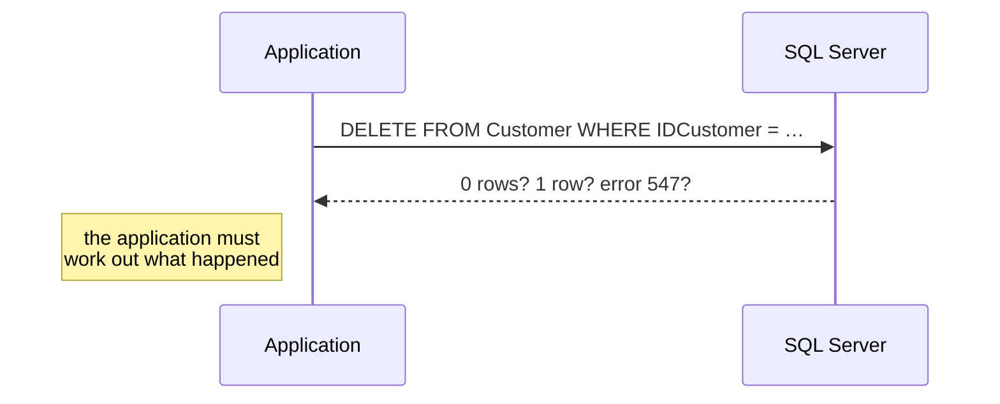
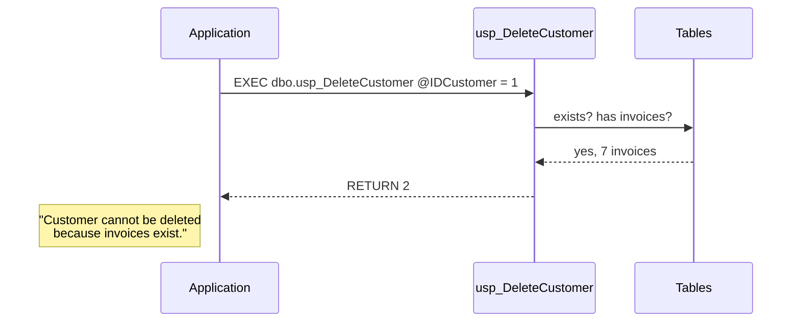
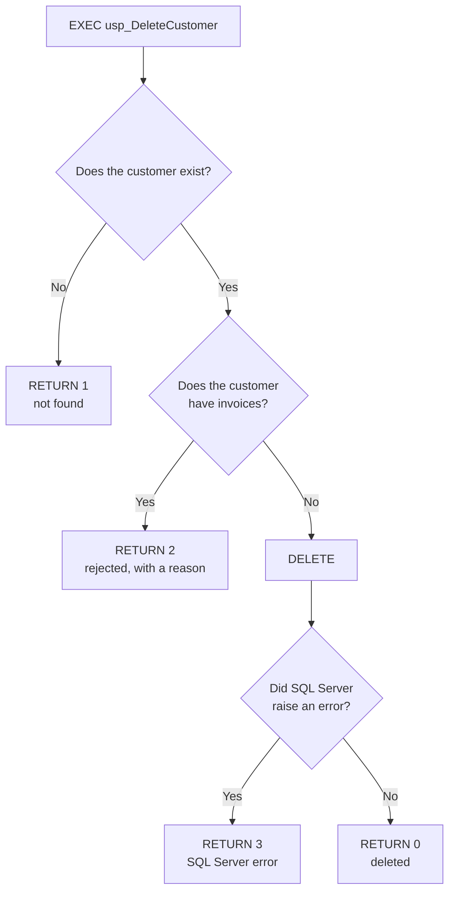
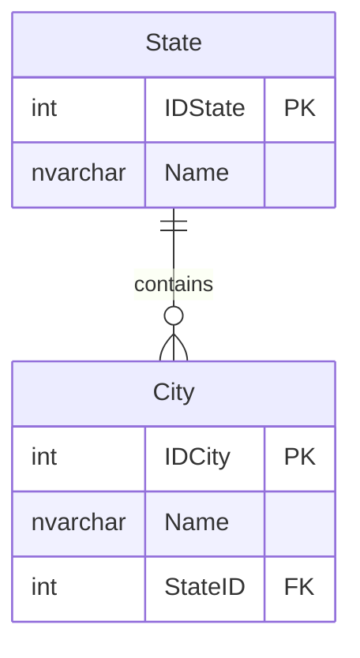
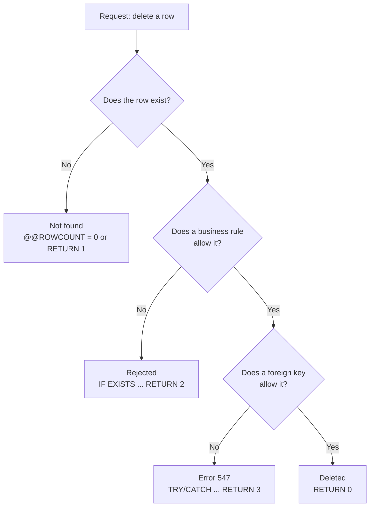

# Lab 7 – CRUD Operations

**Database:** `AdventureWorksENG`

This lab brings together concepts you have already learned in previous labs, including **stored procedures, functions, parameters, control flow, and error handling**.

You will apply these concepts to implement **Create, Read, Update, and Delete (CRUD)** operations against real database tables.

Rather than introducing new T-SQL syntax, the focus is on **combining existing knowledge to solve practical database problems**. You will implement CRUD operations, compare different ways of organizing stored procedures, and handle situations involving missing records, business rules, and referential integrity.

> [!IMPORTANT]
> **This lab is mostly about stored procedures.**
>
> Almost every example is a stored procedure, and it relies on the same building blocks: input and `OUTPUT` parameters, `RETURN` codes, `IF EXISTS` checks, `@@ROWCOUNT`, and `TRY/CATCH`. Solid knowledge of stored procedures is the key to this lab.
>
> If any of these building blocks feel uncertain, review [Lab 3 – Stored Procedures](lab03-stored-procedures.md) before you start. Try to write each procedure yourself before looking at the solution.

> [!NOTE]
> **This lab works on the real `AdventureWorksENG` data.**
>
> Read operations query the actual catalog — real categories, cities, customers, and products. Deletions that a business rule or a foreign key rejects change nothing.
>
> Two deletions in Section 8 **succeed**: customer `16` (Lili Alameda, who has no invoices) and product `680` (HL Road Frame - Black, 58, which was never sold). The expected results in this lab assume a freshly created `AdventureWorksENG`, so recreate the database before you start. On a database where the lab has already run, those two deletions return "does not exist" instead of "deleted".

---

## Learning objectives

After completing this lab, you should be able to:

- distinguish a missing record, a rejected operation, and a SQL Server error;
- organize Create, Read, Update, and Delete operations using stored procedures;
- choose between separate procedures and one procedure that supports several operations;
- implement a read operation as an inline table-valued function when that is appropriate;
- verify the result of an operation, including when zero rows are affected;
- use a basic `TRY/CATCH` block to handle an error raised by a CRUD operation;
- explain how primary keys, foreign keys, and business rules constrain CRUD operations.

Start by selecting the training database:

```sql
USE AdventureWorksENG;
GO
```

> [!NOTE]
> **Prerequisites:** This lab builds directly on [Lab 3 – Stored Procedures](lab03-stored-procedures.md) (input parameters, `OUTPUT` parameters, `RETURN`, `CREATE OR ALTER`) and on the basic `TRY/CATCH` block from [Lab 0 – T-SQL Essentials](lab00-tsql-essentials.md). It also uses the inline table-valued function syntax from [Lab 4 – Functions](lab04-functions.md). None of these topics are re-explained in depth here — only applied.

---

# Section 1 – What CRUD Means

Most applications need four basic operations on data: **Create, Read, Update, and Delete** — together known as **CRUD**. Each corresponds to a statement you already know:

| CRUD | Operation | SQL statement |
|---|---|---|
| **C** | Create | `INSERT` |
| **R** | Read | `SELECT` |
| **U** | Update | `UPDATE` |
| **D** | Delete | `DELETE` |

Applications usually do not run these statements directly. They call stored procedures such as `usp_InsertCustomer` or `usp_DeleteCustomer`, and the procedure runs the SQL. This gives the database a **reusable interface** and a place to enforce **business rules**.

> [!IMPORTANT]
> **CRUD describes four types of operations, not necessarily four stored procedures.**
>
> An application might use a separate procedure for each operation or combine several operations into one procedure. Choosing between these designs is one of the topics of this lab.

## What can happen when you delete a row?

Writing a `DELETE` statement is easy. Knowing what happened after it ran is not.

When an application sends a `DELETE` directly, it has to work out the meaning of the response itself:



On the real data in `AdventureWorksENG`, the same statement produces very different results:

| Customer | Situation | What SQL Server reports |
|---|---|---|
| `16` – Lili Alameda | exists, has no invoices | 1 row deleted |
| `99999` | does not exist | 0 rows deleted, **no error** |
| `1` – Gustavo Achong | has 7 invoices | **error 547** (`FK_Invoice_Customer`) — and `@@ROWCOUNT` is still 0 |

Look at Gustavo Achong's row. His invoices are safe — the foreign key `FK_Invoice_Customer` refuses to delete a customer who still has invoices. But what the application receives is an error message and `@@ROWCOUNT = 0`: the same row count as for a customer who does not exist.

In two of the three cases *nothing was deleted*, for completely different reasons. An application that cannot tell them apart will show the wrong message to the user, or silently ignore a real problem.

## The procedure reports the outcome

The reasons for using stored procedures from [Lab 3](lab03-stored-procedures.md#why-use-stored-procedures) still apply to CRUD operations. Take `usp_DeleteCustomer`:

- **Encapsulation** — the application does not need to know which tables are checked or in which order. Those steps live inside the procedure.
- **Reusability** — a web shop, a mobile app, and an internal admin tool can all call the same procedure. The rule about invoices is written once, not repeated in every application.
- **A stable interface** — the application knows only the procedure name, the parameter `@IDCustomer`, and the meaning of the return codes. The checks inside can change without changing the application.
- **Fewer network round-trips** — without a procedure, the application would send three statements: check that the customer exists, check for invoices, then delete. With a procedure, it sends one `EXEC`.

For CRUD, the interface has one more job: to report clearly **what happened**.

Here is the same request for Gustavo Achong, this time through a procedure:



Inside, the procedure decides between four answers and returns a different code for each:



Notice what the invoice check does **not** do: it does not protect the data any better. The foreign key already does that. What the check adds is a **clear answer** — return code `2` instead of error 547 — which the application can translate into a message.

Not every rule has a constraint behind it. Some rules cannot be expressed as a constraint at all (Section 7.2), and for those, the check in the procedure is the only protection.

You will build exactly this procedure in Section 8.

> [!IMPORTANT]
> **Designing CRUD operations whose outcomes the caller can tell apart is the main goal of this lab.** Every section adds one piece: verifying affected rows (Section 2), return codes for business rules (Section 3), handling errors (Section 6), and understanding the constraints behind them (Section 7). Section 8 brings everything together.

## Check your understanding

1. A `DELETE` statement affects zero rows. Is that an error?
2. What does `@@ROWCOUNT` show after a foreign key rejects the deletion of customer `1`? Why is that a problem for the caller?
3. Does implementing CRUD require exactly four stored procedures?
4. Why might an application call a stored procedure instead of executing a `DELETE` statement directly?

<details>
<summary>Show answers</summary>

1. No. It usually means that no row matched the `WHERE` condition — for example, the record does not exist. SQL Server does not treat that as an error.
2. It shows `0` — the same value as for a customer that does not exist. Looking only at the number of affected rows, the caller cannot tell a missing record from a rejected operation.
3. No. CRUD describes four types of operations. They can be implemented using separate or combined procedures.
4. A stored procedure provides a reusable operation and can report clearly what happened. For a customer who still has invoices, the foreign key protects the data either way — but the procedure can answer with return code `2` instead of error 547. For rules that have no constraint behind them, the procedure is also the place where they are enforced.

</details>

---

# Section 2 – CRUD with Separate Procedures

One way to implement CRUD is to create a **separate stored procedure for each operation**.

Each procedure has a specific responsibility: inserting, retrieving, updating, or deleting data.

In this section, we will implement CRUD operations for the `Category` table.

The table contains two columns:

| Column | Description |
|---|---|
| `IDCategory` | Primary key, automatically generated using `IDENTITY` |
| `Name` | Category name |

We will create five procedures:

| Procedure | Operation |
|---|---|
| `usp_InsertCategory` | Create |
| `usp_GetCategory` | Read one category |
| `usp_FindCategoriesByName` | Read multiple categories |
| `usp_UpdateCategoryName` | Update |
| `usp_DeleteCategory` | Delete |

Notice that we have **five procedures for four CRUD operations**. This is because reading one category and searching for multiple categories are different requirements.

## 2.1 Create – Insert a category

The first procedure inserts a new category and returns its generated ID through an `OUTPUT` parameter.

```sql
CREATE OR ALTER PROCEDURE dbo.usp_InsertCategory
    @Name          nvarchar(50),
    @NewCategoryID int OUTPUT
AS
BEGIN
    SET NOCOUNT ON;

    INSERT INTO Category (Name)
    VALUES (@Name);

    SET @NewCategoryID = SCOPE_IDENTITY();
END;
GO
```

The shop is adding a new product line, scooters. Execute the procedure:

```sql
DECLARE @NewID int;

EXEC dbo.usp_InsertCategory
    @Name = N'Scooters',
    @NewCategoryID = @NewID OUTPUT;

SELECT @NewID AS NewCategoryID;
```

The procedure inserts a new row and returns its generated primary key.

Verify the result:

```sql
SELECT *
FROM Category
WHERE Name = N'Scooters';
```

> [!NOTE]
> The `OUTPUT` parameter and `SCOPE_IDENTITY()` were introduced in Lab 3. Here, we use them to return the ID of a newly created record.

> [!WARNING]
> **Run the insert only once.** `Category.Name` is not protected by a unique constraint — only `IDCategory` is. If you execute the block twice, SQL Server inserts a second `Scooters` row without complaint, and the expected results later in this section will no longer match.
>
> The database enforces only the rules it has been given. Section 7 returns to this question: which rules does the database guarantee, and which must your code enforce?

## 2.2 Read – Retrieve one category

A common requirement is to retrieve a single record using its primary key.

```sql
CREATE OR ALTER PROCEDURE dbo.usp_GetCategory
    @IDCategory int
AS
BEGIN
    SET NOCOUNT ON;

    SELECT
        IDCategory,
        Name
    FROM Category
    WHERE IDCategory = @IDCategory;
END;
GO
```

Test the procedure against the real catalog. `AdventureWorksENG` contains four categories:

| IDCategory | Name |
|---:|---|
| 1 | Bicycles |
| 2 | Parts |
| 3 | Clothes |
| 4 | Accessories |

Before you run the two calls below, **predict**: what will the second call return — an error, or something else?

```sql
EXEC dbo.usp_GetCategory @IDCategory = 1;

EXEC dbo.usp_GetCategory @IDCategory = 999999;
```

The first call retrieves the real category `Bicycles`.

The second call returns an empty result set, because no category has that ID.

This is the first outcome from Section 1: **the row does not exist**. SQL Server does not report it as an error — the caller has to notice that the result set is empty.

> [!IMPORTANT]
> A `SELECT` statement that finds no matching records does not raise an error.
>
> It simply returns **zero rows**.

## 2.3 Read – Search for multiple categories

Sometimes an application needs to search for records rather than retrieve one specific record.

For example, users might search for categories whose names start with a particular text.

```sql
CREATE OR ALTER PROCEDURE dbo.usp_FindCategoriesByName
    @NamePattern nvarchar(50)
AS
BEGIN
    SET NOCOUNT ON;

    SELECT
        IDCategory,
        Name
    FROM Category
    WHERE Name LIKE @NamePattern
    ORDER BY Name;
END;
GO
```

Execute the procedure against the real catalog:

```sql
-- Categories starting with 'B'
EXEC dbo.usp_FindCategoriesByName
    @NamePattern = N'B%';

-- Every category
EXEC dbo.usp_FindCategoriesByName
    @NamePattern = N'%';
```

The first call returns one row, `Bicycles`. The second returns every category, sorted by name — the four real ones plus `Scooters`, which you created in Section 2.1:

| IDCategory | Name |
|---:|---|
| 4 | Accessories |
| 1 | Bicycles |
| 3 | Clothes |
| 2 | Parts |
| 5 | Scooters |

On a freshly created database `Scooters` receives ID `5`.

Searching for a pattern that matches nothing, such as `N'Q%'`, returns zero rows rather than an error.

Compare the two Read procedures:

| Procedure | Result |
|---|---|
| `usp_GetCategory` | Zero or one record, identified by primary key |
| `usp_FindCategoriesByName` | Zero, one, or multiple records matching a search pattern |

Both procedures implement the **Read** operation, but they serve different purposes.

## 2.4 Update – Change a category name

The next procedure updates the name of an existing category.

It also returns the number of affected rows.

```sql
CREATE OR ALTER PROCEDURE dbo.usp_UpdateCategoryName
    @IDCategory int,
    @NewName    nvarchar(50)
AS
BEGIN
    SET NOCOUNT ON;

    UPDATE Category
    SET Name = @NewName
    WHERE IDCategory = @IDCategory;

    SELECT @@ROWCOUNT AS RowsUpdated;
END;
GO
```

First, retrieve the ID of the `Scooters` category created in Section 2.1.

```sql
DECLARE @CategoryID int;

SELECT @CategoryID = IDCategory
FROM Category
WHERE Name = N'Scooters';

EXEC dbo.usp_UpdateCategoryName
    @IDCategory = @CategoryID,
    @NewName = N'Electric Scooters';
```

Expected result:

| RowsUpdated |
|---:|
| 1 |

Verify the change:

```sql
SELECT *
FROM Category
WHERE Name = N'Electric Scooters';
```

Now try updating a category that does not exist. **Predict** the result before you run it:

```sql
EXEC dbo.usp_UpdateCategoryName
    @IDCategory = 999999,
    @NewName = N'Unknown Category';
```

Expected result:

| RowsUpdated |
|---:|
| 0 |

Again, this is the outcome *the row does not exist* — this time reported through the number of affected rows.

> [!IMPORTANT]
> **Zero affected rows does not mean that the SQL statement failed.**
>
> The `UPDATE` executed successfully, but no record matched the specified ID.
>
> We use `@@ROWCOUNT`, introduced in Lab 0, to detect this situation.

## 2.5 Delete – Remove a category

The final procedure deletes a category using its primary key. It follows the same pattern as `usp_UpdateCategoryName`.

```sql
CREATE OR ALTER PROCEDURE dbo.usp_DeleteCategory
    @IDCategory int
AS
BEGIN
    SET NOCOUNT ON;

    DELETE FROM Category
    WHERE IDCategory = @IDCategory;

    SELECT @@ROWCOUNT AS RowsDeleted;
END;
GO
```

`@@ROWCOUNT` must be read immediately after the `DELETE`. Most statements in between would overwrite it — for example, `SET @x = 5` sets it to `1`, and `PRINT` sets it to `0`.

The scooter line is discontinued. Delete the category:

```sql
DECLARE @CategoryID int;

SELECT @CategoryID = IDCategory
FROM Category
WHERE Name = N'Electric Scooters';

-- First attempt
EXEC dbo.usp_DeleteCategory
    @IDCategory = @CategoryID;

-- Try deleting the same category again
EXEC dbo.usp_DeleteCategory
    @IDCategory = @CategoryID;
```

Both calls run in the same batch, so the second one can reuse `@CategoryID`.

Expected results:

| Call | RowsDeleted |
|---|---:|
| First attempt | 1 |
| Same category again | 0 |

The second call affects zero rows because the category has already been deleted.

> [!WARNING]
> Not every category can be deleted successfully.
>
> `Electric Scooters` deleted cleanly because nothing referenced it. Every **real** category in `AdventureWorksENG` has subcategories — `Bicycles` has 3, `Parts` has 14, `Clothes` has 8, `Accessories` has 12 — so the foreign key constraint prevents deleting any of them.
>
> Section 6 runs exactly that deletion against the real `Bicycles` category and examines the error.

## 2.6 Summary – Complete CRUD interface

We have now implemented all four CRUD operations using five stored procedures. Each performs one clearly defined operation, which makes the interface straightforward to understand, test, and maintain.

Look at the procedures from the caller's point of view. How does the caller learn what happened?

| Procedure | The caller learns the outcome from |
|---|---|
| `usp_InsertCategory` | the `OUTPUT` parameter (the new ID) |
| `usp_GetCategory`, `usp_FindCategoriesByName` | the number of rows in the result set |
| `usp_UpdateCategoryName`, `usp_DeleteCategory` | a result set containing `@@ROWCOUNT` |

A row count tells the caller **whether** something changed. It cannot tell the caller **why** nothing changed — and Section 1 showed that "nothing was deleted" can have several very different causes.

Section 3 introduces return codes, which can carry that reason. Section 6 shows what happens to a row count when SQL Server raises an error.

Separate procedures are also not the only possible design. Section 5 explores how multiple CRUD operations can be combined into a single procedure.

## Check your understanding

1. Why did we create five procedures for four CRUD operations?
2. What is the purpose of the `OUTPUT` parameter in `usp_InsertCategory`?
3. What happens when `usp_GetCategory` receives an ID that does not exist?
4. What does `RowsUpdated = 0` mean?
5. How does the caller of `usp_GetCategory` know that the requested category does not exist?
6. What happens if you run the insert from Section 2.1 twice? Why doesn't SQL Server stop you?

<details>
<summary>Show answers</summary>

1. Because we implemented two different Read operations: retrieving one category by ID and searching for multiple categories by name.
2. It returns the generated primary key of the newly inserted category.
3. The procedure returns an empty result set.
4. The `UPDATE` executed successfully but did not match any rows.
5. Only by checking that the result set is empty. No error is raised, so the caller must check the number of returned rows itself.
6. A second `Scooters` row is inserted with a new ID. SQL Server allows it because `Category.Name` has no unique constraint — the database only enforces the rules that have been defined for it.

</details>

---

# Section 3 – CRUD for `State` and `City`

In Section 2, we implemented CRUD operations for the `Category` table using separate stored procedures.

In this section, we apply the same pattern to the `State` and `City` tables.

These tables are connected through a foreign key:



The `City.StateID` column is nullable, meaning that a city can exist without being assigned to a state.

We start with simple `INSERT` and `SELECT` operations, then implement a `DELETE` procedure that checks a business rule before removing data.

Section 2.6 ended with a question: can a row count tell the caller **why** nothing was deleted? Section 3.4 answers it. Instead of a row count, the procedure returns a **return code** — a number that says which of several outcomes occurred.

> [!NOTE]
> The procedures follow the patterns from Section 2. The required T-SQL concepts, including `OUTPUT`, `SCOPE_IDENTITY()`, `IF`, and `RETURN`, were introduced in previous labs.

## 3.1 Create – Insert a state

The shop is expanding to Slovenia. The procedure `dbo.usp_InsertState`:

- accepts the state name through `@Name`;
- inserts the new state;
- returns its generated ID through the `OUTPUT` parameter `@NewStateID`.

It uses the same `INSERT`, `SCOPE_IDENTITY()`, and `OUTPUT` pattern as `usp_InsertCategory` in Section 2.1.

```sql
CREATE OR ALTER PROCEDURE dbo.usp_InsertState
    @Name       nvarchar(50),
    @NewStateID int OUTPUT
AS
BEGIN
    SET NOCOUNT ON;

    INSERT INTO State (Name)
    VALUES (@Name);

    SET @NewStateID = SCOPE_IDENTITY();
END;
GO
```

Insert `Slovenia`:

```sql
DECLARE @NewID int;

EXEC dbo.usp_InsertState
    @Name = N'Slovenia',
    @NewStateID = @NewID OUTPUT;

SELECT @NewID AS NewStateID;
```

Verify that the new state exists:

```sql
SELECT IDState, Name
FROM State
WHERE Name = N'Slovenia';
```

Run the insert only once. Like `Category.Name`, `State.Name` is not unique, so a second run inserts a second `Slovenia`. On a freshly created database, `Slovenia` receives `IDState = 4`.

## 3.2 Create – Insert cities

The procedure `dbo.usp_InsertCity`:

- accepts the city name through `@Name` and the state's ID through `@StateID`;
- inserts the city and associates it with that state;
- returns the generated city ID through `@NewCityID`.

The caller already knows the state's ID, so the procedure does not need to search for the state by name. It inserts the supplied `@StateID` directly into `City.StateID`.

```sql
CREATE OR ALTER PROCEDURE dbo.usp_InsertCity
    @Name      nvarchar(50),
    @StateID   int,
    @NewCityID int OUTPUT
AS
BEGIN
    SET NOCOUNT ON;

    INSERT INTO City (Name, StateID)
    VALUES (@Name, @StateID);

    SET @NewCityID = SCOPE_IDENTITY();
END;
GO
```

Insert the first two Slovenian cities, `Ljubljana` and `Maribor`:

```sql
DECLARE @StateID int;

SELECT @StateID = IDState
FROM State
WHERE Name = N'Slovenia';

DECLARE @City1 int, @City2 int;

EXEC dbo.usp_InsertCity
    N'Ljubljana', @StateID, @City1 OUTPUT;

EXEC dbo.usp_InsertCity
    N'Maribor', @StateID, @City2 OUTPUT;

SELECT
    @City1 AS City1ID,
    @City2 AS City2ID;

-- Verify the inserted cities
SELECT *
FROM City
WHERE StateID = @StateID;
```

On a freshly created database, `Ljubljana` receives `IDCity = 14` and `Maribor` `IDCity = 15`.

### Predict, then try

After `Ljubljana` and `Maribor` are inserted, consider two calls with a wrong `@StateID`. **Predict** what each one does, then run them:

```sql
DECLARE @NewCityID int;

-- A state that does not exist
EXEC dbo.usp_InsertCity N'Koper', 999, @NewCityID OUTPUT;

-- No state at all
EXEC dbo.usp_InsertCity N'Koper', NULL, @NewCityID OUTPUT;

SELECT IDCity, Name, StateID
FROM City
WHERE Name = N'Koper';
```

<details>
<summary>Show answer</summary>

The two calls look almost the same, but they end in two different outcomes from Section 1:

| Call | Result |
|---|---|
| `@StateID = 999` | **Error 547** — the `INSERT` conflicts with the foreign key `FK_City_State`. No row is inserted. |
| `@StateID = NULL` | **Success** — `Koper` is inserted without a state. No error, no warning. |

A foreign key checks only values that are present. Because `City.StateID` is nullable, `NULL` simply means "no state", and the database accepts it.

This also matters for the test data: if `@StateID` were `NULL` because the insert in Section 3.1 failed, `Ljubljana` and `Maribor` would be inserted without a state, and Section 3.3 would return no cities for Slovenia.

</details>

## 3.3 Read – Retrieve cities by state

The procedure `dbo.usp_GetCitiesByState` accepts `@IDState` and returns `IDCity` and `Name` for all cities of that state, sorted alphabetically by name.

A `JOIN` is not required because the procedure already receives the state's ID; a `WHERE` condition on `City.StateID` is enough.

```sql
CREATE OR ALTER PROCEDURE dbo.usp_GetCitiesByState
    @IDState int
AS
BEGIN
    SET NOCOUNT ON;

    SELECT
        IDCity,
        Name
    FROM City
    WHERE StateID = @IDState
    ORDER BY Name;
END;
GO
```

First, read the cities of the real state `Croatia` (`IDState = 1`):

```sql
EXEC dbo.usp_GetCitiesByState
    @IDState = 1;
```

Expected result:

| IDCity | Name |
|---:|---|
| 2 | Osijek |
| 3 | Pula |
| 4 | Rijeka |
| 5 | Split |
| 1 | Zagreb |

Then read the cities of `Slovenia`:

```sql
DECLARE @StateID int;

SELECT @StateID = IDState
FROM State
WHERE Name = N'Slovenia';

EXEC dbo.usp_GetCitiesByState
    @IDState = @StateID;
```

Expected result:

| IDCity | Name |
|---:|---|
| 14 | Ljubljana |
| 15 | Maribor |

The IDs assume a freshly created database and that each insert was run once.

## 3.4 Delete – Remove a city with a business rule

A city may have customers associated with it through `Customer.CityID`.

Suppose our application has the following business rule:

**A city cannot be deleted if it has at least one customer.**

The procedure `dbo.usp_DeleteCity` implements this rule. It checks whether the city exists and whether any customers belong to it, and deletes the city only when it exists and has no customers. Instead of a row count, it reports the result with `RETURN`:

| Return code | Meaning |
|---:|---|
| `0` | City deleted successfully |
| `1` | City does not exist |
| `2` | City has customers; deletion rejected |

```sql
CREATE OR ALTER PROCEDURE dbo.usp_DeleteCity
    @IDCity int
AS
BEGIN
    SET NOCOUNT ON;

    IF NOT EXISTS (
        SELECT 1
        FROM City
        WHERE IDCity = @IDCity
    )
        RETURN 1;

    IF EXISTS (
        SELECT 1
        FROM Customer
        WHERE CityID = @IDCity
    )
        RETURN 2;

    DELETE FROM City
    WHERE IDCity = @IDCity;

    RETURN 0;
END;
GO
```

### Test the procedure

We test all three outcomes:

1. Delete `Ljubljana`, which exists and has no customers yet.
2. Delete `Ljubljana` again, using the same ID.
3. Delete `Zagreb` (`IDCity = 1`). No test data is needed here: every real city in `AdventureWorksENG` already has customers, and `Zagreb` has 1492 of them.

The return code is captured with `EXEC @Result = ...`:

```sql
DECLARE @City1 int, @Result int;

SELECT @City1 = IDCity
FROM City
WHERE Name = N'Ljubljana';

-- Test 1: Ljubljana exists and has no customers yet
EXEC @Result = dbo.usp_DeleteCity @IDCity = @City1;
SELECT @Result AS DeleteTestCity_FirstTry;

-- Test 2: Same city again
EXEC @Result = dbo.usp_DeleteCity @IDCity = @City1;
SELECT @Result AS DeleteTestCity_SecondTry;

-- Test 3: Real city that has customers (Zagreb)
EXEC @Result = dbo.usp_DeleteCity @IDCity = 1;
SELECT @Result AS DeleteZagreb;

-- Verify that Zagreb is untouched
SELECT IDCity, Name, StateID
FROM City
WHERE IDCity = 1;

SELECT COUNT(*) AS ZagrebCustomers
FROM Customer
WHERE CityID = 1;
```

Expected results:

| Test | Return code |
|---|---:|
| Delete Ljubljana | 0 |
| Delete Ljubljana again | 1 |
| Delete Zagreb (1492 customers) | 2 |

`Zagreb` still exists and still has 1492 customers. The business rule stopped the operation before any `DELETE` ran.

> [!NOTE]
> The procedure checks the business rule before executing `DELETE`.
>
> However, a check followed by a `DELETE` is not automatically atomic. In a concurrent environment, another session could modify related data between these statements.
>
> Later sections discuss database constraints and error handling as additional protection.

### What does the business rule actually add?

`Customer.CityID` has a foreign key to `City` — `FK_Customer_City`. Without the business rule, the database would refuse to delete `Zagreb` anyway:

```sql
DELETE FROM City
WHERE IDCity = 1;
```

```text
Msg 547, Level 16, State 1, Line 1
The DELETE statement conflicted with the REFERENCE constraint "FK_Customer_City".
The conflict occurred in database "AdventureWorksENG", table "dbo.Customer", column 'CityID'.
The statement has been terminated.
```

So the check in `usp_DeleteCity` does not protect the data — the foreign key already does that. What it adds is a **clear answer**: instead of an error, the caller receives return code `2`, which says exactly why the city was not deleted.

In terms of Section 1, the procedure turns outcome *SQL Server error* into outcome *rejected by a business rule*.

## Check your understanding

1. Why does `usp_InsertCity` need a `@StateID` parameter?
2. What happens when `usp_GetCitiesByState` finds no matching cities?
3. Why does `usp_DeleteCity` check whether the city exists before deleting it?
4. What is the difference between return codes `1` and `2`?
5. `Customer.CityID` has a foreign key to `City`. What would happen if `usp_DeleteCity` skipped the customer check and simply ran `DELETE` for `Zagreb`?

<details>
<summary>Show answers</summary>

1. To associate the new city with an existing state.
2. The procedure returns an empty result set.
3. To distinguish a nonexistent city from a successful deletion.
4. Code `1` means the city does not exist; code `2` means the city exists but cannot be deleted because it has customers.
5. The foreign key `FK_Customer_City` would reject the `DELETE` with error 547, and `Zagreb` would remain. The data would be safe either way — but the caller would receive an error instead of return code `2`, which explains the reason.

</details>

---

# Section 4 – Functions and Data Access

So far, we have implemented CRUD operations using stored procedures.

However, the **Read** operation can also be implemented using a function.

In Lab 4, you learned how inline table-valued functions (TVFs) return tables that can be used directly in SQL queries.

In this section, we will implement the same Read operation using both a stored procedure and an inline TVF, then compare how they can be used.

## 4.1 The data we will read

No test data is needed for this section. All 13 original cities in `AdventureWorksENG` have customers, so we can read real records:

| City | Customers |
|---|---:|
| Zagreb | 1492 |
| Osijek | 1552 |
| Rijeka | 1601 |

We will use `Zagreb` throughout this section.

## 4.2 Read using a stored procedure

Create a procedure that retrieves customers by city name.

```sql
CREATE OR ALTER PROCEDURE dbo.usp_GetCustomersByCity
    @CityName nvarchar(50)
AS
BEGIN
    SET NOCOUNT ON;

    SELECT
        c.IDCustomer,
        c.FirstName,
        c.LastName,
        ci.Name AS City
    FROM Customer AS c
    JOIN City AS ci
        ON ci.IDCity = c.CityID
    WHERE ci.Name = @CityName
    ORDER BY c.LastName, c.FirstName;
END;
GO
```

Execute the procedure:

```sql
EXEC dbo.usp_GetCustomersByCity
    @CityName = N'Zagreb';
```

The procedure returns all 1492 customers who live in `Zagreb`, sorted by last name.

## 4.3 Read using an inline table-valued function

Now implement the same operation using an inline TVF.

```sql
CREATE OR ALTER FUNCTION dbo.fn_CustomersByCity
(
    @CityName nvarchar(50)
)
RETURNS TABLE
AS
RETURN
(
    SELECT
        c.IDCustomer,
        c.FirstName,
        c.LastName,
        ci.Name AS City
    FROM Customer AS c
    JOIN City AS ci
        ON ci.IDCity = c.CityID
    WHERE ci.Name = @CityName
);
GO
```

Execute the function:

```sql
SELECT *
FROM dbo.fn_CustomersByCity(N'Zagreb');
```

Both implementations return the same customer information.

Compare the two definitions once more. **Predict:** why does `usp_GetCustomersByCity` contain `ORDER BY`, while `fn_CustomersByCity` does not?

<details>
<summary>Show answer</summary>

An inline TVF returns a **table**, and the rows of a table have no guaranteed order. SQL Server rejects `ORDER BY` inside an inline function:

```text
Msg 1033, Level 15, State 1
The ORDER BY clause is invalid in views, inline functions, derived tables, subqueries,
and common table expressions, unless TOP, OFFSET or FOR XML is also specified.
```

The caller decides the order — the query in Section 4.4 sorts the function's result with its own `ORDER BY`. A procedure, on the other hand, returns a final result set to the caller, so it can sort it.

</details>

The difference between the two is **how their results can be used**.

## 4.4 Using a function in a larger query

Suppose we want to retrieve customers from a particular city together with their invoices.

Because an inline TVF can be used as a table source, we can join its result directly with the `Invoice` table.

To keep the output readable, we also filter by last name — something the function's own parameter does not support, but the surrounding query can add freely:

```sql
SELECT
    f.FirstName,
    f.LastName,
    i.IDInvoice,
    CONVERT(date, i.InvoiceDate) AS InvoiceDate
FROM dbo.fn_CustomersByCity(N'Zagreb') AS f
LEFT JOIN Invoice AS i
    ON i.CustomerID = f.IDCustomer
WHERE f.LastName = N'Beck'
ORDER BY f.FirstName, i.InvoiceDate;
```

Expected result:

| FirstName | LastName | IDInvoice | InvoiceDate |
|---|---|---:|---|
| Bradley | Beck | NULL | NULL |
| Calvin | Beck | 45004 | 2001-12-27 |
| Christy | Beck | 49558 | 2003-03-02 |
| Christy | Beck | 66272 | 2004-03-16 |

Three real customers from Zagreb share the last name `Beck`. Christy appears twice because she has two invoices.

Bradley appears with `NULL` invoice columns: the `LEFT JOIN` keeps him in the result even though he has no invoices at all.

We cannot use a stored procedure in the same way:

```sql
-- Invalid SQL: a stored procedure cannot be used in FROM

SELECT *
FROM dbo.usp_GetCustomersByCity(N'Zagreb');
```

SQL Server rejects the query with an error that may look surprising at first:

```text
Msg 208, Level 16, State 224
Invalid object name 'dbo.usp_GetCustomersByCity'.
```

The message does not say that procedures are not allowed in `FROM`. In `FROM`, SQL Server looks for a table, a view, or a table-valued function with that name — and a procedure is none of these, so the object is reported as not found.

A stored procedure is executed using `EXEC`, while an inline TVF can participate directly in a `SELECT`, `JOIN`, or subquery.

> [!IMPORTANT]
> **Stored procedures and inline TVFs can both retrieve data, but they are not interchangeable.**
>
> A procedure is executed as an operation, while an inline TVF provides a table result that can be combined with other SQL queries.

## 4.5 When should you use each approach?

| Stored procedure | Inline TVF |
|---|---|
| Executed using `EXEC` | Used in `FROM` |
| Can return result sets | Returns a table |
| Supports `OUTPUT` parameters and integer `RETURN` codes | Does not support `OUTPUT` parameters |
| Can execute `INSERT`, `UPDATE`, and `DELETE` | Cannot modify database tables |
| Useful for database operations and application interfaces | Useful for reusable, parameterized queries |
| Caller learns the outcome from a return code, `OUTPUT` parameters, or result sets | Caller learns the outcome only from the returned rows |

For CRUD operations:

- **Create, Update, Delete:** stored procedures can implement these operations.
- **Read:** both stored procedures and inline TVFs are possible choices.

> [!TIP]
> If the result needs to be joined with other tables or used inside a larger SQL query, an inline TVF is often a convenient choice.
>
> If the application needs to execute a defined database operation, a stored procedure may be more appropriate.

## 4.6 What can a function tell its caller?

In Section 3, `Maribor` was added to `Slovenia` and nobody lives there yet. Compare two calls:

```sql
-- A city that exists but has no customers
SELECT COUNT(*) AS Customers
FROM dbo.fn_CustomersByCity(N'Maribor');

-- A city that does not exist
SELECT COUNT(*) AS Customers
FROM dbo.fn_CustomersByCity(N'Atlantis');
```

Both return `0`.

Two different situations produce exactly the same answer. The function has no return code and no `OUTPUT` parameter — the only thing it can give the caller is rows. Zero rows cannot say *why* there are zero rows.

A stored procedure could tell the difference: it could check whether the city exists and return code `1` if it does not, just as `usp_DeleteCity` did in Section 3.

> [!NOTE]
> This is not a reason to avoid functions. For a Read operation, "no matching rows" is often all the caller needs. But when the caller must distinguish *missing* from *empty*, a function is not enough on its own.

## Check your understanding

1. Can both a stored procedure and an inline TVF retrieve customer information?
2. Why can an inline TVF be used in a `JOIN`?
3. Can a stored procedure be used directly in the `FROM` clause of a `SELECT` statement?
4. Can an inline TVF update or delete rows in a database table?
5. When might an inline TVF be more convenient than a stored procedure?
6. `fn_CustomersByCity` returns zero rows. What can the caller conclude about the city?
7. Why does `usp_GetCustomersByCity` contain `ORDER BY`, but `fn_CustomersByCity` does not?

<details>
<summary>Show answers</summary>

1. Yes. Both can retrieve data from database tables.
2. Because an inline TVF returns a table that SQL Server can use as a table source.
3. No. Stored procedures are executed using `EXEC` and cannot be used directly as table sources.
4. No. T-SQL user-defined functions cannot modify database tables.
5. When the returned data needs to participate in a larger query, such as a `JOIN` or subquery.
6. Only that no customers matched. The city may exist without customers, or it may not exist at all — the function cannot report which.
7. An inline TVF returns a table, and table rows have no guaranteed order, so SQL Server rejects `ORDER BY` inside it. The caller sorts the result. A procedure returns the final result set, so it can sort it itself.

</details>

---

# Section 5 – One Procedure for Multiple Operations

In Section 2, we implemented CRUD using separate stored procedures. Each procedure performed one specific operation.

However, this is not the only possible design.

Sometimes, **multiple CRUD operations can be combined into a single stored procedure**.

For example, an application might use:

- One procedure for inserting and updating records.
- One procedure for reading and deleting records.
- One procedure supporting all four CRUD operations.

The choice depends on the application's requirements and how we want to organize the database interface.

## 5.1 Common approaches

Consider three possible designs for managing categories.

| Approach | Example | Description |
| --- | --- | --- |
| Separate procedures | `usp_InsertCategory`, `usp_UpdateCategoryName` | Each operation has its own procedure |
| Combined Create + Update | `usp_SaveCategory` | One procedure inserts or updates a record |
| Action-based procedure | `usp_ManageCategory` | An `@Action` parameter selects the operation |

A combined procedure usually needs a way to determine which operation to execute.

Two common techniques are:

- **Check whether an ID was provided:** insert a new record when the ID is `NULL`, otherwise update the existing record.
- **Use an action parameter:** select the operation explicitly using values such as `INSERT`, `UPDATE`, `GET`, or `DELETE`.

Let's examine both approaches.

## 5.2 Combining Create and Update – Save pattern

A common requirement in applications is to use the same form for creating a new record and editing an existing one.

For example, consider a form for managing states.

When the user creates a new state, the application does not yet have its ID.

When the user edits an existing state, the application already knows its ID.

We can support both operations using one procedure.

### Example – `usp_SaveState`

```sql
CREATE OR ALTER PROCEDURE dbo.usp_SaveState
    @IDState int OUTPUT,
    @Name    nvarchar(50)
AS
BEGIN
    SET NOCOUNT ON;

    IF @IDState IS NULL
    BEGIN
        INSERT INTO State (Name)
        VALUES (@Name);

        SET @IDState = SCOPE_IDENTITY();
    END
    ELSE
    BEGIN
        UPDATE State
        SET Name = @Name
        WHERE IDState = @IDState;
    END
END;
GO
```

The procedure uses the value of `@IDState` to determine which operation to perform.

| `@IDState` | Operation |
| --- | --- |
| `NULL` | Insert a new state |
| Existing ID | Update the state with that ID |
| Nonexistent ID | Update affects zero rows |

### Test the procedure

Run both calls together in one batch, so the second call receives the ID returned by the first:

```sql
DECLARE @IDState int = NULL;

-- Test 1: Insert a new state
EXEC dbo.usp_SaveState
    @IDState = @IDState OUTPUT,
    @Name = N'Austria';

SELECT @IDState AS NewStateID;

-- Test 2: Update the same state
EXEC dbo.usp_SaveState
    @IDState = @IDState OUTPUT,
    @Name = N'Republic of Austria';

SELECT *
FROM State
WHERE IDState = @IDState;
```

In the first call `@IDState` is `NULL`, so the procedure inserts a new state and returns its generated ID.

The second call receives that ID, so it updates the existing state instead of inserting another one.

> [!IMPORTANT]
> The same `OUTPUT` parameter can be used to pass an ID into a procedure and return an ID to the caller.
>
> In this example, `NULL` means Create, while a supplied ID means Update.

This pattern is often called a **Save procedure**.

Notice that it does not automatically insert a new row when the supplied ID does not exist. In that case, the `UPDATE` simply affects zero rows.

**Predict:** an application calls `usp_SaveState` with `@IDState = 999` and `@Name = N'Switzerland'`. No state has that ID. What does the caller see?

```sql
DECLARE @IDState int = 999, @Result int;

EXEC @Result = dbo.usp_SaveState
    @IDState = @IDState OUTPUT,
    @Name = N'Switzerland';

SELECT @IDState AS IDStateAfterCall, @Result AS ReturnValue;
```

<details>
<summary>Show answer</summary>

| IDStateAfterCall | ReturnValue |
|---:|---:|
| 999 | 0 |

Nothing was saved, but the caller cannot tell. There is no error, the return value is `0` (the default when a procedure has no `RETURN`), and `@IDState` still holds an ID — so the application would report that the state was saved.

One line after the `UPDATE` would fix it:

```sql
IF @@ROWCOUNT = 0
    RETURN 1;
```

The procedure in Section 5.5 uses exactly this pattern for its `UPDATE` action.

</details>

## 5.3 Using an action parameter

Another approach is to let the caller explicitly specify which operation should be performed.

For example, once the procedure below exists, a caller could write:

```sql
EXEC dbo.usp_ManageSubcategory
    @Action = N'GET',
    @IDSubcategory = 7;
```

Or:

```sql
EXEC dbo.usp_ManageSubcategory
    @Action = N'DELETE',
    @IDSubcategory = 7;
```

The `@Action` parameter determines which branch of the procedure runs. Do not run these two calls yet — the procedure is created later in this section.

### Prepare test data

To test the `DELETE` action we need two subcategories: one that has products and one that is empty.

A subcategory **with** products already exists in the real catalog — `Chains` (`IDSubcategory = 7`), which contains the product `Chain`. We will use it directly.

An **empty** subcategory does not exist: all 37 real subcategories contain at least one product. So we create one, attached to the real `Parts` category (`IDCategory = 2`):

```sql
INSERT INTO Subcategory (CategoryID, Name)
VALUES (2, N'Kickstands');

SELECT SCOPE_IDENTITY() AS SubWithoutProduct;
```

### Example – `usp_ManageSubcategory`

The procedure supports two operations:

- `GET` – retrieve a subcategory.
- `DELETE` – delete a subcategory if it has no products.

```sql
CREATE OR ALTER PROCEDURE dbo.usp_ManageSubcategory
    @Action        nvarchar(10),
    @IDSubcategory int
AS
BEGIN
    SET NOCOUNT ON;

    IF @Action = N'GET'
    BEGIN
        SELECT
            IDSubcategory,
            CategoryID,
            Name
        FROM Subcategory
        WHERE IDSubcategory = @IDSubcategory;

        IF @@ROWCOUNT = 0
            RETURN 1;

        RETURN 0;
    END

    IF @Action = N'DELETE'
    BEGIN
        IF NOT EXISTS (
            SELECT 1
            FROM Subcategory
            WHERE IDSubcategory = @IDSubcategory
        )
            RETURN 1;

        IF EXISTS (
            SELECT 1
            FROM Product
            WHERE SubcategoryID = @IDSubcategory
        )
            RETURN 2;

        DELETE FROM Subcategory
        WHERE IDSubcategory = @IDSubcategory;

        RETURN 0;
    END

    RETURN 99;
END;
GO
```

The procedure uses these return codes:

| Return code | Meaning |
| ---: | --- |
| `0` | Operation completed |
| `1` | Subcategory does not exist |
| `2` | Subcategory has products; deletion rejected |
| `99` | Unknown action |

For `GET`, return code `1` tells the caller that the subcategory does not exist. Section 4.6 showed that a function cannot make this distinction — a procedure can.

### Test the procedure

```sql
DECLARE @SubWithoutProduct int, @Result int;

SELECT @SubWithoutProduct = IDSubcategory
FROM Subcategory
WHERE Name = N'Kickstands';

-- Read the real subcategory 'Chains'
EXEC @Result = dbo.usp_ManageSubcategory
    @Action = N'GET',
    @IDSubcategory = 7;

SELECT @Result AS GetChains; -- 0

-- Read a nonexistent subcategory
EXEC @Result = dbo.usp_ManageSubcategory
    @Action = N'GET',
    @IDSubcategory = 999999;

SELECT @Result AS GetMissing; -- 1

-- Delete a nonexistent subcategory
EXEC @Result = dbo.usp_ManageSubcategory
    @Action = N'DELETE',
    @IDSubcategory = 999999;

SELECT @Result AS DeleteMissing; -- 1

-- Try deleting 'Chains', which contains the product 'Chain'
EXEC @Result = dbo.usp_ManageSubcategory
    @Action = N'DELETE',
    @IDSubcategory = 7;

SELECT @Result AS DeleteChains; -- 2

-- A typo in the action name
EXEC @Result = dbo.usp_ManageSubcategory
    @Action = N'REMOVE',
    @IDSubcategory = 7;

SELECT @Result AS UnknownAction; -- 99

-- Delete the empty subcategory
EXEC @Result = dbo.usp_ManageSubcategory
    @Action = N'DELETE',
    @IDSubcategory = @SubWithoutProduct;

SELECT @Result AS DeleteUnused; -- 0

-- 'Chains' and its product are untouched
SELECT IDSubcategory, CategoryID, Name FROM Subcategory WHERE IDSubcategory = 7;
SELECT IDProduct, Name FROM Product WHERE SubcategoryID = 7;
```

The `GET` action returns the real subcategory:

| IDSubcategory | CategoryID | Name |
|---:|---:|---|
| 7 | 2 | Chains |

The same procedure supports different operations, but the caller must supply the correct `@Action`. A typo such as `REMOVE` is not an error — the procedure simply returns `99`, and the caller has to check for it.

> [!NOTE]
> `@Action = N'get'` in lowercase also works. `AdventureWorksENG` uses the case-insensitive collation `Croatian_CI_AS`, so `N'get' = N'GET'` is true. On a database with a case-sensitive collation, the same call would return `99`.

## 5.4 Comparing the approaches

Both separate and combined procedures can implement CRUD operations.

However, they have different characteristics.

| Aspect | Separate procedures | Combined procedure |
| --- | --- | --- |
| Purpose | One clearly defined operation | Several related operations |
| Parameters | Specific to each operation | May need parameters used only by certain operations |
| Readability | Usually simpler | More branching logic |
| Maintenance | Operations can be modified independently | Several operations share one implementation |
| Calling | Different procedure names | One procedure with an action or ID-based decision |

> [!IMPORTANT]
> There is no requirement to combine CRUD operations into one procedure.
>
> **Separate procedures are often easier to understand and maintain**, especially when operations have different parameters or business rules.
>
> Combined procedures can be useful when operations are closely related, such as Create and Update in a Save procedure.

## 5.5 Create, Update, and Delete combined

The procedure `dbo.usp_ManageCategory` combines three operations on `Category`:

- `INSERT`
- `UPDATE`
- `DELETE`

The Read operations remain in the separate procedures created in Section 2.

It uses the same `@Action` approach as `usp_ManageSubcategory` in Section 5.3, with these parameters:

```sql
@Action     nvarchar(10),
@IDCategory int OUTPUT,
@Name       nvarchar(50) = NULL
```

Each action reports its outcome with a return code:

| Action | Behavior | Return code |
| --- | --- | --- |
| `INSERT` | Insert a category and return its ID | `0` |
| `UPDATE` | Update an existing category | `0` success, `1` not found |
| `DELETE` | Delete a category without subcategories | `0` deleted, `1` not found, `2` has subcategories |
| Other | Unknown action | `99` |

`INSERT` uses `SCOPE_IDENTITY()` to return the generated ID. `UPDATE` uses `@@ROWCOUNT` to detect whether a row was updated. `DELETE` checks whether the category exists and whether it has any subcategories before deleting it.

```sql
CREATE OR ALTER PROCEDURE dbo.usp_ManageCategory
    @Action     nvarchar(10),
    @IDCategory int OUTPUT,
    @Name       nvarchar(50) = NULL
AS
BEGIN
    SET NOCOUNT ON;

    IF @Action = N'INSERT'
    BEGIN
        INSERT INTO Category (Name)
        VALUES (@Name);

        SET @IDCategory = SCOPE_IDENTITY();
        RETURN 0;
    END

    IF @Action = N'UPDATE'
    BEGIN
        UPDATE Category
        SET Name = @Name
        WHERE IDCategory = @IDCategory;

        IF @@ROWCOUNT = 0
            RETURN 1;

        RETURN 0;
    END

    IF @Action = N'DELETE'
    BEGIN
        IF NOT EXISTS (
            SELECT 1
            FROM Category
            WHERE IDCategory = @IDCategory
        )
            RETURN 1;

        IF EXISTS (
            SELECT 1
            FROM Subcategory
            WHERE CategoryID = @IDCategory
        )
            RETURN 2;

        DELETE FROM Category
        WHERE IDCategory = @IDCategory;

        RETURN 0;
    END

    RETURN 99;
END;
GO
```

### Test the procedure

The test inserts a new category named `Gift Cards`, captures its generated ID, renames it to `Gift Vouchers`, deletes it, and then tries to delete it again:

```sql
DECLARE @IDCategory int = NULL;
DECLARE @Result int;

-- INSERT
EXEC @Result = dbo.usp_ManageCategory
    @Action = N'INSERT',
    @IDCategory = @IDCategory OUTPUT,
    @Name = N'Gift Cards';

SELECT @IDCategory AS CategoryID, @Result AS InsertResult;

-- UPDATE
EXEC @Result = dbo.usp_ManageCategory
    @Action = N'UPDATE',
    @IDCategory = @IDCategory OUTPUT,
    @Name = N'Gift Vouchers';

SELECT @Result AS UpdateResult;

-- DELETE
EXEC @Result = dbo.usp_ManageCategory
    @Action = N'DELETE',
    @IDCategory = @IDCategory OUTPUT;

SELECT @Result AS DeleteResult;

-- DELETE again
EXEC @Result = dbo.usp_ManageCategory
    @Action = N'DELETE',
    @IDCategory = @IDCategory OUTPUT;

SELECT @Result AS DeleteAgainResult;
```

Expected return codes: `0`, `0`, `0`, `1`.

### Predict, then try

`@Name` has a default value of `NULL`, so the caller may omit it — for every action. What happens when the caller omits it for `INSERT`?

```sql
DECLARE @IDCategory int = NULL, @Result int;

EXEC @Result = dbo.usp_ManageCategory
    @Action = N'INSERT',
    @IDCategory = @IDCategory OUTPUT;

SELECT @IDCategory AS NewCategoryID, @Result AS InsertResult;
```

<details>
<summary>Show answer</summary>

SQL Server raises an error:

```text
Msg 515, Level 16, State 2, Procedure dbo.usp_ManageCategory, Line 11
Cannot insert the value NULL into column 'Name', table 'AdventureWorksENG.dbo.Category';
column does not allow nulls. INSERT fails.
The statement has been terminated.
```

and then returns:

| NewCategoryID | InsertResult |
|---:|---:|
| NULL | 0 |

Two problems are visible here:

1. **A shared parameter list fits no action exactly.** `@Name` is optional because `DELETE` does not need it — but `INSERT` does. The procedure's signature cannot express "required only for some actions".
2. **The error did not stop the procedure.** Error 515 terminated only the `INSERT` statement. The procedure continued with the next statement, `RETURN 0`, and reported success. Section 6 examines this behavior and how to handle it.

</details>

## Check your understanding

1. What determines whether `usp_SaveState` inserts or updates a record?
2. What is the purpose of the `@Action` parameter?
3. Why does `usp_ManageSubcategory` return `2` when a subcategory has products?
4. What is one advantage of separate CRUD procedures?
5. When might a combined procedure be useful?
6. `usp_SaveState` is called with an ID that does not exist. What does the caller receive, and why is that a problem?
7. `usp_ManageCategory` is called with `@Action = N'INSERT'` but without `@Name`. The `INSERT` fails — why is the return code still `0`?

<details>
<summary>Show answers</summary>

1. The value of `@IDState`. `NULL` means Insert; a supplied ID means Update.
2. It explicitly selects which operation the procedure should execute.
3. Because the procedure enforces a business rule that prevents deleting subcategories that still have products.
4. Each procedure has one clearly defined responsibility, making the interface easier to understand and maintain.
5. When operations are closely related, such as inserting and updating records through the same application form.
6. Return value `0`, no error, and the same ID in `@IDState`. Nothing was saved, but nothing tells the caller so. Checking `@@ROWCOUNT` after the `UPDATE` and returning `1` would fix it.
7. The `NULL` violates the `NOT NULL` column, so SQL Server terminates the `INSERT` statement — but not the procedure. Execution continues with `RETURN 0`.

</details>

---

# Section 6 – Error Handling in CRUD Operations

In previous sections, we implemented CRUD procedures that check whether records exist and whether business rules allow an operation.

However, even a correctly written SQL statement can fail because of database constraints.

In Lab 0, you learned how to use `TRY/CATCH` to handle SQL Server errors. Now we will apply that knowledge to a real CRUD operation.

## 6.1 The problem – Deleting a referenced record

Consider the relationship between `Category` and `Subcategory`.

Each subcategory belongs to a category through the foreign key `Subcategory.CategoryID`.

No setup is required: the real category `Bicycles` (`IDCategory = 1`) already has three subcategories — `Mountain Bikes`, `Road Bikes`, and `Touring Bikes`.

Try deleting it using `usp_DeleteCategory` from Section 2. Before you run it, **predict**: what will the caller receive — an error, a result set, or both? And if there is a result set, what will `RowsDeleted` contain?

```sql
EXEC dbo.usp_DeleteCategory
    @IDCategory = 1;
```

<details>
<summary>Show answer</summary>

SQL Server rejects the `DELETE` because the category is still referenced by its subcategories.

The output is:

```text
Msg 547, Level 16, State 1, Procedure dbo.usp_DeleteCategory, Line 7
The DELETE statement conflicted with the REFERENCE constraint "FK_Subcategory_Category".
The conflict occurred in database "AdventureWorksENG", table "dbo.Subcategory", column 'CategoryID'.
The statement has been terminated.
```

followed by a result set:

| RowsDeleted |
|---:|
| 0 |

`Bicycles` and its three subcategories remain in the database.

</details>

Notice the last line of the message: *the statement has been terminated*. Error 547 stops only the failed `DELETE`. The procedure then continues with the next statement, so `SELECT @@ROWCOUNT` still runs and reports zero deleted rows.

> [!WARNING]
> The caller now receives both an error and a normal-looking result. Reading only the result set, it would see `RowsDeleted = 0` — the same answer as for a category that does not exist. Section 6.4 returns to why these two outcomes must not be confused.

> [!IMPORTANT]
> **A foreign key constraint protects referential integrity.**
>
> SQL Server does not allow a referenced category to be deleted while related subcategories still exist, assuming the foreign key uses the default `NO ACTION` behavior.

## 6.2 Handling the error with TRY/CATCH

We can modify `usp_DeleteCategory` to catch SQL Server errors.

```sql
CREATE OR ALTER PROCEDURE dbo.usp_DeleteCategory
    @IDCategory int
AS
BEGIN
    SET NOCOUNT ON;

    BEGIN TRY
        DELETE FROM Category
        WHERE IDCategory = @IDCategory;

        SELECT @@ROWCOUNT AS RowsDeleted;
        RETURN 0;
    END TRY
    BEGIN CATCH
        SELECT
            ERROR_NUMBER()  AS ErrorNumber,
            ERROR_MESSAGE() AS ErrorMessage;
        RETURN 3;
    END CATCH
END;
GO
```

Execute the same deletion again, this time capturing the return code:

```sql
DECLARE @Result int;

EXEC @Result = dbo.usp_DeleteCategory
    @IDCategory = 1;

SELECT @Result AS ReturnCode;
```

Instead of propagating the original SQL Server error to the caller, the procedure catches it and returns information about the failure.

Expected results:

| ErrorNumber | ErrorMessage |
|---:|---|
| 547 | The DELETE statement conflicted with the REFERENCE constraint... |

| ReturnCode |
|---:|
| 3 |

Notice that `Bicycles` is **still not deleted**.

`TRY/CATCH` changes how the error is handled, not whether the database constraint is enforced.

Look at what changed for the caller:

- **The caller no longer receives an error.** The procedure handled it. If the caller wraps the call in its own `TRY/CATCH`, its `CATCH` does not run.
- **The result set has a different shape.** On success the caller receives `RowsDeleted`; on failure it receives `ErrorNumber` and `ErrorMessage`. Recognising the outcome by the columns of a result set is fragile.
- **The return code says what happened.** `0` means the `DELETE` ran; `3` means it failed with an error. This is the most reliable signal for the caller, and Section 8 uses the same convention.

> [!NOTE]
> Why add `RETURN 3` explicitly? Without it, a procedure that catches an error does not return `0`. In this example SQL Server returned **`-6`** — a value it chose itself. Negative return values are used by SQL Server itself, so a procedure should always return its own documented code instead.

## 6.3 Where should TRY/CATCH be placed?

So far, we placed `TRY/CATCH` inside the stored procedure.

However, error handling can also be implemented by the caller.

For this demonstration, first restore the original version of `usp_DeleteCategory` from Section 2. That version does not catch the error internally.

```sql
CREATE OR ALTER PROCEDURE dbo.usp_DeleteCategory
    @IDCategory int
AS
BEGIN
    SET NOCOUNT ON;

    DELETE FROM Category
    WHERE IDCategory = @IDCategory;

    SELECT @@ROWCOUNT AS RowsDeleted;
END;
GO
```

Now the caller can handle the error:

```sql
BEGIN TRY
    EXEC dbo.usp_DeleteCategory
        @IDCategory = 1;
END TRY
BEGIN CATCH
    SELECT
        ERROR_NUMBER()    AS ErrorNumber,
        ERROR_MESSAGE()   AS ErrorMessage,
        ERROR_PROCEDURE() AS FailedIn;
END CATCH;
```

Compare the output with Section 6.1. This time the caller receives **only** the `CATCH` result — no `RowsDeleted = 0`.

When an error occurs inside a `TRY` block, execution jumps to the `CATCH` block immediately. That applies to statements executed *within* the call as well: the `DELETE` inside the procedure fails, the rest of the procedure is skipped, and control moves to the caller's `CATCH`. `TRY/CATCH` does not only report the error — it changes which statements run.

The `ERROR_PROCEDURE()` function identifies the stored procedure in which the error occurred.

In this example, it returns `dbo.usp_DeleteCategory` — the schema-qualified name. If the procedure still contained the internal `CATCH` from Section 6.2, the caller's `CATCH` would not run because the procedure would already have handled the error.

Both approaches are valid, but they have different characteristics.

| Aspect | TRY/CATCH inside procedure | TRY/CATCH at caller |
|---|---|---|
| Error handling | Centralized in the procedure | Handled by the caller |
| Consistency | All callers receive the same handling | Different callers may handle errors differently |
| Control | Procedure decides what to report | Caller decides how to react |
| Maintenance | Error handling maintained with the procedure | Error handling maintained by each caller |

> [!NOTE]
> A procedure can also catch an error and propagate it to the caller using `THROW`.
>
> We will explore `THROW` and more advanced error-handling techniques in Lab 9.

## 6.4 Different outcomes of a CRUD operation

Section 1 asked what can happen when you delete a row. We have now met every outcome, and for each one we have a way for the caller to detect it:

| Outcome | Example in this lab | How the caller detects it |
|---|---|---|
| The row does not exist | `usp_GetCategory` and `usp_UpdateCategoryName` with ID `999999` (Section 2) | Empty result set, `@@ROWCOUNT = 0`, or return code `1` (Sections 3 and 5) |
| Rejected by a business rule | `usp_DeleteCity` for `Zagreb` (Section 3), `DELETE` of `Chains` (Section 5.3) | Explicit return code `2` |
| SQL Server error | Deleting `Bicycles` (Section 6.1), `INSERT` without a name (Section 5.5) | `TRY/CATCH`; return code `3` (Section 6.2) |
| Success | Deleting `Electric Scooters` (Section 2.5) | Return code `0`, rows affected |

The decision flow from Section 1, now with the mechanism for each outcome:



These situations should not be treated as equivalent. Only one of them is a SQL Server error — the others are normal results that the procedure must report explicitly.

Sections 5.5 and 6.1 also showed a trap. A statement that fails with an error such as 547 or 515 terminates only itself — the procedure continues. Any `@@ROWCOUNT` or `RETURN` that follows then reports a misleading result: `RowsDeleted = 0` or return code `0`.

> [!IMPORTANT]
> Use `@@ROWCOUNT` to determine how many rows a statement affected.
>
> Use explicit checks and `RETURN` codes to report business-rule outcomes.
>
> Use `TRY/CATCH` to handle SQL Server errors.
>
> **A row count or return code read after a statement that can fail is reliable only if the error is caught.**

## Check your understanding

1. Why does SQL Server reject the deletion of a category that has subcategories?
2. What is SQL Server error 547?
3. Does adding `TRY/CATCH` allow the category to be deleted?
4. Can `TRY/CATCH` be placed outside a stored procedure?
5. What is the difference between `@@ROWCOUNT = 0` and a SQL Server error?
6. What does `ERROR_PROCEDURE()` return?
7. Why did `usp_DeleteCategory` in Section 6.1 return `RowsDeleted = 0`, even though the `DELETE` failed with an error?
8. In Section 6.3, the caller wraps the call in `TRY/CATCH`. Does the procedure still return `RowsDeleted`? Why?

<details>
<summary>Show answers</summary>

1. Because existing subcategories reference the category through a foreign key.
2. Error 547 indicates a constraint conflict, such as a foreign key violation.
3. No. The foreign key constraint still prevents deletion.
4. Yes. The caller can wrap the procedure call in `TRY/CATCH`, provided the procedure propagates the error.
5. `@@ROWCOUNT = 0` means no rows were affected. A SQL Server error means the statement encountered a condition that prevented successful execution.
6. It returns the name of the procedure or trigger where the error occurred, or `NULL` when no such object is associated with the error.
7. Error 547 terminates only the `DELETE` statement. The procedure continues with the next statement, so `SELECT @@ROWCOUNT` runs and reports the zero rows of the failed statement.
8. No. Inside a `TRY` block, an error transfers control to the `CATCH` block immediately — including errors raised inside the called procedure. The rest of the procedure, including `SELECT @@ROWCOUNT`, is skipped.

</details>

---

# Section 7 – Data Integrity and Business Rules

In Section 6, we saw that SQL Server can reject a CRUD operation when it violates a database constraint.

However, database constraints are not the only rules that control how data can be modified.

Applications often have additional **business rules** that determine whether an operation is allowed.

In this section, we will compare these two types of protection and see how they work together.

## 7.1 Database constraints

Database constraints protect the integrity of stored data.

For example, a foreign key ensures that a non-NULL value in a referencing column points to an existing row in the referenced table.

Consider some relationships in `AdventureWorksENG`:

| Child table.column | Parent table.column | Foreign key required? |
|---|---|---|
| `City.StateID` | `State.IDState` | No |
| `Customer.CityID` | `City.IDCity` | No |
| `Invoice.CustomerID` | `Customer.IDCustomer` | Yes |
| `InvoiceItem.InvoiceID` | `Invoice.IDInvoice` | Yes |
| `InvoiceItem.ProductID` | `Product.IDProduct` | Yes |
| `Product.SubcategoryID` | `Subcategory.IDSubcategory` | No |
| `Subcategory.CategoryID` | `Category.IDCategory` | Yes |

A required foreign key column cannot contain `NULL`.

An optional foreign key column can contain `NULL`, allowing a child record to exist without referencing a parent.

### Does an optional foreign key allow deleting the parent?

Consider `Product.SubcategoryID`.

This column is nullable, so a product can exist without belonging to a subcategory.

In fact, 209 real products have `SubcategoryID = NULL` — for example `Adjustable Race` (`IDProduct = 1`). Such products reference nothing, so they block nothing.

Now consider the subcategory `Chains` (`IDSubcategory = 7`). The product `Chain` (`IDProduct = 952`) belongs to it.

**Predict:** `Product.SubcategoryID` allows `NULL`. Will SQL Server allow you to delete `Chains`? Then run the statement:

```sql
DELETE FROM Subcategory
WHERE IDSubcategory = 7;
```

<details>
<summary>Show answer</summary>

No. SQL Server rejects the deletion:

```text
Msg 547, Level 16, State 1, Line 1
The DELETE statement conflicted with the REFERENCE constraint "FK_Product_Subcategory".
The conflict occurred in database "AdventureWorksENG", table "dbo.Product", column 'SubcategoryID'.
The statement has been terminated.
```

Deleting `Chains` would leave the product `Chain` pointing at a row that no longer exists. Whether the column *could* contain `NULL` does not matter — this product's value is `7`, not `NULL`. With the default `NO ACTION` behavior, the foreign key protects every existing reference.

</details>

> [!IMPORTANT]
> **Nullable foreign key does not mean unrestricted deletion.**
>
> A nullable foreign key allows a child record to exist without a parent. It does not automatically allow deletion of a parent that is currently referenced.

Other foreign key configurations, such as `ON DELETE SET NULL` or `ON DELETE CASCADE`, can produce different behavior. These depend on how the relationship was defined.

## 7.2 Business rules

Database constraints enforce structural rules, such as primary key uniqueness and referential integrity.

Business rules describe what an application allows users to do.

For example:

- A customer cannot be deleted if they have invoices.
- A product cannot be deleted if it has been sold.
- A subcategory cannot be deleted if it contains products.

These rules can be implemented explicitly in stored procedures.

Consider the following check:

```sql
IF EXISTS (
    SELECT 1
    FROM Invoice
    WHERE CustomerID = @IDCustomer
)
    RETURN 2;
```

The procedure checks whether the customer has invoices before attempting to delete the customer.

If invoices exist, it returns a specific status code without executing `DELETE`.

This gives the caller a meaningful result that can be translated into an application message, such as:

```text
Customer cannot be deleted because invoices exist.
```

### When a business rule matches a database constraint

`Invoice.CustomerID` is a required foreign key, so SQL Server would reject deleting a customer with invoices even without this check. Section 3.4 showed the same situation for cities: the check does not protect the data — the foreign key already does. It turns a database error into a **specific business result** the caller can act on.

### Rules that no constraint can express

Every business rule in this lab so far mirrors an existing foreign key. That is common, but it is not the whole picture. Many rules cannot be written as a constraint at all, for example:

> *A subcategory cannot be deleted if any of its products has ever been sold.*

A foreign key only checks whether a reference exists. This rule looks through two tables — `Product` and `InvoiceItem` — and depends on the data in them, so it has to be checked by code:

```sql
IF EXISTS (
    SELECT 1
    FROM Product AS p
    JOIN InvoiceItem AS ii
        ON ii.ProductID = p.IDProduct
    WHERE p.SubcategoryID = @IDSubcategory
)
    RETURN 2;
```

On the real data, `Chains` fails this check — its product `Chain` has been sold 250 times. `Panniers` (`IDSubcategory = 35`) passes it: it contains one product, which has never been sold. The foreign key would still stop the `DELETE` of `Panniers`, because the product exists. The two protections check different things, and both apply.

For rules like this, the procedure is the **only** protection.

| Protection | Purpose |
|---|---|
| Foreign key constraint | Prevent invalid references |
| Business rule check | Decide whether the operation is allowed and report a meaningful outcome |
| `TRY/CATCH` | Handle SQL Server errors if the operation fails |

These mechanisms complement each other.

## 7.3 What should be enforced where?

A useful general guideline is:

| Requirement | Typical implementation |
|---|---|
| Primary key must be unique | `PRIMARY KEY` constraint |
| Foreign key must reference an existing row | `FOREIGN KEY` constraint |
| Required column must contain a value | `NOT NULL` constraint |
| Value must be unique, such as a category name | `UNIQUE` constraint |
| Value must satisfy a simple condition | `CHECK` constraint |
| Deletion depends on application-specific rules | Stored procedure or application business logic |
| SQL Server rejects an operation | `TRY/CATCH` |

Some business rules can also be enforced directly through database constraints.

The important point is to understand **which mechanism guarantees data integrity and which mechanism provides application-specific behavior**.

### Back to the two `Scooters`

Section 2.1 warned that running the insert twice creates two categories named `Scooters`. Now you can say why SQL Server allows it: `Category.Name` has no `UNIQUE` constraint. The only rule the database enforces on `Category` is the primary key on `IDCategory` — and two rows with different IDs satisfy it.

If category names must be unique, that is a rule the database *can* guarantee — the real data contains no duplicate names, so a `UNIQUE` constraint could be added. Until it is, every procedure that inserts or renames a category would have to check for duplicates itself, and any code that bypasses those procedures could still create them.

> [!NOTE]
> A business-rule check and the following `DELETE` are separate statements. In a concurrent environment, another session could insert a related record between the check and the deletion.
>
> A constraint is checked as part of the statement itself, so it cannot be bypassed this way. Procedural checks need transactions and appropriate locking for the same guarantee — Labs 9 and 10 cover these topics.

> [!IMPORTANT]
> **Do not rely only on procedural checks to protect referential integrity.**
>
> Database constraints protect the data regardless of which application or procedure modifies it.

## Check your understanding

1. What is the purpose of a foreign key constraint?
2. What is the difference between a required and an optional foreign key?
3. Can a referenced parent always be deleted when the child's foreign key column is nullable?
4. Why might a stored procedure check for related invoices when the foreign key already prevents deleting the customer?
5. What is the role of `TRY/CATCH` when a CRUD operation violates a database constraint?
6. `Product.SubcategoryID` is nullable. Why does deleting the subcategory `Chains` still fail?
7. Why did SQL Server allow two categories named `Scooters` in Section 2.1? How could the database prevent it?

<details>
<summary>Show answers</summary>

1. It ensures that non-NULL foreign key values reference existing rows in the parent table.
2. A required foreign key column cannot contain `NULL`; an optional one can.
3. No. With the default `NO ACTION` behavior, SQL Server prevents deleting a parent that is still referenced, even when the foreign key column is nullable.
4. To return a meaningful business status instead of relying on the caller to interpret a database error.
5. It allows the procedure or caller to handle the SQL Server error and report the failure appropriately.
6. Nullability only means that a product *may* have no subcategory. The product `Chain` does have one — `SubcategoryID = 7` — and the foreign key protects that existing reference.
7. `Category.Name` has no `UNIQUE` constraint, so two rows with different IDs and the same name are valid. Adding a `UNIQUE` constraint on `Name` would make the database reject the second insert.

</details>

---

# Section 8 – Putting It Together: Get and Delete Without Breaking the Rules

This final section combines the concepts covered throughout the lab:

- Implementing CRUD operations using stored procedures and functions.
- Choosing between separate and combined procedures.
- Checking business rules before modifying data.
- Using `RETURN` codes to report operation results.
- Handling SQL Server errors with `TRY/CATCH`.

We implement two scenarios using different approaches.

Both scenarios focus on **Read and Delete** operations, but the same principles apply to other CRUD operations.

## 8.1 Scenario A – Customer: Separate function and procedure

An application needs to retrieve customer information and delete customers who no longer have invoices.

We implement two database objects:

| Object | Purpose |
|---|---|
| `dbo.fn_GetCustomer` | Retrieve a customer by ID |
| `dbo.usp_DeleteCustomer` | Delete a customer if they have no invoices |

### The function

`dbo.fn_GetCustomer` is an inline table-valued function, following the pattern from Section 4. It accepts `@IDCustomer` and returns `IDCustomer`, `FirstName`, `LastName`, `Email`, `PhoneNumber`, and `CityID` of that customer — or an empty result set if the customer does not exist.

```sql
CREATE OR ALTER FUNCTION dbo.fn_GetCustomer
(
    @IDCustomer int
)
RETURNS TABLE
AS
RETURN
(
    SELECT
        IDCustomer,
        FirstName,
        LastName,
        Email,
        PhoneNumber,
        CityID
    FROM Customer
    WHERE IDCustomer = @IDCustomer
);
GO

```

### The delete procedure

`dbo.usp_DeleteCustomer` accepts `@IDCustomer` and:

1. checks whether the customer exists;
2. checks whether any invoices reference the customer;
3. executes the `DELETE` inside `TRY/CATCH`;
4. returns a status code.

| Return code | Meaning |
|---:|---|
| `0` | Customer deleted successfully |
| `1` | Customer does not exist |
| `2` | Customer has invoices; deletion rejected |
| `3` | SQL Server error occurred |

```sql
CREATE OR ALTER PROCEDURE dbo.usp_DeleteCustomer
    @IDCustomer int
AS
BEGIN
    SET NOCOUNT ON;

    IF NOT EXISTS (
        SELECT 1
        FROM Customer
        WHERE IDCustomer = @IDCustomer
    )
        RETURN 1;

    IF EXISTS (
        SELECT 1
        FROM Invoice
        WHERE CustomerID = @IDCustomer
    )
        RETURN 2;

    BEGIN TRY
        DELETE FROM Customer
        WHERE IDCustomer = @IDCustomer;

        IF @@ROWCOUNT = 0
            RETURN 1;
    END TRY
    BEGIN CATCH
        RETURN 3;
    END CATCH

    RETURN 0;
END;
GO
```

### The customers we will use

No test data is needed. `AdventureWorksENG` already contains both cases — 19119 customers have invoices and 853 do not:

| IDCustomer | Name | Invoices | Role in this scenario |
|---:|---|---:|---|
| 1 | Gustavo Achong | 7 | Deletion must be **rejected** |
| 16 | Lili Alameda | 0 | Deletion must **succeed** |

### Test the implementation

```sql
DECLARE @Result int;

-- Read a real customer: Gustavo Achong
SELECT *
FROM dbo.fn_GetCustomer(1);

-- Read a nonexistent customer
SELECT *
FROM dbo.fn_GetCustomer(999999);

-- Delete Lili Alameda, who has no invoices
EXEC @Result = dbo.usp_DeleteCustomer
    @IDCustomer = 16;

SELECT @Result AS DeleteNoInvoices; -- 0

-- Attempt to delete Gustavo Achong, who has 7 invoices
EXEC @Result = dbo.usp_DeleteCustomer
    @IDCustomer = 1;

SELECT @Result AS DeleteWithInvoice; -- 2

-- Delete Lili Alameda again
EXEC @Result = dbo.usp_DeleteCustomer
    @IDCustomer = 16;

SELECT @Result AS DeleteAgain; -- 1

-- Gustavo Achong and his invoices are untouched
SELECT IDCustomer, FirstName, LastName FROM Customer WHERE IDCustomer = 1;
SELECT COUNT(*) AS AchongInvoices FROM Invoice WHERE CustomerID = 1;
```

Expected results:

| Test | Expected result |
|---|---|
| Get customer `1` (Gustavo Achong) | One row |
| Get customer `999999` | Zero rows |
| Delete customer `16` (no invoices) | Return `0` |
| Delete customer `1` (7 invoices) | Return `2` |
| Delete customer `16` again | Return `1` |

Reading customer `1` returns the real record:

| IDCustomer | FirstName | LastName | Email | PhoneNumber | CityID |
|---:|---|---|---|---|---:|
| 1 | Gustavo | Achong | gustavo0@adventure-works.com | 398-555-0132 | 9 |

Gustavo Achong and his seven invoices still exist after the rejected deletion.

### Test the safety net

Return code `3` never appeared in the tests above. The invoice check runs first, so the `DELETE` never reaches a customer with invoices — and the `CATCH` block never runs.

To see it work, temporarily disable the business rule. In `usp_DeleteCustomer`, comment out the invoice check, then run `CREATE OR ALTER` again:

```sql
    -- IF EXISTS (
    --     SELECT 1
    --     FROM Invoice
    --     WHERE CustomerID = @IDCustomer
    -- )
    --     RETURN 2;
```

**Predict** what happens when you now try to delete Gustavo Achong:

```sql
DECLARE @Result int;

EXEC @Result = dbo.usp_DeleteCustomer
    @IDCustomer = 1;

SELECT @Result AS DeleteWithoutRuleCheck;

SELECT IDCustomer, FirstName, LastName
FROM Customer
WHERE IDCustomer = 1;
```

<details>
<summary>Show answer</summary>

| DeleteWithoutRuleCheck |
|---:|
| 3 |

Gustavo Achong still exists. Without the business rule, the `DELETE` reached the database, the foreign key `FK_Invoice_Customer` rejected it with error 547, and the `CATCH` block turned the error into return code `3`.

This is protection in layers:

1. The **business rule** rejects the request first and explains why (return code `2`).
2. If the rule is missing or bypassed, the **foreign key** still protects the data.
3. **`TRY/CATCH`** turns the resulting error into a code the caller can handle (return code `3`).

Remove the comments and run `CREATE OR ALTER` once more to restore the procedure.

</details>

> [!NOTE]
> Return code `3` tells the caller *that* an error occurred, but not *which* one. The error number and message are lost. A procedure can return them alongside the code, or pass the original error on to the caller with `THROW` — Lab 9 covers this.

## 8.2 Scenario B – Product: Combined procedure

An application needs to retrieve product information and delete products that have never been sold.

This time, both operations are implemented in **one stored procedure**, `dbo.usp_ManageProduct`, using the `@Action` pattern from Section 5:

```sql
@Action    nvarchar(10),
@IDProduct int
```

The procedure supports two actions:

- **`GET`** retrieves the product identified by `@IDProduct` and returns `IDProduct`, `Name`, `ProductNumber`, `Color`, `PriceWithoutVAT`, and `SubcategoryID`. It returns code `1` if the product does not exist.
- **`DELETE`** checks whether the product exists and whether it appears in `InvoiceItem`, and deletes it only if it has never been sold. The `DELETE` runs inside `TRY/CATCH`, and `@@ROWCOUNT` is checked immediately after it.

| Return code | Meaning |
|---:|---|
| `0` | Operation completed successfully |
| `1` | Product does not exist |
| `2` | Product has been sold; deletion rejected |
| `3` | SQL Server error occurred |
| `99` | Unknown action |

Return code `1` applies to both actions: as in Section 5.3, `GET` tells the caller when the product does not exist.

```sql
CREATE OR ALTER PROCEDURE dbo.usp_ManageProduct
    @Action    nvarchar(10),
    @IDProduct int
AS
BEGIN
    SET NOCOUNT ON;

    IF @Action = N'GET'
    BEGIN
        SELECT
            IDProduct,
            Name,
            ProductNumber,
            Color,
            PriceWithoutVAT,
            SubcategoryID
        FROM Product
        WHERE IDProduct = @IDProduct;

        IF @@ROWCOUNT = 0
            RETURN 1;

        RETURN 0;
    END

    IF @Action = N'DELETE'
    BEGIN
        IF NOT EXISTS (
            SELECT 1
            FROM Product
            WHERE IDProduct = @IDProduct
        )
            RETURN 1;

        IF EXISTS (
            SELECT 1
            FROM InvoiceItem
            WHERE ProductID = @IDProduct
        )
            RETURN 2;

        BEGIN TRY
            DELETE FROM Product
            WHERE IDProduct = @IDProduct;

            IF @@ROWCOUNT = 0
                RETURN 1;
        END TRY
        BEGIN CATCH
            RETURN 3;
        END CATCH

        RETURN 0;
    END

    RETURN 99;
END;
GO
```

### The products we will use

Again, no test data is needed. Of the 504 real products, 266 have been sold at least once and 238 never have:

| IDProduct | Name | Times sold | Role in this scenario |
|---:|---|---:|---|
| 707 | Sport-100 Helmet, Red | 3083 | Deletion must be **rejected** |
| 680 | HL Road Frame - Black, 58 | 0 | Deletion must **succeed** |

### Test the implementation

```sql
DECLARE @Result int;

-- GET a real product: Sport-100 Helmet, Red
EXEC @Result = dbo.usp_ManageProduct
    @Action = N'GET',
    @IDProduct = 707;

SELECT @Result AS GetHelmet; -- 0

-- GET nonexistent product
EXEC @Result = dbo.usp_ManageProduct
    @Action = N'GET',
    @IDProduct = 999999;

SELECT @Result AS GetMissing; -- 1

-- DELETE HL Road Frame - Black, 58, which was never sold
EXEC @Result = dbo.usp_ManageProduct
    @Action = N'DELETE',
    @IDProduct = 680;

SELECT @Result AS DeleteNeverSold; -- 0

-- DELETE Sport-100 Helmet, Red, which was sold 3083 times
EXEC @Result = dbo.usp_ManageProduct
    @Action = N'DELETE',
    @IDProduct = 707;

SELECT @Result AS DeleteSold; -- 2

-- DELETE the already deleted product
EXEC @Result = dbo.usp_ManageProduct
    @Action = N'DELETE',
    @IDProduct = 680;

SELECT @Result AS DeleteMissing; -- 1

-- Unknown action
EXEC @Result = dbo.usp_ManageProduct
    @Action = N'UNKNOWN',
    @IDProduct = 707;

SELECT @Result AS UnknownAction; -- 99

-- Sport-100 Helmet, Red and its invoice items are untouched
SELECT IDProduct, Name FROM Product WHERE IDProduct = 707;
SELECT COUNT(*) AS HelmetInvoiceItems FROM InvoiceItem WHERE ProductID = 707;
```

Expected results:

| Test | Expected result |
|---|---|
| GET product `707` | One row, return `0` |
| GET product `999999` | Zero rows, return `1` |
| DELETE product `680` (never sold) | Return `0` |
| DELETE product `707` (sold 3083 times) | Return `2` |
| DELETE product `680` again | Return `1` |
| Unknown action | Return `99` |

The `GET` action returns the real product:

| IDProduct | Name | ProductNumber | Color | PriceWithoutVAT | SubcategoryID |
|---:|---|---|---|---:|---:|
| 707 | Sport-100 Helmet, Red | HL-U509-R | Crvena | 34.9900 | 31 |

## 8.3 Compare the two approaches

Both scenarios implement Read and Delete operations, but they organize them differently.

| Aspect | Scenario A – Customer | Scenario B – Product |
|---|---|---|
| Read | Inline TVF | Stored procedure |
| Delete | Separate procedure | Combined with GET |
| Interface | Two database objects | One database object |
| Operation selection | Function or procedure name | `@Action` parameter |
| Business rule | Customer must have no invoices | Product must never have been sold |

Neither approach is universally better.

The appropriate design depends on the application's requirements, how the results will be used, and how the database interface should be organized.

## Final questions

1. Which approach would you find easier to maintain: separate objects or one combined procedure?
2. Why can `fn_GetCustomer` be used in a `JOIN`, while `usp_ManageProduct` cannot?
3. Why do both DELETE procedures check related records before attempting deletion?
4. Why do the procedures still use `TRY/CATCH` after checking business rules?
5. What is the advantage of using consistent `RETURN` codes across multiple procedures?
6. Section 1 described four outcomes of a delete request. Map return codes `0`, `1`, `2`, and `3` to them.

<details>
<summary>Discussion</summary>

1. Both approaches are valid. Separate objects usually have clearer responsibilities, while combined procedures provide a single entry point.
2. An inline TVF returns a table that can participate directly in SQL queries. A stored procedure cannot be used directly as a table source.
3. To enforce business rules and return meaningful status codes instead of immediately attempting an operation that should be rejected.
4. Database errors may still occur, including constraint violations caused by concurrent changes or other unexpected conditions.
5. Consistent return codes make it easier for applications to handle operation results in a predictable way.
6. The return codes are exactly the four outcomes:

   | Return code | Outcome from Section 1 |
   |---:|---|
   | `0` | The row was deleted |
   | `1` | The row does not exist |
   | `2` | Rejected by a business rule |
   | `3` | SQL Server error |

   Each outcome now has its own answer — which is what Section 1 set out to achieve.

</details>

---

# What You Should Know After This Lab

The main idea of this lab: **"nothing was deleted" can mean four different things, and the caller must be able to tell them apart.**

| Outcome | How it is detected | Return code used in this lab |
|---|---|---:|
| Success | Rows affected | `0` |
| The row does not exist | Empty result set or `@@ROWCOUNT = 0` — not an error | `1` |
| Rejected by a business rule | `IF EXISTS` check before the `DELETE` — not an error | `2` |
| SQL Server error | `TRY/CATCH`, `ERROR_NUMBER()`, `ERROR_MESSAGE()` | `3` |

```text
CRUD
    -> four categories of operations, not a fixed number of procedures

Separate procedures
    -> one clear purpose per procedure

Combined procedure
    -> one entry point; an @Action parameter or an ID-based decision (Save pattern)
    -> one shared parameter list fits no action exactly
    -> a typo in @Action is not an error - check for the "unknown action" code
```

```text
Errors inside a procedure
    -> an error such as 547 or 515 terminates the statement, not the procedure
    -> without TRY/CATCH, the procedure continues: @@ROWCOUNT and RETURN
       that follow report a misleading result (RowsDeleted = 0, RETURN 0)
    -> with TRY at the caller, the procedure stops at the error
    -> in CATCH, always RETURN your own code - otherwise SQL Server picks one (-6)
```

```text
Function
    -> read-only, usable inside FROM / JOIN
    -> no ORDER BY inside an inline TVF - the caller sorts
    -> can return only rows: it cannot tell "does not exist" from "exists, but empty"

Procedure
    -> can implement INSERT / UPDATE / DELETE
    -> can report the outcome with a return code or OUTPUT parameters
```

```text
Protection in layers
    -> business rule: rejects the request first and explains why (RETURN 2)
    -> constraint: protects the data even when the rule is missing or bypassed
    -> TRY/CATCH: turns the constraint error into a code the caller can handle (RETURN 3)

The database enforces only the rules it has been given
    -> Category.Name has no UNIQUE constraint, so two Scooters are valid
    -> some rules (e.g. "a product was ever sold") cannot be a constraint at all
```

And remember:

> **A nullable foreign key means a child row does not need a parent. It does not mean a referenced parent can be deleted.**

---

## Additional practice

Exercises for this lab are in [CRUD Operation Exercises](../exercises/lab07-crud-operations.md). They cover separate and combined procedures, reading through a function, error handling, and operations on related tables.
