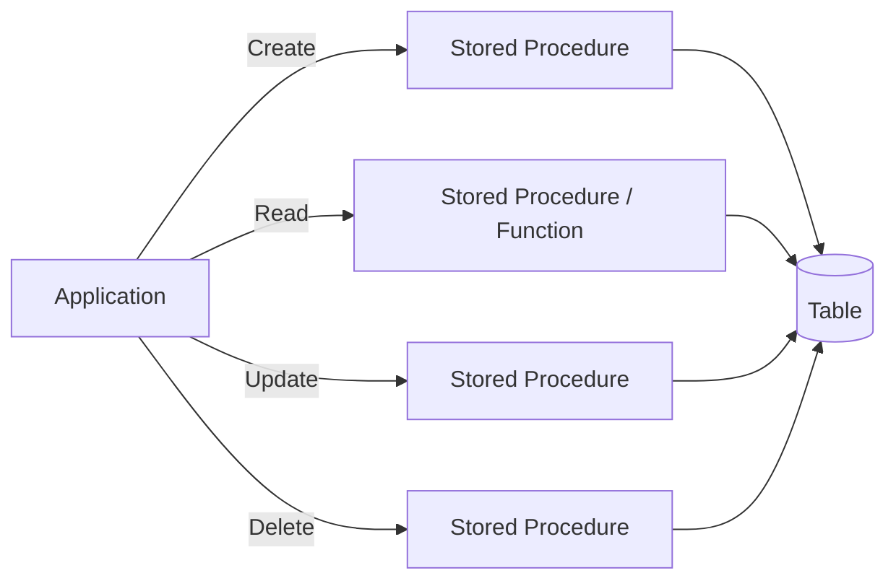
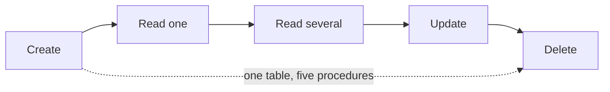
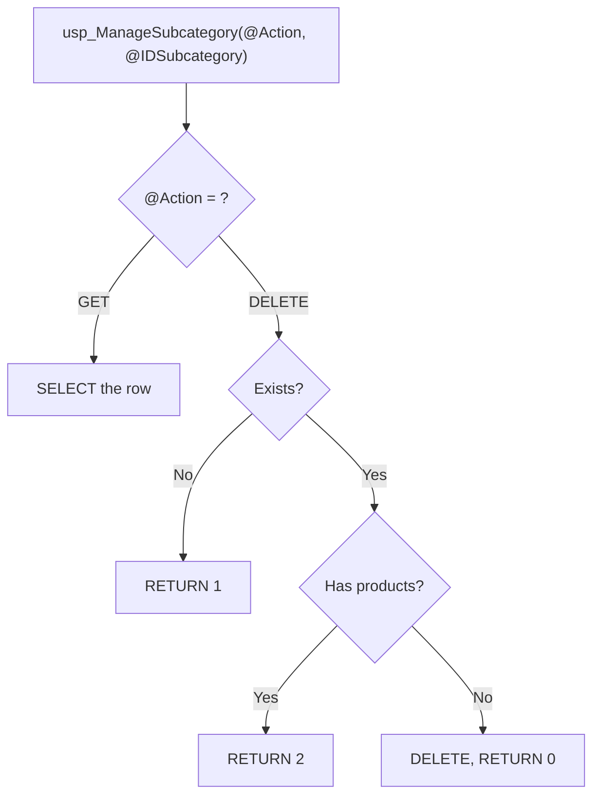
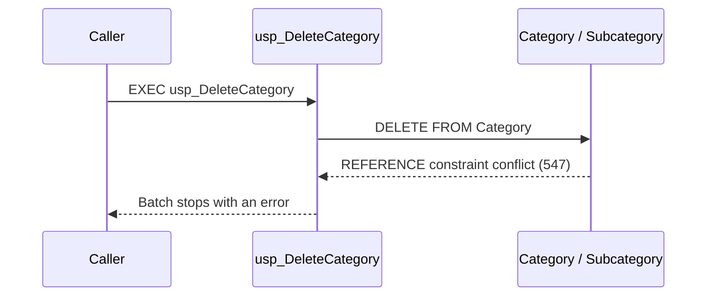
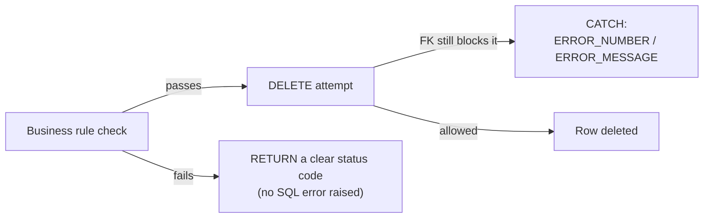
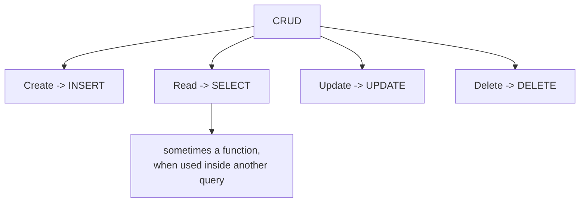

# Lab 7 – CRUD Operations

**Database:** `AdventureWorksENG`

This lab organizes everything you already know about stored procedures, parameters, and return values around one practical goal: implementing **Create, Read, Update, and Delete (CRUD)** operations against real tables.

Lab 3 introduced the mechanics of stored procedures. This lab is about **applying** those mechanics to a complete set of data operations, choosing between different ways of organizing them, and handling the problems that show up only once you start changing data: missing rows, business rules, and referential integrity.

> [!IMPORTANT]
> **Core idea:** CRUD is not "four procedures." It is four kinds of operations an application needs. How you package them — one procedure per operation, a shared procedure, or a function — is a design decision.

---

## Learning objectives

After completing this lab, you should be able to:

- organize Create, Read, Update, and Delete operations using stored procedures;
- choose between separate procedures and one procedure that supports several operations;
- implement a read operation as an inline table-valued function when that is appropriate;
- verify the result of an operation, including when zero rows are affected;
- distinguish a missing record, a rejected operation, and a SQL Server error;
- use a basic `TRY/CATCH` block to handle an error raised by a CRUD operation;
- explain how primary keys, foreign keys, and business rules constrain CRUD operations.

Start by selecting the training database:

```sql
USE AdventureWorksENG;
GO
```

> [!NOTE]
> **Prerequisites:** This lab builds directly on [Lab 3 – Stored Procedures](lab03-stored-procedures.md) (input parameters, `OUTPUT` parameters, `RETURN`, `CREATE OR ALTER`) and on the basic `TRY/CATCH` block from [Lab 0 – T-SQL Essentials](lab00-tsql-essentials.md). It also uses the inline table-valued function syntax from [Lab 4 – Functions](lab04-functions.md). None of these topics are re-explained in depth here — only applied.

---

# Section 1 – What CRUD Means

## Why not just let the application run SQL directly?

Every table in a database needs the same basic things done to it: new rows get added, existing rows get looked up, changed, and eventually removed. Nothing stops an application from doing this with raw `INSERT`, `SELECT`, `UPDATE`, and `DELETE` statements sent straight from application code.

In practice, that causes real problems once more than a trivial amount of code touches the data:

- **Scattered rules.** If five different parts of an application each contain their own `DELETE FROM Customer ...`, who makes sure none of them deletes a customer that still has invoices? Either every one of those five places repeats the same check, or — more realistically — one of them eventually forgets.
- **No single place to fix a bug.** If the rule for "which customers can be deleted" changes, you need to find and update every place that implemented it.
- **Harder to control access.** Granting an application `DELETE` rights on `Customer` lets it delete *any* row, in *any* way. Granting it rights to execute one specific procedure lets it perform exactly the operation that procedure implements — nothing more.

This is the same idea Lab 3 introduced as a **database interface**: the application asks for a named operation, and the database decides how that operation is actually carried out — including whatever validation belongs to it. CRUD is simply the recurring pattern of *which* operations almost every table ends up needing.

## What CRUD means

**CRUD** stands for four kinds of operations an application performs on data:

| Letter | Operation | Typical SQL statement |
|---|---|---|
| **C**reate | add a new record | `INSERT` |
| **R**ead | retrieve one or more records | `SELECT` |
| **U**pdate | modify an existing record | `UPDATE` |
| **D**elete | remove a record | `DELETE` |

> [!NOTE]
> You may also see the "R" spelled out as **Retrieve** rather than Read — same meaning, both in common use.

You already know all four statements. What this lab adds is **how to package them behind a stable, reusable database interface** — the same idea introduced in Lab 3, now applied systematically to all four operations, for real tables, including the problems that only show up once you start changing data.



> [!IMPORTANT]
> CRUD describes **four categories of operations**, not a fixed number of procedures. A "Read" requirement alone can split into "get one record" and "find several records by a criterion" — two different procedures, both still "R".

Equally, a single procedure can sometimes support more than one operation. Section 5 of this lab looks at that approach directly.

## Check your understanding

1. What do the four letters of CRUD stand for?
2. Does CRUD require exactly four stored procedures per table?
3. Which SQL statement typically implements the "Read" operation?
4. Give one concrete problem that can happen if several parts of an application each send their own raw `DELETE` statement against a table, instead of going through one shared procedure.

<details>
<summary>Show answers</summary>

1. Create, Read, Update, Delete.
2. No. CRUD describes four categories of operations; a table may need more than one procedure for "Read" (one record vs. several), and some operations may be combined into one procedure.
3. `SELECT`.
4. Any validation the delete should respect (e.g., "do not delete a customer who still has invoices") has to be repeated correctly in every one of those places, and a later rule change has to be found and fixed everywhere it was duplicated.

</details>

---

# Section 2 – CRUD with Separate Procedures: `Category`

The most direct way to organize CRUD is one procedure per operation. This section builds a complete, working set for the `Category` table (`IDCategory`, `Name`), as described in [SCHEMA-REFERENCE.md](../SCHEMA-REFERENCE.md).

`Category` is a good first example: it has no required input columns beyond `Name`, and a freshly inserted row has no dependent rows yet, so every operation below can be demonstrated cleanly. Section 6 returns to this table once a category *does* have dependent rows.

## Create

```sql
CREATE OR ALTER PROCEDURE dbo.usp_InsertCategory
    @Name           nvarchar(50),
    @NewCategoryID  int OUTPUT
AS
BEGIN
    SET NOCOUNT ON;

    INSERT INTO Category (Name)
    VALUES (@Name);

    SET @NewCategoryID = SCOPE_IDENTITY();
END
GO
```

This is the same `OUTPUT` + `SCOPE_IDENTITY()` pattern from Lab 3 — here used specifically for the "C" in CRUD: the caller gets back the key of the row it just created.

Call it:

```sql
DECLARE @NewID int;

EXEC dbo.usp_InsertCategory
    @Name          = N'ZZ_LabTestCategory_Empty',
    @NewCategoryID = @NewID OUTPUT;

SELECT @NewID AS NewCategoryID;
```

Verify:

```sql
SELECT *
FROM Category
WHERE Name = N'ZZ_LabTestCategory_Empty';
```

## Read one record

```sql
CREATE OR ALTER PROCEDURE dbo.usp_GetCategory
    @IDCategory int
AS
BEGIN
    SET NOCOUNT ON;

    SELECT
        IDCategory,
        Name
    FROM Category
    WHERE IDCategory = @IDCategory;
END
GO
```

Call it with a valid ID (use the `@NewID` captured above) and with one that cannot exist:

```sql
EXEC dbo.usp_GetCategory @IDCategory = 1;

EXEC dbo.usp_GetCategory @IDCategory = 999999;
```

> [!NOTE]
> A "Get one record" procedure does not raise an error for a missing ID. It simply returns an **empty result set** — zero rows, not `NULL`, not an error. The caller must check whether any row came back.

## Read several records by a criterion

```sql
CREATE OR ALTER PROCEDURE dbo.usp_FindCategoriesByName
    @NamePattern nvarchar(50)
AS
BEGIN
    SET NOCOUNT ON;

    SELECT
        IDCategory,
        Name
    FROM Category
    WHERE Name LIKE @NamePattern
    ORDER BY Name;
END
GO
```

```sql
EXEC dbo.usp_FindCategoriesByName @NamePattern = N'ZZ_LabTest%';
```

This is a different "R" from `usp_GetCategory`: one record by key vs. zero, one, or many records by a pattern. Both are legitimate "Read" procedures for the same table.

## Update

```sql
CREATE OR ALTER PROCEDURE dbo.usp_UpdateCategoryName
    @IDCategory int,
    @NewName    nvarchar(50)
AS
BEGIN
    SET NOCOUNT ON;

    UPDATE Category
    SET Name = @NewName
    WHERE IDCategory = @IDCategory;

    SELECT @@ROWCOUNT AS RowsUpdated;
END
GO
```

Test a real update, then an update of an ID that does not exist:

```sql
DECLARE @NewID int;

SELECT @NewID = IDCategory
FROM Category
WHERE Name = N'ZZ_LabTestCategory_Empty';

EXEC dbo.usp_UpdateCategoryName
    @IDCategory = @NewID,
    @NewName    = N'ZZ_LabTestCategory_Renamed';
-- RowsUpdated = 1

EXEC dbo.usp_UpdateCategoryName
    @IDCategory = 999999,
    @NewName    = N'Does not matter';
-- RowsUpdated = 0
```

> [!IMPORTANT]
> `RowsUpdated = 0` is not an error. The statement executed correctly; it simply found nothing to change. Section 6 comes back to this distinction in more detail.

## Delete

```sql
CREATE OR ALTER PROCEDURE dbo.usp_DeleteCategory
    @IDCategory int
AS
BEGIN
    SET NOCOUNT ON;

    DELETE FROM Category
    WHERE IDCategory = @IDCategory;

    SELECT @@ROWCOUNT AS RowsDeleted;
END
GO
```

```sql
DECLARE @IDToDelete int;

SELECT @IDToDelete = IDCategory
FROM Category
WHERE Name = N'ZZ_LabTestCategory_Renamed';

EXEC dbo.usp_DeleteCategory @IDCategory = @IDToDelete;
-- RowsDeleted = 1

EXEC dbo.usp_DeleteCategory @IDCategory = @IDToDelete;
-- RowsDeleted = 0 (already gone)
```

This works cleanly here because `ZZ_LabTestCategory_Empty` never had any subcategories. **Not every category can be deleted this simply** — Section 6 uses this exact procedure against a category that *does* have dependent rows.



## Check your understanding

1. Why does `usp_GetCategory` return an empty result set instead of raising an error for a missing ID?
2. Why are `usp_GetCategory` and `usp_FindCategoriesByName` both "Read" procedures, even though they look different?
3. What does `RowsUpdated = 0` tell you about the `UPDATE` statement that just ran?

<details>
<summary>Show answers</summary>

1. Looking for a specific ID is simply a filter condition. If no row matches, `SELECT` correctly returns zero rows — this is normal behavior, not an error.
2. Both retrieve data without changing it. "Read" covers both "find one record by key" and "find a set of records by a criterion."
3. The statement executed without error, but no row matched the `WHERE` clause, so nothing was changed.

</details>

---

# Section 3 – Practice: CRUD for `State` and `City`

Now implement a similar set of operations yourself, using `State` and `City` (see [SCHEMA-REFERENCE.md](../SCHEMA-REFERENCE.md)). The exercises get progressively harder: Exercise 1 is a single insert, Exercise 4 combines a business condition with `RETURN`.

`City.StateID` is an **optional** foreign key to `State.IDState`. Keep that in mind — it means a city does not strictly need a state, but a state that already has cities attached cannot be deleted without consequences (Section 6 and 7 return to this).

## Exercise 1 — Insert a state [BEGINNER]

Create `dbo.usp_InsertState` with parameters `@Name nvarchar(50)` and `@NewStateID int OUTPUT`. Insert the row and return its generated ID.

Test it with:

```sql
DECLARE @NewID int;

EXEC dbo.usp_InsertState
    @Name       = N'ZZ_LabTestState',
    @NewStateID = @NewID OUTPUT;

SELECT @NewID AS NewStateID;
```

<details>
<summary>Hint</summary>

Use the same `INSERT` + `SCOPE_IDENTITY()` + `OUTPUT` pattern as `usp_InsertCategory` in Section 2.

</details>

<details>
<summary>Solution</summary>

```sql
CREATE OR ALTER PROCEDURE dbo.usp_InsertState
    @Name       nvarchar(50),
    @NewStateID int OUTPUT
AS
BEGIN
    SET NOCOUNT ON;

    INSERT INTO State (Name)
    VALUES (@Name);

    SET @NewStateID = SCOPE_IDENTITY();
END
GO
```

</details>

## Exercise 2 — Insert a city [BEGINNER]

Create `dbo.usp_InsertCity` with parameters `@Name nvarchar(50)`, `@StateID int`, and `@NewCityID int OUTPUT`.

Using the state created in Exercise 1, insert **two** cities: `ZZ_LabTestCity1` and `ZZ_LabTestCity2`.

<details>
<summary>Hint</summary>

Unlike Lab 3's `usp_InsertCityInState`, you do not need to look up the state by name here — the caller already has `@StateID` from Exercise 1.

</details>

<details>
<summary>Solution</summary>

```sql
CREATE OR ALTER PROCEDURE dbo.usp_InsertCity
    @Name      nvarchar(50),
    @StateID   int,
    @NewCityID int OUTPUT
AS
BEGIN
    SET NOCOUNT ON;

    INSERT INTO City (Name, StateID)
    VALUES (@Name, @StateID);

    SET @NewCityID = SCOPE_IDENTITY();
END
GO
```

```sql
DECLARE @StateID int;

SELECT @StateID = IDState
FROM State
WHERE Name = N'ZZ_LabTestState';

DECLARE @City1 int, @City2 int;

EXEC dbo.usp_InsertCity N'ZZ_LabTestCity1', @StateID, @City1 OUTPUT;
EXEC dbo.usp_InsertCity N'ZZ_LabTestCity2', @StateID, @City2 OUTPUT;

SELECT @City1 AS City1ID, @City2 AS City2ID;
```

</details>

## Exercise 3 — Read cities by state [INTERMEDIATE]

Create `dbo.usp_GetCitiesByState` with parameter `@IDState int`. Return `IDCity` and `Name` for every city in that state, sorted by `Name`.

Test it against `ZZ_LabTestState` — you should get exactly 2 rows.

<details>
<summary>Hint</summary>

Filter `City` on `StateID = @IDState`. No `JOIN` is required because the caller already supplies the state's ID.

</details>

<details>
<summary>Solution</summary>

```sql
CREATE OR ALTER PROCEDURE dbo.usp_GetCitiesByState
    @IDState int
AS
BEGIN
    SET NOCOUNT ON;

    SELECT
        IDCity,
        Name
    FROM City
    WHERE StateID = @IDState
    ORDER BY Name;
END
GO
```

```sql
DECLARE @StateID int;

SELECT @StateID = IDState
FROM State
WHERE Name = N'ZZ_LabTestState';

EXEC dbo.usp_GetCitiesByState @IDState = @StateID;
-- Expected: 2 rows (ZZ_LabTestCity1, ZZ_LabTestCity2)
```

</details>

## Exercise 4 — Delete a city, but not if it has customers [ADVANCED]

Create `dbo.usp_DeleteCity` with parameter `@IDCity int`. Use `RETURN` to report the outcome:

| Return code | Meaning |
|---:|---|
| `0` | city deleted |
| `1` | city does not exist |
| `2` | city has at least one customer and was **not** deleted |

Test all three cases:

1. Delete `ZZ_LabTestCity1` (no customers) — expect `0`.
2. Delete `ZZ_LabTestCity1` again — expect `1`.
3. Insert a test customer into `ZZ_LabTestCity2` (see Section 4 for the `Customer` columns), then try to delete `ZZ_LabTestCity2` — expect `2`, and the city must still exist afterward.

<details>
<summary>Hint</summary>

Check existence first with `IF NOT EXISTS (...) RETURN 1;`. Check for customers with `IF EXISTS (SELECT 1 FROM Customer WHERE CityID = @IDCity) RETURN 2;`. Only then run the `DELETE`.

</details>

<details>
<summary>Solution</summary>

```sql
CREATE OR ALTER PROCEDURE dbo.usp_DeleteCity
    @IDCity int
AS
BEGIN
    SET NOCOUNT ON;

    IF NOT EXISTS (SELECT 1 FROM City WHERE IDCity = @IDCity)
        RETURN 1;

    IF EXISTS (SELECT 1 FROM Customer WHERE CityID = @IDCity)
        RETURN 2;

    DELETE FROM City
    WHERE IDCity = @IDCity;

    RETURN 0;
END
GO
```

```sql
DECLARE @City1 int, @City2 int, @Result int;

SELECT @City1 = IDCity FROM City WHERE Name = N'ZZ_LabTestCity1';
SELECT @City2 = IDCity FROM City WHERE Name = N'ZZ_LabTestCity2';

EXEC @Result = dbo.usp_DeleteCity @IDCity = @City1;
SELECT @Result AS DeleteCity1_FirstTry; -- 0

EXEC @Result = dbo.usp_DeleteCity @IDCity = @City1;
SELECT @Result AS DeleteCity1_SecondTry; -- 1

INSERT INTO Customer (FirstName, LastName, CityID)
VALUES (N'ZZ', N'ZZ_LabTestCustomer_ForDeleteTest', @City2);

EXEC @Result = dbo.usp_DeleteCity @IDCity = @City2;
SELECT @Result AS DeleteCity2_WithCustomer; -- 2

SELECT * FROM City WHERE IDCity = @City2; -- still exists
```

Note that the `@IDCity` check and the `Customer` check are both business-rule pre-checks written in T-SQL — nothing here relies on a database constraint yet. Section 7 compares this style of protection with what the foreign keys already enforce on their own.

</details>

## Exercise 5 — Save a state: Create and Update combined [ADVANCED]

Section 5 introduces "Create + Update combined" as one of the common ways to group CRUD operations: one "save" procedure that inserts a new row when the caller has no ID yet, and updates the existing row when it does.

Create `dbo.usp_SaveState` with parameters `@IDState int OUTPUT` and `@Name nvarchar(50)`:

- if `@IDState` is `NULL`, **insert** a new state and return its generated ID through `@IDState`;
- otherwise, **update** the `Name` of the state with that ID.

Test it by calling it once to create a state, then again — passing back the ID you got the first time — to rename it.

<details>
<summary>Hint</summary>

`State.IDState` is an identity column, so you cannot insert a specific ID value. That is exactly why the "create" branch ignores any incoming value and produces a fresh one with `SCOPE_IDENTITY()`, while the "update" branch trusts the ID the caller already has.

</details>

<details>
<summary>Solution</summary>

```sql
CREATE OR ALTER PROCEDURE dbo.usp_SaveState
    @IDState int OUTPUT,
    @Name    nvarchar(50)
AS
BEGIN
    SET NOCOUNT ON;

    IF @IDState IS NULL
    BEGIN
        INSERT INTO State (Name)
        VALUES (@Name);

        SET @IDState = SCOPE_IDENTITY();
    END
    ELSE
    BEGIN
        UPDATE State
        SET Name = @Name
        WHERE IDState = @IDState;
    END
END
GO
```

```sql
DECLARE @IDState int = NULL;

EXEC dbo.usp_SaveState
    @IDState = @IDState OUTPUT,
    @Name    = N'ZZ_LabTestState_Saved';

SELECT @IDState AS NewStateID;

EXEC dbo.usp_SaveState
    @IDState = @IDState OUTPUT,
    @Name    = N'ZZ_LabTestState_SavedRenamed';

SELECT * FROM State WHERE IDState = @IDState;
-- same row, Name is now 'ZZ_LabTestState_SavedRenamed'
```

The same `@IDState` variable is passed in and received back via `OUTPUT` in the same call — a common idiom for this pattern. The first call leaves it `NULL` on the way in, so the procedure inserts; the second call supplies the value the first call produced, so the procedure updates.

This procedure makes one simplification worth naming: it does not check whether the `@IDState` passed to the "update" branch actually exists. If it does not, `UPDATE` simply matches zero rows — the same "not an error, just zero rows" case from Section 2.

</details>

---

# Section 4 – Functions and Data Access

Section 3 of Lab 4 introduced inline table-valued functions (TVFs) as a "parameterised View." CRUD read operations are exactly where that distinction matters: a function can be used inside `FROM` and joined with other tables, while a procedure can only be executed on its own.

## Setup

```sql
INSERT INTO City (Name, StateID)
VALUES (N'ZZ_LabTestCity3', NULL);

DECLARE @CityID int = SCOPE_IDENTITY();

INSERT INTO Customer (FirstName, LastName, CityID)
VALUES
    (N'Ada',   N'ZZ_LabTestCustomer', @CityID),
    (N'Grace', N'ZZ_LabTestCustomer', @CityID);
```

(`City.StateID` is nullable, so this test city does not need a state.)

## The same read, as a procedure and as a function

```sql
CREATE OR ALTER PROCEDURE dbo.usp_GetCustomersByCity
    @CityName nvarchar(50)
AS
BEGIN
    SET NOCOUNT ON;

    SELECT
        c.IDCustomer,
        c.FirstName,
        c.LastName,
        ci.Name AS City
    FROM Customer AS c
    JOIN City AS ci
        ON ci.IDCity = c.CityID
    WHERE ci.Name = @CityName
    ORDER BY c.LastName, c.FirstName;
END
GO
```

```sql
CREATE OR ALTER FUNCTION dbo.fn_CustomersByCity
(
    @CityName nvarchar(50)
)
RETURNS TABLE
AS
RETURN
(
    SELECT
        c.IDCustomer,
        c.FirstName,
        c.LastName,
        ci.Name AS City
    FROM Customer AS c
    JOIN City AS ci
        ON ci.IDCity = c.CityID
    WHERE ci.Name = @CityName
);
GO
```

Both return the same rows:

```sql
EXEC dbo.usp_GetCustomersByCity @CityName = N'ZZ_LabTestCity3';

SELECT *
FROM dbo.fn_CustomersByCity(N'ZZ_LabTestCity3');
```

## Where they stop being equivalent

The function can be joined directly with another table:

```sql
SELECT
    f.FirstName,
    f.LastName,
    i.IDInvoice,
    i.InvoiceDate
FROM dbo.fn_CustomersByCity(N'ZZ_LabTestCity3') AS f
LEFT JOIN Invoice AS i
    ON i.CustomerID = f.IDCustomer;
```

Both `IDInvoice` and `InvoiceDate` come back `NULL` for these two customers — they were just created and have no invoices yet. Keep this observation in mind; the final exercise in this lab (Section 8) is built around finding exactly this kind of customer.

The equivalent is **not possible** with `usp_GetCustomersByCity`:

```sql
-- This is not valid:
SELECT *
FROM dbo.usp_GetCustomersByCity('ZZ_LabTestCity3') AS f
LEFT JOIN Invoice ...
```

A procedure's result set cannot be joined like a table source.

> [!TIP]
> Use a procedure when the caller needs to run the read on its own. Use a function when the result needs to participate in a larger query — a `JOIN`, a filter, or a subquery.

## Limits to keep in mind

The inline TVF above is read-only by design — this is a property of T-SQL user-defined functions in general (Lab 4, Section 1), not something specific to CRUD:

- it cannot `INSERT`, `UPDATE`, or `DELETE` any table;
- it cannot use `OUTPUT` parameters or `RETURN` a status code the way a procedure does — it has exactly one output, the table itself;
- a multi-statement TVF (Lab 4, Section 6) is still only for *returning* a table — it does not change this.

This is why every Create, Update, and Delete operation in this lab is implemented as a **procedure**. Functions are the right tool only for the "R" in CRUD.

## Check your understanding

1. Why can `fn_CustomersByCity` be used in a `JOIN`, while `usp_GetCustomersByCity` cannot?
2. Could `fn_CustomersByCity` be rewritten to also delete inactive customers? Why or why not?
3. When would you prefer the procedure over the function, even though both return the same rows?

<details>
<summary>Show answers</summary>

1. The function returns a table, which SQL Server can use as a row source anywhere a table is expected. A procedure's result set is only available to the statement that executed it.
2. No. T-SQL user-defined functions cannot modify application tables, regardless of how the function is written.
3. When the caller just needs to run the read directly, e.g., from application code that calls stored procedures uniformly, or when the read needs `OUTPUT`/`RETURN` alongside the rows.

</details>

---

# Section 5 – One Procedure for Multiple Operations

So far, every operation has had its own procedure. An alternative is **one procedure that performs several operations**, selected by a parameter.

## Common ways to group CRUD operations

In practice, you will usually see one of a few recognizable groupings:

| Style | Create | Read | Update | Delete |
|---|---|---|---|---|
| Fully separate (a.k.a. "one procedure per operation") | own procedure | own procedure (or function, Section 4) | own procedure | own procedure |
| Create + Update combined (a.k.a. "combined write / separate reads") | combined into one procedure | own procedure (or function) | *(same procedure as Create)* | own procedure |
| Create + Update + Delete combined (a.k.a. "single write procedure") | combined into one procedure | own procedure (or function) | *(same procedure)* | *(same procedure)* |

Notice what stays constant across all three: **Read is always its own procedure, or a function.** Since a function cannot modify data (Section 4), it can only ever stand in for the "R" — never for Create, Update, or Delete, in any of these groupings.

`Create + Update combined` typically takes the shape of a "save" procedure: if the caller passes no ID (or `NULL`), the procedure inserts a new row; if the caller passes an existing ID, it updates that row instead. `Create + Update + Delete combined` extends the same idea with an explicit `@Action` (or similar) parameter to tell the three write operations apart.

This section builds a **different** combination: one procedure that supports **Read and Delete** together, for `Subcategory` (`IDSubcategory`, `CategoryID`, `Name`). This is not one of the three groupings above — it is a grouping that fits a specific requirement you will meet again in Section 8. The underlying lesson is the same either way:

> [!IMPORTANT]
> There is no single correct way to group CRUD operations into procedures. Pick the grouping that matches what a specific requirement actually needs, not a fixed rule. Section 3's Exercise 5 lets you practice the "Create + Update combined" style directly.

## Setup

```sql
DECLARE @CategoryID int;

INSERT INTO Category (Name) VALUES (N'ZZ_LabTestCategory_ForSub');
SET @CategoryID = SCOPE_IDENTITY();

DECLARE @SubWithProduct int, @SubWithoutProduct int;

INSERT INTO Subcategory (CategoryID, Name) VALUES (@CategoryID, N'ZZ_LabTestSubcategory_Used');
SET @SubWithProduct = SCOPE_IDENTITY();

INSERT INTO Subcategory (CategoryID, Name) VALUES (@CategoryID, N'ZZ_LabTestSubcategory_Unused');
SET @SubWithoutProduct = SCOPE_IDENTITY();

INSERT INTO Product (Name, ProductNumber, MinimumQuantityInStock, PriceWithoutVAT, SubcategoryID)
VALUES (N'ZZ_LabTestProduct', N'ZZ-LAB-0001', 0, 1.00, @SubWithProduct);

SELECT @SubWithProduct AS SubWithProduct, @SubWithoutProduct AS SubWithoutProduct;
```

## The combined procedure

```sql
CREATE OR ALTER PROCEDURE dbo.usp_ManageSubcategory
    @Action         nvarchar(10),
    @IDSubcategory  int
AS
BEGIN
    SET NOCOUNT ON;

    IF @Action = N'GET'
    BEGIN
        SELECT
            IDSubcategory,
            CategoryID,
            Name
        FROM Subcategory
        WHERE IDSubcategory = @IDSubcategory;

        RETURN 0;
    END

    IF @Action = N'DELETE'
    BEGIN
        IF NOT EXISTS (SELECT 1 FROM Subcategory WHERE IDSubcategory = @IDSubcategory)
            RETURN 1; -- not found

        IF EXISTS (SELECT 1 FROM Product WHERE SubcategoryID = @IDSubcategory)
            RETURN 2; -- has products, deletion rejected

        DELETE FROM Subcategory
        WHERE IDSubcategory = @IDSubcategory;

        RETURN 0;
    END

    RETURN 99; -- unknown action
END
GO
```

Test every path. Look up the two subcategory IDs created in the setup step by name, so the test does not depend on remembering their generated identity values:

```sql
DECLARE @SubWithProduct int, @SubWithoutProduct int, @Result int;

SELECT @SubWithProduct    = IDSubcategory FROM Subcategory WHERE Name = N'ZZ_LabTestSubcategory_Used';
SELECT @SubWithoutProduct = IDSubcategory FROM Subcategory WHERE Name = N'ZZ_LabTestSubcategory_Unused';

EXEC @Result = dbo.usp_ManageSubcategory @Action = N'GET', @IDSubcategory = @SubWithProduct;
-- returns the row and RETURN 0

EXEC @Result = dbo.usp_ManageSubcategory @Action = N'DELETE', @IDSubcategory = 999999;
SELECT @Result AS DeleteMissing; -- 1

EXEC @Result = dbo.usp_ManageSubcategory @Action = N'DELETE', @IDSubcategory = @SubWithProduct;
SELECT @Result AS DeleteUsed; -- 2, rejected, Product still points to it

EXEC @Result = dbo.usp_ManageSubcategory @Action = N'DELETE', @IDSubcategory = @SubWithoutProduct;
SELECT @Result AS DeleteUnused; -- 0, deleted
```



## Comparing the two designs

| Aspect | Separate procedures (Section 2) | One combined procedure (this section) |
|---|---|---|
| Readability | Each procedure has one clear purpose | Caller must know which `@Action` values exist |
| Interface | More procedures to discover and document | One name to call, with a "mode" parameter |
| Maintenance | A change to "Delete" cannot break "Get" | A bug in shared validation logic affects every action |
| Extensibility | Add a new procedure for a new operation | Add another `IF @Action = ...` branch |
| Parameter list | Each procedure takes only what it needs | `@IDSubcategory` is required even for actions that might not use every parameter |

> [!IMPORTANT]
> Neither approach is always better. Separate procedures usually give the clearest interface when operations have little in common. A combined procedure can make sense when several operations share most of their validation logic, or when an application wants one well-known entry point for a group of related actions. The right choice depends on the specific requirement — this is a design decision, not a rule.

## Check your understanding

1. What determines which branch of `usp_ManageSubcategory` runs?
2. Why does `DELETE` on `@SubWithProduct` return `2` instead of actually deleting the row?
3. Name one advantage of separate procedures over a combined procedure, and one advantage in the other direction.

<details>
<summary>Show answers</summary>

1. The `@Action` parameter.
2. The procedure checks for dependent `Product` rows before deleting and returns a specific code instead of deleting a subcategory that is still in use.
3. Separate procedures: each one has a single, obvious purpose, which usually makes the interface easier to understand. Combined procedure: one name to call and document for a group of closely related operations, with shared validation logic written once.

</details>

## Challenge — Create + Update + Delete combined

`usp_ManageSubcategory` combines Read and Delete. Now try the grouping from the comparison table at the start of this section: **Create, Update, and Delete combined in one procedure, with Read kept separate.**

Create `dbo.usp_ManageCategory` with parameters `@Action nvarchar(10)`, `@IDCategory int OUTPUT`, and `@Name nvarchar(50) = NULL`, supporting:

| `@Action` | Behavior | `RETURN` |
|---|---|---|
| `N'INSERT'` | insert a new category with `@Name`; return its ID through `@IDCategory` | `0` |
| `N'UPDATE'` | update the `Name` of the category identified by `@IDCategory` | `0` on success, `1` if no row matched |
| `N'DELETE'` | delete the category identified by `@IDCategory`, unless it has subcategories | `0` deleted, `1` not found, `2` has subcategories |

Reuse `usp_GetCategory` and `usp_FindCategoriesByName` from Section 2 for "Read" — this procedure does not need to implement it again.

<details>
<summary>Hint</summary>

`@IDCategory` plays two roles depending on `@Action`: for `INSERT` it is purely an output (the caller does not know the ID yet); for `UPDATE` and `DELETE` it is also an input, the same idiom used by `usp_SaveState` in Section 3. Combine the `DELETE` branch with the same `IF NOT EXISTS` / `IF EXISTS` pre-check structure already used by `usp_DeleteCity` (Section 3) and `usp_ManageSubcategory` (this section) — no `TRY/CATCH` needed yet; Section 6 introduces that next, using a different category.

</details>

<details>
<summary>Solution</summary>

```sql
CREATE OR ALTER PROCEDURE dbo.usp_ManageCategory
    @Action     nvarchar(10),
    @IDCategory int OUTPUT,
    @Name       nvarchar(50) = NULL
AS
BEGIN
    SET NOCOUNT ON;

    IF @Action = N'INSERT'
    BEGIN
        INSERT INTO Category (Name)
        VALUES (@Name);

        SET @IDCategory = SCOPE_IDENTITY();
        RETURN 0;
    END

    IF @Action = N'UPDATE'
    BEGIN
        UPDATE Category
        SET Name = @Name
        WHERE IDCategory = @IDCategory;

        IF @@ROWCOUNT = 0
            RETURN 1;

        RETURN 0;
    END

    IF @Action = N'DELETE'
    BEGIN
        IF NOT EXISTS (SELECT 1 FROM Category WHERE IDCategory = @IDCategory)
            RETURN 1;

        IF EXISTS (SELECT 1 FROM Subcategory WHERE CategoryID = @IDCategory)
            RETURN 2;

        DELETE FROM Category
        WHERE IDCategory = @IDCategory;

        RETURN 0;
    END

    RETURN 99;
END
GO
```

```sql
DECLARE @IDCategory int, @Result int;

EXEC @Result = dbo.usp_ManageCategory
    @Action     = N'INSERT',
    @IDCategory = @IDCategory OUTPUT,
    @Name       = N'ZZ_LabTestCategory_Combined';

SELECT @IDCategory AS NewCategoryID, @Result AS InsertResult; -- 0

EXEC @Result = dbo.usp_ManageCategory
    @Action     = N'UPDATE',
    @IDCategory = @IDCategory OUTPUT,
    @Name       = N'ZZ_LabTestCategory_CombinedRenamed';

SELECT @Result AS UpdateResult; -- 0

EXEC @Result = dbo.usp_ManageCategory
    @Action     = N'DELETE',
    @IDCategory = @IDCategory OUTPUT;

SELECT @Result AS DeleteResult; -- 0, no subcategories, so it is deleted
```

`@IDCategory` is `OUTPUT` throughout: for `INSERT`, the procedure sets it; for `UPDATE` and `DELETE`, the procedure only reads it, so it simply keeps the value the caller passed in.

</details>

---

# Section 6 – Error Handling in CRUD Operations

Section 2 already showed that `RowsUpdated = 0` is not an error. This section introduces a genuinely different situation: SQL Server itself **rejecting** a statement.

## The problem: deleting a referenced row

Create a category that has a subcategory, then try to delete it with `usp_DeleteCategory` from Section 2 — unmodified, with no extra checks:

```sql
DECLARE @CategoryID int;

INSERT INTO Category (Name) VALUES (N'ZZ_LabTestCategory_WithSub');
SET @CategoryID = SCOPE_IDENTITY();

INSERT INTO Subcategory (CategoryID, Name)
VALUES (@CategoryID, N'ZZ_LabTestSubcategory_Blocking');

EXEC dbo.usp_DeleteCategory @IDCategory = @CategoryID;
```

This statement fails. SQL Server reports a REFERENCE constraint conflict (error number **547**) because `Subcategory.CategoryID` is a required foreign key pointing at this category. The batch stops at this error.



## Catching it with `TRY/CATCH`

Add the basic `TRY/CATCH` block from Lab 0 around the `DELETE`:

```sql
CREATE OR ALTER PROCEDURE dbo.usp_DeleteCategory
    @IDCategory int
AS
BEGIN
    SET NOCOUNT ON;

    BEGIN TRY
        DELETE FROM Category
        WHERE IDCategory = @IDCategory;

        SELECT @@ROWCOUNT AS RowsDeleted;
    END TRY
    BEGIN CATCH
        SELECT
            ERROR_NUMBER()  AS ErrorNumber,
            ERROR_MESSAGE() AS ErrorMessage;
    END CATCH
END
GO
```

Run the same failing call again, looking up the category by name:

```sql
DECLARE @CategoryID int;

SELECT @CategoryID = IDCategory
FROM Category
WHERE Name = N'ZZ_LabTestCategory_WithSub';

EXEC dbo.usp_DeleteCategory @IDCategory = @CategoryID;
```

Instead of stopping the batch, the procedure now returns `ErrorNumber = 547` and a readable message. The category is **not** deleted — `TRY/CATCH` reports the failure, it does not make the operation succeed.

> [!IMPORTANT]
> `TRY/CATCH` does not bypass a foreign key constraint. The `DELETE` is still rejected. The only thing that changes is that your code — rather than the raw SQL Server error — decides what the caller sees.

## Where should `TRY/CATCH` live?

`TRY/CATCH` does not have to live inside the procedure. The caller can wrap the `EXEC` call instead. Using the version of `usp_DeleteCategory` *without* its own `TRY/CATCH` (the one from Section 2):

```sql
DECLARE @CategoryID int;

SELECT @CategoryID = IDCategory
FROM Category
WHERE Name = N'ZZ_LabTestCategory_WithSub';

BEGIN TRY
    EXEC dbo.usp_DeleteCategory @IDCategory = @CategoryID;
END TRY
BEGIN CATCH
    SELECT
        ERROR_NUMBER()    AS ErrorNumber,
        ERROR_MESSAGE()   AS ErrorMessage,
        ERROR_PROCEDURE() AS FailedIn;
END CATCH
```

`ERROR_PROCEDURE()` reports `usp_DeleteCategory` here — it names where the error actually occurred, not where it was caught. This is exactly why it is useful at the caller's site: without it, you would only know that *something* the caller invoked had failed.

Both placements are valid, and the choice has real consequences:

| | `TRY/CATCH` inside the procedure | `TRY/CATCH` at the caller |
|---|---|---|
| Consistency | Every caller gets the same handling automatically | Each caller must remember to add it |
| What the caller sees | Whatever the procedure decides to return (e.g., a `RETURN` code) | The raw SQL Server error, unless the caller translates it |
| Risk | Easy to forget in one procedure among many | Easy to forget in one call site among many |

The procedures in this lab (Section 6 onward) put `TRY/CATCH` **inside** the procedure, so every caller automatically gets the same, already-translated status code instead of a raw SQL Server error.

## Four different "nothing happened," side by side

This lab has now produced four distinct situations. They look similar from the outside but mean different things:

| Situation | Example from this lab | How to detect it |
|---|---|---|
| Record does not exist | `usp_GetCategory @IDCategory = 999999` | Empty result set, or an explicit `IF NOT EXISTS` check |
| Operation matched zero rows | `usp_UpdateCategoryName` on a missing ID | `@@ROWCOUNT = 0` after the statement |
| Operation rejected by a business rule | `usp_ManageSubcategory` deleting `@SubWithProduct` | A specific `RETURN` code from an explicit pre-check |
| SQL Server rejected the statement | `usp_DeleteCategory` on a referenced category | `CATCH` runs; inspect `ERROR_NUMBER()` / `ERROR_MESSAGE()` |

> [!WARNING]
> Do not reach for `TRY/CATCH` as a general substitute for checking `@@ROWCOUNT` or validating business rules first. Use it for genuine SQL Server errors — constraint violations, conversion failures, and similar cases — not for "this matched no rows," which is normal, error-free behavior.

> [!NOTE]
> A `REFERENCE` constraint conflict (547) is one example of "SQL Server rejected the statement," but not the only one. Attempting to insert a duplicate `PRIMARY KEY` or `UNIQUE` value raises a different error (2627) — the "C" in CRUD can fail this way too. Every `INSERT` in this lab relies on an `IDENTITY` column, which is exactly what avoids this: the caller never supplies the key, so it cannot collide. A table where the caller supplies its own primary key would need the same kind of `TRY/CATCH` protection shown here, just for a different error number.

As a reminder from [Lab 0](lab00-tsql-essentials.md): `TRY/CATCH` catches errors of severity 11–19, which covers both 547 and 2627. It does not catch severity 1–10 (informational) or 20–25 (fatal) errors.

## Clean up this section's test data

Delete children before parents:

```sql
DELETE FROM Subcategory WHERE Name = N'ZZ_LabTestSubcategory_Blocking';
DELETE FROM Category WHERE Name = N'ZZ_LabTestCategory_WithSub';
```

## Check your understanding

1. Why does the first `EXEC dbo.usp_DeleteCategory` in this section fail?
2. After adding `TRY/CATCH`, is the category deleted when the procedure is called again?
3. Which SQL Server function gives you the text of the error inside `CATCH`? Which one tells you where the error happened?
4. Give one case where `CATCH` runs, and one case where it does not even though zero rows were affected.
5. What is one advantage of putting `TRY/CATCH` inside the procedure instead of at every caller?
6. Besides a `REFERENCE` constraint conflict, name another kind of error `TRY/CATCH` can catch in a CRUD procedure.

<details>
<summary>Show answers</summary>

1. `Subcategory.CategoryID` is a required foreign key referencing this category; SQL Server refuses to delete a row that is still referenced.
2. No. `TRY/CATCH` only changes how the failure is reported; the constraint still blocks the `DELETE`.
3. `ERROR_MESSAGE()` gives the text; `ERROR_PROCEDURE()` gives the name of the procedure where the error occurred.
4. `CATCH` runs when SQL Server raises an error, such as the 547 constraint violation above. It does not run for an `UPDATE` or `DELETE` that executes successfully but matches zero rows — that case is detected with `@@ROWCOUNT`, not `TRY/CATCH`.
5. Every caller automatically gets the same, already-translated handling, instead of each caller having to remember to wrap the `EXEC` call itself.
6. A `PRIMARY KEY` or `UNIQUE` constraint violation (error 2627), for example when an `INSERT` supplies a key value that already exists.

</details>

---

# Section 7 – Data Integrity and Business Rules

CRUD operations do not run in isolation — they run against a schema with primary keys, foreign keys, and constraints, summarized in [SCHEMA-REFERENCE.md](../SCHEMA-REFERENCE.md). Some restrictions come from the schema itself; others are rules your procedure enforces on top of it.

## Required vs. optional foreign keys

| Child table.column | → | Parent table.column | Required? |
|---|---|---|---|
| `City.StateID` | → | `State.IDState` | optional |
| `Customer.CityID` | → | `City.IDCity` | optional |
| `Invoice.CustomerID` | → | `Customer.IDCustomer` | **required** |
| `Invoice.SalesmanID` | → | `Salesman.IDSalesman` | optional |
| `Invoice.CreditCardID` | → | `CreditCard.IDCreditCard` | optional |
| `InvoiceItem.InvoiceID` | → | `Invoice.IDInvoice` | **required** |
| `InvoiceItem.ProductID` | → | `Product.IDProduct` | **required** |
| `Product.SubcategoryID` | → | `Subcategory.IDSubcategory` | optional |
| `Subcategory.CategoryID` | → | `Category.IDCategory` | **required** |

> [!WARNING]
> "Optional" describes whether a **child row can be inserted without a parent** (the FK column accepts `NULL`). It says nothing about deleting a parent that is **already referenced**. `Product.SubcategoryID` is optional, but a `Subcategory` that currently has products still cannot be deleted — exactly what Section 6 demonstrated.

## When a business rule matches the schema

Compare the two rules used in this lab's remaining exercises:

- "A customer can be deleted only if it has no invoices" — `Invoice.CustomerID` is a **required** foreign key, so SQL Server would reject this delete anyway if it were attempted directly.
- "A product can be deleted only if it has never been sold" — `InvoiceItem.ProductID` is also a **required** foreign key, so the same is true there.

In both cases, the business rule and the schema constraint protect the same thing. This is common, and it does not make the pre-check pointless:



- A pre-check (`IF EXISTS (...) RETURN ...`) fails fast, with a status code your application can act on directly.
- `TRY/CATCH` remains a safety net for whatever the pre-check did not anticipate — a race condition, a rule you forgot to check, or any other SQL Server error.

Neither replaces the other. Section 8 asks you to combine both.

## Check your understanding

1. Does a nullable foreign key column mean a referenced parent row can always be deleted?
2. `Invoice.CustomerID` is a required foreign key. What happens if a procedure tries to delete a `Customer` row that has invoices, without any pre-check?
3. Why might a procedure still check a business rule explicitly, even when a foreign key already enforces the same restriction?

<details>
<summary>Show answers</summary>

1. No. Nullability only means a child row does not have to reference a parent. A parent that is actually referenced by existing child rows still cannot be deleted.
2. The `DELETE` is rejected by SQL Server with a REFERENCE constraint error, the same kind of error shown in Section 6.
3. An explicit check lets the procedure report a clear, specific outcome (a status code) before attempting the operation, instead of relying on the caller to interpret a raw SQL Server error.

</details>

---

# Section 8 – Final Exercise: Get and Delete Without Breaking the Rules

This exercise combines everything from this lab: choosing between separate and combined procedures, implementing a read with a function or a procedure, pre-checking a business rule, and catching a SQL Server error as a safety net.

Work through **both** scenarios. They solve the same kind of problem with two different designs, matching the two approaches compared in Section 5.

## Scenario A — `Customer`: a separate function and a separate procedure

Implement:

- `dbo.fn_GetCustomer(@IDCustomer int)` — an inline table-valued function returning the matching row (`IDCustomer`, `FirstName`, `LastName`, `Email`, `PhoneNumber`, `CityID`) from `Customer`, or no rows if the ID does not exist.
- `dbo.usp_DeleteCustomer(@IDCustomer int)` — a procedure that deletes a customer **only if that customer has no invoices**, and reports the outcome with `RETURN`:

| Return code | Meaning |
|---:|---|
| `0` | customer deleted |
| `1` | customer does not exist |
| `2` | customer has at least one invoice; deletion rejected |
| `3` | SQL Server rejected the statement (caught by `TRY/CATCH`) |

### Prepare your own test data

```sql
INSERT INTO Customer (FirstName, LastName)
VALUES (N'ZZ', N'ZZ_LabTestCustomer_NoInvoices');

DECLARE @CustomerNoInvoices int = SCOPE_IDENTITY();

INSERT INTO Customer (FirstName, LastName)
VALUES (N'ZZ', N'ZZ_LabTestCustomer_WithInvoice');

DECLARE @CustomerWithInvoice int = SCOPE_IDENTITY();

INSERT INTO Invoice (InvoiceDate, InvoiceNumber, CustomerID)
VALUES (GETDATE(), N'ZZ-LAB-INV-0001', @CustomerWithInvoice);

SELECT @CustomerNoInvoices AS CustomerNoInvoices, @CustomerWithInvoice AS CustomerWithInvoice;
```

### Success criteria

- `fn_GetCustomer` used in a `SELECT ... FROM` returns the matching row, and zero rows for a nonexistent ID.
- Deleting `@CustomerNoInvoices` returns `0`, and the row is gone.
- Deleting `@CustomerWithInvoice` returns `2`, and the row (and its invoice) still exist.
- Deleting a nonexistent ID returns `1`.

<details>
<summary>Hints</summary>

- The function body is a single `SELECT`, exactly like `fn_CustomersByCity` in Section 4 — just filtered by `IDCustomer` instead of a city name.
- In the procedure, check existence first, then check `EXISTS (SELECT 1 FROM Invoice WHERE CustomerID = @IDCustomer)`, and only then run the `DELETE` inside `TRY/CATCH`.

</details>

<details>
<summary>Solution</summary>

```sql
CREATE OR ALTER FUNCTION dbo.fn_GetCustomer
(
    @IDCustomer int
)
RETURNS TABLE
AS
RETURN
(
    SELECT
        IDCustomer,
        FirstName,
        LastName,
        Email,
        PhoneNumber,
        CityID
    FROM Customer
    WHERE IDCustomer = @IDCustomer
);
GO

CREATE OR ALTER PROCEDURE dbo.usp_DeleteCustomer
    @IDCustomer int
AS
BEGIN
    SET NOCOUNT ON;

    IF NOT EXISTS (SELECT 1 FROM Customer WHERE IDCustomer = @IDCustomer)
        RETURN 1;

    IF EXISTS (SELECT 1 FROM Invoice WHERE CustomerID = @IDCustomer)
        RETURN 2;

    BEGIN TRY
        DELETE FROM Customer
        WHERE IDCustomer = @IDCustomer;
    END TRY
    BEGIN CATCH
        RETURN 3;
    END CATCH

    RETURN 0;
END
GO
```

```sql
DECLARE @CustomerNoInvoices int, @CustomerWithInvoice int, @Result int;

SELECT @CustomerNoInvoices   = IDCustomer FROM Customer WHERE LastName = N'ZZ_LabTestCustomer_NoInvoices';
SELECT @CustomerWithInvoice  = IDCustomer FROM Customer WHERE LastName = N'ZZ_LabTestCustomer_WithInvoice';

SELECT * FROM dbo.fn_GetCustomer(@CustomerNoInvoices);
SELECT * FROM dbo.fn_GetCustomer(999999); -- no rows

EXEC @Result = dbo.usp_DeleteCustomer @IDCustomer = @CustomerNoInvoices;
SELECT @Result AS DeleteNoInvoices; -- 0

EXEC @Result = dbo.usp_DeleteCustomer @IDCustomer = @CustomerWithInvoice;
SELECT @Result AS DeleteWithInvoice; -- 2

EXEC @Result = dbo.usp_DeleteCustomer @IDCustomer = @CustomerNoInvoices;
SELECT @Result AS DeleteAgain; -- 1, already gone
```

`RETURN 3` is defensive: the pre-check already covers the only foreign key involved (`Invoice.CustomerID`), so `TRY/CATCH` here is a safety net rather than the primary mechanism — consistent with Section 7.

</details>

## Scenario B — `Product`: one combined procedure

Implement `dbo.usp_ManageProduct(@Action nvarchar(10), @IDProduct int)`, supporting:

- `@Action = N'GET'` — return the matching row (`IDProduct`, `Name`, `ProductNumber`, `Color`, `PriceWithoutVAT`, `SubcategoryID`).
- `@Action = N'DELETE'` — delete the product **only if it has never appeared in `InvoiceItem`**, using the same `RETURN` codes as Scenario A (`0`, `1`, `2`, `3`), where `2` now means "product was sold at least once."

### Prepare your own test data

```sql
INSERT INTO Product (Name, ProductNumber, MinimumQuantityInStock, PriceWithoutVAT)
VALUES (N'ZZ_LabTestProduct_NeverSold', N'ZZ-LAB-0002', 0, 9.99);

DECLARE @ProductNeverSold int = SCOPE_IDENTITY();

INSERT INTO Product (Name, ProductNumber, MinimumQuantityInStock, PriceWithoutVAT)
VALUES (N'ZZ_LabTestProduct_Sold', N'ZZ-LAB-0003', 0, 9.99);

DECLARE @ProductSold int = SCOPE_IDENTITY();

INSERT INTO Invoice (InvoiceDate, InvoiceNumber, CustomerID)
VALUES (GETDATE(), N'ZZ-LAB-INV-0002', (SELECT TOP (1) IDCustomer FROM Customer));

DECLARE @InvoiceID int = SCOPE_IDENTITY();

INSERT INTO InvoiceItem (InvoiceID, ProductID, Quantity, InitialPrice, Discount, TotalPrice)
VALUES (@InvoiceID, @ProductSold, 1, 9.99, 0, 9.99);

SELECT @ProductNeverSold AS ProductNeverSold, @ProductSold AS ProductSold;
```

### Success criteria

- `GET` for `@ProductNeverSold` returns one row; `GET` for a nonexistent ID returns zero rows.
- `DELETE` for `@ProductNeverSold` returns `0`, and the row is gone.
- `DELETE` for `@ProductSold` returns `2`, and the row (and its invoice item) still exist.
- `DELETE` for a nonexistent ID returns `1`.

<details>
<summary>Hints</summary>

- Follow the same `IF @Action = ...` structure as `usp_ManageSubcategory` in Section 5.
- The "never sold" check is `NOT EXISTS (SELECT 1 FROM InvoiceItem WHERE ProductID = @IDProduct)`.

</details>

<details>
<summary>Solution</summary>

```sql
CREATE OR ALTER PROCEDURE dbo.usp_ManageProduct
    @Action    nvarchar(10),
    @IDProduct int
AS
BEGIN
    SET NOCOUNT ON;

    IF @Action = N'GET'
    BEGIN
        SELECT
            IDProduct,
            Name,
            ProductNumber,
            Color,
            PriceWithoutVAT,
            SubcategoryID
        FROM Product
        WHERE IDProduct = @IDProduct;

        RETURN 0;
    END

    IF @Action = N'DELETE'
    BEGIN
        IF NOT EXISTS (SELECT 1 FROM Product WHERE IDProduct = @IDProduct)
            RETURN 1;

        IF EXISTS (SELECT 1 FROM InvoiceItem WHERE ProductID = @IDProduct)
            RETURN 2;

        BEGIN TRY
            DELETE FROM Product
            WHERE IDProduct = @IDProduct;
        END TRY
        BEGIN CATCH
            RETURN 3;
        END CATCH

        RETURN 0;
    END

    RETURN 99;
END
GO
```

```sql
DECLARE @ProductNeverSold int, @ProductSold int, @Result int;

SELECT @ProductNeverSold = IDProduct FROM Product WHERE Name = N'ZZ_LabTestProduct_NeverSold';
SELECT @ProductSold      = IDProduct FROM Product WHERE Name = N'ZZ_LabTestProduct_Sold';

EXEC dbo.usp_ManageProduct @Action = N'GET', @IDProduct = @ProductNeverSold;
EXEC dbo.usp_ManageProduct @Action = N'GET', @IDProduct = 999999; -- no rows

EXEC @Result = dbo.usp_ManageProduct @Action = N'DELETE', @IDProduct = @ProductNeverSold;
SELECT @Result AS DeleteNeverSold; -- 0

EXEC @Result = dbo.usp_ManageProduct @Action = N'DELETE', @IDProduct = @ProductSold;
SELECT @Result AS DeleteSold; -- 2
```

</details>

## Compare the two scenarios

1. Scenario A uses a function for "Read" and a separate procedure for "Delete." Scenario B uses one procedure with an `@Action` parameter for both. Which did you find easier to call correctly? Which would be easier to extend with an "Update" operation later?
2. Both scenarios use the same four `RETURN` codes. Why does that consistency matter if an application calls many such procedures?
3. In both scenarios, the business rule matches an existing required foreign key. Where exactly would `CATCH` matter if that stopped being true — for example, if `InvoiceItem.ProductID` were ever changed to an optional foreign key?

<details>
<summary>Discussion</summary>

1. There is no single correct answer — this is the same trade-off compared in Section 5. A function + procedure pair gives two small, single-purpose objects; a combined procedure gives one entry point but requires every caller to know the `@Action` values.
2. A consistent set of return codes lets application code handle the outcome of any CRUD procedure the same way, without memorizing a different convention per procedure.
3. If the foreign key became optional, the database would no longer block the delete on its own. The business-rule pre-check (`EXISTS (...)`) would then be the **only** protection, and `CATCH` would no longer have that particular error to catch — reinforcing why the pre-check should not be treated as redundant just because it currently overlaps with a constraint.

</details>

---

# Cleanup

Remove the procedures and functions created in this lab:

```sql
DROP PROCEDURE IF EXISTS dbo.usp_InsertCategory;
DROP PROCEDURE IF EXISTS dbo.usp_GetCategory;
DROP PROCEDURE IF EXISTS dbo.usp_FindCategoriesByName;
DROP PROCEDURE IF EXISTS dbo.usp_UpdateCategoryName;
DROP PROCEDURE IF EXISTS dbo.usp_DeleteCategory;
DROP PROCEDURE IF EXISTS dbo.usp_InsertState;
DROP PROCEDURE IF EXISTS dbo.usp_InsertCity;
DROP PROCEDURE IF EXISTS dbo.usp_GetCitiesByState;
DROP PROCEDURE IF EXISTS dbo.usp_DeleteCity;
DROP PROCEDURE IF EXISTS dbo.usp_SaveState;
DROP PROCEDURE IF EXISTS dbo.usp_GetCustomersByCity;
DROP FUNCTION  IF EXISTS dbo.fn_CustomersByCity;
DROP PROCEDURE IF EXISTS dbo.usp_ManageSubcategory;
DROP PROCEDURE IF EXISTS dbo.usp_ManageCategory;
DROP FUNCTION  IF EXISTS dbo.fn_GetCustomer;
DROP PROCEDURE IF EXISTS dbo.usp_DeleteCustomer;
DROP PROCEDURE IF EXISTS dbo.usp_ManageProduct;
GO
```

Remove the test rows, children before parents:

```sql
DELETE FROM InvoiceItem WHERE InvoiceID IN (
    SELECT IDInvoice FROM Invoice WHERE InvoiceNumber LIKE N'ZZ-LAB-INV-%'
);
DELETE FROM Invoice WHERE InvoiceNumber LIKE N'ZZ-LAB-INV-%';

DELETE FROM Product WHERE ProductNumber LIKE N'ZZ-LAB-%';

DELETE FROM Subcategory WHERE Name LIKE N'ZZ_LabTest%';
DELETE FROM Category WHERE Name LIKE N'ZZ_LabTest%';

DELETE FROM Customer WHERE LastName LIKE N'ZZ_LabTestCustomer%';

DELETE FROM City WHERE Name LIKE N'ZZ_LabTest%';
DELETE FROM State WHERE Name LIKE N'ZZ_LabTest%';
GO
```

> [!TIP]
> All test data in this lab used the `ZZ_LabTest` / `ZZ-LAB-` naming convention precisely so it can be found and removed safely, without touching the existing `AdventureWorksENG` sample data.

---

# What You Should Know After This Lab



```text
CRUD
    -> four categories of operations, not a fixed number of procedures
```

```text
Separate procedures
    -> one clear purpose per procedure

Combined procedure
    -> one entry point, an @Action parameter, shared validation logic
    -> common groupings: Create+Update, or Create+Update+Delete
    -> Read stays separate (or becomes a function) in every grouping
```

```text
TRY/CATCH
    -> catches severity 11-19; not 1-10 (informational) or 20-25 (fatal)
    -> can live inside the procedure (consistent for every caller)
       or at the caller (ERROR_PROCEDURE() still names where it failed)
```

```text
Zero rows affected
    -> not an error; check @@ROWCOUNT

Business rule rejected
    -> not an error; a pre-check returns a status code

SQL Server rejected the statement
    -> a real error; TRY/CATCH, ERROR_NUMBER(), ERROR_MESSAGE()
```

```text
Function
    -> read-only, usable inside FROM / JOIN

Procedure
    -> required for INSERT / UPDATE / DELETE
```

And remember:

> **A nullable foreign key means a child row does not need a parent. It does not mean a referenced parent can be deleted.**

---

# Where to Go Next

**Lab 8 – T-SQL Programming** goes further with error handling, including `THROW` and re-raising errors, together with `CONVERT` and `FORMAT` for working with dates and formatted output.
