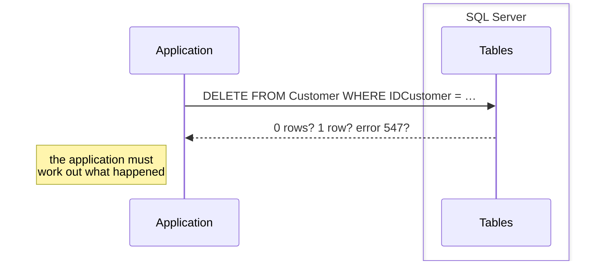
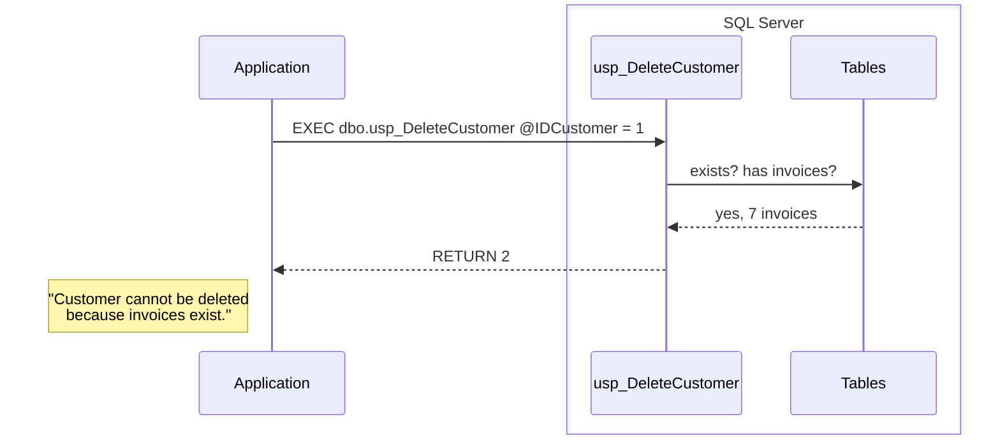
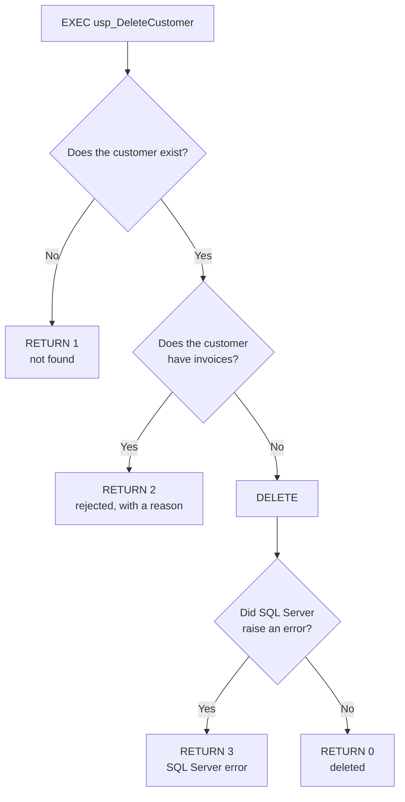
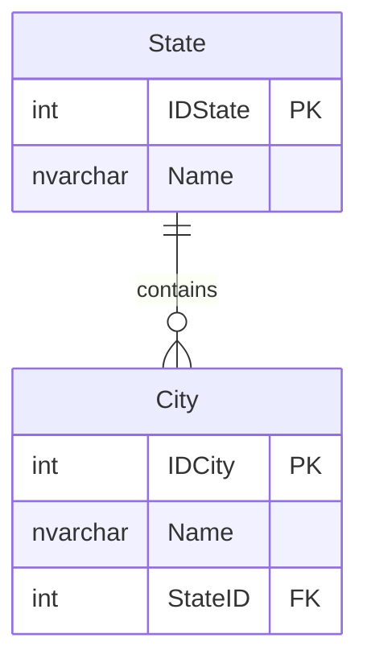
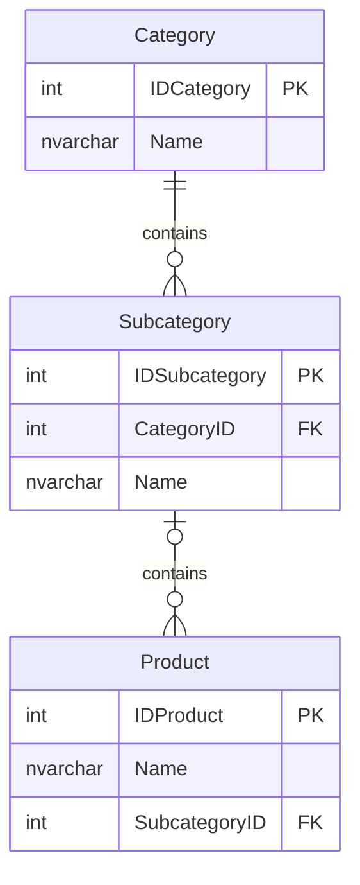

# Lab 7 – CRUD Operations

**Database:** `AdventureWorksENG`

This lab brings together concepts you have already learned in previous labs, including **stored procedures, functions, parameters, control flow, and error handling**.

You will apply these concepts to implement **Create, Read, Update, and Delete (CRUD)** operations against real database tables.

Rather than introducing new T-SQL syntax, the focus is on **combining existing knowledge to solve practical database problems**. You will implement CRUD operations, compare different ways of organizing stored procedures, and handle situations involving missing records, business rules, and referential integrity.

> [!IMPORTANT]
> **This lab is mostly about stored procedures.**
>
> Almost every example is a stored procedure, and it relies on the same building blocks: input and `OUTPUT` parameters, `RETURN` codes, `IF EXISTS` checks, `@@ROWCOUNT` ([Lab 0, Section 9](lab00-tsql-essentials.md#section-9---set-nocount-on-and-rowcount)), and `TRY/CATCH`. Solid knowledge of stored procedures is the key to this lab.
>
> If any of these building blocks feel uncertain, review [Lab 3 – Stored Procedures](lab03-stored-procedures.md) before you start. Before you run each example, try to predict what it will return.

> [!NOTE]
> **This lab works on the real `AdventureWorksENG` data.**
>
> Read operations query the actual catalog — real categories, cities, customers, and products. Deletions that a business rule or a foreign key rejects change nothing.
>
> Several examples insert, change, or delete rows — for example, Section 7 deletes customer `16` (Lili Alameda, who has no invoices). The expected results, including the generated IDs, assume a freshly created `AdventureWorksENG`, so recreate the database before you start. On a database where the lab has already run, the results will differ.

---

## Learning objectives

After completing this lab, you should be able to:

- distinguish a missing record, a rejected operation, and a SQL Server error;
- organize Create, Read, Update, and Delete operations using stored procedures;
- choose between separate procedures and one procedure that supports several operations;
- implement a read operation as an inline table-valued function when that is appropriate;
- verify the result of an operation, including when zero rows are affected;
- use a basic `TRY/CATCH` block to handle an error raised by a CRUD operation;
- explain what a foreign key guarantees, and decide whether a rule belongs in a constraint or in a procedure.

Start by selecting the training database:

```sql
USE AdventureWorksENG;
GO
```

> [!NOTE]
> **Prerequisites:** This lab builds directly on [Lab 3 – Stored Procedures](lab03-stored-procedures.md) (input parameters, `OUTPUT` parameters, `RETURN`, `CREATE OR ALTER`) and on `@@ROWCOUNT` and the basic `TRY/CATCH` block from [Lab 0 – T-SQL Essentials](lab00-tsql-essentials.md). It also uses the inline table-valued function syntax from [Lab 4 – Functions](lab04-functions.md). None of these topics are re-explained in depth here — only applied.

---

# Section 1 – What CRUD Means

Most applications need four basic operations on data: **Create, Read, Update, and Delete** — together known as **CRUD**. Each corresponds to a statement you already know:

| CRUD | Operation | SQL statement |
|---|---|---|
| **C** | Create | `INSERT` |
| **R** | Read | `SELECT` |
| **U** | Update | `UPDATE` |
| **D** | Delete | `DELETE` |

Applications usually do not run these statements directly. They call stored procedures such as `usp_InsertCustomer` or `usp_DeleteCustomer`, and the procedure runs the SQL. This gives the database a **reusable interface** and a place to enforce **business rules**.

> [!IMPORTANT]
> **CRUD describes four types of operations, not necessarily four stored procedures.**
>
> An application might use a separate procedure for each operation or combine several operations into one procedure. Choosing between these designs is one of the topics of this lab.

## What can happen when you delete a row?

Writing a `DELETE` statement is easy. Knowing what happened after it ran is not.

When an application sends a `DELETE` directly, it has to work out the meaning of the response itself:



On the real data in `AdventureWorksENG`, the same statement produces very different results:

| Customer | Situation | What SQL Server reports |
|---|---|---|
| `16` – Lili Alameda | exists, has no invoices | 1 row deleted |
| `99999` | does not exist | 0 rows deleted, **no error** |
| `1` – Gustavo Achong | has 7 invoices | **error 547** (`FK_Invoice_Customer`) — and `@@ROWCOUNT` is still 0 |

Look at Gustavo Achong's row. His invoices are safe — the foreign key `FK_Invoice_Customer` refuses to delete a customer who still has invoices. But what the application receives is an error message and `@@ROWCOUNT = 0`: the same row count as for a customer who does not exist.

In two of the three cases *nothing was deleted*, for completely different reasons. An application that cannot tell them apart will show the wrong message to the user, or silently ignore a real problem.

## The procedure reports the outcome

The reasons for using stored procedures from [Lab 3](lab03-stored-procedures.md#why-use-stored-procedures) still apply to CRUD operations. Take `usp_DeleteCustomer`:

- **Encapsulation** — the application does not need to know which tables are checked or in which order. Those steps live inside the procedure.
- **Reusability** — a web shop, a mobile app, and an internal admin tool can all call the same procedure. The rule about invoices is written once, not repeated in every application.
- **A stable interface** — the application knows only the procedure name, the parameter `@IDCustomer`, and the meaning of the return codes. The checks inside can change without changing the application.
- **Fewer network round-trips** — without a procedure, the application would send three statements: check that the customer exists, check for invoices, then delete. With a procedure, it sends one `EXEC`.

For CRUD, the interface has one more job: to report clearly **what happened**.

Here is the same request for Gustavo Achong, this time through a procedure:



Inside, the procedure decides between four answers and returns a different code for each:



Notice what the invoice check does **not** do: it does not protect the data any better. The foreign key already does that. What the check adds is a **clear answer** — return code `2` instead of error 547 — which the application can translate into a message.

Not every rule has a constraint behind it. Some rules cannot be expressed as a constraint at all (Section 6.2), and for those, the check in the procedure is the only protection.

You will build exactly this procedure in Section 7.

> [!IMPORTANT]
> **Designing CRUD operations whose outcomes the caller can tell apart is the main goal of this lab.** Every section adds one piece: verifying affected rows and reporting business rules with return codes (Section 2), handling errors (Section 5), and understanding the constraints behind them (Section 6). Section 7 brings everything together.

## Check your understanding

1. A `DELETE` statement affects zero rows. Is that an error?
2. What does `@@ROWCOUNT` show after a foreign key rejects the deletion of customer `1`? Why is that a problem for the caller?
3. Does implementing CRUD require exactly four stored procedures?
4. Why might an application call a stored procedure instead of executing a `DELETE` statement directly?

<details>
<summary>Show answers</summary>

1. No. It usually means that no row matched the `WHERE` condition — for example, the record does not exist. SQL Server does not treat that as an error.
2. It shows `0` — the same value as for a customer that does not exist. Looking only at the number of affected rows, the caller cannot tell a missing record from a rejected operation.
3. No. CRUD describes four types of operations. They can be implemented using separate or combined procedures.
4. A stored procedure provides a reusable operation and can report clearly what happened. For a customer who still has invoices, the foreign key protects the data either way — but the procedure can answer with return code `2` instead of error 547. For rules that have no constraint behind them, the procedure is also the place where they are enforced.

</details>

---

# Section 2 – CRUD for `State` and `City`

Section 1 showed the problem on `Customer` and `Invoice`, and the procedure that solves it. Before building that procedure in Section 7, we work through the same idea on two smaller tables, `State` and `City`. Their relationship is the same — a parent and its children, connected through a foreign key — but each table has only a name and an ID, so every CRUD operation fits on one screen.

This section implements every CRUD operation on `State` and `City`, using a separate stored procedure for each operation. The two tables are connected through a foreign key:



The `City.StateID` column is nullable, meaning that a city can exist without being assigned to a state.

`AdventureWorksENG` already contains three states — `Croatia` (1), `Germany` (2), and `Italy` (3) — and 13 cities, all of which have customers.

| Procedure | Operation |
|---|---|
| `usp_InsertState`, `usp_InsertCity` | Create |
| `usp_GetCitiesByState` | Read |
| `usp_UpdateCityName` | Update |
| `usp_DeleteCity` | Delete — first with a row count, then with a business rule and return codes |

The procedures use T-SQL you know from earlier labs: `OUTPUT` parameters and `SCOPE_IDENTITY()` from Lab 3, and `@@ROWCOUNT` from [Lab 0, Section 9](lab00-tsql-essentials.md#section-9---set-nocount-on-and-rowcount). What is new is the question the whole lab is about: after each call, **how does the caller learn what happened?**

## 2.1 Create – Insert a state

The shop is expanding to Slovenia. `dbo.usp_InsertState` inserts a state and returns its generated ID through an `OUTPUT` parameter:

```sql
CREATE OR ALTER PROCEDURE dbo.usp_InsertState
    @Name       nvarchar(50),
    @NewStateID int OUTPUT
AS
BEGIN
    INSERT INTO State (Name)
    VALUES (@Name);

    SET @NewStateID = SCOPE_IDENTITY();
END;
GO
```

```sql
DECLARE @NewID int;

EXEC dbo.usp_InsertState
    @Name = N'Slovenia',
    @NewStateID = @NewID OUTPUT;

SELECT @NewID AS NewStateID;
```

On a freshly created database, `Slovenia` receives `IDState = 4`.

Verify the result:

```sql
SELECT *
FROM State
WHERE Name = N'Slovenia';
```

> [!NOTE]
> **Two kinds of SQL in this lab.** The application — the caller — works only through procedures: it calls `EXEC` and uses what the procedure returns. The verification queries, such as the `SELECT` above, are for us. They look directly into the table to confirm what the procedure did, and they are not part of the application.

> [!WARNING]
> **Run the insert only once.** `State.Name` is not protected by a unique constraint — only `IDState` is. If you execute the block twice, SQL Server inserts a second `Slovenia` row without complaint, and the expected results later in this lab will no longer match.
>
> The database enforces only the rules it has been given. Section 6 returns to this question: which rules does the database guarantee, and which must your code enforce?

## 2.2 Create – Insert cities into a state

`dbo.usp_InsertCity` inserts a city and associates it with a state. The caller passes the state's ID, so the procedure does not need to search for the state by name — it stores `@StateID` directly in `City.StateID`:

```sql
CREATE OR ALTER PROCEDURE dbo.usp_InsertCity
    @Name      nvarchar(50),
    @StateID   int,
    @NewCityID int OUTPUT
AS
BEGIN
    INSERT INTO City (Name, StateID)
    VALUES (@Name, @StateID);

    SET @NewCityID = SCOPE_IDENTITY();
END;
GO
```

Insert the first two Slovenian cities, `Ljubljana` and `Maribor`. `usp_InsertState` returned `IDState = 4` for `Slovenia`, so the application passes that ID to `usp_InsertCity`:

```sql
DECLARE @City1 int, @City2 int;

EXEC dbo.usp_InsertCity
    N'Ljubljana', 4, @City1 OUTPUT;

EXEC dbo.usp_InsertCity
    N'Maribor', 4, @City2 OUTPUT;

SELECT
    @City1 AS City1ID,
    @City2 AS City2ID;
```

On a freshly created database, `Ljubljana` receives `IDCity = 14` and `Maribor` `IDCity = 15`.

### Predict, then try

After `Ljubljana` and `Maribor` are inserted, try two calls with a wrong `@StateID`. **Predict** what each one does before you run it.

**Test 1 – A state that does not exist**

```sql
DECLARE @NewCityID int;

EXEC dbo.usp_InsertCity
    N'Koper', 999, @NewCityID OUTPUT;

SELECT IDCity, Name, StateID
FROM City
WHERE Name = N'Koper';
```

<details>
<summary>Show answer</summary>

**Error 547** — the `INSERT` conflicts with the foreign key `FK_City_State`, because no state has `IDState = 999`. No row is inserted, so the `SELECT` returns an empty result set.

Notice also that `usp_InsertCity` does not handle the error yet — the caller receives SQL Server's error message directly. For now, that is intentional: Section 5 shows how a procedure catches errors like this one with `TRY/CATCH` and reports them to the caller in a controlled way.

</details>

**Test 2 – No state at all**

```sql
DECLARE @NewCityID int;

EXEC dbo.usp_InsertCity
    N'Koper', NULL, @NewCityID OUTPUT;

SELECT IDCity, Name, StateID
FROM City
WHERE Name = N'Koper';
```

<details>
<summary>Show answer</summary>

**Success** — `Koper` is inserted without a state. No error, no warning:

| IDCity | Name | StateID |
|---:|---|---|
| 17 | Koper | NULL |

A foreign key checks only values that are present. Because `City.StateID` is nullable, `NULL` simply means "no state", and the database accepts it.

</details>

The two calls look almost the same, but they end in two different outcomes from Section 1: an error, and a success that may not be what the caller intended.

This also matters for the test data: if `@StateID` were `NULL` because the insert in Section 2.1 failed, `Ljubljana` and `Maribor` would be inserted without a state, and `usp_GetCitiesByState` would return no cities for Slovenia.

## 2.3 Read – Retrieve the cities of a state

`dbo.usp_GetCitiesByState` returns the cities of one state. It needs no `JOIN` — a `WHERE` condition on `City.StateID` is enough:

```sql
CREATE OR ALTER PROCEDURE dbo.usp_GetCitiesByState
    @IDState int
AS
BEGIN
    SELECT
        IDCity,
        Name
    FROM City
    WHERE StateID = @IDState
    ORDER BY Name;
END;
GO
```

**Test 1 – Slovenia**

```sql
EXEC dbo.usp_GetCitiesByState
    @IDState = 4;
```

Expected:

| IDCity | Name |
|---:|---|
| 14 | Ljubljana |
| 15 | Maribor |

**Test 2 – Croatia, a real state**

```sql
EXEC dbo.usp_GetCitiesByState
    @IDState = 1;
```

Expected:

| IDCity | Name |
|---:|---|
| 2 | Osijek |
| 3 | Pula |
| 4 | Rijeka |
| 5 | Split |
| 1 | Zagreb |

**Test 3 – A state that does not exist**

**Predict:** what will this call return — an error, or something else?

```sql
EXEC dbo.usp_GetCitiesByState
    @IDState = 999;
```

Expected: an empty result set.

This is the first outcome from Section 1: **the row does not exist**. SQL Server does not report it as an error — the caller has to notice that the result set is empty.

> [!IMPORTANT]
> A `SELECT` statement that finds no matching records does not raise an error.
>
> It simply returns **zero rows**.

## 2.4 Update – Rename a city

The shop wants Croatian city names, but one of the Italian cities is still stored in English: `Rome` (`IDCity = 10`). `dbo.usp_UpdateCityName` changes the name of a city and returns the number of affected rows:

```sql
CREATE OR ALTER PROCEDURE dbo.usp_UpdateCityName
    @IDCity  int,
    @NewName nvarchar(50)
AS
BEGIN
    UPDATE City
    SET Name = @NewName
    WHERE IDCity = @IDCity;

    SELECT @@ROWCOUNT AS RowsUpdated;
END;
GO
```

**Test 1 – Rename `Rome` to `Rim`**

```sql
EXEC dbo.usp_UpdateCityName
    @IDCity = 10,
    @NewName = N'Rim';
```

Expected: `RowsUpdated = 1`.

Verify the change:

```sql
SELECT *
FROM City
WHERE IDCity = 10;
```

**Test 2 – A city that does not exist**

**Predict** the result before you run it:

```sql
EXEC dbo.usp_UpdateCityName
    @IDCity = 99999,
    @NewName = N'Atlantis';
```

Expected: `RowsUpdated = 0`.

Again, this is the outcome *the row does not exist* — this time reported through the number of affected rows.

> [!IMPORTANT]
> **Zero affected rows does not mean that the SQL statement failed.**
>
> The `UPDATE` executed successfully, but no record matched the specified ID. `@@ROWCOUNT` is how the procedure detects this situation.

## 2.5 Delete – Remove a city

The first version of `dbo.usp_DeleteCity` follows the same pattern as `usp_UpdateCityName`:

```sql
CREATE OR ALTER PROCEDURE dbo.usp_DeleteCity
    @IDCity int
AS
BEGIN
    DELETE FROM City
    WHERE IDCity = @IDCity;

    SELECT @@ROWCOUNT AS RowsDeleted;
END;
GO
```

`@@ROWCOUNT` must be read immediately after the `DELETE`. Most statements in between would overwrite it — for example, `SET @x = 5` sets it to `1`, and `PRINT` sets it to `0`.

The experiment in Section 2.2 left `Koper` in the table without a state. On a freshly created database it has `IDCity = 17` — the failed insert with `@StateID = 999` used up ID 16. Clean it up.

**Test 1 – Delete `Koper`**

```sql
EXEC dbo.usp_DeleteCity
    @IDCity = 17;
```

Expected: `RowsDeleted = 1`.

**Test 2 – Delete the same city again**

```sql
EXEC dbo.usp_DeleteCity
    @IDCity = 17;
```

Expected: `RowsDeleted = 0` — the city has already been deleted.

`Koper` could be deleted because nothing referenced it. A row count tells the caller **whether** something was deleted, but it cannot tell the caller **why** nothing was deleted — and Section 1 showed that "nothing was deleted" can have several very different causes. The next version of the procedure solves this.

## 2.6 Delete with a business rule – return codes

A city may have customers associated with it through `Customer.CityID`.

Suppose our application has the following business rule:

**A city cannot be deleted if it has at least one customer.**

This is the decision from Section 1 on a smaller scale: `City` and its customers play the role of `Customer` and its invoices. Only the error branch (`RETURN 3`) is missing — Section 5 adds it.

The new version of `dbo.usp_DeleteCity` implements this rule and replaces the one from Section 2.5. It checks whether the city exists and whether any customers belong to it, and deletes the city only when it exists and has no customers. Instead of a row count, it reports the result with `RETURN`:

| Return code | Meaning |
|---:|---|
| `0` | City deleted successfully |
| `1` | City does not exist |
| `2` | City has customers; deletion rejected |

```sql
CREATE OR ALTER PROCEDURE dbo.usp_DeleteCity
    @IDCity int
AS
BEGIN
    IF NOT EXISTS (
        SELECT 1
        FROM City
        WHERE IDCity = @IDCity
    )
        RETURN 1;

    IF EXISTS (
        SELECT 1
        FROM Customer
        WHERE CityID = @IDCity
    )
        RETURN 2;

    DELETE FROM City
    WHERE IDCity = @IDCity;

    RETURN 0;
END;
GO
```

### Test the procedure

Each test covers one outcome. The return code is captured with `EXEC @Result = ...`. Before running a test, predict which code it will return.

**Test 1 – Ljubljana exists and has no customers yet**

The ID of `Ljubljana` — `14` — comes from the result of `usp_GetCitiesByState` in Section 2.3.

```sql
DECLARE @Result int;

EXEC @Result = dbo.usp_DeleteCity @IDCity = 14;

SELECT @Result AS ReturnCode;
```

Expected: `0` — the city is deleted.

**Test 2 – Delete the same city again**

```sql
DECLARE @Result int;

EXEC @Result = dbo.usp_DeleteCity @IDCity = 14;

SELECT @Result AS ReturnCode;
```

Expected: `1` — the city no longer exists.

**Test 3 – Zagreb has customers**

No test data is needed here: every real city in `AdventureWorksENG` already has customers, and `Zagreb` (`IDCity = 1`) has 1492 of them.

```sql
DECLARE @Result int;

EXEC @Result = dbo.usp_DeleteCity @IDCity = 1;

SELECT @Result AS ReturnCode;
```

Expected: `2` — the business rule rejects the deletion.

Verify that `Zagreb` is untouched:

```sql
SELECT IDCity, Name, StateID
FROM City
WHERE IDCity = 1;

SELECT COUNT(*) AS ZagrebCustomers
FROM Customer
WHERE CityID = 1;
```

`Zagreb` still exists and still has 1492 customers. The business rule stopped the operation before any `DELETE` ran.

> [!NOTE]
> The procedure checks the business rule before executing `DELETE`.
>
> However, a check followed by a `DELETE` is not automatically atomic. In a concurrent environment, another session could modify related data between these statements.
>
> Section 6.2 returns to this problem, and Labs 9 and 10 show how transactions solve it.

### What does the business rule actually add?

`Customer.CityID` has a foreign key to `City` — `FK_Customer_City`. Without the business rule, the database would refuse to delete `Zagreb` anyway:

```sql
DELETE FROM City
WHERE IDCity = 1;
```

```text
Msg 547, Level 16, State 1, Line 1
The DELETE statement conflicted with the REFERENCE constraint "FK_Customer_City".
The conflict occurred in database "AdventureWorksENG", table "dbo.Customer", column 'CityID'.
The statement has been terminated.
```

So the check in `usp_DeleteCity` does not protect the data — the foreign key already does that. What it adds is a **clear answer**: instead of an error, the caller receives return code `2`, which says exactly why the city was not deleted.

## 2.7 Summary – How does the caller learn what happened?

We have implemented all four CRUD operations, each with its own procedure. Look at them from the caller's point of view:

| Procedure | The caller learns the outcome from |
|---|---|
| `usp_InsertState`, `usp_InsertCity` | the `OUTPUT` parameter (the new ID) |
| `usp_GetCitiesByState` | the number of rows in the result set |
| `usp_UpdateCityName`, `usp_DeleteCity` (Section 2.5) | a result set containing `@@ROWCOUNT` |
| `usp_DeleteCity` (Section 2.6) | the return code |

A row count says **whether** something changed. A return code can also say **why** not. Section 4 shows how several CRUD operations can be combined into one procedure, and Section 5 shows what happens to a row count when SQL Server raises an error.

## Check your understanding

1. Why does `usp_InsertCity` need a `@StateID` parameter?
2. What happens when `usp_InsertCity` is called with `@StateID = NULL`? And with `@StateID = 999`?
3. What happens when `usp_GetCitiesByState` receives a state that does not exist?
4. What does `RowsUpdated = 0` mean?
5. What is the difference between return codes `1` and `2` of `usp_DeleteCity`?
6. `Customer.CityID` has a foreign key to `City`. What would happen if `usp_DeleteCity` skipped the customer check and simply ran `DELETE` for `Zagreb`?
7. What happens if you run the insert from Section 2.1 twice? Why doesn't SQL Server stop you?

<details>
<summary>Show answers</summary>

1. To associate the new city with an existing state.
2. With `NULL`, the city is inserted without a state — no error. With `999`, the foreign key `FK_City_State` rejects the `INSERT` with error 547, because no state has that ID.
3. The procedure returns an empty result set. No error is raised, so the caller must check the number of returned rows itself.
4. The `UPDATE` executed successfully but did not match any rows.
5. Code `1` means the city does not exist; code `2` means the city exists but cannot be deleted because it has customers.
6. The foreign key `FK_Customer_City` would reject the `DELETE` with error 547, and `Zagreb` would remain. The data would be safe either way — but the caller would receive an error instead of return code `2`, which explains the reason.
7. A second `Slovenia` row is inserted with a new ID. SQL Server allows it because `State.Name` has no unique constraint — the database only enforces the rules that have been defined for it.

</details>

---

# Section 3 – Functions and Data Access

So far, we have implemented CRUD operations using stored procedures.

However, the **Read** operation can also be implemented using a function.

In Lab 4, you learned how inline table-valued functions (TVFs) return tables that can be used directly in SQL queries.

In this section, we will implement the same Read operation using both a stored procedure and an inline TVF, then compare how they can be used.

## 3.1 The data we will read

No test data is needed for this section. All 13 original cities in `AdventureWorksENG` have customers, so we can read real records:

| City | Customers |
|---|---:|
| Zagreb | 1492 |
| Osijek | 1552 |
| Rijeka | 1601 |

We will use `Zagreb` throughout this section.

## 3.2 Read using a stored procedure

Create a procedure that retrieves customers by city name.

```sql
CREATE OR ALTER PROCEDURE dbo.usp_GetCustomersByCity
    @CityName nvarchar(50)
AS
BEGIN
    SELECT
        c.IDCustomer,
        c.FirstName,
        c.LastName,
        ci.Name AS City
    FROM Customer AS c
    JOIN City AS ci
        ON ci.IDCity = c.CityID
    WHERE ci.Name = @CityName
    ORDER BY c.LastName, c.FirstName;
END;
GO
```

Execute the procedure:

```sql
EXEC dbo.usp_GetCustomersByCity
    @CityName = N'Zagreb';
```

The procedure returns all 1492 customers who live in `Zagreb`, sorted by last name.

## 3.3 Read using an inline table-valued function

Now implement the same operation using an inline TVF.

```sql
CREATE OR ALTER FUNCTION dbo.fn_CustomersByCity
(
    @CityName nvarchar(50)
)
RETURNS TABLE
AS
RETURN
(
    SELECT
        c.IDCustomer,
        c.FirstName,
        c.LastName,
        ci.Name AS City
    FROM Customer AS c
    JOIN City AS ci
        ON ci.IDCity = c.CityID
    WHERE ci.Name = @CityName
);
GO
```

Execute the function:

```sql
SELECT *
FROM dbo.fn_CustomersByCity(N'Zagreb');
```

Both implementations return the same customer information.

Compare the two definitions once more. **Predict:** why does `usp_GetCustomersByCity` contain `ORDER BY`, while `fn_CustomersByCity` does not?

<details>
<summary>Show answer</summary>

An inline TVF returns a **table**, and the rows of a table have no guaranteed order. SQL Server rejects `ORDER BY` inside an inline function:

```text
Msg 1033, Level 15, State 1
The ORDER BY clause is invalid in views, inline functions, derived tables, subqueries,
and common table expressions, unless TOP, OFFSET or FOR XML is also specified.
```

The caller decides the order — the query in Section 3.4 sorts the function's result with its own `ORDER BY`. A procedure, on the other hand, returns a final result set to the caller, so it can sort it.

</details>

So which one should you use? It depends on **who calls it**: an application calls a procedure, while other SQL queries use a function. Often the best answer is both — Section 3.7 shows how.

The difference between the two is **how their results can be used**.

## 3.4 Using a function in a larger query

Suppose we want to retrieve customers from a particular city together with their invoices.

Because an inline TVF can be used as a table source, we can join its result directly with the `Invoice` table.

To keep the output readable, we also filter by last name — something the function's own parameter does not support, but the surrounding query can add freely:

```sql
SELECT
    f.FirstName,
    f.LastName,
    i.IDInvoice,
    CONVERT(date, i.InvoiceDate) AS InvoiceDate
FROM dbo.fn_CustomersByCity(N'Zagreb') AS f
LEFT JOIN Invoice AS i
    ON i.CustomerID = f.IDCustomer
WHERE f.LastName = N'Beck'
ORDER BY f.FirstName, i.InvoiceDate;
```

Expected result:

| FirstName | LastName | IDInvoice | InvoiceDate |
|---|---|---:|---|
| Bradley | Beck | NULL | NULL |
| Calvin | Beck | 45004 | 2001-12-27 |
| Christy | Beck | 49558 | 2003-03-02 |
| Christy | Beck | 66272 | 2004-03-16 |

Three real customers from Zagreb share the last name `Beck`. Christy appears twice because she has two invoices.

Bradley appears with `NULL` invoice columns: the `LEFT JOIN` keeps him in the result even though he has no invoices at all.

We cannot use a stored procedure in the same way:

```sql
-- Invalid SQL: a stored procedure cannot be used in FROM

SELECT *
FROM dbo.usp_GetCustomersByCity(N'Zagreb');
```

SQL Server rejects the query with an error that may look surprising at first:

```text
Msg 208, Level 16, State 224
Invalid object name 'dbo.usp_GetCustomersByCity'.
```

The message does not say that procedures are not allowed in `FROM`. In `FROM`, SQL Server looks for a table, a view, or a table-valued function with that name — and a procedure is none of these, so the object is reported as not found.

A stored procedure is executed using `EXEC`, while an inline TVF can participate directly in a `SELECT`, `JOIN`, or subquery.

> [!IMPORTANT]
> **Stored procedures and inline TVFs can both retrieve data, but they are not interchangeable.**
>
> A procedure is executed as an operation, while an inline TVF provides a table result that can be combined with other SQL queries.

## 3.5 When should you use each approach?

| Stored procedure | Inline TVF |
|---|---|
| Executed using `EXEC` | Used in `FROM` |
| Can return result sets | Returns a table |
| Supports `OUTPUT` parameters and integer `RETURN` codes | Does not support `OUTPUT` parameters |
| Can execute `INSERT`, `UPDATE`, and `DELETE` | Cannot modify database tables |
| Useful for database operations and application interfaces | Useful for reusable, parameterized queries |
| Caller learns the outcome from a return code, `OUTPUT` parameters, or result sets | Caller learns the outcome only from the returned rows |

For CRUD operations, **Create, Update, and Delete** are always procedures — a function cannot modify tables. For **Read**, choose by who calls it:

> [!TIP]
> - **The application calls the Read → use a procedure.** It is the stable interface from Lab 3, it can sort the result, and it can report when the requested record does not exist.
> - **The Read is part of another query** — a `JOIN`, a report, or another procedure → **use an inline TVF.**
> - **You need both → write the query once in a function, and let the procedure call it.** Section 3.7 shows this pattern.

## 3.6 What can a function tell its caller?

In Section 2, `Maribor` was added to `Slovenia` and nobody lives there yet. Compare two calls:

```sql
-- A city that exists but has no customers
SELECT COUNT(*) AS Customers
FROM dbo.fn_CustomersByCity(N'Maribor');

-- A city that does not exist
SELECT COUNT(*) AS Customers
FROM dbo.fn_CustomersByCity(N'Atlantis');
```

Both return `0`.

Two different situations produce exactly the same answer. The function has no return code and no `OUTPUT` parameter — the only thing it can give the caller is rows. Zero rows cannot say *why* there are zero rows.

A stored procedure could tell the difference: it could check whether the city exists and return code `1` if it does not, just as `usp_DeleteCity` did in Section 2.6. Section 3.7 does exactly that.

> [!NOTE]
> This is not a reason to avoid functions. For a Read operation, "no matching rows" is often all the caller needs. But when the caller must distinguish *missing* from *empty*, a function is not enough on its own.

## 3.7 Using both: a procedure built on a function

The function from Section 3.3 contains the query. The application, however, should call a procedure — and the procedure can add what the function cannot: sorting, and telling *missing* from *empty*.

Replace `usp_GetCustomersByCity` from Section 3.2 with a version that uses the function:

```sql
CREATE OR ALTER PROCEDURE dbo.usp_GetCustomersByCity
    @CityName nvarchar(50)
AS
BEGIN
    IF NOT EXISTS (
        SELECT 1
        FROM City
        WHERE Name = @CityName
    )
        RETURN 1;

    SELECT IDCustomer, FirstName, LastName, City
    FROM dbo.fn_CustomersByCity(@CityName)
    ORDER BY LastName, FirstName;

    RETURN 0;
END;
GO
```

Test it with the three cities from this section.

**Test 1 – Zagreb**

```sql
DECLARE @Result int;

EXEC @Result = dbo.usp_GetCustomersByCity
    @CityName = N'Zagreb';

SELECT @Result AS ReturnCode;
```

Expected: 1492 customers, sorted by last name, and return code `0`.

**Test 2 – Maribor exists, but has no customers**

```sql
DECLARE @Result int;

EXEC @Result = dbo.usp_GetCustomersByCity
    @CityName = N'Maribor';

SELECT @Result AS ReturnCode;
```

Expected: an empty result and return code `0`.

**Test 3 – Atlantis does not exist**

```sql
DECLARE @Result int;

EXEC @Result = dbo.usp_GetCustomersByCity
    @CityName = N'Atlantis';

SELECT @Result AS ReturnCode;
```

Expected: an empty result and return code `1`.

The query exists in one place only — the function. Reports and other queries can join it; the application calls the procedure and gets a sorted result and a clear answer when the city does not exist.

## Check your understanding

1. Can both a stored procedure and an inline TVF retrieve customer information?
2. Why can an inline TVF be used in a `JOIN`?
3. Can a stored procedure be used directly in the `FROM` clause of a `SELECT` statement?
4. Can an inline TVF update or delete rows in a database table?
5. When might an inline TVF be more convenient than a stored procedure?
6. `fn_CustomersByCity` returns zero rows. What can the caller conclude about the city?
7. Why does `usp_GetCustomersByCity` contain `ORDER BY`, but `fn_CustomersByCity` does not?

<details>
<summary>Show answers</summary>

1. Yes. Both can retrieve data from database tables.
2. Because an inline TVF returns a table that SQL Server can use as a table source.
3. No. Stored procedures are executed using `EXEC` and cannot be used directly as table sources.
4. No. T-SQL user-defined functions cannot modify database tables.
5. When the returned data needs to participate in a larger query, such as a `JOIN` or subquery.
6. Only that no customers matched. The city may exist without customers, or it may not exist at all — the function cannot report which.
7. An inline TVF returns a table, and table rows have no guaranteed order, so SQL Server rejects `ORDER BY` inside it. The caller sorts the result. A procedure returns the final result set, so it can sort it itself.

</details>

---

# Section 4 – One Procedure for Multiple Operations

In Section 2, we implemented CRUD using separate stored procedures. Each procedure performed one specific operation.

However, this is not the only possible design.

Sometimes, **multiple CRUD operations can be combined into a single stored procedure**.

For example, an application might use:

- One procedure for inserting and updating records.
- One procedure for reading and deleting records.
- One procedure supporting all four CRUD operations.

The choice depends on the application's requirements and how we want to organize the database interface.

## 4.1 Common approaches

Consider three possible designs.

| Approach | Example | Description |
| --- | --- | --- |
| Separate procedures | `usp_InsertCity`, `usp_UpdateCityName` | Each operation has its own procedure |
| Combined Create + Update | `usp_SaveCustomer` | One procedure inserts or updates a record |
| Action-based procedure | `usp_ManageCategory` | An `@Action` parameter selects the operation |

A combined procedure usually needs a way to determine which operation to execute.

Two common techniques are:

- **Check whether an ID was provided:** insert a new record when the ID is `NULL`, otherwise update the existing record.
- **Use an action parameter:** select the operation explicitly using values such as `INSERT`, `UPDATE`, `GET`, or `DELETE`.

Let's examine both approaches.

## 4.2 Combining Create and Update – Save pattern

A common requirement in applications is to use the same form for creating a new record and editing an existing one.

For example, consider a customer form in a web shop.

When a new customer registers, the application does not yet have an ID.

When an existing customer edits their details, the application already knows the ID.

We can support both operations using one procedure.

### Example – `usp_SaveCustomer`

```sql
CREATE OR ALTER PROCEDURE dbo.usp_SaveCustomer
    @IDCustomer    int = NULL,        -- NULL: insert; an ID: update that customer
    @FirstName     nvarchar(50),
    @LastName      nvarchar(50),
    @Email         nvarchar(50),
    @PhoneNumber   nvarchar(25),
    @CityID        int,
    @NewCustomerID int = NULL OUTPUT  -- INSERT: the generated ID
AS
BEGIN
    IF @IDCustomer IS NULL
    BEGIN
        INSERT INTO Customer (FirstName, LastName, Email, PhoneNumber, CityID)
        VALUES (@FirstName, @LastName, @Email, @PhoneNumber, @CityID);

        SET @NewCustomerID = SCOPE_IDENTITY();
    END
    ELSE
    BEGIN
        UPDATE Customer
        SET FirstName   = @FirstName,
            LastName    = @LastName,
            Email       = @Email,
            PhoneNumber = @PhoneNumber,
            CityID      = @CityID
        WHERE IDCustomer = @IDCustomer;
    END
END;
GO
```

Each ID parameter has one role. `@IDCustomer` is an input — it tells the procedure *which* customer to update. `@NewCustomerID` is an output — it returns the ID that `INSERT` generated, just like `@NewStateID` in Section 2.1.

The procedure uses the value of `@IDCustomer` to determine which operation to perform.

| `@IDCustomer` | Operation |
| --- | --- |
| `NULL` | Insert a new customer |
| Existing ID | Update the customer with that ID |
| Nonexistent ID | Update affects zero rows |

Notice that the `UPDATE` sets **every** column, not only the one that changed. A form sends all of its fields when the user saves, so the procedure simply writes them all.

### Test the procedure

Ana Horvat from Zagreb (`CityID = 1`) registers in the web shop. Later, she changes her phone number.

**Test 1 – A new customer registers**

The application does not have an ID yet, so it does not pass `@IDCustomer` at all:

```sql
DECLARE @NewID int;

EXEC dbo.usp_SaveCustomer
    @FirstName     = N'Ana',
    @LastName      = N'Horvat',
    @Email         = N'ana.horvat@example.com',
    @PhoneNumber   = N'091-555-0142',
    @CityID        = 1,
    @NewCustomerID = @NewID OUTPUT;

SELECT @NewID AS NewCustomerID;
```

`@IDCustomer` is `NULL`, so the procedure inserts a new customer and returns the generated ID — `19978` on a freshly created database.

**Test 2 – The same customer changes her phone number**

Now the application knows Ana's ID and passes it as `@IDCustomer`:

```sql
EXEC dbo.usp_SaveCustomer
    @IDCustomer  = 19978,
    @FirstName   = N'Ana',
    @LastName    = N'Horvat',
    @Email       = N'ana.horvat@example.com',
    @PhoneNumber = N'098-555-0177',
    @CityID      = 1;

SELECT *
FROM Customer
WHERE IDCustomer = 19978;
```

The procedure updates the existing customer instead of inserting another one:

| IDCustomer | FirstName | LastName | Email | PhoneNumber | CityID |
|---:|---|---|---|---|---:|
| 19978 | Ana | Horvat | ana.horvat@example.com | 098-555-0177 | 1 |

> [!NOTE]
> You may also see Save procedures that use **one** `OUTPUT` parameter for both directions: the caller passes `NULL` or an ID in, and the procedure overwrites it with the new ID after an insert. It works, but the parameter then means two different things before and after the call. Separate input and output parameters are easier to read.

This pattern is often called a **Save procedure**.

Notice that it does not automatically insert a new row when the supplied ID does not exist. In that case, the `UPDATE` simply affects zero rows.

**Predict:** an application calls `usp_SaveCustomer` with `@IDCustomer = 99999`. No customer has that ID. What does the caller see?

```sql
DECLARE @NewID int, @Result int;

EXEC @Result = dbo.usp_SaveCustomer
    @IDCustomer    = 99999,
    @FirstName     = N'Ivan',
    @LastName      = N'Kovač',
    @Email         = NULL,
    @PhoneNumber   = NULL,
    @CityID        = 1,
    @NewCustomerID = @NewID OUTPUT;

SELECT @NewID AS NewCustomerID, @Result AS ReturnValue;
```

<details>
<summary>Show answer</summary>

| NewCustomerID | ReturnValue |
|---:|---:|
| NULL | 0 |

Nothing was saved, but the caller cannot tell. There is no error, and the return value is `0` — the default when a procedure has no `RETURN`. `NewCustomerID` is `NULL`, but that is expected for every update, so it says nothing either. The application would report that the customer was saved.

</details>

### Telling the caller that the customer does not exist

Usually the ID is valid — the application loaded the customer into the form before the user edited it. But not always: another user may have deleted the customer in the meantime, or the ID may come from a URL that was changed by hand. The application cannot check this itself, so the procedure has to tell it.

Two lines after the `UPDATE` close the gap — the same `@@ROWCOUNT` check that `usp_UpdateCityName` used in Section 2.4, now turned into a return code:

```sql
CREATE OR ALTER PROCEDURE dbo.usp_SaveCustomer
    @IDCustomer    int = NULL,        -- NULL: insert; an ID: update that customer
    @FirstName     nvarchar(50),
    @LastName      nvarchar(50),
    @Email         nvarchar(50),
    @PhoneNumber   nvarchar(25),
    @CityID        int,
    @NewCustomerID int = NULL OUTPUT  -- INSERT: the generated ID
AS
BEGIN
    IF @IDCustomer IS NULL
    BEGIN
        INSERT INTO Customer (FirstName, LastName, Email, PhoneNumber, CityID)
        VALUES (@FirstName, @LastName, @Email, @PhoneNumber, @CityID);

        SET @NewCustomerID = SCOPE_IDENTITY();
    END
    ELSE
    BEGIN
        UPDATE Customer
        SET FirstName   = @FirstName,
            LastName    = @LastName,
            Email       = @Email,
            PhoneNumber = @PhoneNumber,
            CityID      = @CityID
        WHERE IDCustomer = @IDCustomer;

        IF @@ROWCOUNT = 0
            RETURN 1;   -- the customer does not exist
    END

    RETURN 0;
END;
GO
```

| Return code | Meaning |
|---:|---|
| `0` | Saved — inserted or updated |
| `1` | Not saved — the customer does not exist |

Run the same call again:

```sql
DECLARE @NewID int, @Result int;

EXEC @Result = dbo.usp_SaveCustomer
    @IDCustomer    = 99999,
    @FirstName     = N'Ivan',
    @LastName      = N'Kovač',
    @Email         = NULL,
    @PhoneNumber   = NULL,
    @CityID        = 1,
    @NewCustomerID = @NewID OUTPUT;

SELECT @NewID AS NewCustomerID, @Result AS ReturnValue;
```

Expected: `NewCustomerID = NULL` and `ReturnValue = 1`. Now the application can tell the user that the customer no longer exists, instead of reporting a successful save.

This is the same convention as in Section 2.6 — `0` for success, `1` for a record that does not exist. Section 4.5 uses the same check for its `UPDATE` action.

## 4.3 Using an action parameter

Another approach is to let the caller explicitly specify which operation should be performed.

For example, once the procedure below exists, a caller could write:

```sql
EXEC dbo.usp_ManageSubcategory
    @Action = N'GET',
    @IDSubcategory = 7;
```

Or:

```sql
EXEC dbo.usp_ManageSubcategory
    @Action = N'DELETE',
    @IDSubcategory = 7;
```

The `@Action` parameter determines which branch of the procedure runs. Do not run these two calls yet — the procedure is created later in this section.

### The tables

The procedures in Sections 4.3 and 4.5 work with three tables of the product catalog:



Every subcategory must belong to a category — `Subcategory.CategoryID` is required. A product may have no subcategory — `Product.SubcategoryID` is nullable. Section 6 returns to what this difference means.

### Prepare test data

To test the `DELETE` action we need two subcategories: one that has products and one that is empty.

A subcategory **with** products already exists in the real catalog — `Chains` (`IDSubcategory = 7`), which contains the product `Chain`. We will use it directly.

An **empty** subcategory does not exist: all 37 real subcategories contain at least one product. So we create one, attached to the real `Parts` category (`IDCategory = 2`):

```sql
INSERT INTO Subcategory (CategoryID, Name)
VALUES (2, N'Kickstands');

SELECT SCOPE_IDENTITY() AS SubWithoutProduct;
```

On a freshly created database, `Kickstands` receives `IDSubcategory = 38`.

### Example – `usp_ManageSubcategory`

The procedure supports two operations:

- `GET` – retrieve a subcategory.
- `DELETE` – delete a subcategory if it has no products.

```sql
CREATE OR ALTER PROCEDURE dbo.usp_ManageSubcategory
    @Action        nvarchar(10),
    @IDSubcategory int
AS
BEGIN
    IF @Action = N'GET'
    BEGIN
        SELECT
            IDSubcategory,
            CategoryID,
            Name
        FROM Subcategory
        WHERE IDSubcategory = @IDSubcategory;

        IF @@ROWCOUNT = 0
            RETURN 1;

        RETURN 0;
    END

    IF @Action = N'DELETE'
    BEGIN
        IF NOT EXISTS (
            SELECT 1
            FROM Subcategory
            WHERE IDSubcategory = @IDSubcategory
        )
            RETURN 1;

        IF EXISTS (
            SELECT 1
            FROM Product
            WHERE SubcategoryID = @IDSubcategory
        )
            RETURN 2;

        DELETE FROM Subcategory
        WHERE IDSubcategory = @IDSubcategory;

        RETURN 0;
    END

    RETURN 99;
END;
GO
```

The procedure uses these return codes:

| Return code | Meaning |
| ---: | --- |
| `0` | Operation completed |
| `1` | Subcategory does not exist |
| `2` | Subcategory has products; deletion rejected |
| `99` | Unknown action |

For `GET`, return code `1` tells the caller that the subcategory does not exist. Section 3.6 showed that a function cannot make this distinction — a procedure can.

### Test the procedure

`Kickstands` received `IDSubcategory = 38` when it was inserted above. Each test covers one outcome; predict the return code before you run it.

**Test 1 – Read the real subcategory `Chains`**

```sql
DECLARE @Result int;

EXEC @Result = dbo.usp_ManageSubcategory
    @Action = N'GET',
    @IDSubcategory = 7;

SELECT @Result AS ReturnCode;
```

Expected: return code `0` and one row:

| IDSubcategory | CategoryID | Name |
|---:|---:|---|
| 7 | 2 | Chains |

**Test 2 – Read a nonexistent subcategory**

```sql
DECLARE @Result int;

EXEC @Result = dbo.usp_ManageSubcategory
    @Action = N'GET',
    @IDSubcategory = 999999;

SELECT @Result AS ReturnCode;
```

Expected: an empty result and return code `1`.

**Test 3 – Delete a nonexistent subcategory**

```sql
DECLARE @Result int;

EXEC @Result = dbo.usp_ManageSubcategory
    @Action = N'DELETE',
    @IDSubcategory = 999999;

SELECT @Result AS ReturnCode;
```

Expected: `1` — the subcategory does not exist.

**Test 4 – Delete `Chains`, which contains the product `Chain`**

```sql
DECLARE @Result int;

EXEC @Result = dbo.usp_ManageSubcategory
    @Action = N'DELETE',
    @IDSubcategory = 7;

SELECT @Result AS ReturnCode;
```

Expected: `2` — the subcategory has products, so the deletion is rejected.

**Test 5 – A typo in the action name**

```sql
DECLARE @Result int;

EXEC @Result = dbo.usp_ManageSubcategory
    @Action = N'REMOVE',
    @IDSubcategory = 7;

SELECT @Result AS ReturnCode;
```

Expected: `99` — unknown action.

**Test 6 – Delete the empty subcategory `Kickstands`**

```sql
DECLARE @Result int;

EXEC @Result = dbo.usp_ManageSubcategory
    @Action = N'DELETE',
    @IDSubcategory = 38;

SELECT @Result AS ReturnCode;
```

Expected: `0` — the subcategory is deleted.

Verify that `Chains` and its product are untouched:

```sql
SELECT IDSubcategory, CategoryID, Name
FROM Subcategory
WHERE IDSubcategory = 7;

SELECT IDProduct, Name
FROM Product
WHERE SubcategoryID = 7;
```

The same procedure supports different operations, but the caller must supply the correct `@Action`. A typo such as `REMOVE` is not an error — the procedure simply returns `99`, and the caller has to check for it.

> [!NOTE]
> `@Action = N'get'` in lowercase also works. `AdventureWorksENG` uses the case-insensitive collation `Croatian_CI_AS`, so `N'get' = N'GET'` is true. On a database with a case-sensitive collation, the same call would return `99`.

## 4.4 Comparing the approaches

Both separate and combined procedures can implement CRUD operations.

However, they have different characteristics.

| Aspect | Separate procedures | Combined procedure |
| --- | --- | --- |
| Purpose | One clearly defined operation | Several related operations |
| Parameters | Specific to each operation | May need parameters used only by certain operations |
| Readability | Usually simpler | More branching logic |
| Maintenance | Operations can be modified independently | Several operations share one implementation |
| Calling | Different procedure names | One procedure with an action or ID-based decision |

> [!IMPORTANT]
> There is no requirement to combine CRUD operations into one procedure.
>
> **Separate procedures are often easier to understand and maintain**, especially when operations have different parameters or business rules.
>
> Combined procedures can be useful when operations are closely related, such as Create and Update in a Save procedure.

## 4.5 Create, Update, and Delete combined

`Category` is the top of the product catalog shown in Section 4.3. `AdventureWorksENG` has four categories: `Bicycles` (1), `Parts` (2), `Clothes` (3), and `Accessories` (4).

The procedure `dbo.usp_ManageCategory` combines three operations on `Category`:

- `INSERT`
- `UPDATE`
- `DELETE`

Reading stays in a separate procedure, as in Section 2.

It uses the same `@Action` approach as `usp_ManageSubcategory` in Section 4.3, with these parameters:

```sql
@Action        nvarchar(10),
@IDCategory    int          = NULL,        -- UPDATE, DELETE: the category to change
@Name          nvarchar(50) = NULL,        -- INSERT, UPDATE: the (new) name
@NewCategoryID int          = NULL OUTPUT  -- INSERT: the generated ID
```

Each parameter has one role. `@IDCategory` is an input — it tells the procedure *which* category to change. `@NewCategoryID` is an output — it returns the ID that `INSERT` generated, just like `usp_InsertState` in Section 2.1.

Not every action uses every parameter:

| Action | `@IDCategory` | `@Name` | `@NewCategoryID` |
|---|:---:|:---:|:---:|
| `INSERT` | – | ✓ | ✓ (output) |
| `UPDATE` | ✓ | ✓ | – |
| `DELETE` | ✓ | – | – |

This is typical of a combined procedure: the parameter list is shared, so each action ignores some of it. That is why every parameter except `@Action` has a default value.

Each action reports its outcome with a return code:

| Action | Behavior | Return code |
| --- | --- | --- |
| `INSERT` | Insert a category and return its ID | `0` |
| `UPDATE` | Update an existing category | `0` success, `1` not found |
| `DELETE` | Delete a category without subcategories | `0` deleted, `1` not found, `2` has subcategories |
| Other | Unknown action | `99` |

`INSERT` uses `SCOPE_IDENTITY()` to return the generated ID. `UPDATE` uses `@@ROWCOUNT` to detect whether a row was updated. `DELETE` checks whether the category exists and whether it has any subcategories before deleting it.

```sql
CREATE OR ALTER PROCEDURE dbo.usp_ManageCategory
    @Action        nvarchar(10),
    @IDCategory    int          = NULL,
    @Name          nvarchar(50) = NULL,
    @NewCategoryID int          = NULL OUTPUT
AS
BEGIN
    IF @Action = N'INSERT'
    BEGIN
        INSERT INTO Category (Name)
        VALUES (@Name);

        SET @NewCategoryID = SCOPE_IDENTITY();
        RETURN 0;
    END

    IF @Action = N'UPDATE'
    BEGIN
        UPDATE Category
        SET Name = @Name                 -- the new name
        WHERE IDCategory = @IDCategory;  -- the category to change

        IF @@ROWCOUNT = 0
            RETURN 1;

        RETURN 0;
    END

    IF @Action = N'DELETE'
    BEGIN
        IF NOT EXISTS (
            SELECT 1
            FROM Category
            WHERE IDCategory = @IDCategory
        )
            RETURN 1;

        IF EXISTS (
            SELECT 1
            FROM Subcategory
            WHERE CategoryID = @IDCategory
        )
            RETURN 2;

        DELETE FROM Category
        WHERE IDCategory = @IDCategory;

        RETURN 0;
    END

    RETURN 99;
END;
GO
```

In the `UPDATE` branch, `@IDCategory` identifies the row and `@Name` is its new value. The procedure never needs the old name — the ID is enough to find the row.

### Test the procedure

The test inserts a new category named `Gift Cards`, renames it to `Gift Vouchers`, deletes it, and then tries to delete it again.

**Test 1 – INSERT**

```sql
DECLARE @NewID int, @Result int;

EXEC @Result = dbo.usp_ManageCategory
    @Action        = N'INSERT',
    @Name          = N'Gift Cards',
    @NewCategoryID = @NewID OUTPUT;

SELECT @NewID AS NewCategoryID, @Result AS ReturnCode;
```

Expected: return code `0` and the new ID — `5` on a freshly created database. The next tests use this ID.

**Test 2 – UPDATE**

```sql
DECLARE @Result int;

EXEC @Result = dbo.usp_ManageCategory
    @Action     = N'UPDATE',
    @IDCategory = 5,
    @Name       = N'Gift Vouchers';

SELECT @Result AS ReturnCode;
```

Expected: `0` — the category is renamed.

**Test 3 – DELETE**

```sql
DECLARE @Result int;

EXEC @Result = dbo.usp_ManageCategory
    @Action     = N'DELETE',
    @IDCategory = 5;

SELECT @Result AS ReturnCode;
```

Expected: `0` — the category has no subcategories, so it is deleted.

**Test 4 – DELETE again**

```sql
DECLARE @Result int;

EXEC @Result = dbo.usp_ManageCategory
    @Action     = N'DELETE',
    @IDCategory = 5;

SELECT @Result AS ReturnCode;
```

Expected: `1` — the category no longer exists.

### A caller that only updates

The four tests run one after another, but the actions do not depend on each other. A caller that only edits a category already knows its ID — for example, the application showed the list of categories, and the user picked `Clothes` (`IDCategory = 3`) and typed a new name:

```sql
DECLARE @Result int;

EXEC @Result = dbo.usp_ManageCategory
    @Action     = N'UPDATE',
    @IDCategory = 3,
    @Name       = N'Clothing';

SELECT @Result AS UpdateResult;  -- 0
```

> [!TIP]
> **Always call a combined procedure with named parameters.** Because each action uses a different subset of parameters, a positional call is easy to get wrong. `EXEC dbo.usp_ManageCategory N'UPDATE', 3, N'Clothing'` happens to work, but a positional `INSERT` would need an explicit `NULL` for `@IDCategory` before the name — skip it, and `Gift Cards` lands in the `int` parameter and the call fails with *Error converting data type nvarchar to int*. With named parameters, each value goes exactly where its name says.

### Predict, then try

`@Name` has a default value of `NULL`, so the caller may omit it — for every action. What happens when the caller omits it for `INSERT`?

```sql
DECLARE @NewID int, @Result int;

EXEC @Result = dbo.usp_ManageCategory
    @Action        = N'INSERT',
    @NewCategoryID = @NewID OUTPUT;

SELECT @NewID AS NewCategoryID, @Result AS InsertResult;
```

<details>
<summary>Show answer</summary>

SQL Server raises an error:

```text
Msg 515, Level 16, State 2, Procedure dbo.usp_ManageCategory, Line 10
Cannot insert the value NULL into column 'Name', table 'AdventureWorksENG.dbo.Category';
column does not allow nulls. INSERT fails.
The statement has been terminated.
```

and then returns:

| NewCategoryID | InsertResult |
|---:|---:|
| NULL | 0 |

Two problems are visible here:

1. **A shared parameter list fits no action exactly.** `@Name` is optional because `DELETE` does not need it — but `INSERT` does. The procedure's signature cannot express "required only for some actions".
2. **The error did not stop the procedure.** Error 515 terminated only the `INSERT` statement. The procedure continued with the next statement, `RETURN 0`, and reported success. Section 5 examines this behavior and how to handle it.

</details>

## Check your understanding

1. What determines whether `usp_SaveCustomer` inserts or updates a record?
2. What is the purpose of the `@Action` parameter?
3. Why does `usp_ManageSubcategory` return `2` when a subcategory has products?
4. What is one advantage of separate CRUD procedures?
5. When might a combined procedure be useful?
6. The first version of `usp_SaveCustomer` is called with an ID that does not exist. What does the caller receive, why is that a problem, and how does the final version solve it?
7. `usp_ManageCategory` is called with `@Action = N'INSERT'` but without `@Name`. The `INSERT` fails — why is the return code still `0`?

<details>
<summary>Show answers</summary>

1. The value of `@IDCustomer`. `NULL` means Insert; a supplied ID means Update.
2. It explicitly selects which operation the procedure should execute.
3. Because the subcategory still has products. The foreign key `FK_Product_Subcategory` would reject the `DELETE` anyway — return code `2` tells the caller *why*, instead of error 547.
4. Each procedure has one clearly defined responsibility, making the interface easier to understand and maintain.
5. When operations are closely related, such as inserting and updating records through the same application form.
6. Return value `0`, no error, and `@NewCustomerID = NULL` — the same as after any successful update. Nothing was saved, but nothing tells the caller so. The final version checks `@@ROWCOUNT` after the `UPDATE` and returns `1` when no row was updated.
7. The `NULL` violates the `NOT NULL` column, so SQL Server terminates the `INSERT` statement — but not the procedure. Execution continues with `RETURN 0`.

</details>

---

# Section 5 – Error Handling in CRUD Operations

In previous sections, we implemented CRUD procedures that check whether records exist and whether business rules allow an operation.

However, even a correctly written SQL statement can fail because of database constraints.

In Lab 0, you learned how to use `TRY/CATCH` to handle SQL Server errors. Now we will apply that knowledge to a real CRUD operation.

## 5.1 The problem – Deleting a referenced record

Section 4.5 ended with a trap: the `INSERT` failed with error 515, but the procedure still returned `0`. This section starts with the same trap in its simplest form.

`usp_ManageCategory` checks for subcategories before it deletes a category, so its `DELETE` never fails. A procedure without that check does. `dbo.usp_DeleteCategory` follows the same pattern as the first version of `usp_DeleteCity` in Section 2.5. Like the other procedures in this lab, it reports success with `RETURN 0`:

```sql
CREATE OR ALTER PROCEDURE dbo.usp_DeleteCategory
    @IDCategory int
AS
BEGIN
    DELETE FROM Category
    WHERE IDCategory = @IDCategory;

    SELECT @@ROWCOUNT AS RowsDeleted;
    RETURN 0;
END;
GO
```

Try deleting `Bicycles` (`IDCategory = 1`). As the diagram in Section 4.3 shows, every subcategory belongs to a category — and `Bicycles` has three: `Mountain Bikes`, `Road Bikes`, and `Touring Bikes`. Before you run it, **predict**: what will the caller receive — an error, a result set, or both? What will `RowsDeleted` contain, and which return code will the procedure return?

```sql
DECLARE @Result int;

EXEC @Result = dbo.usp_DeleteCategory
    @IDCategory = 1;

SELECT @Result AS ReturnCode;
```

<details>
<summary>Show answer</summary>

SQL Server rejects the `DELETE` because the category is still referenced by its subcategories.

The output is:

```text
Msg 547, Level 16, State 1, Procedure dbo.usp_DeleteCategory, Line 5
The DELETE statement conflicted with the REFERENCE constraint "FK_Subcategory_Category".
The conflict occurred in database "AdventureWorksENG", table "dbo.Subcategory", column 'CategoryID'.
The statement has been terminated.
```

followed by two result sets:

| RowsDeleted |
|---:|
| 0 |

| ReturnCode |
|---:|
| 0 |

`Bicycles` and its three subcategories remain in the database — yet the procedure reported success.

</details>

Notice the last line of the message: *the statement has been terminated*. Error 547 stops only the failed `DELETE`. The procedure then continues with the next statements: `SELECT @@ROWCOUNT` reports zero deleted rows, and `RETURN 0` reports success.

> [!WARNING]
> The caller now receives both an error and a normal-looking result. Reading only the return code, it would see `0` — success. Reading only the result set, it would see `RowsDeleted = 0` — the same answer as for a category that does not exist. Section 5.4 returns to why these outcomes must not be confused.

> [!IMPORTANT]
> **A foreign key constraint protects referential integrity.**
>
> SQL Server does not allow a referenced category to be deleted while related subcategories still exist, assuming the foreign key uses the default `NO ACTION` behavior.

## 5.2 Handling the error with TRY/CATCH

We can modify `usp_DeleteCategory` to catch SQL Server errors.

```sql
CREATE OR ALTER PROCEDURE dbo.usp_DeleteCategory
    @IDCategory int
AS
BEGIN
    BEGIN TRY
        DELETE FROM Category
        WHERE IDCategory = @IDCategory;

        SELECT @@ROWCOUNT AS RowsDeleted;
        RETURN 0;
    END TRY
    BEGIN CATCH
        SELECT
            ERROR_NUMBER()  AS ErrorNumber,
            ERROR_MESSAGE() AS ErrorMessage;
        RETURN 3;
    END CATCH
END;
GO
```

Execute the same deletion again:

```sql
DECLARE @Result int;

EXEC @Result = dbo.usp_DeleteCategory
    @IDCategory = 1;

SELECT @Result AS ReturnCode;
```

Instead of propagating the original SQL Server error to the caller, the procedure catches it and returns information about the failure.

Expected results:

| ErrorNumber | ErrorMessage |
|---:|---|
| 547 | The DELETE statement conflicted with the REFERENCE constraint... |

| ReturnCode |
|---:|
| 3 |

Notice that `Bicycles` is **still not deleted**.

`TRY/CATCH` changes how the error is handled, not whether the database constraint is enforced.

Look at what changed for the caller:

- **The caller no longer receives an error.** The procedure handled it. If the caller wraps the call in its own `TRY/CATCH`, its `CATCH` does not run.
- **The result set has a different shape.** On success the caller receives `RowsDeleted`; on failure it receives `ErrorNumber` and `ErrorMessage`. Recognising the outcome by the columns of a result set is fragile.
- **The return code says what happened.** In Section 5.1 the same call returned `0`; now it returns `3`. `0` means the `DELETE` ran; `3` means it failed with an error. This is the most reliable signal for the caller, and Section 7 uses the same convention.

The same `TRY/CATCH` would also close the trap from the end of Section 4.5: wrapped in `TRY`, the failed `INSERT` in `usp_ManageCategory` would jump to `CATCH` and return `3` instead of `0`.

> [!NOTE]
> Why add `RETURN 3` explicitly? Without it, a procedure that catches an error does not return `0`. In this example SQL Server returned **`-6`** — a value it chose itself. Negative return values are used by SQL Server itself, so a procedure should always return its own documented code instead.

## 5.3 Where should TRY/CATCH be placed?

So far, we placed `TRY/CATCH` inside the stored procedure.

However, error handling can also be implemented by the caller.

For this demonstration, first restore the original version of `usp_DeleteCategory` from Section 5.1. That version does not catch the error internally.

```sql
CREATE OR ALTER PROCEDURE dbo.usp_DeleteCategory
    @IDCategory int
AS
BEGIN
    DELETE FROM Category
    WHERE IDCategory = @IDCategory;

    SELECT @@ROWCOUNT AS RowsDeleted;
    RETURN 0;
END;
GO
```

Now the caller can handle the error:

```sql
BEGIN TRY
    EXEC dbo.usp_DeleteCategory
        @IDCategory = 1;
END TRY
BEGIN CATCH
    SELECT
        ERROR_NUMBER()    AS ErrorNumber,
        ERROR_MESSAGE()   AS ErrorMessage,
        ERROR_PROCEDURE() AS FailedIn;
END CATCH;
```

Compare the output with Section 5.1. This time the caller receives **only** the `CATCH` result — no `RowsDeleted = 0`.

When an error occurs inside a `TRY` block, execution jumps to the `CATCH` block immediately. That applies to statements executed *within* the call as well: the `DELETE` inside the procedure fails, the rest of the procedure is skipped, and control moves to the caller's `CATCH`. `TRY/CATCH` does not only report the error — it changes which statements run.

The `ERROR_PROCEDURE()` function identifies the stored procedure in which the error occurred.

In this example, it returns `dbo.usp_DeleteCategory` — the schema-qualified name. If the procedure still contained the internal `CATCH` from Section 5.2, the caller's `CATCH` would not run because the procedure would already have handled the error.

Both approaches are valid, but they have different characteristics.

| Aspect | TRY/CATCH inside procedure | TRY/CATCH at caller |
|---|---|---|
| Error handling | Centralized in the procedure | Handled by the caller |
| Consistency | All callers receive the same handling | Different callers may handle errors differently |
| Control | Procedure decides what to report | Caller decides how to react |
| Maintenance | Error handling maintained with the procedure | Error handling maintained by each caller |

> [!NOTE]
> A procedure can also catch an error and propagate it to the caller using `THROW`.
>
> We will explore `THROW` and more advanced error-handling techniques in Lab 9.

## 5.4 Which mechanism detects which outcome?

Section 1 asked what can happen when you delete a row. We have now met every outcome, and for each one we have a way for the caller to detect it:

| Outcome | Example in this lab | How the caller detects it |
|---|---|---|
| The row does not exist | `usp_GetCitiesByState` and `usp_UpdateCityName` with a nonexistent ID (Section 2) | Empty result set, `@@ROWCOUNT = 0`, or return code `1` (Sections 2.6 and 4) |
| Rejected by a business rule | `usp_DeleteCity` for `Zagreb` (Section 2.6), `DELETE` of `Chains` (Section 4.3) | Explicit return code `2` |
| SQL Server error | Deleting `Bicycles` (Section 5.1), `INSERT` without a name (Section 4.5) | `TRY/CATCH`; return code `3` (Section 5.2) |
| Success | Deleting `Koper` (Section 2.5) and `Ljubljana` (Section 2.6) | `RowsDeleted = 1` or return code `0` |

Only one of these outcomes is a SQL Server error. The others are normal results that the procedure must report explicitly.

Sections 4.5 and 5.1 also showed a trap. A statement that fails with an error such as 547 or 515 terminates only itself — the procedure continues. Any `@@ROWCOUNT` or `RETURN` that follows then reports a misleading result: `RowsDeleted = 0` and return code `0`.

> [!IMPORTANT]
> **A row count or return code read after a statement that can fail is reliable only if the error is caught.**

## Check your understanding

1. Why does SQL Server reject the deletion of a category that has subcategories?
2. What is SQL Server error 547?
3. Does adding `TRY/CATCH` allow the category to be deleted?
4. Can `TRY/CATCH` be placed outside a stored procedure?
5. What is the difference between `@@ROWCOUNT = 0` and a SQL Server error?
6. What does `ERROR_PROCEDURE()` return?
7. Why did `usp_DeleteCategory` in Section 5.1 return `RowsDeleted = 0` and return code `0`, even though the `DELETE` failed with an error?
8. In Section 5.3, the caller wraps the call in `TRY/CATCH`. Does the procedure still return `RowsDeleted`? Why?

<details>
<summary>Show answers</summary>

1. Because existing subcategories reference the category through a foreign key.
2. Error 547 indicates a constraint conflict, such as a foreign key violation.
3. No. The foreign key constraint still prevents deletion.
4. Yes. The caller can wrap the procedure call in `TRY/CATCH`, provided the procedure propagates the error.
5. `@@ROWCOUNT = 0` means no rows were affected. A SQL Server error means the statement encountered a condition that prevented successful execution.
6. It returns the name of the procedure or trigger where the error occurred, or `NULL` when no such object is associated with the error.
7. Error 547 terminates only the `DELETE` statement. The procedure continues with the next statements: `SELECT @@ROWCOUNT` reports the zero rows of the failed statement, and `RETURN 0` reports success.
8. No. Inside a `TRY` block, an error transfers control to the `CATCH` block immediately — including errors raised inside the called procedure. The rest of the procedure, including `SELECT @@ROWCOUNT` and `RETURN 0`, is skipped.

</details>

---

# Section 6 – Data Integrity and Business Rules

In Section 5, we saw that SQL Server can reject a CRUD operation when it violates a database constraint.

However, database constraints are not the only rules that control how data can be modified.

Applications often have additional **business rules** that determine whether an operation is allowed.

This section answers three questions:

- What exactly does a foreign key guarantee? (Section 6.1)
- What if a rule needs more than that — a rule the foreign key allows to be broken? (Section 6.2)
- When should a rule be left to the database instead of a procedure? (Section 6.3)

## 6.1 Database constraints

Database constraints protect the integrity of stored data.

For example, a foreign key ensures that a non-NULL value in a referencing column points to an existing row in the referenced table.

Consider some relationships in `AdventureWorksENG`:

| Child table.column | Parent table.column | Foreign key required? |
|---|---|---|
| `City.StateID` | `State.IDState` | No |
| `Customer.CityID` | `City.IDCity` | No |
| `Invoice.CustomerID` | `Customer.IDCustomer` | Yes |
| `InvoiceItem.InvoiceID` | `Invoice.IDInvoice` | Yes |
| `InvoiceItem.ProductID` | `Product.IDProduct` | Yes |
| `Product.SubcategoryID` | `Subcategory.IDSubcategory` | No |
| `Subcategory.CategoryID` | `Category.IDCategory` | Yes |

A required foreign key column cannot contain `NULL`.

An optional foreign key column can contain `NULL`, allowing a child record to exist without referencing a parent.

### Does an optional foreign key allow deleting the parent?

Consider `Product.SubcategoryID`. This is how it is defined (an excerpt — the table already exists, so do not run it):

```sql
CREATE TABLE Product (
    IDProduct     int IDENTITY PRIMARY KEY,
    Name          nvarchar(50) NOT NULL,
    -- ...
    SubcategoryID int NULL,
    CONSTRAINT FK_Product_Subcategory
        FOREIGN KEY (SubcategoryID) REFERENCES Subcategory (IDSubcategory)
);
```

Two separate properties are defined here: `NULL` says the column may be empty, and the `FOREIGN KEY` says that any value it does contain must exist in `Subcategory`. So a product can exist without belonging to a subcategory.

In fact, 209 real products have `SubcategoryID = NULL` — for example `Adjustable Race` (`IDProduct = 1`). Such products reference nothing, so they block nothing.

Now consider the subcategory `Chains` (`IDSubcategory = 7`). The product `Chain` (`IDProduct = 952`) belongs to it.

**Predict:** `Product.SubcategoryID` allows `NULL`. Will SQL Server allow you to delete `Chains`? Then run the statement:

```sql
DELETE FROM Subcategory
WHERE IDSubcategory = 7;
```

<details>
<summary>Show answer</summary>

No. SQL Server rejects the deletion:

```text
Msg 547, Level 16, State 1, Line 1
The DELETE statement conflicted with the REFERENCE constraint "FK_Product_Subcategory".
The conflict occurred in database "AdventureWorksENG", table "dbo.Product", column 'SubcategoryID'.
The statement has been terminated.
```

Deleting `Chains` would leave the product `Chain` pointing at a row that no longer exists. Whether the column *could* contain `NULL` does not matter — this product's value is `7`, not `NULL`. With the default `NO ACTION` behavior, the foreign key protects every existing reference.

</details>

> [!IMPORTANT]
> **Nullable foreign key does not mean unrestricted deletion.**
>
> A nullable foreign key allows a child record to exist without a parent. It does not automatically allow deletion of a parent that is currently referenced.

Other foreign key configurations, such as `ON DELETE SET NULL` or `ON DELETE CASCADE`, can produce different behavior. These depend on how the relationship was defined.

## 6.2 When the foreign key does not protect

Database constraints enforce structural rules, such as primary key uniqueness and referential integrity. **Business rules** describe what an application allows users to do — for example, *a customer cannot be deleted if they have invoices*.

Every business rule in this lab so far mirrors an existing foreign key. Sections 1 and 2.6 showed what the check adds in that case: not extra protection — the foreign key already protects the data — but a **specific answer** for the caller, such as return code `2` instead of error 547.

Now consider a rule where the foreign key says *yes*, but the business says *no*.

### The rule

Most invoices in `AdventureWorksENG` are web orders: 27,659 of the 31,465 invoices have no salesman (`SalesmanID` is `NULL`). The shop decides that every web order will be handed over to a salesman — with one rule:

> *A web order may be assigned only to a permanent employee.*

`Salesman.Employee` tells permanent employees (`1`) from external sales agents (`0`):

```sql
SELECT IDSalesman, FirstName, LastName, Employee
FROM Salesman
WHERE IDSalesman IN (268, 275);
```

| IDSalesman | FirstName | LastName | Employee |
|---:|---|---|---:|
| 268 | Marino | Alessi | 0 |
| 275 | Santi | Ajello | 1 |

Invoice `75123` (`SO75123`, customer Devin Phillips) is a web order without a salesman.

**Predict:** `Invoice.SalesmanID` has a foreign key to `Salesman`. Will SQL Server let you assign invoice `75123` to the external agent Marino Alessi?

```sql
UPDATE Invoice
SET SalesmanID = 268
WHERE IDInvoice = 75123;
```

<details>
<summary>Show answer</summary>

Yes. The `UPDATE` succeeds — `1 row affected`, no error.

The foreign key `FK_Invoice_Salesman` checks only one thing: that a salesman with ID `268` **exists**. He does. Whether he is a permanent employee is a **value in his row**, and a foreign key never looks at values.

</details>

Undo the assignment before you continue:

```sql
UPDATE Invoice
SET SalesmanID = NULL
WHERE IDInvoice = 75123;
```

Could another constraint enforce the rule? A `CHECK` constraint on `Invoice` sees only the columns of its own row — it cannot read `Salesman.Employee`. No constraint can express this rule. For rules like this, the procedure is the **only** protection.

### The procedure

`dbo.usp_AssignSalesman` checks the rule before it changes anything:

| Return code | Meaning |
|---:|---|
| `0` | Invoice assigned to the salesman |
| `1` | Invoice does not exist |
| `2` | Salesman is not a permanent employee; assignment rejected |

```sql
CREATE OR ALTER PROCEDURE dbo.usp_AssignSalesman
    @IDInvoice  int,
    @IDSalesman int
AS
BEGIN
    IF NOT EXISTS (
        SELECT 1
        FROM Invoice
        WHERE IDInvoice = @IDInvoice
    )
        RETURN 1;

    IF NOT EXISTS (
        SELECT 1
        FROM Salesman
        WHERE IDSalesman = @IDSalesman
          AND Employee = 1
    )
        RETURN 2;

    UPDATE Invoice
    SET SalesmanID = @IDSalesman
    WHERE IDInvoice = @IDInvoice;

    RETURN 0;
END;
GO
```

The second check asks for a salesman who exists **and** is a permanent employee. That one condition is the whole business rule.

**Test 1 – An external agent**

```sql
DECLARE @Result int;

EXEC @Result = dbo.usp_AssignSalesman
    @IDInvoice  = 75123,
    @IDSalesman = 268;

SELECT @Result AS ReturnCode;
```

Expected: `2` — Marino Alessi is not a permanent employee. The invoice stays without a salesman.

**Test 2 – A permanent employee**

```sql
DECLARE @Result int;

EXEC @Result = dbo.usp_AssignSalesman
    @IDInvoice  = 75123,
    @IDSalesman = 275;

SELECT @Result AS ReturnCode;

SELECT IDInvoice, InvoiceNumber, SalesmanID
FROM Invoice
WHERE IDInvoice = 75123;
```

Expected: `0`, and the invoice now belongs to Santi Ajello:

| IDInvoice | InvoiceNumber | SalesmanID |
|---:|---|---:|
| 75123 | SO75123 | 275 |

**Test 3 – An invoice that does not exist**

```sql
DECLARE @Result int;

EXEC @Result = dbo.usp_AssignSalesman
    @IDInvoice  = 999999,
    @IDSalesman = 275;

SELECT @Result AS ReturnCode;
```

Expected: `1`.

### What the procedure does not protect

Look back at the `UPDATE` in the *Predict* step. It assigned an invoice to an external agent without calling the procedure — and nothing stopped it. A rule that lives only in a procedure protects only the calls that go **through** that procedure. Any code that writes to `Invoice` directly bypasses it.

The rule also works differently from a constraint in one useful way. Marino Alessi already has 48 invoices from the past. The procedure checks only **new** assignments, so those invoices stay valid. A constraint checks every row, old and new alike.

> [!NOTE]
> A business-rule check and the following `UPDATE` or `DELETE` are separate statements. In a concurrent environment, another session could change the data between the check and the change — for example, the salesman's `Employee` value.
>
> A constraint is checked as part of the statement itself, so it cannot be bypassed this way. Procedural checks need transactions and appropriate locking for the same guarantee — Labs 9 and 10 cover these topics.

## 6.3 What should be enforced where?

A useful general guideline is:

| Requirement | Typical implementation |
|---|---|
| Primary key must be unique | `PRIMARY KEY` constraint |
| Foreign key must reference an existing row | `FOREIGN KEY` constraint |
| Required column must contain a value | `NOT NULL` constraint |
| Value must be unique, such as an invoice number | `UNIQUE` constraint |
| Value must satisfy a condition within its own row | `CHECK` constraint |
| Rule depends on other rows or tables, or applies only to new changes | Stored procedure or application business logic |

If the database **can** enforce a rule, let it. A constraint protects the data no matter which procedure, application, or direct `UPDATE` changes it.

### A rule the database can enforce

Every invoice has a number, such as `SO75123`. Two invoices with the same number would be a serious problem — and yet `AdventureWorksENG` does not prevent it: the only constraint on `Invoice` is the primary key on `IDInvoice`.

The real data contains no duplicate numbers, so the rule can be added as a constraint:

```sql
ALTER TABLE Invoice
ADD CONSTRAINT UQ_Invoice_InvoiceNumber UNIQUE (InvoiceNumber);
```

If the table already contained a duplicate, this statement would fail — SQL Server refuses to add a constraint that the existing data violates.

Now try to create a second invoice with the number `SO75123`:

```sql
INSERT INTO Invoice (InvoiceDate, InvoiceNumber, CustomerID)
VALUES (GETDATE(), N'SO75123', 4189);
```

```text
Msg 2627, Level 14, State 1, Line 1
Violation of UNIQUE KEY constraint 'UQ_Invoice_InvoiceNumber'. Cannot insert duplicate key in object 'dbo.Invoice'. The duplicate key value is (SO75123).
The statement has been terminated.
```

The database now rejects the duplicate for **every** caller — including a direct `INSERT` like this one, which no procedure could have stopped.

The same applies to `State.Name` from Section 2.1: SQL Server would accept a second `Slovenia` row because `State.Name` has no `UNIQUE` constraint. The database enforces only the rules it has been given.

> [!IMPORTANT]
> **Do not rely only on procedural checks to protect data integrity.**
>
> Use a constraint whenever the rule can be expressed as one. Keep procedural checks for rules that no constraint can express — and for giving the caller a clear answer.

## Check your understanding

1. What is the purpose of a foreign key constraint?
2. What is the difference between a required and an optional foreign key?
3. `Product.SubcategoryID` is nullable. Why does deleting the subcategory `Chains` still fail?
4. Why did the direct `UPDATE` that assigned invoice `75123` to Marino Alessi succeed, even though `Invoice.SalesmanID` has a foreign key?
5. Why can a `CHECK` constraint on `Invoice` not enforce the rule *"web orders go only to permanent employees"*?
6. Name one situation in which `usp_AssignSalesman` does not protect the rule.
7. Why is a `UNIQUE` constraint on `InvoiceNumber` better than a duplicate check inside an insert procedure?

<details>
<summary>Show answers</summary>

1. It ensures that non-NULL foreign key values reference existing rows in the parent table.
2. A required foreign key column cannot contain `NULL`; an optional one can.
3. Nullability only means that a product *may* have no subcategory. The product `Chain` does have one — `SubcategoryID = 7` — and the foreign key protects that existing reference. With the default `NO ACTION` behavior, a referenced parent cannot be deleted.
4. A foreign key checks only that the referenced row exists. Salesman `268` exists; whether he is a permanent employee is a value in his row, which the foreign key does not look at.
5. A `CHECK` constraint sees only the columns of its own row. The rule depends on `Salesman.Employee`, a column in another table.
6. When code updates `Invoice` directly instead of calling the procedure. (Also when another session changes the salesman's `Employee` value between the check and the `UPDATE` — Labs 9 and 10.)
7. The constraint protects every way of inserting or changing data — any procedure, any application, any direct `INSERT` or `UPDATE`. A check in a procedure protects only the calls that go through that procedure.

</details>

---

# Section 7 – Putting It Together: The Procedure from Section 1

Section 1 showed an application asking `usp_DeleteCustomer` to delete Gustavo Achong and receiving return code `2`. This final section builds that procedure. It brings together the pieces from the whole lab:

- checking that the record exists (Section 2);
- checking a business rule and reporting it with a return code (Section 2.6);
- handling SQL Server errors with `TRY/CATCH` (Section 5);
- the foreign key that protects the data behind it all (Section 6).

## 7.1 The procedure

`dbo.usp_DeleteCustomer` accepts `@IDCustomer` and:

1. checks whether the customer exists;
2. checks whether any invoices reference the customer;
3. executes the `DELETE` inside `TRY/CATCH`;
4. returns a status code.

| Return code | Meaning |
|---:|---|
| `0` | Customer deleted successfully |
| `1` | Customer does not exist |
| `2` | Customer has invoices; deletion rejected |
| `3` | SQL Server error occurred |

```sql
CREATE OR ALTER PROCEDURE dbo.usp_DeleteCustomer
    @IDCustomer int
AS
BEGIN
    IF NOT EXISTS (
        SELECT 1
        FROM Customer
        WHERE IDCustomer = @IDCustomer
    )
        RETURN 1;

    IF EXISTS (
        SELECT 1
        FROM Invoice
        WHERE CustomerID = @IDCustomer
    )
        RETURN 2;

    BEGIN TRY
        DELETE FROM Customer
        WHERE IDCustomer = @IDCustomer;

        IF @@ROWCOUNT = 0
            RETURN 1;
    END TRY
    BEGIN CATCH
        RETURN 3;
    END CATCH

    RETURN 0;
END;
GO
```

## 7.2 Test the procedure

No test data is needed. The original `AdventureWorksENG` data already contains both cases — 19119 customers have invoices and 853 do not:

| IDCustomer | Name | Invoices | Role in this test |
|---:|---|---:|---|
| 1 | Gustavo Achong | 7 | Deletion must be **rejected** |
| 16 | Lili Alameda | 0 | Deletion must **succeed** |

**Test 1 – Delete Lili Alameda, who has no invoices**

```sql
DECLARE @Result int;

EXEC @Result = dbo.usp_DeleteCustomer
    @IDCustomer = 16;

SELECT @Result AS ReturnCode;
```

Expected: `0` — the customer is deleted.

**Test 2 – Delete Gustavo Achong, who has 7 invoices**

```sql
DECLARE @Result int;

EXEC @Result = dbo.usp_DeleteCustomer
    @IDCustomer = 1;

SELECT @Result AS ReturnCode;
```

Expected: `2` — the deletion is rejected.

**Test 3 – Delete Lili Alameda again**

```sql
DECLARE @Result int;

EXEC @Result = dbo.usp_DeleteCustomer
    @IDCustomer = 16;

SELECT @Result AS ReturnCode;
```

Expected: `1` — the customer no longer exists.

Verify that Gustavo Achong and his invoices are untouched:

```sql
SELECT IDCustomer, FirstName, LastName
FROM Customer
WHERE IDCustomer = 1;

SELECT COUNT(*) AS AchongInvoices
FROM Invoice
WHERE CustomerID = 1;
```

Gustavo Achong and his seven invoices still exist after the rejected deletion.

## 7.3 Test the safety net

Return code `3` never appeared in the tests in Section 7.2. The invoice check runs first, so the `DELETE` never reaches a customer with invoices — and the `CATCH` block never runs.

To see it work, temporarily disable the business rule. In `usp_DeleteCustomer`, comment out the invoice check, then run `CREATE OR ALTER` again:

```sql
    -- IF EXISTS (
    --     SELECT 1
    --     FROM Invoice
    --     WHERE CustomerID = @IDCustomer
    -- )
    --     RETURN 2;
```

**Predict** what happens when you now try to delete Gustavo Achong:

```sql
DECLARE @Result int;

EXEC @Result = dbo.usp_DeleteCustomer
    @IDCustomer = 1;

SELECT @Result AS DeleteWithoutRuleCheck;

SELECT IDCustomer, FirstName, LastName
FROM Customer
WHERE IDCustomer = 1;
```

<details>
<summary>Show answer</summary>

| DeleteWithoutRuleCheck |
|---:|
| 3 |

Gustavo Achong still exists. Without the business rule, the `DELETE` reached the database, the foreign key `FK_Invoice_Customer` rejected it with error 547, and the `CATCH` block turned the error into return code `3`.

This is protection in layers:

1. The **business rule** rejects the request first and explains why (return code `2`).
2. If the rule is missing or bypassed, the **foreign key** still protects the data.
3. **`TRY/CATCH`** turns the resulting error into a code the caller can handle (return code `3`).

Remove the comments and run `CREATE OR ALTER` once more to restore the procedure.

</details>

> [!NOTE]
> Return code `3` tells the caller *that* an error occurred, but not *which* one. The error number and message are lost. A procedure can return them alongside the code, or pass the original error on to the caller with `THROW` — Lab 9 covers this.

## Final questions

1. `FK_Invoice_Customer` already prevents deleting a customer who has invoices. Why does `usp_DeleteCustomer` still check for invoices?
2. Why does the procedure still use `TRY/CATCH` after checking the business rule?
3. What is the advantage of using consistent `RETURN` codes across multiple procedures?
4. Section 1 described four answers to a delete request. Map return codes `0`, `1`, `2`, and `3` to them.

<details>
<summary>Discussion</summary>

1. Not to protect the data — the foreign key does that. The check gives the caller a specific reason: return code `2` instead of error 547.
2. An error can still occur: the business rule may be missing or bypassed, as the safety-net test showed, or another session may insert an invoice between the check and the `DELETE`. `TRY/CATCH` turns such an error into return code `3`.
3. Consistent return codes make it easier for applications to handle operation results in a predictable way.
4. The return codes are exactly the four outcomes:

   | Return code | Outcome from Section 1 |
   |---:|---|
   | `0` | The row was deleted |
   | `1` | The row does not exist |
   | `2` | Rejected by a business rule |
   | `3` | SQL Server error |

   Each outcome now has its own answer — which is what Section 1 set out to achieve.

</details>

---

# What You Should Know After This Lab

The main idea of this lab: **a delete request can end in four different ways, and the caller must be able to tell them apart.**

| Outcome | How it is detected | Return code used in this lab |
|---|---|---:|
| Success | Rows affected | `0` |
| The row does not exist | Empty result set or `@@ROWCOUNT = 0` — not an error | `1` |
| Rejected by a business rule | `IF EXISTS` check before the `DELETE` — not an error | `2` |
| SQL Server error | `TRY/CATCH`, `ERROR_NUMBER()`, `ERROR_MESSAGE()` | `3` |

```text
CRUD
    -> four categories of operations, not a fixed number of procedures

Separate procedures
    -> one clear purpose per procedure

Combined procedure
    -> one entry point; an @Action parameter or an ID-based decision (Save pattern)
    -> one shared parameter list fits no action exactly
    -> a typo in @Action is not an error - check for the "unknown action" code
    -> an UPDATE of a missing row is not an error - check @@ROWCOUNT and RETURN 1
```

```text
Errors inside a procedure
    -> an error such as 547 or 515 terminates the statement, not the procedure
    -> without TRY/CATCH, the procedure continues: @@ROWCOUNT and RETURN
       that follow report a misleading result (RowsDeleted = 0, RETURN 0)
    -> with TRY at the caller, the procedure stops at the error
    -> in CATCH, always RETURN your own code - otherwise SQL Server picks one (-6)
```

```text
Function
    -> read-only, usable inside FROM / JOIN
    -> no ORDER BY inside an inline TVF - the caller sorts
    -> can return only rows: it cannot tell "does not exist" from "exists, but empty"

Procedure
    -> can implement INSERT / UPDATE / DELETE
    -> can report the outcome with a return code or OUTPUT parameters

Read
    -> called by the application: procedure
    -> part of another query: inline TVF
    -> often both: the function holds the query, the procedure calls it
```

```text
Protection in layers
    -> business rule: rejects the request first and explains why (RETURN 2)
    -> constraint: protects the data even when the rule is missing or bypassed
    -> TRY/CATCH: turns the constraint error into a code the caller can handle (RETURN 3)
    -> a rule no constraint can express is protected only by the procedure -
       a direct UPDATE bypasses it
    -> if the database can enforce a rule (UNIQUE, CHECK), let it

The database enforces only the rules it has been given
    -> State.Name has no UNIQUE constraint, so two Slovenia rows are valid
    -> some rules (e.g. "web orders go only to permanent employees") cannot be a constraint at all
```

And remember:

> **A nullable foreign key means a child row does not need a parent. It does not mean a referenced parent can be deleted.**

---

## Additional practice

Exercises for this lab are in [CRUD Operation Exercises](../exercises/lab07-crud-operations.md). They cover separate and combined procedures, reading through a function, error handling, and operations on related tables.
