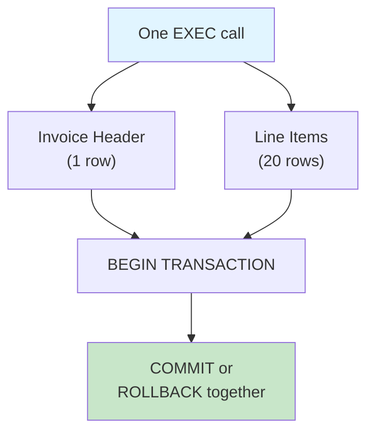
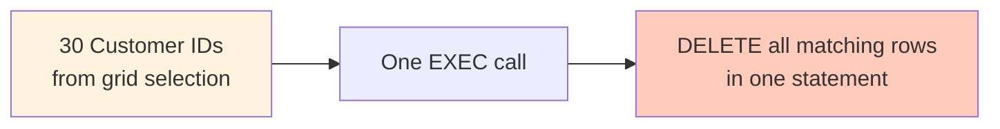
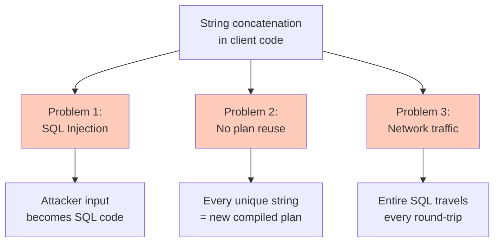
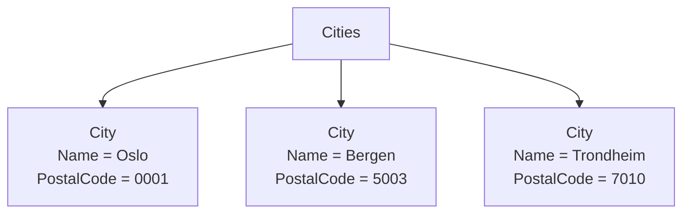
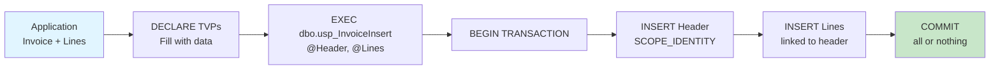
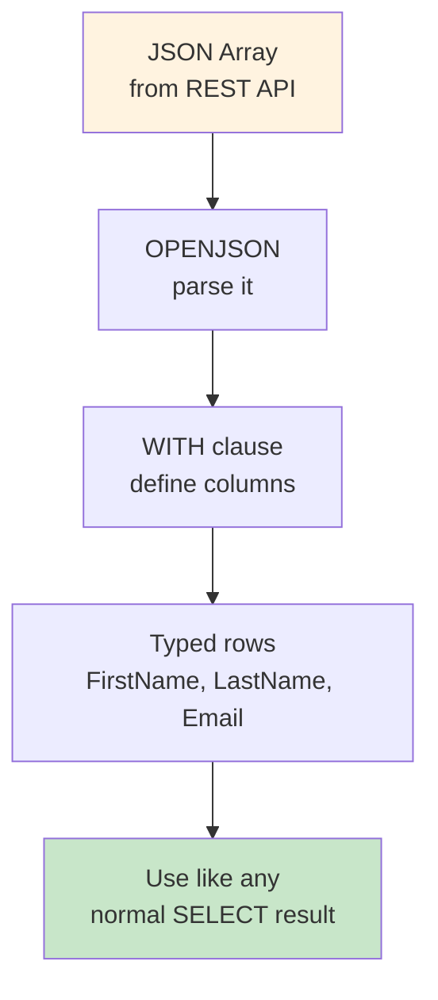
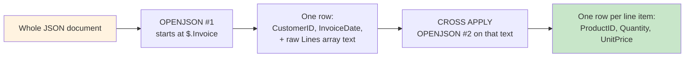
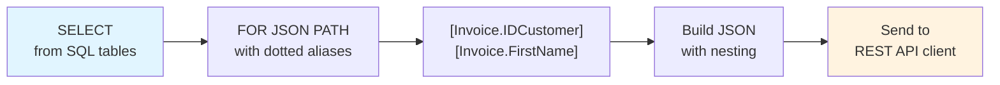
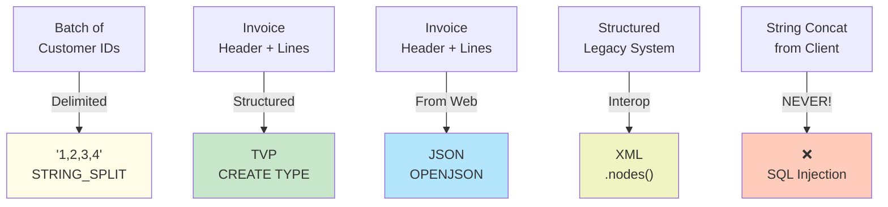
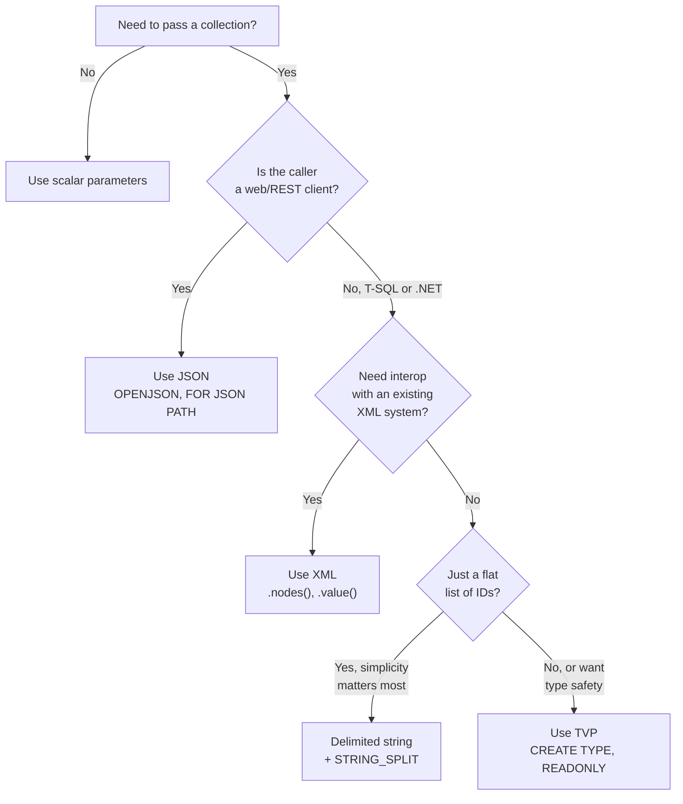

# Lab 8 – Complex Parameters: Passing Collections to Procedures

**Database:** `AdventureWorksENG`

In Labs 3 and 4, we learned that stored procedures and functions package database operations behind a name. Every procedure and function we wrote accepted scalar parameters — one `int`, one `nvarchar`, one `money` at a time.

But what happens when you need to pass **many** values in a single call? How do you insert an invoice header together with twenty line items? How do you delete multiple rows by ID? How do you accept the output of a web API that sends JSON?

This lab introduces five methods for passing collections of data into procedures. Some are anti-patterns to avoid. Others are the native SQL Server way. One is essential for web integration. By the end, you'll know which to reach for in different situations.

> [!IMPORTANT]
> **Core idea:** A collection parameter is not a scalar. It needs structure. SQL Server provides multiple envelopes — some safer, some faster, some more natural for the wire protocol you're using. This lab covers three historical workarounds (client-side query building, delimited strings, XML) and the two native answers designed for this exact job (Table-Valued Parameters and JSON).

---

## Learning objectives

After completing this lab, you should be able to:

- identify the two classic collection-parameter problems: the 1:N insert and the batch key operation;
- understand why client-side query building is dangerous and how it fails in three concrete ways;
- pass a flat list of values as a delimited string and split them with `STRING_SPLIT`;
- pass hierarchical data as XML, shred it with `.nodes()` and `.value()`, and build it back with `FOR XML PATH`;
- define a table type with `CREATE TYPE ... AS TABLE` and pass tables as parameters using Table-Valued Parameters (TVPs);
- accept JSON data with `OPENJSON(@json) WITH (...)`, shred it into typed columns, and build JSON output with `FOR JSON PATH` and dotted aliases;
- compare all five methods (client-side query, delimited string, XML, TVP, JSON) and know which to reach for in different situations.

---

> [!NOTE]
> **Prerequisites:** This lab assumes familiarity with:
>
> - **Stored procedures (Lab 3)** — how to create them, what `EXEC` does, what parameters are.
> - **Functions (Lab 4)** — scalar and table-valued functions.
> - **T-SQL programming (Lab 0)** — variables (Section 2), `IF/BEGIN/END` (Section 4), `WHILE` loops (Section 7), inline type conversion (Section 6), and basic `TRY/CATCH` (Section 10).
>
> String functions (`LEN`, `SUBSTRING`, `CHARINDEX`) and XML/JSON literals are introduced inline as needed.

---

Start by selecting the training database:

```sql
USE AdventureWorksENG;
GO
```

---

# Section 1 – The Problem: Two Shapes

Every real-world system encounters two shapes of the same problem.

## Problem 1 — The 1:N Insert

An invoice has a header and many line items. You want one procedure call that inserts both the header and all lines together.



Without such a mechanism, you'd need twenty-one `EXEC` calls — one for the header, twenty for the lines — or worse, you'd loop in application code.

## Problem 2 — The Batch Key Operation

A user selects 30 rows in a grid and clicks "Delete". You want one procedure call that deletes all 30 by their IDs.



Both problems need the same fundamental thing: a way to send **more than a scalar value** to a procedure in a single call.

## One List, Five Envelopes

Here is a concrete running example to hold onto for the rest of the lab. Suppose the marketing team wants to feature **products 1, 2, and 3** on the homepage this week, and you need to pass that short list of IDs into a procedure.

The list itself never changes — `1`, `2`, `3`. Only the **envelope** around it changes:

| Method | The same three IDs, packaged for the call |
|--------|--------------------------------------------|
| Client-side query *(never do this)* | baked directly into the SQL text: `...WHERE IDProduct = 1 OR IDProduct = 2 OR IDProduct = 3` |
| Delimited string | `'1,2,3'` |
| XML | `<IDs><ID>1</ID><ID>2</ID><ID>3</ID></IDs>` |
| TVP | a table value: 3 rows, one column `ID` |
| JSON | `[1, 2, 3]` |

Every section below teaches you how to build, send, and unpack one row of this table. Section 7 closes the loop with the same example, side by side, once you've seen all five.

---

# Section 2 – Method 1: Client-Side Query Building (The Anti-Example)

## The Tempting Solution

The simplest idea: build the SQL string in your application code.

```python
# Python pseudo-code — DO NOT DO THIS
sql = f"DELETE FROM Customer WHERE IDCustomer = {id1} OR IDCustomer = {id2} OR IDCustomer = {id3}"
cursor.execute(sql)
```

Easy. Direct. Every programmer knows how to concatenate strings.

**Never do it.**

This is the single worst pattern in database programming. Not for prototypes. Not for internal tools. Not for anything.

## Three Concrete Problems



### 1. SQL Injection

If any of those `id` values comes from user input, an attacker can put SQL syntax into your string.

Imagine a vulnerable search box whose client code builds this query:

```text
"SELECT * FROM Customer WHERE LastName = '" + userInput + "'"
```

The same code path, three different inputs:

| What the user types | SQL the server actually receives | What happens |
|---|---|---|
| `Smith` | `...WHERE LastName = 'Smith'` | Finds customers named Smith — works as intended |
| `' OR 1=1 --` | `...WHERE LastName = '' OR 1=1 --'` | `1=1` is always true, so **every row matches**. The `--` comments out the trailing `'` so the query still parses. |
| `'; DROP TABLE Customer; --` | `...WHERE LastName = ''; DROP TABLE Customer; --'` | The `;` starts a brand-new statement. SQL Server runs it. **The table is gone.** |

Nothing about the *code* changed between these three rows — only the text a user typed into a box. That is the entire attack: the database cannot tell "data" from "code" once they've been glued into the same string.

With input like this, an attacker can:
- Return every row from a table
- Delete an entire table
- Read credit card numbers from a different table via `UNION SELECT`
- Modify data arbitrarily

**SQL injection is not a "wrong password" problem. It is a "your whole database is readable and modifiable through one input box" problem.**

### 2. No Query Plan Reuse

SQL Server compiles a separate plan for each unique query text.

If you send:
- `DELETE FROM Customer WHERE IDCustomer = 1`
- `DELETE FROM Customer WHERE IDCustomer = 2`
- `DELETE FROM Customer WHERE IDCustomer = 3`

SQL Server treats these as three different queries and compiles three separate plans. The plan cache fills with almost-identical plans that get used once and thrown away.

### 3. Network Traffic

The entire SQL string travels across the network every time.

With a stored procedure and parameters, the server name and parameter values travel — small. With a concatenated string, everything travels every time.

## The Safer Client-Side Alternative (Still Limited)

Using **parameterised queries** in the client solves injection and plan-cache problems:

```python
# Python with parameterised query — safe, but incomplete
cursor.execute("DELETE FROM Customer WHERE IDCustomer = ?", (id,))
```

But parameterised queries do **not** solve "many rows in one call". If you have 30 IDs to delete, you still send 30 separate `EXEC` calls. The network makes thirty round-trips instead of one.

> [!TIP]
> The remaining methods in this lab all live **inside the procedure**, not in the client. That is how they solve the "many rows in one call" problem.

---

# Section 3 – Method 2: Delimited String Parameters

The first real answer: glue values together into a string — `'1,2,3'` for our running example — and split them back apart inside the procedure.

## STRING_SPLIT — The Modern Splitter

```sql
SELECT value
FROM STRING_SPLIT('1,2,5,7,11', ',');
```

Result:

```
value
-----
1
2
5
7
11
```

Pass it a string and a separator. Get back a table with one column — always named `value`. One row per piece.

`STRING_SPLIT` is available in SQL Server 2016 and later.

> [!NOTE]
> **Before `STRING_SPLIT` existed**, you had to walk the string yourself with `LEN`, `SUBSTRING`, and `CHARINDEX` — find the next separator, cut out the piece before it, repeat. Older code you inherit may still do it that way. You'll build one of these manual splitters yourself in the [exercises](../exercises/complex-parameters.md), which is the fastest way to appreciate what one built-in function saves you.

## Full Pattern: Delete by ID List

```sql
CREATE OR ALTER PROCEDURE dbo.usp_DeleteCustomersByIDList
    @IDList nvarchar(max)
AS
BEGIN
    DELETE FROM dbo.Customer
    WHERE IDCustomer IN
    (
        SELECT CAST(value AS int)
        FROM STRING_SPLIT(@IDList, ',')
    );
END
GO
```

Call it:

```sql
-- Before: 5 customers
SELECT COUNT(*) FROM dbo.Customer;

-- Delete customers with IDs 2 and 3 in a single call
EXEC dbo.usp_DeleteCustomersByIDList @IDList = '2,3';

-- After: 3 customers
SELECT COUNT(*) FROM dbo.Customer;
```

All deleted in one call, solving Problem 2 (batch key operation).

> [!NOTE]
> Don't actually run this if AdventureWorksENG is your only copy — it modifies real data. For actual testing, create your own test table or use the provided exercises.

## The Trade-Offs

| Aspect | Details |
|--------|---------|
| **Pros** | Simple. Works on every SQL Server version. Small on the wire. |
| **Cons** | Untyped — everything is text until you `CAST`. Fragile — pick a separator the data can't contain. No column structure — one flat list only. |

Delimited strings work fine for a batch of integer IDs where the format is under your control. They fall apart the moment you need **structure** — an invoice with a customer ID, a date, **and** ten line items with a product ID, quantity, and price each.

For anything with structure, we need a richer format.

---

# Section 4 – Method 3: XML Parameters

## The Idea

XML is a text blob with **structure**. Tags. Attributes. Nesting. The moment you nest, you can carry an invoice header **and** all its line items in one value.

```xml
<Invoice>
    <Header>
        <CustomerID>5</CustomerID>
        <InvoiceDate>2026-07-23</InvoiceDate>
    </Header>
    <Lines>
        <Line ProductID="1" Quantity="2" UnitPrice="199.00" />
        <Line ProductID="2" Quantity="1" UnitPrice="49.90" />
        <Line ProductID="3" Quantity="5" UnitPrice="9.99" />
    </Lines>
</Invoice>
```

One parameter. Whole structure.

## Reading XML: `.nodes()` and `.value()`

SQL Server gives us two methods on the `xml` type:
- **`.nodes(path)`** — cut the XML into rows.
- **`.value(path, type)`** — extract a column from each row.

### Minimal XQuery Syntax

You need four things:

```
/root/element      — from the root, find all elements at this path
.                  — the current node's value
@name              — the attribute called name
..                 — the parent node
```

Slashes separate levels like a file path. `.` is "here". `@` is "attribute".

### Example: Shred Cities from XML

Picture the document as a tree before looking at the code — this is exactly what `/Cities/City` walks:



`.nodes('/Cities/City')` walks down to the three `City` boxes and returns one row per box. `.value('@Name', ...)` then reads one label inside the box you're standing on.

```sql
DECLARE @Cities xml = N'
<Cities>
    <City Name="Oslo"      PostalCode="0001" />
    <City Name="Bergen"    PostalCode="5003" />
    <City Name="Trondheim" PostalCode="7010" />
</Cities>';

SELECT
    tbl.node.value('@Name',       'nvarchar(50)') AS CityName,
    tbl.node.value('@PostalCode', 'nvarchar(10)') AS PostalCode
FROM @Cities.nodes('/Cities/City') AS tbl(node);
```

Breaking it down:

- `@Cities.nodes('/Cities/City')` — start from the document root, find every `City` node under `Cities`, return them as rows.
- The result is a one-column table; we alias both table and column — `AS tbl(node)`.
- `tbl.node` is now one row per city — each still an XML fragment.
- `.value('@Name', 'nvarchar(50)')` — read the `Name` attribute of the current node and cast it to `nvarchar(50)`.
- Result: three clean rows, two columns.

| CityName | PostalCode |
|----------|-----------|
| Oslo | 0001 |
| Bergen | 5003 |
| Trondheim | 7010 |

## Full Pattern: Insert a Batch of Cities

Create the procedure first:

```sql
CREATE OR ALTER PROCEDURE dbo.usp_InsertCityBatch
    @StateID int,
    @Cities  xml
AS
BEGIN
    INSERT INTO City (Name, StateID)
    SELECT
        tbl.node.value('@Name', 'nvarchar(50)'),
        @StateID
    FROM @Cities.nodes('/Cities/City') AS tbl(node);
END
GO
```

Then, in one unbroken batch, create a state to attach the cities to, call the procedure, verify, and clean up:

```sql
DECLARE @NorwayID int;

INSERT INTO State (Name)
VALUES ('Norway');

SET @NorwayID = SCOPE_IDENTITY();

-- Call it
EXEC dbo.usp_InsertCityBatch
    @StateID = @NorwayID,
    @Cities  = N'
<Cities>
    <City Name="Oslo"      />
    <City Name="Bergen"    />
    <City Name="Trondheim" />
</Cities>';

-- Verify
SELECT c.Name, s.Name AS StateName
FROM City c
JOIN State s ON s.IDState = c.StateID
WHERE s.Name = 'Norway';

-- Cleanup
DELETE FROM City  WHERE StateID = @NorwayID;
DELETE FROM State WHERE IDState = @NorwayID;
```

```sql
DROP PROCEDURE dbo.usp_InsertCityBatch;
```

> [!NOTE]
> `@NorwayID` must stay in scope from the moment it is declared until it is last used. `GO` ends a batch and clears all local variables, so everything that reads `@NorwayID` — the `EXEC`, the cleanup `DELETE`s — must run in the same batch as the `DECLARE`. The procedure itself can be created separately beforehand, since it doesn't depend on the variable.

**Three inserts. One procedure call. One round-trip.**

The application sent one `EXEC` with one XML parameter. The database received the whole batch in a single message and did the work in one `INSERT ... SELECT`, much faster than three separate `INSERT`s.

## Element Text vs Attributes

XML can store data two ways:

```xml
<!-- As attributes -->
<City Name="Oslo" />

<!-- As element text -->
<City>Oslo</City>
```

Read attributes with `@Name`. Read element text with `.`:

```sql
DECLARE @Cities xml = N'
<Cities>
    <City>Oslo</City>
    <City>Bergen</City>
</Cities>';

SELECT tbl.node.value('.', 'nvarchar(50)') AS CityName
FROM @Cities.nodes('/Cities/City') AS tbl(node);
```

Same idea. Different key.

## Building XML: FOR XML PATH

XML works both ways. If a client sends XML in, sometimes we send XML back.

```sql
SELECT
    c.IDCustomer       AS [@IDCustomer],
    c.FirstName        AS [FirstName],
    c.LastName         AS [LastName],
    c.Email            AS [Emails/Email]
FROM Customer c
WHERE c.IDCustomer <= 3
FOR XML PATH('Customer'), ROOT('Customers');
```

Look at the column aliases:

- `[@IDCustomer]` — a name starting with `@` becomes an XML attribute.
- `[FirstName]` — a plain name becomes a child element.
- `[Emails/Email]` — a slash creates nested elements.
- `FOR XML PATH('Customer')` — wrap each row in a `<Customer>` element.
- `ROOT('Customers')` — wrap the whole thing in `<Customers>...</Customers>`.

Expected shape:

```xml
<Customers>
  <Customer IDCustomer="1">
    <FirstName>Gustavo</FirstName>
    <LastName>Achong</LastName>
    <Emails>
      <Email>gustavo0@adventure-works.com</Email>
    </Emails>
  </Customer>
  ...
</Customers>
```

This is the mirror image of `.nodes()` and `.value()`. One converts XML into rows. The other converts rows into XML.

## The Trade-Offs

| Aspect | Details |
|--------|---------|
| **Pros** | Handles arbitrarily nested structure. Standard. Self-documenting. Round-trips easily: `FOR XML` out, `.nodes()` in. |
| **Cons** | Verbose — lots of angle brackets on the wire. Parsing slower than TVP or JSON. Weakly typed until you `CAST`. |

XML is fine when the data has structure and the wire format is already XML. It falls apart against a web API that speaks JSON.

---

# Section 5 – Table-Valued Parameters

## The Idea

Back to our running example: pass products `1, 2, 3` into a procedure — but this time, as an actual **table**, not text.

Here's the wrinkle. Every parameter you've written so far has a type SQL Server already knows about:

```sql
CREATE OR ALTER PROCEDURE dbo.usp_Example
    @IDList nvarchar(max),   -- SQL Server knows "nvarchar"
    @Price  money            -- SQL Server knows "money"
AS ...
```

But you **cannot** write this:

```sql
-- NOT VALID — SQL Server rejects an inline table shape
CREATE OR ALTER PROCEDURE dbo.usp_Example
    @IDs TABLE (ID int) READONLY
AS ...
```

A parameter's type must already exist and have a name. `int`, `nvarchar`, `money` qualify. "A table with these columns" does not — not until you name it yourself.

**`CREATE TYPE ... AS TABLE`** does exactly that: it teaches SQL Server a new type shape, once, under a name you choose. After that, the type behaves like any other — you can use it as a parameter, and the procedure reads the whole table through it, not just one scalar.

This is SQL Server's **native answer** to "pass me many rows". No string to parse, no angle brackets, no `OPENJSON` — just a table, passed as a table.

## Step 1 – Define the Type

```sql
CREATE TYPE dbo.ProductIDList AS TABLE
(
    ID int PRIMARY KEY
);
GO
```

`CREATE TYPE ... AS TABLE` — one new keyword. Inside the parentheses, the same column definitions you'd use in `CREATE TABLE`. Give it a primary key when you can — SQL Server uses it for optimization.

Once created, `dbo.ProductIDList` is a first-class type. You can use it anywhere a type is allowed.

## Step 2 – Use It in a Procedure

```sql
CREATE OR ALTER PROCEDURE dbo.usp_GetProductsByIDs
    @IDs dbo.ProductIDList READONLY
AS
BEGIN
    SELECT
        p.IDProduct,
        p.Name,
        p.PriceWithoutVAT
    FROM Product p
    INNER JOIN @IDs i ON i.ID = p.IDProduct;
END
GO
```

The key word: **`READONLY`**. Inside the procedure, you cannot `INSERT`, `UPDATE`, or `DELETE` on `@IDs`. You can only read from it.

This is a **fundamental rule** of TVPs, not a bug you can work around. Why? Read-only means SQL Server doesn't have to copy the input into a temporary structure — it passes the data efficiently and the procedure works directly with it.

> [!NOTE]
> If you truly need to modify the input list, copy it into a local table variable of the same type — that copy is not `READONLY` and you can modify it freely.

## Step 3 – Call It From T-SQL

To call a TVP-accepting procedure from T-SQL, declare a variable of the type, fill it, and pass it:

```sql
DECLARE @MyIDs dbo.ProductIDList;

INSERT INTO @MyIDs (ID) VALUES (1), (2), (3);

EXEC dbo.usp_GetProductsByIDs @IDs = @MyIDs;
```

Three rows in a variable. One `EXEC` call. Inside the procedure, `@IDs` behaves like any other table you can `JOIN` against.

This is Problem 2 (batch key operation) solved.

Clean up this introductory example before moving on (the next example defines its own types):

```sql
DROP PROCEDURE dbo.usp_GetProductsByIDs;
DROP TYPE dbo.ProductIDList;
GO
```

## Full Example: The 1:N Insert with Two TVPs

This is the showcase example. An invoice header and many line items, all in one call.



First, define two types:

```sql
CREATE TYPE dbo.InvoiceHeaderInput AS TABLE
(
    CustomerID   int  NOT NULL,
    InvoiceDate  date NOT NULL
);
GO

CREATE TYPE dbo.InvoiceLineInput AS TABLE
(
    ProductID  int   NOT NULL,
    Quantity   int   NOT NULL,
    UnitPrice  money NOT NULL
);
GO
```

Now the procedure:

```sql
CREATE OR ALTER PROCEDURE dbo.usp_InvoiceInsert
    @Header dbo.InvoiceHeaderInput READONLY,
    @Lines  dbo.InvoiceLineInput   READONLY
AS
BEGIN
    SET XACT_ABORT ON;
    BEGIN TRANSACTION;

    DECLARE @NewInvoiceID int;

    -- Insert the header
    INSERT INTO Invoice (CustomerID, InvoiceDate, InvoiceNumber)
    SELECT
        h.CustomerID,
        h.InvoiceDate,
        CONVERT(nvarchar(20), NEWID())
    FROM @Header h;

    -- Capture the new invoice ID
    SET @NewInvoiceID = SCOPE_IDENTITY();

    -- Insert all line items, linked to the new invoice
    INSERT INTO InvoiceItem (InvoiceID, ProductID, Quantity, InitialPrice, Discount, TotalPrice)
    SELECT
        @NewInvoiceID,
        l.ProductID,
        l.Quantity,
        l.UnitPrice,
        0,
        l.Quantity * l.UnitPrice
    FROM @Lines l;

    COMMIT TRANSACTION;

    SELECT @NewInvoiceID AS NewInvoiceID;
END
GO
```

The key pieces:

- **`BEGIN TRANSACTION` / `COMMIT`** — either both the header and lines land together, or none of them do. This ensures the invoice is never half-created.
- **`SCOPE_IDENTITY()`** — captures the auto-generated invoice ID so we can link the line items.
- **Two TVPs** — one for the header shape, one for the lines shape. Each can be read multiple times by different parts of the procedure.
- **`InitialPrice` and `Discount`** — `InvoiceItem` requires both (`NOT NULL`). The TVP only carries a single `UnitPrice`, so the procedure uses it as `InitialPrice` and records no discount (`0`) for this simplified example.

Call it:

```sql
DECLARE @Hdr dbo.InvoiceHeaderInput;
DECLARE @Lns dbo.InvoiceLineInput;

INSERT INTO @Hdr (CustomerID, InvoiceDate) VALUES (1, '2026-07-23');

INSERT INTO @Lns (ProductID, Quantity, UnitPrice) VALUES
    (1, 2, 199.00),
    (2, 1,  49.90),
    (3, 5,   9.99);

EXEC dbo.usp_InvoiceInsert @Header = @Hdr, @Lines = @Lns;
```

One `EXEC`. One header. Three line items. One transaction. **Problem 1 solved — natively, type-safely, atomically.**

Clean up the demo invoice, then the procedure and types (note the drop order — procedure before types):

```sql
DECLARE @LastInvoiceID int = (SELECT MAX(IDInvoice) FROM Invoice);

DELETE FROM InvoiceItem WHERE InvoiceID = @LastInvoiceID;
DELETE FROM Invoice     WHERE IDInvoice = @LastInvoiceID;

DROP PROCEDURE dbo.usp_InvoiceInsert;
DROP TYPE dbo.InvoiceLineInput;
DROP TYPE dbo.InvoiceHeaderInput;
GO
```

> [!IMPORTANT]
> **Drop the procedure before the type.** SQL Server refuses to drop a type that any procedure still references. This "children before parents" rule is important.

## The Trade-Offs

| Aspect | Details |
|--------|---------|
| **Pros** | Type-safe. Multi-column. Native SQL Server answer. Best query plan quality. Standard client-library support (.NET, Python, Java all have TVP support). |
| **Cons** | You must `CREATE TYPE` first. `ALTER TYPE` does not exist — to change the shape, you must drop and recreate. Any procedure using the type blocks the drop. |

TVPs are the default choice when both the client and server speak SQL Server (T-SQL to T-SQL, .NET to SQL, Python with pyodbc, etc.). Keep TVP types small and focused — one type per concept, not one per procedure.

---

# Section 6 – JSON Parameters

## The Idea

Not all callers speak SQL Server. Web frontends send JSON. Mobile apps send JSON. REST APIs trade in JSON.

SQL Server (since 2016) can accept an `nvarchar(max)` containing JSON, parse it into rows, and let you query it like a table. No `CREATE TYPE`. Just an `nvarchar(max)` and a couple of functions.

This bridges the gap between the JSON world (outside the database) and the SQL world (inside the database).

## Reading JSON: OPENJSON WITH

The function `OPENJSON(@json, path)` takes JSON and shreds it into rows. The `WITH (...)` clause declares what columns you want and where to find them.



```sql
DECLARE @Customers nvarchar(max) = N'
[
    { "FirstName": "Ida",   "LastName": "Ibsen",    "Email": "ida@example.com" },
    { "FirstName": "Jonas", "LastName": "Jensen",   "Email": "jonas@example.com" },
    { "FirstName": "Kari",  "LastName": "Kristian", "Email": "kari@example.com" }
]';

SELECT *
FROM OPENJSON(@Customers)
WITH
(
    FirstName nvarchar(50)  '$.FirstName',
    LastName  nvarchar(50)  '$.LastName',
    Email     nvarchar(100) '$.Email'
);
```

Breaking it down:

- `OPENJSON(@Customers)` — parse the JSON. Without a `WITH` clause it returns a generic key/value view.
- `WITH (...)` — declare the columns we want. Name, SQL type, JSON path.
- `'$.FirstName'` — the path expression. `$` is "the root of this row". `$.FirstName` is the `FirstName` property of the current object.
- Result: three clean columns, three rows. Identical to a normal SQL query result.

| FirstName | LastName  | Email |
|-----------|-----------|-------|
| Ida | Ibsen | ida@example.com |
| Jonas | Jensen | jonas@example.com |
| Kari | Kristian | kari@example.com |

## Full Example: Insert a Batch via JSON

```sql
CREATE OR ALTER PROCEDURE dbo.usp_InsertCustomerBatchFromJson
    @JsonCustomers nvarchar(max)
AS
BEGIN
    INSERT INTO Customer (FirstName, LastName, Email)
    SELECT FirstName, LastName, Email
    FROM OPENJSON(@JsonCustomers)
    WITH
    (
        FirstName nvarchar(50)  '$.FirstName',
        LastName  nvarchar(50)  '$.LastName',
        Email     nvarchar(100) '$.Email'
    );
END
GO

-- Call it
EXEC dbo.usp_InsertCustomerBatchFromJson @JsonCustomers = N'
[
    { "FirstName": "Alice",   "LastName": "Anderson", "Email": "alice@example.com" },
    { "FirstName": "Bob",     "LastName": "Brown",    "Email": "bob@example.com" }
]';

-- Verify
SELECT FirstName, LastName, Email
FROM Customer
WHERE Email IN ('alice@example.com', 'bob@example.com');

-- Cleanup
DELETE FROM Customer WHERE Email IN ('alice@example.com', 'bob@example.com');
DROP PROCEDURE dbo.usp_InsertCustomerBatchFromJson;
```

**Two customers. One `INSERT`. One JSON parameter.**

## Deeply Nested JSON

Real-world JSON is rarely flat. It nests:

```json
{
    "Invoice":
    {
        "CustomerID": 5,
        "InvoiceDate": "2026-07-23",
        "Lines":
        [
            { "ProductID": 1, "Quantity": 2, "UnitPrice": 199.00 },
            { "ProductID": 2, "Quantity": 1, "UnitPrice": 49.90 }
        ]
    }
}
```

To read this:

```sql
DECLARE @Json nvarchar(max) = N'{
    "Invoice": {
        "CustomerID": 5,
        "InvoiceDate": "2026-07-23",
        "Lines": [
            { "ProductID": 1, "Quantity": 2, "UnitPrice": 199.00 },
            { "ProductID": 2, "Quantity": 1, "UnitPrice": 49.90 }
        ]
    }
}';

SELECT *
FROM OPENJSON(@Json, '$.Invoice')
WITH
(
    CustomerID  int          '$.CustomerID',
    InvoiceDate date         '$.InvoiceDate'
);
```

Key points:

- The second argument to `OPENJSON` — `'$.Invoice'` — sets the **starting point** in the JSON. Start here, not at the document root.
- The paths in the `WITH` columns are **relative** to that starting point. `'$.CustomerID'` means "from the current Invoice object, read the CustomerID property".

This one `OPENJSON` call only reaches the header — `CustomerID` and `InvoiceDate` are plain values, but `Lines` is itself an array. One `WITH` clause can read scalars; it can't also shred a nested array in the same breath. That takes a **second** `OPENJSON`, applied to just the `Lines` fragment:



The first `OPENJSON` produces one row holding the header values **and** the untouched `Lines` array as raw text (that's what `AS JSON` below means: "don't try to parse this column, just hand me the text"). The second `OPENJSON`, run once per row via `CROSS APPLY`, then shreds that text into one row per line item:

```sql
SELECT
    inv.CustomerID,
    inv.InvoiceDate,
    lines.ProductID,
    lines.Quantity,
    lines.UnitPrice
FROM OPENJSON(@Json, '$.Invoice') AS inv
WITH
(
    CustomerID  int          '$.CustomerID',
    InvoiceDate date         '$.InvoiceDate',
    LinesJson   nvarchar(max) '$.Lines' AS JSON
)
CROSS APPLY OPENJSON(inv.LinesJson)
WITH
(
    ProductID  int           '$.ProductID',
    Quantity   int           '$.Quantity',
    UnitPrice  decimal(10,2) '$.UnitPrice'
) AS lines;
```

This shreds the nested array into individual rows, one per line item.

## Building JSON: FOR JSON PATH

JSON works both ways. Use `FOR JSON PATH` with dotted column aliases to build nested JSON from a `SELECT`:



```sql
SELECT
    c.IDCustomer       AS [Invoice.IDCustomer],
    c.FirstName        AS [Invoice.FirstName],
    c.LastName         AS [Invoice.LastName],
    c.Email            AS [Invoice.Email]
FROM Customer c
WHERE c.IDCustomer < 5
FOR JSON PATH, ROOT('Customers');
```

Expected output:

```json
{
    "Customers": [
        {
            "Invoice": {
                "IDCustomer": 1,
                "FirstName": "Gustavo",
                "LastName": "Achong",
                "Email": "gustavo0@adventure-works.com"
            }
        },
        ...
    ]
}
```

Key points:

- Each dot in the column alias creates one level of object nesting.
- `[Invoice.IDCustomer]` produces `{ "Invoice": { "IDCustomer": ... } }`.
- `FOR JSON PATH` wraps each row in its own object.
- `ROOT('Customers')` wraps the whole array in a root container.

## The Trade-Offs

| Aspect | Details |
|--------|---------|
| **Pros** | The web already speaks JSON. Zero impedance mismatch on the client — send JSON as-is, no translation needed. Lighter syntax than XML. Requires no `CREATE TYPE`. |
| **Cons** | Less strictly typed than TVPs — all parsing happens at runtime. No pre-compiled plan for the shape. Requires SQL Server 2016+. |

JSON is the natural choice when the caller is a web service (React frontend, FastAPI backend, mobile app, etc.) and JSON is already the wire format. If both client and server are .NET or T-SQL, TVP is usually faster and safer.

---

# Section 7 – Five Methods: One Table, One Choice

## Back to the Running Example

Section 1 opened with one request — pass products `1, 2, 3` into a procedure — shown in five envelopes before you'd seen any of the mechanics. Now that you've built all five, here is the same table again, with the parameter declaration each method actually needs:

| Method | Parameter declaration | What travels in the call |
|--------|------------------------|---------------------------|
| Client-side query *(never do this)* | *(no parameter at all — the values sit inside the SQL text itself)* | `...WHERE IDProduct = 1 OR IDProduct = 2 OR IDProduct = 3` |
| Delimited string | `@IDList nvarchar(max)` | `'1,2,3'` |
| XML | `@IDs xml` | `<IDs><ID>1</ID><ID>2</ID><ID>3</ID></IDs>` |
| TVP | `@IDs dbo.ProductIDList READONLY` | a table value: 3 rows, one column `ID` |
| JSON | `@Json nvarchar(max)` | `[1, 2, 3]` |

Same three products, five times. The only thing that changed from Section 1 to here is that you now know exactly how each row of this table is built, sent, and unpacked.

## The Comparison

Here is the complete picture — all five methods, one table:

| Method | Type-Safe | Plan Reuse | Injection Risk | Handles Structure | Network Efficiency | When to Use |
|--------|-----------|-----------|--------------|----------|----------|-----------|
| **Client-side query** | No | Poor | **HIGH** | No | Poor | **Never** |
| **Delimited string** | No | Good | None | No | Good | Flat list of IDs where simplicity beats type safety |
| **XML** | Partial | Good | None | Yes | Fair | Nested data; interop with XML systems |
| **TVP** | **Yes** | **Best** | None | Yes | Excellent | **Default for T-SQL–to–T-SQL and .NET** |
| **JSON** | Weak | Good | None | Yes | Fair | **Web-facing APIs; SQL Server 2016+** |

## Reading the Table

**Never**: Client-side query building. Period. SQL injection risk is unacceptable.

**For a flat list**: Delimited string works. Simple, small on the wire. No structure needed.

**For hierarchical data in SQL Server 2008+, without web integration**: XML. Standard, self-documenting, handles arbitrary nesting.

**Default choice**: Table-Valued Parameters. Type-safe, best plan quality, fastest execution, standard in all modern client libraries.

**Web API situation**: JSON. The client already sends it as JSON. Accept it as JSON. No translation layer.

## Methods at a Glance



## Decision Flowchart



---

## Check your understanding

1. What is the 1:N insert problem, and why is it hard without collection parameters?
2. Name three concrete reasons never to build SQL by string concatenation in the client.
3. What does `STRING_SPLIT` return, and what type is the `value` column?
4. When you use XML, what does `@Name` mean in `.value('@Name', 'nvarchar(50)')`?
5. When you use `FOR XML PATH`, how do you create nested elements in the output?
6. Why is `READONLY` mandatory on TVP parameters, and what do you do if you need to modify the input?
7. In `OPENJSON(@Json, '$.Invoice')`, what does `'$.Invoice'` do?
8. How would you use `FOR JSON PATH` to build nested JSON with dotted aliases?
9. Compare TVP and JSON: when would you pick each one?

<details>
<summary>Show answers</summary>

1. **1:N insert** — An invoice header and twenty line items need to go into the database together, all or nothing. Without collection parameters, you'd need one call for the header and twenty more for the lines. With one collection parameter, it's one call, one round-trip, one transaction.

2. **Three reasons never to concatenate** — (1) **SQL injection**: attacker input becomes SQL, letting the attacker execute their own statements. (2) **No plan-cache reuse**: every unique query text compiles a new plan; 30 different ID combinations = 30 different plans filling the cache. (3) **Network chatter**: the whole SQL string travels every time instead of just the procedure name and parameters.

3. **STRING_SPLIT returns** — A one-column table with a column always named `value`, of type `nvarchar` (matching the input string's type). One row per split piece. If the input was `'1,2,5'` and separator was `,`, you get three rows: `1`, `2`, `5`.

4. **`@Name` in XML** — It reads an **attribute** named `Name` on the current node. If you wanted to read the node's text content instead (the value between opening and closing tags), you'd use `.` (dot).

5. **Nested elements in FOR XML PATH** — Use a **slash** in the column alias. `[Emails/Email]` produces `<Emails><Email>...</Email></Emails>`. (This is different from `FOR JSON PATH`, which uses **dots** instead of slashes for the same purpose — see question 8.)

6. **Why `READONLY` is mandatory** — It allows SQL Server to pass the TVP data efficiently without copying it to a temporary structure. The procedure can only read it, not modify it. If you need to modify, copy the TVP into a local table variable (which is **not** `READONLY`) and modify the copy.

7. **`'$.Invoice'` in OPENJSON** — It sets the **starting point** for shredding. Instead of starting at the document root (`$`), start at the `Invoice` property. All column paths in the `WITH` clause are then relative to each row starting from that point.

8. **Dotted aliases in FOR JSON PATH** — Column aliases like `[Invoice.IDCustomer]` or `[Invoice.Lines.ProductID]` create nested objects. Each dot is one level of nesting. `[A.B.C]` produces `{ "A": { "B": { "C": ... } } }`.

9. **TVP vs JSON** — **TVP** when both client and server are SQL Server or .NET; it's type-safe and fastest. **JSON** when the client is a web service (React, mobile, etc.) and JSON is already the wire format; it eliminates translation overhead.

</details>

---

# Exercises

Try each exercise before opening the solution.

---

## Exercise 1 — Delimited String: Delete by Name Pattern [INTERMEDIATE]

Create a procedure `dbo.usp_DeleteProductsByNameList` that takes one `nvarchar(max)` parameter — a comma-separated list of product names.

The procedure must:

1. Accept `@NameList nvarchar(max)`.
2. Delete all products whose name appears in the list.
3. Use `STRING_SPLIT` to split the list.

Insert three throwaway test products first (do not delete real `AdventureWorksENG` products — see the [database safety note](../exercises/README.md#database-safety-note)). Test the procedure against your own test products. Verify they are gone.

### Hints

- Use `STRING_SPLIT(@NameList, ',')` to get a table.
- Use `IN (SELECT value FROM STRING_SPLIT(...))` to match the names.
- Remember: `value` is `nvarchar`, and the `Product.Name` column is also `nvarchar`, so no `CAST` is needed.
- `Product.ProductNumber` and `Product.MinimumQuantityInStock` are `NOT NULL` — supply a value for each when inserting test rows.

<details>
<summary>Show solution</summary>

```sql
CREATE OR ALTER PROCEDURE dbo.usp_DeleteProductsByNameList
    @NameList nvarchar(max)
AS
BEGIN
    DELETE FROM dbo.Product
    WHERE Name IN
    (
        SELECT value
        FROM STRING_SPLIT(@NameList, ',')
    );
END
GO

-- Insert three throwaway test products — never delete real seed data
INSERT INTO Product (Name, ProductNumber, MinimumQuantityInStock, PriceWithoutVAT) VALUES
    (N'ZZ_TestProduct1', N'ZZTEST-001', 0, 9.99),
    (N'ZZ_TestProduct2', N'ZZTEST-002', 0, 9.99),
    (N'ZZ_TestProduct3', N'ZZTEST-003', 0, 9.99);

-- Test: delete all three test products in a single call
EXEC dbo.usp_DeleteProductsByNameList @NameList = N'ZZ_TestProduct1,ZZ_TestProduct2,ZZ_TestProduct3';

-- Verify they are gone
SELECT * FROM Product WHERE Name LIKE N'ZZ_TestProduct%';

DROP PROCEDURE dbo.usp_DeleteProductsByNameList;
```

</details>

---

## Exercise 2 — XML: Insert a Batch of States [INTERMEDIATE]

Create a procedure `dbo.usp_InsertStatesBatch` that accepts an `xml` parameter of this shape:

```xml
<States>
    <State Name="NewCountry1" />
    <State Name="NewCountry2" />
    <State Name="NewCountry3" />
</States>
```

The procedure must:

1. Accept `@States xml`.
2. Insert all rows into the `State` table.
3. Use `.nodes()` and `.value()` to shred the XML.

Test it with at least three state names. Verify. Delete the rows, then drop the procedure.

### Hints

- Use `.nodes('/States/State')` to iterate over each `State` element.
- Use `.value('@Name', 'nvarchar(50)')` to extract the `Name` attribute.
- Remember: alias both the table and the column after `.nodes()` — `AS tbl(node)`.

<details>
<summary>Show solution</summary>

```sql
CREATE OR ALTER PROCEDURE dbo.usp_InsertStatesBatch
    @States xml
AS
BEGIN
    INSERT INTO State (Name)
    SELECT
        tbl.node.value('@Name', 'nvarchar(50)')
    FROM @States.nodes('/States/State') AS tbl(node);
END
GO

-- Test
EXEC dbo.usp_InsertStatesBatch @States = N'
<States>
    <State Name="NewCountry1" />
    <State Name="NewCountry2" />
    <State Name="NewCountry3" />
</States>';

-- Verify
SELECT * FROM State WHERE Name LIKE N'NewCountry%';

-- Cleanup
DELETE FROM State WHERE Name LIKE N'NewCountry%';
DROP PROCEDURE dbo.usp_InsertStatesBatch;
```

</details>

---

## Exercise 3 — XML Round-Trip: Customers to XML and Back [ADVANCED]

Write a query (not a procedure) that:

1. Reads from `Customer` where `IDCustomer < 11`.
2. Produces XML of this shape:

```xml
<Customers>
    <Customer IDCustomer="1">
        <FirstName>Gustavo</FirstName>
        <LastName>Achong</LastName>
        <Emails>
            <Email>gustavo0@adventure-works.com</Email>
        </Emails>
    </Customer>
    ...
</Customers>
```

Use `FOR XML PATH` with slash-separated aliases to create the nested structure.

### Hints

- `[@IDCustomer]` in the `SELECT` becomes an XML attribute.
- `[FirstName]` becomes a simple element.
- `[Emails/Email]` with a slash creates a nested element.
- Use `FOR XML PATH('Customer'), ROOT('Customers')` to set the structure.

<details>
<summary>Show solution</summary>

```sql
SELECT
    c.IDCustomer      AS [@IDCustomer],
    c.FirstName       AS [FirstName],
    c.LastName        AS [LastName],
    c.Email           AS [Emails/Email]
FROM Customer c
WHERE c.IDCustomer < 11
FOR XML PATH('Customer'), ROOT('Customers');
```

Run it and inspect the XML. Notice:

- `[@IDCustomer]` became an attribute on the `<Customer>` element.
- `[FirstName]` and `[LastName]` became child elements.
- `[Emails/Email]` created a nested `<Emails>` container with an `<Email>` child inside.

</details>

---

## Exercise 4 — TVP Fundamentals [INTERMEDIATE]

Create a **table type** `dbo.ProductIDList` with a single `int` column called `ID` (primary key).

Write a procedure `dbo.usp_ListProductsByIDList` that:

1. Accepts one `dbo.ProductIDList READONLY` parameter.
2. Returns `IDProduct`, `Name`, and `PriceWithoutVAT` for all products in the list.
3. Joins the TVP against the `Product` table.

Call it with three product IDs. Verify the results. Then drop the procedure and the type (in the right order).

### Hints

- `CREATE TYPE ... AS TABLE` defines the type; `CREATE OR ALTER PROCEDURE` uses it as a parameter type.
- Remember `READONLY` is mandatory.
- After `DECLARE @List dbo.ProductIDList;`, you can `INSERT INTO @List (ID) VALUES (...), (...);`
- Drop the procedure first, then the type.

<details>
<summary>Show solution</summary>

```sql
CREATE TYPE dbo.ProductIDList AS TABLE
(
    ID int PRIMARY KEY
);
GO

CREATE OR ALTER PROCEDURE dbo.usp_ListProductsByIDList
    @IDs dbo.ProductIDList READONLY
AS
BEGIN
    SELECT
        p.IDProduct,
        p.Name,
        p.PriceWithoutVAT
    FROM Product p
    INNER JOIN @IDs ids ON ids.ID = p.IDProduct
    ORDER BY p.IDProduct;
END
GO

-- Test
DECLARE @ProductList dbo.ProductIDList;
INSERT INTO @ProductList (ID) VALUES (1), (2), (5);

EXEC dbo.usp_ListProductsByIDList @IDs = @ProductList;

-- Cleanup (procedure first, then type)
DROP PROCEDURE dbo.usp_ListProductsByIDList;
DROP TYPE dbo.ProductIDList;
```

</details>

---

## Exercise 5 — JSON: Insert Customers from JSON [INTERMEDIATE]

Write a procedure `dbo.usp_InsertCustomersFromJson` that:

1. Accepts an `nvarchar(max)` parameter containing JSON.
2. The JSON is an array of objects with `FirstName`, `LastName`, and `Email` fields.
3. Uses `OPENJSON ... WITH (...)` to shred the JSON into rows.
4. Inserts all rows into the `Customer` table.

Call it with at least two customers in JSON format. Verify they were inserted. Clean up by deleting those rows.

### Hints

- JSON array: `[ { "FirstName": "...", ... }, { "FirstName": "...", ... } ]`
- `OPENJSON(@Json)` without a second argument shreds the root array.
- `WITH (FirstName nvarchar(50) '$.FirstName', ...)`  — column name, type, and path.
- Paths like `'$.FirstName'` mean "from the current row, read the FirstName property".

<details>
<summary>Show solution</summary>

```sql
CREATE OR ALTER PROCEDURE dbo.usp_InsertCustomersFromJson
    @JsonCustomers nvarchar(max)
AS
BEGIN
    INSERT INTO Customer (FirstName, LastName, Email)
    SELECT FirstName, LastName, Email
    FROM OPENJSON(@JsonCustomers)
    WITH
    (
        FirstName nvarchar(50)  '$.FirstName',
        LastName  nvarchar(50)  '$.LastName',
        Email     nvarchar(100) '$.Email'
    );
END
GO

-- Test
EXEC dbo.usp_InsertCustomersFromJson @JsonCustomers = N'
[
    { "FirstName": "Xavier", "LastName": "Xavier", "Email": "xavier@example.com" },
    { "FirstName": "Yolanda", "LastName": "Yates", "Email": "yolanda@example.com" }
]';

-- Verify
SELECT FirstName, LastName, Email
FROM Customer
WHERE Email IN ('xavier@example.com', 'yolanda@example.com');

-- Cleanup
DELETE FROM Customer WHERE Email IN ('xavier@example.com', 'yolanda@example.com');
DROP PROCEDURE dbo.usp_InsertCustomersFromJson;
```

</details>

---

# Cleanup

Remove the procedures and types created in the lab body. (Each exercise's solution already cleans up after itself.)

```sql
DROP PROCEDURE IF EXISTS dbo.usp_DeleteCustomersByIDList;
DROP PROCEDURE IF EXISTS dbo.usp_InsertCityBatch;
DROP PROCEDURE IF EXISTS dbo.usp_GetProductsByIDs;
DROP PROCEDURE IF EXISTS dbo.usp_InvoiceInsert;
DROP PROCEDURE IF EXISTS dbo.usp_InsertCustomerBatchFromJson;
GO

DROP TYPE IF EXISTS dbo.ProductIDList;
DROP TYPE IF EXISTS dbo.InvoiceLineInput;
DROP TYPE IF EXISTS dbo.InvoiceHeaderInput;
GO
```

---

# What You Should Know After This Lab

**Collection parameters are not scalars.** A scalar is one value. A collection is many. SQL Server provides multiple envelopes for different situations.

**Never build SQL by concatenation in the client.** It enables SQL injection, fills the query plan cache with single-use plans, and sends data inefficiently.

**Delimited strings work for a flat list of IDs.** Nothing more. Use `STRING_SPLIT` to split. Avoid if the delimiter character might appear in the data.

**XML handles nesting and structure.** Use `.nodes()` to shred, `.value()` to extract columns, `FOR XML PATH` to build it back. It is verbose on the wire but standard and self-documenting.

**Table-Valued Parameters (TVPs)** are SQL Server's native answer. `CREATE TYPE ... AS TABLE` once, then pass variables of that type as `READONLY` parameters. Type-safe, fast, multi-column. Default choice for T-SQL-to-T-SQL and .NET.

**JSON matches the web.** `OPENJSON ... WITH (...)` shreds it on the way in. `FOR JSON PATH` with dotted aliases builds it on the way out. Essential when the client is a REST API, frontend, or mobile app.

## The Complete Comparison

| Method | Use When | Why |
|--------|----------|-----|
| **Client-side query** | **Never.** | SQL injection, plan cache, network — three ways to lose. |
| **Delimited string** | Flat list of IDs, simplicity over type safety | Simple, small on wire. No structure needed. |
| **XML** | Hierarchical data; interop with XML systems | Standard, self-documenting. Verbose on wire. |
| **TVP** | **Default for .NET and T-SQL–to–T-SQL** | Type-safe, fastest, best plans, multi-column. |
| **JSON** | **Web APIs, REST endpoints, mobile clients** | Client already sends JSON. Zero translation. |

**By the end of this lab, you have all five methods and know which to reach for.** The decision flowchart in Section 7 guides you. When in doubt: **TVP for database-to-database, JSON for web-facing APIs.**

---

## Additional practice

More exercises on delimited strings, XML, and mixed scenarios are available in [Complex Parameters Exercises](../exercises/complex-parameters.md).

---

# Where to Go Next

You now have the complete collection-parameters toolkit — all five methods, their trade-offs, and when each one is the right choice.

**Lab 9 – T-SQL Programming** continues with deeper error handling, including `THROW` and re-raising errors, and introduces `CONVERT` and `FORMAT` for working with dates and formatted text output. These patterns build on the `TRY/CATCH` foundations from Lab 0 and the transaction patterns you've seen here (the `BEGIN TRANSACTION` / `ROLLBACK TRANSACTION` in the TVP 1:N insert example).
