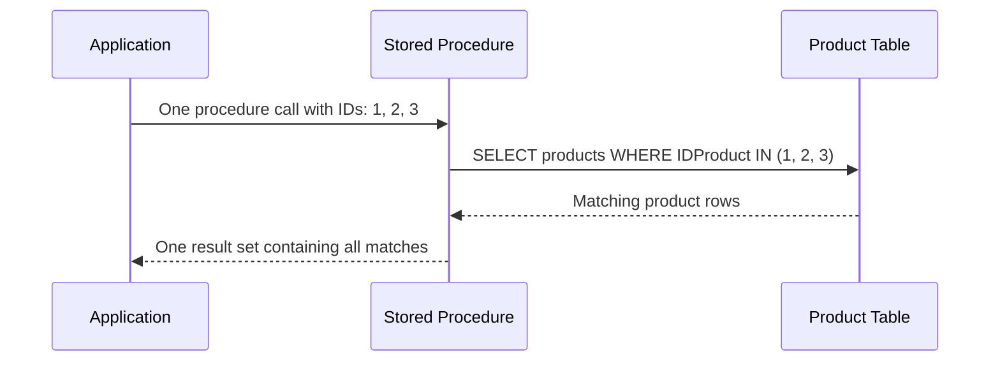
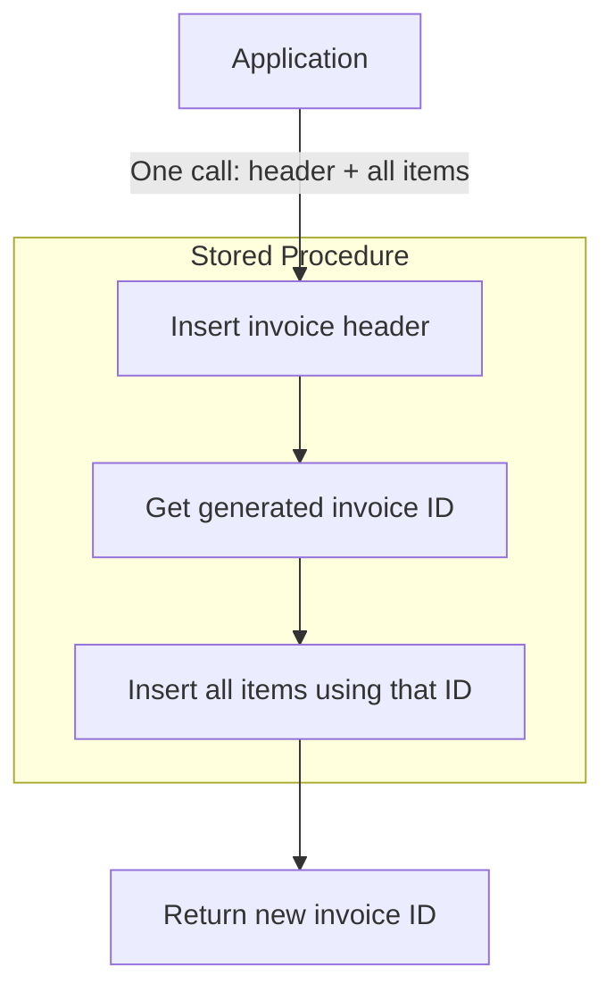
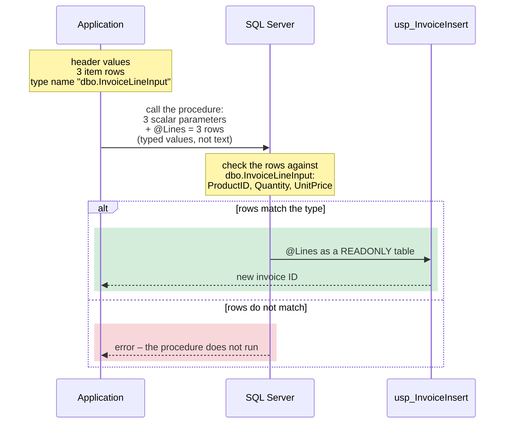
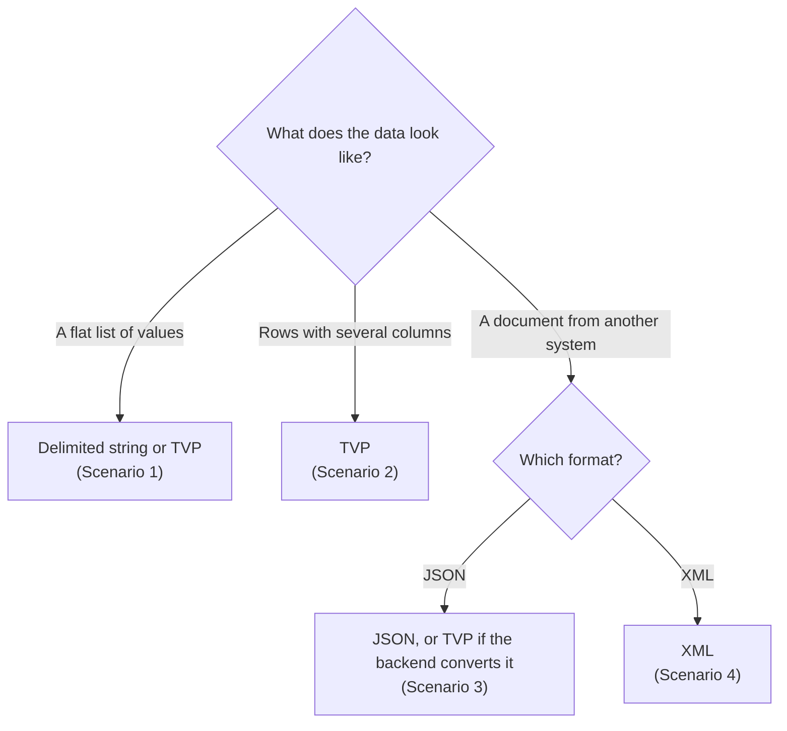

# Lab 8 – Complex Parameters: Passing Collections to Procedures

**Database:** `AdventureWorksENG`

In Labs 3 and 4, we learned that stored procedures and functions package database operations behind a name. Every procedure and function we wrote accepted scalar parameters — one `int`, one `nvarchar`, one `money` at a time.

But what happens when you need to pass **many** values in a single call? How do you insert an invoice header together with twenty line items? How do you delete multiple rows by ID? How do you accept the output of a web API that sends JSON?

This lab compares five approaches to handling collections of data, starting with unsafe SQL concatenation and moving to delimited strings, XML, JSON, and TVPs. By the end, you will know how each approach works and which to consider in different situations.

> [!IMPORTANT]
> **Core idea:** A collection is not a scalar. It needs a structure that SQL Server can turn into rows. Each method in this lab is a different envelope for the same collection.

---

## Learning objectives

After completing this lab, you should be able to:

- identify the two classic collection-parameter problems: the 1:N insert and the batch key operation;
- explain the risks of unsafe SQL concatenation, the benefits of parameterization, and the overhead of separate database calls;
- pass a flat list of values as a delimited string and split them with `STRING_SPLIT`;
- pass structured data as XML: shred it with `.nodes()` and `.value()`, read attributes and element text, insert a parent row with its children, and build XML back with `FOR XML PATH`;
- pass JSON data: read single values with `JSON_VALUE`, shred arrays with `OPENJSON ... WITH (...)`, insert a parent row with its children, and build JSON back with `FOR JSON PATH`;
- define a table type with `CREATE TYPE ... AS TABLE` and pass tables as parameters using Table-Valued Parameters (TVPs);
- compare all five methods (client-side query, delimited string, XML, JSON, TVP) and know which to reach for in different situations.

---

> [!NOTE]
> Run each insert example once, except where an exercise explicitly asks you to repeat a call. Repeating an insert may create duplicate rows or fail if a unique constraint prevents duplicates.

Start by selecting the training database:

```sql
USE AdventureWorksENG;
GO
```

---

# Section 1 – The Problem: Passing Multiple Values

In previous labs, we learned how to create stored procedures and pass values through parameters.

Consider this simple procedure:

```sql
CREATE OR ALTER PROCEDURE dbo.usp_GetProduct
    @ProductID int
AS
BEGIN
    SELECT IDProduct, Name, PriceWithoutVAT
    FROM Product
    WHERE IDProduct = @ProductID;
END;
GO
```

We can call it by passing a single product ID:

```sql
EXEC dbo.usp_GetProduct @ProductID = 1;
```

This works because `@ProductID` is a **scalar parameter** — it contains one value.

But what if we want to pass several product IDs in a single procedure call?

For example, we might want to retrieve products **1, 2, and 3**.

We cannot simply pass a list to an `int` parameter:

```sql
-- This does not work
EXEC dbo.usp_GetProduct @ProductID = (1, 2, 3);
```

An `int` parameter expects one integer, not a collection of integers.

We need a way to pass **multiple values through a single parameter**.

This is the main problem we will solve in this lab.

## 1.1 Problem 1 – Working with Multiple IDs

Imagine an application that displays a list of products.

A user selects three products and clicks a button to display their details.

The application knows which products were selected:

```text
Selected product IDs: 1, 2, 3
```

One possible solution is to call the procedure three times:

```sql
EXEC dbo.usp_GetProduct @ProductID = 1;
EXEC dbo.usp_GetProduct @ProductID = 2;
EXEC dbo.usp_GetProduct @ProductID = 3;
```

This works, but the application must make three separate procedure calls.

What if the user selects 100 products?

A better approach would be to pass all selected IDs in **one procedure call** and let SQL Server process them together.



This type of operation is called a **batch operation**.

The same concept applies when we want to update, delete, or retrieve multiple rows using a list of IDs: one set-based SQL statement processes all items, instead of the same operation running separately for each item.

## 1.2 Problem 2 – Inserting Related Data

Now consider a more complex example: creating an invoice.

An invoice consists of:

- **One invoice header** — customer, date, invoice number.
- **Multiple invoice items** — products, quantities, and prices.

For example:

**Invoice**

| IDInvoice | CustomerID | InvoiceDate |
|---|---|---|
| 101 | 5 | 2026-11-04 |

**InvoiceItem**

| InvoiceID | ProductID | Quantity | UnitPrice |
|---|---|---|---|
| 101 | 1 | 2 | 199.00 |
| 101 | 2 | 1 | 49.90 |
| 101 | 3 | 5 | 9.99 |

The application needs to send all this information to the database.

We could create separate procedures for inserting the invoice header and each invoice item.

However, this introduces several challenges:

1. The application must make multiple procedure calls.
2. The invoice ID must be passed to every invoice item.
3. If one insert fails, we must ensure that the invoice is not left incomplete.

Ideally, we want to send the entire invoice in **one procedure call**.



The procedure receives the invoice data, inserts the header, and uses its generated ID to link all items to the invoice.

> [!IMPORTANT]
> **One procedure call does not necessarily mean one SQL statement.**
>
> A procedure may execute several SQL statements. One call alone does not ensure that all changes succeed or fail together. [Lab 9 – Transactions](lab09-transactions.md) shows how to provide that behavior; the parent-child examples in this lab do not use transactions yet.

## 1.3 The Solution – Complex Parameters

Both examples have something in common.

We need to pass more than one value to a stored procedure:

- A **list of IDs**, such as `1, 2, 3`.
- A **collection of related records**, such as an invoice with multiple items.

These are examples of **complex parameters**.

Unlike scalar parameters, complex parameters can represent collections or structured data.

SQL Server provides several ways to handle this.

In this lab, we will explore five approaches:

| Method | Example | Main idea |
|---|---|---|
| Client-side query building | `WHERE IDProduct IN (1, 2, 3)` | Construct SQL in application code |
| Delimited string | `'1,2,3'` | Pass a string and split it into values |
| XML | `<IDs><ID>1</ID><ID>2</ID><ID>3</ID></IDs>` | Pass structured XML data |
| JSON | `[1, 2, 3]` | Pass structured JSON data |
| Table-Valued Parameter (TVP) | A table containing three ID rows | Pass a collection of typed rows |

All five approaches can represent the same list of product IDs, but they differ in how the data is prepared, transmitted, and processed.

We will begin with what an application can do using only scalar parameters and SQL text, and then explore the other four methods.

---

# Section 2 – Method 1: Client-Side Query Building

In Section 1, the user selected products `1`, `2`, and `3`. Before we look at new kinds of parameters, let's see what an application can do with what we already have: scalar parameters and SQL text.

## 2.1 Two Options We Already Have

**One call per ID.** The application can call the procedure once for each selected ID, as in Section 1.1. This is safe and correct, but every ID is a separate call, and each call waits for a response from the server. With 100 selected products, the application makes **100 calls**, and the communication time adds up — especially when the application and the database run on different servers.

**All IDs in one SQL statement.** To make only one call, the application can write all the IDs into the SQL text itself and send this statement:

```sql
SELECT *
FROM Product
WHERE IDProduct IN (1, 2, 3);
```

This is one call and one set-based statement. In a real application, however, the IDs come from outside — for example, from a web request — as text. **Writing such text directly into the SQL statement is dangerous.**

## 2.2 SQL Injection

SQL injection occurs when user-provided data becomes part of the SQL command itself.

Consider the application from Section 2.1 that writes the selected IDs into the SQL text. The code is written in Python, but only as an example: an application in C# or Java builds SQL text the same way. You do not run this code in SSMS.

```python
# UNSAFE — text from the user is inserted directly into SQL text
ids = input("Enter product IDs: ")      # for example: 1,2,3

sql = f"SELECT * FROM Product WHERE IDProduct IN ({ids})"

cursor.execute(sql)
```

Now imagine the user enters:

```text
Enter product IDs: 1) OR 1=1 --
```

The application generates:

```sql
SELECT *
FROM Product
WHERE IDProduct IN (1) OR 1=1 --);
```

The application writes the beginning and the end of the statement, and the user's input fills the gap:

```text
The application writes:  ... WHERE IDProduct IN (____________)
The user sends:                                  1) OR 1=1 --

SQL Server receives:     ... WHERE IDProduct IN (1) OR 1=1 --)
                                                 └─────┬────┘
                                                       └─ everything here was sent by the user
```

SQL Server reads the user's part as SQL code:

1. `)` after `1` closes the list, so the list contains only `1`.
2. `OR 1=1` adds a new condition that is always true.
3. `--` starts a comment, so SQL Server ignores the closing `)` added by the application.

Run the generated statement in SSMS: instead of product `1` alone, it returns **all** `504` products. The user has changed the meaning of the SQL statement without changing the application code.

The safe way is the one you already know from stored procedures: pass the value as a **parameter**. A parameter is always treated as a value, never as SQL code.

```text
Without parameters – one piece of text
  Application ───► "... WHERE IDProduct IN (1) OR 1=1 --)"   SQL Server reads all of it as SQL code

With parameters – the SQL text and the values are sent separately
  Application ─┬─► "... WHERE IDProduct = @ProductID"        SQL Server reads this as SQL code
               └─► "1) OR 1=1 --"                            SQL Server uses this only as a value
```

As a parameter, `1) OR 1=1 --` is just text that is not a number, so SQL Server rejects it instead of running it.

> [!TIP]
> The optional [`Cyber Lab`](../demos/cyber-lab/) demo shows how an application should be designed to keep user input separate from SQL code.

## 2.3 A Parameter Cannot Carry a List

Parameters protect us from SQL injection. Can we use one parameter for the whole list of IDs? Try it in SSMS:

```sql
DECLARE @IDs nvarchar(100) = N'1,2,3';

SELECT IDProduct, Name
FROM Product
WHERE IDProduct IN (@IDs);
```

SQL Server returns an error:

```text
Conversion failed when converting the nvarchar value '1,2,3' to data type int.
```

`@IDs` is **one value** — the text `'1,2,3'` — not a list of three numbers. `IN (@IDs)` compares `IDProduct` with that single value, so SQL Server tries to convert the whole text to `int`, and fails.

With scalar parameters only, the safe solution is one call per ID again:

| Approach | Safe from SQL injection | Calls for 100 IDs |
|---|---|---|
| One call per ID (2.1) | Yes | 100 |
| All IDs written into the SQL text (2.1) | No | 1 |
| One parameter that carries a collection (Sections 3–6) | Yes | 1 |

We need both: values passed **as parameters**, and many values passed **in one call**. The remaining four methods from Section 1.3 do exactly that — each passes a collection through a single parameter.

We will begin with the simplest format: **delimited strings**. Section 3 shows how to turn exactly this text, `'1,2,3'`, into separate values.

**Check your understanding**

1. With the input `1) OR 1=1 --`, why does the query built from SQL text return all products, while the same input passed as a parameter does not?
2. Why is calling a procedure with a scalar parameter once per ID not a good way to retrieve 100 products?
3. Why does `WHERE IDProduct IN (@IDs)` fail when `@IDs` is `N'1,2,3'`?

<details>
<summary>Show answers</summary>

1. In the query built from SQL text, the input becomes part of the SQL code: `)` closes the list, `OR 1=1` adds a condition that is always true, and `--` comments out the rest. A parameter is sent separately from the SQL text, so SQL Server treats `1) OR 1=1 --` as one value; it is not a number, so it is rejected and nothing runs.
2. A scalar parameter carries one value, so 100 IDs still mean 100 calls. We need many values in one call.
3. `@IDs` is one `nvarchar` value, not a list. SQL Server compares `IDProduct` with that single value and tries to convert the text `'1,2,3'` to `int`, which fails.

</details>

---

# Section 3 – Method 2: Delimited String Parameters

Section 2.3 ended with the text `'1,2,3'`: one `nvarchar` value that contains three IDs separated by commas. Passing a list this way is called a **delimited string parameter**.

To use the IDs in a query, we must split the text back into separate values. SQL Server provides a built-in function for this: **`STRING_SPLIT`**.

## 3.1 The STRING_SPLIT Function

The `STRING_SPLIT` function divides a string into separate values using a specified delimiter.

Its basic syntax is:

```sql
STRING_SPLIT(string, separator)
```

For example:

```sql
SELECT value
FROM STRING_SPLIT('1,2,3', ',');
```

Result:

| value |
|---|
| 1 |
| 2 |
| 3 |

The function returns a table containing one column named `value`.

Each separated value becomes a row.

Notice that the values are returned as **strings**, even though they look like numbers.

To use them as integers, we can convert them:

```sql
SELECT CAST(value AS int) AS ProductID
FROM STRING_SPLIT('1,2,3', ',');
```

Now the result contains integer values that can be compared with integer columns in the database.

## 3.2 Using STRING_SPLIT in a Query

In Section 2.1, the IDs were written directly into the query: `WHERE IDProduct IN (1, 2, 3)`. Now we take them from the string instead:

```sql
DECLARE @IDList nvarchar(200) = N'1,2,3';

SELECT IDProduct, Name, PriceWithoutVAT
FROM Product
WHERE IDProduct IN
(
    SELECT CAST(value AS int)
    FROM STRING_SPLIT(@IDList, ',')
);
```

Let's examine the process:

1. `@IDList` contains the string `'1,2,3'`.
2. `STRING_SPLIT` separates it into three rows.
3. `CAST` converts each value into an integer.
4. The `IN` operator checks whether `IDProduct` matches any of these values.

The result is the same as with `IN (1, 2, 3)`, but the list of IDs is now supplied through a variable.

This means we can use the same SQL statement with different lists of IDs.

## 3.3 Passing the List to a Stored Procedure

We can now create a stored procedure that accepts a list of product IDs.

```sql
CREATE OR ALTER PROCEDURE dbo.usp_GetProductsByIDList
    @IDList nvarchar(200)
AS
BEGIN
    SELECT IDProduct, Name, PriceWithoutVAT
    FROM Product
    WHERE IDProduct IN
    (
        SELECT CAST(value AS int)
        FROM STRING_SPLIT(@IDList, ',')
    );
END;
GO
```

Call the procedure:

```sql
EXEC dbo.usp_GetProductsByIDList
    @IDList = N'1,2,3';
```

We can also pass a different list without modifying the procedure:

```sql
EXEC dbo.usp_GetProductsByIDList
    @IDList = N'316,317,318,319';
```

**One parameter. Multiple IDs. One procedure call.**

This solves our first problem: passing a collection of simple values to a stored procedure.

The same `IN (SELECT … FROM STRING_SPLIT(…))` condition works in `UPDATE` and `DELETE` statements, so one call can change or delete all the listed rows.

## 3.4 Limitations of Delimited Strings

Delimited strings are simple and convenient, but they have several limitations.

| Limitation | Explanation |
|---|---|
| No type safety | Values arrive as text; a value such as `'1,ABC,3'` fails when converted with `CAST`. |
| Delimiter conflicts | A comma cannot safely separate values that may themselves contain commas without additional rules. |
| Limited structure | A string such as `'1,2,3'` represents a flat list, not a collection of records with multiple fields. |

The type-safety problem is easy to see:

```sql
SELECT CAST(value AS int) AS ProductID
FROM STRING_SPLIT('1,ABC,3', ',');
```

The query fails with *"Conversion failed when converting the varchar value 'ABC' to data type int."* Nothing in a delimited string prevents a caller from sending a value that is not a number.

For example, consider an invoice containing several products.

Each invoice item needs multiple values:

| ProductID | Quantity | UnitPrice |
|---|---|---|
| 1 | 2 | 199.00 |
| 2 | 1 | 49.90 |
| 3 | 5 | 9.99 |

We could try to represent this information as a string:

```text
1,2,199.00;2,1,49.90;3,5,9.99
```

But now we need two delimiters:

- `;` to separate invoice items.
- `,` to separate fields within each item.

We would also need additional logic to extract and convert every value.

This quickly becomes difficult to maintain.

**Delimited strings work well for simple lists of values, but they are not ideal for structured data.**

In the next section, we will introduce **XML**, which allows us to represent more complex information using elements, attributes, and nested structures.

**Check your understanding**

1. What does `STRING_SPLIT('1,2,3', ',')` return, and what type is the `value` column?
2. A caller runs `EXEC dbo.usp_GetProductsByIDList @IDList = N'1,ABC,3';`. What happens?
3. Why is a delimited string a poor fit for invoice items?

<details>
<summary>Show answers</summary>

1. A table with one column named `value` and three rows: `1`, `2`, and `3`. The column is `nvarchar` if either argument is `nvarchar` or `nchar`; otherwise it is `varchar`. The values are strings until you convert them.
2. `CAST('ABC' AS int)` fails with a conversion error. Nothing in a delimited string prevents a caller from sending a value that is not a number.
3. Each item has several fields. We would need two delimiters and our own code to split and convert every value, and the values would have no names or types.

</details>

---

# Section 4 – Method 3: XML Parameters

In Section 3, we passed a list of IDs as a comma-separated string:

```text
1,2,3
```

This works well when each item is **one value**. But what if each item contains several values?

For example, we may want to insert several customers in one call. Each customer has a first name, a last name, and an email address. A comma-separated string cannot clearly show which value belongs to which field.

We need a format that can represent **structured data**. One solution is **XML (Extensible Markup Language)**.

> [!TIP]
> For a short introduction to both XML and JSON, see the [XML and JSON Primer](../XML-JSON-PRIMER.md).

## 4.1 What Is XML?

XML is a text-based format that describes data using **elements** and **attributes**.

```xml
<Customers>
    <Customer FirstName="Nina" LastName="Novak" Email="nina.novak@example.com" />
    <Customer FirstName="Ivan" LastName="Horvat" Email="ivan.horvat@example.com" />
</Customers>
```

The XML document contains:

- A root element: `<Customers>`.
- Two child elements: `<Customer>`.
- Three attributes for each customer: `FirstName`, `LastName`, and `Email`.

Unlike a comma-separated string, XML names every value, so it is clear what each value represents.

Elements can also contain other elements, so XML can describe **nested** data, such as an invoice with its items. We will use this in Section 4.4.

SQL Server has a built-in `xml` data type for storing and processing XML documents.

## 4.2 Reading XML in SQL Server

SQL Server provides several methods for working with XML. In this lab, we use three:

| Method | Purpose |
|---|---|
| `.nodes()` | Converts matching XML elements into rows |
| `.value()` | Extracts one value from an XML element or attribute and converts it to a SQL type |
| `.query()` | Returns part of an XML document as XML; we use it only to display what `.nodes()` produced |

### Step 1 – Convert XML elements into rows

We want one row for each `Customer` element. The `.nodes()` method does that:

```sql
FROM @Customers.nodes('/Customers/Customer') AS tbl(col)
```

The expression `@Customers.nodes('/Customers/Customer')` selects every `Customer` element inside the root `Customers` element.

`.nodes()` is used in the `FROM` clause because it returns a **table**:

- The table always has **one column** of type `xml`.
- Each row of that column holds one matching element.
- We **must** name the table and its column with an alias: `AS tbl(col)` names the table `tbl` and its column `col`.

The names `tbl` and `col` are our choice — any valid names work.

For our document, `.nodes()` turns one XML value into a table with two rows:

```text
@Customers (one xml value)                 tbl (one row per Customer)
                                           ┌───────────────────────────────────┐
<Customers>                                │ col                               │
                                           ├───────────────────────────────────┤
    <Customer FirstName="Nina" ... /> ───► │ <Customer FirstName="Nina" ... /> │  row 1
    <Customer FirstName="Ivan" ... /> ───► │ <Customer FirstName="Ivan" ... /> │  row 2
</Customers>                               └───────────────────────────────────┘
```

Let's look at these rows:

```sql
DECLARE @Customers xml = N'
<Customers>
    <Customer FirstName="Nina" LastName="Novak" Email="nina.novak@example.com" />
    <Customer FirstName="Ivan" LastName="Horvat" Email="ivan.horvat@example.com" />
</Customers>';

SELECT *
FROM @Customers.nodes('/Customers/Customer') AS tbl(col);
```

The query fails:

*"The column 'col' that was returned from the nodes() method cannot be used directly. It can only be used with one of the four XML data type methods, exist(), nodes(), query(), and value(), or in IS NULL and IS NOT NULL checks."*

`col` is not a standalone XML value: it points to one element inside `@Customers`. We can use it only through an XML method. To display the element, use `.query('.')`:

```sql
DECLARE @Customers xml = N'
<Customers>
    <Customer FirstName="Nina" LastName="Novak" Email="nina.novak@example.com" />
    <Customer FirstName="Ivan" LastName="Horvat" Email="ivan.horvat@example.com" />
</Customers>';

SELECT
    tbl.col.query('.') AS CustomerXml -- NEW: display the element as XML
FROM @Customers.nodes('/Customers/Customer') AS tbl(col);
```

Result:

| CustomerXml |
|---|
| `<Customer FirstName="Nina" LastName="Novak" Email="nina.novak@example.com"/>` |
| `<Customer FirstName="Ivan" LastName="Horvat" Email="ivan.horvat@example.com"/>` |

These are the two rows from the diagram. In each row, `tbl.col` is one `Customer` element, and `.query('.')` returns that element (`.`) as XML.

> [!NOTE]
> The path `/Customers/Customer` is an **XPath** expression. XPath is part of **XQuery**, the W3C standard language for querying XML; the `xml` methods in SQL Server support a subset of it:
>
> - `/Customers` — the root element.
> - `/Customers/Customer` — all `Customer` elements inside `Customers`.
> - `@FirstName` — the `FirstName` attribute of the current element.
> - `.` — the current element. `.query('.')` returns it as XML; `.value('.', ...)` returns its text as a SQL value (Section 4.5).

### Step 2 – Extract values using `.value()`

Instead of XML fragments, we usually want ordinary SQL values:

```sql
DECLARE @Customers xml = N'
<Customers>
    <Customer FirstName="Nina" LastName="Novak" Email="nina.novak@example.com" />
    <Customer FirstName="Ivan" LastName="Horvat" Email="ivan.horvat@example.com" />
</Customers>';

SELECT
    tbl.col.value('@FirstName', 'nvarchar(50)') AS FirstName,
    tbl.col.value('@LastName', 'nvarchar(50)') AS LastName,
    tbl.col.value('@Email', 'nvarchar(50)') AS Email
FROM @Customers.nodes('/Customers/Customer') AS tbl(col);
```

Result:

| FirstName | LastName | Email |
|---|---|---|
| Nina | Novak | nina.novak@example.com |
| Ivan | Horvat | ivan.horvat@example.com |

**The XML document has been converted into relational rows and columns.**

1. `.nodes('/Customers/Customer')` creates one row for each customer.
2. In each row, `tbl.col` points to that customer's element.
3. `tbl.col.value('@FirstName', 'nvarchar(50)')` reads the `FirstName` attribute of that element and converts it to `nvarchar(50)`.

This process is sometimes called **XML shredding**.

> [!WARNING]
> **XML names are case-sensitive.** The path `/customers/customer` does not match `<Customers><Customer>`, so the query returns **no rows** — without an error. Similarly, a misspelled attribute such as `@Firstname` returns `NULL`.
>
> If you get an empty result or unexpected `NULL` values, first check the letter case of every element and attribute name.

> [!NOTE]
> Always read values from the elements returned by `.nodes()`, as in the example above. If you call `.value()` directly on the whole document, for example `@Customers.value('/Customers/Customer/@FirstName', 'nvarchar(50)')`, SQL Server reports that `'value()' requires a singleton`, because the path could match several elements.

## 4.3 Passing XML to a Stored Procedure

Now we can use XML as a stored procedure parameter. The following procedure inserts several customers, each with three fields, in one call.

### Step 1 – Create the procedure

```sql
CREATE OR ALTER PROCEDURE dbo.usp_InsertCustomerBatch
    @Customers xml
AS
BEGIN
    INSERT INTO Customer (FirstName, LastName, Email)
    SELECT
        tbl.col.value('@FirstName', 'nvarchar(50)'),
        tbl.col.value('@LastName', 'nvarchar(50)'),
        tbl.col.value('@Email', 'nvarchar(50)')
    FROM @Customers.nodes('/Customers/Customer') AS tbl(col);
END;
GO
```

The procedure uses `INSERT INTO ... SELECT`. The XML parameter is converted into rows, and all customers are inserted with one SQL statement — no `WHILE` loop and no separate `INSERT` for each customer.

### Step 2 – Call the procedure

```sql
EXEC dbo.usp_InsertCustomerBatch
    @Customers = N'
<Customers>
    <Customer FirstName="Nina" LastName="Novak" Email="nina.novak@example.com" />
    <Customer FirstName="Ivan" LastName="Horvat" Email="ivan.horvat@example.com" />
    <Customer FirstName="Ana" LastName="Kovac" Email="ana.kovac@example.com" />
</Customers>';
```

### Step 3 – Verify the result

```sql
SELECT IDCustomer, FirstName, LastName, Email
FROM Customer
WHERE Email IN (
    N'nina.novak@example.com',
    N'ivan.horvat@example.com',
    N'ana.kovac@example.com'
);
```

## 4.4 Inserting a Parent and Its Children

In Section 1.2, we described the 1:N insert problem: an invoice header together with several invoice items. Because XML elements can contain other elements, one document can carry both:

```xml
<Invoice CustomerID="5" InvoiceDate="2026-11-04" InvoiceNumber="SO-TEST-001">
    <Lines>
        <Line ProductID="1" Quantity="2" UnitPrice="199.00" />
        <Line ProductID="2" Quantity="1" UnitPrice="49.90" />
        <Line ProductID="3" Quantity="5" UnitPrice="9.99" />
    </Lines>
</Invoice>
```

The `Invoice` element is the parent; its attributes hold the header values. The `<Lines>` element groups the child `Line` elements, one for each invoice item.

### Step 1 – Read the nested XML

Before writing the procedure, let's read the items:

```sql
DECLARE @Invoice xml = N'
<Invoice CustomerID="5" InvoiceDate="2026-11-04" InvoiceNumber="SO-TEST-001">
    <Lines>
        <Line ProductID="1" Quantity="2" UnitPrice="199.00" />
        <Line ProductID="2" Quantity="1" UnitPrice="49.90" />
        <Line ProductID="3" Quantity="5" UnitPrice="9.99" />
    </Lines>
</Invoice>';

SELECT
    tbl.col.value('@ProductID', 'int') AS ProductID,
    tbl.col.value('@Quantity', 'int') AS Quantity,
    tbl.col.value('@UnitPrice', 'money') AS UnitPrice
FROM @Invoice.nodes('/Invoice/Lines/Line') AS tbl(col);
```

Result:

| ProductID | Quantity | UnitPrice |
|---|---|---|
| 1 | 2 | 199.00 |
| 2 | 1 | 49.90 |
| 3 | 5 | 9.99 |

The path `/Invoice/Lines/Line` follows the nesting of the document: `.nodes()` returns one row for each `Line` element.

### Step 2 – Create the procedure

The procedure inserts the invoice header first, then uses its generated ID when inserting the items.

```sql
CREATE OR ALTER PROCEDURE dbo.usp_InvoiceInsertFromXml
    @Invoice xml
AS
BEGIN
    DECLARE @NewInvoiceID int;

    -- Insert the invoice header
    INSERT INTO Invoice (CustomerID, InvoiceDate, InvoiceNumber)
    SELECT
        tbl.col.value('@CustomerID', 'int'),
        tbl.col.value('@InvoiceDate', 'date'),
        tbl.col.value('@InvoiceNumber', 'nvarchar(20)')
    FROM @Invoice.nodes('/Invoice') AS tbl(col);

    -- Get the generated invoice ID
    SET @NewInvoiceID = SCOPE_IDENTITY();

    -- Insert all invoice items
    INSERT INTO InvoiceItem
    (
        InvoiceID,
        ProductID,
        Quantity,
        InitialPrice,
        Discount,
        TotalPrice
    )
    SELECT
        @NewInvoiceID,
        ProductID,
        Quantity,
        UnitPrice,
        0,
        Quantity * UnitPrice
    FROM
    (
        SELECT
            tbl.col.value('@ProductID', 'int') AS ProductID,
            tbl.col.value('@Quantity', 'int') AS Quantity,
            tbl.col.value('@UnitPrice', 'money') AS UnitPrice
        FROM @Invoice.nodes('/Invoice/Lines/Line') AS tbl(col)
    ) AS lines;

    -- Return the generated invoice ID
    SELECT @NewInvoiceID AS NewInvoiceID;
END;
GO
```

Both inserts use the same pattern:

- `@Invoice.nodes('/Invoice')` returns one row — the header — and `.value()` reads its three attributes.
- `@Invoice.nodes('/Invoice/Lines/Line')` returns one row per item. The inner query turns each item into typed columns, so the outer `SELECT` can compute `Quantity * UnitPrice` without repeating the `.value()` calls.
- `SCOPE_IDENTITY()` returns the ID generated for the header, and every item receives it.

In this simplified example, `UnitPrice` becomes `InitialPrice`, `Discount` is set to `0`, and `TotalPrice` is calculated as `Quantity * UnitPrice`.

### Step 3 – Call the procedure

```sql
EXEC dbo.usp_InvoiceInsertFromXml
    @Invoice = N'
<Invoice CustomerID="5" InvoiceDate="2026-11-04" InvoiceNumber="SO-TEST-001">
    <Lines>
        <Line ProductID="1" Quantity="2" UnitPrice="199.00" />
        <Line ProductID="2" Quantity="1" UnitPrice="49.90" />
        <Line ProductID="3" Quantity="5" UnitPrice="9.99" />
    </Lines>
</Invoice>';
```

### Step 4 – Verify the result

```sql
SELECT
    i.IDInvoice,
    i.InvoiceNumber,
    i.InvoiceDate,
    ii.ProductID,
    ii.Quantity,
    ii.InitialPrice,
    ii.TotalPrice
FROM Invoice i
JOIN InvoiceItem ii ON ii.InvoiceID = i.IDInvoice
WHERE i.InvoiceNumber = N'SO-TEST-001';
```

The procedure inserts one invoice header and three related items in a single call.

As noted in Section 1.2, if inserting the items fails, the invoice header remains in the database; Lab 9 fixes this with a transaction.

## 4.5 Reading Element Text

So far, every value was stored in an **attribute**. An element can also store a value as its **text**, and it can have both at the same time:

```text
<City PostalCode="10000">Zagreb</City>
      └───────┬────────┘ └─┬──┘
              │            └── element text: read with .
              └── attribute: read with @PostalCode
```

```sql
DECLARE @Cities xml = N'
<Cities>
    <City PostalCode="10000">Zagreb</City>
    <City PostalCode="21000">Split</City>
    <City PostalCode="31000">Osijek</City>
</Cities>';

SELECT
    tbl.col.value('.', 'nvarchar(50)') AS CityName,
    tbl.col.value('@PostalCode', 'nvarchar(10)') AS PostalCode
FROM @Cities.nodes('/Cities/City') AS tbl(col);
```

Result:

| CityName | PostalCode |
|---|---|
| Zagreb | 10000 |
| Split | 21000 |
| Osijek | 31000 |

In each row, `tbl.col` is one `City` element:

- `.` reads the text of that element.
- `@PostalCode` reads its attribute.

## 4.6 Generating XML with FOR XML PATH

So far, we have received XML and converted it into SQL rows. SQL Server can also do the opposite: **convert query results into XML**. This is useful when an application or external system expects XML output.

### Building the same shape we read in Section 4.3

The column aliases decide what the XML looks like. An alias starting with `@` creates an attribute:

```sql
SELECT
    c.FirstName AS [@FirstName],
    c.LastName AS [@LastName],
    c.Email AS [@Email]
FROM Customer c
WHERE c.IDCustomer <= 3
FOR XML PATH('Customer'), ROOT('Customers');
```

Result:

```xml
<Customers>
    <Customer FirstName="Gustavo" LastName="Achong" Email="gustavo0@adventure-works.com" />
    <Customer FirstName="Catherine" LastName="Abel" Email="catherine0@adventure-works.com" />
    <Customer FirstName="Kim" LastName="Abercrombie" Email="kim2@adventure-works.com" />
</Customers>
```

This is exactly the shape that `dbo.usp_InsertCustomerBatch` accepts. `.nodes()` and `.value()` turn XML into rows; `FOR XML PATH` turns rows back into XML.

### Elements and nested elements

An alias without `@` creates a child element, and a `/` in the alias creates nested elements:

```sql
SELECT
    c.IDCustomer AS [@IDCustomer],
    c.FirstName AS [FirstName],
    c.LastName AS [LastName],
    c.Email AS [Emails/Email]
FROM Customer c
WHERE c.IDCustomer <= 3
FOR XML PATH('Customer'), ROOT('Customers');
```

The result contains one `Customer` element for each row. The first one looks like this:

```xml
<Customers>
    <Customer IDCustomer="1">
        <FirstName>Gustavo</FirstName>
        <LastName>Achong</LastName>
        <Emails>
            <Email>gustavo0@adventure-works.com</Email>
        </Emails>
    </Customer>
    ...
</Customers>
```

| SQL syntax | XML result |
|---|---|
| `[@IDCustomer]` | Creates an XML attribute |
| `[FirstName]` | Creates a child element |
| `[Emails/Email]` | Creates nested elements |
| `FOR XML PATH('Customer')` | Creates one `Customer` element per row |
| `ROOT('Customers')` | Wraps the result in a root element |

## 4.7 Advantages and Limitations of XML

| Advantages | Limitations |
|---|---|
| Supports nested and hierarchical data | More verbose than simpler formats |
| Names every value, so items can have several fields | XML syntax and XQuery require additional learning |
| Built-in `xml` data type in SQL Server | XML processing introduces parsing overhead |
| Can convert XML into relational rows | Names are case-sensitive; a wrong or missing name silently returns no rows or `NULL` |
| Supports XML input and output | May be unnecessary when simpler formats are sufficient |

XML remains useful when integrating with systems that already exchange XML documents, such as certain SOAP-based services.

> [!TIP]
> Additional practice: [Exercise 7 of the Complex Parameters Exercises](../exercises/lab08-complex-parameters.md#exercise-7--xml-find-or-create-related-records-advanced) demonstrates a more advanced XML procedure that finds or creates related records across multiple tables.

In the next section, we will explore **JSON**, which represents the same kind of structured data in the format most web applications already use.

**Check your understanding**

1. In `.value('@ProductID', 'int')`, what does `@ProductID` read? How would you read the text of the element instead?
2. In the procedure in Section 4.4, how does each item get the ID of its invoice?
3. You change the path in Section 4.4 to `/invoice/lines/line`. What happens?
4. In `FOR XML PATH`, how do you create nested elements in the output?

<details>
<summary>Show answers</summary>

1. The **attribute** `ProductID` of the current element. To read the element's text, use `.`, as in Section 4.5.
2. The procedure inserts the header first. `SCOPE_IDENTITY()` returns the ID generated for it, and the `INSERT ... SELECT` puts that `@NewInvoiceID` into every item row.
3. The query returns **no rows**, without an error. XML names are case-sensitive, so the path does not match `<Invoice><Lines><Line>`.
4. Use a **slash** in the column alias. `[Emails/Email]` produces `<Emails><Email>...</Email></Emails>`.

</details>

---

# Section 5 – Method 4: JSON Parameters

XML represents structured data, but it is verbose. Modern web applications usually exchange the same kind of data using **JSON (JavaScript Object Notation)**.

JSON is widely used by REST APIs, web applications, and mobile applications because it is relatively simple, compact, and easy to process.

SQL Server can read JSON, convert it into relational rows, and generate JSON from query results.

In this section, we will learn how to use JSON as a stored procedure parameter.

## 5.1 What Is JSON?

JSON is a text-based format for representing structured data.

It supports objects, arrays, strings, numbers, Boolean values, and `null`.

Consider a customer represented as a JSON object:

```json
{
    "FirstName": "Alice",
    "LastName": "Anderson",
    "Email": "alice@example.com"
}
```

An **object** contains named properties and their values.

We can also represent multiple customers using a JSON array:

```json
[
    {
        "FirstName": "Alice",
        "LastName": "Anderson",
        "Email": "alice@example.com"
    },
    {
        "FirstName": "Bob",
        "LastName": "Brown",
        "Email": "bob@example.com"
    }
]
```

The square brackets `[]` represent an array, while curly brackets `{}` represent objects.

In this example, the array contains two customer objects.

Unlike XML, JSON had no data type of its own before SQL Server 2025, so it is stored and passed as `nvarchar(max)`. The examples in this lab use `nvarchar(max)`; the JSON functions work from SQL Server 2016, with database compatibility level 130 or higher.

> [!NOTE]
> SQL Server 2025 adds a native `json` data type, which checks the text when it is assigned. `DECLARE @Json json = N'{"a": 1';` fails at once because the closing `}` is missing. An `nvarchar(max)` variable accepts the same text without an error, because to SQL Server it is just a string. The JSON functions do not always catch the mistake later either: `JSON_VALUE(@Json, '$.a')` still returns `1`. All JSON functions in this lab work with both types.

## 5.2 Reading a Single Value – JSON_VALUE

Let's start with a JSON object. Its `Address` property is itself an object, with its own properties `Street`, `City`, and `PostalCode`.

```sql
DECLARE @Customer nvarchar(max) = N'
{
    "FirstName": "Alice",
    "LastName": "Anderson",
    "Email": "alice@example.com",
    "Address": {
        "Street": "Ilica 10",
        "City": "Zagreb",
        "PostalCode": "10000"
    }
}';

SELECT
    JSON_VALUE(@Customer, '$.FirstName') AS FirstName,
    JSON_VALUE(@Customer, '$.LastName') AS LastName,
    JSON_VALUE(@Customer, '$.Email') AS Email,
    -- properties inside the nested Address object
    JSON_VALUE(@Customer, '$.Address.Street') AS Street,
    JSON_VALUE(@Customer, '$.Address.City') AS City,
    JSON_VALUE(@Customer, '$.Address.PostalCode') AS PostalCode;
```

Result:

| FirstName | LastName | Email | Street | City | PostalCode |
|---|---|---|---|---|---|
| Alice | Anderson | alice@example.com | Ilica 10 | Zagreb | 10000 |

The `JSON_VALUE` function extracts a single scalar value from a JSON document.

Its basic syntax is:

```sql
JSON_VALUE(json_expression, path)
```

The path tells SQL Server which property to read.

For example:

| JSON path | Meaning |
|---|---|
| `$` | Root of the JSON document |
| `$.FirstName` | Property `FirstName` |
| `$.Email` | Property `Email` |
| `$.Address.City` | Property `City` inside `Address` |

The `$` symbol represents the root of the JSON document, and dots are used to navigate through nested objects.

This path syntax comes from the SQL standard (SQL/JSON, part of ISO SQL:2016), so other databases, such as Oracle and PostgreSQL, use the same `$.Property` notation.

## 5.3 Converting JSON Arrays into Rows – OPENJSON

`JSON_VALUE` reads one value. To turn a JSON **array** into rows, SQL Server provides the **`OPENJSON`** function.

### Step 1 – Read a simple array

Start with our familiar list of product IDs, written as a JSON array. Without specifying columns, `OPENJSON` returns three default columns:

```sql
DECLARE @IDs nvarchar(max) = N'[1, 2, 3]';

SELECT *
FROM OPENJSON(@IDs);
```

Result:

| key | value | type |
|---|---|---|
| 0 | 1 | 2 |
| 1 | 2 | 2 |
| 2 | 3 | 2 |

The columns represent:

- `key` — the array index, starting at zero.
- `value` — the value of the array element.
- `type` — a numeric code describing the JSON value type (`2` means number).

This is enough for a simple list, but an array of customer objects has several properties per element.

### Step 2 – Define columns with WITH

We can use `WITH (...)` to specify which properties should become SQL columns:

```sql
DECLARE @Customers nvarchar(max) = N'
[
    { "FirstName": "Ida", "LastName": "Ibsen", "Email": "ida@example.com" },
    { "FirstName": "Jonas", "LastName": "Jensen", "Email": "jonas@example.com" },
    { "FirstName": "Kari", "LastName": "Kristian", "Email": "kari@example.com" }
]';

SELECT *
FROM OPENJSON(@Customers)
WITH
(
    FirstName nvarchar(50) '$.FirstName',
    LastName  nvarchar(50) '$.LastName',
    Email     nvarchar(50) '$.Email'
);
```

Result:

| FirstName | LastName | Email |
|---|---|---|
| Ida | Ibsen | ida@example.com |
| Jonas | Jensen | jonas@example.com |
| Kari | Kristian | kari@example.com |

The `WITH` clause defines, for every column:

1. The SQL column name.
2. The SQL data type.
3. The JSON path containing the value.

For example, `FirstName nvarchar(50) '$.FirstName'` means: create a column named `FirstName`, convert its value to `nvarchar(50)`, and read it from the `FirstName` property.

**The JSON array has now become a relational result set.** This is the JSON counterpart of XML shredding with `.nodes()` and `.value()`.

## 5.4 Passing JSON to a Stored Procedure

Now we can use `OPENJSON` inside a stored procedure.

Our goal is to insert multiple customers using one JSON parameter.

### Step 1 – Create the procedure

```sql
CREATE OR ALTER PROCEDURE dbo.usp_InsertCustomerBatchFromJson
    @JsonCustomers nvarchar(max)
AS
BEGIN
    INSERT INTO Customer (FirstName, LastName, Email)
    SELECT FirstName, LastName, Email
    FROM OPENJSON(@JsonCustomers)
    WITH
    (
        FirstName nvarchar(50) '$.FirstName',
        LastName  nvarchar(50) '$.LastName',
        Email     nvarchar(50) '$.Email'
    );
END;
GO
```

The procedure receives one string containing JSON data.

`OPENJSON` converts the array into rows, and `INSERT INTO ... SELECT` inserts all customers using one SQL statement.

### Step 2 – Call the procedure

```sql
EXEC dbo.usp_InsertCustomerBatchFromJson
    @JsonCustomers = N'
[
    {
        "FirstName": "Ruđer",
        "LastName": "Bošković",
        "Email": "rudjer.boskovic@example.com"
    },
    {
        "FirstName": "Janica",
        "LastName": "Kostelić",
        "Email": "janica.kostelic@example.com"
    }
]';
```

### Step 3 – Verify the result

```sql
SELECT IDCustomer, FirstName, LastName, Email
FROM Customer
WHERE Email IN
(
    N'rudjer.boskovic@example.com',
    N'janica.kostelic@example.com'
);
```

The procedure can handle a larger array without changing its SQL code.

## 5.5 Working with Nested JSON

Real-world JSON documents often contain nested objects and arrays. Consider the same invoice we inserted from XML in Section 4.4, now written as JSON:

```json
{
    "Invoice": {
        "CustomerID": 5,
        "InvoiceDate": "2026-11-04",
        "InvoiceNumber": "SO-TEST-002",
        "Lines": [
            { "ProductID": 1, "Quantity": 2, "UnitPrice": 199.00 },
            { "ProductID": 2, "Quantity": 1, "UnitPrice": 49.90 },
            { "ProductID": 3, "Quantity": 5, "UnitPrice": 9.99 }
        ]
    }
}
```

This document contains two levels of information:

- **Invoice header** — customer ID, invoice date, and invoice number.
- **Invoice lines** — an array of products, quantities, and prices.

We read the header with `JSON_VALUE`, and the `Lines` array with `OPENJSON` and a path pointing directly to that array:

```sql
DECLARE @Json nvarchar(max) = N'
{
    "Invoice": {
        "CustomerID": 5,
        "InvoiceDate": "2026-11-04",
        "InvoiceNumber": "SO-TEST-002",
        "Lines": [
            { "ProductID": 1, "Quantity": 2, "UnitPrice": 199.00 },
            { "ProductID": 2, "Quantity": 1, "UnitPrice": 49.90 },
            { "ProductID": 3, "Quantity": 5, "UnitPrice": 9.99 }
        ]
    }
}';

SELECT
    JSON_VALUE(@Json, '$.Invoice.CustomerID') AS CustomerID,
    JSON_VALUE(@Json, '$.Invoice.InvoiceDate') AS InvoiceDate,
    JSON_VALUE(@Json, '$.Invoice.InvoiceNumber') AS InvoiceNumber;

SELECT *
FROM OPENJSON(@Json, '$.Invoice.Lines')
WITH
(
    ProductID int '$.ProductID',
    Quantity  int '$.Quantity',
    UnitPrice money '$.UnitPrice'
);
```

The second result:

| ProductID | Quantity | UnitPrice |
|---|---|---|
| 1 | 2 | 199.00 |
| 2 | 1 | 49.90 |
| 3 | 5 | 9.99 |

The second argument of `OPENJSON`, `'$.Invoice.Lines'`, tells SQL Server to start reading from the `Lines` array inside the `Invoice` object.

## 5.6 Inserting Related Records from JSON

Now we insert the invoice from Section 5.5: one row in `Invoice` and one row in `InvoiceItem` for every line. The whole invoice arrives as **one JSON document**: `JSON_VALUE` reads the header, and `OPENJSON` turns the lines into rows.

### Step 1 – Create the procedure

```sql
CREATE OR ALTER PROCEDURE dbo.usp_InvoiceInsertFromJson
    @Json nvarchar(max)
AS
BEGIN
    DECLARE @NewInvoiceID int;

    -- Insert the invoice header
    INSERT INTO Invoice (CustomerID, InvoiceDate, InvoiceNumber)
    VALUES
    (
        JSON_VALUE(@Json, '$.Invoice.CustomerID'),
        JSON_VALUE(@Json, '$.Invoice.InvoiceDate'),
        JSON_VALUE(@Json, '$.Invoice.InvoiceNumber')
    );

    -- Get the generated invoice ID
    SET @NewInvoiceID = SCOPE_IDENTITY();

    -- Insert all invoice items
    INSERT INTO InvoiceItem
    (
        InvoiceID,
        ProductID,
        Quantity,
        InitialPrice,
        Discount,
        TotalPrice
    )
    SELECT
        @NewInvoiceID,
        ProductID,
        Quantity,
        UnitPrice,
        0,
        Quantity * UnitPrice
    FROM OPENJSON(@Json, '$.Invoice.Lines')
    WITH
    (
        ProductID int '$.ProductID',
        Quantity  int '$.Quantity',
        UnitPrice money '$.UnitPrice'
    );

    -- Return the generated invoice ID
    SELECT @NewInvoiceID AS NewInvoiceID;
END;
GO
```

The structure follows the XML procedure from Section 4.4: insert the parent, read `SCOPE_IDENTITY()`, then insert all children with one `INSERT ... SELECT`.

### Step 2 – Call the procedure

```sql
EXEC dbo.usp_InvoiceInsertFromJson
    @Json = N'
{
    "Invoice": {
        "CustomerID": 5,
        "InvoiceDate": "2026-11-04",
        "InvoiceNumber": "SO-TEST-002",
        "Lines": [
            { "ProductID": 1, "Quantity": 2, "UnitPrice": 199.00 },
            { "ProductID": 2, "Quantity": 1, "UnitPrice": 49.90 },
            { "ProductID": 3, "Quantity": 5, "UnitPrice": 9.99 }
        ]
    }
}';
```

### Step 3 – Verify the result

```sql
SELECT
    i.IDInvoice,
    i.InvoiceNumber,
    i.InvoiceDate,
    ii.ProductID,
    ii.Quantity,
    ii.InitialPrice,
    ii.TotalPrice
FROM Invoice i
JOIN InvoiceItem ii ON ii.InvoiceID = i.IDInvoice
WHERE i.InvoiceNumber = N'SO-TEST-002';
```

The result should contain three items linked to the same invoice. As in Section 4.4, if inserting the items fails, the invoice header remains in the database; Lab 9 fixes this with a transaction.

## 5.7 Generating JSON with FOR JSON PATH

So far, we have converted JSON into SQL rows. SQL Server can also do the opposite: **convert query results into JSON**. This is useful when sending data to REST APIs or other applications that expect JSON.

### Building the same shape we read in Section 5.4

```sql
SELECT
    c.FirstName,
    c.LastName,
    c.Email
FROM Customer c
WHERE c.IDCustomer <= 3
FOR JSON PATH;
```

Result:

```json
[
    { "FirstName": "Gustavo", "LastName": "Achong", "Email": "gustavo0@adventure-works.com" },
    { "FirstName": "Catherine", "LastName": "Abel", "Email": "catherine0@adventure-works.com" },
    { "FirstName": "Kim", "LastName": "Abercrombie", "Email": "kim2@adventure-works.com" }
]
```

Each row becomes one JSON object, and the column names become property names. This is exactly the shape that `dbo.usp_InsertCustomerBatchFromJson` accepts. `OPENJSON` turns JSON into rows; `FOR JSON PATH` turns rows back into JSON.

### Nested objects

A **dot** in a column alias creates a nested object, and `ROOT` wraps the array in a root object:

```sql
SELECT
    c.IDCustomer,
    c.FirstName,
    c.LastName,
    c.Email AS [Contact.Email],
    c.PhoneNumber AS [Contact.Phone]
FROM Customer c
WHERE c.IDCustomer <= 3
FOR JSON PATH, ROOT('Customers');
```

The result contains one object for each row. The first one looks like this:

```json
{
    "Customers": [
        {
            "IDCustomer": 1,
            "FirstName": "Gustavo",
            "LastName": "Achong",
            "Contact": {
                "Email": "gustavo0@adventure-works.com",
                "Phone": "398-555-0132"
            }
        },
        ...
    ]
}
```

| SQL syntax | JSON result |
|---|---|
| `c.FirstName` | Creates a property named `FirstName` |
| `[Contact.Email]` | Creates a nested `Contact` object with an `Email` property |
| `FOR JSON PATH` | Creates one object per row, all inside an array |
| `ROOT('Customers')` | Wraps the array in a root object |

This is the JSON counterpart of `FOR XML PATH`: JSON uses dots where XML uses slashes to create nested structures.

## 5.8 Advantages and Limitations of JSON

| Advantages | Limitations |
|---|---|
| Widely used by web applications and REST APIs | JSON input must be parsed |
| Supports objects, arrays, and nested structures | Data types are checked during extraction and conversion |
| No predefined type is required | Missing or misspelled properties (names are case-sensitive) return `NULL` without an error |
| Can represent complex data in one parameter | Additional validation may be required |
| Supports both input and output | Large JSON documents introduce parsing overhead |

JSON is particularly useful when the application already works with JSON data.

For example, a REST API can receive a JSON request and pass the relevant document to a stored procedure.

However, JSON is not always the best choice: the procedure must parse the text and check every value.

> [!TIP]
> **Real-world example:** The optional [`OBP REST Demo`](../demos/obp-rest-demo/) demonstrates how a FastAPI application receives JSON through an HTTP request and uses a SQL Server stored procedure to insert an invoice with multiple items.

All three methods so far — delimited strings, XML, and JSON — send text that SQL Server must take apart. In the next section, we will explore **Table-Valued Parameters (TVPs)**, which pass typed rows directly, without any parsing.

**Check your understanding**

1. When do you use `JSON_VALUE`, and when `OPENJSON`?
2. In `OPENJSON(@Json, '$.Invoice.Lines')`, what does the second argument do?
3. In the `WITH` clause, what does `Quantity int '$.Quantity'` define? What do you get for a line that has no `Quantity` property?
4. In `FOR JSON PATH`, how do you create a nested object? How does this differ from `FOR XML PATH`?

<details>
<summary>Show answers</summary>

1. `JSON_VALUE` reads **one** scalar value, such as the invoice number. `OPENJSON` turns an **array** into rows, such as the invoice lines.
2. It sets the starting point: `OPENJSON` returns one row for each element of the `Lines` array. The paths in `WITH` are relative to that element.
3. A column named `Quantity`, of type `int`, read from the `Quantity` property. A missing property gives `NULL`, without an error.
4. Use a **dot** in the column alias: `[Contact.Email]` creates a `Contact` object with an `Email` property. `FOR XML PATH` uses a slash for the same purpose.

</details>

---

# Section 6 – Method 5: Table-Valued Parameters (TVPs)

In the previous sections, we passed collections as delimited strings, XML, and JSON.

All three approaches send **text**, and SQL Server must extract and convert the values before it can use them as relational data.

What if we could pass a **table directly to a stored procedure**?

SQL Server supports exactly this through **Table-Valued Parameters (TVPs)**.

## 6.1 What Is a Table-Valued Parameter?

A Table-Valued Parameter allows a stored procedure to receive multiple rows and columns as one parameter.

Consider our familiar example: we want to retrieve products with IDs `1`, `2`, and `3`.

With a delimited string, we passed:

```sql
@IDList = N'1,2,3'
```

With XML, we could pass:

```xml
<IDs>
    <ID>1</ID>
    <ID>2</ID>
    <ID>3</ID>
</IDs>
```

With JSON, we passed:

```json
[1, 2, 3]
```

With a TVP, we pass the values as a table:

| ID |
|---|
| 1 |
| 2 |
| 3 |

The stored procedure can use this table directly in SQL queries, including `SELECT`, `JOIN`, and `WHERE`.

There is no need for `STRING_SPLIT`, XML methods, or `OPENJSON`.

We start with a table that has one column. In Section 6.4, we pass a table with several columns: the items of an invoice.

## 6.2 Defining a Table Type

Before using a TVP, we must define its structure.

SQL Server already provides built-in data types such as:

```sql
int
nvarchar(50)
date
money
```

But there is no built-in type representing a table with a column named `ID`.

We must create one.

### Step 1 – Create a user-defined table type

```sql
CREATE TYPE dbo.ProductIDList AS TABLE
(
    ID int PRIMARY KEY
);
GO
```

This statement creates a new table type named `dbo.ProductIDList`.

It defines the structure of a table containing one integer column.

The `PRIMARY KEY` ensures that the same ID cannot appear more than once in a value of this type.

`CREATE TYPE ... AS TABLE` does not create a table that stores product IDs. It creates a reusable structure for declaring table variables and procedure parameters.

> [!NOTE]
> If you run this section again, `CREATE TYPE` fails because the type already exists. A type cannot be dropped while a procedure uses it: first drop the procedures that use the type, then the type itself with `DROP TYPE`.

### Step 2 – Declare a variable of this type

Now that the type exists, we can declare a table variable of this type and insert rows into it:

```sql
DECLARE @MyIDs dbo.ProductIDList;

INSERT INTO @MyIDs (ID)
VALUES (1), (2), (3);

SELECT *
FROM @MyIDs;
```

Result:

| ID |
|---|
| 1 |
| 2 |
| 3 |

Notice that `@MyIDs` behaves like a table.

We can insert rows, query its contents, and use it in joins.

The important difference is that it is a **table variable**, not a permanent table stored under a name such as `dbo.Product`.

## 6.3 Passing a Table to a Stored Procedure

Now let's create a procedure that receives our table variable.

```sql
CREATE OR ALTER PROCEDURE dbo.usp_GetProductsByIDs
    @IDs dbo.ProductIDList READONLY
AS
BEGIN
    SELECT
        p.IDProduct,
        p.Name,
        p.PriceWithoutVAT
    FROM Product p
    INNER JOIN @IDs i ON i.ID = p.IDProduct;
END;
GO
```

Notice the parameter declaration:

```sql
@IDs dbo.ProductIDList READONLY
```

It contains three important parts:

| Part | Meaning |
|---|---|
| `@IDs` | Parameter name |
| `dbo.ProductIDList` | User-defined table type |
| `READONLY` | The procedure cannot modify the parameter |

Unlike ordinary scalar parameters, TVPs must be declared with `READONLY`.

### Calling the procedure

We can now pass our table variable to the procedure:

```sql
DECLARE @MyIDs dbo.ProductIDList;

INSERT INTO @MyIDs (ID)
VALUES (1), (2), (3);

EXEC dbo.usp_GetProductsByIDs
    @IDs = @MyIDs;
```

The procedure receives all three IDs and joins them with the `Product` table.

The procedure can accept any number of IDs without changing its definition.

### Why READONLY?

Inside the procedure, we can read the TVP, as `dbo.usp_GetProductsByIDs` does. Try to create a procedure that changes it:

```sql
CREATE OR ALTER PROCEDURE dbo.usp_TryToChangeIDs
    @IDs dbo.ProductIDList READONLY
AS
BEGIN
    INSERT INTO @IDs (ID)
    VALUES (4);
END;
GO
```

SQL Server refuses to create it: *"The table-valued parameter "@IDs" is READONLY and cannot be modified."* The procedure can use the input data, but it cannot change the collection supplied by the caller.

If we need to modify the data, we can copy it into a local table variable or temporary table.

## 6.4 Practical Example – Inserting an Invoice with Multiple Items

In Sections 4.4 and 5.6, we inserted the same invoice from an XML document and from a JSON document. Now we insert it with a TVP, still in **one stored procedure call**.

For this example, we will use:

- **Scalar parameters** for the invoice header.
- A **Table-Valued Parameter** for the invoice items.

The header contains a fixed number of values, while the number of items can vary.

### Step 1 – Define the table type

Each invoice item contains three values:

| ProductID | Quantity | UnitPrice |
|---|---|---|
| 1 | 2 | 199.00 |
| 2 | 1 | 49.90 |
| 3 | 5 | 9.99 |

Create a table type representing these items:

```sql
CREATE TYPE dbo.InvoiceLineInput AS TABLE
(
    ProductID int NOT NULL,
    Quantity int NOT NULL,
    UnitPrice money NOT NULL
);
GO
```

Unlike our earlier table type containing only IDs, this type represents **records with multiple columns**.

### Step 2 – Create the procedure

```sql
CREATE OR ALTER PROCEDURE dbo.usp_InvoiceInsert
    @CustomerID int,
    @InvoiceDate date,
    @InvoiceNumber nvarchar(20),
    @Lines dbo.InvoiceLineInput READONLY
AS
BEGIN
    DECLARE @NewInvoiceID int;

    -- Insert the invoice header
    INSERT INTO Invoice (CustomerID, InvoiceDate, InvoiceNumber)
    VALUES (@CustomerID, @InvoiceDate, @InvoiceNumber);

    -- Get the generated invoice ID
    SET @NewInvoiceID = SCOPE_IDENTITY();

    -- Insert all invoice items
    INSERT INTO InvoiceItem
    (
        InvoiceID,
        ProductID,
        Quantity,
        InitialPrice,
        Discount,
        TotalPrice
    )
    SELECT
        @NewInvoiceID,
        ProductID,
        Quantity,
        UnitPrice,
        0,
        Quantity * UnitPrice
    FROM @Lines;

    -- Return the generated invoice ID
    SELECT @NewInvoiceID AS NewInvoiceID;
END;
GO
```

The body of the procedure is the same as in Sections 4.4 and 5.6: insert the header, read `SCOPE_IDENTITY()`, then insert all items with one `INSERT ... SELECT`. Only the input is new: the header arrives as three scalar parameters, and the items arrive as typed rows in `@Lines`, so the procedure reads them with a plain `FROM @Lines`.

| | 4.4 – XML | 5.6 – JSON | 6.4 – TVP |
|---|---|---|---|
| Header | `.value()` reads three attributes | `JSON_VALUE` reads three properties | Three scalar parameters |
| Items | `.nodes('/Invoice/Lines/Line')` and `.value()` | `OPENJSON(@Json, '$.Invoice.Lines') WITH (...)` | `FROM @Lines` |
| Data types checked | When the procedure shreds the XML | When the procedure shreds the JSON | When the caller fills the TVP |

The same simplified mapping as in Section 4.4 applies: `UnitPrice` becomes `InitialPrice`, `Discount` is `0`, and `TotalPrice` is `Quantity * UnitPrice`.

As in Sections 4.4 and 5.6, if inserting the items fails, the invoice header remains in the database; Lab 9 fixes this with a transaction.

### Step 3 – Prepare the items and call the procedure

Declare a variable of our table type and fill it with three invoice items:

```sql
DECLARE @InvoiceLines dbo.InvoiceLineInput;

INSERT INTO @InvoiceLines (ProductID, Quantity, UnitPrice)
VALUES
    (1, 2, 199.00),
    (2, 1, 49.90),
    (3, 5, 9.99);

EXEC dbo.usp_InvoiceInsert
    @CustomerID = 5,
    @InvoiceDate = '2026-11-04',
    @InvoiceNumber = N'SO-TEST-003',
    @Lines = @InvoiceLines;
```

Run this entire block together so that `@InvoiceLines` remains in scope.

The procedure receives the header through three scalar parameters and all three items through one TVP.

The procedure returns the generated invoice ID.

In SSMS, we act as the caller: we declare a variable, fill it, and pass it. An application does not send this code. It builds the rows in its own table-like structure (for example, a `DataTable` in .NET) whose columns must match the type: **the same number of columns, in the same order, with compatible data types**. It then sends the rows together with the name of the table type, and SQL Server checks them against the type definition:



*Typed values, not text* means that each value travels in its own data type: `199.00` arrives as a `money` value, not as the characters `1`, `9`, `9`, `.`, `0`, `0`. SQL Server does not have to split or convert anything, as it did with `STRING_SPLIT`, XML, and JSON, and no value can ever become SQL code.

The table type is a contract between the application and the procedure: if you add a column to `dbo.InvoiceLineInput`, every application that fills it must change too.

### Step 4 – Verify the result

Find the invoice and its items using the invoice number supplied in the procedure call:

```sql
SELECT
    i.IDInvoice,
    i.InvoiceNumber,
    i.InvoiceDate,
    ii.ProductID,
    ii.Quantity,
    ii.InitialPrice,
    ii.TotalPrice
FROM Invoice i
JOIN InvoiceItem ii ON ii.InvoiceID = i.IDInvoice
WHERE i.InvoiceNumber = N'SO-TEST-003';
```

The result should contain three items linked to the same invoice.

## 6.5 Advantages and Limitations of TVPs

| Advantages | Limitations |
|---|---|
| Strong typing — columns have defined SQL data types | Requires a user-defined table type |
| Supports multiple rows and columns | TVP parameters must be `READONLY` |
| Can be used directly in joins and queries | Changing a table type is expensive: it cannot be altered, so every procedure that uses it must be dropped and recreated, and every application that fills it must change at the same time |
| Avoids parsing delimited strings, XML, or JSON | Client applications must support sending TVPs |
| Useful for set-based operations | SQL Server does not maintain column statistics on TVPs |

TVPs are particularly useful when an application needs to pass a collection of relational records directly to SQL Server, and they are commonly used from .NET applications. Because SQL Server keeps no statistics on TVP columns, copying a large TVP into a temporary table can sometimes give a better execution plan.

In the next section, we will compare all five approaches and discuss when each method is most appropriate.

**Check your understanding**

1. Does `CREATE TYPE dbo.ProductIDList AS TABLE` create a table that stores product IDs?
2. Why must a TVP be declared `READONLY`, and what do you do if you need to modify the input?
3. In Section 6.4, why is the invoice header passed as scalar parameters and the items as a TVP?

<details>
<summary>Show answers</summary>

1. No. It creates a reusable **structure** for declaring table variables and procedure parameters. No data is stored.
2. SQL Server requires TVPs to be read-only: the procedure can query the rows but cannot change them, so the caller's data stays as it was sent. To modify the data, copy it into a local table variable or a temporary table.
3. The header has a fixed number of values; the number of items varies.

</details>

---

# Section 7 – Choosing the Right Method

Throughout this lab, we explored five approaches to passing collections of data to SQL Server.

Each method solves a similar problem: **how to send multiple values or structured records to a stored procedure in a single call**.

However, the methods differ in how data is represented, processed, and validated.

The goal is not to memorize five different solutions. It is to understand **which method is appropriate for a particular situation**.

## 7.1 One List, Five Approaches

Section 1.3 showed the same list of product IDs — `1`, `2`, and `3` — in five representations. The values are identical; only their representation changes.

For stored procedures, the corresponding parameter declarations are:

| Method | Parameter declaration |
|---|---|
| Client-side query building | No collection parameter; values are embedded in SQL text |
| Delimited string | `@IDList nvarchar(200)` |
| XML | `@IDs xml` |
| JSON | `@Json nvarchar(max)` |
| TVP | `@IDs dbo.ProductIDList READONLY` |

Delimited strings and JSON are both passed as text, but their contents have different structures. This lab uses `nvarchar(200)` for the ID lists and `nvarchar(max)` for JSON documents.

XML has its own SQL Server data type; JSON has one only from SQL Server 2025 (Section 5.1). TVPs use a user-defined table type.

## 7.2 Comparing the Methods

The following table summarizes the main characteristics of each approach.

| Method | Data Structure | Type Safety | Main Advantage | Main Limitation |
|---|---|---|---|---|
| Client-side query building | SQL text | None for concatenated values | Simple to construct | SQL injection risk with untrusted input |
| Delimited string | Flat list | Values arrive as text | Simple for lists of IDs | Requires splitting and conversion |
| XML | Hierarchical | XML type; extracted values require conversion | Supports complex nested structures | Verbose syntax and parsing overhead |
| JSON | Objects and arrays | Values are converted during extraction | Natural format for web integration | Requires parsing and validation |
| TVP | Relational rows and columns | Strong | Typed data can be used directly in SQL | Requires a predefined table type |

The methods also differ in how easily they adapt to change. JSON is tolerant: if a procedure starts reading a new property, an older application that does not send it still works, because `OPENJSON` returns `NULL` for it, and extra properties are simply ignored. A TVP is a strict contract: when the table type changes, the procedures and every application that fills it must change together. JSON pays for its flexibility with weaker type checking; a TVP pays for its strong typing with a rigid contract.

There is no single method that is always best.

## 7.3 Common Use Cases

Let's look at four practical situations. Each one was solved earlier in this lab.

### Scenario 1 – A simple list of IDs

An application needs to retrieve several products:

```sql
EXEC dbo.usp_GetProductsByIDList
    @IDList = N'316,317,318,319,320';
```

A **delimited string** is sufficient: the procedure from Section 3 uses `STRING_SPLIT` to turn it into rows.

**Why?** The input is a simple flat list. If the client supports TVPs, a TVP (Section 6.3) is another good option, particularly when type safety is important.

### Scenario 2 – Inserting invoice items from an application

An application needs to insert an invoice with several items, each with a product ID, quantity, and unit price.

A **TVP** is a natural choice when the client supports it: the items arrive as typed rows, and the procedure inserts them with one `INSERT ... SELECT` (Section 6.4).

**Why?** The data is already relational and contains multiple columns.

### Scenario 3 – Receiving data from a REST API

A web application sends the invoice as a JSON document, like the one in Section 5.5.

A procedure with a **JSON** parameter reads the header with `JSON_VALUE` and the items with `OPENJSON` (Section 5.6).

**Why?** JSON is already the format used by the API. Depending on the application architecture, the backend could also convert the JSON into a TVP before calling SQL Server. Both designs are valid.

### Scenario 4 – Integration with an XML-based system

An external system sends documents in XML, like the invoice in Section 4.4.

A procedure with an **XML** parameter extracts the data with `.nodes()` and `.value()` (Section 4.4).

**Why?** The source system already uses XML, so SQL Server can process the existing format directly. This is common when integrating with XML-based services and legacy systems.

## 7.4 How to Choose

Use the following decision diagram as a general guide. Each outcome matches one of the scenarios above.



This diagram is a guideline, not a strict rule. The choice also depends on where data conversion should happen and how the application is designed.

## 7.5 Key Takeaways

- **Choose by the data, not by the syntax.** First consider the structure of the data and how it arrives at the database: a simple list, a collection of relational rows, and a nested document may need different approaches.
- **Keep untrusted values separate from SQL code.** Use parameterized queries or stored procedure parameters; never concatenate user input into SQL text.
- **Delimited strings suit simple flat lists.** `STRING_SPLIT` turns the string into rows; the values are text and must be converted.
- **XML handles nesting and structure.** `.nodes()` and `.value()` shred it into rows; `FOR XML PATH` builds it back.
- **JSON fits applications that already exchange JSON.** `JSON_VALUE` reads single values, `OPENJSON ... WITH` shreds arrays, and `FOR JSON PATH` builds JSON back.
- **TVPs pass typed relational rows.** Define the type with `CREATE TYPE ... AS TABLE` and use it as a `READONLY` parameter.
- **One call is not one unit of work.** A parent-child insert runs several statements; Lab 9 makes them succeed or fail together.

---

## Check your understanding

These questions connect the whole lab. Questions about individual methods are at the end of Sections 2–6.

1. What is the 1:N insert problem, and why is it hard without collection parameters?
2. Do the parent-child procedures in this lab guarantee that the invoice header and its items are inserted together or not at all?
3. Which method would you consider first for each input: (a) a list of product IDs, (b) invoice items from an application that supports TVPs, (c) a JSON request received by a REST API, (d) a document from an external XML-based system?

<details>
<summary>Show answers</summary>

1. **1:N insert** — An invoice header and its items must be inserted together. With one procedure call per row, an invoice with twenty items needs twenty-one calls. A collection parameter carries all items in one call.
2. **No.** Each procedure runs several statements. If inserting the items fails, the header stays in the database. Lab 9 makes the statements succeed or fail together with a transaction.
3. **(a)** A delimited string, or a TVP when type safety matters. **(b)** A TVP. **(c)** JSON, or a TVP if the backend converts the data first. **(d)** XML. Section 7.3 explains each choice.

</details>

---

## Additional practice

Exercises for this lab are in [Complex Parameters Exercises](../exercises/lab08-complex-parameters.md).
