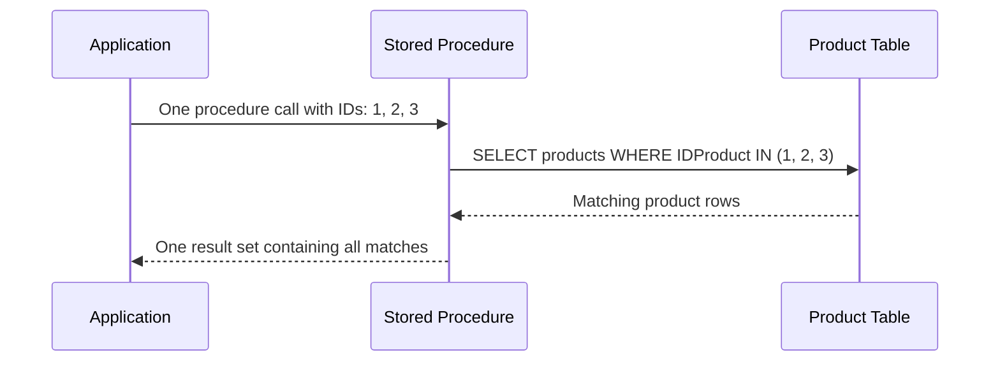
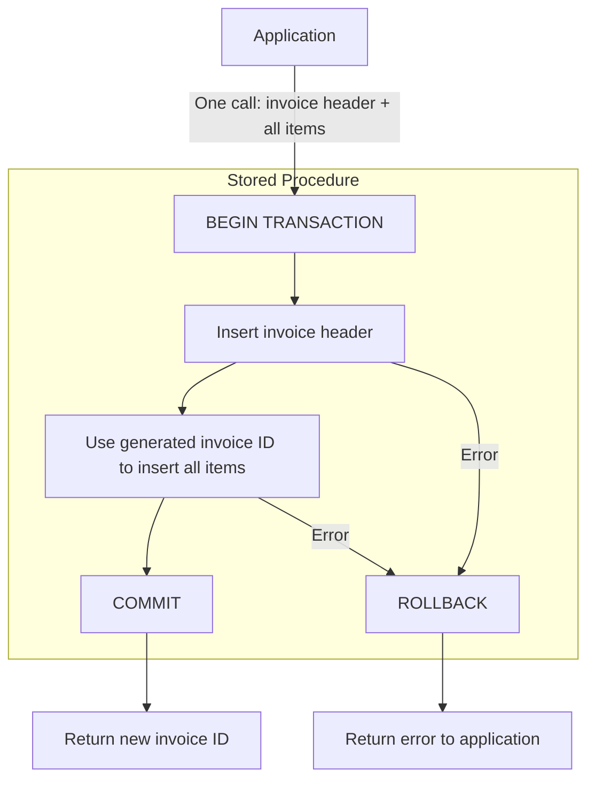
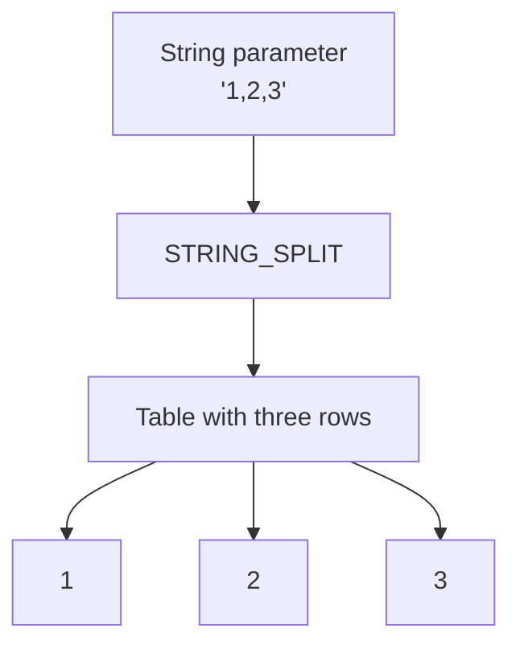
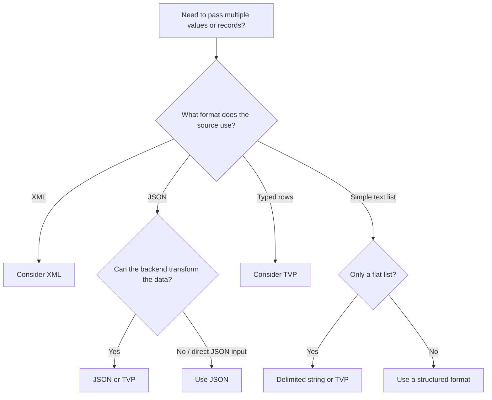

# Lab 8 – Complex Parameters: Passing Collections to Procedures

**Database:** `AdventureWorksENG`

In Labs 3 and 4, we learned that stored procedures and functions package database operations behind a name. Every procedure and function we wrote accepted scalar parameters — one `int`, one `nvarchar`, one `money` at a time.

But what happens when you need to pass **many** values in a single call? How do you insert an invoice header together with twenty line items? How do you delete multiple rows by ID? How do you accept the output of a web API that sends JSON?

This lab compares five approaches to handling collections of data, starting with unsafe SQL concatenation and moving to delimited strings, XML, TVPs, and JSON. By the end, you will know how each approach works and which to consider in different situations.

> [!IMPORTANT]
> **Core idea:** A collection parameter is not a scalar. It needs structure. SQL Server provides multiple envelopes — some safer, some faster, some more natural for the wire protocol you're using. This lab compares unsafe client-side SQL concatenation with four ways to pass collections or structured data: delimited strings, XML, Table-Valued Parameters, and JSON. TVPs pass typed relational rows; XML and JSON represent structured documents.

---

## Learning objectives

After completing this lab, you should be able to:

- identify the two classic collection-parameter problems: the 1:N insert and the batch key operation;
- understand why client-side query building is dangerous and how it fails in three concrete ways;
- pass a flat list of values as a delimited string and split them with `STRING_SPLIT`;
- pass hierarchical data as XML, shred it with `.nodes()` and `.value()`, and build it back with `FOR XML PATH`;
- use XML to pass a single entity with many fields, not just a batch of simple items, and insert it with `.value()`'s singleton syntax;
- define a table type with `CREATE TYPE ... AS TABLE` and pass tables as parameters using Table-Valued Parameters (TVPs);
- accept JSON data with `OPENJSON(@json) WITH (...)`, shred it into typed columns, and build JSON output with `FOR JSON PATH` and dotted aliases;
- insert a parent row and its children from a single nested JSON document, using `JSON_VALUE` and `OPENJSON` together inside one transaction;
- compare all five methods (client-side query, delimited string, XML, TVP, JSON) and know which to reach for in different situations.

---

> [!NOTE]
> **Prerequisites:** This lab assumes familiarity with:
>
> - **Stored procedures (Lab 3)** — how to create them, what `EXEC` does, what parameters are.
> - **Functions (Lab 4)** — scalar and table-valued functions.
> - **T-SQL programming (Lab 0)** — variables (Section 2), `IF/BEGIN/END` (Section 4), `WHILE` loops (Section 7), inline type conversion (Section 6), and basic `TRY/CATCH` (Section 10).
>
> String functions (`LEN`, `SUBSTRING`, `CHARINDEX`) and XML/JSON literals are introduced inline as needed.

---

Start by selecting the training database:

```sql
USE AdventureWorksENG;
GO
```

---

# Section 1 – The Problem: Passing Multiple Values

In previous labs, we learned how to create stored procedures and pass values through parameters.

Consider this simple procedure:

```sql
CREATE OR ALTER PROCEDURE dbo.usp_GetProduct
    @ProductID int
AS
BEGIN
    SELECT IDProduct, Name, PriceWithoutVAT
    FROM Product
    WHERE IDProduct = @ProductID;
END;
GO
```

We can call it by passing a single product ID:

```sql
EXEC dbo.usp_GetProduct @ProductID = 1;
```

This works because `@ProductID` is a **scalar parameter** — it contains one value.

But what if we want to pass several product IDs in a single procedure call?

For example, we might want to retrieve products **1, 2, and 3**.

We cannot simply pass a list to an `int` parameter:

```sql
-- This does not work
EXEC dbo.usp_GetProduct @ProductID = (1, 2, 3);
```

An `int` parameter expects one integer, not a collection of integers.

We need a way to pass **multiple values through a single parameter**.

This is the main problem we will solve in this lab.

## 1.1 Problem 1 – Working with Multiple IDs

Imagine an application that displays a list of products.

A user selects three products and clicks a button to display their details.

The application knows which products were selected:

```text
Selected product IDs: 1, 2, 3
```

One possible solution is to call the procedure three times:

```sql
EXEC dbo.usp_GetProduct @ProductID = 1;
EXEC dbo.usp_GetProduct @ProductID = 2;
EXEC dbo.usp_GetProduct @ProductID = 3;
```

This works, but the application must make three separate procedure calls.

What if the user selects 100 products?

A better approach would be to pass all selected IDs in **one procedure call** and let SQL Server process them together.



This type of operation is called a **batch operation**.

The same concept applies when we want to update, delete, or retrieve multiple rows using a list of IDs.

> [!NOTE]
> A batch operation processes multiple items together. In SQL Server, we can often use a single set-based SQL statement instead of executing the same operation separately for each item.

## 1.2 Problem 2 – Inserting Related Data

Now consider a more complex example: creating an invoice.

An invoice consists of:

- **One invoice header** — customer, date, invoice number.
- **Multiple invoice items** — products, quantities, and prices.

For example:

**Invoice**

| IDInvoice | CustomerID | InvoiceDate |
|---|---|---|
| 101 | 5 | 2026-11-04 |

**InvoiceItem**

| InvoiceID | ProductID | Quantity | UnitPrice |
|---|---|---|---|
| 101 | 1 | 2 | 199.00 |
| 101 | 2 | 1 | 49.90 |
| 101 | 3 | 5 | 9.99 |

The application needs to send all this information to the database.

We could create separate procedures for inserting the invoice header and each invoice item.

However, this introduces several challenges:

1. The application must make multiple procedure calls.
2. The invoice ID must be passed to every invoice item.
3. If one insert fails, we must ensure that the invoice is not left incomplete.

Ideally, we want to send the entire invoice in **one procedure call**.



The procedure receives the invoice data, inserts the header and all items, and manages the transaction.

If an error occurs, the transaction can be rolled back so that the invoice is not partially inserted.

> [!IMPORTANT]
> **One procedure call does not necessarily mean one SQL statement.**
>
> A procedure may execute several SQL statements inside a transaction. The transaction ensures that related changes are committed or rolled back together.

## 1.3 The Solution – Complex Parameters

Both examples have something in common.

We need to pass more than one value to a stored procedure:

- A **list of IDs**, such as `1, 2, 3`.
- A **collection of related records**, such as an invoice with multiple items.

These are examples of **complex parameters**.

Unlike scalar parameters, complex parameters can represent collections or structured data.

SQL Server provides several ways to handle this.

In this lab, we will explore five approaches:

| Method | Example | Main idea |
|---|---|---|
| Client-side query building | `WHERE IDProduct IN (1, 2, 3)` | Construct SQL in application code |
| Delimited string | `'1,2,3'` | Pass a string and split it into values |
| XML | `<IDs><ID>1</ID><ID>2</ID><ID>3</ID></IDs>` | Pass structured XML data |
| Table-Valued Parameter (TVP) | A table containing three ID rows | Pass a collection of typed rows |
| JSON | `[1, 2, 3]` | Pass structured JSON data |

All five approaches can represent the same list of product IDs, but they differ in how the data is prepared, transmitted, and processed.

Some approaches are safer, more efficient, or better suited to particular applications than others.

We will begin with a problematic approach — building SQL statements directly in application code — and then explore better alternatives.

By the end of this lab, you should understand **how to pass collections of data to stored procedures and how to choose an appropriate method for a given situation**.

---

# Section 2 – Method 1: Client-Side Query Building

In Section 1, we saw a simple problem: an application needs to retrieve several products using their IDs.

For example, the user selects products `1`, `2`, and `3`.

One possible solution is to construct a SQL statement directly in the application.

## 2.1 Building SQL in Application Code

Consider the following Python example:

```python
product_ids = [1, 2, 3]

# Convert the IDs into the text "1,2,3"
id_list = ",".join(str(product_id) for product_id in product_ids)

# Insert that text into the SQL statement
sql = f"SELECT * FROM Product WHERE IDProduct IN ({id_list})"

# Send the SQL statement to the database
cursor.execute(sql)
```

The application generates this SQL statement:

```sql
SELECT *
FROM Product
WHERE IDProduct IN (1, 2, 3);
```

The database receives a complete SQL statement and executes it.

At first glance, this approach seems simple and convenient.

However, **building SQL by inserting untrusted values directly into the SQL text is dangerous**.

Let's examine the main problems.

## 2.2 Problem 1 – SQL Injection

SQL injection occurs when user-provided data becomes part of the SQL command itself.

Consider an application that allows users to search for customers by first and last name.

The application builds a SQL statement like this:

```python
# UNSAFE — user input is inserted directly into SQL text
first_name = input("Enter first name: ")
last_name = input("Enter last name: ")

sql = (
    f"SELECT * FROM Customer "
    f"WHERE FirstName = '{first_name}' AND LastName = '{last_name}'"
)

cursor.execute(sql)
```

### Example 1 – Normal input

The user enters:

```text
First name: Gustavo
Last name: Achong
```

The application generates:

```sql
SELECT *
FROM Customer
WHERE FirstName = 'Gustavo' AND LastName = 'Achong';
```

Everything works as expected.

### Example 2 – Malicious input

Now imagine the user enters:

```text
First name: Gustavo
Last name: Achong' OR 1=1 --
```

The application generates:

```sql
SELECT *
FROM Customer
WHERE FirstName = 'Gustavo' AND LastName = 'Achong' OR 1=1 --';
```

Let's examine what happened:

1. The first `'` closes the original string.
2. `OR 1=1` adds a condition that is always true.
3. `--` starts a comment, causing SQL Server to ignore the closing quote added by the application and everything else on that line.

Because `1=1` is always true, the query returns **all customers**, not just those with a particular last name.

The user has changed the meaning of the SQL statement without changing the application code.

### The solution – Parameterized queries

Instead of inserting user input directly into SQL text, pass the values as parameters:

```python
first_name = input("Enter first name: ")
last_name = input("Enter last name: ")

sql = "SELECT * FROM Customer WHERE FirstName = ? AND LastName = ?"

cursor.execute(sql, (first_name, last_name))
```

The `?` placeholders mark where parameter values belong. The values are supplied separately through `cursor.execute`.

If a user enters:

```text
First name: Gustavo
Last name: Achong' OR 1=1 --
```

SQL Server treats the entire last-name input as **a value to search for**, rather than as SQL code.

The query searches for a customer whose last name is literally `Achong' OR 1=1 --`. It does not return all customers.

> [!IMPORTANT]
> Do not put quotes around the `?` placeholders. The database driver handles parameter values.

Besides keeping input separate from SQL code, parameters can also help SQL Server reuse execution plans. We will examine that benefit next.

## 2.3 Problem 2 – Query Plan Reuse

Before executing a query, SQL Server needs an **execution plan** — instructions describing how to access the required data.

Preparing a plan takes work. SQL Server can therefore **cache the plan and reuse it** when the same query runs again.

### When values are part of the SQL text

Suppose an application retrieves a product using this Python code:

```python
sql = f"SELECT * FROM Product WHERE IDProduct = {product_id}"
cursor.execute(sql)
```

When the application searches for products `1`, `2`, and `3`, it sends these statements in separate calls:

```sql
SELECT * FROM Product WHERE IDProduct = 1;
SELECT * FROM Product WHERE IDProduct = 2;
SELECT * FROM Product WHERE IDProduct = 3;
```

The operation is the same each time: find a product by its ID.

However, because the ID is embedded in the statement, **the SQL text changes with every different ID**.

SQL Server may compile and cache separate plans for these statements. With many different IDs, this can increase compilation work and plan-cache usage.

### When values are passed as parameters

Instead, the application can use a parameterized query:

```python
cursor.execute(
    "SELECT * FROM Product WHERE IDProduct = ?",
    (product_id,)
)
```

The `?` is a parameter placeholder. The application supplies the product ID separately.

The query text stays the same across executions:

| Execution | Query text | Parameter value |
|---|---|---|
| 1 | `SELECT * FROM Product WHERE IDProduct = ?` | `1` |
| 2 | `SELECT * FROM Product WHERE IDProduct = ?` | `2` |
| 3 | `SELECT * FROM Product WHERE IDProduct = ?` | `3` |

SQL Server can reuse a cached plan for the parameterized query while processing a different ID each time.

**The key idea: keep the query the same and pass changing values as parameters.**

> [!NOTE]
> SQL Server can automatically parameterize some queries containing literal values, so different SQL text does not always produce separate execution plans.
>
> Explicit parameters make plan reuse more predictable.

> [!IMPORTANT]
> Parameterization does not reduce the number of calls.
>
> Retrieving three products separately still requires three executions. Passing multiple IDs together — the main topic of this lab — addresses that separate problem.

## 2.4 Problem 3 – Many Separate Database Calls

Parameterized queries keep values separate from SQL code and can help SQL Server reuse execution plans.

However, they do not reduce the number of database calls.

Suppose an application needs to retrieve 100 products. It could execute the same parameterized query once for each product ID:

```python
for product_id in product_ids:
    cursor.execute(
        "SELECT * FROM Product WHERE IDProduct = ?",
        (product_id,)
    )
    products = cursor.fetchall()
```

The query text stays the same, but the application executes it **100 times**.

Each execution sends a request to SQL Server and waits for a response before continuing to the next product.

Even if each query runs quickly, the time spent communicating with the server can add up. This is especially noticeable when the application and database run on different servers.

### Send the IDs together

Instead of retrieving one product at a time, the application can send all 100 IDs in **one call**.

SQL Server then processes the collection and returns all matching products in one result set.

| Approach | IDs per call | Number of calls |
|---|---|---|
| Query inside a loop | 1 | 100 |
| Pass a collection | 100 | 1 |

This reduces communication overhead and allows SQL Server to process the IDs together using a set-based query.

> [!IMPORTANT]
> **Parameters and collections address different needs.**
>
> - Parameterization keeps values separate from SQL code and can support execution-plan reuse.
> - A collection parameter allows multiple values or records to be sent in one call.
>
> A collection can also be passed as a parameter. The following sections show several ways to do this.

## 2.5 The Better Approach

We have seen three separate problems:

| Problem | Better approach |
|---|---|
| User input can change the SQL command | Pass values as parameters |
| Changing SQL text can reduce execution-plan reuse | Keep query text consistent and use parameters |
| Separate queries require many database calls | Send multiple values together |

For a single product ID, a scalar parameter is sufficient:

```sql
EXEC dbo.usp_GetProduct @ProductID = 1;
```

But calling this procedure once for each of 100 product IDs still requires **100 calls**.

To process all selected products in one call, we need a way to pass **a collection of IDs**.

In the following sections, we will explore four ways to represent that collection:

- **Delimited strings** — combine values into one string.
- **XML** — represent data using elements and attributes.
- **Table-Valued Parameters (TVPs)** — pass typed rows.
- **JSON** — represent data using arrays and objects.

Each approach allows a procedure to receive multiple values through one parameter. The procedure then reads those values and processes them together.

We will begin with the simplest format: **delimited strings**.

---

# Section 3 – Method 2: Delimited String Parameters

In Section 1, we wanted to pass several product IDs to a stored procedure using a single parameter.

A simple solution is to combine the IDs into one string, separating them with commas:

```text
1,2,3
```

Instead of passing three separate integers, we pass **one string containing three values**.

Inside the stored procedure, SQL Server splits the string back into individual values.

This technique is called a **delimited string parameter**.

## 3.1 How It Works

Consider the following parameter:

```sql
DECLARE @IDList nvarchar(200) = N'1,2,3';
```

Although it contains three numbers, SQL Server sees it as a single string.

We need to convert it into a collection of values that can be used in a SQL query.



SQL Server provides a built-in function called **`STRING_SPLIT`** for this purpose.

## 3.2 The STRING_SPLIT Function

The `STRING_SPLIT` function divides a string into separate values using a specified delimiter.

Its basic syntax is:

```sql
STRING_SPLIT(string, separator)
```

For example:

```sql
SELECT value
FROM STRING_SPLIT('1,2,5,7,11', ',');
```

Result:

| value |
|---|
| 1 |
| 2 |
| 5 |
| 7 |
| 11 |

The function returns a table containing one column named `value`.

Each separated value becomes a row.

Notice that the values are returned as **strings**, even though they look like numbers.

To use them as integers, we can convert them:

```sql
SELECT CAST(value AS int) AS ProductID
FROM STRING_SPLIT('1,2,5,7,11', ',');
```

Now the result contains integer values that can be compared with integer columns in the database.

> [!NOTE]
> `STRING_SPLIT` is available in SQL Server 2016 and later, with database compatibility level 130 or higher.
>
> The function does not guarantee the order of returned rows. If order matters, it must be handled explicitly.

## 3.3 Using STRING_SPLIT in a Query

Let's return to our example from Section 1.

We want to retrieve products with IDs `1`, `2`, and `3`.

First, we can write a normal query:

```sql
SELECT IDProduct, Name, PriceWithoutVAT
FROM Product
WHERE IDProduct IN (1, 2, 3);
```

Now replace the hardcoded list with `STRING_SPLIT`:

```sql
DECLARE @IDList nvarchar(200) = N'1,2,3';

SELECT IDProduct, Name, PriceWithoutVAT
FROM Product
WHERE IDProduct IN
(
    SELECT CAST(value AS int)
    FROM STRING_SPLIT(@IDList, ',')
);
```

Let's examine the process:

1. `@IDList` contains the string `'1,2,3'`.
2. `STRING_SPLIT` separates it into three rows.
3. `CAST` converts each value into an integer.
4. The `IN` operator checks whether `IDProduct` matches any of these values.

The result is the same as the original query, but the list of IDs is now supplied through a variable.

This means we can use the same SQL statement with different lists of IDs.

## 3.4 Passing the List to a Stored Procedure

We can now create a stored procedure that accepts a list of product IDs.

```sql
CREATE OR ALTER PROCEDURE dbo.usp_GetProductsByIDList
    @IDList nvarchar(200)
AS
BEGIN
    SELECT IDProduct, Name, PriceWithoutVAT
    FROM Product
    WHERE IDProduct IN
    (
        SELECT CAST(value AS int)
        FROM STRING_SPLIT(@IDList, ',')
    );
END;
GO
```

Call the procedure:

```sql
EXEC dbo.usp_GetProductsByIDList
    @IDList = N'1,2,3';
```

We can also pass a different list without modifying the procedure:

```sql
EXEC dbo.usp_GetProductsByIDList
    @IDList = N'5,10,15,20';
```

**One parameter. Multiple IDs. One procedure call.**

This solves our first problem: passing a collection of simple values to a stored procedure.

## 3.5 Practical Example – Deleting Multiple Customers

Suppose a user selects three customers and clicks **Delete**.

The application can send their IDs as one comma-separated string. The procedure splits the string and deletes the matching customers using one `DELETE` statement.

### Step 1 – Create the procedure

```sql
CREATE OR ALTER PROCEDURE dbo.usp_DeleteCustomersByIDList
    @IDList nvarchar(200)
AS
BEGIN
    DELETE FROM Customer
    WHERE IDCustomer IN
    (
        SELECT CAST(value AS int)
        FROM STRING_SPLIT(@IDList, ',')
    );
END;
GO
```

### Step 2 – Check the selected customers

For this example, we use customers with IDs `55`, `56`, and `57`.

```sql
SELECT IDCustomer, FirstName, LastName
FROM Customer
WHERE IDCustomer IN (55, 56, 57);
```

> [!NOTE]
> Use the training database. The selected customers must not be referenced by invoices or other records, otherwise a foreign key constraint may prevent deletion.

### Step 3 – Delete the customers

Pass all three IDs through one parameter:

```sql
EXEC dbo.usp_DeleteCustomersByIDList
    @IDList = N'55,56,57';
```

`STRING_SPLIT` separates the string into three values, and `CAST` converts them into integers. The `DELETE` statement removes all matching customers.

### Step 4 – Verify the result

```sql
SELECT IDCustomer, FirstName, LastName
FROM Customer
WHERE IDCustomer IN (55, 56, 57);
```

The query should return no rows.

**Three customer IDs. One parameter. One procedure call.**

## 3.6 Limitations of Delimited Strings

Delimited strings are simple and convenient, but they have several limitations.

| Limitation | Explanation |
|---|---|
| No type safety | Values arrive as text and may require conversion. |
| Invalid values | A value such as `'1,ABC,3'` causes an error when converted to `int` using `CAST`. |
| Delimiter conflicts | A comma cannot safely separate values that may themselves contain commas without additional rules. |
| Limited structure | A string such as `'1,2,3'` represents a flat list, not a collection of records with multiple fields. |
| No guaranteed order | `STRING_SPLIT` does not guarantee that rows are returned in their original order. |

For example, consider an invoice containing several products.

Each invoice item needs multiple values:

| ProductID | Quantity | UnitPrice |
|---|---|---|
| 1 | 2 | 199.00 |
| 2 | 1 | 49.90 |
| 3 | 5 | 9.99 |

We could try to represent this information as a string:

```text
1,2,199.00;2,1,49.90;3,5,9.99
```

But now we need two delimiters:

- `;` to separate invoice items.
- `,` to separate fields within each item.

We would also need additional logic to extract and convert every value.

This quickly becomes difficult to maintain.

**Delimited strings work well for simple lists of values, but they are not ideal for structured data.**

In the next section, we will introduce **XML**, which allows us to represent more complex information using elements, attributes, and nested structures.

---

# Section 4 – Method 3: XML Parameters

In Section 3, we learned how to pass multiple values using a comma-separated string.

This works well for simple lists, such as:

```text
1,2,3
```

But what if each item contains several values?

For example, an invoice may contain multiple products, each with its own quantity and price.

We need a format that can represent **structured data**, not just a list of values.

One solution is **XML (Extensible Markup Language)**.

## 4.1 What Is XML?

XML is a text-based format used to represent structured information.

It uses **elements**, **attributes**, and **nested structures** to describe data.

Consider this example:

```xml
<Customers>
    <Customer ID="1" Name="Alice" />
    <Customer ID="2" Name="Bob" />
    <Customer ID="3" Name="Charlie" />
</Customers>
```

The XML document contains:

- A root element: `<Customers>`.
- Three child elements: `<Customer>`.
- Two attributes for each customer: `ID` and `Name`.

Unlike a comma-separated string, XML explicitly describes what each value represents.

For example, we could represent an invoice and its items:

```xml
<Invoice>
    <CustomerID>5</CustomerID>
    <InvoiceDate>2026-11-04</InvoiceDate>
    <Items>
        <Item ProductID="1" Quantity="2" UnitPrice="199.00" />
        <Item ProductID="2" Quantity="1" UnitPrice="49.90" />
        <Item ProductID="3" Quantity="5" UnitPrice="9.99" />
    </Items>
</Invoice>
```

This document contains both the invoice information and a collection of invoice items.

All the information can be passed to a stored procedure using **one XML parameter**.

SQL Server has a built-in `xml` data type for storing and processing XML documents.

## 4.2 Reading XML in SQL Server

SQL Server provides several methods for working with XML.

In this lab, we will focus on two:

| Method | Purpose |
|---|---|
| `.nodes()` | Converts matching XML elements into rows |
| `.value()` | Extracts a value from an XML element or attribute |

Let's see how they work together.

### Step 1 – Declare an XML variable

```sql
DECLARE @Cities xml = N'
<Cities>
    <City Name="Oslo" PostalCode="0001" />
    <City Name="Bergen" PostalCode="5003" />
    <City Name="Trondheim" PostalCode="7010" />
</Cities>';
```

This variable contains one XML document with three cities.

### Step 2 – Convert XML elements into rows

We want to extract each `City` element.

```sql
DECLARE @Cities xml = N'
<Cities>
    <City Name="Oslo" PostalCode="0001" />
    <City Name="Bergen" PostalCode="5003" />
    <City Name="Trondheim" PostalCode="7010" />
</Cities>';

SELECT
    c.node.query('.') AS CityXml
FROM @Cities.nodes('/Cities/City') AS c(node);
```

The expression:

```sql
@Cities.nodes('/Cities/City')
```

selects every `City` element inside the root `Cities` element.

The result contains three rows, each holding one XML fragment.

| CityXml |
|---|
| `<City Name="Oslo" PostalCode="0001" />` |
| `<City Name="Bergen" PostalCode="5003" />` |
| `<City Name="Trondheim" PostalCode="7010" />` |

The syntax `AS c(node)` assigns names to the resulting table and XML column.

> [!NOTE]
> The path `/Cities/City` uses **XQuery**, a language for navigating XML.
>
> Think of it as a path through the XML structure:
>
> - `/Cities` — the root element.
> - `/Cities/City` — all `City` elements inside `Cities`.
> - `@Name` — the `Name` attribute.
> - `.` — the current XML node.

### Step 3 – Extract values using `.value()`

Instead of returning XML fragments, we usually want ordinary SQL values.

We can extract the attributes using `.value()`:

```sql
DECLARE @Cities xml = N'
<Cities>
    <City Name="Oslo" PostalCode="0001" />
    <City Name="Bergen" PostalCode="5003" />
    <City Name="Trondheim" PostalCode="7010" />
</Cities>';

SELECT
    c.node.value('@Name', 'nvarchar(50)') AS CityName,
    c.node.value('@PostalCode', 'nvarchar(10)') AS PostalCode
FROM @Cities.nodes('/Cities/City') AS c(node);
```

Result:

| CityName | PostalCode |
|---|---|
| Oslo | 0001 |
| Bergen | 5003 |
| Trondheim | 7010 |

Notice that we now have a normal SQL result set.

**The XML document has been converted into relational rows and columns.**

The two methods work together:

1. `.nodes('/Cities/City')` identifies each city and creates a row.
2. `.value('@Name', 'nvarchar(50)')` extracts the city name.
3. `.value('@PostalCode', 'nvarchar(10)')` extracts the postal code.

This process is sometimes called **XML shredding**.

## 4.3 Passing XML to a Stored Procedure

Now that we know how to extract data from XML, we can use it as a stored procedure parameter.

Let's create a procedure that inserts multiple cities.

Each city belongs to a state, so the procedure will accept:

- `@StateID` — a scalar parameter identifying the state.
- `@Cities` — an XML parameter containing multiple cities.

### Step 1 – Create the procedure

```sql
CREATE OR ALTER PROCEDURE dbo.usp_InsertCityBatch
    @StateID int,
    @Cities xml
AS
BEGIN
    INSERT INTO City (Name, StateID)
    SELECT
        c.node.value('@Name', 'nvarchar(50)'),
        @StateID
    FROM @Cities.nodes('/Cities/City') AS c(node);
END;
GO
```

Notice that the procedure uses `INSERT INTO ... SELECT`.

The XML parameter is converted into rows, and all cities are inserted using one SQL statement.

We do not need a `WHILE` loop or a separate `INSERT` statement for each city.

### Step 2 – Call the procedure

First, create a test state and capture its ID.

Then pass the XML document to the procedure.

```sql
-- Find Croatia's ID
SELECT IDState, Name
FROM State
WHERE Name = N'Croatia';

-- Use Croatia's ID (1) to insert three cities
EXEC dbo.usp_InsertCityBatch
    @StateID = 1,
    @Cities = N'
<Cities>
    <City Name="Nin" />
    <City Name="Ilok" />
    <City Name="Imotski" />
</Cities>';

-- Verify
SELECT c.IDCity, c.Name AS CityName, s.Name AS StateName
FROM City c
JOIN State s ON s.IDState = c.StateID
WHERE s.IDState = 1
  AND c.Name IN (N'Nin', N'Ilok', N'Imotski');
```

**Three cities. One XML parameter. One procedure call.**

## 4.4 XML Attributes vs. Element Values

XML can represent information in two common ways.

**Using attributes:**

```xml
<City Name="Oslo" />
```

**Using element text:**

```xml
<City>Oslo</City>
```

Both represent the same city name, but the SQL expressions used to read them are different.

For attributes, we use `@`:

```sql
DECLARE @City xml = N'<City Name="Oslo" />';

SELECT @City.value('(/City/@Name)[1]', 'nvarchar(50)') AS CityName;
```

For element text, we can use the element path:

```sql
DECLARE @City xml = N'<City>Oslo</City>';

SELECT @City.value('(/City/text())[1]', 'nvarchar(50)') AS CityName;
```

Both queries return:

| CityName |
|---|
| Oslo |

> [!IMPORTANT]
> Notice the `[1]` in the expressions.
>
> When reading directly from an XML variable, SQL Server often requires us to specify that we expect a single value.
>
> The expression `(/City/@Name)[1]` selects the first matching `Name` attribute.
>
> In the earlier `.nodes()` examples, each row already represents a particular `City` node, so expressions such as `@Name` are evaluated relative to that node.

## 4.5 Passing One Entity with Multiple Fields

So far, we have used XML to pass collections of rows.

However, XML can also represent **one entity containing multiple fields**.

For example:

```xml
<Customer>
    <FirstName>Nina</FirstName>
    <LastName>Novak</LastName>
    <Email>nina.novak@example.com</Email>
</Customer>
```

We could pass these values as three separate scalar parameters.

Alternatively, we can pass the entire customer as one XML parameter.

```sql
CREATE OR ALTER PROCEDURE dbo.usp_InsertCustomerFromXml
    @Customer xml
AS
BEGIN
    DECLARE @NewCustomerID int;

    INSERT INTO Customer (FirstName, LastName, Email)
    VALUES
    (
        @Customer.value('(/Customer/FirstName)[1]', 'nvarchar(50)'),
        @Customer.value('(/Customer/LastName)[1]', 'nvarchar(50)'),
        @Customer.value('(/Customer/Email)[1]', 'nvarchar(100)')
    );

    SET @NewCustomerID = SCOPE_IDENTITY();

    SELECT *
    FROM Customer
    WHERE IDCustomer = @NewCustomerID;
END;
GO
```

Call the procedure:

```sql
EXEC dbo.usp_InsertCustomerFromXml
    @Customer = N'
<Customer>
    <FirstName>Nina</FirstName>
    <LastName>Novak</LastName>
    <Email>nina.novak@example.com</Email>
</Customer>';
```

The procedure extracts the individual values from XML and inserts a new customer.

Clean up the test data:

```sql
DELETE FROM Customer
WHERE Email = N'nina.novak@example.com';

DROP PROCEDURE dbo.usp_InsertCustomerFromXml;
```

This example demonstrates that XML parameters are useful not only for lists but also for structured objects containing several related values.

## 4.6 Generating XML with FOR XML PATH

So far, we have received XML and converted it into SQL rows.

SQL Server can also perform the opposite operation: **convert query results into XML**.

This is useful when an application or external system expects XML output.

For example:

```sql
SELECT
    c.IDCustomer AS [@IDCustomer],
    c.FirstName AS [FirstName],
    c.LastName AS [LastName],
    c.Email AS [Emails/Email]
FROM Customer c
WHERE c.IDCustomer <= 3
FOR XML PATH('Customer'), ROOT('Customers');
```

The result has a structure similar to this:

```xml
<Customers>
    <Customer IDCustomer="1">
        <FirstName>Gustavo</FirstName>
        <LastName>Achong</LastName>
        <Emails>
            <Email>gustavo0@adventure-works.com</Email>
        </Emails>
    </Customer>
</Customers>
```

The important parts are:

| SQL syntax | XML result |
|---|---|
| `[@IDCustomer]` | Creates an XML attribute |
| `[FirstName]` | Creates a child element |
| `[Emails/Email]` | Creates nested elements |
| `FOR XML PATH('Customer')` | Creates one `Customer` element per row |
| `ROOT('Customers')` | Wraps the result in a root element |

Notice the use of `/` in column aliases.

For example:

```sql
c.Email AS [Emails/Email]
```

creates:

```xml
<Emails>
    <Email>...</Email>
</Emails>
```

This is how we can build nested XML structures directly from relational data.

## 4.7 Advantages and Limitations of XML

| Advantages | Limitations |
|---|---|
| Supports nested and hierarchical data | More verbose than simpler formats |
| Can represent collections and individual objects | XML syntax and XQuery require additional learning |
| Built-in `xml` data type in SQL Server | XML processing introduces parsing overhead |
| Can convert XML into relational rows | Requires careful handling of missing or invalid values |
| Supports XML input and output | May be unnecessary when simpler formats are sufficient |

XML remains useful when integrating with systems that already exchange XML documents, such as certain SOAP-based services.

However, it is not the only way to pass structured data to SQL Server.

> [!TIP]
> Additional practice: Exercise 7 demonstrates a more advanced XML procedure that finds or creates related records across multiple tables.

In the next section, we will explore **Table-Valued Parameters (TVPs)**, which allow us to pass collections of typed rows directly to stored procedures without converting them into XML or delimited strings.

---

# Section 5 – Method 4: Table-Valued Parameters (TVPs)

In the previous sections, we learned how to pass collections of data using delimited strings and XML.

Both approaches allow us to send multiple values through a single parameter.

However, they require SQL Server to extract values from text before using them as relational data.

What if we could pass a **table directly to a stored procedure**?

SQL Server supports exactly this through **Table-Valued Parameters (TVPs)**.

## 5.1 What Is a Table-Valued Parameter?

A Table-Valued Parameter allows a stored procedure to receive multiple rows and columns as one parameter.

Consider our familiar example: we want to retrieve products with IDs `1`, `2`, and `3`.

With a delimited string, we passed:

```sql
@IDList = N'1,2,3'
```

With XML, we could pass:

```xml
<IDs>
    <ID>1</ID>
    <ID>2</ID>
    <ID>3</ID>
</IDs>
```

With a TVP, we pass the values as a table:

| ID |
|---|
| 1 |
| 2 |
| 3 |

The stored procedure can use this table directly in SQL queries, including `SELECT`, `JOIN`, and `WHERE`.

There is no need for `STRING_SPLIT` or XML parsing.

> [!IMPORTANT]
> A TVP is a parameter whose value is a collection of typed rows.
>
> Unlike a scalar parameter, which contains one value, a TVP can contain many rows and multiple columns.

## 5.2 Defining a Table Type

Before using a TVP, we must define its structure.

SQL Server already provides built-in data types such as:

```sql
int
nvarchar(50)
date
money
```

But there is no built-in type representing a table with a column named `ID`.

We must create one.

### Step 1 – Create a user-defined table type

```sql
CREATE TYPE dbo.ProductIDList AS TABLE
(
    ID int PRIMARY KEY
);
GO
```

This statement creates a new table type named `dbo.ProductIDList`.

It defines the structure of a table containing one integer column.

The `PRIMARY KEY` ensures that the same ID cannot appear more than once in a value of this type.

> [!NOTE]
> `CREATE TYPE ... AS TABLE` defines a reusable table structure.
>
> It does not create a regular database table containing product IDs. Instead, it creates a type that can be used to declare table variables and procedure parameters.

### Step 2 – Declare a variable of this type

Now that the type exists, we can declare a variable:

```sql
DECLARE @MyIDs dbo.ProductIDList;
```

This creates a table variable based on our custom type.

We can insert rows into it:

```sql
DECLARE @MyIDs dbo.ProductIDList;

INSERT INTO @MyIDs (ID)
VALUES (1), (2), (3);

SELECT *
FROM @MyIDs;
```

Result:

| ID |
|---|
| 1 |
| 2 |
| 3 |

Notice that `@MyIDs` behaves like a table.

We can insert rows, query its contents, and use it in joins.

The important difference is that it is a **table variable**, not a permanent table stored under a name such as `dbo.Product`.

## 5.3 Passing a Table to a Stored Procedure

Now let's create a procedure that receives our table variable.

```sql
CREATE OR ALTER PROCEDURE dbo.usp_GetProductsByIDs
    @IDs dbo.ProductIDList READONLY
AS
BEGIN
    SELECT
        p.IDProduct,
        p.Name,
        p.PriceWithoutVAT
    FROM Product p
    INNER JOIN @IDs i ON i.ID = p.IDProduct;
END;
GO
```

Notice the parameter declaration:

```sql
@IDs dbo.ProductIDList READONLY
```

It contains three important parts:

| Part | Meaning |
|---|---|
| `@IDs` | Parameter name |
| `dbo.ProductIDList` | User-defined table type |
| `READONLY` | The procedure cannot modify the parameter |

Unlike ordinary scalar parameters, TVPs must be declared with `READONLY`.

### Calling the procedure

We can now pass our table variable to the procedure:

```sql
DECLARE @MyIDs dbo.ProductIDList;

INSERT INTO @MyIDs (ID)
VALUES (1), (2), (3);

EXEC dbo.usp_GetProductsByIDs
    @IDs = @MyIDs;
```

The procedure receives all three IDs and joins them with the `Product` table.

**Three IDs. One table parameter. One procedure call.**

The procedure can accept any number of IDs without changing its definition.

### Why READONLY?

Inside the procedure, we can read the TVP:

```sql
SELECT *
FROM @IDs;
```

However, we cannot modify it:

```sql
-- Not allowed inside a procedure
INSERT INTO @IDs (ID)
VALUES (4);
```

SQL Server requires TVPs to be read-only.

This means that the procedure can use the input data without changing the collection supplied by the caller.

If we need to modify the data, we can copy it into a local table variable or temporary table.

### Cleanup

```sql
DROP PROCEDURE dbo.usp_GetProductsByIDs;
DROP TYPE dbo.ProductIDList;
GO
```

> [!IMPORTANT]
> Drop the procedure before dropping the table type.
>
> SQL Server does not allow a table type to be dropped while a stored procedure still depends on it.

## 5.4 Practical Example – Inserting an Invoice with Multiple Items

Let's return to the invoice problem introduced in Section 1.

An invoice contains:

- One header with customer information and invoice date.
- Multiple line items containing products, quantities, and prices.

We want to insert the entire invoice using **one stored procedure call**.

For this example, we will use:

- Scalar parameters for the invoice header.
- A Table-Valued Parameter for the invoice items.

This is a natural design because the header contains a fixed number of values, while the number of invoice items can vary.

### Step 1 – Define the table type

Each invoice item contains three values:

| ProductID | Quantity | UnitPrice |
|---|---|---|
| 1 | 2 | 199.00 |
| 2 | 1 | 49.90 |
| 3 | 5 | 9.99 |

Create a table type representing these items:

```sql
CREATE TYPE dbo.InvoiceLineInput AS TABLE
(
    ProductID int NOT NULL,
    Quantity int NOT NULL,
    UnitPrice money NOT NULL
);
GO
```

Notice that the table type contains multiple columns.

TVPs are not limited to simple lists of IDs.

They can represent collections of records with different data types.

### Step 2 – Create the procedure

```sql
CREATE OR ALTER PROCEDURE dbo.usp_InvoiceInsert
    @CustomerID int,
    @InvoiceDate date,
    @Lines dbo.InvoiceLineInput READONLY
AS
BEGIN
    SET NOCOUNT ON;
    SET XACT_ABORT ON;

    DECLARE @NewInvoiceID int;

    BEGIN TRY
        BEGIN TRANSACTION;

        -- Insert the invoice header
        INSERT INTO Invoice
        (
            CustomerID,
            InvoiceDate,
            InvoiceNumber
        )
        VALUES
        (
            @CustomerID,
            @InvoiceDate,
            LEFT(CONVERT(nvarchar(36), NEWID()), 20)
        );

        -- Get the generated invoice ID
        SET @NewInvoiceID = SCOPE_IDENTITY();

        -- Insert all invoice items
        INSERT INTO InvoiceItem
        (
            InvoiceID,
            ProductID,
            Quantity,
            InitialPrice,
            Discount,
            TotalPrice
        )
        SELECT
            @NewInvoiceID,
            ProductID,
            Quantity,
            UnitPrice,
            0,
            Quantity * UnitPrice
        FROM @Lines;

        COMMIT TRANSACTION;

        -- Return the generated invoice ID
        SELECT @NewInvoiceID AS NewInvoiceID;

    END TRY
    BEGIN CATCH
        IF @@TRANCOUNT > 0
            ROLLBACK TRANSACTION;

        THROW;
    END CATCH;
END;
GO
```

Let's examine the important parts.

**1. Scalar parameters**

```sql
@CustomerID int,
@InvoiceDate date
```

These represent the invoice header.

**2. Table-Valued Parameter**

```sql
@Lines dbo.InvoiceLineInput READONLY
```

This contains all invoice items.

**3. Transaction**

```sql
BEGIN TRANSACTION;
...
COMMIT TRANSACTION;
```

The invoice header and its items must be inserted together.

If an error occurs, the `CATCH` block rolls back the transaction.

**4. SCOPE_IDENTITY()**

```sql
SET @NewInvoiceID = SCOPE_IDENTITY();
```

This retrieves the ID generated when the invoice header was inserted.

We use it to link every invoice item to the correct invoice.

**5. Set-based INSERT**

```sql
INSERT INTO InvoiceItem (...)
SELECT ...
FROM @Lines;
```

This inserts all invoice items using one SQL statement.

We do not need a loop.

> [!NOTE]
> In this simplified example, `UnitPrice` becomes `InitialPrice`, `Discount` is set to `0`, and `TotalPrice` is calculated as `Quantity * UnitPrice`.
>
> The invoice number is generated using `NEWID()` as a demonstration placeholder. Real invoicing systems normally use a defined invoice-numbering mechanism.

### Step 3 – Call, verify, and clean up

Declare a table variable containing the invoice items, then call the procedure once and capture its returned invoice ID.

The following script creates one invoice, displays its items, and removes that same invoice and its items.

```sql
DECLARE @InvoiceLines dbo.InvoiceLineInput;
DECLARE @Result TABLE (NewInvoiceID int);
DECLARE @NewInvoiceID int;

INSERT INTO @InvoiceLines
(
    ProductID,
    Quantity,
    UnitPrice
)
VALUES
    (1, 2, 199.00),
    (2, 1, 49.90),
    (3, 5, 9.99);

INSERT INTO @Result (NewInvoiceID)
EXEC dbo.usp_InvoiceInsert
    @CustomerID = 1,
    @InvoiceDate = '2026-11-04',
    @Lines = @InvoiceLines;

SELECT @NewInvoiceID = NewInvoiceID
FROM @Result;

-- Verify the invoice and its items
SELECT
    i.IDInvoice,
    i.InvoiceDate,
    ii.ProductID,
    ii.Quantity,
    ii.InitialPrice,
    ii.TotalPrice
FROM Invoice i
JOIN InvoiceItem ii ON ii.InvoiceID = i.IDInvoice
WHERE i.IDInvoice = @NewInvoiceID;

-- Remove only the invoice created by this test
DELETE FROM InvoiceItem
WHERE InvoiceID = @NewInvoiceID;

DELETE FROM Invoice
WHERE IDInvoice = @NewInvoiceID;
```

Run this entire script as one batch so that all variables remain in scope.

Finally, remove the procedure and table type:

```sql
DROP PROCEDURE dbo.usp_InvoiceInsert;
DROP TYPE dbo.InvoiceLineInput;
GO
```

> [!IMPORTANT]
> We use the generated invoice ID to identify the test data.
>
> Avoid using `MAX(IDInvoice)` to find the last inserted invoice. Another session may insert a different invoice, making that approach unreliable.

## 5.5 Advantages and Limitations of TVPs

| Advantages | Limitations |
|---|---|
| Strong typing — columns have defined SQL data types | Requires a user-defined table type |
| Supports multiple rows and columns | TVP parameters must be `READONLY` |
| Can be used directly in joins and queries | Table types cannot be altered directly |
| Avoids parsing XML or delimited strings | Client applications must support sending TVPs |
| Useful for set-based operations | SQL Server does not maintain column statistics on TVPs |

TVPs are particularly useful when an application needs to pass a collection of relational records directly to SQL Server.

They are commonly used in SQL Server applications, including applications written in .NET.

However, TVPs do not always guarantee the fastest execution plan. SQL Server does not maintain statistics on TVP columns, which can affect optimization for larger collections.

For some workloads, copying TVP data into a temporary table may provide better query optimization.

> [!TIP]
> **When should you use a TVP?**
>
> Use a TVP when you need to pass multiple typed rows to a stored procedure and your database client supports Table-Valued Parameters.
>
> For example:
>
> - Retrieving multiple products by ID.
> - Updating many records in one operation.
> - Inserting multiple invoice items.
> - Passing structured data from a .NET application to SQL Server.

In the next section, we will explore **JSON parameters**, which are especially useful when applications already exchange data in JSON format, such as REST APIs and web applications.

---

# Section 6 – Method 5: JSON Parameters

In the previous sections, we learned how to pass collections of data using delimited strings, XML, and Table-Valued Parameters (TVPs).

These methods are useful when applications need to send multiple values to SQL Server.

However, modern web applications frequently exchange data using **JSON (JavaScript Object Notation)**.

JSON is widely used by REST APIs, web applications, and mobile applications because it is relatively simple, compact, and easy to process.

SQL Server can read JSON, convert it into relational rows, and generate JSON from query results.

In this section, we will learn how to use JSON as a stored procedure parameter.

## 6.1 What Is JSON?

JSON is a text-based format for representing structured data.

It supports objects, arrays, strings, numbers, Boolean values, and `null`.

Consider a customer represented as a JSON object:

```json
{
    "FirstName": "Alice",
    "LastName": "Anderson",
    "Email": "alice@example.com"
}
```

An **object** contains named properties and their values.

We can also represent multiple customers using a JSON array:

```json
[
    {
        "FirstName": "Alice",
        "LastName": "Anderson",
        "Email": "alice@example.com"
    },
    {
        "FirstName": "Bob",
        "LastName": "Brown",
        "Email": "bob@example.com"
    }
]
```

The square brackets `[]` represent an array, while curly brackets `{}` represent objects.

In this example, the array contains two customer objects.

> [!NOTE]
> In SQL Server 2016–2022, JSON is typically stored and passed as `nvarchar(max)`.
>
> SQL Server provides built-in functions for reading and generating JSON. The examples in this lab use these functions and are compatible with SQL Server 2016 or later, provided the database compatibility level supports `OPENJSON` (level 130 or higher).

## 6.2 Reading a Single Value – JSON_VALUE

Let's start with a simple JSON object.

```sql
DECLARE @Customer nvarchar(max) = N'
{
    "FirstName": "Alice",
    "LastName": "Anderson",
    "Email": "alice@example.com"
}';

SELECT
    JSON_VALUE(@Customer, '$.FirstName') AS FirstName,
    JSON_VALUE(@Customer, '$.LastName') AS LastName,
    JSON_VALUE(@Customer, '$.Email') AS Email;
```

Result:

| FirstName | LastName | Email |
|---|---|---|
| Alice | Anderson | alice@example.com |

The `JSON_VALUE` function extracts a single scalar value from a JSON document.

Its basic syntax is:

```sql
JSON_VALUE(json_expression, path)
```

The path tells SQL Server which property to read.

For example:

| JSON path | Meaning |
|---|---|
| `$` | Root of the JSON document |
| `$.FirstName` | Property `FirstName` |
| `$.Email` | Property `Email` |
| `$.Address.City` | Property `City` inside `Address` |

The `$` symbol represents the root of the JSON document, and dots are used to navigate through nested objects.

> [!IMPORTANT]
> `JSON_VALUE` extracts **one scalar value**.
>
> It is useful when we need a specific property, but it does not convert an entire JSON array into multiple SQL rows.

## 6.3 Converting JSON Arrays into Rows – OPENJSON

Now consider a JSON array containing several customers.

We want to convert the array into a normal SQL result set.

SQL Server provides the **`OPENJSON`** function for this purpose.

### Step 1 – Declare a JSON array

```sql
DECLARE @Customers nvarchar(max) = N'
[
    { "FirstName": "Ida", "LastName": "Ibsen", "Email": "ida@example.com" },
    { "FirstName": "Jonas", "LastName": "Jensen", "Email": "jonas@example.com" },
    { "FirstName": "Kari", "LastName": "Kristian", "Email": "kari@example.com" }
]';
```

### Step 2 – Read the array

Without specifying columns, `OPENJSON` returns three default columns:

```sql
DECLARE @IDs nvarchar(max) = N'[1, 2, 3]';

SELECT *
FROM OPENJSON(@IDs);
```

Result:

| key | value | type |
|---|---|---|
| 0 | 1 | 2 |
| 1 | 2 | 2 |
| 2 | 3 | 2 |

The columns represent:

- `key` — the array index, starting at zero.
- `value` — the value of the array element.
- `type` — a numeric code describing the JSON value type (`2` means number).

This is useful for simple arrays, but our customer objects contain multiple properties.

### Step 3 – Define columns with WITH

We can use `WITH (...)` to specify which properties should become SQL columns.

```sql
DECLARE @Customers nvarchar(max) = N'
[
    { "FirstName": "Ida", "LastName": "Ibsen", "Email": "ida@example.com" },
    { "FirstName": "Jonas", "LastName": "Jensen", "Email": "jonas@example.com" },
    { "FirstName": "Kari", "LastName": "Kristian", "Email": "kari@example.com" }
]';

SELECT *
FROM OPENJSON(@Customers)
WITH
(
    FirstName nvarchar(50) '$.FirstName',
    LastName  nvarchar(50) '$.LastName',
    Email     nvarchar(100) '$.Email'
);
```

Result:

| FirstName | LastName | Email |
|---|---|---|
| Ida | Ibsen | ida@example.com |
| Jonas | Jensen | jonas@example.com |
| Kari | Kristian | kari@example.com |

The `WITH` clause defines:

1. The SQL column name.
2. The SQL data type.
3. The JSON path containing the value.

For example:

```sql
FirstName nvarchar(50) '$.FirstName'
```

means: create a column named `FirstName`, convert its value to `nvarchar(50)`, and read it from the `FirstName` property.

**The JSON array has now become a relational result set.**

This process is similar to XML shredding using `.nodes()` and `.value()`.

## 6.4 Passing JSON to a Stored Procedure

Now we can use `OPENJSON` inside a stored procedure.

Our goal is to insert multiple customers using one JSON parameter.

### Step 1 – Create the procedure

```sql
CREATE OR ALTER PROCEDURE dbo.usp_InsertCustomerBatchFromJson
    @JsonCustomers nvarchar(max)
AS
BEGIN
    INSERT INTO Customer (FirstName, LastName, Email)
    SELECT FirstName, LastName, Email
    FROM OPENJSON(@JsonCustomers)
    WITH
    (
        FirstName nvarchar(50) '$.FirstName',
        LastName  nvarchar(50) '$.LastName',
        Email     nvarchar(100) '$.Email'
    );
END;
GO
```

The procedure receives one string containing JSON data.

`OPENJSON` converts the array into rows, and `INSERT INTO ... SELECT` inserts all customers using one SQL statement.

### Step 2 – Call the procedure

```sql
EXEC dbo.usp_InsertCustomerBatchFromJson
    @JsonCustomers = N'
[
    {
        "FirstName": "ZZ_TestAlice",
        "LastName": "Anderson",
        "Email": "zz_alice@example.com"
    },
    {
        "FirstName": "ZZ_TestBob",
        "LastName": "Brown",
        "Email": "zz_bob@example.com"
    }
]';
```

### Step 3 – Verify and clean up

```sql
SELECT IDCustomer, FirstName, LastName, Email
FROM Customer
WHERE Email IN
(
    N'zz_alice@example.com',
    N'zz_bob@example.com'
);

DELETE FROM Customer
WHERE Email IN
(
    N'zz_alice@example.com',
    N'zz_bob@example.com'
);

DROP PROCEDURE dbo.usp_InsertCustomerBatchFromJson;
```

**Two customers. One JSON parameter. One procedure call.**

The procedure can handle a larger array without changing its SQL code.

## 6.5 Working with Nested JSON

Real-world JSON documents often contain nested objects and arrays.

Consider an invoice with several line items:

```json
{
    "Invoice": {
        "CustomerID": 5,
        "InvoiceDate": "2026-11-04",
        "Lines": [
            { "ProductID": 1, "Quantity": 2, "UnitPrice": 199.00 },
            { "ProductID": 2, "Quantity": 1, "UnitPrice": 49.90 },
            { "ProductID": 3, "Quantity": 5, "UnitPrice": 9.99 }
        ]
    }
}
```

This document contains two levels of information:

- **Invoice header** — customer ID and invoice date.
- **Invoice lines** — an array of products, quantities, and prices.

We can read the header using `JSON_VALUE`.

```sql
DECLARE @Json nvarchar(max) = N'
{
    "Invoice": {
        "CustomerID": 5,
        "InvoiceDate": "2026-11-04",
        "Lines": [
            { "ProductID": 1, "Quantity": 2, "UnitPrice": 199.00 },
            { "ProductID": 2, "Quantity": 1, "UnitPrice": 49.90 },
            { "ProductID": 3, "Quantity": 5, "UnitPrice": 9.99 }
        ]
    }
}';

SELECT
    JSON_VALUE(@Json, '$.Invoice.CustomerID') AS CustomerID,
    JSON_VALUE(@Json, '$.Invoice.InvoiceDate') AS InvoiceDate;
```

But what about the `Lines` array?

We can use `OPENJSON` with a path pointing directly to that array:

```sql
SELECT *
FROM OPENJSON(@Json, '$.Invoice.Lines')
WITH
(
    ProductID int '$.ProductID',
    Quantity  int '$.Quantity',
    UnitPrice decimal(10,2) '$.UnitPrice'
);
```

Result:

| ProductID | Quantity | UnitPrice |
|---|---|---|
| 1 | 2 | 199.00 |
| 2 | 1 | 49.90 |
| 3 | 5 | 9.99 |

Notice the second argument:

```sql
'$.Invoice.Lines'
```

It tells SQL Server to start reading from the `Lines` array inside the `Invoice` object.

### Reading both levels with CROSS APPLY

> [!TIP]
> This is an optional advanced example. For the core lab, focus on reading the header with `JSON_VALUE` and the items with `OPENJSON`. Run the following query in the same batch as the declaration of `@Json`.

Sometimes we want to combine the invoice header and line items in one result.

We can use two `OPENJSON` operations connected by `CROSS APPLY`.

```sql
SELECT
    inv.CustomerID,
    inv.InvoiceDate,
    line.ProductID,
    line.Quantity,
    line.UnitPrice
FROM OPENJSON(@Json, '$.Invoice')
WITH
(
    CustomerID int '$.CustomerID',
    InvoiceDate date '$.InvoiceDate',
    LinesJson nvarchar(max) '$.Lines' AS JSON
) AS inv
CROSS APPLY OPENJSON(inv.LinesJson)
WITH
(
    ProductID int '$.ProductID',
    Quantity int '$.Quantity',
    UnitPrice decimal(10,2) '$.UnitPrice'
) AS line;
```

Result:

| CustomerID | InvoiceDate | ProductID | Quantity | UnitPrice |
|---|---|---|---|---|
| 5 | 2026-11-04 | 1 | 2 | 199.00 |
| 5 | 2026-11-04 | 2 | 1 | 49.90 |
| 5 | 2026-11-04 | 3 | 5 | 9.99 |

Let's break down the process:

1. The first `OPENJSON` reads the invoice header.
2. `AS JSON` preserves the nested `Lines` array as JSON text.
3. `CROSS APPLY` passes that array to the second `OPENJSON`.
4. The second `OPENJSON` converts each line item into a row.
5. The result combines the header values with each line item.

> [!NOTE]
> `CROSS APPLY` allows the right-hand expression to use values from the current row on the left.
>
> In this example, it processes the `LinesJson` array belonging to each invoice row.
>
> Also notice that the aliases `AS inv` and `AS line` appear **after** the `WITH (...)` clauses.

## 6.6 Inserting Related Records from JSON

We can also use JSON to insert a parent record together with its child records.

Consider a state containing several cities:

```json
{
    "StateName": "Sweden",
    "Cities": [
        "Stockholm",
        "Gothenburg",
        "Malmo"
    ]
}
```

We want to insert:

- One record into the `State` table.
- Three records into the `City` table, linked to the new state.

The procedure must perform both operations inside a transaction.

### Step 1 – Create the procedure

```sql
CREATE OR ALTER PROCEDURE dbo.usp_InsertStateWithCities
    @Json nvarchar(max)
AS
BEGIN
    SET NOCOUNT ON;
    SET XACT_ABORT ON;

    DECLARE @NewStateID int;
    DECLARE @StateName nvarchar(50);

    SET @StateName = JSON_VALUE(@Json, '$.StateName');

    BEGIN TRY
        BEGIN TRANSACTION;

        -- Insert the state
        INSERT INTO State (Name)
        VALUES (@StateName);

        SET @NewStateID = SCOPE_IDENTITY();

        -- Insert all cities
        INSERT INTO City (Name, StateID)
        SELECT value, @NewStateID
        FROM OPENJSON(@Json, '$.Cities');

        COMMIT TRANSACTION;

        SELECT @NewStateID AS NewStateID;
    END TRY
    BEGIN CATCH
        IF @@TRANCOUNT > 0
            ROLLBACK TRANSACTION;

        THROW;
    END CATCH;
END;
GO
```

The procedure uses:

- `JSON_VALUE` to extract the state name.
- `SCOPE_IDENTITY()` to retrieve the new state ID.
- `OPENJSON` to convert the city array into rows.
- A transaction to keep the inserts together.

Notice that `OPENJSON` is used without `WITH` because the `Cities` array contains simple strings rather than objects.

### Step 2 – Call the procedure

```sql
EXEC dbo.usp_InsertStateWithCities
    @Json = N'
{
    "StateName": "ZZ_TestSweden",
    "Cities": [
        "Stockholm",
        "Gothenburg",
        "Malmo"
    ]
}';
```

### Step 3 – Verify and clean up

```sql
SELECT
    s.IDState,
    s.Name AS StateName,
    c.Name AS CityName
FROM State s
JOIN City c ON c.StateID = s.IDState
WHERE s.Name = N'ZZ_TestSweden';

-- Cleanup
DELETE FROM City
WHERE StateID IN
(
    SELECT IDState
    FROM State
    WHERE Name = N'ZZ_TestSweden'
);

DELETE FROM State
WHERE Name = N'ZZ_TestSweden';

DROP PROCEDURE dbo.usp_InsertStateWithCities;
```

The procedure inserts one state and three related cities in a single call.

If an error occurs during the insert, the transaction is rolled back.

This is the same parent-child pattern we previously used with Table-Valued Parameters. The difference is that the data now arrives as JSON.

## 6.7 Generating JSON with FOR JSON PATH

So far, we have converted JSON into SQL rows.

SQL Server can also perform the opposite operation: convert query results into JSON.

This is useful when sending data to REST APIs or other applications that expect JSON.

Consider this query:

```sql
SELECT
    c.IDCustomer AS [Customer.IDCustomer],
    c.FirstName AS [Customer.FirstName],
    c.LastName AS [Customer.LastName],
    c.Email AS [Customer.Email]
FROM Customer c
WHERE c.IDCustomer < 5
FOR JSON PATH, ROOT('Customers');
```

The result has a structure similar to:

```json
{
    "Customers": [
        {
            "Customer": {
                "IDCustomer": 1,
                "FirstName": "Gustavo",
                "LastName": "Achong",
                "Email": "gustavo0@adventure-works.com"
            }
        }
    ]
}
```

The important parts are:

| SQL syntax | Purpose |
|---|---|
| `[Customer.IDCustomer]` | Creates a nested `Customer` object with an `IDCustomer` property |
| `[Customer.FirstName]` | Adds `FirstName` to the nested object |
| `FOR JSON PATH` | Converts query rows into JSON objects |
| `ROOT('Customers')` | Wraps the resulting array in a root object |

Notice that **dots in column aliases create nested JSON objects**.

For example:

```sql
c.Email AS [Customer.Contact.Email]
```

produces a structure like:

```json
{
    "Customer": {
        "Contact": {
            "Email": "alice@example.com"
        }
    }
}
```

This is similar to `FOR XML PATH`, but JSON uses dots instead of slashes to define nested structures.

## 6.8 Advantages and Limitations of JSON

| Advantages | Limitations |
|---|---|
| Widely used by web applications and REST APIs | JSON input must be parsed |
| Supports objects, arrays, and nested structures | Data types are checked during extraction and conversion |
| No custom table type is required | Missing properties may produce `NULL` |
| Can represent complex data in one parameter | Additional validation may be required |
| Supports both input and output | Large JSON documents introduce parsing overhead |

JSON is particularly useful when the application already works with JSON data.

For example, a REST API can receive a JSON request and pass the relevant document to a stored procedure.

However, JSON is not always the best choice.

When an application can pass typed relational rows directly to SQL Server, **Table-Valued Parameters may be more appropriate**.

> [!TIP]
> **Real-world example:** The optional [`OBP REST Demo`](../demos/obp-rest-demo/) demonstrates how a FastAPI application receives JSON through an HTTP request and uses a SQL Server stored procedure to insert an invoice with multiple items.

In the next section, we will compare all five approaches and discuss when each method is most appropriate.

---

# Section 7 – Choosing the Right Method

Throughout this lab, we explored five approaches to passing collections of data to SQL Server.

Each method solves a similar problem: **how to send multiple values or structured records to a stored procedure in a single call**.

However, the methods differ in how data is represented, processed, and validated.

The goal is not to memorize five different solutions. It is to understand **which method is appropriate for a particular situation**.

## 7.1 One List, Five Approaches

Let's return to the example from Section 1.

An application needs to retrieve products with IDs `1`, `2`, and `3`.

We can represent the same collection in several ways:

| Method | Example |
|---|---|
| Client-side query building | `WHERE IDProduct IN (1, 2, 3)` |
| Delimited string | `'1,2,3'` |
| XML | `<IDs><ID>1</ID><ID>2</ID><ID>3</ID></IDs>` |
| Table-Valued Parameter | A table containing three rows |
| JSON | `[1, 2, 3]` |

The values are identical. Only their representation changes.

For stored procedures, the corresponding parameter declarations are:

| Method | Parameter declaration |
|---|---|
| Client-side query building | No collection parameter; values are embedded in SQL text |
| Delimited string | `@IDList nvarchar(max)` |
| XML | `@IDs xml` |
| TVP | `@IDs dbo.ProductIDList READONLY` |
| JSON | `@Json nvarchar(max)` |

Notice that both delimited strings and JSON commonly use `nvarchar(max)`, but their contents have different structures.

XML has its own SQL Server data type, while TVPs use a user-defined table type.

> [!NOTE]
> Client-side query building is included for comparison, but unsafe concatenation of user input into SQL statements should be avoided.
>
> Parameterized SQL can be generated dynamically when necessary. The important rule is to keep untrusted values separate from executable SQL code.

## 7.2 Comparing the Methods

The following table summarizes the main characteristics of each approach.

| Method | Data Structure | Type Safety | Main Advantage | Main Limitation |
|---|---|---|---|---|
| Client-side SQL concatenation | SQL text | None for concatenated values | Simple to construct | SQL injection risk with untrusted input |
| Delimited string | Flat list | Values arrive as text | Simple for lists of IDs | Requires splitting and conversion |
| XML | Hierarchical | XML type; extracted values require conversion | Supports complex nested structures | Verbose syntax and parsing overhead |
| TVP | Relational rows and columns | Strong | Typed data can be used directly in SQL | Requires a predefined table type |
| JSON | Objects and arrays | Values are converted during extraction | Natural format for web integration | Requires parsing and validation |

There is no single method that is always best.

The appropriate choice depends on:

- The structure of the data.
- The application sending the data.
- The need for type safety.
- The database operations being performed.
- Performance and integration requirements.

## 7.3 Common Use Cases

Let's examine four practical situations.

### Scenario 1 – A simple list of IDs

An application needs to retrieve several products.

Input:

```text
1,2,3,4,5
```

A delimited string can be sufficient:

```sql
EXEC dbo.usp_GetProductsByIDList
    @IDList = N'1,2,3,4,5';
```

The procedure uses `STRING_SPLIT` to convert the string into rows.

**Why?** The input is a simple list, and the format is easy to process.

If the client supports TVPs, a TVP is another good option, particularly when type safety is important.

### Scenario 2 – Inserting multiple invoice items

An application needs to insert an invoice containing several products.

Each item has:

- Product ID.
- Quantity.
- Unit price.

A **Table-Valued Parameter** is a natural choice when the client supports it.

The application passes the invoice items as typed rows, and the procedure can insert them using `INSERT INTO ... SELECT`.

**Why?** The data is already relational and contains multiple columns.

### Scenario 3 – Receiving data from a REST API

A web application sends a JSON document:

```json
{
    "CustomerID": 5,
    "Items": [
        { "ProductID": 1, "Quantity": 2 },
        { "ProductID": 2, "Quantity": 1 }
    ]
}
```

SQL Server can process this document using `JSON_VALUE` and `OPENJSON`.

**Why?** JSON is already the format used by the API.

Depending on the application architecture, the backend could also convert the JSON into a TVP before calling SQL Server.

Both designs are valid.

### Scenario 4 – Integration with an XML-based system

An external system sends:

```xml
<Products>
    <Product ID="1" Quantity="2" />
    <Product ID="2" Quantity="1" />
</Products>
```

A stored procedure can accept an `xml` parameter and use `.nodes()` and `.value()` to extract the data.

**Why?** The source system already uses XML, so SQL Server can process the existing format directly.

This is particularly useful when integrating with XML-based services and legacy systems.

## 7.4 How to Choose

Use the following decision diagram as a general guide.



This diagram is a guideline, not a strict rule.

For example, a REST API may receive JSON, convert it into typed objects, and pass those objects to SQL Server using a TVP.

The choice depends on where data conversion should happen and how the application is designed.

## 7.5 Key Takeaways

The most important concepts from this lab are:

**1. Scalar parameters and collection parameters solve different problems.**

A scalar parameter represents one value. A collection parameter can represent multiple values or records.

**2. Avoid unsafe SQL concatenation.**

Use parameterized queries or properly defined stored procedure parameters to keep data separate from executable SQL code.

**3. Delimited strings are suitable for simple lists.**

Use `STRING_SPLIT` to convert the string into rows. Remember that values may require type conversion.

**4. XML supports structured and hierarchical data.**

Use `.nodes()` and `.value()` to extract data and `FOR XML PATH` to generate XML output.

**5. TVPs allow typed rows to be passed directly to procedures.**

Define a table type using `CREATE TYPE ... AS TABLE` and use it as a `READONLY` parameter.

**6. JSON is useful for modern application integration.**

Use `JSON_VALUE` for individual scalar values, `OPENJSON` for arrays and objects, and `FOR JSON PATH` to generate JSON output.

> [!IMPORTANT]
> **Remember the principle, not just the syntax.**
>
> When choosing a method, first consider the structure of the data and how it arrives at the database.
>
> A simple list, a collection of relational rows, and a nested document may require different approaches.

---

## Check your understanding

1. What is the 1:N insert problem, and why is it hard without collection parameters?
2. Why should untrusted values be passed as parameters? How can parameterization help plan reuse, and how can collection parameters reduce network round-trips?
3. What does `STRING_SPLIT` return, and what type is the `value` column?
4. When you use XML, what does `@Name` mean in `.value('@Name', 'nvarchar(50)')`?
5. When you use `FOR XML PATH`, how do you create nested elements in the output?
6. Why is `READONLY` mandatory on TVP parameters, and what do you do if you need to modify the input?
7. In `OPENJSON(@Json, '$.Invoice')`, what does `'$.Invoice'` do?
8. How would you use `FOR JSON PATH` to build nested JSON with dotted aliases?
9. Compare TVP and JSON: when would you pick each one?

<details>
<summary>Show answers</summary>

1. **1:N insert** — An invoice header and its line items must be inserted together. A simple implementation using a separate procedure call for every row would require one call for the header and twenty calls for twenty items. A collection parameter allows one call to carry all items, while the procedure uses a transaction to keep the related inserts together.

2. **Parameters, plans, and round-trips** — Passing untrusted values as parameters keeps data separate from executable SQL code. Keeping the statement text stable can also improve execution-plan reuse, although SQL Server can automatically parameterize some literal queries. Collection parameters reduce round-trips when they replace separate calls for individual items. A single dynamically constructed `IN (...)` query can also use one round-trip; the number of calls and safe handling of values are separate concerns.

3. **STRING_SPLIT returns** — With the two-argument syntax used in this lab, it returns a table with one column named `value`. The column is `nvarchar` if either input argument is `nvarchar` or `nchar`; otherwise it is `varchar`. For example, `STRING_SPLIT('1,2,5', ',')` returns three `varchar` values: `1`, `2`, and `5`. They are strings until converted to a numeric type.

4. **`@Name` in XML** — It reads an **attribute** named `Name` on the current node. If you wanted to read the node's text content instead (the value between opening and closing tags), you'd use `.` (dot).

5. **Nested elements in FOR XML PATH** — Use a **slash** in the column alias. `[Emails/Email]` produces `<Emails><Email>...</Email></Emails>`. (This is different from `FOR JSON PATH`, which uses **dots** instead of slashes for the same purpose — see question 8.)

6. **`READONLY` is required** — SQL Server requires TVPs to be input-only, read-only parameters. The procedure can query the rows but cannot insert, update, or delete rows in the parameter. If modifications are needed, copy the data into a local table variable or temporary table and modify the copy.

7. **`'$.Invoice'` in OPENJSON** — It sets the **starting point** for shredding. Instead of starting at the document root (`$`), start at the `Invoice` property. All column paths in the `WITH` clause are then relative to each row starting from that point.

8. **Dotted aliases in FOR JSON PATH** — Column aliases like `[Invoice.IDCustomer]` or `[Invoice.Lines.ProductID]` create nested objects. Each dot is one level of nesting. `[A.B.C]` produces `{ "A": { "B": { "C": ... } } }`.

9. **TVP** is a good choice for passing typed relational data when the database client supports it. **JSON** is useful when data already arrives in JSON format, particularly through web APIs. The best choice depends on the application architecture and workload.

</details>

---

# Exercises

Try each exercise before opening the solution.

---

## Exercise 1 — Delimited String: Delete by Name List [INTERMEDIATE]

Create a procedure `dbo.usp_DeleteProductsByNameList` that takes one `nvarchar(max)` parameter — a comma-separated list of product names.

The procedure must:

1. Accept `@NameList nvarchar(max)`.
2. Delete all products whose name appears in the list.
3. Use `STRING_SPLIT` to split the list.

Insert three throwaway test products first (do not delete real `AdventureWorksENG` products — see the [database safety note](../exercises/README.md#database-safety-note)). Test the procedure against your own test products. Verify they are gone.

### Hints

- Use `STRING_SPLIT(@NameList, ',')` to get a table.
- Use `IN (SELECT value FROM STRING_SPLIT(...))` to match the names.
- Remember: `value` is `nvarchar`, and the `Product.Name` column is also `nvarchar`, so no `CAST` is needed.
- `Product.ProductNumber` and `Product.MinimumQuantityInStock` are `NOT NULL` — supply a value for each when inserting test rows.

<details>
<summary>Show solution</summary>

```sql
CREATE OR ALTER PROCEDURE dbo.usp_DeleteProductsByNameList
    @NameList nvarchar(max)
AS
BEGIN
    DELETE FROM dbo.Product
    WHERE Name IN
    (
        SELECT value
        FROM STRING_SPLIT(@NameList, ',')
    );
END
GO

-- Insert three throwaway test products — never delete real seed data
INSERT INTO Product (Name, ProductNumber, MinimumQuantityInStock, PriceWithoutVAT) VALUES
    (N'ZZ_TestProduct1', N'ZZTEST-001', 0, 9.99),
    (N'ZZ_TestProduct2', N'ZZTEST-002', 0, 9.99),
    (N'ZZ_TestProduct3', N'ZZTEST-003', 0, 9.99);

-- Test: delete all three test products in a single call
EXEC dbo.usp_DeleteProductsByNameList @NameList = N'ZZ_TestProduct1,ZZ_TestProduct2,ZZ_TestProduct3';

-- Verify they are gone
SELECT * FROM Product WHERE Name LIKE N'ZZ_TestProduct%';

DROP PROCEDURE dbo.usp_DeleteProductsByNameList;
```

</details>

---

## Exercise 2 — XML: Insert a Batch of States [INTERMEDIATE]

Create a procedure `dbo.usp_InsertStatesBatch` that accepts an `xml` parameter of this shape:

```xml
<States>
    <State Name="NewCountry1" />
    <State Name="NewCountry2" />
    <State Name="NewCountry3" />
</States>
```

The procedure must:

1. Accept `@States xml`.
2. Insert all rows into the `State` table.
3. Use `.nodes()` and `.value()` to shred the XML.

Test it with at least three state names. Verify. Delete the rows, then drop the procedure.

### Hints

- Use `.nodes('/States/State')` to iterate over each `State` element.
- Use `.value('@Name', 'nvarchar(50)')` to extract the `Name` attribute.
- Remember: alias both the table and the column after `.nodes()` — `AS tbl(node)`.

<details>
<summary>Show solution</summary>

```sql
CREATE OR ALTER PROCEDURE dbo.usp_InsertStatesBatch
    @States xml
AS
BEGIN
    INSERT INTO State (Name)
    SELECT
        tbl.node.value('@Name', 'nvarchar(50)')
    FROM @States.nodes('/States/State') AS tbl(node);
END
GO

-- Test
EXEC dbo.usp_InsertStatesBatch @States = N'
<States>
    <State Name="NewCountry1" />
    <State Name="NewCountry2" />
    <State Name="NewCountry3" />
</States>';

-- Verify
SELECT * FROM State WHERE Name LIKE N'NewCountry%';

-- Cleanup
DELETE FROM State WHERE Name LIKE N'NewCountry%';
DROP PROCEDURE dbo.usp_InsertStatesBatch;
```

</details>

---

## Exercise 3 – Generating Nested XML with FOR XML PATH [ADVANCED]

Write a query (not a procedure) that:

1. Reads from `Customer` where `IDCustomer < 11`.
2. Produces XML of this shape:

```xml
<Customers>
    <Customer IDCustomer="1">
        <FirstName>Gustavo</FirstName>
        <LastName>Achong</LastName>
        <Emails>
            <Email>gustavo0@adventure-works.com</Email>
        </Emails>
    </Customer>
    ...
</Customers>
```

Use `FOR XML PATH` with slash-separated aliases to create the nested structure.

### Hints

- `[@IDCustomer]` in the `SELECT` becomes an XML attribute.
- `[FirstName]` becomes a simple element.
- `[Emails/Email]` with a slash creates a nested element.
- Use `FOR XML PATH('Customer'), ROOT('Customers')` to set the structure.

<details>
<summary>Show solution</summary>

```sql
SELECT
    c.IDCustomer      AS [@IDCustomer],
    c.FirstName       AS [FirstName],
    c.LastName        AS [LastName],
    c.Email           AS [Emails/Email]
FROM Customer c
WHERE c.IDCustomer < 11
FOR XML PATH('Customer'), ROOT('Customers');
```

Run it and inspect the XML. Notice:

- `[@IDCustomer]` became an attribute on the `<Customer>` element.
- `[FirstName]` and `[LastName]` became child elements.
- `[Emails/Email]` created a nested `<Emails>` container with an `<Email>` child inside.

</details>

---

## Exercise 4 — TVP Fundamentals [INTERMEDIATE]

Create a **table type** `dbo.ProductIDList` with a single `int` column called `ID` (primary key).

Write a procedure `dbo.usp_ListProductsByIDList` that:

1. Accepts one `dbo.ProductIDList READONLY` parameter.
2. Returns `IDProduct`, `Name`, and `PriceWithoutVAT` for all products in the list.
3. Joins the TVP against the `Product` table.

Call it with three product IDs. Verify the results. Then drop the procedure and the type (in the right order).

### Hints

- `CREATE TYPE ... AS TABLE` defines the type; `CREATE OR ALTER PROCEDURE` uses it as a parameter type.
- Remember `READONLY` is mandatory.
- After `DECLARE @List dbo.ProductIDList;`, you can `INSERT INTO @List (ID) VALUES (...), (...);`
- Drop the procedure first, then the type.

<details>
<summary>Show solution</summary>

```sql
CREATE TYPE dbo.ProductIDList AS TABLE
(
    ID int PRIMARY KEY
);
GO

CREATE OR ALTER PROCEDURE dbo.usp_ListProductsByIDList
    @IDs dbo.ProductIDList READONLY
AS
BEGIN
    SELECT
        p.IDProduct,
        p.Name,
        p.PriceWithoutVAT
    FROM Product p
    INNER JOIN @IDs ids ON ids.ID = p.IDProduct
    ORDER BY p.IDProduct;
END
GO

-- Test
DECLARE @ProductList dbo.ProductIDList;
INSERT INTO @ProductList (ID) VALUES (1), (2), (5);

EXEC dbo.usp_ListProductsByIDList @IDs = @ProductList;

-- Cleanup (procedure first, then type)
DROP PROCEDURE dbo.usp_ListProductsByIDList;
DROP TYPE dbo.ProductIDList;
```

</details>

---

## Exercise 5 — JSON: Insert Customers from JSON [INTERMEDIATE]

Write a procedure `dbo.usp_InsertCustomersFromJson` that:

1. Accepts an `nvarchar(max)` parameter containing JSON.
2. The JSON is an array of objects with `FirstName`, `LastName`, and `Email` fields.
3. Uses `OPENJSON ... WITH (...)` to shred the JSON into rows.
4. Inserts all rows into the `Customer` table.

Call it with at least two customers in JSON format. Verify they were inserted. Clean up by deleting those rows.

### Hints

- JSON array: `[ { "FirstName": "...", ... }, { "FirstName": "...", ... } ]`
- `OPENJSON(@Json)` without a second argument shreds the root array.
- `WITH (FirstName nvarchar(50) '$.FirstName', ...)`  — column name, type, and path.
- Paths like `'$.FirstName'` mean "from the current row, read the FirstName property".

<details>
<summary>Show solution</summary>

```sql
CREATE OR ALTER PROCEDURE dbo.usp_InsertCustomersFromJson
    @JsonCustomers nvarchar(max)
AS
BEGIN
    INSERT INTO Customer (FirstName, LastName, Email)
    SELECT FirstName, LastName, Email
    FROM OPENJSON(@JsonCustomers)
    WITH
    (
        FirstName nvarchar(50)  '$.FirstName',
        LastName  nvarchar(50)  '$.LastName',
        Email     nvarchar(100) '$.Email'
    );
END
GO

-- Test
EXEC dbo.usp_InsertCustomersFromJson @JsonCustomers = N'
[
    { "FirstName": "Xavier", "LastName": "Xavier", "Email": "xavier@example.com" },
    { "FirstName": "Yolanda", "LastName": "Yates", "Email": "yolanda@example.com" }
]';

-- Verify
SELECT FirstName, LastName, Email
FROM Customer
WHERE Email IN ('xavier@example.com', 'yolanda@example.com');

-- Cleanup
DELETE FROM Customer WHERE Email IN ('xavier@example.com', 'yolanda@example.com');
DROP PROCEDURE dbo.usp_InsertCustomersFromJson;
```

</details>

---

## Exercise 6 — TVP: Insert Multiple Products [INTERMEDIATE]

Create a **table type** `dbo.ProductInput` with columns `Name nvarchar(50)`, `ProductNumber nvarchar(25)`, and `PriceWithoutVAT money` (all `NOT NULL`).

Write a procedure `dbo.usp_InsertProducts` that:

1. Accepts one `dbo.ProductInput READONLY` parameter.
2. Inserts every row from it into the `Product` table.

Call it with at least two test products. Verify they were inserted with a query. Clean up by deleting those rows, then drop the procedure and the type (in the right order).

### Hints

- `Product.MinimumQuantityInStock` is `NOT NULL` with no default — supply a value (e.g. `0`) in the `INSERT`, even though the TVP itself doesn't carry that column.
- Use a distinctive name prefix (e.g. `ZZ_Test`) for your test products so cleanup is a single `WHERE Name LIKE ...`.
- Drop the procedure first, then the type.

<details>
<summary>Show solution</summary>

```sql
CREATE TYPE dbo.ProductInput AS TABLE
(
    Name            nvarchar(50) NOT NULL,
    ProductNumber   nvarchar(25) NOT NULL,
    PriceWithoutVAT money        NOT NULL
);
GO

CREATE OR ALTER PROCEDURE dbo.usp_InsertProducts
    @Products dbo.ProductInput READONLY
AS
BEGIN
    INSERT INTO Product (Name, ProductNumber, MinimumQuantityInStock, PriceWithoutVAT)
    SELECT Name, ProductNumber, 0, PriceWithoutVAT
    FROM @Products;
END
GO

-- Test
DECLARE @NewProducts dbo.ProductInput;

INSERT INTO @NewProducts (Name, ProductNumber, PriceWithoutVAT) VALUES
    (N'ZZ_TestWidget1', N'ZZTEST-101', 19.99),
    (N'ZZ_TestWidget2', N'ZZTEST-102', 29.99);

EXEC dbo.usp_InsertProducts @Products = @NewProducts;

-- Verify
SELECT IDProduct, Name, ProductNumber, PriceWithoutVAT
FROM Product
WHERE Name LIKE N'ZZ_TestWidget%';

-- Cleanup (procedure first, then type)
DELETE FROM Product WHERE Name LIKE N'ZZ_TestWidget%';
DROP PROCEDURE dbo.usp_InsertProducts;
DROP TYPE dbo.ProductInput;
```

</details>

---

## Exercise 7 – XML: Find or Create Related Records [ADVANCED]

> [!TIP]
> Optional extension or homework: this exercise combines XML input with transactions and find-or-create logic across three related tables.

In previous exercises, we used XML to insert multiple records into a database.

Now consider a more realistic situation.

An application receives information about a customer, including their city and state. However, some of this information may already exist in the database.

We want to create a stored procedure that **inserts only the missing records**.

### The problem

Our database contains three related tables:

- `State` — stores states or countries.
- `City` — stores cities, each belonging to a state.
- `Customer` — stores customers, each optionally linked to a city.

The relationships are:


The application sends the following XML document:

```xml
<Customer
    FirstName="Luka"
    LastName="Modric"
    City="Madrid"
    State="Spain" />
```

Before inserting the customer, the procedure must determine whether the state and city already exist.

For example:

- If `Spain` already exists, use its existing `IDState`.
- If `Madrid` already exists within `Spain`, use its existing `IDCity`.
- If the customer already exists, do not insert a duplicate.

### Requirements

Create a stored procedure named `dbo.usp_InsertCustomerWithLocation` that:

1. Accepts one parameter named `@Customer` of type `xml`.
2. Extracts `FirstName`, `LastName`, `City`, and `State` from the XML attributes.
3. Checks whether the state exists. If not, inserts it and retrieves its new ID.
4. Checks whether the city exists **within that state**. If not, inserts it and retrieves its new ID.
5. Checks whether the customer exists using their first and last name. If not, inserts the customer and links them to the city.
6. Uses a transaction to keep the insert operations together.
7. Returns the customer's ID, name, city, and state.

For this exercise, assume that the combination of first and last name uniquely identifies a customer. In a real application, a more reliable identifier would normally be required.

### Expected behavior

Call the procedure twice using the same XML:

```sql
EXEC dbo.usp_InsertCustomerWithLocation
    @Customer = N'
<Customer
    FirstName="Luka"
    LastName="Modric"
    City="Madrid"
    State="Spain" />';
```

After the first call, the required records should exist.

After the second call, no additional records should be inserted.

Both calls should return the same customer ID.

### Hints

- Use `.value()` to extract XML attributes.
- Use `SELECT @Variable = Column FROM Table` to find existing IDs.
- Use `IF @Variable IS NULL` to decide whether an insert is necessary.
- Use `SCOPE_IDENTITY()` to retrieve newly generated IDs.
- Check both `City.Name` and `City.StateID` when searching for an existing city.
- Use `BEGIN TRANSACTION`, `COMMIT`, and `ROLLBACK` to manage the operation.

> [!NOTE]
> The find-or-create pattern is not specific to XML. The same database logic can be used with scalar parameters, JSON, or Table-Valued Parameters.
>
> XML is simply the format used to pass the input data.

<details>
<summary>Show solution</summary>

```sql
CREATE OR ALTER PROCEDURE dbo.usp_InsertCustomerWithLocation
    @Customer xml
AS
BEGIN
    SET NOCOUNT ON;
    SET XACT_ABORT ON;

    DECLARE @FirstName nvarchar(50) =
        @Customer.value('(/Customer/@FirstName)[1]', 'nvarchar(50)');

    DECLARE @LastName nvarchar(50) =
        @Customer.value('(/Customer/@LastName)[1]', 'nvarchar(50)');

    DECLARE @CityName nvarchar(50) =
        @Customer.value('(/Customer/@City)[1]', 'nvarchar(50)');

    DECLARE @StateName nvarchar(50) =
        @Customer.value('(/Customer/@State)[1]', 'nvarchar(50)');

    DECLARE @StateID int;
    DECLARE @CityID int;
    DECLARE @CustomerID int;

    BEGIN TRY
        BEGIN TRANSACTION;

        -- Step 1: Find or create the state
        SELECT @StateID = IDState
        FROM State
        WHERE Name = @StateName;

        IF @StateID IS NULL
        BEGIN
            INSERT INTO State (Name)
            VALUES (@StateName);

            SET @StateID = SCOPE_IDENTITY();
        END;

        -- Step 2: Find or create the city
        SELECT @CityID = IDCity
        FROM City
        WHERE Name = @CityName
          AND StateID = @StateID;

        IF @CityID IS NULL
        BEGIN
            INSERT INTO City (Name, StateID)
            VALUES (@CityName, @StateID);

            SET @CityID = SCOPE_IDENTITY();
        END;

        -- Step 3: Find or create the customer
        SELECT @CustomerID = IDCustomer
        FROM Customer
        WHERE FirstName = @FirstName
          AND LastName = @LastName;

        IF @CustomerID IS NULL
        BEGIN
            INSERT INTO Customer (FirstName, LastName, CityID)
            VALUES (@FirstName, @LastName, @CityID);

            SET @CustomerID = SCOPE_IDENTITY();
        END;

        COMMIT TRANSACTION;

        -- Return customer information
        SELECT
            c.IDCustomer,
            c.FirstName,
            c.LastName,
            ci.Name AS CityName,
            s.Name AS StateName
        FROM Customer c
        LEFT JOIN City ci ON ci.IDCity = c.CityID
        LEFT JOIN State s ON s.IDState = ci.StateID
        WHERE c.IDCustomer = @CustomerID;

    END TRY
    BEGIN CATCH
        IF @@TRANCOUNT > 0
            ROLLBACK TRANSACTION;

        THROW;
    END CATCH;
END;
GO
```

### Test the procedure

For an isolated test, use distinctive names that do not already exist in the training database.

```sql
-- First call
EXEC dbo.usp_InsertCustomerWithLocation
    @Customer = N'
<Customer
    FirstName="ZZ_TestLuka"
    LastName="ZZ_TestModric"
    City="ZZ_TestMadrid"
    State="ZZ_TestSpain" />';

-- Second call with identical data
EXEC dbo.usp_InsertCustomerWithLocation
    @Customer = N'
<Customer
    FirstName="ZZ_TestLuka"
    LastName="ZZ_TestModric"
    City="ZZ_TestMadrid"
    State="ZZ_TestSpain" />';
```

### Verify the results

```sql
SELECT COUNT(*) AS StateCount
FROM State
WHERE Name = N'ZZ_TestSpain';

SELECT COUNT(*) AS CityCount
FROM City c
JOIN State s ON s.IDState = c.StateID
WHERE c.Name = N'ZZ_TestMadrid'
  AND s.Name = N'ZZ_TestSpain';

SELECT COUNT(*) AS CustomerCount
FROM Customer
WHERE FirstName = N'ZZ_TestLuka'
  AND LastName = N'ZZ_TestModric';
```

Expected results:

| StateCount | CityCount | CustomerCount |
|---|---|---|
| 1 | 1 | 1 |

Running the procedure multiple times with the same input should not create additional records during this sequential test.

### Cleanup

Remove only the test records created for this exercise, in the correct order.

```sql
DELETE FROM Customer
WHERE FirstName = N'ZZ_TestLuka'
  AND LastName = N'ZZ_TestModric';

DELETE FROM City
WHERE Name = N'ZZ_TestMadrid'
  AND StateID IN
  (
      SELECT IDState
      FROM State
      WHERE Name = N'ZZ_TestSpain'
  );

DELETE FROM State
WHERE Name = N'ZZ_TestSpain';

DROP PROCEDURE dbo.usp_InsertCustomerWithLocation;
```

</details>

> [!IMPORTANT]
> **Real-world consideration: concurrent execution**
>
> A transaction ensures that related changes are committed or rolled back together, but it does not automatically prevent duplicate records when two sessions execute the procedure simultaneously.
>
> In production systems, find-or-create operations should also use appropriate unique constraints and concurrency control.
>
> For this exercise, assume that the procedure is executed sequentially in an isolated training database.


# Cleanup

Remove the procedures and types created in the lab body. (Each exercise's solution already cleans up after itself.)

```sql
DROP PROCEDURE IF EXISTS dbo.usp_GetProduct;
DROP PROCEDURE IF EXISTS dbo.usp_GetProductsByIDList;
DROP PROCEDURE IF EXISTS dbo.usp_DeleteCustomersByIDList;
DROP PROCEDURE IF EXISTS dbo.usp_InsertCityBatch;
DROP PROCEDURE IF EXISTS dbo.usp_InsertCustomerFromXml;
DROP PROCEDURE IF EXISTS dbo.usp_InsertCustomerWithLocation;
DROP PROCEDURE IF EXISTS dbo.usp_GetProductsByIDs;
DROP PROCEDURE IF EXISTS dbo.usp_InvoiceInsert;
DROP PROCEDURE IF EXISTS dbo.usp_InsertCustomerBatchFromJson;
DROP PROCEDURE IF EXISTS dbo.usp_InsertStateWithCities;
GO

DROP TYPE IF EXISTS dbo.ProductIDList;
DROP TYPE IF EXISTS dbo.InvoiceLineInput;
GO
```

---

# What You Should Know After This Lab

**Collection parameters are not scalars.** A scalar is one value. A collection is many. SQL Server provides multiple envelopes for different situations.

**Keep untrusted values separate from SQL code.** Use parameterized queries or properly implemented stored procedures. Dynamic SQL can be valid when values are passed as parameters rather than concatenated into the statement.

**Delimited strings suit simple flat lists.** Use `STRING_SPLIT` to produce rows and convert values as needed. Avoid this approach if values may contain the delimiter and no escaping rules are defined.

**XML handles nesting and structure.** Use `.nodes()` to shred, `.value()` to extract columns, `FOR XML PATH` to build it back. It is verbose on the wire but standard and self-documenting.

**Table-Valued Parameters (TVPs)** pass typed relational rows. Define a type with `CREATE TYPE ... AS TABLE`, then use it as a `READONLY` parameter. TVPs are a natural choice for calls between T-SQL procedures and for clients that support them, including .NET. Performance depends on the workload.

**JSON fits applications that already exchange JSON.** Use `OPENJSON ... WITH (...)` to extract typed rows and `FOR JSON PATH` with dotted aliases to generate nested objects. A backend can pass JSON to SQL Server or transform it into a TVP.

## The Complete Comparison

| Method | Use When | Why |
|--------|----------|-----|
| **Unsafe SQL concatenation** | Avoid embedding untrusted values in SQL text | Use parameterized statements instead. |
| **Delimited string** | Flat list of IDs, simplicity over type safety | Simple, small on wire. No structure needed. |
| **XML** | Hierarchical data; interop with XML systems | Standard, self-documenting. Verbose on wire. |
| **TVP** | Typed relational data; client supports TVPs | Strong typing, multiple columns, direct use in SQL. |
| **JSON** | Applications and services that already exchange JSON | Supports objects, arrays, and nested data without a custom table type. |

Use the decision flowchart in Section 7 as a guide. Consider TVPs for typed relational rows, JSON or XML when the source already uses those formats, and delimited strings for simple flat lists. Choose according to the client, data structure, and workload.

---

## Additional practice

More exercises on delimited strings, XML, and mixed scenarios are available in [Complex Parameters Exercises](../exercises/complex-parameters.md).

---

# Where to Go Next

You now have the complete collection-parameters toolkit — all five methods, their trade-offs, and when each one is the right choice.

**Lab 9 – T-SQL Programming** continues with deeper error handling, including `THROW` and re-raising errors, and introduces `CONVERT` and `FORMAT` for working with dates and formatted text output. These patterns build on the `TRY/CATCH` foundations from Lab 0 and the transaction patterns you've seen here (the `BEGIN TRANSACTION` / `ROLLBACK TRANSACTION` in the TVP 1:N insert example).
