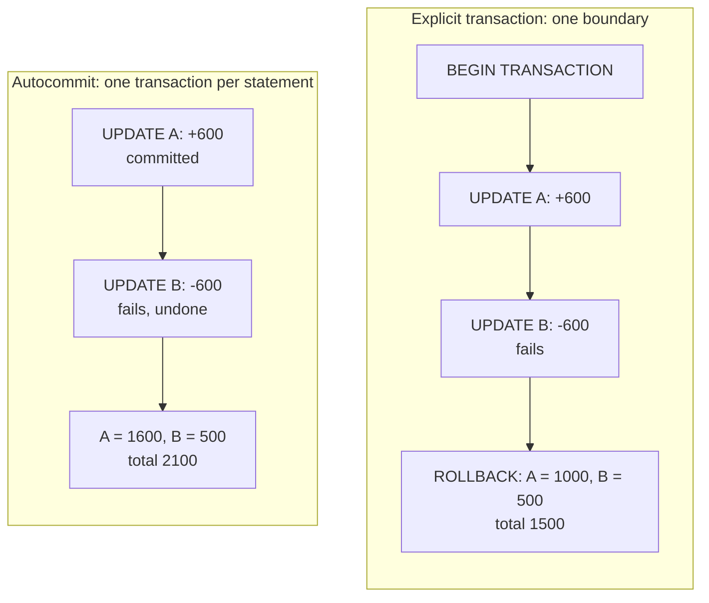
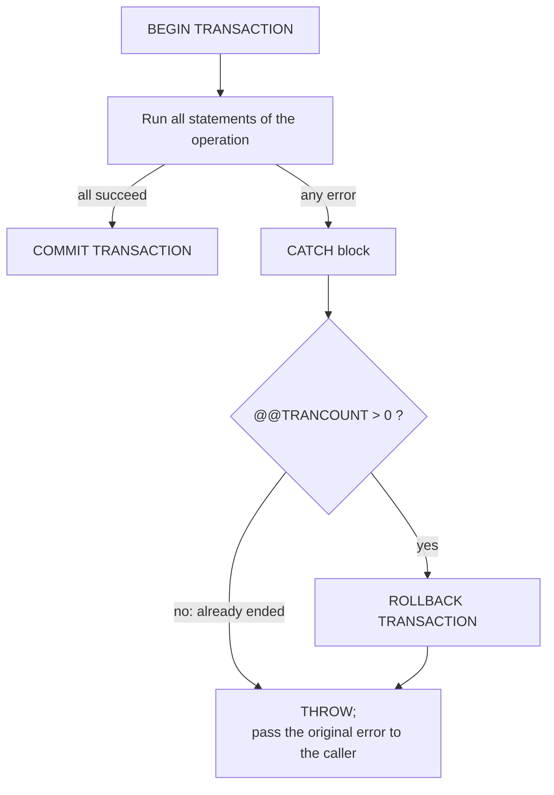
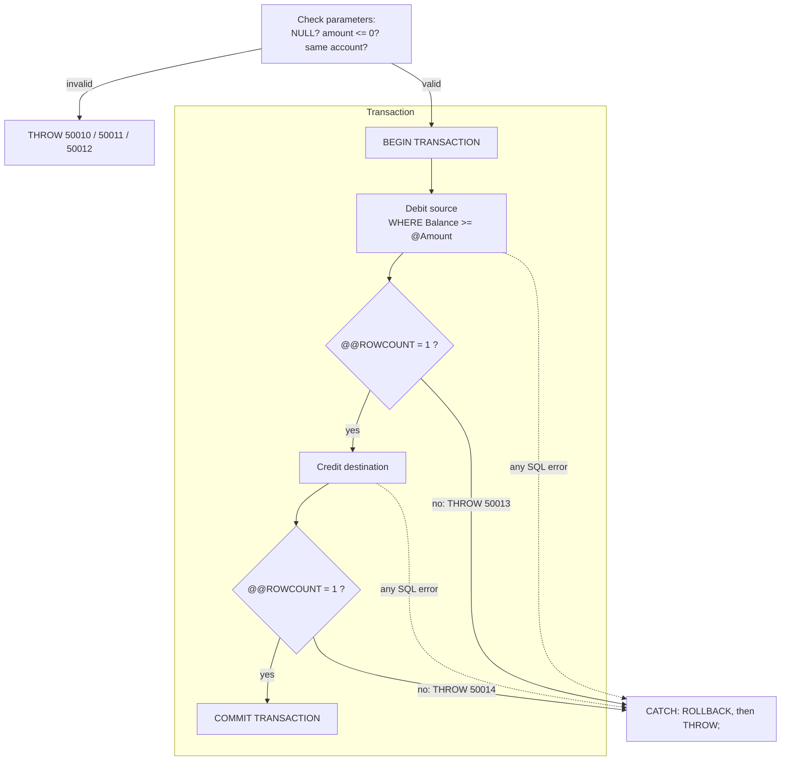
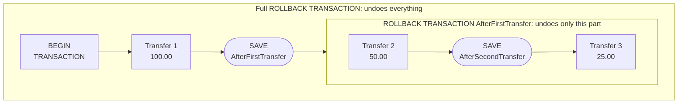
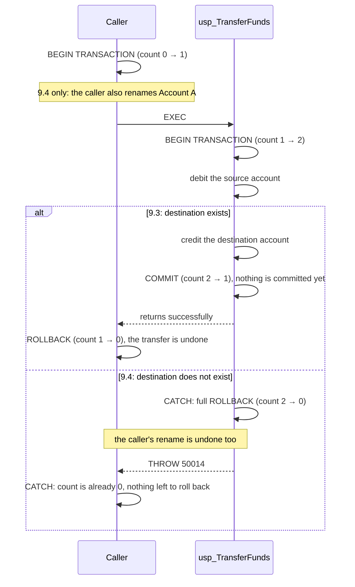
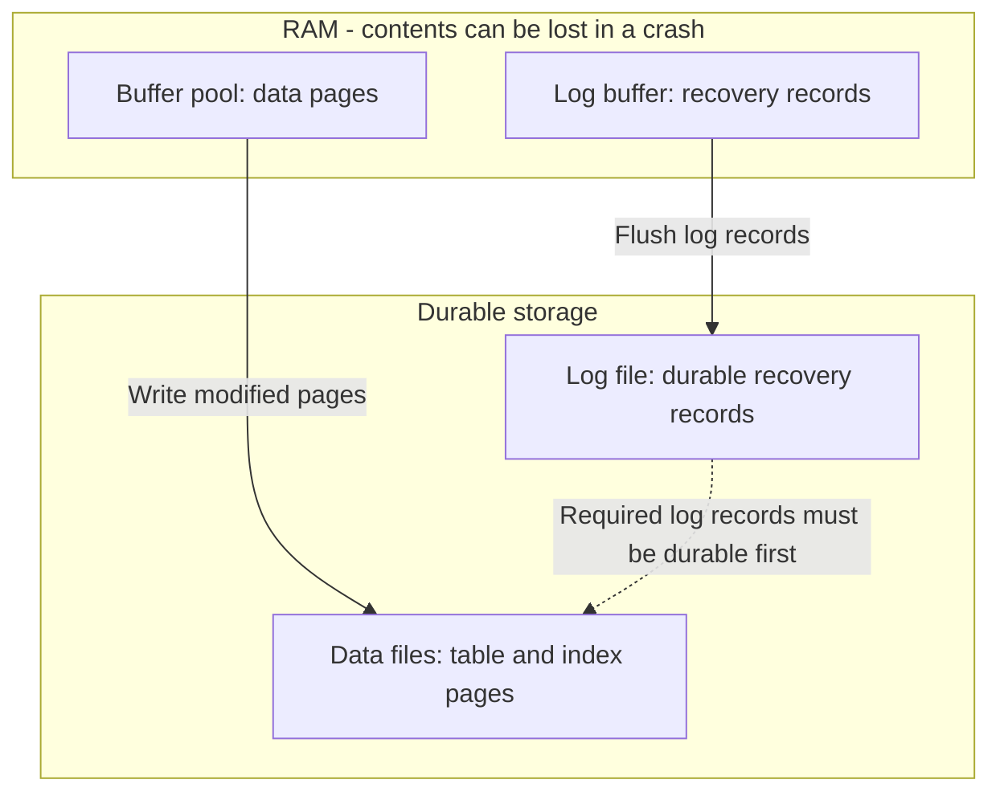
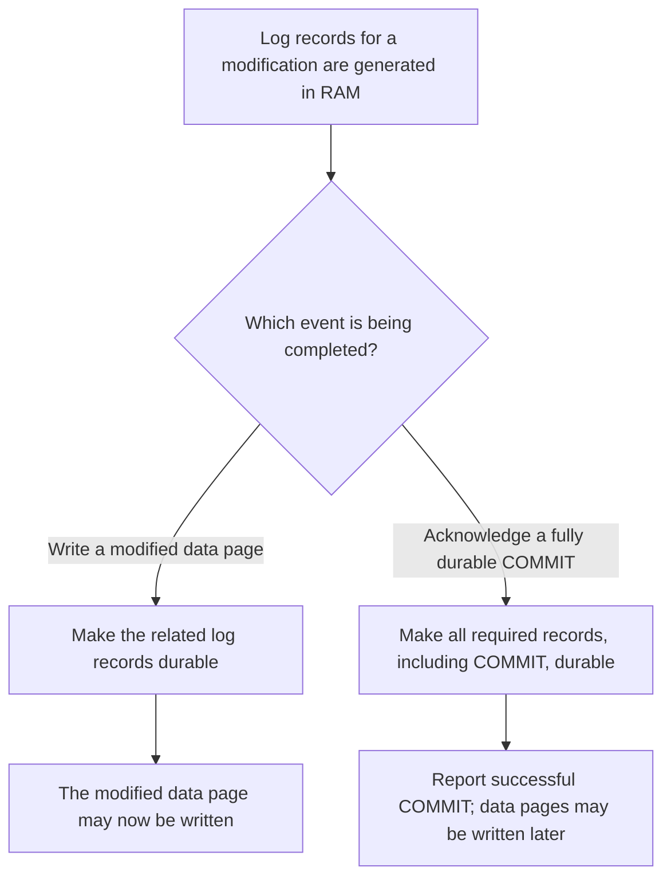
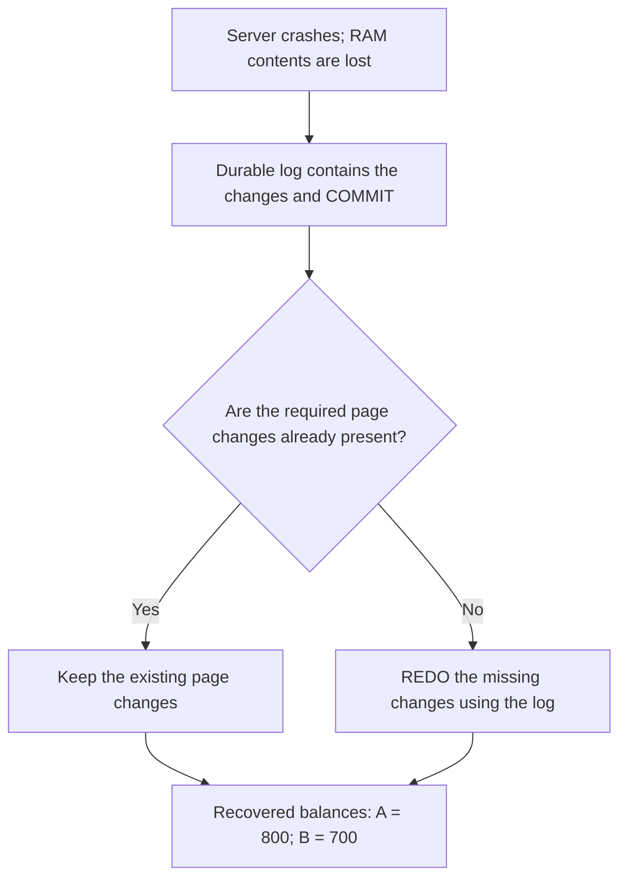

# Lab 9 – Transactions

**Database:** `TransactionsLab` (created in this lab — see *Before you start*)

In previous labs we wrote procedures that insert, update, and delete data, and in Lab 8 we passed several rows to a procedure in one call. But one procedure call can run several SQL statements — what happens if the first one succeeds and the second one fails?

Consider a bank transfer: subtract money from one account, add it to another. Keeping only one half would lose or create money. In this lab you will use **transactions** to treat several database changes as one unit of work — starting with manual `COMMIT`/`ROLLBACK`, then adding error handling, then moving the complete operation into a stored procedure.

> [!IMPORTANT]
> **Core idea:** Related changes should be confirmed together or undone together. A transaction defines that boundary. Your code must also detect unsuccessful business operations and choose the correct outcome.

---

## Learning objectives

After completing this lab, you should be able to:

- explain why several related SQL statements may need one transaction, distinguish autocommit from explicit transactions, and name the four ACID properties;
- use `BEGIN TRANSACTION`, `COMMIT TRANSACTION`, and `ROLLBACK TRANSACTION`, and inspect uncommitted changes;
- combine transactions with `TRY/CATCH`, `THROW`, and `SET XACT_ABORT ON`;
- use `@@ROWCOUNT` to detect an operation that did not affect the expected row;
- implement and verify a transaction inside a stored procedure;
- use a savepoint to undo part of a transaction;
- explain `@@TRANCOUNT`, why an inner `COMMIT` does not independently commit changes, and distinguish a transaction managed by a procedure from one managed by its caller;
- explain, at a conceptual level, how write-ahead logging, checkpoints, and UNDO/REDO let SQL Server keep its promises after a crash.

> [!NOTE]
> **Suggested route for a 90-minute lab:** Part A (Sections 1–2) and Part B (Sections 3–5) are the core, followed by Exercises 6 and 9 of the [Transaction Exercises](../exercises/lab09-transactions.md). Part C (Sections 6–10) goes deeper — savepoints, nesting, transaction ownership, and the transaction log — for instructor demonstration or self-study.

**Prerequisites:** [Lab 0 – T-SQL Essentials](lab00-tsql-essentials.md), [Lab 3 – Stored Procedures](lab03-stored-procedures.md), [Lab 7 – CRUD Operations](lab07-crud-operations.md), and [Lab 8 – Complex Parameters](lab08-complex-parameters.md) — variables, `IF`, `@@ROWCOUNT`, procedure parameters, and basic `TRY/CATCH`. This lab uses **one SSMS query window**; concurrency and two-session demonstrations are covered in **Lab 10**.

---

## Before you start

Run examples **section by section** — some deliberately produce errors. This lab runs in its own dedicated database, `TransactionsLab`, separate from `AdventureWorksENG` (the same pattern as the `IndexLab` and `PayrollLab` databases in other labs). All account names and balances are fictional.

```sql
USE master;
GO

DROP DATABASE IF EXISTS TransactionsLab;
GO

CREATE DATABASE TransactionsLab;
GO

USE TransactionsLab;
GO
```

Run this once at the start. Within the lab, the examples reset the account balances with a short `UPDATE` instead of recreating the database.

> [!IMPORTANT]
> Every transaction you start must eventually finish with `COMMIT` or a full `ROLLBACK`. A `SELECT`, the end of a procedure, and the SSMS `GO` separator do not finish it automatically.

Requires SQL Server 2016 SP1 or later (`CREATE OR ALTER PROCEDURE`).

---

# Part A – Understanding Transactions

---

# Section 1 – Why We Need Transactions

## 1.1 Prepare the practice table

Create a small table for two accounts:

```sql
CREATE TABLE dbo.BankAccount
(
    AccountID int NOT NULL
        CONSTRAINT PK_BankAccount PRIMARY KEY,
    AccountName nvarchar(50) NOT NULL,
    Balance decimal(12, 2) NOT NULL,
    CONSTRAINT CK_BankAccount_Balance
        CHECK (Balance >= 0)
);
GO

INSERT INTO dbo.BankAccount (AccountID, AccountName, Balance)
VALUES
    (1, N'Account A', 1000.00),
    (2, N'Account B',  500.00);

SELECT AccountID, AccountName, Balance
FROM dbo.BankAccount
ORDER BY AccountID;
```

Expected data:

| AccountID | AccountName | Balance |
|---|---|---:|
| 1 | Account A | 1000.00 |
| 2 | Account B | 500.00 |

The total balance is **1500.00**. A transfer between these accounts should change the individual balances but preserve their total.

The `CHECK` constraint prevents negative balances. It does not ensure that every subtraction has a matching addition. That rule belongs to the complete transfer operation.

## 1.2 Two statements, one business operation

A transfer of `200.00` from Account A to Account B requires two changes:

```sql
-- Read this example first. The next subsection demonstrates the failure.
UPDATE dbo.BankAccount
SET Balance = Balance - 200.00
WHERE AccountID = 1;

UPDATE dbo.BankAccount
SET Balance = Balance + 200.00
WHERE AccountID = 2;
```

The business operation succeeds only when **both** changes succeed. If the second statement fails after the first has been committed, we have an incomplete transfer.

## 1.3 Demonstrate a partial operation

Now transfer `600.00` from Account B to Account A — but Account B has only `500.00`. This transfer credits the destination first and debits the source second. Predict the final balances and the total before you run the block:

```sql
-- Reset before the demonstration.
UPDATE dbo.BankAccount
SET Balance = CASE AccountID
                  WHEN 1 THEN 1000.00
                  WHEN 2 THEN  500.00
              END;

BEGIN TRY
    -- Credit Account A.
    UPDATE dbo.BankAccount
    SET Balance = Balance + 600.00
    WHERE AccountID = 1;

    -- Debit Account B: 500.00 - 600.00 would be negative, so CHECK fails.
    UPDATE dbo.BankAccount
    SET Balance = Balance - 600.00
    WHERE AccountID = 2;
END TRY
BEGIN CATCH
    SELECT ERROR_MESSAGE() AS ErrorMessage;
END CATCH;

SELECT AccountID, AccountName, Balance
FROM dbo.BankAccount
ORDER BY AccountID;

SELECT SUM(Balance) AS TotalBalance
FROM dbo.BankAccount;
```

The `CHECK` constraint error is expected. Results:

| Account | Balance |
|---|---:|
| Account A | 1600.00 |
| Account B | 500.00 |
| **Total** | **2100.00** |

The bank has just created `600.00` out of nothing. The credit succeeded and was committed. The debit failed and was undone. The `CATCH` block displayed the error, but it did not undo the credit.

**Handling an error does not automatically make several statements atomic.**

## 1.4 Autocommit and explicit transactions

In the normal **autocommit** mode, each individual SQL statement runs as its own transaction. One `UPDATE` affecting many rows is therefore already one unit of work: if it fails, SQL Server undoes that whole statement.

Our problem is different: the transfer contains **two separate statements**, so autocommit gives it two separate transactions.



*Diagram 1 – The same two statements under autocommit (what you just ran) and inside one explicit transaction (Sections 2 and 3).*

| Mode | Transaction boundary | Typical use |
|---|---|---|
| Autocommit | One statement | A single independent change |
| Explicit transaction | Several statements, grouped under your control | Several changes that belong together |

## 1.5 ACID: four promises of a transaction

What went wrong in 1.3 has a name. A reliable transaction makes four promises, known by the acronym **ACID**:

| Property | Promise | In our example | Where in this lab |
|---|---|---|---|
| **Atomicity** | All changes are kept together or undone together | The credit and the debit form one operation | Sections 2, 3, and 5 |
| **Consistency** | A transaction takes the database from one valid state to another | Balances stay non-negative; a transfer preserves the total | Section 4 |
| **Isolation** | Concurrent transactions do not interfere with each other | Two simultaneous transfers from the same account | Lab 10 |
| **Durability** | Once committed, changes survive a crash or restart | A confirmed transfer does not disappear | Section 10 |

Block 1.3 broke **atomicity**: half of the transfer stayed. That broke **consistency** as well: the total changed from `1500.00` to `2100.00`.

> [!IMPORTANT]
> A transaction does not know your business rules. If your code subtracts `200.00` and adds only `100.00`, both statements succeed and the transaction commits them. Consistency depends on correct constraints and business logic, not only on transaction boundaries.

**Check your understanding**

1. Why did Account A remain changed after the error?
2. Does `TRY/CATCH` alone guarantee all-or-nothing execution?
3. Why might a single procedure call still need an explicit transaction?

<details>
<summary>Show answers</summary>

1. Its credit was a separate, successful autocommit transaction.
2. No. `TRY/CATCH` controls error handling; it does not create a transaction around the statements.
3. A procedure can execute several statements. Calling it once does not automatically group them into one transaction.

</details>

---

# Section 2 – BEGIN, COMMIT, and ROLLBACK

## 2.1 The three commands

| Command | Purpose |
|---|---|
| `BEGIN TRANSACTION` | Start an explicit transaction |
| `COMMIT TRANSACTION` | Confirm the transaction's changes |
| `ROLLBACK TRANSACTION` | Undo the transaction's changes |

`TRAN` is a shorter spelling of `TRANSACTION`.

```sql
BEGIN TRANSACTION;

-- Related database changes go here.

COMMIT TRANSACTION;
```

Alternatively, end the transaction with `ROLLBACK TRANSACTION` to discard the changes.

## 2.2 Confirm a transfer

First reset the balances:

```sql
UPDATE dbo.BankAccount
SET Balance = CASE AccountID
                  WHEN 1 THEN 1000.00
                  WHEN 2 THEN  500.00
              END;
```

Predict the two balances after `COMMIT` before you run this. Then run the transfer:

```sql
BEGIN TRANSACTION;

UPDATE dbo.BankAccount
SET Balance = Balance - 200.00
WHERE AccountID = 1;

UPDATE dbo.BankAccount
SET Balance = Balance + 200.00
WHERE AccountID = 2;

-- This session can read its own uncommitted changes.
SELECT AccountID, AccountName, Balance
FROM dbo.BankAccount
ORDER BY AccountID;

COMMIT TRANSACTION;

SELECT AccountID, AccountName, Balance
FROM dbo.BankAccount
ORDER BY AccountID;

SELECT SUM(Balance) AS TotalBalance,
       @@TRANCOUNT AS OpenTransactionCount
FROM dbo.BankAccount;
```

Expected balances are `800.00` and `700.00`. The total is still `1500.00`, and the transaction count is `0`.

## 2.3 Undo a transfer

The previous committed balances are now our starting point. Predict both balances *after* the `ROLLBACK` before you run this.

```sql
BEGIN TRANSACTION;

UPDATE dbo.BankAccount
SET Balance = Balance - 100.00
WHERE AccountID = 1;

UPDATE dbo.BankAccount
SET Balance = Balance + 100.00
WHERE AccountID = 2;

SELECT AccountID, Balance AS BalanceBeforeRollback
FROM dbo.BankAccount
ORDER BY AccountID;

ROLLBACK TRANSACTION;

SELECT AccountID, Balance AS BalanceAfterRollback
FROM dbo.BankAccount
ORDER BY AccountID;
```

| Point | Account A | Account B |
|---|---:|---:|
| Before this transaction | 800.00 | 700.00 |
| Inside the transaction | 700.00 | 800.00 |
| After `ROLLBACK` | 800.00 | 700.00 |

The `SELECT` inside the transaction did not confirm anything. It only displayed the current session's view of the data.

> [!NOTE]
> `ROLLBACK` can undo an open transaction. It cannot undo a transaction that has already been committed. Correcting a committed mistake requires a new operation or an appropriate recovery process.

## 2.4 BEGIN/END is not a transaction

These two constructs have different purposes:

| Construct | Meaning |
|---|---|
| `BEGIN ... END` | Group T-SQL statements into a code block |
| `BEGIN TRANSACTION ... COMMIT` | Group database changes into a transaction |

A procedure's `BEGIN ... END` body does not create a transaction.

---

# Part B – Transactions in Code

---

# Section 3 – Handling Errors Inside a Transaction

Manual `COMMIT` and `ROLLBACK` are useful while learning. An application needs code that chooses the correct outcome when an operation fails.

[Lab 0 – T-SQL Essentials](lab00-tsql-essentials.md), Section 10, introduced the basic `TRY/CATCH` block. Here we combine it with transactions.

## 3.1 The basic pattern

```sql
BEGIN TRY
    BEGIN TRANSACTION;

    -- Execute all statements belonging to the operation.

    COMMIT TRANSACTION;
END TRY
BEGIN CATCH
    IF @@TRANCOUNT > 0
        ROLLBACK TRANSACTION;

    THROW;
END CATCH;
```



*Diagram 2 – Every path ends with the transaction finished: committed on success, rolled back on any error.*

- `THROW;` without arguments rethrows the original error, so the caller knows the operation failed.
- Some errors have already ended the transaction by the time `CATCH` runs. The `@@TRANCOUNT` check prevents a second error from a `ROLLBACK` with no transaction to roll back.

The pattern assumes that this block owns the whole operation. Section 9 explains how an outer transaction changes that responsibility.

## 3.2 Repeat the failing transfer with protection

Run the `600.00` transfer from 1.3 again, this time inside the pattern:

```sql
UPDATE dbo.BankAccount
SET Balance = CASE AccountID
                  WHEN 1 THEN 1000.00
                  WHEN 2 THEN  500.00
              END;

BEGIN TRY
    BEGIN TRANSACTION;

    UPDATE dbo.BankAccount
    SET Balance = Balance + 600.00
    WHERE AccountID = 1;

    UPDATE dbo.BankAccount
    SET Balance = Balance - 600.00
    WHERE AccountID = 2;

    COMMIT TRANSACTION;
END TRY
BEGIN CATCH
    IF @@TRANCOUNT > 0
        ROLLBACK TRANSACTION;

    THROW;
END CATCH;
```

The `CHECK` constraint error is expected. `THROW` stops the batch, so run this verification **separately**:

```sql
SELECT AccountID, AccountName, Balance
FROM dbo.BankAccount
ORDER BY AccountID;

SELECT SUM(Balance) AS TotalBalance,
       @@TRANCOUNT AS OpenTransactionCount
FROM dbo.BankAccount;
```

Expected results: Account A `1000.00`, Account B `500.00`, total `1500.00`, transaction count `0`.

The credit to Account A succeeded at first, but the handler rolled it back when the debit failed. No money was created.

## 3.3 When CATCH never runs: SET XACT_ABORT ON

In 3.2, `CATCH` ran and rolled back. But some interruptions never reach `CATCH`. The most common one is a **cancelled query**: the user presses *Cancel* in SSMS, or an application gives up after its command timeout. The client stops the batch, so no T-SQL code runs after that point, `CATCH` included.

Try it. Run this block and, during the 20-second wait, click **Cancel Executing Query** in SSMS (or press `Alt+Break`). If the block finishes before you cancel, simply run it again:

```sql
UPDATE dbo.BankAccount
SET Balance = CASE AccountID
                  WHEN 1 THEN 1000.00
                  WHEN 2 THEN  500.00
              END;

BEGIN TRY
    BEGIN TRANSACTION;

    UPDATE dbo.BankAccount
    SET Balance = Balance - 200.00
    WHERE AccountID = 1;

    WAITFOR DELAY '00:00:20'; -- Cancel the query during this wait.

    UPDATE dbo.BankAccount
    SET Balance = Balance + 200.00
    WHERE AccountID = 2;

    COMMIT TRANSACTION;
END TRY
BEGIN CATCH
    IF @@TRANCOUNT > 0
        ROLLBACK TRANSACTION;

    THROW;
END CATCH;
```

After cancelling, run:

```sql
SELECT @@TRANCOUNT AS OpenTransactionCount;
```

The result is `1`: the debit is still in an **open transaction** that nobody will finish. Locks it holds can block other sessions (Lab 10). Close it by hand:

```sql
ROLLBACK TRANSACTION;
```

The fix is one session setting. By default, `XACT_ABORT` is `OFF`. When it is `ON`, an error or a cancel aborts the whole transaction:

- if `CATCH` never runs, as after a cancel, SQL Server rolls the transaction back itself;
- if `CATCH` runs, the transaction can no longer be committed, so `CATCH` still rolls it back. That is why the pattern keeps its own `ROLLBACK`.

Add this line before `BEGIN TRY` in the block above, run it again, and cancel it again:

```sql
SET XACT_ABORT ON;
```

This time `@@TRANCOUNT` is `0` and the balances are `1000.00` and `500.00`.

That completes the pattern. From now on, transactional code with `TRY/CATCH` in this lab, including the procedure in Section 5, starts with `SET XACT_ABORT ON`:

```sql
SET XACT_ABORT ON;

BEGIN TRY
    BEGIN TRANSACTION;

    -- Execute all statements belonging to the operation.

    COMMIT TRANSACTION;
END TRY
BEGIN CATCH
    IF @@TRANCOUNT > 0
        ROLLBACK TRANSACTION;

    THROW;
END CATCH;
```

`XACT_ABORT ON` is a safety net, not a replacement for the rest of the pattern:

- an `UPDATE` that matches zero rows is not an error, so `XACT_ABORT` does not react to it (Section 4);
- syntax errors are not affected by this setting;
- `TRY/CATCH` is still needed to roll back and report the error in a controlled way.

---

# Section 4 – When SQL Succeeds but the Business Operation Fails

Section 3 handled operations that fail with an **error**. This section is about the **C** in ACID: an operation can run without any SQL error and still break a business rule. The database cannot detect that by itself; your code must.

## 4.1 Zero affected rows is not an SQL error

The following statement is valid SQL:

```sql
UPDATE dbo.BankAccount
SET Balance = Balance + 200.00
WHERE AccountID = 999;

SELECT @@ROWCOUNT AS RowsAffected;
```

The result is `0` because account `999` does not exist.

If we had already debited another account, SQL Server would not automatically know that the intended transfer was incomplete.

## 4.2 Check @@ROWCOUNT immediately

We must check the number of affected rows directly after the relevant statement:

```sql
UPDATE dbo.BankAccount
SET Balance = Balance + 200.00
WHERE AccountID = 999;

IF @@ROWCOUNT <> 1
    THROW 50001, 'Destination account does not exist.', 1;
```

Run this as an independent example. The custom error is expected; no account is changed.

`THROW` with arguments creates an application error:

| Argument | Meaning |
|---|---|
| `50001` | Application error number; user-defined numbers start at `50000` |
| Message | Explanation for the caller |
| `1` | State value, which can help identify where an error was raised |

`THROW;` without arguments is used inside `CATCH` to rethrow the original error.

Read `@@ROWCOUNT` **immediately** after the statement you want to check. Other statements can change or reset its value.

## 4.3 Detect insufficient funds in the update

Instead of reading a balance and later deciding whether to subtract, we can include the condition in the update itself:

```sql
DECLARE @Amount decimal(12, 2) = 2000.00;

UPDATE dbo.BankAccount
SET Balance = Balance - @Amount
WHERE AccountID = 1
  AND Balance >= @Amount;

IF @@ROWCOUNT <> 1
    THROW 50002, 'Source account does not exist or has insufficient funds.', 1;
```

Account A has less than `2000.00`, so no row is changed and the custom error is raised.

This gives one clear rule: **the source account must exist and have enough money at the point of the debit**.

The next section puts the checks and both account updates into one procedure.

---

# Section 5 – A Complete Transfer Procedure

## 5.1 Define the operation

The procedure accepts a source account, a destination account, and an amount.

It must:

1. reject missing parameters, a non-positive amount, or equal account IDs;
2. debit the source only if it exists and has sufficient funds;
3. credit the destination only if it exists;
4. commit both changes on success;
5. roll back the operation and report the error on failure.

For the first tests, call this procedure with **no transaction already open**. Section 9 deliberately calls it inside an outer transaction.

## 5.2 Create the procedure

```sql
CREATE OR ALTER PROCEDURE dbo.usp_TransferFunds
    @SourceAccountID int,
    @DestinationAccountID int,
    @Amount decimal(12, 2)
AS
BEGIN
    SET XACT_ABORT ON;

    IF @SourceAccountID IS NULL
       OR @DestinationAccountID IS NULL
       OR @Amount IS NULL
        THROW 50010, 'Account IDs and amount are required.', 1;

    IF @Amount <= 0
        THROW 50011, 'Transfer amount must be greater than zero.', 1;

    IF @SourceAccountID = @DestinationAccountID
        THROW 50012, 'Source and destination accounts must be different.', 1;

    BEGIN TRY
        BEGIN TRANSACTION;

        UPDATE dbo.BankAccount
        SET Balance = Balance - @Amount
        WHERE AccountID = @SourceAccountID
          AND Balance >= @Amount;

        IF @@ROWCOUNT <> 1
            THROW 50013,
                'Source account does not exist or has insufficient funds.', 1;

        UPDATE dbo.BankAccount
        SET Balance = Balance + @Amount
        WHERE AccountID = @DestinationAccountID;

        IF @@ROWCOUNT <> 1
            THROW 50014, 'Destination account does not exist.', 1;

        COMMIT TRANSACTION;
    END TRY
    BEGIN CATCH
        IF @@TRANCOUNT > 0
            ROLLBACK TRANSACTION;

        THROW;
    END CATCH;
END;
GO
```



*Diagram 3 – `usp_TransferFunds`. The parameter checks run before the transaction starts. Inside the transaction, every failure leads to the same place: a full rollback and an error for the caller.*

The parameter checks need no database data, so they run before the transaction opens. The transaction then contains only the work that must be atomic.

## 5.3 Test a successful transfer

```sql
UPDATE dbo.BankAccount
SET Balance = CASE AccountID
                  WHEN 1 THEN 1000.00
                  WHEN 2 THEN  500.00
              END;

EXEC dbo.usp_TransferFunds
    @SourceAccountID = 1,
    @DestinationAccountID = 2,
    @Amount = 200.00;

SELECT AccountID, AccountName, Balance
FROM dbo.BankAccount
ORDER BY AccountID;

SELECT SUM(Balance) AS TotalBalance,
       @@TRANCOUNT AS OpenTransactionCount
FROM dbo.BankAccount;
```

Expected balances: `800.00` and `700.00`. Expected total: `1500.00`. Expected transaction count: `0`.

## 5.4 Test a missing destination

The source update will succeed first. The procedure must undo it when the destination update affects zero rows.

For an expected error, the test's outer `CATCH` displays the message and allows verification to continue:

```sql
BEGIN TRY
    EXEC dbo.usp_TransferFunds
        @SourceAccountID = 1,
        @DestinationAccountID = 999,
        @Amount = 100.00;
END TRY
BEGIN CATCH
    SELECT ERROR_NUMBER() AS ErrorNumber,
           ERROR_MESSAGE() AS ErrorMessage;
END CATCH;

SELECT AccountID, Balance
FROM dbo.BankAccount
ORDER BY AccountID;

SELECT @@TRANCOUNT AS OpenTransactionCount;
```

Expected error: `50014`. Balances remain `800.00` and `700.00`. The transaction count is `0`.

## 5.5 Test insufficient funds

```sql
BEGIN TRY
    EXEC dbo.usp_TransferFunds
        @SourceAccountID = 1,
        @DestinationAccountID = 2,
        @Amount = 2000.00;
END TRY
BEGIN CATCH
    SELECT ERROR_NUMBER() AS ErrorNumber,
           ERROR_MESSAGE() AS ErrorMessage;
END CATCH;

SELECT AccountID, Balance
FROM dbo.BankAccount
ORDER BY AccountID;

SELECT @@TRANCOUNT AS OpenTransactionCount;
```

Expected error: `50013`. Both balances remain unchanged, and no transaction remains open.

## 5.6 Verify behavior, not only messages

| Test | Expected result | What to verify |
|---|---|---|
| Valid transfer | Success | Correct debit and credit; total unchanged |
| Missing destination | Error `50014` | Earlier debit undone |
| Insufficient funds | Error `50013` | Neither balance changes |
| Zero or negative amount | Error `50011` | Neither balance changes |
| Same source and destination | Error `50012` | Neither balance changes |
| `NULL` parameter | Error `50010` | Neither balance changes |

For these standalone calls, `@@TRANCOUNT` must be `0` after each test.

> [!NOTE]
> An error message is only part of the result. Always inspect the final data and transaction count. A procedure that reports an error but leaves half the operation committed is still incorrect.

---

# Part C – Going Deeper

Parts A and B cover what you need to write a correct transaction. Part C looks at less common tools (savepoints), at what happens when transactions meet procedures (nesting and ownership), and at how SQL Server keeps its promises after a crash.

---

# Section 6 – Savepoints: Undoing Part of a Transaction

A full `ROLLBACK` undoes the complete transaction. Sometimes we want to undo only the work done after a particular point.

A **savepoint** is a named marker inside an open transaction. The examples in this section build up to the following picture:



*Diagram 4 – Three transfers and two savepoints in one transaction. Rolling back to `AfterFirstTransfer` also discards the later savepoint `AfterSecondTransfer` (6.4). A full rollback ignores savepoints (6.3).*

## 6.1 Create a savepoint

Reset the account balances before this independent demonstration. Based on 2.2 and 2.3, predict what `ROLLBACK TRANSACTION AfterFirstTransfer` will leave behind before reading on.

```sql
UPDATE dbo.BankAccount
SET Balance = CASE AccountID
                  WHEN 1 THEN 1000.00
                  WHEN 2 THEN  500.00
              END;
```

Run this block:

```sql
BEGIN TRANSACTION;

-- First transfer: keep this one.
UPDATE dbo.BankAccount
SET Balance = Balance - 100.00
WHERE AccountID = 1;

UPDATE dbo.BankAccount
SET Balance = Balance + 100.00
WHERE AccountID = 2;

SAVE TRANSACTION AfterFirstTransfer;

-- Second transfer: we will cancel this one.
UPDATE dbo.BankAccount
SET Balance = Balance - 50.00
WHERE AccountID = 1;

UPDATE dbo.BankAccount
SET Balance = Balance + 50.00
WHERE AccountID = 2;

SELECT AccountID, Balance AS BeforeSavepointRollback
FROM dbo.BankAccount
ORDER BY AccountID;

ROLLBACK TRANSACTION AfterFirstTransfer;

SELECT AccountID, Balance AS AfterSavepointRollback
FROM dbo.BankAccount
ORDER BY AccountID;

SELECT @@TRANCOUNT AS OpenTransactionCount;

COMMIT TRANSACTION;
```

| Point | Account A | Account B |
|---|---:|---:|
| Initial state | 1000.00 | 500.00 |
| After first transfer | 900.00 | 600.00 |
| After second transfer | 850.00 | 650.00 |
| After rollback to savepoint | 900.00 | 600.00 |
| After final commit | 900.00 | 600.00 |

## 6.2 What a savepoint does not do

`SAVE TRANSACTION` does not commit earlier work or start an independent transaction.

After `ROLLBACK TRANSACTION AfterFirstTransfer`, the transaction is still open. We must still finish it with `COMMIT` or a full `ROLLBACK`.

If we replaced the final `COMMIT` with a full `ROLLBACK`, both transfers would be undone.

> [!NOTE]
> This example deliberately cancels valid work. Recovering from an actual SQL error using a savepoint is more complicated: some errors leave the transaction unable to commit, and a savepoint cannot repair that state. The main error-handling pattern in this lab rolls back the entire business operation.

## 6.3 A full rollback removes work recorded before the savepoint too

A savepoint only protects work from a **partial** rollback. It does not protect that work from a **full** rollback.

Reset the balances, then run this block:

```sql
UPDATE dbo.BankAccount
SET Balance = CASE AccountID
                  WHEN 1 THEN 1000.00
                  WHEN 2 THEN  500.00
              END;
```

```sql
BEGIN TRANSACTION;

-- First transfer.
UPDATE dbo.BankAccount
SET Balance = Balance - 100.00
WHERE AccountID = 1;

UPDATE dbo.BankAccount
SET Balance = Balance + 100.00
WHERE AccountID = 2;

SAVE TRANSACTION AfterFirstTransfer;

-- Second transfer.
UPDATE dbo.BankAccount
SET Balance = Balance - 50.00
WHERE AccountID = 1;

UPDATE dbo.BankAccount
SET Balance = Balance + 50.00
WHERE AccountID = 2;

SELECT AccountID, Balance AS BeforeFullRollback
FROM dbo.BankAccount
ORDER BY AccountID;

ROLLBACK TRANSACTION;

SELECT AccountID, Balance AS AfterFullRollback
FROM dbo.BankAccount
ORDER BY AccountID;

SELECT @@TRANCOUNT AS OpenTransactionCount;
```

| Point | Account A | Account B |
|---|---:|---:|
| Initial state | 1000.00 | 500.00 |
| After first transfer | 900.00 | 600.00 |
| After second transfer | 850.00 | 650.00 |
| After full rollback | 1000.00 | 500.00 |

Compare this with 6.1: there, `ROLLBACK TRANSACTION AfterFirstTransfer` undid only the second transfer, and the subsequent `COMMIT` kept the first one. Here, `ROLLBACK TRANSACTION` with no savepoint name is a **full** rollback: it undoes everything in the transaction, including the work recorded before the savepoint existed.

A savepoint marks a point for a partial rollback. It does not create a boundary that a full rollback must respect. The number of savepoints inside a transaction has no effect on what a full `ROLLBACK` undoes.

## 6.4 Rolling back to an earlier savepoint invalidates later ones

A transaction can contain several savepoints. Rolling back to an earlier one also discards any savepoint defined after it.

Reset the balances, then run this block:

```sql
UPDATE dbo.BankAccount
SET Balance = CASE AccountID
                  WHEN 1 THEN 1000.00
                  WHEN 2 THEN  500.00
              END;
```

```sql
BEGIN TRANSACTION;

UPDATE dbo.BankAccount
SET Balance = Balance - 100.00
WHERE AccountID = 1;

UPDATE dbo.BankAccount
SET Balance = Balance + 100.00
WHERE AccountID = 2;

SAVE TRANSACTION AfterFirstTransfer;

UPDATE dbo.BankAccount
SET Balance = Balance - 50.00
WHERE AccountID = 1;

UPDATE dbo.BankAccount
SET Balance = Balance + 50.00
WHERE AccountID = 2;

SAVE TRANSACTION AfterSecondTransfer;

UPDATE dbo.BankAccount
SET Balance = Balance - 25.00
WHERE AccountID = 1;

UPDATE dbo.BankAccount
SET Balance = Balance + 25.00
WHERE AccountID = 2;

SELECT AccountID, Balance AS BeforeAnyRollback
FROM dbo.BankAccount
ORDER BY AccountID;

-- Discards the third transfer AND the AfterSecondTransfer savepoint itself.
ROLLBACK TRANSACTION AfterFirstTransfer;

SELECT AccountID, Balance AS AfterSavepointRollback
FROM dbo.BankAccount
ORDER BY AccountID;

SELECT @@TRANCOUNT AS StillOpen; -- 1

ROLLBACK TRANSACTION;

SELECT AccountID, Balance AS AfterFullRollback
FROM dbo.BankAccount
ORDER BY AccountID;

SELECT @@TRANCOUNT AS FinalCount; -- 0
```

| Point | Account A | Account B |
|---|---:|---:|
| Initial state | 1000.00 | 500.00 |
| After first transfer | 900.00 | 600.00 |
| After second transfer | 850.00 | 650.00 |
| After third transfer | 875.00 | 625.00 |
| After rollback to `AfterFirstTransfer` | 900.00 | 600.00 |
| After full rollback | 1000.00 | 500.00 |

After `ROLLBACK TRANSACTION AfterFirstTransfer`, the savepoint `AfterSecondTransfer` no longer exists. Running `ROLLBACK TRANSACTION AfterSecondTransfer` at that point would fail with an error, because that savepoint was defined after the point we already rolled back to.

The transaction itself is still open after a savepoint rollback (`@@TRANCOUNT` is `1`). It must still be finished with `COMMIT` or a full `ROLLBACK`, exactly as in 6.2.

---

# Section 7 – What ROLLBACK Does Not Undo

`ROLLBACK` undoes transactional changes to table data. It is not a universal undo button for everything that happened while the transaction was open.

## 7.1 IDENTITY values

Create a separate demonstration table:

```sql
CREATE TABLE dbo.Note
(
    NoteID int IDENTITY(1, 1) NOT NULL
        CONSTRAINT PK_Note PRIMARY KEY,
    NoteText nvarchar(100) NOT NULL
);
GO

INSERT INTO dbo.Note (NoteText)
VALUES (N'First committed note');

BEGIN TRANSACTION;

INSERT INTO dbo.Note (NoteText)
VALUES (N'This note will be rolled back');

SELECT NoteID, NoteText
FROM dbo.Note
ORDER BY NoteID;

ROLLBACK TRANSACTION;

INSERT INTO dbo.Note (NoteText)
VALUES (N'Next committed note');

SELECT NoteID, NoteText
FROM dbo.Note
ORDER BY NoteID;
```

On the first run against this newly created table, the final IDs are `1` and `3`. The row with ID `2` was rolled back, but its allocated identity value was consumed.

`IDENTITY` generates identifiers; it does not guarantee a gap-free sequence. Rollbacks, failed inserts, and other events can leave gaps. Do not use the largest identity value as a row count.

## 7.2 Variables and the outside world

Two more things stay as they are after a rollback:

- **T-SQL variables.** A value assigned to a variable inside a transaction keeps that value after `ROLLBACK`.
- **Actions outside the database.** An email that was sent or an external API that was called is not recalled by a database rollback.

This is one reason to keep a transaction focused on database work: do not send an email or call an external service while the transaction is still open.

---

# Section 8 – @@TRANCOUNT and Nested Transactions

`@@TRANCOUNT` reports the transaction nesting count for the **current connection**. Nesting looks like an exotic case, but it happens every time a procedure that starts its own transaction is called inside another transaction — the topic of Section 9.

## 8.1 How the counter changes

Assuming an active, valid local transaction where required:

| Statement | Effect on `@@TRANCOUNT` |
|---|---|
| `BEGIN TRANSACTION` | Adds `1` |
| `COMMIT TRANSACTION` | Subtracts `1` |
| Full `ROLLBACK TRANSACTION` | Resets it to `0` |
| `SAVE TRANSACTION SavepointName` | No change |
| `ROLLBACK TRANSACTION SavepointName` | No change |

```sql
SELECT @@TRANCOUNT AS BeforeBegin;       -- 0

BEGIN TRANSACTION;
SELECT @@TRANCOUNT AS AfterFirstBegin;   -- 1

    BEGIN TRANSACTION;
    SELECT @@TRANCOUNT AS AfterSecondBegin; -- 2

    COMMIT TRANSACTION;
    SELECT @@TRANCOUNT AS AfterInnerCommit; -- 1

COMMIT TRANSACTION;
SELECT @@TRANCOUNT AS AfterOuterCommit;  -- 0
```

## 8.2 An inner COMMIT does not independently commit

SQL Server does not provide independently committable nested transactions.

Run this complete example:

```sql
UPDATE dbo.BankAccount
SET Balance = CASE AccountID
                  WHEN 1 THEN 1000.00
                  WHEN 2 THEN  500.00
              END;

BEGIN TRANSACTION;

    BEGIN TRANSACTION;

    UPDATE dbo.BankAccount
    SET Balance = Balance - 100.00
    WHERE AccountID = 1;

    UPDATE dbo.BankAccount
    SET Balance = Balance + 100.00
    WHERE AccountID = 2;

    COMMIT TRANSACTION;

    SELECT @@TRANCOUNT AS AfterInnerCommit; -- 1

ROLLBACK TRANSACTION;

SELECT AccountID, Balance
FROM dbo.BankAccount
ORDER BY AccountID;

SELECT @@TRANCOUNT AS AfterOuterRollback; -- 0
```

The original balances, `1000.00` and `500.00`, are restored.

The inner `COMMIT` reduced the counter from `2` to `1`. The changes were still part of the outer transaction and could be undone.

**An inner `COMMIT` does not make its changes independent of the outer transaction. Only the outermost successful `COMMIT` completes the transaction.**

## 8.3 Full rollback is different

```sql
BEGIN TRANSACTION;
    BEGIN TRANSACTION;
        SELECT @@TRANCOUNT AS BeforeRollback; -- 2

        ROLLBACK TRANSACTION;

SELECT @@TRANCOUNT AS AfterRollback; -- 0
```

A full rollback ends the entire transaction, regardless of nesting depth. There is no remaining outer transaction to commit.

**Check your understanding**

Predict the final counter for each sequence. Each sequence starts at `0`.

| Sequence | Final `@@TRANCOUNT` |
|---|---|
| `BEGIN TRAN; COMMIT;` | ? |
| `BEGIN TRAN; BEGIN TRAN; COMMIT;` | ? |
| `BEGIN TRAN; BEGIN TRAN; ROLLBACK;` | ? |
| `BEGIN TRAN; SAVE TRAN S1; ROLLBACK TRAN S1;` | ? |

<details>
<summary>Show answers</summary>

The values are **0, 1, 0, and 1**.

The second and fourth sequences leave a transaction open. If you run them, finish those transactions before continuing.

</details>

---

# Section 9 – Who Manages the Transaction?

A transaction can be managed by the procedure or by its caller. The important question is: **which code owns the complete business operation?**

[Lab 7 – CRUD Operations](lab07-crud-operations.md), Section 6.3, asked the same ownership question about `TRY/CATCH` placement — inside a procedure or at its caller. Here it returns for transactions, and the stakes are higher: the wrong choice does not just mis-handle an error message, it can commit or roll back the wrong amount of work.

## 9.1 The procedure manages the transaction

Our transfer procedure represents one complete operation. It starts a transaction, performs the work, and commits or rolls back.

```sql
EXEC dbo.usp_TransferFunds
    @SourceAccountID = 1,
    @DestinationAccountID = 2,
    @Amount = 50.00;
```

This is convenient when one call corresponds to the entire operation. This example changes the balances; later demonstrations reset them explicitly.

## 9.2 The caller manages the transaction

An application or another procedure may need to combine several operations into one transaction.

Here is a small helper procedure with no transaction commands:

```sql
CREATE OR ALTER PROCEDURE dbo.usp_ChangeBalance
    @AccountID int,
    @Change decimal(12, 2)
AS
BEGIN
    IF @Change IS NULL
        THROW 50020, 'Balance change is required.', 1;

    UPDATE dbo.BankAccount
    SET Balance = Balance + @Change
    WHERE AccountID = @AccountID;

    IF @@ROWCOUNT <> 1
        THROW 50021, 'Account does not exist.', 1;
END;
GO
```

The caller groups two calls:

```sql
UPDATE dbo.BankAccount
SET Balance = CASE AccountID
                  WHEN 1 THEN 1000.00
                  WHEN 2 THEN  500.00
              END;

SET XACT_ABORT ON;

BEGIN TRY
    BEGIN TRANSACTION;

    EXEC dbo.usp_ChangeBalance
        @AccountID = 1, @Change = -100.00;

    EXEC dbo.usp_ChangeBalance
        @AccountID = 2, @Change = 100.00;

    COMMIT TRANSACTION;
END TRY
BEGIN CATCH
    IF @@TRANCOUNT > 0
        ROLLBACK TRANSACTION;

    THROW;
END CATCH;

SELECT AccountID, Balance
FROM dbo.BankAccount
ORDER BY AccountID;
```

Expected balances: `900.00` and `600.00`.

The helper participates in the caller's transaction without starting its own. If the caller does not start a transaction, its update runs in autocommit mode.

This helper illustrates transaction ownership. It is a low-level building block: it does not itself enforce a complete transfer or preserve the combined account balance.

## 9.3 An outer transaction wraps our transfer procedure

What happens when the caller starts a transaction and then calls `usp_TransferFunds`, which starts its own? Sections 9.3 and 9.4 run both outcomes. Follow `@@TRANCOUNT` in the diagram:



*Diagram 5 – One transaction shared by a caller and a procedure. Only the outermost `COMMIT` confirms anything, and any full `ROLLBACK` ends the whole transaction.*

Reset the balances and run this complete block:

```sql
UPDATE dbo.BankAccount
SET Balance = CASE AccountID
                  WHEN 1 THEN 1000.00
                  WHEN 2 THEN  500.00
              END;

BEGIN TRANSACTION; -- count: 0 -> 1

EXEC dbo.usp_TransferFunds
    @SourceAccountID = 1,
    @DestinationAccountID = 2,
    @Amount = 100.00;

-- The procedure's BEGIN changed 1 -> 2.
-- Its COMMIT changed 2 -> 1.
SELECT @@TRANCOUNT AS AfterProcedure; -- 1

SELECT AccountID, Balance AS InsideOuterTransaction
FROM dbo.BankAccount
ORDER BY AccountID;

ROLLBACK TRANSACTION; -- count: 1 -> 0

SELECT AccountID, Balance AS AfterOuterRollback
FROM dbo.BankAccount
ORDER BY AccountID;
```

The final balances are `1000.00` and `500.00`.

The procedure returned successfully, but its inner `COMMIT` did not independently confirm the transfer. The caller's rollback undid it.

## 9.4 A rollback inside a procedure can undo the caller's work

The reverse is equally important. Our transfer procedure uses a **full rollback** when an execution error reaches its handler.

If an outer transaction exists, that rollback also undoes earlier work in the outer transaction.

```sql
BEGIN TRY
    BEGIN TRANSACTION;

    -- Earlier work belonging to the caller.
    UPDATE dbo.BankAccount
    SET AccountName = N'Temporary account name'
    WHERE AccountID = 1;

    -- The procedure debits the source, then finds no destination.
    EXEC dbo.usp_TransferFunds
        @SourceAccountID = 1,
        @DestinationAccountID = 999,
        @Amount = 100.00;

    COMMIT TRANSACTION;
END TRY
BEGIN CATCH
    IF @@TRANCOUNT > 0
        ROLLBACK TRANSACTION;

    SELECT ERROR_MESSAGE() AS ErrorMessage;
END CATCH;

SELECT AccountID, AccountName, Balance
FROM dbo.BankAccount
ORDER BY AccountID;

SELECT @@TRANCOUNT AS OpenTransactionCount;
```

The temporary name change is also undone. Account A is still named `Account A`, balances are `1000.00` and `500.00`, and the transaction count is `0`.

The caller's `CATCH` receives error `50014`. When it runs, `@@TRANCOUNT` is already `0`: the procedure's full rollback ended the caller's transaction too.

**A procedure's full `ROLLBACK` is not limited to the statements inside that procedure. It ends the entire current transaction.** For this lab's transfer procedure, a failure means the complete enclosing operation fails. A caller must not continue toward a commit after that failure.

## 9.5 Choose a clear convention

| Approach | Appropriate when… | Responsibility |
|---|---|---|
| Procedure manages the transaction | One procedure performs the complete operation | Procedure starts and finishes the transaction |
| Caller manages the transaction | Several calls form one larger operation | Caller starts and finishes the transaction; helpers participate |
| Procedure supports both contexts | A reusable operation has a carefully defined transaction contract | Requires additional ownership and error-state handling |

The third approach is discussed briefly in Additional Reading. It is not required for this lab.

---

# Section 10 – How SQL Server Keeps A and D: the Transaction Log

Sections 1–9 relied on two of the ACID promises from 1.5: **atomicity** (`ROLLBACK` undoes everything) and **durability** (`COMMIT` is permanent). This section explains how SQL Server keeps them, even if the server stops unexpectedly. Nothing here changes how you write a transaction.

The section builds on the data pages and buffer pool from Lab 5. It uses a **simplified model**: the real log format and recovery algorithm contain more detail, but they follow the same rules. Sections 10.1–10.5 are the core ideas; 10.6–10.9 go further into recovery.

## 10.1 The missing link: memory is not permanent storage

Recall the buffer pool from Lab 5. SQL Server reads data pages into memory and performs changes there. A modified page is called a **dirty page**. In this context, *dirty* means modified in memory and not yet written back to its data file.

Memory is fast, but its contents can be lost if the server crashes or loses power. If a changed page exists only in memory, how can SQL Server promise that a committed change will survive?

The answer is the **transaction log**.

SQL Server maintains both data pages and log records in memory, with separate mechanisms for writing them to files:



*Diagram 6 – Two memory buffers and two file roles. The dashed arrow is a WAL ordering requirement, not a transfer of data from the log file to the data file.*

| Component | Location | Purpose |
|---|---|---|
| Buffer pool | RAM | Holds data pages, including modified pages |
| Log buffer | RAM | Temporarily holds generated log records before they are flushed |
| Data files | Durable storage | Store table and index pages |
| Transaction log file | Durable storage | Stores log records used for recovery |

A database has at least one data file and one log file. Common extensions are `.mdf` for the primary data file, `.ndf` for additional data files, and `.ldf` for log files. A record in the **log buffer** is still in memory; a **log flush** writes it to durable storage.

## 10.2 Follow one transfer into the log

Use the same transfer as before, starting from these illustrative balances:

| Account | Before transfer | After successful transfer |
|---|---:|---:|
| A | 1000.00 | 800.00 |
| B | 500.00 | 700.00 |

The SQL operation contains two updates:

```sql
-- Illustration only: the executable examples are in Sections 2 and 5.
BEGIN TRANSACTION;

UPDATE dbo.BankAccount
SET Balance = Balance - 200.00
WHERE AccountID = 1;

UPDATE dbo.BankAccount
SET Balance = Balance + 200.00
WHERE AccountID = 2;

COMMIT TRANSACTION;
```

As SQL Server processes the changes, it generates log records associated with the transaction. Those records provide information needed to recover the changes.

The following table is a conceptual log for one transfer. Read it from top to bottom.

| Order | Transaction | Record | Simplified recovery information |
|---|---|---|---|
| 1 | T1 | Begin | Start of the logged transaction |
| 2 | T1 | Change account A | Old balance: 1000.00; new balance: 800.00 |
| 3 | T1 | Change account B | Old balance: 500.00; new balance: 700.00 |
| 4 | T1 | Commit | Successful completion |

Two directions are now possible:

- **UNDO:** restore the old values when the transaction must be rolled back.
- **REDO:** reconstruct logged changes that need to be reapplied during recovery.

The transaction log is not an audit trail: it does not record who performed a business action or why.

## 10.3 Write-ahead logging: which information must be written first?

The rule is called **Write-Ahead Logging (WAL)**:

> Log records describing a page modification must reach durable storage before that modified page is written to its data file.

This rule matters even **before commit**. SQL Server may write an uncommitted dirty page to a data file. The relevant log information must already be durable so the change can later be undone if necessary.

There is also a requirement for a normal, **fully durable commit**:

> The log records required for the transaction, including its commit record, must be durable before SQL Server acknowledges the commit as successful.

These are related but distinct requirements:

| Event | What must already be durable? |
|---|---|
| Writing a modified data page to its data file | The log records describing the page changes |
| Acknowledging a fully durable commit | The transaction's required log records, including its commit record |

> [!IMPORTANT]
> **COMMIT does not have to write every changed data page immediately.** The durable log provides the information needed to recover the confirmed operation.
>
> Conversely, finding a change in a data file does not prove that its transaction committed.

The two durability rules can be read separately:



*Diagram 7 – WAL constrains page writes; fully durable commit also requires the commit record to be durable.*

## 10.4 ROLLBACK and UNDO: restore the previous values

Suppose both account updates have run, but the operation is canceled before commit.

The balances visible inside our session are now `800.00` and `700.00`. A full rollback must restore `1000.00` and `500.00`.

Conceptually, the system follows the transaction's changes backward:

1. Undo the later update: restore account B from `700.00` to `500.00`.
2. Undo the earlier update: restore account A from `800.00` to `1000.00`.

Follow the restored balances in the table below:

| Point | Account A | Account B |
|---|---:|---:|
| Before the transaction | 1000.00 | 500.00 |
| After both updates | 800.00 | 700.00 |
| After undoing B | 800.00 | 500.00 |
| After undoing A | 1000.00 | 500.00 |

The final outcome illustrates **Atomicity**: neither update remains.

If a crash happens after only the first update, recovery must undo that incomplete transaction's effects. The second update never happened, so there is no second update to undo.

## 10.5 COMMIT, a crash, and REDO: preserve the confirmed operation

Now consider a different sequence:

1. Both account updates run.
2. The required log records and the commit record reach durable storage.
3. SQL Server reports a successful commit.
4. The server crashes before all changed data pages have been written to the data files.

The memory contents are lost, but the durable transaction log survives. During recovery, SQL Server can reconstruct any logged changes that are missing from the data pages.



*Diagram 8 – A conceptual recovery decision for this committed transfer.*

The recovered result must preserve the confirmed transfer:

| Account | Required recovered balance |
|---|---:|
| A | 800.00 |
| B | 700.00 |

This illustrates **Durability**.

> [!IMPORTANT]
> **REDO does not mean calling the transfer procedure again.** Recovery uses the log to restore the required page changes. It must not subtract another `200.00` from the recovered balance.

## 10.6 Several transactions share the log

A database normally has many transactions. Their log records can be interleaved in the same log stream.

For example, transaction T1 can begin first, while another transaction T2 finishes first:

| Log order | Transaction | Conceptual record |
|---|---|---|
| 1 | T1 | Begin |
| 2 | T1 | Change A |
| 3 | T2 | Begin |
| 4 | T2 | Change another row |
| 5 | T1 | Change B |
| 6 | T2 | Commit |
| 7 | T1 | Commit |

Read the table from top to bottom. T1 begins first, but T2 commits first. The transaction identifier distinguishes their records within one shared log stream.

This explains two important points:

- Undoing T1 does not mean undoing every later record in the whole database log.
- SQL Server can identify T1's changes separately from T2's changes.

We are looking only at logging and recovery here. Which operations can proceed simultaneously, and when one session must wait, are questions for Lab 10.

## 10.7 Checkpoints help recovery

Over time, SQL Server writes dirty data pages to their files. A **checkpoint** coordinates page flushing and records recovery information, reducing the work needed after an unexpected shutdown.

A checkpoint is different from a commit:

| COMMIT | Checkpoint |
|---|---|
| Completes a transaction when it is the outermost successful commit | Helps manage page flushing and recovery work |
| Confirms the transaction's changes | Does not confirm every transaction currently open |
| Requires the necessary log records to be durable for fully durable completion | Writes recovery information and flushes dirty pages according to the checkpoint mechanism |

A transaction can begin before a checkpoint and still be active afterward. Relevant information before the checkpoint may therefore still be needed for recovery.

A checkpoint is not a backup, and it does not mean that all transactions have completed.

## 10.8 Recovery exercise: which outcomes must survive?

The following diagram shows five transactions, a checkpoint, and a later crash. Each bar starts when the transaction begins. Labels marked `COMMIT` indicate successful fully durable completion; labels marked `ACTIVE at crash` identify incomplete transactions. Read the labels rather than relying on colors, which depend on the GitHub theme.

```mermaid
gantt
    title Five transactions, a checkpoint, and a crash
    dateFormat HH:mm
    axisFormat %H:%M
    section Events
    Checkpoint          :milestone, cp, 09:03, 0m
    System crash        :milestone, crash, 09:10, 0m
    section Transactions
    T1 - COMMIT at 09.02 :done, t1, 09:00, 2m
    T2 - COMMIT at 09.05 :done, t2, 09:01, 4m
    T3 - ACTIVE at crash :active, t3, 09:02, 8m
    T4 - COMMIT at 09.08 :done, t4, 09:04, 4m
    T5 - ACTIVE at crash :active, t5, 09:06, 4m
```



*Diagram 9 – The clock times are illustrative. T3 and T5 end at the crash boundary because execution stops, not because they commit.*

**Questions**

1. Which transactions have committed before the crash?
2. Which transactions were incomplete and must have their effects undone?
3. Do we know from this timeline exactly which data pages require REDO?
4. Does the checkpoint commit T3?

<details>
<summary>Show answers</summary>

| Transaction | State at the crash | Required outcome |
|---|---|---|
| T1 | Committed before the checkpoint | Preserve its confirmed effects |
| T2 | Committed after the checkpoint | Preserve its confirmed effects; redo missing changes where needed |
| T3 | Incomplete; started before the checkpoint | Undo its effects |
| T4 | Committed after the checkpoint | Preserve its confirmed effects; redo missing changes where needed |
| T5 | Incomplete; started after the checkpoint | Undo its effects |

The timeline does **not** show the complete page and log state. We cannot identify every required REDO operation from transaction end times alone.

The checkpoint does not commit T3. Its changes remain unconfirmed until that transaction commits, and it is still incomplete when the crash occurs.

</details>

This exercise asks for the required **outcome**. The real recovery algorithm (analysis, redo, undo) has more steps and is outside this lab.

## 10.9 A system crash is different from losing the storage

The examples above assume that the data and log storage remain usable after the server restarts.

| Failure | What is affected? | Basic response |
|---|---|---|
| Operation canceled or rolled back | One transaction's work | Undo the transaction's changes |
| Server crash or power loss | In-memory state; files remain available | Recover using the surviving data files and log |
| Loss or corruption of required storage | Data and/or log files | Appropriate backups, log backups, or another recovery strategy are needed |

The transaction log does not replace backups. A log stored on a failed device cannot be assumed to remain available for recovery.

## 10.10 Check your understanding

1. Which ACID property explains all-or-nothing behavior?
2. Why is a log record in RAM insufficient for durability?
3. Must all changed data pages be written at commit?
4. Can an uncommitted change already be present in a data file?
5. What is the difference between UNDO and REDO?
6. Does REDO execute the bank transfer procedure again?
7. Does a checkpoint confirm active transactions?
8. Why must business logic still be correct inside a transaction?

<details>
<summary>Show answers</summary>

1. Atomicity.
2. RAM can be lost in a crash. The required log records must be durable for a fully durable commit.
3. No. Data pages may be written later, provided the logging rules are followed.
4. Yes. Its log information must be durable first so the change can be undone if necessary.
5. UNDO removes a transaction's effects; REDO reconstructs logged changes where recovery needs them.
6. No. Recovery works from log information, not by calling application procedures again.
7. No. A checkpoint helps page flushing and recovery; it does not commit active transactions.
8. Atomicity groups the specified changes. It cannot determine whether the operation implements the correct business rule.

</details>

---

# Section 11 – Common Mistakes and Final Review

## 11.1 Common mistakes

| Mistake | Why it matters | Better approach |
|---|---|---|
| Assuming one procedure call is one transaction | Its statements can commit separately | Define an explicit transaction where needed |
| Using `BEGIN/END` as if it were a transaction | It only groups code | Use `BEGIN TRANSACTION` |
| Assuming every SQL error rolls back everything | Some errors affect only a statement | Use a clear transaction and error-handling pattern |
| Treating zero affected rows as automatic failure | SQL Server may report successful execution | Check `@@ROWCOUNT` and raise an error when required |
| Reading `@@ROWCOUNT` after unrelated statements | Its value may have changed | Check it immediately after the relevant operation |
| Catching an error and only printing a message | The caller may believe the operation succeeded | Roll back as required and propagate the error |
| Forgetting to finish a transaction | It can retain resources and interfere with other work | Ensure all paths finish or transfer ownership explicitly |
| Leaving out `SET XACT_ABORT ON` | A cancelled query or timeout skips `CATCH` and leaves the transaction open | Start transactional code with `SET XACT_ABORT ON` |
| Expecting an inner `COMMIT` to be independent | An outer rollback can undo its changes | Understand the shared transaction boundary |
| Expecting savepoint rollback to close the transaction | The transaction stays open | Finish it explicitly |
| Expecting identity values to be gap-free | Allocations are not undone with the inserted rows | Treat IDs as identifiers |

## 11.2 Final questions

1. What does an explicit transaction add to autocommit behavior?
2. What is the difference between full rollback and rollback to a savepoint?
3. Does an inner `COMMIT` protect changes from an outer rollback?
4. Can an `UPDATE` succeed while affecting zero rows?
5. Why should a failing procedure usually rethrow the error after rollback?
6. Does `@@TRANCOUNT > 0` tell us whether a transaction can commit?
7. Why can a transaction log preserve committed changes even if the data pages were not yet written?
8. Why does a transaction still need correct business logic?

<details>
<summary>Show answers</summary>

1. It groups several statements into one transaction boundary.
2. Full rollback undoes and ends the whole transaction. Savepoint rollback undoes later work and leaves the transaction open.
3. No. It only reduces the nesting count; the outer transaction still controls the final outcome.
4. Yes. No matching row is not automatically an execution error.
5. So the caller knows the requested operation failed and can react appropriately.
6. No. It reports nesting, not whether the transaction is committable. `XACT_STATE()` reports that state; see Additional Reading.
7. The log contains recovery information. Under fully durable commit, the required log records are durable before commit is acknowledged.
8. Atomicity keeps the specified changes together. It cannot decide whether those changes represent the correct business operation.

</details>

## 11.3 Key takeaways

- **A business operation can require several SQL statements.** Use a transaction when those changes must be kept or undone together — that is atomicity, the A in ACID.
- **`COMMIT` confirms; `ROLLBACK` undoes.** A savepoint allows partial rollback without closing the transaction.
- **Errors need a policy.** Detect missing rows and business failures, roll back the required scope, and report the error.
- **Nested transactions share the final outcome.** An inner commit is not independent, and a full rollback can undo the caller's work.
- **The transaction log supports recovery.** Committing a transaction is different from immediately writing every modified data page.

Back to the opening question: a transfer that subtracts from one account and adds to another must never keep only one half. The core tools in this lab — explicit transactions, `TRY/CATCH` with `THROW`, `@@ROWCOUNT`, and a clear transaction boundary — let us implement and verify that requirement. Section 10 explains how SQL Server preserves committed work after a crash.

**Looking ahead:** What happens if two sessions try to change the same data at the same time? Lab 10 introduces concurrency, locking, isolation levels, and deadlocks.

---

## Additional practice

Exercises for this lab are in [Transaction Exercises](../exercises/lab09-transactions.md). Part A applies explicit transactions, savepoints, and caller-vs-procedure ownership to real `AdventureWorksENG` tables; Part B continues in `TransactionsLab` with the transfer procedure from Section 5.

---

# Additional Reading

The following topics extend the lab. They are not required for the exercises.

## A. XACT_STATE(): Is the Transaction Committable?

`@@TRANCOUNT` reports the nesting count. `XACT_STATE()` reports whether a user transaction exists and whether it can commit.

| `XACT_STATE()` | Meaning |
|---|---|
| `0` | No active user transaction |
| `1` | Active transaction that can commit |
| `-1` | Active transaction that cannot commit; a full rollback is required |

An uncommittable transaction cannot be repaired by rolling back to a savepoint.

To observe the state, start with no open transaction and run:

```sql
SET XACT_ABORT ON;

BEGIN TRY
    BEGIN TRANSACTION;

    -- Deliberately violate the CHECK constraint.
    UPDATE dbo.BankAccount
    SET Balance = -1.00
    WHERE AccountID = 1;

    COMMIT TRANSACTION;
END TRY
BEGIN CATCH
    SELECT ERROR_MESSAGE() AS ErrorMessage,
           @@TRANCOUNT AS TransactionCount,
           XACT_STATE() AS TransactionState;

    IF @@TRANCOUNT > 0
        ROLLBACK TRANSACTION;
END CATCH;

SELECT @@TRANCOUNT AS FinalTransactionCount,
       XACT_STATE() AS FinalTransactionState;
```

For this constraint error with `XACT_ABORT ON`, the transaction is uncommittable in `CATCH`. After rollback, both final values are `0`.

Our main pattern always rolls back on a caught operation failure. It therefore does not need to distinguish committable and uncommittable transactions before deciding to roll back.

## B. Procedures That Support an Existing Transaction

A reusable procedure can check `@@TRANCOUNT` on entry:

- If no transaction exists, it starts one and owns its completion.
- If a transaction already exists, it participates without committing the caller's transaction.
- It may create a savepoint so that certain recoverable failures can undo only its own work.
- If an error makes the transaction uncommittable, rollback to that savepoint is not possible. The caller must perform a full rollback.
- Some errors can already have ended the transaction, so rollback logic must also handle the absence of a transaction.

This is more than adding `IF @@TRANCOUNT = 0` before `BEGIN`. The contract must define who handles errors, which work may survive, and whether the caller may continue.

`SET XACT_ABORT ON` and `THROW` must be considered when designing that policy. Do not assume that a savepoint makes every failure locally recoverable.

See Microsoft's `SAVE TRANSACTION` documentation for a worked transaction-ownership example.

## C. Keep Transactions Focused

An open transaction can retain resources needed by other sessions. Keep the transaction focused on the database work that must be atomic.

Avoid leaving a transaction open while waiting for a user, displaying a confirmation dialog, or performing an unrelated slow network request.

The main procedure validates simple parameter rules before opening its transaction. Database-dependent checks need more care because other sessions can change the data; Lab 10 develops that topic.

## D. References

- [Database checkpoints](https://learn.microsoft.com/en-us/sql/relational-databases/logs/database-checkpoints-sql-server)
- [Restore and recovery overview](https://learn.microsoft.com/en-us/sql/relational-databases/backup-restore/restore-and-recovery-overview-sql-server)

- [Transactions – Microsoft Learn](https://learn.microsoft.com/en-us/sql/t-sql/language-elements/transactions-transact-sql)
- [Transaction locking and row versioning guide – transaction basics and error behavior](https://learn.microsoft.com/en-us/sql/relational-databases/sql-server-transaction-locking-and-row-versioning-guide)
- [BEGIN TRANSACTION](https://learn.microsoft.com/en-us/sql/t-sql/language-elements/begin-transaction-transact-sql)
- [COMMIT TRANSACTION](https://learn.microsoft.com/en-us/sql/t-sql/language-elements/commit-transaction-transact-sql)
- [ROLLBACK TRANSACTION](https://learn.microsoft.com/en-us/sql/t-sql/language-elements/rollback-transaction-transact-sql)
- [SAVE TRANSACTION](https://learn.microsoft.com/en-us/sql/t-sql/language-elements/save-transaction-transact-sql)
- [SET XACT_ABORT](https://learn.microsoft.com/en-us/sql/t-sql/statements/set-xact-abort-transact-sql)
- [TRY…CATCH](https://learn.microsoft.com/en-us/sql/t-sql/language-elements/try-catch-transact-sql)
- [THROW](https://learn.microsoft.com/en-us/sql/t-sql/language-elements/throw-transact-sql)
- [@@TRANCOUNT](https://learn.microsoft.com/en-us/sql/t-sql/functions/trancount-transact-sql)
- [@@ROWCOUNT](https://learn.microsoft.com/en-us/sql/t-sql/functions/rowcount-transact-sql)
- [XACT_STATE](https://learn.microsoft.com/en-us/sql/t-sql/functions/xact-state-transact-sql)
- [IDENTITY property](https://learn.microsoft.com/en-us/sql/t-sql/statements/create-table-transact-sql-identity-property)
- [SQL Server transaction log architecture and management guide](https://learn.microsoft.com/en-us/sql/relational-databases/sql-server-transaction-log-architecture-and-management-guide)
