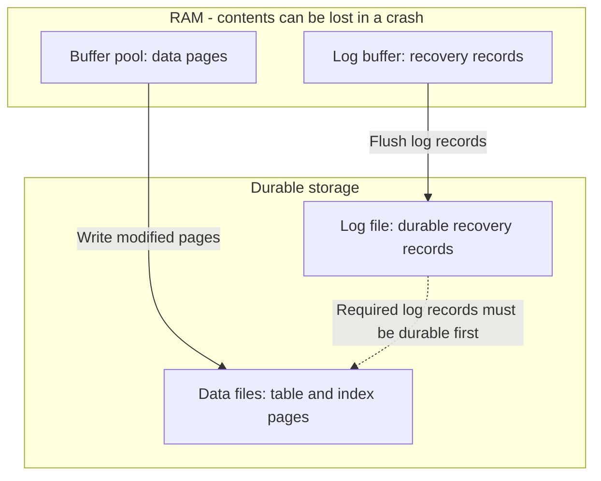
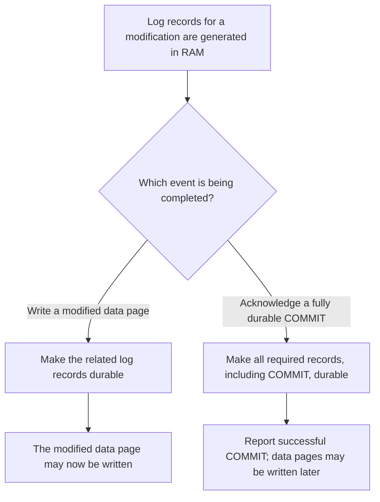
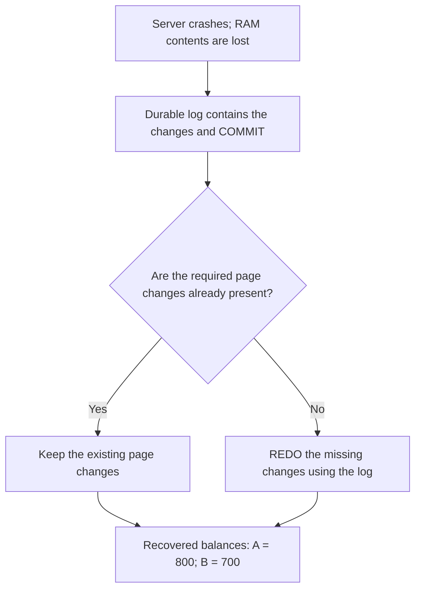

# Lab 9 – Transactions

**Database:** `TransactionsLab` (created in this lab — see *Before you start*)

In previous labs we wrote procedures that insert, update, and delete data, and in Lab 8 we passed several rows to a procedure in one call. But one procedure call can run several SQL statements — what happens if the first one succeeds and the second one fails?

Consider a bank transfer: subtract money from one account, add it to another. Keeping only one half would lose or create money. In this lab you will use **transactions** to treat several database changes as one unit of work — starting with manual `COMMIT`/`ROLLBACK`, then adding error handling, then moving the complete operation into a stored procedure.

> [!IMPORTANT]
> **Core idea:** Related changes should be confirmed together or undone together. A transaction defines that boundary. Your code must also detect unsuccessful business operations and choose the correct outcome.

---

## Learning objectives

After completing this lab, you should be able to:

- explain why several related SQL statements may need one transaction, and distinguish autocommit from explicit transactions;
- use `BEGIN TRANSACTION`, `COMMIT TRANSACTION`, and `ROLLBACK TRANSACTION`, and inspect uncommitted changes;
- use a savepoint to undo part of a transaction;
- explain `@@TRANCOUNT` and why an inner `COMMIT` does not independently commit changes;
- combine transactions with `TRY/CATCH`, `THROW`, and `SET XACT_ABORT ON`;
- use `@@ROWCOUNT` to detect an operation that did not affect the expected row;
- implement and verify a transaction inside a stored procedure, and distinguish a transaction managed by a procedure from one managed by its caller;
- explain the ACID properties and, at a conceptual level, how write-ahead logging, checkpoints, and UNDO/REDO let SQL Server keep those promises after a crash.

> [!NOTE]
> **Prerequisites:** [Lab 0 – T-SQL Essentials](lab00-tsql-essentials.md), [Lab 3 – Stored Procedures](lab03-stored-procedures.md), [Lab 7 – CRUD Operations](lab07-crud-operations.md), and [Lab 8 – Complex Parameters](lab08-complex-parameters.md) — variables, `IF`, `@@ROWCOUNT`, procedure parameters, and basic `TRY/CATCH`.
>
> This lab uses **one SSMS query window**; concurrency, locking, isolation levels, and two-session demonstrations are covered in **Lab 10**.

---

## Before you start

Run examples **section by section** — some deliberately produce errors. This lab runs in its own dedicated database, `TransactionsLab`, separate from `AdventureWorksENG` (the same pattern as the `IndexLab` and `PayrollLab` databases in other labs). All account names and balances are fictional.

```sql
USE master;
GO

IF DB_ID(N'TransactionsLab') IS NULL
BEGIN
    CREATE DATABASE TransactionsLab;
END;
GO

USE TransactionsLab;
GO

SET IMPLICIT_TRANSACTIONS OFF;
SET XACT_ABORT OFF;

SELECT @@TRANCOUNT AS OpenTransactionCount;
```

The expected transaction count is `0`. If it isn't, finish or roll back any transaction left open from a previous session before continuing.

> [!IMPORTANT]
> Every transaction you start must eventually finish with `COMMIT` or a full `ROLLBACK`. A `SELECT`, the end of a procedure, and the SSMS `GO` separator do not finish it automatically.

Requires SQL Server 2016 SP1 or later (`CREATE OR ALTER PROCEDURE`).

---

# Part A – Understanding Transactions

---

# Section 1 – Why We Need Transactions

## 1.1 Prepare the practice table

Create a small table for two accounts:

```sql
CREATE TABLE dbo.BankAccount
(
    AccountID int NOT NULL
        CONSTRAINT PK_BankAccount PRIMARY KEY,
    AccountName nvarchar(50) NOT NULL,
    Balance decimal(12, 2) NOT NULL,
    CONSTRAINT CK_BankAccount_Balance
        CHECK (Balance >= 0)
);
GO

INSERT INTO dbo.BankAccount (AccountID, AccountName, Balance)
VALUES
    (1, N'Account A', 1000.00),
    (2, N'Account B',  500.00);

SELECT AccountID, AccountName, Balance
FROM dbo.BankAccount
ORDER BY AccountID;
```

Expected data:

| AccountID | AccountName | Balance |
|---|---|---:|
| 1 | Account A | 1000.00 |
| 2 | Account B | 500.00 |

The total balance is **1500.00**. A transfer between these accounts should change the individual balances but preserve their total.

The `CHECK` constraint prevents negative balances. It does not ensure that every subtraction has a matching addition. That rule belongs to the complete transfer operation.

> [!NOTE]
> Run the table creation once. To repeat later demonstrations, reset the balances using the supplied `UPDATE` statements. You do not need to recreate the table.

## 1.2 Two statements, one business operation

A transfer of `200.00` requires two changes:

```sql
-- Read this example first. The next subsection demonstrates the failure.
UPDATE dbo.BankAccount
SET Balance = Balance - 200.00
WHERE AccountID = 1;

UPDATE dbo.BankAccount
SET Balance = Balance + 200.00
WHERE AccountID = 2;
```

The business operation succeeds only when **both** changes succeed.

If the second statement fails after the first has been committed, we have an incomplete transfer.

## 1.3 Demonstrate a partial operation

We will deliberately make the second statement violate the balance constraint. This simulates a programming error after the first statement succeeds.

Run this complete block:

```sql
SET XACT_ABORT OFF;

-- Reset before the demonstration.
UPDATE dbo.BankAccount
SET Balance = CASE AccountID
                  WHEN 1 THEN 1000.00
                  WHEN 2 THEN  500.00
              END;

BEGIN TRY
    UPDATE dbo.BankAccount
    SET Balance = Balance - 200.00
    WHERE AccountID = 1;

    -- Deliberate error: a negative balance violates CHECK.
    UPDATE dbo.BankAccount
    SET Balance = -1.00
    WHERE AccountID = 2;
END TRY
BEGIN CATCH
    SELECT ERROR_MESSAGE() AS ErrorMessage;
END CATCH;

SELECT AccountID, AccountName, Balance
FROM dbo.BankAccount
ORDER BY AccountID;

SELECT SUM(Balance) AS TotalBalance
FROM dbo.BankAccount;
```

Expected balances:

| Account | Balance |
|---|---:|
| Account A | 800.00 |
| Account B | 500.00 |
| **Total** | **1300.00** |

The first `UPDATE` succeeded and was committed. The second `UPDATE` failed and its changes were undone. The `CATCH` block displayed the error, but it did not undo the first statement.

**Handling an error does not automatically make several statements atomic.**

## 1.4 Autocommit and explicit transactions

In the normal **autocommit** mode, each individual SQL statement runs as a transaction.

This means that one `UPDATE` statement affecting many rows is already one unit of work. For an ordinary constraint violation, SQL Server undoes that statement; it does not keep an arbitrary successful subset of its rows.

Our problem is different: the transfer contains **two separate statements**.

| Mode | Transaction boundary | Typical use |
|---|---|---|
| Autocommit | One statement | A single independent change |
| Explicit transaction | Statements between `BEGIN TRANSACTION` and `COMMIT` or `ROLLBACK` | Several changes that belong together |

> [!IMPORTANT]
> SQL Server already uses transactions when you do not write `BEGIN TRANSACTION`. An explicit transaction lets you group multiple statements into one unit of work.

**Check your understanding**

1. Why did the first account remain changed after the error?
2. Does `TRY/CATCH` alone guarantee all-or-nothing execution?
3. Why might a single procedure call still need an explicit transaction?

<details>
<summary>Show answers</summary>

1. It was a separate, successful autocommit transaction.
2. No. `TRY/CATCH` controls error handling; it does not create a transaction around the statements.
3. A procedure can execute several statements. Calling it once does not automatically group them into one transaction.

</details>

---

# Section 2 – BEGIN, COMMIT, and ROLLBACK

## 2.1 The three commands

| Command | Purpose |
|---|---|
| `BEGIN TRANSACTION` | Start an explicit transaction |
| `COMMIT TRANSACTION` | Confirm the transaction's changes |
| `ROLLBACK TRANSACTION` | Undo the transaction's changes |

`TRAN` is a shorter spelling of `TRANSACTION`.

```sql
BEGIN TRANSACTION;

-- Related database changes go here.

COMMIT TRANSACTION;
```

Alternatively, end the transaction with `ROLLBACK TRANSACTION` to discard the changes.

## 2.2 Confirm a transfer

First reset the balances:

```sql
UPDATE dbo.BankAccount
SET Balance = CASE AccountID
                  WHEN 1 THEN 1000.00
                  WHEN 2 THEN  500.00
              END;
```

Predict the two balances after `COMMIT` before you run this. Then run the transfer:

```sql
BEGIN TRANSACTION;

UPDATE dbo.BankAccount
SET Balance = Balance - 200.00
WHERE AccountID = 1;

UPDATE dbo.BankAccount
SET Balance = Balance + 200.00
WHERE AccountID = 2;

-- This session can read its own uncommitted changes.
SELECT AccountID, AccountName, Balance
FROM dbo.BankAccount
ORDER BY AccountID;

COMMIT TRANSACTION;

SELECT AccountID, AccountName, Balance
FROM dbo.BankAccount
ORDER BY AccountID;

SELECT SUM(Balance) AS TotalBalance,
       @@TRANCOUNT AS OpenTransactionCount
FROM dbo.BankAccount;
```

Expected balances are `800.00` and `700.00`. The total is still `1500.00`, and the transaction count is `0`.

## 2.3 Undo a transfer

The previous committed balances are now our starting point. Predict both balances *after* the `ROLLBACK` before you run this.

```sql
BEGIN TRANSACTION;

UPDATE dbo.BankAccount
SET Balance = Balance - 100.00
WHERE AccountID = 1;

UPDATE dbo.BankAccount
SET Balance = Balance + 100.00
WHERE AccountID = 2;

SELECT AccountID, Balance AS BalanceBeforeRollback
FROM dbo.BankAccount
ORDER BY AccountID;

ROLLBACK TRANSACTION;

SELECT AccountID, Balance AS BalanceAfterRollback
FROM dbo.BankAccount
ORDER BY AccountID;
```

| Point | Account A | Account B |
|---|---:|---:|
| Before this transaction | 800.00 | 700.00 |
| Inside the transaction | 700.00 | 800.00 |
| After `ROLLBACK` | 800.00 | 700.00 |

The `SELECT` inside the transaction did not confirm anything. It only displayed the current session's view of the data.

> [!NOTE]
> `ROLLBACK` can undo an open transaction. It cannot undo a transaction that has already been committed. Correcting a committed mistake requires a new operation or an appropriate recovery process.

## 2.4 BEGIN/END is not a transaction

These two constructs have different purposes:

| Construct | Meaning |
|---|---|
| `BEGIN ... END` | Group T-SQL statements into a code block |
| `BEGIN TRANSACTION ... COMMIT` | Group database changes into a transaction |

A procedure's `BEGIN ... END` body does not create a transaction.

## 2.5 ROLLBACK and IDENTITY values

Rolling back also interacts with other table features — not just with the data you changed on purpose.

Create a separate demonstration table:

```sql
CREATE TABLE dbo.Note
(
    NoteID int IDENTITY(1, 1) NOT NULL
        CONSTRAINT PK_Note PRIMARY KEY,
    NoteText nvarchar(100) NOT NULL
);
GO

INSERT INTO dbo.Note (NoteText)
VALUES (N'First committed note');

BEGIN TRANSACTION;

INSERT INTO dbo.Note (NoteText)
VALUES (N'This note will be rolled back');

SELECT NoteID, NoteText
FROM dbo.Note
ORDER BY NoteID;

ROLLBACK TRANSACTION;

INSERT INTO dbo.Note (NoteText)
VALUES (N'Next committed note');

SELECT NoteID, NoteText
FROM dbo.Note
ORDER BY NoteID;
```

On the first run against this newly created table, the final IDs are `1` and `3`. The row with ID `2` was rolled back, but its allocated identity value was consumed.

> [!NOTE]
> `IDENTITY` generates identifiers; it does not guarantee a gap-free sequence. Rollbacks, failed inserts, and other events can leave gaps. Do not use the largest identity value as a row count.

---

# Section 3 – Savepoints: Undoing Part of a Transaction

A full `ROLLBACK` undoes the complete transaction. Sometimes we want to undo only the work done after a particular point.

A **savepoint** is a named marker inside an open transaction.

## 3.1 Create a savepoint

Reset the account balances before this independent demonstration. Based on 2.2 and 2.3, predict what `ROLLBACK TRANSACTION AfterFirstTransfer` will leave behind before reading on.

```sql
UPDATE dbo.BankAccount
SET Balance = CASE AccountID
                  WHEN 1 THEN 1000.00
                  WHEN 2 THEN  500.00
              END;
```

Run this block:

```sql
BEGIN TRANSACTION;

-- First transfer: keep this one.
UPDATE dbo.BankAccount
SET Balance = Balance - 100.00
WHERE AccountID = 1;

UPDATE dbo.BankAccount
SET Balance = Balance + 100.00
WHERE AccountID = 2;

SAVE TRANSACTION AfterFirstTransfer;

-- Second transfer: we will cancel this one.
UPDATE dbo.BankAccount
SET Balance = Balance - 50.00
WHERE AccountID = 1;

UPDATE dbo.BankAccount
SET Balance = Balance + 50.00
WHERE AccountID = 2;

SELECT AccountID, Balance AS BeforeSavepointRollback
FROM dbo.BankAccount
ORDER BY AccountID;

ROLLBACK TRANSACTION AfterFirstTransfer;

SELECT AccountID, Balance AS AfterSavepointRollback
FROM dbo.BankAccount
ORDER BY AccountID;

SELECT @@TRANCOUNT AS OpenTransactionCount;

COMMIT TRANSACTION;
```

| Point | Account A | Account B |
|---|---:|---:|
| Initial state | 1000.00 | 500.00 |
| After first transfer | 900.00 | 600.00 |
| After second transfer | 850.00 | 650.00 |
| After rollback to savepoint | 900.00 | 600.00 |
| After final commit | 900.00 | 600.00 |

## 3.2 What a savepoint does not do

`SAVE TRANSACTION` does not commit earlier work or start an independent transaction.

After `ROLLBACK TRANSACTION AfterFirstTransfer`, the transaction is still open. We must still finish it with `COMMIT` or a full `ROLLBACK`.

If we replaced the final `COMMIT` with a full `ROLLBACK`, both transfers would be undone.

> [!NOTE]
> This example deliberately cancels valid work. Recovering from an actual SQL error using a savepoint is more complicated: some errors leave the transaction unable to commit, and a savepoint cannot repair that state. The main error-handling pattern in this lab rolls back the entire business operation.

## 3.3 A full rollback removes work recorded before the savepoint too

A savepoint only protects work from a **partial** rollback. It does not protect that work from a **full** rollback.

Reset the balances, then run this block:

```sql
UPDATE dbo.BankAccount
SET Balance = CASE AccountID
                  WHEN 1 THEN 1000.00
                  WHEN 2 THEN  500.00
              END;
```

```sql
BEGIN TRANSACTION;

-- First transfer.
UPDATE dbo.BankAccount
SET Balance = Balance - 100.00
WHERE AccountID = 1;

UPDATE dbo.BankAccount
SET Balance = Balance + 100.00
WHERE AccountID = 2;

SAVE TRANSACTION AfterFirstTransfer;

-- Second transfer.
UPDATE dbo.BankAccount
SET Balance = Balance - 50.00
WHERE AccountID = 1;

UPDATE dbo.BankAccount
SET Balance = Balance + 50.00
WHERE AccountID = 2;

SELECT AccountID, Balance AS BeforeFullRollback
FROM dbo.BankAccount
ORDER BY AccountID;

ROLLBACK TRANSACTION;

SELECT AccountID, Balance AS AfterFullRollback
FROM dbo.BankAccount
ORDER BY AccountID;

SELECT @@TRANCOUNT AS OpenTransactionCount;
```

| Point | Account A | Account B |
|---|---:|---:|
| Initial state | 1000.00 | 500.00 |
| After first transfer | 900.00 | 600.00 |
| After second transfer | 850.00 | 650.00 |
| After full rollback | 1000.00 | 500.00 |

Compare this with 4.1: there, `ROLLBACK TRANSACTION AfterFirstTransfer` undid only the second transfer, and the subsequent `COMMIT` kept the first one. Here, `ROLLBACK TRANSACTION` with no savepoint name is a **full** rollback: it undoes everything in the transaction, including the work recorded before the savepoint existed.

> [!IMPORTANT]
> A savepoint marks a point for a partial rollback. It does not create a boundary that a full rollback must respect. The number of savepoints inside a transaction has no effect on what a full `ROLLBACK` undoes.

## 3.4 Rolling back to an earlier savepoint invalidates later ones

A transaction can contain several savepoints. Rolling back to an earlier one also discards any savepoint defined after it.

Reset the balances, then run this block:

```sql
UPDATE dbo.BankAccount
SET Balance = CASE AccountID
                  WHEN 1 THEN 1000.00
                  WHEN 2 THEN  500.00
              END;
```

```sql
BEGIN TRANSACTION;

UPDATE dbo.BankAccount
SET Balance = Balance - 100.00
WHERE AccountID = 1;

UPDATE dbo.BankAccount
SET Balance = Balance + 100.00
WHERE AccountID = 2;

SAVE TRANSACTION AfterFirstTransfer;

UPDATE dbo.BankAccount
SET Balance = Balance - 50.00
WHERE AccountID = 1;

UPDATE dbo.BankAccount
SET Balance = Balance + 50.00
WHERE AccountID = 2;

SAVE TRANSACTION AfterSecondTransfer;

UPDATE dbo.BankAccount
SET Balance = Balance - 25.00
WHERE AccountID = 1;

UPDATE dbo.BankAccount
SET Balance = Balance + 25.00
WHERE AccountID = 2;

SELECT AccountID, Balance AS BeforeAnyRollback
FROM dbo.BankAccount
ORDER BY AccountID;

-- Discards the third transfer AND the AfterSecondTransfer savepoint itself.
ROLLBACK TRANSACTION AfterFirstTransfer;

SELECT AccountID, Balance AS AfterSavepointRollback
FROM dbo.BankAccount
ORDER BY AccountID;

SELECT @@TRANCOUNT AS StillOpen; -- 1

ROLLBACK TRANSACTION;

SELECT AccountID, Balance AS AfterFullRollback
FROM dbo.BankAccount
ORDER BY AccountID;

SELECT @@TRANCOUNT AS FinalCount; -- 0
```

| Point | Account A | Account B |
|---|---:|---:|
| Initial state | 1000.00 | 500.00 |
| After first transfer | 900.00 | 600.00 |
| After second transfer | 850.00 | 650.00 |
| After third transfer | 875.00 | 625.00 |
| After rollback to `AfterFirstTransfer` | 900.00 | 600.00 |
| After full rollback | 1000.00 | 500.00 |

After `ROLLBACK TRANSACTION AfterFirstTransfer`, the savepoint `AfterSecondTransfer` no longer exists. Running `ROLLBACK TRANSACTION AfterSecondTransfer` at that point would fail with an error, because that savepoint was defined after the point we already rolled back to.

The transaction itself is still open after a savepoint rollback (`@@TRANCOUNT` is `1`). It must still be finished with `COMMIT` or a full `ROLLBACK`, exactly as in 4.2.

---

# Section 4 – @@TRANCOUNT and Nested Transactions

`@@TRANCOUNT` reports the transaction nesting count for the **current connection**.

## 4.1 How the counter changes

Assuming an active, valid local transaction where required:

| Statement | Effect on `@@TRANCOUNT` |
|---|---|
| `BEGIN TRANSACTION` | Adds `1` |
| `COMMIT TRANSACTION` | Subtracts `1` |
| Full `ROLLBACK TRANSACTION` | Resets it to `0` |
| `SAVE TRANSACTION SavepointName` | No change |
| `ROLLBACK TRANSACTION SavepointName` | No change |

```sql
SELECT @@TRANCOUNT AS BeforeBegin;       -- 0

BEGIN TRANSACTION;
SELECT @@TRANCOUNT AS AfterFirstBegin;   -- 1

    BEGIN TRANSACTION;
    SELECT @@TRANCOUNT AS AfterSecondBegin; -- 2

    COMMIT TRANSACTION;
    SELECT @@TRANCOUNT AS AfterInnerCommit; -- 1

COMMIT TRANSACTION;
SELECT @@TRANCOUNT AS AfterOuterCommit;  -- 0
```

## 4.2 An inner COMMIT does not independently commit

SQL Server does not provide independently committable nested transactions.

Run this complete example:

```sql
UPDATE dbo.BankAccount
SET Balance = CASE AccountID
                  WHEN 1 THEN 1000.00
                  WHEN 2 THEN  500.00
              END;

BEGIN TRANSACTION;

    BEGIN TRANSACTION;

    UPDATE dbo.BankAccount
    SET Balance = Balance - 100.00
    WHERE AccountID = 1;

    UPDATE dbo.BankAccount
    SET Balance = Balance + 100.00
    WHERE AccountID = 2;

    COMMIT TRANSACTION;

    SELECT @@TRANCOUNT AS AfterInnerCommit; -- 1

ROLLBACK TRANSACTION;

SELECT AccountID, Balance
FROM dbo.BankAccount
ORDER BY AccountID;

SELECT @@TRANCOUNT AS AfterOuterRollback; -- 0
```

The original balances, `1000.00` and `500.00`, are restored.

The inner `COMMIT` reduced the counter from `2` to `1`. The changes were still part of the outer transaction and could be undone.

> [!IMPORTANT]
> An inner `COMMIT` does not make its changes independent of the outer transaction. Only the outermost successful `COMMIT` completes the transaction.

## 4.3 Full rollback is different

```sql
BEGIN TRANSACTION;
    BEGIN TRANSACTION;
        SELECT @@TRANCOUNT AS BeforeRollback; -- 2

        ROLLBACK TRANSACTION;

SELECT @@TRANCOUNT AS AfterRollback; -- 0
```

A full rollback ends the entire transaction, regardless of nesting depth. There is no remaining outer transaction to commit.

**Check your understanding**

Predict the final counter for each sequence. Each sequence starts at `0`.

| Sequence | Final `@@TRANCOUNT` |
|---|---|
| `BEGIN TRAN; COMMIT;` | ? |
| `BEGIN TRAN; BEGIN TRAN; COMMIT;` | ? |
| `BEGIN TRAN; BEGIN TRAN; ROLLBACK;` | ? |
| `BEGIN TRAN; SAVE TRAN S1; ROLLBACK TRAN S1;` | ? |

<details>
<summary>Show answers</summary>

The values are **0, 1, 0, and 1**.

The second and fourth sequences leave a transaction open. If you run them, finish those transactions before continuing.

</details>

---

# Part B – Transactions and Stored Procedures

---

# Section 5 – Handling Errors Inside a Transaction

Manual `COMMIT` and `ROLLBACK` are useful while learning. An application needs code that chooses the correct outcome when an operation fails.

[Lab 0 – T-SQL Essentials](lab00-tsql-essentials.md), Section 10, introduced the basic `TRY/CATCH` block. Here we combine it with transactions.

## 5.1 The basic pattern

```sql
SET XACT_ABORT ON;

BEGIN TRY
    BEGIN TRANSACTION;

    -- Execute all statements belonging to the operation.

    COMMIT TRANSACTION;
END TRY
BEGIN CATCH
    IF @@TRANCOUNT > 0
        ROLLBACK TRANSACTION;

    THROW;
END CATCH;
```

This pattern assumes that the block owns the whole operation and that a full rollback is the required response to an error. Section 8 explains how an outer transaction changes that responsibility.

| Element | Purpose |
|---|---|
| `TRY` | Execute the operation and its successful commit |
| `CATCH` | Handle execution errors caught by T-SQL |
| `IF @@TRANCOUNT > 0` | Check that a transaction still exists before rolling it back |
| `ROLLBACK` | Undo the complete operation |
| `THROW;` | Pass the original error to the caller |

Some errors may already have ended the transaction. The counter check avoids a second error from trying to roll back when no transaction exists.

## 5.2 SET XACT_ABORT ON

`SET XACT_ABORT ON` makes many execution errors abort the whole transaction rather than merely undoing the statement that failed.

Inside `TRY/CATCH`, an error can leave a transaction **uncommittable** when control reaches `CATCH`. We therefore keep the explicit rollback in the handler.

It does not mean that every possible problem is automatically handled:

- syntax and compilation errors are not controlled by this setting;
- an `UPDATE` that matches zero rows is not automatically an error;
- business-rule failures must be detected by your code.

`THROW` honors `XACT_ABORT`. Use `THROW` for new error-handling examples in this lab.

> [!IMPORTANT]
> `XACT_ABORT` supports the error-handling pattern. It does not replace `TRY/CATCH`, validation, or a deliberate rollback policy.

## 5.3 Repeat the failing example with protection

Reset the balances, then run the protected operation:

```sql
UPDATE dbo.BankAccount
SET Balance = CASE AccountID
                  WHEN 1 THEN 1000.00
                  WHEN 2 THEN  500.00
              END;

SET XACT_ABORT ON;

BEGIN TRY
    BEGIN TRANSACTION;

    UPDATE dbo.BankAccount
    SET Balance = Balance - 200.00
    WHERE AccountID = 1;

    -- Deliberate CHECK constraint violation.
    UPDATE dbo.BankAccount
    SET Balance = -1.00
    WHERE AccountID = 2;

    COMMIT TRANSACTION;
END TRY
BEGIN CATCH
    IF @@TRANCOUNT > 0
        ROLLBACK TRANSACTION;

    THROW;
END CATCH;
```

An error message is expected. After it appears, run this verification **separately**:

```sql
SELECT AccountID, AccountName, Balance
FROM dbo.BankAccount
ORDER BY AccountID;

SELECT SUM(Balance) AS TotalBalance,
       @@TRANCOUNT AS OpenTransactionCount
FROM dbo.BankAccount;
```

Expected results:

- Account A: `1000.00`.
- Account B: `500.00`.
- Total: `1500.00`.
- Transaction count: `0`.

The first update succeeded initially, but the handler rolled it back when the second update failed.

> [!NOTE]
> The deliberate failure uses a constraint to produce a predictable error. There is no need to stop SQL Server or simulate a real crash.

---

# Section 6 – When SQL Succeeds but the Business Operation Fails

## 6.1 Zero affected rows is not an SQL error

The following statement is valid SQL:

```sql
UPDATE dbo.BankAccount
SET Balance = Balance + 200.00
WHERE AccountID = 999;

SELECT @@ROWCOUNT AS RowsAffected;
```

The result is `0` because account `999` does not exist.

If we had already debited another account, SQL Server would not automatically know that the intended transfer was incomplete.

## 6.2 Check @@ROWCOUNT immediately

We must check the number of affected rows directly after the relevant statement:

```sql
UPDATE dbo.BankAccount
SET Balance = Balance + 200.00
WHERE AccountID = 999;

IF @@ROWCOUNT <> 1
    THROW 50001, 'Destination account does not exist.', 1;
```

Run this as an independent example. The custom error is expected; no account is changed.

`THROW` with arguments creates an application error:

| Argument | Meaning |
|---|---|
| `50001` | Application error number; user-defined numbers start at `50000` |
| Message | Explanation for the caller |
| `1` | State value, which can help identify where an error was raised |

`THROW;` without arguments is used inside `CATCH` to rethrow the original error.

> [!IMPORTANT]
> Read `@@ROWCOUNT` immediately. Other statements can change or reset its value.

## 6.3 Detect insufficient funds in the update

Instead of reading a balance and later deciding whether to subtract, we can include the condition in the update itself:

```sql
DECLARE @Amount decimal(12, 2) = 2000.00;

UPDATE dbo.BankAccount
SET Balance = Balance - @Amount
WHERE AccountID = 1
  AND Balance >= @Amount;

IF @@ROWCOUNT <> 1
    THROW 50002, 'Source account does not exist or has insufficient funds.', 1;
```

The account currently has `1000.00`, so no row is changed and the custom error is raised.

This gives one clear rule: **the source account must exist and have enough money at the point of the debit**.

The next section puts the checks and both account updates into one procedure.

---

# Section 7 – A Complete Transfer Procedure

## 7.1 Define the operation

The procedure accepts a source account, a destination account, and an amount.

It must:

1. reject missing parameters, a non-positive amount, or equal account IDs;
2. debit the source only if it exists and has sufficient funds;
3. credit the destination only if it exists;
4. commit both changes on success;
5. roll back the operation and report the error on failure.

For the first tests, call this procedure with **no transaction already open**. Section 8 deliberately calls it inside an outer transaction to explore nesting.

## 7.2 Create the procedure

```sql
CREATE OR ALTER PROCEDURE dbo.usp_TransferFunds
    @SourceAccountID int,
    @DestinationAccountID int,
    @Amount decimal(12, 2)
AS
BEGIN
    SET NOCOUNT ON;
    SET XACT_ABORT ON;

    IF @SourceAccountID IS NULL
       OR @DestinationAccountID IS NULL
       OR @Amount IS NULL
        THROW 50010, 'Account IDs and amount are required.', 1;

    IF @Amount <= 0
        THROW 50011, 'Transfer amount must be greater than zero.', 1;

    IF @SourceAccountID = @DestinationAccountID
        THROW 50012, 'Source and destination accounts must be different.', 1;

    BEGIN TRY
        BEGIN TRANSACTION;

        UPDATE dbo.BankAccount
        SET Balance = Balance - @Amount
        WHERE AccountID = @SourceAccountID
          AND Balance >= @Amount;

        IF @@ROWCOUNT <> 1
            THROW 50013,
                'Source account does not exist or has insufficient funds.', 1;

        UPDATE dbo.BankAccount
        SET Balance = Balance + @Amount
        WHERE AccountID = @DestinationAccountID;

        IF @@ROWCOUNT <> 1
            THROW 50014, 'Destination account does not exist.', 1;

        COMMIT TRANSACTION;
    END TRY
    BEGIN CATCH
        IF @@TRANCOUNT > 0
            ROLLBACK TRANSACTION;

        THROW;
    END CATCH;
END;
GO
```

The parameter checks happen before the procedure opens its transaction, keeping the transaction focused on database work. If this procedure is invoked inside an outer transaction, its errors can still affect that transaction; see Section 8.

## 7.3 Test a successful transfer

```sql
UPDATE dbo.BankAccount
SET Balance = CASE AccountID
                  WHEN 1 THEN 1000.00
                  WHEN 2 THEN  500.00
              END;

EXEC dbo.usp_TransferFunds
    @SourceAccountID = 1,
    @DestinationAccountID = 2,
    @Amount = 200.00;

SELECT AccountID, AccountName, Balance
FROM dbo.BankAccount
ORDER BY AccountID;

SELECT SUM(Balance) AS TotalBalance,
       @@TRANCOUNT AS OpenTransactionCount
FROM dbo.BankAccount;
```

Expected balances: `800.00` and `700.00`. Expected total: `1500.00`. Expected transaction count: `0`.

## 7.4 Test a missing destination

The source update will succeed first. The procedure must undo it when the destination update affects zero rows.

For an expected error, the test's outer `CATCH` displays the message and allows verification to continue:

```sql
BEGIN TRY
    EXEC dbo.usp_TransferFunds
        @SourceAccountID = 1,
        @DestinationAccountID = 999,
        @Amount = 100.00;
END TRY
BEGIN CATCH
    SELECT ERROR_NUMBER() AS ErrorNumber,
           ERROR_MESSAGE() AS ErrorMessage;
END CATCH;

SELECT AccountID, Balance
FROM dbo.BankAccount
ORDER BY AccountID;

SELECT @@TRANCOUNT AS OpenTransactionCount;
```

Expected error: `50014`. Balances remain `800.00` and `700.00`. The transaction count is `0`.

## 7.5 Test insufficient funds

```sql
BEGIN TRY
    EXEC dbo.usp_TransferFunds
        @SourceAccountID = 1,
        @DestinationAccountID = 2,
        @Amount = 2000.00;
END TRY
BEGIN CATCH
    SELECT ERROR_NUMBER() AS ErrorNumber,
           ERROR_MESSAGE() AS ErrorMessage;
END CATCH;

SELECT AccountID, Balance
FROM dbo.BankAccount
ORDER BY AccountID;

SELECT @@TRANCOUNT AS OpenTransactionCount;
```

Expected error: `50013`. Both balances remain unchanged, and no transaction remains open.

## 7.6 Verify behavior, not only messages

| Test | Expected result | What to verify |
|---|---|---|
| Valid transfer | Success | Correct debit and credit; total unchanged |
| Missing destination | Error `50014` | Earlier debit undone |
| Insufficient funds | Error `50013` | Neither balance changes |
| Zero or negative amount | Error `50011` | Neither balance changes |
| Same source and destination | Error `50012` | Neither balance changes |
| `NULL` parameter | Error `50010` | Neither balance changes |

For these standalone calls, `@@TRANCOUNT` must be `0` after each test.

> [!NOTE]
> An error message is only part of the result. Always inspect the final data and transaction count. A procedure that reports an error but leaves half the operation committed is still incorrect.

---

# Section 8 – Who Manages the Transaction?

A transaction can be managed by the procedure or by its caller. The important question is: **which code owns the complete business operation?**

[Lab 7 – CRUD Operations](lab07-crud-operations.md), Section 6.3, asked the same ownership question about `TRY/CATCH` placement — inside a procedure or at its caller. Here it returns for transactions, and the stakes are higher: the wrong choice does not just mis-handle an error message, it can commit or roll back the wrong amount of work.

## 8.1 The procedure manages the transaction

Our transfer procedure represents one complete operation. It starts a transaction, performs the work, and commits or rolls back.

```sql
EXEC dbo.usp_TransferFunds
    @SourceAccountID = 1,
    @DestinationAccountID = 2,
    @Amount = 50.00;
```

This is convenient when one call corresponds to the entire operation. This example changes the balances; later demonstrations reset them explicitly.

## 8.2 The caller manages the transaction

An application or another procedure may need to combine several operations into one transaction.

Here is a small helper procedure with no transaction commands:

```sql
CREATE OR ALTER PROCEDURE dbo.usp_ChangeBalance
    @AccountID int,
    @Change decimal(12, 2)
AS
BEGIN
    SET NOCOUNT ON;

    IF @Change IS NULL
        THROW 50020, 'Balance change is required.', 1;

    UPDATE dbo.BankAccount
    SET Balance = Balance + @Change
    WHERE AccountID = @AccountID;

    IF @@ROWCOUNT <> 1
        THROW 50021, 'Account does not exist.', 1;
END;
GO
```

The caller groups two calls:

```sql
UPDATE dbo.BankAccount
SET Balance = CASE AccountID
                  WHEN 1 THEN 1000.00
                  WHEN 2 THEN  500.00
              END;

SET XACT_ABORT ON;

BEGIN TRY
    BEGIN TRANSACTION;

    EXEC dbo.usp_ChangeBalance
        @AccountID = 1, @Change = -100.00;

    EXEC dbo.usp_ChangeBalance
        @AccountID = 2, @Change = 100.00;

    COMMIT TRANSACTION;
END TRY
BEGIN CATCH
    IF @@TRANCOUNT > 0
        ROLLBACK TRANSACTION;

    THROW;
END CATCH;

SELECT AccountID, Balance
FROM dbo.BankAccount
ORDER BY AccountID;
```

Expected balances: `900.00` and `600.00`.

The helper participates in the caller's transaction without starting its own. If the caller does not start a transaction, its update runs in autocommit mode.

> [!NOTE]
> This helper illustrates transaction ownership. It is a low-level building block: it does not itself enforce a complete transfer or preserve the combined account balance.

## 8.3 An outer transaction wraps our transfer procedure

Reset the balances and run this complete block:

```sql
UPDATE dbo.BankAccount
SET Balance = CASE AccountID
                  WHEN 1 THEN 1000.00
                  WHEN 2 THEN  500.00
              END;

BEGIN TRANSACTION; -- count: 0 -> 1

EXEC dbo.usp_TransferFunds
    @SourceAccountID = 1,
    @DestinationAccountID = 2,
    @Amount = 100.00;

-- The procedure's BEGIN changed 1 -> 2.
-- Its COMMIT changed 2 -> 1.
SELECT @@TRANCOUNT AS AfterProcedure; -- 1

SELECT AccountID, Balance AS InsideOuterTransaction
FROM dbo.BankAccount
ORDER BY AccountID;

ROLLBACK TRANSACTION; -- count: 1 -> 0

SELECT AccountID, Balance AS AfterOuterRollback
FROM dbo.BankAccount
ORDER BY AccountID;
```

The final balances are `1000.00` and `500.00`.

The procedure returned successfully, but its inner `COMMIT` did not independently confirm the transfer. The caller's rollback undid it.

## 8.4 A rollback inside a procedure can undo the caller's work

The reverse is equally important. Our transfer procedure uses a **full rollback** when an execution error reaches its handler.

If an outer transaction exists, that rollback also undoes earlier work in the outer transaction.

```sql
BEGIN TRY
    BEGIN TRANSACTION;

    -- Earlier work belonging to the caller.
    UPDATE dbo.BankAccount
    SET AccountName = N'Temporary account name'
    WHERE AccountID = 1;

    -- The procedure debits the source, then finds no destination.
    EXEC dbo.usp_TransferFunds
        @SourceAccountID = 1,
        @DestinationAccountID = 999,
        @Amount = 100.00;

    COMMIT TRANSACTION;
END TRY
BEGIN CATCH
    IF @@TRANCOUNT > 0
        ROLLBACK TRANSACTION;

    SELECT ERROR_MESSAGE() AS ErrorMessage;
END CATCH;

SELECT AccountID, AccountName, Balance
FROM dbo.BankAccount
ORDER BY AccountID;

SELECT @@TRANCOUNT AS OpenTransactionCount;
```

The temporary name change is also undone. Account A is still named `Account A`, balances are `1000.00` and `500.00`, and the transaction count is `0`.

SQL Server may also report a transaction-count mismatch because the procedure entered with an outer transaction and ended it through a full rollback. That is another reason to define transaction ownership clearly.

> [!IMPORTANT]
> A procedure's full `ROLLBACK` is not limited to the statements inside that procedure. It affects the entire current transaction.
>
> For this lab's transfer procedure, a failure means the complete enclosing operation must fail. A caller must not continue toward a commit after that failure.

## 8.5 Choose a clear convention

| Approach | Appropriate when… | Responsibility |
|---|---|---|
| Procedure manages the transaction | One procedure performs the complete operation | Procedure starts and finishes the transaction |
| Caller manages the transaction | Several calls form one larger operation | Caller starts and finishes the transaction; helpers participate |
| Procedure supports both contexts | A reusable operation has a carefully defined transaction contract | Requires additional ownership and error-state handling |

The third approach is discussed briefly in Additional Reading. It is not required for the main exercises.

---

# Section 9 – ACID, the Transaction Log, and Recovery

By now you can write, verify, and troubleshoot transactions: `BEGIN/COMMIT/ROLLBACK`, savepoints, `@@TRANCOUNT`, and the `TRY/CATCH` pattern inside a procedure. This section steps back and explains **how SQL Server can keep the promises you have been relying on**, even if the server stops unexpectedly. Nothing here changes how you write a transaction — it explains why the commands from Sections 2–8 behave the way they do.

This section builds on the data pages and buffer pool introduced in Lab 5. It uses diagrams and conceptual examples; there is no need to shut down SQL Server or inspect its internal log format.

## 9.1 Four transaction properties

The acronym **ACID** describes four properties associated with reliable transaction processing.

| Property | Meaning | Connection to our example |
|---|---|---|
| **Atomicity** | A transaction's changes are kept together or undone together | The debit and credit must form one operation |
| **Consistency** | A correct transaction preserves defined rules | Balances stay non-negative and the transfer preserves the total |
| **Isolation** | Rules control interactions between concurrent transactions | Two simultaneous operations must be handled appropriately |
| **Durability** | Committed changes survive a system restart or crash | A confirmed transfer must not disappear after a restart |

We focus on **Atomicity**, **Consistency**, and **Durability** here. Lab 10 explains isolation and the trade-offs between isolation levels.

> [!IMPORTANT]
> A transaction does not know your business rules. If your code subtracts `200.00` and adds only `100.00`, both statements could succeed and be committed. Atomicity cannot correct the wrong calculation.
>
> Consistency depends on correctly designed constraints and business logic as well as transaction boundaries.

## 9.2 The missing link: memory is not permanent storage

Recall the buffer pool from Lab 5. SQL Server reads data pages into memory and performs changes there. A modified page is called a **dirty page**. In this context, *dirty* means modified in memory and not yet written back to its data file.

Memory is fast, but its contents can be lost if the server crashes or loses power. If a changed page exists only in memory, how can SQL Server promise that a committed change will survive?

The answer is the **transaction log**.

SQL Server maintains both data pages and log records in memory, with separate mechanisms for writing them to files:



*Diagram 1 – Two memory buffers and two file roles. The dashed arrow is a WAL ordering requirement, not a transfer of data from the log file to the data file.*

| Component | Location | Purpose |
|---|---|---|
| Buffer pool | RAM | Holds data pages, including modified pages |
| Log buffer | RAM | Temporarily holds generated log records before they are flushed |
| Data files | Durable storage | Store table and index pages |
| Transaction log file | Durable storage | Stores log records used for recovery |

A database has at least one data file and one log file. Common extensions are `.mdf` for the primary data file, `.ndf` for additional data files, and `.ldf` for log files.

> [!NOTE]
> The diagram separates logical roles. It does not require the data and log files to be on separate physical disks. A record in the **log buffer** is still in memory; a log flush writes records to durable storage.

## 9.3 Follow one transfer into the log

Use the same transfer as before, starting from these illustrative balances:

| Account | Before transfer | After successful transfer |
|---|---:|---:|
| A | 1000.00 | 800.00 |
| B | 500.00 | 700.00 |

The SQL operation contains two updates:

```sql
-- Illustration only: the executable examples are in Sections 2 and 9.
BEGIN TRANSACTION;

UPDATE dbo.BankAccount
SET Balance = Balance - 200.00
WHERE AccountID = 1;

UPDATE dbo.BankAccount
SET Balance = Balance + 200.00
WHERE AccountID = 2;

COMMIT TRANSACTION;
```

As SQL Server processes the changes, it generates log records associated with the transaction. Those records provide information needed to recover the changes.

The following table is a conceptual log for one transfer. Read it from top to bottom.

| Order | Transaction | Record | Simplified recovery information |
|---|---|---|---|
| 1 | T1 | Begin | Start of the logged transaction |
| 2 | T1 | Change account A | Old balance: 1000.00; new balance: 800.00 |
| 3 | T1 | Change account B | Old balance: 500.00; new balance: 700.00 |
| 4 | T1 | Commit | Successful completion |

Two directions are now possible:

- **UNDO:** restore the old values when the transaction must be rolled back.
- **REDO:** reconstruct logged changes that need to be reapplied during recovery.

> [!IMPORTANT]
> This is a **teaching model**, not the physical format of SQL Server log records. Real records contain internal recovery information and are not simply a readable table of every column's old and new values.
>
> The transaction log is also not a substitute for an application audit trail that records who performed a business action and why.

The `BEGIN` row is a conceptual boundary. In SQL Server, executing `BEGIN TRANSACTION` alone does not necessarily write a log record immediately; the logged transaction begins when work requiring logging occurs.

## 9.4 Write-ahead logging: which information must be written first?

The rule is called **Write-Ahead Logging (WAL)**:

> Log records describing a page modification must reach durable storage before that modified page is written to its data file.

This rule matters even **before commit**. SQL Server may write an uncommitted dirty page to a data file. The relevant log information must already be durable so the change can later be undone if necessary.

There is also a requirement for a normal, **fully durable commit**:

> The log records required for the transaction, including its commit record, must be durable before SQL Server acknowledges the commit as successful.

These are related but distinct requirements:

| Event | What must already be durable? |
|---|---|
| Writing a modified data page to its data file | The log records describing the page changes |
| Acknowledging a fully durable commit | The transaction's required log records, including its commit record |

> [!IMPORTANT]
> **COMMIT does not have to write every changed data page immediately.** The durable log provides the information needed to recover the confirmed operation.
>
> Conversely, finding a change in a data file does not prove that its transaction committed.

The two durability rules can be read separately:



*Diagram 2 – WAL constrains page writes; fully durable commit also requires the commit record to be durable. These paths illustrate separate requirements, not the only times a log flush can occur.*

All examples in this section assume normal fully durable commits and storage that honors durability guarantees. Delayed durability is outside this lab.

## 9.5 ROLLBACK and UNDO: restore the previous values

Suppose both account updates have run, but the operation is canceled before commit.

The balances visible inside our session are now `800.00` and `700.00`. A full rollback must restore `1000.00` and `500.00`.

Conceptually, the system follows the transaction's changes backward:

1. Undo the later update: restore account B from `700.00` to `500.00`.
2. Undo the earlier update: restore account A from `800.00` to `1000.00`.

Follow the restored balances in the table below:

| Point | Account A | Account B |
|---|---:|---:|
| Before the transaction | 1000.00 | 500.00 |
| After both updates | 800.00 | 700.00 |
| After undoing B | 800.00 | 500.00 |
| After undoing A | 1000.00 | 500.00 |

The final outcome illustrates **Atomicity**: neither update remains.

If a crash happens after only the first update, recovery must undo that incomplete transaction's effects. The second update never happened, so there is no second update to undo.

> [!NOTE]
> Rollback does not erase the transaction's history from the log. Recovery and rollback can generate additional log records. The illustration shows the restored values, not the full internal rollback algorithm.

## 9.6 COMMIT, a crash, and REDO: preserve the confirmed operation

Now consider a different sequence:

1. Both account updates run.
2. The required log records and the commit record reach durable storage.
3. SQL Server reports a successful commit.
4. The server crashes before all changed data pages have been written to the data files.

The memory contents are lost, but the durable transaction log survives. During recovery, SQL Server can reconstruct any logged changes that are missing from the data pages.



*Diagram 3 – A conceptual recovery decision for this committed transfer. The diagram shows the required result, not SQL Server's complete recovery algorithm.*

The recovered result must preserve the confirmed transfer:

| Account | Required recovered balance |
|---|---:|
| A | 800.00 |
| B | 700.00 |

This illustrates **Durability**.

> [!IMPORTANT]
> **REDO does not mean calling the transfer procedure again.** Recovery uses internal log information to restore the required page changes. It must not subtract another `200.00` from the recovered balance.
>
> Some page changes may already be present and need no reapplication. Recovery determines which work is necessary.

## 9.7 Several transactions share the log

A database normally has many transactions. Their log records can be interleaved in the same log stream.

For example, transaction T1 can begin first, while another transaction T2 finishes first:

| Log order | Transaction | Conceptual record |
|---|---|---|
| 1 | T1 | Begin |
| 2 | T1 | Change A |
| 3 | T2 | Begin |
| 4 | T2 | Change another row |
| 5 | T1 | Change B |
| 6 | T2 | Commit |
| 7 | T1 | Commit |

Read the table from top to bottom. T1 begins first, but T2 commits first. The transaction identifier distinguishes their records within one shared log stream.

This explains two important points:

- Undoing T1 does not mean undoing every later record in the whole database log.
- SQL Server can identify T1's changes separately from T2's changes.

We are looking only at logging and recovery here. Which operations can proceed simultaneously, and when one session must wait, are questions for Lab 10.

## 9.8 Checkpoints help recovery

Over time, SQL Server writes dirty data pages to their files. A **checkpoint** coordinates page flushing and records recovery information, reducing the work needed after an unexpected shutdown.

A checkpoint is different from a commit:

| COMMIT | Checkpoint |
|---|---|
| Completes a transaction when it is the outermost successful commit | Helps manage page flushing and recovery work |
| Confirms the transaction's changes | Does not confirm every transaction currently open |
| Requires the necessary log records to be durable for fully durable completion | Writes recovery information and flushes dirty pages according to the checkpoint mechanism |

A transaction can begin before a checkpoint and still be active afterward. Relevant information before the checkpoint may therefore still be needed for recovery.

> [!NOTE]
> A checkpoint is not a backup and is not a promise that all transactions have completed. It does not remove the need to preserve committed work or undo incomplete work.

## 9.9 Recovery exercise: which outcomes must survive?

The following diagram shows five transactions, a checkpoint, and a later crash. Each bar starts when the transaction begins. Labels marked `COMMIT` indicate successful fully durable completion; labels marked `ACTIVE at crash` identify incomplete transactions. Read the labels rather than relying on colors, which depend on the GitHub theme.

```mermaid
gantt
    title Five transactions, a checkpoint, and a crash
    dateFormat HH:mm
    axisFormat %H:%M
    section Events
    Checkpoint          :milestone, cp, 09:03, 0m
    System crash        :milestone, crash, 09:10, 0m
    section Transactions
    T1 - COMMIT at 09.02 :done, t1, 09:00, 2m
    T2 - COMMIT at 09.05 :done, t2, 09:01, 4m
    T3 - ACTIVE at crash :active, t3, 09:02, 8m
    T4 - COMMIT at 09.08 :done, t4, 09:04, 4m
    T5 - ACTIVE at crash :active, t5, 09:06, 4m
```



*Diagram 4 – The clock times are illustrative. T3 and T5 end at the crash boundary because execution stops, not because they commit.*

**Questions**

1. Which transactions have committed before the crash?
2. Which transactions were incomplete and must have their effects undone?
3. Do we know from this timeline exactly which data pages require REDO?
4. Does the checkpoint commit T3?

<details>
<summary>Show answers</summary>

| Transaction | State at the crash | Required outcome |
|---|---|---|
| T1 | Committed before the checkpoint | Preserve its confirmed effects |
| T2 | Committed after the checkpoint | Preserve its confirmed effects; redo missing changes where needed |
| T3 | Incomplete; started before the checkpoint | Undo its effects |
| T4 | Committed after the checkpoint | Preserve its confirmed effects; redo missing changes where needed |
| T5 | Incomplete; started after the checkpoint | Undo its effects |

The timeline does **not** show the complete page and log state. We cannot identify every required REDO operation from transaction end times alone.

The checkpoint does not commit T3. Its changes remain unconfirmed until that transaction commits, and it is still incomplete when the crash occurs.

</details>

> [!NOTE]
> This exercise describes the required recovered outcome. Real recovery is not simply “redo only the committed transactions, then undo the others.” Traditional SQL Server recovery includes analysis, redo of needed logged modifications, and undo of incomplete work; redo can also involve changes from transactions later undone. Features such as Accelerated Database Recovery change implementation details. Those algorithms are outside this lab.

## 9.10 A system crash is different from losing the storage

The examples above assume that the data and log storage remain usable after the server restarts.

| Failure | What is affected? | Basic response |
|---|---|---|
| Operation canceled or rolled back | One transaction's work | Undo the transaction's changes |
| Server crash or power loss | In-memory state; files remain available | Recover using the surviving data files and log |
| Loss or corruption of required storage | Data and/or log files | Appropriate backups, log backups, or another recovery strategy are needed |

The transaction log does not replace backups. A log stored on a failed device cannot be assumed to remain available for recovery.

## 9.11 Check your understanding

1. Which ACID property explains all-or-nothing behavior?
2. Why is a log record in RAM insufficient for durability?
3. Must all changed data pages be written at commit?
4. Can an uncommitted change already be present in a data file?
5. What is the difference between UNDO and REDO?
6. Does REDO execute the bank transfer procedure again?
7. Does a checkpoint confirm active transactions?
8. Why must business logic still be correct inside a transaction?

<details>
<summary>Show answers</summary>

1. Atomicity.
2. RAM can be lost in a crash. The required log records must be durable for a fully durable commit.
3. No. Data pages may be written later, provided the logging rules are followed.
4. Yes. Its log information must be durable first so the change can be undone if necessary.
5. UNDO removes a transaction's effects; REDO reconstructs logged changes where recovery needs them.
6. No. Recovery works from log information, not by calling application procedures again.
7. No. A checkpoint helps page flushing and recovery; it does not commit active transactions.
8. Atomicity groups the specified changes. It cannot determine whether the operation implements the correct business rule.

</details>

---

# Section 10 – Practice Exercises

Try each exercise before opening the solution. Start each exercise with `@@TRANCOUNT = 0`.

## Exercise 1 – Predict COMMIT and ROLLBACK

Reset the two balances to `1000.00` and `500.00`.

1. Start a transaction.
2. Transfer `150.00` from account 1 to account 2.
3. Display the balances inside the transaction.
4. Roll back and display the balances again.
5. Repeat the operation, this time committing it.

Predict the final balances before running the code.

<details>
<summary>Show solution</summary>

```sql
UPDATE dbo.BankAccount
SET Balance = CASE AccountID
                  WHEN 1 THEN 1000.00
                  WHEN 2 THEN  500.00
              END;

BEGIN TRANSACTION;

UPDATE dbo.BankAccount
SET Balance = Balance - 150.00
WHERE AccountID = 1;

UPDATE dbo.BankAccount
SET Balance = Balance + 150.00
WHERE AccountID = 2;

SELECT AccountID, Balance
FROM dbo.BankAccount
ORDER BY AccountID;

ROLLBACK TRANSACTION;

SELECT AccountID, Balance
FROM dbo.BankAccount
ORDER BY AccountID;

BEGIN TRANSACTION;

UPDATE dbo.BankAccount
SET Balance = Balance - 150.00
WHERE AccountID = 1;

UPDATE dbo.BankAccount
SET Balance = Balance + 150.00
WHERE AccountID = 2;

COMMIT TRANSACTION;

SELECT AccountID, Balance
FROM dbo.BankAccount
ORDER BY AccountID;

SELECT @@TRANCOUNT AS OpenTransactionCount;
```

After rollback: `1000.00` and `500.00`. After the committed transfer: `850.00` and `650.00`. The transaction count is `0`.

</details>

## Exercise 2 – Keep One Change, Cancel Another

Using `dbo.Note` from Section 2.5:

1. Start a transaction.
2. Insert the note `Exercise 2: keep this note`.
3. Create a savepoint.
4. Insert the note `Exercise 2: cancel this note`.
5. Roll back to the savepoint.
6. Commit the transaction.
7. Verify which note was kept and inspect `@@TRANCOUNT`.

<details>
<summary>Show solution</summary>

```sql
BEGIN TRANSACTION;

INSERT INTO dbo.Note (NoteText)
VALUES (N'Exercise 2: keep this note');

SAVE TRANSACTION KeepFirstNote;

INSERT INTO dbo.Note (NoteText)
VALUES (N'Exercise 2: cancel this note');

ROLLBACK TRANSACTION KeepFirstNote;

SELECT @@TRANCOUNT AS BeforeCommit; -- 1

COMMIT TRANSACTION;

SELECT NoteID, NoteText
FROM dbo.Note
WHERE NoteText LIKE N'Exercise 2:%'
ORDER BY NoteID;

SELECT @@TRANCOUNT AS AfterCommit; -- 0
```

Only the first exercise note is stored. Repeating the exercise adds another copy of that note. Identity values may contain gaps.

</details>

## Exercise 3 – An Unused Savepoint

Using `dbo.Note`:

1. Start a transaction.
2. Insert the note `Exercise 3: first note`.
3. Create a savepoint.
4. Insert the note `Exercise 3: second note`.
5. Commit the transaction **without** rolling back to the savepoint.
6. Verify which notes were kept.

Predict the result before running the code: does creating a savepoint that is never rolled back to change anything?

<details>
<summary>Show solution</summary>

```sql
BEGIN TRANSACTION;

INSERT INTO dbo.Note (NoteText)
VALUES (N'Exercise 3: first note');

SAVE TRANSACTION FirstNoteDone;

INSERT INTO dbo.Note (NoteText)
VALUES (N'Exercise 3: second note');

COMMIT TRANSACTION;

SELECT NoteID, NoteText
FROM dbo.Note
WHERE NoteText LIKE N'Exercise 3:%'
ORDER BY NoteID;

SELECT @@TRANCOUNT AS AfterCommit; -- 0
```

Both notes are stored. A savepoint that is never used in a `ROLLBACK TRANSACTION <savepoint>` has no effect at all — `SAVE TRANSACTION` only records a possible point to return to; it does not change what `COMMIT` confirms.

</details>

## Exercise 4 – Test the Transfer Procedure

Reset balances to `1000.00` and `500.00`. Test `dbo.usp_TransferFunds` with:

1. a valid transfer of `250.00` from account 1 to account 2;
2. a transfer of `100.00` to account `999`;
3. a transfer of `5000.00` from account 1;
4. a transfer amount of `0.00`;
5. the same source and destination account.

Cases 1–3 repeat scenarios from 7.3–7.5 — write them **from memory**, without looking back, as a quick retrieval check. Cases 4 and 5 are new: Section 7 never actually triggered errors `50011` or `50012`, so this is the first time you confirm they fire.

After each call, verify the balances and transaction count. Use `TRY/CATCH` around expected errors so verification still runs.

<details>
<summary>Show solution</summary>

Reset and run the successful test:

```sql
UPDATE dbo.BankAccount
SET Balance = CASE AccountID
                  WHEN 1 THEN 1000.00
                  WHEN 2 THEN  500.00
              END;

EXEC dbo.usp_TransferFunds
    @SourceAccountID = 1,
    @DestinationAccountID = 2,
    @Amount = 250.00;

SELECT AccountID, Balance
FROM dbo.BankAccount
ORDER BY AccountID;

SELECT @@TRANCOUNT AS OpenTransactionCount;
```

Use this block for the missing destination:

```sql
BEGIN TRY
    EXEC dbo.usp_TransferFunds
        @SourceAccountID = 1,
        @DestinationAccountID = 999,
        @Amount = 100.00;
END TRY
BEGIN CATCH
    SELECT ERROR_NUMBER() AS ErrorNumber,
           ERROR_MESSAGE() AS ErrorMessage;
END CATCH;

SELECT AccountID, Balance
FROM dbo.BankAccount
ORDER BY AccountID;

SELECT @@TRANCOUNT AS OpenTransactionCount;
```

Repeat the same `TRY/CATCH` block, one call per test. Each call needs its **own** `TRY/CATCH` — an uncaught `THROW` ends the whole batch, so stacking three bare `EXEC` calls without one each would silently skip the tests after the first failure:

```sql
-- Insufficient funds.
BEGIN TRY
    EXEC dbo.usp_TransferFunds
        @SourceAccountID = 1,
        @DestinationAccountID = 2,
        @Amount = 5000.00;
END TRY
BEGIN CATCH
    SELECT ERROR_NUMBER() AS ErrorNumber,
           ERROR_MESSAGE() AS ErrorMessage;
END CATCH;

-- Invalid amount.
BEGIN TRY
    EXEC dbo.usp_TransferFunds
        @SourceAccountID = 1,
        @DestinationAccountID = 2,
        @Amount = 0.00;
END TRY
BEGIN CATCH
    SELECT ERROR_NUMBER() AS ErrorNumber,
           ERROR_MESSAGE() AS ErrorMessage;
END CATCH;

-- Same account.
BEGIN TRY
    EXEC dbo.usp_TransferFunds
        @SourceAccountID = 1,
        @DestinationAccountID = 1,
        @Amount = 100.00;
END TRY
BEGIN CATCH
    SELECT ERROR_NUMBER() AS ErrorNumber,
           ERROR_MESSAGE() AS ErrorMessage;
END CATCH;

SELECT AccountID, Balance
FROM dbo.BankAccount
ORDER BY AccountID;

SELECT @@TRANCOUNT AS OpenTransactionCount;
```

| Test | Account 1 | Account 2 | Expected error | Final count |
|---|---:|---:|---|---:|
| Valid transfer | 750.00 | 750.00 | None | 0 |
| Missing destination | 750.00 | 750.00 | 50014 | 0 |
| Insufficient funds | 750.00 | 750.00 | 50013 | 0 |
| Zero amount | 750.00 | 750.00 | 50011 | 0 |
| Same account | 750.00 | 750.00 | 50012 | 0 |

</details>

## Exercise 5 – Add a Transfer Record

Extend the transfer operation so that it also stores a record of the successful transfer.

Create this table:

```sql
CREATE TABLE dbo.TransferHistory
(
    TransferID int IDENTITY(1, 1) NOT NULL
        CONSTRAINT PK_TransferHistory PRIMARY KEY,
    SourceAccountID int NOT NULL,
    DestinationAccountID int NOT NULL,
    Amount decimal(12, 2) NOT NULL,
    CreatedAt datetime2(0) NOT NULL
        CONSTRAINT DF_TransferHistory_CreatedAt
        DEFAULT SYSDATETIME(),
    CONSTRAINT FK_TransferHistory_Source
        FOREIGN KEY (SourceAccountID)
        REFERENCES dbo.BankAccount (AccountID),
    CONSTRAINT FK_TransferHistory_Destination
        FOREIGN KEY (DestinationAccountID)
        REFERENCES dbo.BankAccount (AccountID),
    CONSTRAINT CK_TransferHistory_Amount CHECK (Amount > 0),
    CONSTRAINT CK_TransferHistory_Accounts
        CHECK (SourceAccountID <> DestinationAccountID)
);
GO
```

Create `dbo.usp_TransferFundsWithHistory` by adapting the procedure from Section 7.

Requirements:

- Keep the parameter validation and balance checks.
- Insert one history row after both account updates and before `COMMIT`.
- Make all three changes part of the same transaction.
- Test a successful transfer and a missing destination.
- Verify that a failed transfer creates no history row.

<details>
<summary>Show solution</summary>

```sql
CREATE OR ALTER PROCEDURE dbo.usp_TransferFundsWithHistory
    @SourceAccountID int,
    @DestinationAccountID int,
    @Amount decimal(12, 2)
AS
BEGIN
    SET NOCOUNT ON;
    SET XACT_ABORT ON;

    IF @SourceAccountID IS NULL
       OR @DestinationAccountID IS NULL
       OR @Amount IS NULL
        THROW 50010, 'Account IDs and amount are required.', 1;

    IF @Amount <= 0
        THROW 50011, 'Transfer amount must be greater than zero.', 1;

    IF @SourceAccountID = @DestinationAccountID
        THROW 50012, 'Source and destination accounts must be different.', 1;

    BEGIN TRY
        BEGIN TRANSACTION;

        UPDATE dbo.BankAccount
        SET Balance = Balance - @Amount
        WHERE AccountID = @SourceAccountID
          AND Balance >= @Amount;

        IF @@ROWCOUNT <> 1
            THROW 50013,
                'Source account does not exist or has insufficient funds.', 1;

        UPDATE dbo.BankAccount
        SET Balance = Balance + @Amount
        WHERE AccountID = @DestinationAccountID;

        IF @@ROWCOUNT <> 1
            THROW 50014, 'Destination account does not exist.', 1;

        INSERT INTO dbo.TransferHistory
            (SourceAccountID, DestinationAccountID, Amount)
        VALUES
            (@SourceAccountID, @DestinationAccountID, @Amount);

        COMMIT TRANSACTION;
    END TRY
    BEGIN CATCH
        IF @@TRANCOUNT > 0
            ROLLBACK TRANSACTION;

        THROW;
    END CATCH;
END;
GO
```

Test success:

```sql
UPDATE dbo.BankAccount
SET Balance = CASE AccountID
                  WHEN 1 THEN 1000.00
                  WHEN 2 THEN  500.00
              END;

SELECT COUNT(*) AS HistoryRowsBefore
FROM dbo.TransferHistory;

EXEC dbo.usp_TransferFundsWithHistory
    @SourceAccountID = 1,
    @DestinationAccountID = 2,
    @Amount = 100.00;

SELECT AccountID, Balance
FROM dbo.BankAccount
ORDER BY AccountID;

SELECT TransferID, SourceAccountID, DestinationAccountID, Amount, CreatedAt
FROM dbo.TransferHistory
ORDER BY TransferID;

SELECT COUNT(*) AS HistoryRowsAfterSuccess
FROM dbo.TransferHistory;
```

Balances become `900.00` and `600.00`. The number of history rows increases by one.

Test failure:

```sql
DECLARE @HistoryRowsBefore int;

SELECT @HistoryRowsBefore = COUNT(*)
FROM dbo.TransferHistory;

BEGIN TRY
    EXEC dbo.usp_TransferFundsWithHistory
        @SourceAccountID = 1,
        @DestinationAccountID = 999,
        @Amount = 100.00;
END TRY
BEGIN CATCH
    SELECT ERROR_MESSAGE() AS ErrorMessage;
END CATCH;

SELECT AccountID, Balance
FROM dbo.BankAccount
ORDER BY AccountID;

SELECT @HistoryRowsBefore AS HistoryRowsBeforeFailure,
       COUNT(*) AS HistoryRowsAfterFailure,
       @@TRANCOUNT AS OpenTransactionCount
FROM dbo.TransferHistory;
```

Balances remain `900.00` and `600.00`. The history count is unchanged, and the transaction count is `0`.

This demonstration intentionally resets balances between tests, so the history table is a record of procedure calls, not a complete ledger of all lab changes.

</details>

## Exercise 6 – Connect Transactions to Lab 8

In Lab 8, one procedure inserted a parent row and related child rows from structured input.

Without changing its original code yet, explain:

1. Why does passing all input in one call not guarantee atomicity?
2. Where should `BEGIN TRANSACTION` and `COMMIT` go?
3. What should happen if inserting a child row fails after the parent was inserted?
4. Should JSON/XML parsing and basic input validation always happen inside the transaction?
5. If a generated parent identity is rolled back, must the next insert reuse it?

<details>
<summary>Show solution</summary>

1. One call can contain several independently committed statements unless a transaction groups them.
2. The transaction must cover all related writes: the parent insert and all child inserts. Commit only after every required write and check succeeds.
3. The complete operation should be rolled back, including the parent insert.
4. Independent parsing and basic input validation can often be done before opening the transaction. Checks that depend on database state must be designed together with the writes and concurrency requirements.
5. No. Rolled-back inserts can consume identity values.

The following is a **structural outline**, not an executable replacement for a tested Lab 8 procedure:

```sql
-- Validate and parse the input where appropriate.

SET XACT_ABORT ON;

BEGIN TRY
    BEGIN TRANSACTION;

    -- Insert the parent.
    -- Capture its ID with SCOPE_IDENTITY() or OUTPUT INSERTED.
    -- Insert all children using that parent ID.
    -- Check any required business conditions.

    COMMIT TRANSACTION;
END TRY
BEGIN CATCH
    IF @@TRANCOUNT > 0
        ROLLBACK TRANSACTION;

    THROW;
END CATCH;
```

Preserve the tested table names, column names, and insert logic from Lab 8 when applying this structure to that database.

</details>

---

# Section 11 – Common Mistakes and Final Review

## 11.1 Common mistakes

| Mistake | Why it matters | Better approach |
|---|---|---|
| Assuming one procedure call is one transaction | Its statements can commit separately | Define an explicit transaction where needed |
| Using `BEGIN/END` as if it were a transaction | It only groups code | Use `BEGIN TRANSACTION` |
| Assuming every SQL error rolls back everything | Some errors affect only a statement | Use a clear transaction and error-handling pattern |
| Treating zero affected rows as automatic failure | SQL Server may report successful execution | Check `@@ROWCOUNT` and raise an error when required |
| Reading `@@ROWCOUNT` after unrelated statements | Its value may have changed | Check it immediately after the relevant operation |
| Catching an error and only printing a message | The caller may believe the operation succeeded | Roll back as required and propagate the error |
| Forgetting to finish a transaction | It can retain resources and interfere with other work | Ensure all paths finish or transfer ownership explicitly |
| Expecting an inner `COMMIT` to be independent | An outer rollback can undo its changes | Understand the shared transaction boundary |
| Expecting savepoint rollback to close the transaction | The transaction stays open | Finish it explicitly |
| Expecting identity values to be gap-free | Allocations are not undone with the inserted rows | Treat IDs as identifiers |

## 11.2 Final questions

1. What does an explicit transaction add to autocommit behavior?
2. What is the difference between full rollback and rollback to a savepoint?
3. Does an inner `COMMIT` protect changes from an outer rollback?
4. Can an `UPDATE` succeed while affecting zero rows?
5. Why should a failing procedure usually rethrow the error after rollback?
6. Does `@@TRANCOUNT > 0` tell us whether a transaction can commit?
7. Why can a transaction log preserve committed changes even if the data pages were not yet written?
8. Why does a transaction still need correct business logic?

<details>
<summary>Show answers</summary>

1. It groups several statements into one transaction boundary.
2. Full rollback undoes and ends the whole transaction. Savepoint rollback undoes later work and leaves the transaction open.
3. No. It only reduces the nesting count; the outer transaction still controls the final outcome.
4. Yes. No matching row is not automatically an execution error.
5. So the caller knows the requested operation failed and can react appropriately.
6. No. It reports nesting, not whether the transaction is committable. `XACT_STATE()` reports that state; see Additional Reading.
7. The log contains recovery information. Under fully durable commit, the required log records are durable before commit is acknowledged.
8. Atomicity keeps the specified changes together. It cannot decide whether those changes represent the correct business operation.

</details>

## 11.3 Key takeaways

- **A business operation can require several SQL statements.** Use a transaction when those changes must be kept or undone together.
- **`COMMIT` confirms; `ROLLBACK` undoes.** A savepoint allows partial rollback without closing the transaction.
- **Errors need a policy.** Detect missing rows and business failures, roll back the required scope, and report the error.
- **Nested transactions share the final outcome.** An inner commit is not independent, and a full rollback can undo the caller's work.
- **The transaction log supports recovery.** Committing a transaction is different from immediately writing every modified data page.

Back to the opening question: a transfer that subtracts from one account and adds to another must never keep only one half. Every tool in this lab — explicit transactions, savepoints, `@@TRANCOUNT`, `TRY/CATCH` with `THROW`, and a clear ownership convention — exists to guarantee that, and Section 9 explained why SQL Server can make that guarantee stick even after a crash.

**Looking ahead:** What happens if two sessions try to change the same data at the same time? Lab 10 introduces concurrency, locking, isolation levels, and deadlocks.

---

# Additional Reading

The following topics extend the lab. They are not required for the main exercises.

## A. XACT_STATE(): Is the Transaction Committable?

`@@TRANCOUNT` reports the nesting count. `XACT_STATE()` reports whether a user transaction exists and whether it can commit.

| `XACT_STATE()` | Meaning |
|---|---|
| `0` | No active user transaction |
| `1` | Active transaction that can commit |
| `-1` | Active transaction that cannot commit; a full rollback is required |

An uncommittable transaction cannot be repaired by rolling back to a savepoint.

To observe the state, start with no open transaction and run:

```sql
SET XACT_ABORT ON;

BEGIN TRY
    BEGIN TRANSACTION;

    -- Deliberately violate the CHECK constraint.
    UPDATE dbo.BankAccount
    SET Balance = -1.00
    WHERE AccountID = 1;

    COMMIT TRANSACTION;
END TRY
BEGIN CATCH
    SELECT ERROR_MESSAGE() AS ErrorMessage,
           @@TRANCOUNT AS TransactionCount,
           XACT_STATE() AS TransactionState;

    IF @@TRANCOUNT > 0
        ROLLBACK TRANSACTION;
END CATCH;

SELECT @@TRANCOUNT AS FinalTransactionCount,
       XACT_STATE() AS FinalTransactionState;
```

For this constraint error with `XACT_ABORT ON`, the transaction is uncommittable in `CATCH`. After rollback, both final values are `0`.

Our main pattern always rolls back on a caught operation failure. It therefore does not need to distinguish committable and uncommittable transactions before deciding to roll back.

## B. Procedures That Support an Existing Transaction

A reusable procedure can check `@@TRANCOUNT` on entry:

- If no transaction exists, it starts one and owns its completion.
- If a transaction already exists, it participates without committing the caller's transaction.
- It may create a savepoint so that certain recoverable failures can undo only its own work.
- If an error makes the transaction uncommittable, rollback to that savepoint is not possible. The caller must perform a full rollback.
- Some errors can already have ended the transaction, so rollback logic must also handle the absence of a transaction.

This is more than adding `IF @@TRANCOUNT = 0` before `BEGIN`. The contract must define who handles errors, which work may survive, and whether the caller may continue.

`SET XACT_ABORT ON` and `THROW` must be considered when designing that policy. Do not assume that a savepoint makes every failure locally recoverable.

See Microsoft's `SAVE TRANSACTION` documentation for a worked transaction-ownership example.

## C. Keep Transactions Focused

An open transaction can retain resources needed by other sessions. Keep the transaction focused on the database work that must be atomic.

Avoid leaving a transaction open while waiting for a user, displaying a confirmation dialog, or performing an unrelated slow network request.

The main procedure validates simple parameter rules before opening its transaction. Database-dependent checks need more care because other sessions can change the data; Lab 10 develops that topic.

## D. Rollback Has a Scope

Rollback undoes transactional database changes. It is not a universal undo mechanism for everything a program does.

Examples:

- allocated identity values may leave gaps;
- ordinary T-SQL variable assignments are not reverted;
- an email or external API request already sent is not automatically recalled by a database rollback.

The scope of this lab is transactional changes to ordinary SQL Server tables.

## E. Optional Cleanup

Keep `TransactionsLab` if you want to repeat the lab later — rerunning the setup script in *Before you start* is enough; it does not recreate the database if one already exists.

Because the lab lives in its own dedicated database, cleanup is a single drop. Finish all open transactions first:

```sql
USE master;
GO

DROP DATABASE TransactionsLab;
```

The history table and its procedure are created in Exercise 5. Omit their drop statements if you did not complete that exercise.

## F. References

- [Database checkpoints](https://learn.microsoft.com/en-us/sql/relational-databases/logs/database-checkpoints-sql-server)
- [Restore and recovery overview](https://learn.microsoft.com/en-us/sql/relational-databases/backup-restore/restore-and-recovery-overview-sql-server)

- [Transactions – Microsoft Learn](https://learn.microsoft.com/en-us/sql/t-sql/language-elements/transactions-transact-sql)
- [Transaction locking and row versioning guide – transaction basics and error behavior](https://learn.microsoft.com/en-us/sql/relational-databases/sql-server-transaction-locking-and-row-versioning-guide)
- [BEGIN TRANSACTION](https://learn.microsoft.com/en-us/sql/t-sql/language-elements/begin-transaction-transact-sql)
- [COMMIT TRANSACTION](https://learn.microsoft.com/en-us/sql/t-sql/language-elements/commit-transaction-transact-sql)
- [ROLLBACK TRANSACTION](https://learn.microsoft.com/en-us/sql/t-sql/language-elements/rollback-transaction-transact-sql)
- [SAVE TRANSACTION](https://learn.microsoft.com/en-us/sql/t-sql/language-elements/save-transaction-transact-sql)
- [SET XACT_ABORT](https://learn.microsoft.com/en-us/sql/t-sql/statements/set-xact-abort-transact-sql)
- [TRY…CATCH](https://learn.microsoft.com/en-us/sql/t-sql/language-elements/try-catch-transact-sql)
- [THROW](https://learn.microsoft.com/en-us/sql/t-sql/language-elements/throw-transact-sql)
- [@@TRANCOUNT](https://learn.microsoft.com/en-us/sql/t-sql/functions/trancount-transact-sql)
- [@@ROWCOUNT](https://learn.microsoft.com/en-us/sql/t-sql/functions/rowcount-transact-sql)
- [XACT_STATE](https://learn.microsoft.com/en-us/sql/t-sql/functions/xact-state-transact-sql)
- [IDENTITY property](https://learn.microsoft.com/en-us/sql/t-sql/statements/create-table-transact-sql-identity-property)
- [SQL Server transaction log architecture and management guide](https://learn.microsoft.com/en-us/sql/relational-databases/sql-server-transaction-log-architecture-and-management-guide)
