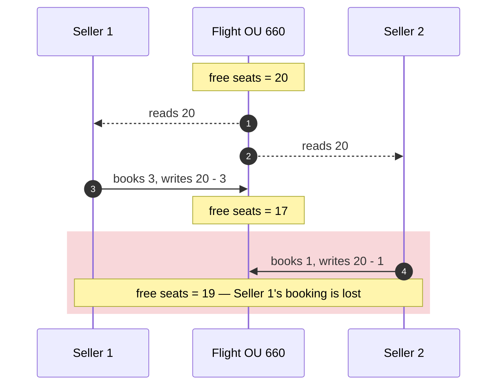
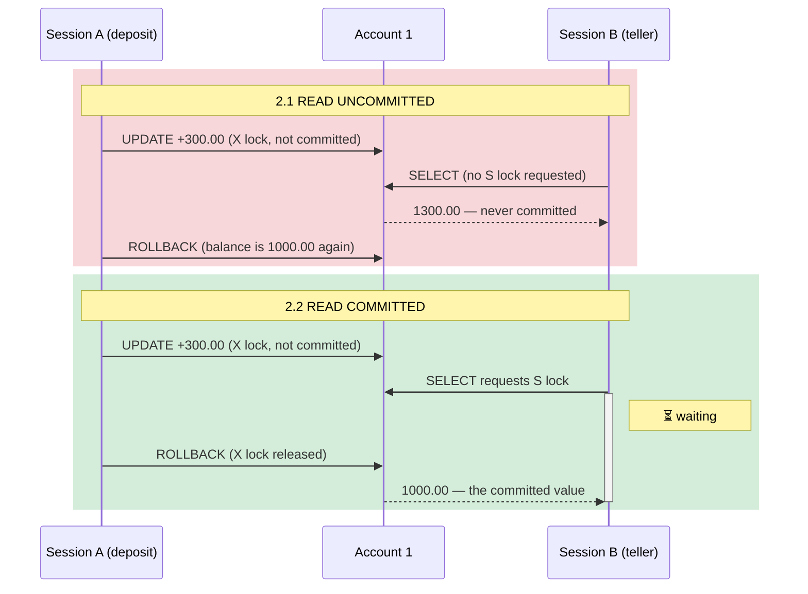
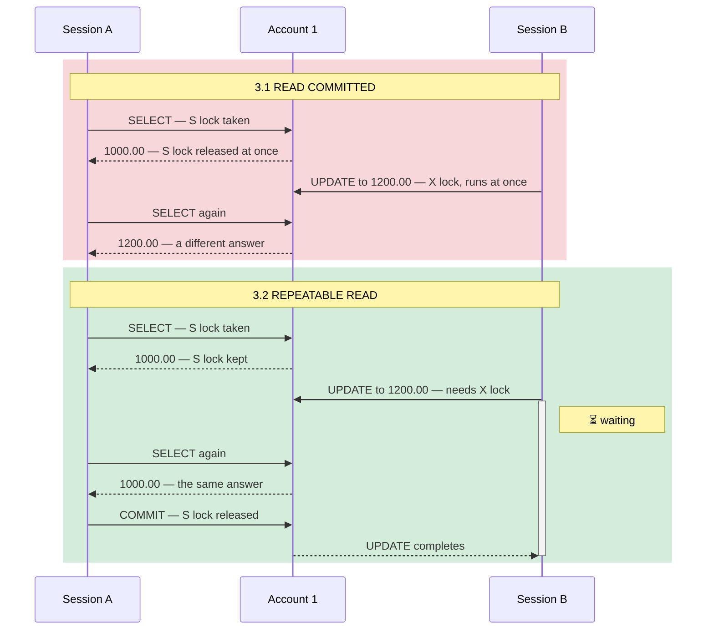
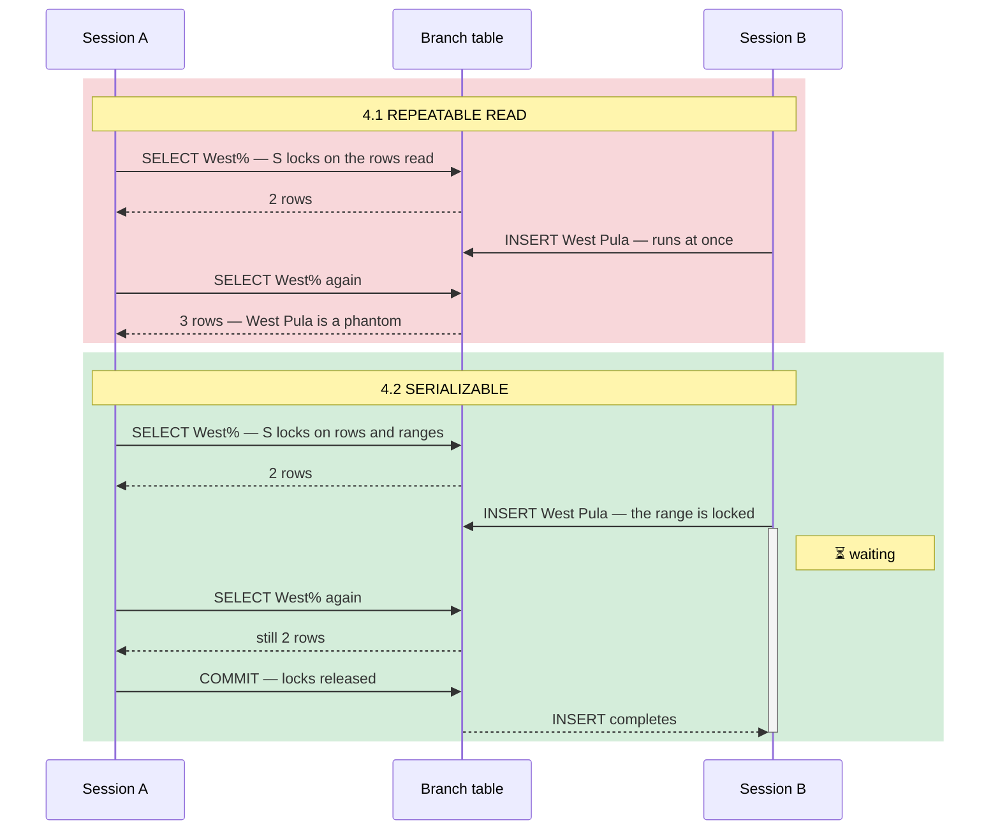
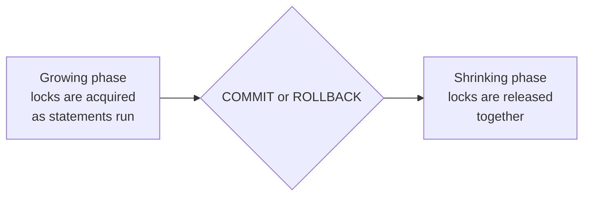
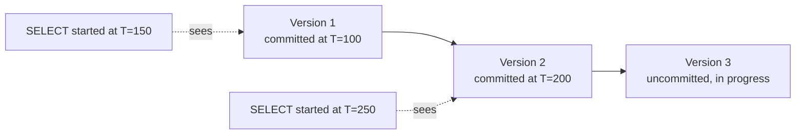

# Lab 10 – Concurrency and Isolation

**Database:** `TransactionsLab` (same database as Lab 9 — see *Before you start*)

Lab 9 treated every transaction as if it were the only one running. In the real world, many sessions read and write the same database at the same time. What happens when two of them touch the same row within a few milliseconds of each other?

Consider two airline sellers booking seats on the same flight at the same moment. Each one reads the number of free seats, subtracts the seats the customer wants, and writes the result back:



Four seats were sold, but the flight still shows 19 free seats. Both sellers did their job correctly, and both changes were saved — yet the first booking has disappeared, overwritten by the second seller, who was still working with the old value 20. This is a **lost update**.

A lost update is one way two sessions can interfere with each other. In this lab you will reproduce three more — the ones the isolation levels are defined by — fix each one with a stronger isolation level, and then look under the hood at how SQL Server enforces that with locks. At the end, we return to the two sellers.

> [!IMPORTANT]
> **Core idea:** An isolation level is a deliberate trade-off between correctness and concurrency. Stronger isolation prevents more surprises but makes sessions wait for each other longer. There is no setting that is simply "best" — only the right one for a given workload.

---

## Learning objectives

After completing this lab, you should be able to:

- distinguish a dirty read, a non-repeatable read, and a phantom read;
- set and explain what each of the four standard isolation levels prevents;
- predict which of two concurrent sessions blocks, and why, given their isolation levels and access pattern;
- explain shared and exclusive locks and read the compatibility matrix between them;
- explain two-phase locking and how the lifetime of shared locks decides what an isolation level guarantees;
- limit how long a session waits for a lock with `SET LOCK_TIMEOUT`;
- explain lock granularity, why an index reduces blocking, and why SQL Server escalates row locks to a table lock;
- recognize a deadlock, interpret SQL Server's error, and design around it.

> [!NOTE]
> This lab needs **two SSMS query windows** connected to the same server and the same `TransactionsLab` database — open a second window with `Ctrl+N` (or File → New Query) before starting Part A. Label the tabs **Session A** and **Session B** (right-click a tab → Rename Tab) so you don't lose track of which window runs which step. Every demo below says exactly which session runs which block.

---

## Before you start

Run this in **either** window first — it only needs to run once, and both windows will then see the same database.

```sql
USE master;
GO

DROP DATABASE IF EXISTS TransactionsLab;
GO

CREATE DATABASE TransactionsLab;
GO

USE TransactionsLab;
GO

CREATE TABLE dbo.BankAccount
(
    AccountID int NOT NULL
        CONSTRAINT PK_BankAccount PRIMARY KEY,
    AccountName nvarchar(50) NOT NULL,
    Balance decimal(12, 2) NOT NULL,
    CONSTRAINT CK_BankAccount_Balance
        CHECK (Balance >= 0)
);
GO

INSERT INTO dbo.BankAccount (AccountID, AccountName, Balance)
VALUES
    (1, N'Account A', 1000.00),
    (2, N'Account B',  500.00);

CREATE TABLE dbo.Branch
(
    BranchID int IDENTITY(1, 1) NOT NULL
        CONSTRAINT PK_Branch PRIMARY KEY,
    BranchName nvarchar(50) NOT NULL
);
GO

INSERT INTO dbo.Branch (BranchName)
VALUES
    (N'West Zagreb'),
    (N'West Rijeka'),
    (N'Central Osijek');
```

In your **second** window, just switch to the database:

```sql
USE TransactionsLab;
```

Confirm the two windows are genuinely separate sessions — run this in both:

```sql
SELECT @@SPID AS SessionID;
```

Each window should report a different number. That number identifies your session for the rest of this lab.

---

# Part A – The Three Problems

# Section 1 – Two Sessions, One Database

## 1.1 Why one session was never the whole story

Every statement you have run so far in this course executed alone — no other session was reading or writing the same rows at the same moment. Production databases rarely have that luxury: hundreds of sessions can touch the same tables at once.

This section names three specific ways that two sessions can interfere with each other and introduces the two tools the demos use: locks and the isolation level. Sections 2–4 reproduce each problem, then fix it. Part B explains the mechanism underneath.

## 1.2 The three problems

| Problem | One-sentence definition |
|---|---|
| **Dirty read** | Reading a value another transaction changed but has not committed — that value may vanish |
| **Non-repeatable read** | Reading the same row twice inside one transaction and getting two different values |
| **Phantom read** | Running the same range query twice inside one transaction and getting a different set of rows |

> [!NOTE]
> The first is about a value that never really existed. The second is a value that changed under you. The third is a row that appeared (or disappeared) under you. Each is prevented by a different, progressively stricter isolation level.

## 1.3 Shared and exclusive locks

SQL Server keeps sessions apart with **locks**. Before a session reads or changes a row, it requests a lock on that row:

| Lock | Used for | Compatible with other sessions' |
|---|---|---|
| **S** (Shared) | Reading | Other **S** locks only |
| **X** (Exclusive) | Writing | Nothing |

| | S requested | X requested |
|---|:---:|:---:|
| **S held** | ✔ compatible | ✗ blocks |
| **X held** | ✗ blocks | ✗ blocks |

Two readers never block each other. A writer blocks every other reader and writer on the same row. When a requested lock is incompatible with a lock another session holds, the requesting session **waits** — its statement appears to hang — until that lock is released.

An **X** lock is always held until the transaction ends. How long an **S** lock is held depends on the isolation level, and that difference is what the demos in Sections 2–4 show.

## 1.4 Demo: a conflict is about one row

Locks are taken on rows, so two sessions conflict only when they need the same row in incompatible ways (Section 6.2 explains why). Both sessions use the default isolation level here.

**Session A** — change account 1 and keep the transaction open:

```sql
BEGIN TRANSACTION;

UPDATE dbo.BankAccount
SET Balance = Balance + 300.00
WHERE AccountID = 1;

-- Do not COMMIT or ROLLBACK yet.
```

**Session B** — read the other account:

```sql
SELECT AccountID, Balance
FROM dbo.BankAccount
WHERE AccountID = 2;
```

This returns `500.00` immediately. Session A holds an **X** lock on account 1 only; account 2 is free, and the primary key lets SQL Server find row 2 without touching row 1.

**Session B** — now read every account:

```sql
SELECT AccountID, Balance
FROM dbo.BankAccount;
```

This query **hangs**. To return all rows, Session B needs an **S** lock on account 1 as well, and Session A's **X** lock blocks it.

**Session A:**

```sql
ROLLBACK TRANSACTION;
```

The instant Session A finishes, Session B's `SELECT` returns both rows, with account 1 at `1000.00`.

## 1.5 How long a session waits: LOCK_TIMEOUT

By default, a blocked session waits for as long as it takes. `SET LOCK_TIMEOUT` sets a limit, in milliseconds, for the session:

```sql
SET LOCK_TIMEOUT 5000;   -- wait at most 5 seconds
```

Repeat the second part of 1.4 with a limit.

**Session A:**

```sql
BEGIN TRANSACTION;

UPDATE dbo.BankAccount
SET Balance = Balance + 300.00
WHERE AccountID = 1;
```

**Session B:**

```sql
SET LOCK_TIMEOUT 5000; -- NEW: give up after 5 seconds

SELECT AccountID, Balance
FROM dbo.BankAccount;
```

After 5 seconds, instead of waiting further, Session B receives an error:

```text
Msg 1222, Level 16
Lock request time out period exceeded.
```

Only the `SELECT` failed; Session B can continue and try again later. Finish Session A and restore the default in Session B:

**Session A:**

```sql
ROLLBACK TRANSACTION;
```

**Session B:**

```sql
SET LOCK_TIMEOUT -1;     -- the default: wait without a limit
```

`LOCK_TIMEOUT` belongs to the session and stays set until it is changed again or the connection closes.

## 1.6 Setting the isolation level

```sql
SET TRANSACTION ISOLATION LEVEL <level>;
```

The four levels are `READ UNCOMMITTED`, `READ COMMITTED` (the default), `REPEATABLE READ`, and `SERIALIZABLE`.

The setting applies to the **session**, not to a single statement — like `LOCK_TIMEOUT` in 1.5 and `@@TRANCOUNT` in Lab 9, the isolation level is per-connection state. It stays in effect for every transaction on that connection until you change it again or the connection closes. That is why the demos below reset it to `READ COMMITTED` whenever a demo has changed it.

## 1.7 Check your understanding

1. Which lock does a session request to read a row, and which to change it?
2. A session holds an **S** lock on a row. Which of these can another session get on the same row: an **S** lock, an **X** lock?
3. In 1.4, why did Session B's first `SELECT` return immediately, but its second one wait?
4. What happens to a blocked statement in a session with `SET LOCK_TIMEOUT 5000`?
5. You run `SET TRANSACTION ISOLATION LEVEL SERIALIZABLE;` in Session A. Which level does Session B use?

<details>
<summary>Show answers</summary>

1. An **S** (shared) lock to read, an **X** (exclusive) lock to change.
2. An **S** lock — two readers are compatible. An **X** lock must wait until the **S** lock is released.
3. The first `SELECT` read only account 2, which Session A had not locked. The second one also had to read account 1, where Session A held an **X** lock.
4. After 5 seconds of waiting, the statement fails with error 1222. The session itself can continue.
5. Its own level — `READ COMMITTED`, unless Session B changed it. The setting belongs to the session that ran it.

</details>

---

# Section 2 – Dirty Reads

## 2.1 Demo: READ UNCOMMITTED exposes an uncommitted value

Two bank tellers look at the same account. One is depositing a cheque that has not been confirmed yet; the other is checking the balance to decide whether to approve a withdrawal. If the second teller sees the unconfirmed deposit and the cheque later bounces, they approve a withdrawal against money that never existed. Session A is the deposit; Session B is the teller checking the balance.

**Session A:**

```sql
BEGIN TRANSACTION;

UPDATE dbo.BankAccount
SET Balance = Balance + 300.00
WHERE AccountID = 1;

-- Do not COMMIT or ROLLBACK yet.
```

Leave Session A exactly here — the deposit is open and uncommitted.

**Session B:**

```sql
SET TRANSACTION ISOLATION LEVEL READ UNCOMMITTED;

SELECT AccountID, Balance
FROM dbo.BankAccount
WHERE AccountID = 1;
```

Session B returns immediately with `1300.00` — a balance Session A never confirmed.

**Session A** (the cheque bounces):

```sql
ROLLBACK TRANSACTION;
```

Now re-run Session B's `SELECT`. It returns `1000.00` — the `1300.00` Session B saw a moment ago has never existed in the committed database and never will.

> [!IMPORTANT]
> `READ UNCOMMITTED` does not request **S** locks, so it reads whatever is in the row right now, committed or not. It never blocks, which makes it fast — and it can hand you a value that is about to be undone.

Before continuing, put Session B back to the default isolation level:

```sql
SET TRANSACTION ISOLATION LEVEL READ COMMITTED;
```

## 2.2 Fix: READ COMMITTED blocks instead of lying

`READ COMMITTED` is SQL Server's default isolation level. Repeat the same demo — this time Session B will not lie to you; it will wait.

**Session A:**

```sql
BEGIN TRANSACTION;

UPDATE dbo.BankAccount
SET Balance = Balance + 300.00
WHERE AccountID = 1;

-- Leave this open again.
```

**Session B** (already at `READ COMMITTED` from the reset above):

```sql
SELECT AccountID, Balance
FROM dbo.BankAccount
WHERE AccountID = 1;
```

This query **hangs**. Do not cancel it — it is waiting for an **S** lock on the row, and Session A holds an **X** lock there.

**Session A:**

```sql
ROLLBACK TRANSACTION;
```

The instant Session A finishes, Session B's `SELECT` returns — with the true value, `1000.00`.

The two demos side by side:



> [!NOTE]
> No lie this time, but a cost: Session B waited. `READ COMMITTED` trades a little latency for a guarantee that you never read a value that might be undone.

## 2.3 Check your understanding

1. Which isolation level never blocks and never guarantees a committed value?
2. Why did Session B's query hang under `READ COMMITTED` but not under `READ UNCOMMITTED`?
3. In 2.1, the teller trusts the `1300.00` and approves a withdrawal of `1200.00` from account 1. What happens to that withdrawal once the deposit is rolled back?

<details>
<summary>Show answers</summary>

1. `READ UNCOMMITTED`. It reads rows without requesting **S** locks, regardless of what other sessions hold.
2. `READ COMMITTED` requires an **S** lock to read a row; Session A held an incompatible **X** lock on that row until it finished. `READ UNCOMMITTED` does not request an **S** lock at all, so there was nothing to wait for.
3. The withdrawal's `UPDATE` cannot change the row before the rollback — it would wait for Session A's **X** lock. After the rollback the balance is `1000.00`, so `1000.00 - 1200.00` violates `CK_BankAccount_Balance` and the `UPDATE` fails. Without that constraint the account would end at `-200.00` — the bank would pay out money that never existed.

</details>

---

# Section 3 – Non-Repeatable Reads

## 3.1 Demo: the same row, two reads, two answers

`READ COMMITTED` stops you from reading an uncommitted value, but it only holds its **S** lock for the instant of the read — not for the rest of the transaction. That gap causes a different problem.

**Session A:**

```sql
BEGIN TRANSACTION;

SELECT AccountID, Balance
FROM dbo.BankAccount
WHERE AccountID = 1;
-- 1000.00. Keep this transaction open.
```

**Session B:**

```sql
UPDATE dbo.BankAccount
SET Balance = 1200.00
WHERE AccountID = 1;
```

This runs immediately — no blocking. `READ COMMITTED` released Session A's **S** lock right after its `SELECT` finished, so Session B's `UPDATE` found nothing in its way.

**Session A:**

```sql
SELECT AccountID, Balance
FROM dbo.BankAccount
WHERE AccountID = 1;
-- 1200.00 — a different answer from the same query, same transaction.

COMMIT TRANSACTION;
```

> [!IMPORTANT]
> `READ COMMITTED` guarantees every individual read is of a committed value. It makes no promise that two reads of the same row, in the same transaction, agree with each other.

Reset the balance before continuing:

```sql
UPDATE dbo.BankAccount SET Balance = 1000.00 WHERE AccountID = 1;
```

## 3.2 Fix: REPEATABLE READ holds the shared lock

**Session A:**

```sql
SET TRANSACTION ISOLATION LEVEL REPEATABLE READ;

BEGIN TRANSACTION;

SELECT AccountID, Balance
FROM dbo.BankAccount
WHERE AccountID = 1;
-- 1000.00. Keep this transaction open.
```

**Session B:**

```sql
UPDATE dbo.BankAccount
SET Balance = 1200.00
WHERE AccountID = 1;
```

This **hangs**. `REPEATABLE READ` keeps its **S** lock on every row it has read until the transaction ends, so Session B's `UPDATE` cannot get the **X** lock it needs.

**Session A:**

```sql
SELECT AccountID, Balance
FROM dbo.BankAccount
WHERE AccountID = 1;
-- Still 1000.00 — the same answer both times.

COMMIT TRANSACTION;
```

The moment Session A commits, Session B's `UPDATE` unblocks and completes.

The two demos side by side:



Reset for the next section:

```sql
UPDATE dbo.BankAccount SET Balance = 1000.00 WHERE AccountID = 1;
```

```sql
SET TRANSACTION ISOLATION LEVEL READ COMMITTED;
```

## 3.3 Check your understanding

1. What makes `REPEATABLE READ` stronger than `READ COMMITTED`?
2. In 3.1, why didn't Session B's `UPDATE` block, given that Session A had already read that row?
3. What is the cost of `REPEATABLE READ` compared to `READ COMMITTED`?

<details>
<summary>Show answers</summary>

1. It holds its **S** locks until the transaction ends, instead of releasing them right after each read.
2. Under `READ COMMITTED`, an **S** lock exists only for the instant of the `SELECT`; it is gone before the next statement runs. There was nothing left for Session B's `UPDATE` to conflict with.
3. Readers now hold locks for longer, which can make writers to the same rows wait longer than they would under `READ COMMITTED`.

</details>

---

# Section 4 – Phantom Reads

## 4.1 Demo: a range query gains a row

`REPEATABLE READ` locks the rows a query actually reads. It has nothing to say about rows that do not exist yet.

**Session A:**

```sql
SET TRANSACTION ISOLATION LEVEL REPEATABLE READ;

BEGIN TRANSACTION;

SELECT BranchID, BranchName
FROM dbo.Branch
WHERE BranchName LIKE N'West%';
-- 2 rows: West Zagreb, West Rijeka. Keep this transaction open.
```

**Session B:**

```sql
INSERT INTO dbo.Branch (BranchName)
VALUES (N'West Pula');
```

This runs immediately — no blocking. Session A's locks cover the rows that existed when it read; they say nothing about a brand-new row.

**Session A:**

```sql
SELECT BranchID, BranchName
FROM dbo.Branch
WHERE BranchName LIKE N'West%';
-- 3 rows now — West Pula is a phantom.

COMMIT TRANSACTION;
```

Clean up the phantom row:

```sql
DELETE FROM dbo.Branch WHERE BranchName = N'West Pula';
```

## 4.2 Fix: SERIALIZABLE locks the range

**Session A:**

```sql
SET TRANSACTION ISOLATION LEVEL SERIALIZABLE;

BEGIN TRANSACTION;

SELECT BranchID, BranchName
FROM dbo.Branch
WHERE BranchName LIKE N'West%';
-- 2 rows. Keep this transaction open.
```

**Session B:**

```sql
INSERT INTO dbo.Branch (BranchName)
VALUES (N'West Pula');
```

This **hangs**. `SERIALIZABLE` locks not only the rows Session A read, but also the **ranges** between them — the gaps where a new row could be inserted — until the transaction ends.

> [!NOTE]
> Which range gets locked depends on how SQL Server reads the rows. `dbo.Branch` has no index on `BranchName`, so the `SELECT` scans the whole table, and the range lock covers the whole table: in this demo, inserting `Central Pula` would block too, and so would an `UPDATE` of `Central Osijek`. With an index on `BranchName`, SQL Server could lock only the `West%` range.

**Session A:**

```sql
SELECT BranchID, BranchName
FROM dbo.Branch
WHERE BranchName LIKE N'West%';
-- Still 2 rows.

COMMIT TRANSACTION;
```

Session B's `INSERT` unblocks and completes.

The two demos side by side:



Clean up and reset the isolation level:

```sql
DELETE FROM dbo.Branch WHERE BranchName = N'West Pula';
GO

SET TRANSACTION ISOLATION LEVEL READ COMMITTED;
```

## 4.3 Check your understanding

1. Why didn't `REPEATABLE READ` stop the phantom in 4.1?
2. What does `SERIALIZABLE` lock that `REPEATABLE READ` does not?
3. Which of the three problems does `SERIALIZABLE` add protection against, compared to `REPEATABLE READ`?

<details>
<summary>Show answers</summary>

1. `REPEATABLE READ` only locks rows it actually read. A brand-new row was never part of that set, so nothing blocked its insertion.
2. The ranges between the rows it read, where a new matching row could be inserted — in this demo, because the table is scanned, the whole table.
3. Phantom reads.

</details>

---

# Section 5 – The Four Isolation Levels

## 5.1 Summary

| Level | Prevents dirty reads | Prevents non-repeatable reads | Prevents phantoms |
|---|:---:|:---:|:---:|
| `READ UNCOMMITTED` | — | — | — |
| `READ COMMITTED` (default) | ✔ | — | — |
| `REPEATABLE READ` | ✔ | ✔ | — |
| `SERIALIZABLE` | ✔ | ✔ | ✔ |

The levels trade one thing for another: the higher in the list, the more sessions can work at the same time; the lower, the stronger the guarantee of consistent data.

```text
READ UNCOMMITTED                 ▲             │
READ COMMITTED (default)         │             │
REPEATABLE READ                  │             │
SERIALIZABLE                     │             ▼
                            concurrency   consistency
```

> [!IMPORTANT]
> Each stricter level is a superset of the one before it: it prevents everything the weaker level prevented, plus one more problem — at the cost of holding locks longer and making more sessions wait.

## 5.2 Choosing a level

Almost every real application runs on `READ COMMITTED`. Design for it by default. Reach for a stricter level only for the specific transaction that genuinely needs the stronger guarantee — not for the whole system — because every step up this table costs concurrency.

## 5.3 Check your understanding

1. You need a report that must never see an uncommitted value, but you don't care if a value changes between two reads in the same transaction. Which level is both sufficient and cheapest?
2. A reconciliation job reads the same set of rows three times in one transaction and must see exactly the same rows each time, including guaranteeing no new matching row appears. Which level does it need?
3. True or false: `SERIALIZABLE` prevents dirty reads.

<details>
<summary>Show answers</summary>

1. `READ COMMITTED` — it is the default, and dirty reads are the only problem that matters here.
2. `SERIALIZABLE` — it needs protection against phantoms, which only `SERIALIZABLE` provides.
3. True — it is the strictest level and prevents all three problems.

</details>

---

# Part B – How SQL Server Enforces Isolation

Part A showed **what** each isolation level prevents. This part explains **how** SQL Server enforces that — by holding locks for a controlled duration — and what happens when two sessions end up waiting for each other.

# Section 6 – How Long Locks Are Held

## 6.1 Two-phase locking (2PL)

Two-phase locking divides a transaction into two phases: in the first, it only acquires locks, as its statements need them; in the second, it only releases them. SQL Server releases the locks together, at `COMMIT` or `ROLLBACK`.



**X** locks always follow this rule: they live exactly as long as the transaction does. **S** locks are where the isolation levels differ — this table is the mechanism behind every demo in Part A:

| Isolation level | **S** lock on a row it reads | **X** lock on a row it changes |
|---|---|---|
| `READ UNCOMMITTED` | not requested | held until the transaction ends |
| `READ COMMITTED` | released right after the read | held until the transaction ends |
| `REPEATABLE READ` | held until the transaction ends | held until the transaction ends |
| `SERIALIZABLE` | held until the transaction ends, together with locks on the ranges between rows | held until the transaction ends |

`REPEATABLE READ` and `SERIALIZABLE` keep **S** locks under the two-phase rule as well. `READ COMMITTED` breaks it for **S** locks — it releases each one right after the read — and that is exactly why it cannot guarantee that a second read returns the same value (see the diagram at the end of Section 3.2). The longer the **S** locks live, the more problems the level prevents — and the longer writers wait.

A consequence for the transactions from Lab 9: a shorter transaction holds its **X** locks for less time, which means less time blocking other sessions. Transaction length is a concurrency decision, not just a correctness one.

## 6.2 Lock granularity

| Granularity | Covers | Concurrency | Overhead |
|---|---|---|---|
| Row | One row | Highest | One lock per row touched |
| Page | One 8 KB page (see [Lab 5](lab05-physical-storage.md)) | Medium | One lock per page |
| Table | The whole table | Lowest | One lock |

SQL Server normally locks rows. That is why, in Section 1.4, Session A's change to account 1 did not stop Session B from reading account 2.

Which rows a statement locks depends on **how SQL Server finds them**. In Section 1.4, the primary key let Session B go straight to account 2, so it never touched the locked row. A query that has to scan the table requests a lock on every row it reads: in Section 4.2, `dbo.Branch` has no index on `BranchName`, so the `SERIALIZABLE` scan locked every row and every gap between them — in effect the whole table, although with row-level locks. An index that lets SQL Server read only the rows it needs ([Lab 6](lab06-indexes.md)) therefore also means fewer locks and less blocking.

To see the row, page and table levels in SQL Server's own lock list, see [Additional Reading A](#a-looking-at-locks-sysdm_tran_locks).

If a single statement would need an impractically large number of row locks — for example, an `UPDATE` with no `WHERE` clause on a large table — SQL Server **escalates** them to one table lock. During that escalated lock, no other session can touch the table at all, even rows the original statement never cared about. SQL Server escalates once a statement holds roughly 5,000 locks on one table, or under memory pressure; the exact threshold is an internal heuristic, so do not rely on a specific number.

## 6.3 Check your understanding

1. When does SQL Server release an **X** lock?
2. In terms of locks, why can `READ COMMITTED` not prevent a non-repeatable read?
3. Two sessions both run under `REPEATABLE READ` and have both read the same row. What happens when one of them tries to change it?
4. Why can an index on the column in a `WHERE` condition reduce blocking?
5. What can cause SQL Server to escalate from row locks to a table lock, and why does it hurt other sessions?

<details>
<summary>Show answers</summary>

1. At `COMMIT` or `ROLLBACK` — never earlier, at any isolation level.
2. It releases the **S** lock right after each read, so between two reads another session can get an **X** lock on the row, change it, and commit.
3. It waits: the `UPDATE` needs an **X** lock, and the other session holds an **S** lock on the row until its transaction ends.
4. With an index, SQL Server reads — and locks — only the rows that match. Without one, it scans the table and requests a lock on every row it reads, so it can collide with sessions working on completely different rows.
5. A single statement that needs a very large number of row locks, such as an unfiltered `UPDATE` or `DELETE` on a large table. The table lock then blocks every other session from the whole table, even from rows the statement never needed.

</details>

---

# Section 7 – Deadlocks

## 7.1 Two sessions, opposite order

A deadlock happens when two sessions each hold a lock the other one needs, and neither can proceed.

Two transfers run at the same time: Session A moves 100.00 from account 1 to account 2; Session B moves 50.00 from account 2 to account 1. Each transfer is a transaction with two `UPDATE`s, as in Lab 9.

**Session A** (first step of its transfer):

```sql
BEGIN TRANSACTION;

UPDATE dbo.BankAccount
SET Balance = Balance - 100.00
WHERE AccountID = 1;
-- Session A now holds an X lock on account 1.
```

**Session B** (first step of its transfer):

```sql
BEGIN TRANSACTION;

UPDATE dbo.BankAccount
SET Balance = Balance - 50.00
WHERE AccountID = 2;
-- Session B now holds an X lock on account 2.
```

**Session A** (second step — needs the row Session B holds):

```sql
UPDATE dbo.BankAccount
SET Balance = Balance + 100.00
WHERE AccountID = 2;
-- Blocks, waiting for Session B.
```

**Session B** (second step — needs the row Session A holds):

```sql
UPDATE dbo.BankAccount
SET Balance = Balance + 50.00
WHERE AccountID = 1;
```

At this moment, the locks form a cycle:

```text
           holds X                   waits for X
 Session A ──────────► Account 1 ◄─────────────────────── Session B
 (1 → 2)                                                   (2 → 1)
     │                                                        │
     │  waits for X                                holds X    │
     └───────────────► Account 2 ◄────────────────────────────┘
```

Neither statement can ever finish on its own — Session A waits for Session B's lock, Session B waits for Session A's. Within a few seconds, SQL Server detects the cycle and ends one of the two transactions. One window shows:

```text
Msg 1205, Level 13, State 51
Transaction (Process ID ...) was deadlocked on lock resources with another process
and has been chosen as the deadlock victim. Rerun the transaction.
```

The **other** window's blocked statement then completes immediately — the victim's locks were released when SQL Server rolled it back.

Finish the surviving session:

```sql
COMMIT TRANSACTION;
```

The session that received `Msg 1205` has already been rolled back automatically; its `@@TRANCOUNT` is `0` and nothing needs undoing there. Only the surviving transfer was committed.

Reset the balances before continuing:

```sql
UPDATE dbo.BankAccount SET Balance = 1000.00 WHERE AccountID = 1;
UPDATE dbo.BankAccount SET Balance =  500.00 WHERE AccountID = 2;
```

## 7.2 Avoiding deadlocks

> [!IMPORTANT]
> SQL Server's fix is automatic but destructive — one transaction simply fails and must be retried. The real fix is in your code: **always touch tables, and rows, in the same order**, everywhere in your application. If every transfer updated the account with the lower ID first — whatever the direction of the transfer — the cycle in 7.1 could never form.

## 7.3 Check your understanding

1. What two conditions together create a deadlock?
2. How does SQL Server resolve a deadlock once it detects one?
3. What is the actual fix for a deadlock-prone pattern?

<details>
<summary>Show answers</summary>

1. Two sessions each hold a lock the other needs, and each is waiting to acquire the other's lock — a cycle of waits with no way out.
2. It picks a victim (typically the transaction that has done less work), rolls it back, and raises error 1205 in that session. The other session's blocked statement then proceeds.
3. Make every transaction acquire locks on shared resources in the same order, so the circular wait can never form.

</details>

---

# Section 8 – Common Mistakes and Final Review

## 8.1 Common mistakes

| Mistake | Why it matters | Better approach |
|---|---|---|
| Assuming one session's behavior predicts another's | Isolation level is per-session | Check `SET TRANSACTION ISOLATION LEVEL` for the session that matters |
| Forgetting a changed isolation level persists | It stays set until changed again or the connection closes | Reset it explicitly when a demo or test finishes |
| Treating `REPEATABLE READ` as phantom-proof | It only locks rows already read | Use `SERIALIZABLE` when new matching rows must not appear |
| Reaching for `SERIALIZABLE` everywhere "to be safe" | Maximizes blocking for problems that may not apply | Match the level to the specific anomaly a transaction must avoid |
| Treating a deadlock as a bug to silence | It is SQL Server protecting correctness, not a malfunction | Fix the access order; always retry the chosen victim |
| Running a large unfiltered `UPDATE`/`DELETE`, or a query with no useful index, on a busy table | It locks many rows, or escalates to a table lock, and blocks unrelated work | Filter and index so only the needed rows are read; split large changes into smaller batches |
| Letting a blocked session wait forever | A user or a job hangs without an error | Set `LOCK_TIMEOUT` where waiting has a limit, and handle error 1222 |

## 8.2 Final questions

1. Name the three concurrency problems in order of which isolation level first prevents each.
2. What table explains every blocking moment demonstrated in Part A, and what decides how long the blocking lasts?
3. What must be true of two transactions for a deadlock to form between them?

<details>
<summary>Show answers</summary>

1. Dirty read (`READ COMMITTED`), non-repeatable read (`REPEATABLE READ`), phantom (`SERIALIZABLE`).
2. The shared/exclusive lock compatibility table (Section 1.3). How long a lock lives (Section 6.1): **X** locks until the transaction ends, **S** locks depending on the isolation level.
3. Each must hold a lock the other needs, with neither able to proceed without the other releasing first.

</details>

---

# Key takeaways

- **Two sessions can interfere in three specific ways.** Dirty read, non-repeatable read, and phantom read — each is a different kind of "the world changed while you were looking."
- **Isolation levels are a trade-off, not a ladder you climb for safety's sake.** Each stricter level prevents one more problem at the cost of more blocking.
- **Locks implement isolation; their duration decides the level.** **X** locks live until the transaction ends; how long **S** locks live is what separates the isolation levels.
- **Fewer rows read means fewer locks.** SQL Server locks rows, so an index that lets a query read only the rows it needs also reduces blocking; a statement that needs too many row locks escalates to a table lock.
- **A deadlock is SQL Server protecting correctness, not a bug.** Fix the access order; the database will always detect and break a cycle it cannot resolve.

Back to the opening question: two sellers booking seats on the same flight. The first booking was lost because each seller read the free seats, calculated the new value outside the database, and wrote it back. Written as one statement — `UPDATE ... SET FreeSeats = FreeSeats - 3` — the read and the write happen together: the first `UPDATE` takes an **X** lock on the row, the second one waits for it, then subtracts from the committed value `17`. Both bookings count. Every tool in this lab — the isolation levels, the lock compatibility rules, and two-phase locking — exists to give you a precise, chosen answer to what one session is allowed to see and change while another is working on the same rows.

**Looking ahead:** Labs 1–10 covered everything needed to design, build, and correctly operate a database as a service to an application. Lab 11 turns to the analytical side — reporting and aggregation over the data this course has spent ten labs learning to store and protect correctly.

---

## Additional practice

Exercises for this lab are in [Concurrency Exercises](../exercises/lab10-concurrency.md).

---

# Additional Reading

The following topics go beyond the locking model of this lab (**S** and **X** locks). They are not required for the exercises.

## A. Looking at Locks: sys.dm_tran_locks

`sys.dm_tran_locks` lists the locks sessions currently hold or wait for. You can watch the table from Section 6.1 in a single window.

**Session A** — `READ COMMITTED`, read a row, then look at this session's own locks before committing:

```sql
BEGIN TRANSACTION;

SELECT AccountID, Balance
FROM dbo.BankAccount
WHERE AccountID = 1;

SELECT
    resource_type  AS ResourceType,
    request_mode   AS LockMode,
    request_status AS Status
FROM sys.dm_tran_locks
WHERE request_session_id = @@SPID
  AND resource_database_id = DB_ID();

COMMIT TRANSACTION;
```

Result of the second `SELECT`:

| ResourceType | LockMode | Status |
|---|---|---|
| DATABASE | S | GRANT |

The transaction is still open, but no lock on the row is left: `READ COMMITTED` released the **S** lock right after the read. (Every session that uses a database holds a **S** lock on the database itself; it only means "this database is in use".)

Run the same block again, with one change in the first line:

```sql
SET TRANSACTION ISOLATION LEVEL REPEATABLE READ; -- NEW: hold S locks

BEGIN TRANSACTION;

SELECT AccountID, Balance
FROM dbo.BankAccount
WHERE AccountID = 1;

SELECT
    resource_type  AS ResourceType,
    request_mode   AS LockMode,
    request_status AS Status
FROM sys.dm_tran_locks
WHERE request_session_id = @@SPID
  AND resource_database_id = DB_ID();

COMMIT TRANSACTION;

SET TRANSACTION ISOLATION LEVEL READ COMMITTED;
```

Result of the second `SELECT`:

| ResourceType | LockMode | Status |
|---|---|---|
| DATABASE | S | GRANT |
| PAGE | IS | GRANT |
| KEY | S | GRANT |
| OBJECT | IS | GRANT |

Now the **S** lock on the row (`KEY`, a row in the primary key index) is still there. The `IS` locks are *intent* locks on the page and the table: they announce that a row below them is locked, so that another session cannot lock the whole page or table in an incompatible mode.

If another session is blocked, it appears in the same view with `Status = WAIT`.

## B. MVCC: An Alternative to Locking

### B.1 Don't lock reads — version them

Locking makes readers and writers wait for each other. **Multi-Version Concurrency Control (MVCC)** takes a different approach: when a row changes, keep the previous committed version, and let a reader read a committed version instead of waiting for the writer.

SQL Server's `READ_COMMITTED_SNAPSHOT` works at the level of a **statement**: each `SELECT` sees the rows as they were committed when that statement started.



No reader waits for a writer, and no writer waits for a reader. The uncommitted version 3 is visible to nobody but its own transaction.

> [!NOTE]
> Writers still block other writers — only one session at a time can change a row. MVCC changes read behavior; it does not remove write conflicts.

### B.2 Turning it on

MVCC is opt-in, per database. Changing this setting requires that no other connection uses the database, so first move **Session B** out of it:

**Session B:**

```sql
USE master;
```

**Session A:**

```sql
ALTER DATABASE TransactionsLab SET READ_COMMITTED_SNAPSHOT ON;
```

**Session B:**

```sql
USE TransactionsLab;
```

If the `ALTER DATABASE` keeps running, another connection (for example, a third query window) is still using `TransactionsLab`.

`READ_COMMITTED_SNAPSHOT ON` changes what `READ COMMITTED` itself means on this database: reads use row versions instead of **S** locks, with no code change required anywhere.

### B.3 Re-run the dirty-read fix under MVCC

Repeat Section 2.2 now that `READ_COMMITTED_SNAPSHOT` is on.

**Session A:**

```sql
BEGIN TRANSACTION;

UPDATE dbo.BankAccount
SET Balance = Balance + 300.00
WHERE AccountID = 1;

-- Leave this open.
```

**Session B:**

```sql
SELECT AccountID, Balance
FROM dbo.BankAccount
WHERE AccountID = 1;
```

This time Session B does **not** block. It returns immediately with `1000.00` — the last *committed* version, read from the version store instead of waiting for Session A's lock.

**Session A:**

```sql
ROLLBACK TRANSACTION;
```

> [!IMPORTANT]
> Same guarantee as Section 2.2 — no dirty read — but the blocking disappeared entirely. The cost moves elsewhere: `tempdb` stores the row versions, and every write becomes slightly more expensive to maintain them.

### B.4 SNAPSHOT isolation

SQL Server offers MVCC in a second form, the `SNAPSHOT` isolation level. The two are easy to confuse:

| Setting | Scope | What a read sees |
|---|---|---|
| `READ_COMMITTED_SNAPSHOT ON` | Database-wide; changes what `READ COMMITTED` means, no code change | Rows as committed when **the statement** started |
| `SNAPSHOT` isolation | Per transaction: `ALLOW_SNAPSHOT_ISOLATION ON` on the database, then `SET TRANSACTION ISOLATION LEVEL SNAPSHOT` in the session | Rows as committed when **the transaction** started — one fixed view for the whole transaction |

Because a `SNAPSHOT` transaction sees one fixed view, its reads are repeatable and show no phantoms. The complete picture:

| Isolation level | Dirty read | Non-repeatable read | Phantom |
|---|:---:|:---:|:---:|
| `READ UNCOMMITTED` | can happen | can happen | can happen |
| `READ COMMITTED` (with or without `READ_COMMITTED_SNAPSHOT`) | **prevented** | can happen | can happen |
| `REPEATABLE READ` | **prevented** | **prevented** | can happen |
| `SERIALIZABLE` | **prevented** | **prevented** | **prevented** |
| `SNAPSHOT` | **prevented** | **prevented** | **prevented**\* |

\* `SNAPSHOT` gives each transaction a consistent view from the moment it started, so a range query sees no phantom *relative to that starting point* — but it does so without blocking the writer. It answers a subtly different question than `SERIALIZABLE`: "what did the world look like when I started?" rather than "force everyone to behave as if transactions ran one at a time."

To return to the locking behavior used in this lab, turn the setting off the same way (Session B in `master` first):

```sql
ALTER DATABASE TransactionsLab SET READ_COMMITTED_SNAPSHOT OFF;
```
