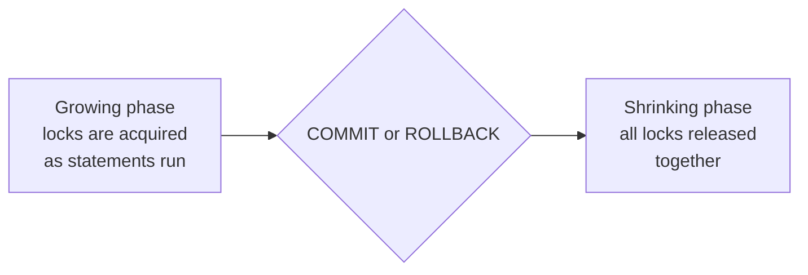
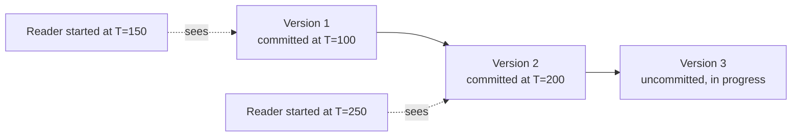

# Lab 10 – Concurrency and Isolation

**Database:** `TransactionsLab` (same database as Lab 9 — see *Before you start*)

Lab 9 treated every transaction as if it were the only one running. In the real world, many sessions read and write the same database at the same time. What happens when two of them touch the same row within a few milliseconds of each other?

Consider two bank tellers looking at the same account at the same instant. One is reading the balance to decide whether to approve a withdrawal; the other is in the middle of depositing a cheque that hasn't been confirmed yet. If the first teller sees the unconfirmed deposit and it later bounces, they approved a withdrawal against money that never existed.

In this lab you will reproduce three concrete ways two sessions can interfere with each other, fix each one with a stronger isolation level, and then look under the hood at how SQL Server actually enforces that — with locks, and with an alternative strategy called MVCC.

> [!IMPORTANT]
> **Core idea:** An isolation level is a deliberate trade-off between correctness and concurrency. Stronger isolation prevents more surprises but makes sessions wait for each other longer. There is no setting that is simply "best" — only the right one for a given workload.

---

## Learning objectives

After completing this lab, you should be able to:

- distinguish a dirty read, a non-repeatable read, and a phantom read;
- set and explain what each of the four standard isolation levels prevents;
- predict which of two concurrent sessions blocks, and why, given their isolation levels and access pattern;
- explain shared and exclusive locks and read the compatibility matrix between them;
- explain two-phase locking and why how long a lock is held controls what an isolation level can guarantee;
- explain lock granularity and why SQL Server escalates row locks to a table lock;
- recognize a deadlock, interpret SQL Server's error, and design around it;
- explain MVCC as an alternative to locking, and enable `READ_COMMITTED_SNAPSHOT`.

> [!NOTE]
> **Prerequisites:** [Lab 9 – Transactions](lab09-transactions.md) — explicit transactions, `@@TRANCOUNT`, and the `TransactionsLab` database this lab continues to use. [Lab 5 – Physical Storage](lab05-physical-storage.md) is useful background for lock granularity (pages, the buffer pool).

> [!NOTE]
> This lab needs **two SSMS query windows** connected to the same server and the same `TransactionsLab` database — open a second window with `Ctrl+N` (or File → New Query) before starting Part C. Label the tabs **Session A** and **Session B** (right-click a tab → Rename Tab) so you don't lose track of which window runs which step. Every demo below says exactly which session runs which block.

---

## Before you start

Run this in **either** window first — it only needs to run once, and both windows will then see the same database.

```sql
USE master;
GO

DROP DATABASE IF EXISTS TransactionsLab;
GO

CREATE DATABASE TransactionsLab;
GO

USE TransactionsLab;
GO

CREATE TABLE dbo.BankAccount
(
    AccountID int NOT NULL
        CONSTRAINT PK_BankAccount PRIMARY KEY,
    AccountName nvarchar(50) NOT NULL,
    Balance decimal(12, 2) NOT NULL,
    CONSTRAINT CK_BankAccount_Balance
        CHECK (Balance >= 0)
);
GO

INSERT INTO dbo.BankAccount (AccountID, AccountName, Balance)
VALUES
    (1, N'Account A', 1000.00),
    (2, N'Account B',  500.00);

CREATE TABLE dbo.Branch
(
    BranchID int IDENTITY(1, 1) NOT NULL
        CONSTRAINT PK_Branch PRIMARY KEY,
    BranchName nvarchar(50) NOT NULL
);
GO

INSERT INTO dbo.Branch (BranchName)
VALUES
    (N'West Zagreb'),
    (N'West Rijeka'),
    (N'Central Osijek');
```

In your **second** window, just switch to the database:

```sql
USE TransactionsLab;
```

Confirm the two windows are genuinely separate sessions — run this in both:

```sql
SELECT @@SPID AS SessionID;
```

Each window should report a different number. That number identifies your session for the rest of this lab.

Requires SQL Server 2016 SP1 or later.

---

# Part C – Concurrency and Isolation

# Section 1 – Two Sessions, One Database

## 1.1 Why one session was never the whole story

Every statement you have run so far in this course executed alone — no other session was reading or writing the same rows at the same moment. Production databases rarely have that luxury: hundreds of sessions can touch the same tables at once.

This section names three specific ways that two sessions can interfere with each other. Part C reproduces each one, then fixes it. Part D explains the locking mechanism underneath.

## 1.2 The three problems

| Problem | One-sentence definition |
|---|---|
| **Dirty read** | Reading a value another transaction changed but has not committed — that value may vanish |
| **Non-repeatable read** | Reading the same row twice inside one transaction and getting two different values |
| **Phantom read** | Running the same range query twice inside one transaction and getting a different set of rows |

> [!NOTE]
> The first is about a value that never really existed. The second is a value that changed under you. The third is a row that appeared (or disappeared) under you. Each is prevented by a different, progressively stricter isolation level.

---

# Section 2 – Dirty Reads

## 2.1 Demo: READ UNCOMMITTED exposes an uncommitted value

**Session A:**

```sql
BEGIN TRANSACTION;

UPDATE dbo.BankAccount
SET AccountName = N'Account A [DIRTY]'
WHERE AccountID = 1;

-- Do not COMMIT or ROLLBACK yet.
```

Leave Session A exactly here — the transaction is open and uncommitted.

**Session B:**

```sql
SET TRANSACTION ISOLATION LEVEL READ UNCOMMITTED;

SELECT AccountID, AccountName
FROM dbo.BankAccount
WHERE AccountID = 1;
```

Session B returns immediately with `Account A [DIRTY]` — a value Session A never confirmed.

**Session A** (finish the transaction):

```sql
ROLLBACK TRANSACTION;
```

Now re-run Session B's `SELECT`. It returns `Account A` — the name Session B saw a moment ago has never existed in the committed database and never will.

> [!IMPORTANT]
> `READ UNCOMMITTED` reads whatever is in memory right now, locked or not, committed or not. It never blocks, which makes it fast — and it can hand you a value that is about to be undone.

Before continuing, put Session B back to the default isolation level:

```sql
SET TRANSACTION ISOLATION LEVEL READ COMMITTED;
```

## 2.2 Fix: READ COMMITTED blocks instead of lying

`READ COMMITTED` is SQL Server's default isolation level. Repeat the same shape of demo — this time Session B will not lie to you; it will wait.

**Session A:**

```sql
BEGIN TRANSACTION;

UPDATE dbo.BankAccount
SET AccountName = N'Account A [DIRTY]'
WHERE AccountID = 1;

-- Leave this open again.
```

**Session B** (already at `READ COMMITTED` from the reset above):

```sql
SELECT AccountID, AccountName
FROM dbo.BankAccount
WHERE AccountID = 1;
```

This query **hangs**. Do not cancel it — it is waiting for Session A's exclusive lock on that row.

**Session A:**

```sql
ROLLBACK TRANSACTION;
```

The instant Session A finishes, Session B's `SELECT` returns — with the true value, `Account A`.

> [!NOTE]
> No lie this time, but a cost: Session B waited. `READ COMMITTED` trades a little latency for a guarantee that you never read a value that might be undone.

## 2.3 Check your understanding

1. Which isolation level never blocks and never guarantees a committed value?
2. Why did Session B's query hang under `READ COMMITTED` but not under `READ UNCOMMITTED`?
3. Is `READ COMMITTED` the SQL Server default?

<details>
<summary>Show answers</summary>

1. `READ UNCOMMITTED`. It reads in-memory values regardless of lock state.
2. `READ COMMITTED` requires a shared lock to read a row; Session A held an incompatible exclusive lock on that row until it finished. `READ UNCOMMITTED` does not request a shared lock at all, so there was nothing to wait for.
3. Yes.

</details>

---

# Section 3 – Non-Repeatable Reads

## 3.1 Demo: the same row, two reads, two answers

`READ COMMITTED` stops you from reading an uncommitted value, but it only holds its shared lock for the instant of the read — not for the rest of the transaction. That gap causes a different problem.

**Session A:**

```sql
BEGIN TRANSACTION;

SELECT AccountID, Balance
FROM dbo.BankAccount
WHERE AccountID = 1;
-- 1000.00. Keep this transaction open.
```

**Session B:**

```sql
UPDATE dbo.BankAccount
SET Balance = 1200.00
WHERE AccountID = 1;
```

This runs immediately — no blocking. `READ COMMITTED` released Session A's shared lock right after its `SELECT` finished, so Session B's `UPDATE` found nothing in its way.

**Session A:**

```sql
SELECT AccountID, Balance
FROM dbo.BankAccount
WHERE AccountID = 1;
-- 1200.00 — a different answer from the same query, same transaction.

COMMIT TRANSACTION;
```

> [!IMPORTANT]
> `READ COMMITTED` guarantees every individual read is of a committed value. It makes no promise that two reads of the same row, in the same transaction, agree with each other.

Reset the balance before continuing:

```sql
UPDATE dbo.BankAccount SET Balance = 1000.00 WHERE AccountID = 1;
```

## 3.2 Fix: REPEATABLE READ holds the shared lock

**Session A:**

```sql
SET TRANSACTION ISOLATION LEVEL REPEATABLE READ;

BEGIN TRANSACTION;

SELECT AccountID, Balance
FROM dbo.BankAccount
WHERE AccountID = 1;
-- 1000.00. Keep this transaction open.
```

**Session B:**

```sql
UPDATE dbo.BankAccount
SET Balance = 1200.00
WHERE AccountID = 1;
```

This **hangs**. `REPEATABLE READ` keeps its shared lock on every row it has read until the transaction ends, so Session B's `UPDATE` cannot get the exclusive lock it needs.

**Session A:**

```sql
SELECT AccountID, Balance
FROM dbo.BankAccount
WHERE AccountID = 1;
-- Still 1000.00 — the same answer both times.

COMMIT TRANSACTION;
```

The moment Session A commits, Session B's `UPDATE` unblocks and completes.

Reset for the next section:

```sql
UPDATE dbo.BankAccount SET Balance = 1000.00 WHERE AccountID = 1;
```

```sql
SET TRANSACTION ISOLATION LEVEL READ COMMITTED;
```

## 3.3 Check your understanding

1. What makes `REPEATABLE READ` stronger than `READ COMMITTED`?
2. In 3.1, why didn't Session B's `UPDATE` block, given that Session A had already read that row?
3. What is the cost of `REPEATABLE READ` compared to `READ COMMITTED`?

<details>
<summary>Show answers</summary>

1. It holds its shared locks until the transaction ends, instead of releasing them right after each read.
2. Under `READ COMMITTED`, a shared lock exists only for the instant of the `SELECT`; it is gone before the next statement runs. There was nothing left for Session B's `UPDATE` to conflict with.
3. Readers now hold locks for longer, which can make writers to the same rows wait longer than they would under `READ COMMITTED`.

</details>

---

# Section 4 – Phantom Reads

## 4.1 Demo: a range query gains a row

`REPEATABLE READ` locks the rows a query actually reads. It has nothing to say about rows that do not exist yet.

**Session A:**

```sql
SET TRANSACTION ISOLATION LEVEL REPEATABLE READ;

BEGIN TRANSACTION;

SELECT BranchID, BranchName
FROM dbo.Branch
WHERE BranchName LIKE N'West%';
-- 2 rows: West Zagreb, West Rijeka. Keep this transaction open.
```

**Session B:**

```sql
INSERT INTO dbo.Branch (BranchName)
VALUES (N'West Pula');
```

This runs immediately — no blocking. Session A's locks cover the two existing `West%` rows; they say nothing about a brand new row that didn't exist when Session A read.

**Session A:**

```sql
SELECT BranchID, BranchName
FROM dbo.Branch
WHERE BranchName LIKE N'West%';
-- 3 rows now — West Pula is a phantom.

COMMIT TRANSACTION;
```

Clean up the phantom row:

```sql
DELETE FROM dbo.Branch WHERE BranchName = N'West Pula';
```

## 4.2 Fix: SERIALIZABLE locks the range

**Session A:**

```sql
SET TRANSACTION ISOLATION LEVEL SERIALIZABLE;

BEGIN TRANSACTION;

SELECT BranchID, BranchName
FROM dbo.Branch
WHERE BranchName LIKE N'West%';
-- 2 rows. Keep this transaction open.
```

**Session B:**

```sql
INSERT INTO dbo.Branch (BranchName)
VALUES (N'West Pula');
```

This **hangs**. `SERIALIZABLE` locks the whole range implied by the predicate — including the gaps where a new matching row could be inserted — not just the rows that currently exist.

**Session A:**

```sql
SELECT BranchID, BranchName
FROM dbo.Branch
WHERE BranchName LIKE N'West%';
-- Still 2 rows.

COMMIT TRANSACTION;
```

Session B's `INSERT` unblocks and completes. Clean up and reset isolation level:

```sql
DELETE FROM dbo.Branch WHERE BranchName = N'West Pula';
GO

SET TRANSACTION ISOLATION LEVEL READ COMMITTED;
```

## 4.3 Check your understanding

1. Why didn't `REPEATABLE READ` stop the phantom in 4.1?
2. What does `SERIALIZABLE` lock that `REPEATABLE READ` does not?
3. Which of the three problems does `SERIALIZABLE` add protection against, compared to `REPEATABLE READ`?

<details>
<summary>Show answers</summary>

1. `REPEATABLE READ` only locks rows it actually read. A brand-new row was never part of that set, so nothing blocked its insertion.
2. The range implied by the query's predicate, including gaps that do not yet contain a row.
3. Phantom reads.

</details>

---

# Section 5 – The Four Isolation Levels

## 5.1 Setting an isolation level

```sql
SET TRANSACTION ISOLATION LEVEL <level>;
```

The setting applies to the **session**, not to a single statement — exactly like `@@TRANCOUNT` in Lab 9, isolation level is per-connection state. It stays in effect for every transaction on that connection until you change it again or the connection closes.

## 5.2 Summary

| Level | Prevents dirty reads | Prevents non-repeatable reads | Prevents phantoms |
|---|:---:|:---:|:---:|
| `READ UNCOMMITTED` | — | — | — |
| `READ COMMITTED` (default) | ✔ | — | — |
| `REPEATABLE READ` | ✔ | ✔ | — |
| `SERIALIZABLE` | ✔ | ✔ | ✔ |

> [!IMPORTANT]
> Each stricter level is a superset of the one before it: it prevents everything the weaker level prevented, plus one more problem — at the cost of holding locks longer and making more sessions wait.

## 5.3 Check your understanding

1. You need a report that must never see an uncommitted value, but you don't care if a value changes between two reads in the same transaction. Which level is both sufficient and cheapest?
2. A reconciliation job reads the same set of rows three times in one transaction and must see exactly the same rows each time, including guaranteeing no new matching row appears. Which level does it need?
3. True or false: `SERIALIZABLE` prevents dirty reads.

<details>
<summary>Show answers</summary>

1. `READ COMMITTED` — it is the default, and dirty reads are the only problem that matters here.
2. `SERIALIZABLE` — it needs protection against phantoms, which only `SERIALIZABLE` provides.
3. True — it is the strictest level and prevents all three problems.

</details>

---

# Part D – Locking, 2PL, and MVCC

Part C showed **what** each isolation level prevents. This part explains **how** SQL Server actually enforces that: by holding locks for a controlled duration, and — as an alternative — by keeping multiple versions of a row instead of locking it at all.

# Section 6 – Shared and Exclusive Locks

## 6.1 Two kinds of lock

| Lock | Used for | Compatible with other sessions' |
|---|---|---|
| **S** (Shared) | Reading | Other **S** locks only |
| **X** (Exclusive) | Writing | Nothing |

| | S requested | X requested |
|---|:---:|:---:|
| **S held** | ✔ compatible | ✗ blocks |
| **X held** | ✗ blocks | ✗ blocks |

> [!NOTE]
> Two readers never block each other. A writer blocks every other reader and writer on the same resource. This single table explains every blocking moment you saw in Part C: `READ UNCOMMITTED` never requests an **S** lock at all, so it never checks this table; every other level does.

## 6.2 Looking under the hood

While a session is blocked (for example, Section 2.2's Session B), run this in a **third** window, or in whichever session is not currently blocked:

```sql
SELECT
    request_session_id   AS SessionID,
    resource_type         AS ResourceType,
    request_mode          AS LockMode,
    request_status        AS Status
FROM sys.dm_tran_locks
WHERE resource_database_id = DB_ID(N'TransactionsLab');
```

You will see one session holding an `X` lock with `GRANT` status, and the other **waiting** for an incompatible lock with `WAIT` status. This is the compatibility table from 6.1, observed directly.

---

# Section 7 – Two-Phase Locking and Lock Granularity

## 7.1 Two-phase locking (2PL)

SQL Server acquires locks as a transaction needs them, and releases all of them together at the end:



*Diagram 1 – Two-phase locking: once a transaction starts releasing locks, it acquires no more. SQL Server collapses the shrinking phase into a single instant at `COMMIT`/`ROLLBACK`.*

> [!IMPORTANT]
> This is why every demo in Part C had you commit or roll back before the blocked session could proceed — SQL Server does not release a lock early just because a transaction's later statements are read-only. The lock lives exactly as long as the transaction does.

A direct consequence from Lab 9: a shorter transaction holds its locks for less time, which means less time blocking other sessions. Transaction length is a concurrency decision, not just a correctness one.

## 7.2 Lock granularity

| Granularity | Covers | Concurrency | Overhead |
|---|---|---|---|
| Row | One row | Highest | One lock per row touched |
| Page | One 8 KB page (see [Lab 5](lab05-physical-storage.md)) | Medium | One lock per page |
| Table | The whole table | Lowest | One lock |

SQL Server normally takes row locks. If a statement would need an impractically large number of them, SQL Server **escalates** to a table lock — for example, an `UPDATE` with no `WHERE` clause touching every row of a large table. During that escalated lock, no other session can touch the table at all, even rows the original statement never cared about.

## 7.3 Check your understanding

1. When does SQL Server release the locks a transaction acquired during its growing phase?
2. Why does a shorter transaction help other sessions, even ones touching completely different rows in the same table?
3. What can cause SQL Server to escalate from row locks to a table lock?

<details>
<summary>Show answers</summary>

1. All at once, at `COMMIT` or `ROLLBACK` — not incrementally as the transaction's later statements run.
2. If the shorter transaction's row locks would otherwise be escalated to a table lock, releasing them sooner frees the whole table sooner.
3. A single statement that would need to acquire a very large number of row locks, such as an unfiltered `UPDATE` or `DELETE` on a large table.

</details>

---

# Section 8 – Deadlocks

## 8.1 Two sessions, opposite order

A deadlock happens when two sessions each hold a lock the other one needs, and neither can proceed.

**Session A:**

```sql
BEGIN TRANSACTION;

UPDATE dbo.BankAccount
SET Balance = Balance + 0.00
WHERE AccountID = 1;
-- Session A now holds an X lock on account 1.
```

**Session B:**

```sql
BEGIN TRANSACTION;

UPDATE dbo.BankAccount
SET Balance = Balance + 0.00
WHERE AccountID = 2;
-- Session B now holds an X lock on account 2.
```

**Session A** (asks for the row Session B holds):

```sql
UPDATE dbo.BankAccount
SET Balance = Balance + 0.00
WHERE AccountID = 2;
-- Blocks, waiting for Session B.
```

**Session B** (asks for the row Session A holds):

```sql
UPDATE dbo.BankAccount
SET Balance = Balance + 0.00
WHERE AccountID = 1;
```

Neither statement can ever finish on its own — Session A waits for Session B's lock, Session B waits for Session A's. Within a few seconds, SQL Server detects the cycle and ends one of the two transactions for you. One window shows:

```
Msg 1205, Level 13, State 51
Transaction (Process ID ...) was deadlocked on lock resources with another process
and has been chosen as the deadlock victim. Rerun the transaction.
```

The **other** window's blocked statement then completes immediately — the victim's lock was released when SQL Server rolled it back.

Finish the surviving session:

```sql
COMMIT TRANSACTION;
```

The session that received `Msg 1205` has already been rolled back automatically; its `@@TRANCOUNT` is `0` and nothing needs undoing there.

## 8.2 Avoiding deadlocks

> [!IMPORTANT]
> SQL Server's fix is automatic but destructive — one transaction simply fails and must be retried. The real fix is in your code: **always touch tables, and rows, in the same order**, everywhere in your application. If every transaction updated account 1 before account 2, the cycle in 8.1 could never form.

## 8.3 Check your understanding

1. What two conditions together create a deadlock?
2. How does SQL Server resolve a deadlock once it detects one?
3. What is the actual fix for a deadlock-prone pattern?

<details>
<summary>Show answers</summary>

1. Two sessions each hold a lock the other needs, and each is waiting to acquire the other's lock — a cycle of waits with no way out.
2. It picks a victim (typically the transaction that has done less work), rolls it back, and raises error 1205 in that session. The other session's blocked statement then proceeds.
3. Make every transaction acquire locks on shared resources in the same order, so the circular wait can never form.

</details>

---

# Section 9 – MVCC: An Alternative to Locking

## 9.1 Don't lock reads — version them

Locking makes readers and writers wait for each other. **Multi-Version Concurrency Control (MVCC)** takes a different approach: keep several versions of a row, and let each reader see the version that was committed when its transaction started.



*Diagram 2 – Each reader is handed the version that existed when its own transaction began. No reader ever waits for a writer, and no writer ever waits for a reader.*

> [!NOTE]
> Writers still block other writers — eventually only one new version can win. MVCC changes read behavior; it does not remove write conflicts.

## 9.2 Turning it on

MVCC is opt-in, per database:

```sql
ALTER DATABASE TransactionsLab SET ALLOW_SNAPSHOT_ISOLATION ON;
ALTER DATABASE TransactionsLab SET READ_COMMITTED_SNAPSHOT ON;
```

`READ_COMMITTED_SNAPSHOT ON` changes what `READ COMMITTED` itself means on this database: reads now use row versions instead of shared locks, with no code change required anywhere.

## 9.3 Re-run the dirty-read fix under MVCC

Repeat Section 2.2 now that `READ_COMMITTED_SNAPSHOT` is on.

**Session A:**

```sql
BEGIN TRANSACTION;

UPDATE dbo.BankAccount
SET AccountName = N'Account A [DIRTY]'
WHERE AccountID = 1;

-- Leave this open.
```

**Session B:**

```sql
SELECT AccountID, AccountName
FROM dbo.BankAccount
WHERE AccountID = 1;
```

This time Session B does **not** block. It returns immediately with `Account A` — the last *committed* version, read from a version snapshot instead of waiting for Session A's lock.

**Session A:**

```sql
ROLLBACK TRANSACTION;
```

> [!IMPORTANT]
> Same guarantee as `READ COMMITTED` without `READ_COMMITTED_SNAPSHOT` — no dirty read — but Section 2.2's blocking disappeared entirely. The cost moves elsewhere: `tempdb` stores the row versions, and every write becomes slightly more expensive to maintain them.

## 9.4 Check your understanding

1. What does a reader see under MVCC that it would not see under lock-based `READ COMMITTED`?
2. Does MVCC remove blocking between two writers of the same row?
3. Where does SQL Server store the extra row versions MVCC needs?

<details>
<summary>Show answers</summary>

1. The same thing, logically — the last committed value. The difference is *how* it gets it: a version snapshot instead of waiting for a lock to be released.
2. No. Writers still block other writers; only reader-vs-writer blocking is eliminated.
3. `tempdb`.

</details>

---

# Section 10 – Isolation Levels vs. the Three Problems

## 10.1 The complete picture

| Isolation level | Dirty read | Non-repeatable read | Phantom |
|---|:---:|:---:|:---:|
| `READ UNCOMMITTED` | can happen | can happen | can happen |
| `READ COMMITTED` (default) | **prevented** | can happen | can happen |
| `REPEATABLE READ` | **prevented** | **prevented** | can happen |
| `SERIALIZABLE` | **prevented** | **prevented** | **prevented** |
| `SNAPSHOT` (MVCC) | **prevented** | **prevented** | **prevented**\* |

\* `SNAPSHOT` gives each reader a consistent view from the moment its transaction started, so a range query sees no phantom *relative to that starting point* — but it does so without blocking the writer. It answers a subtly different question than `SERIALIZABLE`: "what did the world look like when I started?" rather than "force everyone to behave as if transactions ran one at a time."

## 10.2 Choosing a level

> [!IMPORTANT]
> Almost every real application runs on `READ COMMITTED` (or `READ COMMITTED` with `READ_COMMITTED_SNAPSHOT`). Design for it by default. Reach for a stricter level only for the specific transaction that genuinely needs the stronger guarantee — not for the whole system — because every step up this table costs concurrency.

## 10.3 Check your understanding

1. Which level or levels prevent all three problems?
2. What question does `SERIALIZABLE` answer that `SNAPSHOT` does not?
3. What is the practical default for most applications?

<details>
<summary>Show answers</summary>

1. `SERIALIZABLE` and `SNAPSHOT`.
2. Whether the system behaved *as if* every transaction ran one after another, with no overlap at all — `SNAPSHOT` instead gives each transaction a fixed point-in-time view without enforcing that global ordering.
3. `READ COMMITTED`, often combined with `READ_COMMITTED_SNAPSHOT` to avoid reader/writer blocking.

</details>

---

# Section 11 – Practice Exercises

Use your two SSMS windows for every exercise below. Reset `AccountID = 1`'s values (`AccountName = 'Account A'`, `Balance = 1000.00`) and `dbo.Branch` to its three seed rows between exercises if a previous one changed them.

## Exercise 1 – Classify the Anomaly

Read this transcript:

```
Session A: BEGIN TRAN; SELECT Balance FROM BankAccount WHERE AccountID = 1;  -- 1000.00
Session B: UPDATE BankAccount SET Balance = 1500.00 WHERE AccountID = 1; COMMIT;
Session A: SELECT Balance FROM BankAccount WHERE AccountID = 1;  -- 1500.00
Session A: COMMIT;
```

Which of the three concurrency problems does this show? Which isolation level would have prevented it?

<details>
<summary>Show solution</summary>

A non-repeatable read: Session A's `SELECT` returned two different values for the same row within one transaction. `REPEATABLE READ` (or stricter) would have blocked Session B's `UPDATE` until Session A finished.

</details>

## Exercise 2 – Predict the Blocking

Session A runs `SET TRANSACTION ISOLATION LEVEL SERIALIZABLE; BEGIN TRAN; SELECT * FROM dbo.Branch WHERE BranchName LIKE N'West%';` and does not commit. Predict the outcome of each of these, run in Session B, **before** you test it:

1. `SELECT * FROM dbo.Branch WHERE BranchName = N'Central Osijek';`
2. `INSERT INTO dbo.Branch (BranchName) VALUES (N'West Pazin');`
3. `UPDATE dbo.Branch SET BranchName = N'Central Osijek 2' WHERE BranchName = N'Central Osijek';`

<details>
<summary>Show solution</summary>

1. Succeeds immediately — outside the locked range.
2. Blocks — falls inside the `West%` range Session A locked.
3. Succeeds immediately — `Central Osijek` was never read by Session A's query, so it holds no lock there.

Finish by rolling back Session A: `ROLLBACK TRANSACTION;`.

</details>

## Exercise 3 – Fix a Given Anomaly

A reporting procedure must read the total balance across all accounts twice in one transaction (for a before/after comparison) and must not see a different total the second time, even if another session commits a transfer in between. Which isolation level is the minimum sufficient choice, and why not a stricter one?

<details>
<summary>Show solution</summary>

`REPEATABLE READ`. The procedure only re-reads existing rows — it needs protection against a non-repeatable read, not against new rows appearing (no phantom risk, since it is not filtering a growing range). `SERIALIZABLE` would also work but costs more blocking for no extra benefit here.

</details>

## Exercise 4 – Trigger and Explain a Deadlock

Reproduce Section 8.1's deadlock, but swap which account each session updates first (Session A starts with account 2, Session B starts with account 1). Confirm a deadlock still occurs, and explain in your own words why swapping the starting account did not fix it.

<details>
<summary>Show solution</summary>

A deadlock still occurs. What matters is that the two sessions acquire the two locks in **opposite order relative to each other** — it does not matter which specific account each one starts with, only that A then wants what B holds and B then wants what A holds. The fix from 8.2 (always touch accounts in the same, e.g. ascending, ID order, in every transaction) is still required.

</details>

## Exercise 5 – READ_COMMITTED_SNAPSHOT, Costs and Benefits

`READ_COMMITTED_SNAPSHOT` removes the blocking you saw in Section 2.2. List one scenario where you would turn it on, and one reason a team might deliberately choose not to.

<details>
<summary>Show solution</summary>

Turn it on for a read-heavy application where long-running reports currently block, or get blocked by, ordinary transactional writes — the version-based reads stop that contention with no application code changes.

A team might avoid it if `tempdb` is already a bottleneck (it must hold every row version) or if write-heavy workloads cannot absorb the extra cost of maintaining versions on every write.

</details>

---

# Section 12 – Common Mistakes and Final Review

## 12.1 Common mistakes

| Mistake | Why it matters | Better approach |
|---|---|---|
| Assuming one session's behavior predicts another's | Isolation level is per-session | Check `SET TRANSACTION ISOLATION LEVEL` for the session that matters |
| Forgetting a changed isolation level persists | It stays set until changed again or the connection closes | Reset it explicitly when a demo or test finishes |
| Treating `REPEATABLE READ` as phantom-proof | It only locks rows already read | Use `SERIALIZABLE` when new matching rows must not appear |
| Reaching for `SERIALIZABLE` everywhere "to be safe" | Maximizes blocking for problems that may not apply | Match the level to the specific anomaly a transaction must avoid |
| Treating a deadlock as a bug to silence | It is SQL Server protecting correctness, not a malfunction | Fix the access order; always retry the chosen victim |
| Assuming MVCC removes all blocking | Writers still block writers | Expect write contention to remain under `READ_COMMITTED_SNAPSHOT` |

## 12.2 Final questions

1. Name the three concurrency problems in order of which isolation level first prevents each.
2. What table explains every blocking moment demonstrated in Part C?
3. When does SQL Server release a transaction's locks?
4. What must be true of two transactions for a deadlock to form between them?
5. What does `READ_COMMITTED_SNAPSHOT ON` change about the default isolation level?

<details>
<summary>Show answers</summary>

1. Dirty read (`READ COMMITTED`), non-repeatable read (`REPEATABLE READ`), phantom (`SERIALIZABLE`).
2. The shared/exclusive lock compatibility table (Section 6.1).
3. All at once, at `COMMIT` or `ROLLBACK` — two-phase locking's shrinking phase.
4. Each must hold a lock the other needs, with neither able to proceed without the other releasing first.
5. Reads use row versions instead of shared locks, so they no longer block on — or get blocked by — concurrent writers.

</details>

## 12.3 Key takeaways

- **Two sessions can interfere in three specific ways.** Dirty read, non-repeatable read, and phantom read — each is a different kind of "the world changed while you were looking."
- **Isolation levels are a trade-off, not a ladder you climb for safety's sake.** Each stricter level prevents one more problem at the cost of more blocking.
- **Locks implement isolation; two-phase locking controls how long they last.** A transaction's locks live exactly as long as the transaction does.
- **A deadlock is SQL Server protecting correctness, not a bug.** Fix the access order; the database will always detect and break a cycle it cannot resolve.
- **MVCC is a second strategy, not a free upgrade.** It trades locking for row versions — readers stop blocking writers, but writers still block each other, and `tempdb` pays the cost.

Back to the opening question: two tellers looking at the same account at the same instant. Every tool in this lab — the four isolation levels, the lock compatibility rules, two-phase locking, and MVCC — exists to give you a precise, chosen answer to what the second teller is allowed to see.

**Looking ahead:** Labs 1–10 covered everything needed to design, build, and correctly operate a database as a service to an application. Later labs turn to the analytical side — reporting and aggregation over the data this course has spent ten labs learning to store and protect correctly.

---

# Additional Reading

The following topics extend the lab. They are not required for the main exercises.

## A. Lock Escalation Thresholds

SQL Server escalates row or page locks to a table lock once a single statement holds roughly 5,000 locks on one table, or under memory pressure. The exact thresholds are an internal heuristic, not a fixed contract — do not rely on a specific number in application logic. See [Lock Escalation](https://learn.microsoft.com/en-us/sql/relational-databases/sql-server-transaction-locking-and-row-versioning-guide#lock-escalation) for the full behavior, including how to disable it per table with `ALTER TABLE ... SET (LOCK_ESCALATION = ...)`.

## B. SNAPSHOT Isolation vs. READ_COMMITTED_SNAPSHOT

These are two different settings that are easy to confuse:

| Setting | Scope | What it does |
|---|---|---|
| `READ_COMMITTED_SNAPSHOT ON` | Database-wide, automatic | Changes what `READ COMMITTED` itself means — every transaction's reads use versions instead of locks, with no code change |
| `SNAPSHOT` isolation | Per-transaction, opt-in | A transaction explicitly requests `SET TRANSACTION ISOLATION LEVEL SNAPSHOT`, giving it one fixed, consistent view of the database for its entire duration |

Enabling `ALLOW_SNAPSHOT_ISOLATION` (Section 9.2) only makes the `SNAPSHOT` level *available* to request; it does not change the default. `READ_COMMITTED_SNAPSHOT` changes the default directly. A database can have either, both, or neither enabled.

## C. References

- [Transaction Locking and Row Versioning Guide](https://learn.microsoft.com/en-us/sql/relational-databases/sql-server-transaction-locking-and-row-versioning-guide)
- [SET TRANSACTION ISOLATION LEVEL](https://learn.microsoft.com/en-us/sql/t-sql/statements/set-transaction-isolation-level-transact-sql)
- [Lock Compatibility](https://learn.microsoft.com/en-us/sql/relational-databases/sql-server-transaction-locking-and-row-versioning-guide#lock_compatibility)
- [Deadlocking](https://learn.microsoft.com/en-us/sql/relational-databases/sql-server-transaction-locking-and-row-versioning-guide#deadlocking)
- [sys.dm_tran_locks](https://learn.microsoft.com/en-us/sql/relational-databases/system-dynamic-management-views/sys-dm-tran-locks-transact-sql)
- [ALTER DATABASE SET Options (READ_COMMITTED_SNAPSHOT, ALLOW_SNAPSHOT_ISOLATION)](https://learn.microsoft.com/en-us/sql/t-sql/statements/alter-database-transact-sql-set-options)
