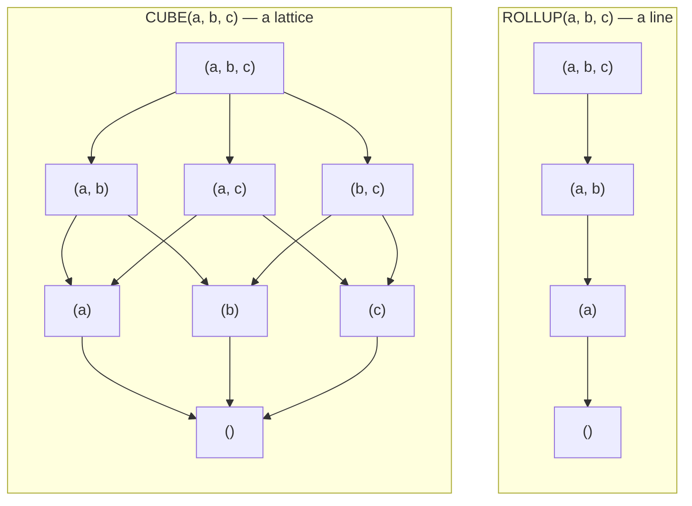
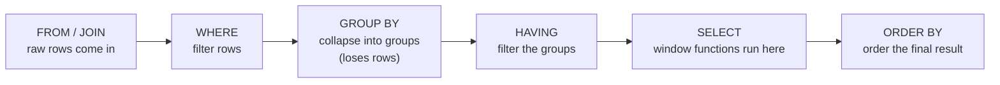

# Lab 11 – Advanced Grouping and Window Functions

**Database:** `AdventureWorksENG`

Every lab so far has been about building a database — tables, procedures, indexes, transactions. The database is now built. It holds data. The question changes: not "how do I put data in", but "how do I ask hard questions of it"?

This lab answers two kinds of questions:

- **Part A – Advanced grouping.** A report with subtotals for every category and a grand total at the bottom. Writing that in plain SQL usually means several queries glued together with `UNION`. Three extensions to `GROUP BY` produce that shape in a single query.
- **Part B – Window functions.** Every product **and** its category's total on the same row, a ranking, or a running total that updates on every row. `GROUP BY` cannot do this, because it collapses the rows. A window function aggregates **without collapsing them**.

> [!IMPORTANT]
> **Core idea:** `GROUP BY` collapses rows into groups. `ROLLUP`, `CUBE`, and `GROUPING SETS` run several `GROUP BY`s at once and stack the results. A window function, `OVER (PARTITION BY ... ORDER BY ...)`, keeps every row and adds a column that summarizes the rows around it.

---

## Learning objectives

After completing this lab, you should be able to:

- explain the difference between a bare aggregate and `GROUP BY ()`, and why they only disagree on an empty input;
- use `ROLLUP` to produce subtotals up a hierarchy in one query;
- use `CUBE` to produce every combination of subtotals, and explain why it grows as `2^n`;
- use `GROUPING SETS` to choose exactly which grouping levels appear, including levels neither `ROLLUP` nor `CUBE` can produce alone;
- rewrite any `ROLLUP` or `CUBE` as an equivalent `GROUPING SETS` list;
- use `GROUPING()` to tell a "this column was rolled away" `NULL` apart from a real data `NULL`, and build a readable report label from it.
- describe the three parts of a window function's `OVER` clause, and which are mandatory for which function family;
- use `ROW_NUMBER`, `RANK`, `DENSE_RANK`, and `NTILE`, and explain how they treat ties differently;
- rank the rows of a `GROUP BY` result with a window function ordered by an aggregate;
- use `SUM`/`AVG`/`COUNT`/`MIN`/`MAX` with `OVER`, and explain why adding `ORDER BY` turns a constant into a running total;
- use `LAG` and `LEAD` to compare a row to its neighbors in an ordered partition;
- explain why `LAST_VALUE` needs an explicit frame, and write that frame correctly;
- choose between `ROWS` and `RANGE` framing, and write the four most common frame idioms.

---

# 🟦 Part A – Advanced Grouping

# Section 1 – The Problem: A Report with Subtotals

## 1.1 The request

Management asks for a revenue report: revenue for every city, a subtotal for every country, and a grand total.

With the tools you already know, each level is a separate query. `UNION ALL` stacks them into one result:

```sql
-- Level 1: one row per city
SELECT s.Name AS Country, c.Name AS City, SUM(ii.TotalPrice) AS Revenue
FROM InvoiceItem ii
JOIN Invoice i ON i.IDInvoice = ii.InvoiceID
JOIN Customer cu ON cu.IDCustomer = i.CustomerID
JOIN City c ON c.IDCity = cu.CityID
JOIN State s ON s.IDState = c.StateID
GROUP BY s.Name, c.Name

UNION ALL

-- Level 2: one row per country
SELECT s.Name, NULL, SUM(ii.TotalPrice)
FROM InvoiceItem ii
JOIN Invoice i ON i.IDInvoice = ii.InvoiceID
JOIN Customer cu ON cu.IDCustomer = i.CustomerID
JOIN City c ON c.IDCity = cu.CityID
JOIN State s ON s.IDState = c.StateID
GROUP BY s.Name

UNION ALL

-- Level 3: the grand total
SELECT NULL, NULL, SUM(ii.TotalPrice)
FROM InvoiceItem ii

ORDER BY Country, City;
```

Result:

| Country | City | Revenue |
|---|---|---:|
| NULL | NULL | 109846381.399888 |
| Croatia | NULL | 45652509.870609 |
| Croatia | Osijek | 8033930.576545 |
| Croatia | Pula | 7959271.672775 |
| Croatia | Rijeka | 8808797.436713 |
| Croatia | Split | 11539959.822518 |
| Croatia | Zagreb | 9310550.362058 |
| Germany | NULL | 21906402.647159 |
| Germany | Berlin | 6151941.818056 |
| Germany | Dresden | 7196759.416819 |
| Germany | Frankfurt | 8557701.412284 |
| Italy | NULL | 42287468.882120 |
| Italy | Certaldo | 7371640.413665 |
| Italy | Milano | 6436199.155929 |
| Italy | Napoli | 9819896.947090 |
| Italy | Rome | 9008852.915235 |
| Italy | Venice | 9650879.450201 |

The report is correct, but the query is not good:

- the same `FROM` and `JOIN`s are written twice, and the grand total is a third query;
- every level needs its own `SELECT`, so a report with four levels needs four queries;
- `NULL` fills the columns that a level does not group by, because all parts of a `UNION ALL` must have the same columns.

Each part is the same aggregate at a different **grouping level**: `(Country, City)`, `(Country)`, and no grouping columns at all.

## 1.2 Grouping by nothing

The third query has no `GROUP BY`, so the whole table is one group. The same level can be written explicitly as `GROUP BY ()` — "group by nothing":

```sql
-- The bare aggregate
SELECT SUM(ii.TotalPrice) AS GrandTotal FROM InvoiceItem ii;

-- Group by nothing
SELECT SUM(ii.TotalPrice) AS GrandTotal FROM InvoiceItem ii GROUP BY ();
```

Both return `109846381.399888`. They differ only on an empty input:

| Form | Over 0 rows |
|---|---|
| Bare aggregate | 1 result row, value `NULL` |
| `GROUP BY ()` | 0 result rows |

`()` is the grand-total level. You will see it in every one of the following sections.

## 1.3 Check your understanding

1. Which three grouping levels does the report in Section 1.1 need?
2. Why is `City` `NULL` in the country rows?
3. What does `SELECT SUM(ii.TotalPrice) FROM InvoiceItem ii WHERE 1 = 0 GROUP BY ()` return?

<details>
<summary>Show answers</summary>

1. `(Country, City)`, `(Country)`, and `()` — the grand total.
2. The country level does not group by `City`, but all parts of a `UNION ALL` must have the same columns, so the query fills the column with `NULL`.
3. No rows. `WHERE 1 = 0` leaves an empty input, and `GROUP BY ()` returns one row per group — there are no rows, so there is no group. Without `GROUP BY ()`, the same query returns one row with `NULL`.

</details>

---

# Section 2 – ROLLUP: Walking Up the Hierarchy

## 2.1 The algorithm

`ROLLUP` takes a list of columns, ordered from most detailed (left) to least detailed (right), and groups repeatedly — dropping the rightmost column each time — until it reaches the grand total:

```text
GROUP BY ROLLUP (a, b, c)

is equivalent to:

  GROUP BY (a, b, c)     -- full detail
  GROUP BY (a, b)        -- drop the rightmost column
  GROUP BY (a)           -- drop another
  GROUP BY ()            -- grand total
```

Four grouping levels for three columns: start on the left with everything, peel off the rightmost column, group again, repeat until you're grouping by nothing.

For two columns, `ROLLUP (Country, City)` gives `(Country, City)`, `(Country)`, and `()` — exactly the three levels of the report in Section 1.

## 2.2 Demo: the same report in one query

```sql
SELECT
    s.Name AS Country,
    c.Name AS City,
    SUM(ii.TotalPrice) AS Revenue
FROM InvoiceItem ii
JOIN Invoice i ON i.IDInvoice = ii.InvoiceID
JOIN Customer cu ON cu.IDCustomer = i.CustomerID
JOIN City c ON c.IDCity = cu.CityID
JOIN State s ON s.IDState = c.StateID
GROUP BY ROLLUP (s.Name, c.Name) -- NEW: three levels in one GROUP BY
ORDER BY s.Name, c.Name;
```

Result (first 7 of 17 rows):

| Country | City | Revenue |
|---|---|---:|
| NULL | NULL | 109846381.399888 |
| Croatia | NULL | 45652509.870609 |
| Croatia | Osijek | 8033930.576545 |
| Croatia | Pula | 7959271.672775 |
| Croatia | Rijeka | 8808797.436713 |
| Croatia | Split | 11539959.822518 |
| Croatia | Zagreb | 9310550.362058 |
| ... | ... | ... |

The 17 rows are exactly the rows of the `UNION ALL` query in Section 1.1 — from one `SELECT`, with the `JOIN`s written once. Three kinds of row come back:

| Row shape | Meaning |
|---|---|
| `Country` and `City` both filled in | Detail — revenue for that one city |
| `Country` filled in, `City` is `NULL` | Subtotal — revenue for that whole country |
| Both `Country` and `City` are `NULL` | Grand total — revenue across everything |

## 2.3 The NULL warning

`NULL` in a `ROLLUP` result column can mean two different things:

1. This column was rolled away at this level (a subtotal or grand-total row), **or**
2. the underlying data in this row genuinely is `NULL`.

You cannot tell these apart from the value alone. Section 5 shows the fix.

## 2.4 Check your understanding

1. Describe the algorithm for `ROLLUP(a, b, c)` in your own words.
2. How many grouping levels does `ROLLUP(a, b, c)` produce?
3. What does a `NULL` in a `ROLLUP` result column mean?

<details>
<summary>Show answers</summary>

1. Group by the full column list, then repeatedly drop the rightmost column and group again, until no columns remain (the grand total).
2. Four: `(a, b, c)`, `(a, b)`, `(a)`, `()`.
3. Usually "this column was rolled away at this level" — but if the underlying data also contains `NULL`s, you cannot distinguish the two without `GROUPING()`.

</details>

---

# Section 3 – CUBE: Every Combination

## 3.1 The algorithm

`CUBE` has the same syntax as `ROLLUP`, but instead of walking a hierarchy in one direction, it produces every possible combination of the grouping columns:

```text
GROUP BY CUBE (a, b, c)

is equivalent to:

  GROUP BY (a, b, c)
  GROUP BY (a, b)   GROUP BY (a, c)   GROUP BY (b, c)
  GROUP BY (a)      GROUP BY (b)      GROUP BY (c)
  GROUP BY ()

8 grouping levels for 3 columns. For n columns: 2^n levels.
```

`ROLLUP` with three columns gave four levels; `CUBE` gives eight. The difference is the "middle" combinations `CUBE` includes — group by `(b, c)` while skipping `a` entirely, group by just `b`, and so on. `ROLLUP` is a straight line up the hierarchy; `CUBE` is the entire lattice of combinations.



## 3.2 Demo: country and year

For `Country` and `City`, `CUBE` would add rows grouped by `City` alone, "revenue for this city across all countries". Every city belongs to exactly one country, so those rows only repeat the detail rows. `CUBE` is useful when the columns are **independent** dimensions — for example, country and invoice year: every country has sales in every year.

```sql
SELECT
    s.Name AS Country,
    YEAR(i.InvoiceDate) AS InvoiceYear,
    SUM(ii.TotalPrice) AS Revenue
FROM InvoiceItem ii
JOIN Invoice i ON i.IDInvoice = ii.InvoiceID
JOIN Customer cu ON cu.IDCustomer = i.CustomerID
JOIN City c ON c.IDCity = cu.CityID
JOIN State s ON s.IDState = c.StateID
GROUP BY CUBE (s.Name, YEAR(i.InvoiceDate)) -- NEW: every combination
ORDER BY Country, InvoiceYear;
```

Result (first 10 of 20 rows):

| Country | InvoiceYear | Revenue |
|---|---|---:|
| NULL | NULL | 109846381.399888 |
| NULL | 2001 | 11331808.961814 |
| NULL | 2002 | 30674773.173625 |
| NULL | 2003 | 42011037.162396 |
| NULL | 2004 | 25828762.102053 |
| Croatia | NULL | 45652509.870609 |
| Croatia | 2001 | 4640120.257854 |
| Croatia | 2002 | 13021813.205923 |
| Croatia | 2003 | 17380664.430461 |
| Croatia | 2004 | 10609911.976371 |
| ... | ... | ... |

Four kinds of row come back:

| Row shape | Meaning |
|---|---|
| `Country` and `InvoiceYear` both filled in | Detail — revenue for one country in one year |
| `Country` filled in, `InvoiceYear` is `NULL` | Revenue for that country across all years |
| `Country` is `NULL`, `InvoiceYear` filled in | Revenue for that year across all countries |
| Both `NULL` | Grand total |

`ROLLUP (s.Name, YEAR(i.InvoiceDate))` would return the same rows except the four yearly totals across all countries: it never skips the left column.

## 3.3 When to use CUBE — and when not

| Use CUBE when | Don't use CUBE when |
|---|---|
| You need totals for every combination of independent dimensions | The columns form a hierarchy — `ROLLUP` already gives you what you need |
| Building a pivot table with fully interchangeable dimensions | You want only some combinations — use `GROUPING SETS` instead |
| | You have many columns: `CUBE` on 6 columns is 64 grouping levels |

> [!IMPORTANT]
> Reach for `ROLLUP` first. Escalate to `CUBE` only when you actually need the extra combinations.

## 3.4 Check your understanding

1. How many grouping levels does `CUBE(a, b, c, d)` produce?
2. What extra rows does `CUBE` give you compared to `ROLLUP` on the same columns?
3. When is `ROLLUP` enough, and `CUBE` unnecessary?

<details>
<summary>Show answers</summary>

1. `2^4 = 16`. Each additional column doubles the count.
2. Every combination that skips a column on the left — for `(Country, InvoiceYear)`, the yearly totals across all countries, which `ROLLUP` never produces.
3. Whenever the grouping columns form a genuine hierarchy (country contains city, year contains month) and you only need subtotals up that hierarchy, not sideways combinations — the vast majority of real reporting queries.

</details>

---

# Section 4 – GROUPING SETS: Pick Your Own

## 4.1 The general form

`GROUPING SETS` is the explicit, general form: you list exactly which grouping levels you want, nothing more:

```text
GROUP BY GROUPING SETS
(
    (a, b),   -- this level
    (a),      -- and this one
    ()        -- and the grand total
)
```

`ROLLUP` and `CUBE` are shortcuts for specific `GROUPING SETS` lists:

```text
GROUP BY ROLLUP(a, b)  ==  GROUP BY GROUPING SETS ((a, b), (a), ())
GROUP BY CUBE(a, b)    ==  GROUP BY GROUPING SETS ((a, b), (a), (b), ())
```

## 4.2 Demo: totals without the detail rows

Management now wants only the totals from Section 3.2: one row per country, one row per year, and the grand total — without the 12 country-and-year detail rows.

```sql
SELECT
    s.Name AS Country,
    YEAR(i.InvoiceDate) AS InvoiceYear,
    SUM(ii.TotalPrice) AS Revenue
FROM InvoiceItem ii
JOIN Invoice i ON i.IDInvoice = ii.InvoiceID
JOIN Customer cu ON cu.IDCustomer = i.CustomerID
JOIN City c ON c.IDCity = cu.CityID
JOIN State s ON s.IDState = c.StateID
GROUP BY GROUPING SETS -- NEW: list the levels explicitly
(
    (s.Name),                -- by country
    (YEAR(i.InvoiceDate)),   -- by year
    ()                       -- grand total
)
ORDER BY Country, InvoiceYear;
```

Result:

| Country | InvoiceYear | Revenue |
|---|---|---:|
| NULL | NULL | 109846381.399888 |
| NULL | 2001 | 11331808.961814 |
| NULL | 2002 | 30674773.173625 |
| NULL | 2003 | 42011037.162396 |
| NULL | 2004 | 25828762.102053 |
| Croatia | NULL | 45652509.870609 |
| Germany | NULL | 21906402.647159 |
| Italy | NULL | 42287468.882120 |

Neither `ROLLUP` nor `CUBE` can produce this shape alone; both would include the detail rows. `GROUPING SETS` lets you skip them.

| Tool | Produces |
|---|---|
| `ROLLUP` | Subtotals up a hierarchy |
| `CUBE` | Every possible subtotal |
| `GROUPING SETS` | Exactly the levels you list |

## 4.3 Check your understanding

1. Rewrite `ROLLUP(a, b, c)` as a `GROUPING SETS` list.
2. Give one scenario where `GROUPING SETS` is the only tool that produces the shape you need.

<details>
<summary>Show answers</summary>

1. `GROUPING SETS ((a, b, c), (a, b), (a), ())`.
2. Revenue by country, revenue by year, and a grand total — but *without* the `(country, year)` detail rows. Neither `ROLLUP` nor `CUBE` skips that level; `GROUPING SETS` lets you list exactly those three levels.

</details>

---

# Section 5 – Reading Multi-Level NULLs with GROUPING()

## 5.1 The trap

```sql
SELECT
    p.Color,
    COUNT(*) AS InvoiceItems,
    SUM(ii.TotalPrice) AS Revenue
FROM Product p
JOIN InvoiceItem ii ON ii.ProductID = p.IDProduct
GROUP BY ROLLUP (p.Color);
```

Result:

| Color | InvoiceItems | Revenue |
|---|---:|---:|
| NULL | 34145 | 1099318.907552 |
| Bijela | 1429 | 29745.127584 |
| Crna | 30099 | 38247018.631195 |
| Crvena | 13065 | 21623269.540854 |
| Plava | 9044 | 9602850.958400 |
| Srebrna | 10654 | 19777339.945262 |
| Srebrna/Crna | 1517 | 147483.909800 |
| Šarena | 8502 | 649849.160346 |
| Žuta | 12862 | 18669505.218895 |
| NULL | 121317 | 109846381.399888 |

Two rows in this result show `Color = NULL`: one is "products where the color is genuinely unrecorded in the data" (`Product` has 248 rows with `Color IS NULL`), the other is the `ROLLUP` grand-total row. Same value, two different meanings, and no way to tell them apart from the raw result.

## 5.2 The fix: GROUPING()

`GROUPING(col)` returns `1` if `col` was rolled away to produce the current row, and `0` otherwise:

```sql
SELECT
    CASE WHEN GROUPING(p.Color) = 1 THEN 'ALL'
         WHEN p.Color IS NULL       THEN '(no color)'
         ELSE p.Color
    END AS Color,
    GROUPING(p.Color) AS ColorIsGroupingNull,
    COUNT(*) AS InvoiceItems,
    SUM(ii.TotalPrice) AS Revenue
FROM Product p
JOIN InvoiceItem ii ON ii.ProductID = p.IDProduct
GROUP BY ROLLUP (p.Color)
ORDER BY GROUPING(p.Color), p.Color;
```

Result:

| Color | ColorIsGroupingNull | InvoiceItems | Revenue |
|---|---:|---:|---:|
| (no color) | 0 | 34145 | 1099318.907552 |
| Bijela | 0 | 1429 | 29745.127584 |
| Crna | 0 | 30099 | 38247018.631195 |
| Crvena | 0 | 13065 | 21623269.540854 |
| Plava | 0 | 9044 | 9602850.958400 |
| Srebrna | 0 | 10654 | 19777339.945262 |
| Srebrna/Crna | 0 | 1517 | 147483.909800 |
| Šarena | 0 | 8502 | 649849.160346 |
| Žuta | 0 | 12862 | 18669505.218895 |
| ALL | 1 | 121317 | 109846381.399888 |

Now the report is unambiguous: rows labeled `(no color)` are real data `NULL`s; the row labeled `ALL` is the `ROLLUP` grand total. The extra `ColorIsGroupingNull` column is shown here only to make the point — a production report would just display the labeled `Color`.

`ORDER BY GROUPING(p.Color)` pushes the grand-total row to the bottom, so detail rows come first, then subtotals, then the grand total — the order most reports expect.

## 5.3 Check your understanding

1. Give a scenario where a data `NULL` and a `ROLLUP` `NULL` are impossible to tell apart without `GROUPING()`.
2. What does `GROUPING(col)` return for a detail row where `col` genuinely is `NULL`?
3. Write the `ORDER BY` that puts subtotals below detail rows and the grand total at the bottom.

<details>
<summary>Show answers</summary>

1. `SELECT Color, SUM(...) FROM Product GROUP BY ROLLUP(Color)` where some products really have `Color = NULL`. The result has two rows with `Color = NULL` — one real, one the grand total — and the raw values alone don't distinguish them.
2. `0` — the row is still a genuine detail row, even though the column's value happens to be `NULL`.
3. `ORDER BY GROUPING(col), col` — sort by the grouping flag first (`0` for detail, `1` for rolled-away), then by the actual value. Extends to more columns by repeating the pattern for each one.

</details>

---

# 🟩 Part B – Window Functions

Part A produced subtotals and grand totals in one query — but every one of `ROLLUP`, `CUBE`, and `GROUPING SETS` *collapses* rows. Each group becomes one output row; the detail is gone. That's fine for a report. It's no help when you want to see every product **and** its category's total on the same row, or rank rows without losing the rows themselves, or compute a running total that updates on every row.

The tool built for exactly that is the window function. It aggregates across a set of rows **without collapsing them**.

# Section 6 – The Anatomy of a Window Function

## 6.1 Grouped versus windowed

```sql
-- Grouped: one row per color, detail gone
SELECT Color, SUM(PriceWithoutVAT) AS ColorTotal
FROM Product
GROUP BY Color;
```

```sql
-- Windowed: every product, plus its color's total
SELECT Name, Color, PriceWithoutVAT,
       SUM(PriceWithoutVAT) OVER (PARTITION BY Color) AS ColorTotal
FROM Product;
```

The grouped query returns 10 rows, one per color. Its `Plava` row is:

| Color | ColorTotal |
|---|---:|
| Plava | 24015.6600 |

The windowed query returns all 504 products. Every one of the 26 `Plava` products carries the same `ColorTotal`; three of them:

| Name | Color | PriceWithoutVAT | ColorTotal |
|---|---|---:|---:|
| Classic Vest, L | Plava | 63.5000 | 24015.6600 |
| Classic Vest, M | Plava | 63.5000 | 24015.6600 |
| HL Touring Frame - Blue, 46 | Plava | 1003.9100 | 24015.6600 |

Same aggregate, same partitioning by color. `GROUP BY` loses the individual rows. The window function keeps every row **and** adds the aggregate as an extra column, living on every row of the partition it applies to. Everything in this lab is a variation on that one pattern.

## 6.2 The shape of every window function

```
funcName(<args>)
OVER
(
    [ PARTITION BY <cols> ]
    [ ORDER BY <cols>
        [ frame ] ]
)
```

A function, the keyword `OVER`, and up to three optional pieces inside the parentheses: `PARTITION BY` slices the rows into independent strips; `ORDER BY` orders the rows within each strip; a frame (Section 10) defines a sliding window inside the ordered strip.

Which pieces you need depends on the function:

| Function family | `PARTITION BY` | `ORDER BY` | Frame |
|---|:---:|:---:|:---:|
| Ranking | optional | **mandatory** | n/a |
| Aggregate | optional | optional | optional |
| Analytical | optional | **mandatory** | optional |

A ranking function without `ORDER BY` makes no sense — ranked by what? Same for `LAG`/`LEAD`/`FIRST_VALUE` — "previous" and "first" are meaningless without an order. An aggregate *without* `ORDER BY` means "across the whole partition, same value on every row"; *with* `ORDER BY`, it means "up to and including this row" (Section 8).

## 6.3 Where it runs in the query



If a query has a `GROUP BY`, the window function sees the **aggregated** rows, not the original table. When you need the individual rows, leave the `GROUP BY` out — most window-function queries have none. When you want to rank or compare the groups themselves, the `GROUP BY` is exactly right (Section 7.4).

## 6.4 Check your understanding

1. What are the three optional pieces of an `OVER` clause?
2. Which piece is mandatory for a ranking function?
3. If a query has a `GROUP BY`, what rows does a window function in that query's `SELECT` see?

<details>
<summary>Show answers</summary>

1. `PARTITION BY` (slice into strips), `ORDER BY` (order within each strip), and a frame (a sliding window inside the ordered strip).
2. `ORDER BY`. `PARTITION BY` is optional.
3. The aggregated rows produced by `GROUP BY`, not the original rows. That is useful for ranking the groups themselves, but not when you need the individual rows.

</details>

---

# Section 7 – Ranking Functions

## 7.1 The four functions

```
ROW_NUMBER()    unique row number per partition (1, 2, 3, 4, ...)
RANK()          rank; ties share; then skip     (1, 2, 2, 4)
DENSE_RANK()    rank; ties share; no skip        (1, 2, 2, 3)
NTILE(n)        bucket rows into n groups
```

`ROW_NUMBER` breaks every tie arbitrarily — every row gets a unique number. `RANK` gives tied rows the same number, then skips ahead (two 2nd-place rows means the next is 4th). `DENSE_RANK` also shares the rank on a tie, but never skips. `NTILE(n)` buckets the rows into `n` roughly-equal groups — quartiles, deciles, percentiles.

## 7.2 Demo: all four side by side

```sql
SELECT
    p.Name,
    p.Color,
    p.PriceWithoutVAT,
    ROW_NUMBER() OVER (ORDER BY p.PriceWithoutVAT DESC) AS RN,
    RANK()       OVER (ORDER BY p.PriceWithoutVAT DESC) AS RK,
    DENSE_RANK() OVER (ORDER BY p.PriceWithoutVAT DESC) AS DR,
    NTILE(4)     OVER (ORDER BY p.PriceWithoutVAT DESC) AS Quartile
FROM Product p
WHERE p.PriceWithoutVAT > 0
ORDER BY p.PriceWithoutVAT DESC;
```

Result (first 12 of 304 rows):

| Name | Color | PriceWithoutVAT | RN | RK | DR | Quartile |
|---|---|---:|---:|---:|---:|---:|
| Road-150 Red, 62 | Crvena | 3578.2700 | 1 | 1 | 1 | 1 |
| Road-150 Red, 44 | Crvena | 3578.2700 | 2 | 1 | 1 | 1 |
| Road-150 Red, 48 | Crvena | 3578.2700 | 3 | 1 | 1 | 1 |
| Road-150 Red, 52 | Crvena | 3578.2700 | 4 | 1 | 1 | 1 |
| Road-150 Red, 56 | Crvena | 3578.2700 | 5 | 1 | 1 | 1 |
| Mountain-100 Silver, 38 | Srebrna | 3399.9900 | 6 | 6 | 2 | 1 |
| Mountain-100 Silver, 42 | Srebrna | 3399.9900 | 7 | 6 | 2 | 1 |
| Mountain-100 Silver, 44 | Srebrna | 3399.9900 | 8 | 6 | 2 | 1 |
| Mountain-100 Silver, 48 | Srebrna | 3399.9900 | 9 | 6 | 2 | 1 |
| Mountain-100 Black, 38 | Crna | 3374.9900 | 10 | 10 | 3 | 1 |
| Mountain-100 Black, 42 | Crna | 3374.9900 | 11 | 10 | 3 | 1 |
| Mountain-100 Black, 44 | Crna | 3374.9900 | 12 | 10 | 3 | 1 |

The five `Road-150 Red` bikes have the same price. `ROW_NUMBER` still numbers them 1 to 5; `RANK` and `DENSE_RANK` give all five `1`. The next price differs in the two: `RANK` continues with `6` (five rows were ahead), `DENSE_RANK` with `2` (one distinct price was ahead). `NTILE(4)` puts the first 76 of the 304 rows into quartile `1`.

The order of tied rows is not defined, so `ROW_NUMBER` can number the five bikes in a different order on your computer.

## 7.3 Restarting per partition

```sql
SELECT
    p.Name,
    p.Color,
    p.PriceWithoutVAT,
    ROW_NUMBER() OVER (PARTITION BY p.Color
                       ORDER BY p.PriceWithoutVAT DESC) AS RankInColor
FROM Product p
WHERE p.Color IS NOT NULL
ORDER BY p.Color, p.PriceWithoutVAT DESC;
```

Result (first 8 rows):

| Name | Color | PriceWithoutVAT | RankInColor |
|---|---|---:|---:|
| Mountain Bike Socks, M | Bijela | 9.5000 | 1 |
| Mountain Bike Socks, L | Bijela | 9.5000 | 2 |
| Racing Socks, M | Bijela | 8.9900 | 3 |
| Racing Socks, L | Bijela | 8.9900 | 4 |
| Mountain-100 Black, 38 | Crna | 3374.9900 | 1 |
| Mountain-100 Black, 42 | Crna | 3374.9900 | 2 |
| Mountain-100 Black, 44 | Crna | 3374.9900 | 3 |
| Mountain-100 Black, 48 | Crna | 3374.9900 | 4 |

Adding `PARTITION BY p.Color` makes `RankInColor` restart at `1` for every new color — "the most expensive Crna product", "the most expensive Plava product", all in one query. The same pattern applies to `RANK`, `DENSE_RANK`, and `NTILE`.

## 7.4 Ranking the result of a GROUP BY

Back to the report from Part A: which city earns the most in each country? The query needs one row per city, so it uses `GROUP BY`, and then ranks those city rows within each country:

```sql
SELECT
    s.Name AS Country,
    c.Name AS City,
    SUM(ii.TotalPrice) AS Revenue,
    RANK() OVER (PARTITION BY s.Name
                 ORDER BY SUM(ii.TotalPrice) DESC) AS RankInCountry -- NEW: rank by an aggregate
FROM InvoiceItem ii
JOIN Invoice i ON i.IDInvoice = ii.InvoiceID
JOIN Customer cu ON cu.IDCustomer = i.CustomerID
JOIN City c ON c.IDCity = cu.CityID
JOIN State s ON s.IDState = c.StateID
GROUP BY s.Name, c.Name
ORDER BY Country, RankInCountry;
```

Result:

| Country | City | Revenue | RankInCountry |
|---|---|---:|---:|
| Croatia | Split | 11539959.822518 | 1 |
| Croatia | Zagreb | 9310550.362058 | 2 |
| Croatia | Rijeka | 8808797.436713 | 3 |
| Croatia | Osijek | 8033930.576545 | 4 |
| Croatia | Pula | 7959271.672775 | 5 |
| Germany | Frankfurt | 8557701.412284 | 1 |
| Germany | Dresden | 7196759.416819 | 2 |
| Germany | Berlin | 6151941.818056 | 3 |
| Italy | Napoli | 9819896.947090 | 1 |
| Italy | Venice | 9650879.450201 | 2 |
| Italy | Rome | 9008852.915235 | 3 |
| Italy | Certaldo | 7371640.413665 | 4 |
| Italy | Milano | 6436199.155929 | 5 |

This works because of the order in Section 6.3: `GROUP BY` runs first and produces one row per city; the window function then runs over those 13 rows. That is why its `ORDER BY` can use `SUM(ii.TotalPrice)` — the same aggregate as in the `SELECT` list.

Here the window function seeing the grouped rows is exactly what we want: we rank the groups themselves. The rule is the same as always — a window function sees the rows that exist when `SELECT` runs.

## 7.5 When to use each

| Function | Use for |
|---|---|
| `ROW_NUMBER` | Pagination, de-duplication ("give me the first one") |
| `RANK` | Classical leaderboards |
| `DENSE_RANK` | Grouped-by-value listings ("top 5 distinct prices") |
| `NTILE(n)` | Percentiles, deciles, cohort analysis |

## 7.6 Check your understanding

1. What does `RANK` do differently from `ROW_NUMBER`?
2. What does `DENSE_RANK` do differently from `RANK`?
3. You want the top 3 rows per partition, and you don't want ties to give you more or fewer than 3. Which function do you use?
4. In Section 7.4, why can the `ORDER BY` inside `OVER` use `SUM(ii.TotalPrice)`?

<details>
<summary>Show answers</summary>

1. `ROW_NUMBER` gives every row a unique number, breaking ties arbitrarily. `RANK` gives tied rows the same number and then skips the following numbers (`1, 2, 2, 4`).
2. `DENSE_RANK` also shares a rank across ties, but does not skip — the next distinct value gets the next integer (`1, 2, 2, 3`).
3. `ROW_NUMBER`, filtered to `<= 3` in an outer query — it guarantees exactly 3 rows per partition regardless of ties. `RANK` could return more or fewer than 3 if there's a tie at the boundary.
4. The query has a `GROUP BY`, which runs before the window function. When the window function runs, each row is a group, so it can be ordered by that group's aggregate.

</details>

---

# Section 8 – Aggregate Window Functions and Running Totals

## 8.1 Two shapes

```
SUM(col) OVER (PARTITION BY x)              -- constant over each partition
SUM(col) OVER (PARTITION BY x ORDER BY y)   -- running total, resets per partition
```

The same aggregate functions you already know — `SUM`, `AVG`, `COUNT`, `MIN`, `MAX` — become window functions with `OVER`. Without `ORDER BY`, the aggregate is computed across the whole partition and every row sees the same value. With `ORDER BY`, it becomes a running total: each row sees the aggregate of every row up to and including itself, in the given order.

## 8.2 Demo: a grand total on every row

```sql
SELECT
    p.Name,
    p.PriceWithoutVAT,
    SUM(p.PriceWithoutVAT) OVER () AS TotalOfAllPrices
FROM Product p
WHERE p.PriceWithoutVAT > 0;
```

Result (first 4 of 304 rows):

| Name | PriceWithoutVAT | TotalOfAllPrices |
|---|---:|---:|
| LL Mountain Seat Assembly | 133.3400 | 221087.7900 |
| ML Mountain Seat Assembly | 147.1400 | 221087.7900 |
| HL Mountain Seat Assembly | 196.9200 | 221087.7900 |
| LL Road Seat Assembly | 133.3400 | 221087.7900 |

An empty `OVER ()` means no partition and no order — the window is the entire result set, so the same total appears on every row.

## 8.3 Demo: running total per year

```sql
SELECT
    i.InvoiceDate,
    i.IDInvoice,
    ii.IDInvoiceItem,
    ii.TotalPrice,
    SUM(ii.TotalPrice) OVER
    (
        PARTITION BY YEAR(i.InvoiceDate)
        ORDER BY i.InvoiceDate, i.IDInvoice, ii.IDInvoiceItem
    ) AS RunningTotalThisYear
FROM InvoiceItem ii
JOIN Invoice i ON i.IDInvoice = ii.InvoiceID
ORDER BY i.InvoiceDate, i.IDInvoice, ii.IDInvoiceItem;
```

`IDInvoiceItem` makes the order unique, so every row adds exactly one item to the total.

Result (the last rows of 2001 and the first rows of 2002, out of 121317 rows):

| InvoiceDate | IDInvoice | IDInvoiceItem | TotalPrice | RunningTotalThisYear |
|---|---:|---:|---:|---:|
| 2001-12-31 | 45035 | 5149 | 3578.270000 | 11327531.593614 |
| 2001-12-31 | 45036 | 5150 | 3578.270000 | 11331109.863614 |
| 2001-12-31 | 45037 | 5151 | 699.098200 | 11331808.961814 |
| 2002-01-01 | 45038 | 5152 | 11.400000 | 11.400000 |
| 2002-01-01 | 45038 | 5153 | 115.361600 | 126.761600 |
| 2002-01-01 | 45038 | 5154 | 1429.408600 | 1556.170200 |

The running total climbs as the rows go by in date order. The last row of 2001 shows `11331808.961814` — the 2001 revenue from Section 3.2. On January 1st, the total starts again from the first item, because the partition is `YEAR(InvoiceDate)`, and a new year is a new partition. One query, no loop.

## 8.4 Why ORDER BY inside OVER produces a running total

The default frame when `ORDER BY` is present is:

```
RANGE BETWEEN UNBOUNDED PRECEDING AND CURRENT ROW
```

— "aggregate every row from the start of the partition up to and including this one." That is the running-total definition. Section 10 covers frames directly; for now, this explains why "aggregate + `ORDER BY`" behaves the way it does.

## 8.5 Check your understanding

1. What is the difference between `SUM(col) OVER ()` and `SUM(col) OVER (ORDER BY x)`?
2. What does `PARTITION BY YEAR(date) ORDER BY date` give you inside an aggregate window?
3. Why is a running total called "running"?

<details>
<summary>Show answers</summary>

1. Without `ORDER BY`, the aggregate is computed across the whole window — every row sees the same value. With `ORDER BY`, it's computed from the start of the partition up to and including each row — a running total.
2. A running total per calendar year, resetting every January 1st; each row shows the year-to-date total as of its own date.
3. The value grows monotonically as you move down the ordered rows — each row is a snapshot of the total "so far", the same shape as adding numbers on a calculator without pressing equals.

</details>

---

# Section 9 – Analytical Functions: LAG, LEAD, FIRST_VALUE, LAST_VALUE

## 9.1 The four functions

```
FIRST_VALUE(col)   value of col in the FIRST row of the window
LAST_VALUE(col)    value of col in the LAST row of the window    *
LAG(col, n)        value of col from n rows BEFORE the current row
LEAD(col, n)       value of col from n rows AFTER the current row

ORDER BY       mandatory — "first"/"last"/"previous"/"next" need an order
PARTITION BY   optional — restarts per partition

* LAST_VALUE has a default-frame trap. See 9.4.
```

`LAG` and `LEAD` are the two you will reach for most often: `LAG(col, 1)` is the value of `col` in the previous row; `LEAD(col, 1)` is the value in the next row.

## 9.2 Demo: LAG for a time-series diff

```sql
SELECT
    p.Name,
    p.PriceWithoutVAT,
    LAG(p.PriceWithoutVAT, 1) OVER (ORDER BY p.PriceWithoutVAT) AS PrevPrice,
    p.PriceWithoutVAT
      - LAG(p.PriceWithoutVAT, 1) OVER (ORDER BY p.PriceWithoutVAT) AS DeltaFromPrev
FROM Product p
WHERE p.PriceWithoutVAT > 0
ORDER BY p.PriceWithoutVAT;
```

Result (first 5 of 304 rows):

| Name | PriceWithoutVAT | PrevPrice | DeltaFromPrev |
|---|---:|---:|---:|
| Patch Kit/8 Patches | 2.2900 | NULL | NULL |
| Road Tire Tube | 3.9900 | 2.2900 | 1.7000 |
| Touring Tire Tube | 4.9900 | 3.9900 | 1.0000 |
| Mountain Tire Tube | 4.9900 | 4.9900 | .0000 |
| Water Bottle - 30 oz. | 4.9900 | 4.9900 | .0000 |

`PrevPrice` is the previous product's price on every row; the first row's `PrevPrice` is `NULL`, because nothing precedes it — that's `LAG`'s default at the edge of a partition. `DeltaFromPrev` is how much more this product costs than the one before it. "Compare each row to the one before it" is one of the most common analytical patterns in real code.

## 9.3 LEAD: the mirror

```sql
SELECT
    p.Name,
    p.PriceWithoutVAT,
    LEAD(p.PriceWithoutVAT, 1) OVER (ORDER BY p.PriceWithoutVAT) AS NextPrice
FROM Product p
WHERE p.PriceWithoutVAT > 0
ORDER BY p.PriceWithoutVAT;
```

Result (first 3 of 304 rows):

| Name | PriceWithoutVAT | NextPrice |
|---|---:|---:|
| Patch Kit/8 Patches | 2.2900 | 3.9900 |
| Road Tire Tube | 3.9900 | 4.9900 |
| Touring Tire Tube | 4.9900 | 4.9900 |

Same idea, mirrored: the last row's `NextPrice` is `NULL`, since nothing follows it. Common use: "when does the next event happen after this one" — timestamps, schedules, version history.

## 9.4 FIRST_VALUE and the LAST_VALUE trap

```sql
SELECT
    p.Name,
    p.PriceWithoutVAT,
    FIRST_VALUE(p.Name) OVER (ORDER BY p.PriceWithoutVAT) AS CheapestProduct
FROM Product p
WHERE p.PriceWithoutVAT > 0
ORDER BY p.PriceWithoutVAT;
```

Result (first 4 of 304 rows):

| Name | PriceWithoutVAT | CheapestProduct |
|---|---:|---|
| Patch Kit/8 Patches | 2.2900 | Patch Kit/8 Patches |
| Road Tire Tube | 3.9900 | Patch Kit/8 Patches |
| Touring Tire Tube | 4.9900 | Patch Kit/8 Patches |
| Mountain Tire Tube | 4.9900 | Patch Kit/8 Patches |

Every row shows the name of the cheapest product — the first row of the ordered window. `LAST_VALUE` looks symmetric, but is not, with default settings:

```sql
SELECT
    p.Name, p.PriceWithoutVAT,
    LAST_VALUE(p.Name) OVER (ORDER BY p.PriceWithoutVAT) AS LastValueDefault
FROM Product p
WHERE p.PriceWithoutVAT > 0
ORDER BY p.PriceWithoutVAT;
```

Result (first 4 of 304 rows):

| Name | PriceWithoutVAT | LastValueDefault |
|---|---:|---|
| Patch Kit/8 Patches | 2.2900 | Patch Kit/8 Patches |
| Road Tire Tube | 3.9900 | Road Tire Tube |
| Touring Tire Tube | 4.9900 | Water Bottle - 30 oz. |
| Mountain Tire Tube | 4.9900 | Water Bottle - 30 oz. |

`LastValueDefault` is not the most expensive product. It is "the last value seen so far". The default frame when `ORDER BY` is present is `RANGE BETWEEN UNBOUNDED PRECEDING AND CURRENT ROW` (Section 8.4), so the window ends at the current row: on the first two rows, `LastValueDefault` is the row's own `Name`. On the rows priced `4.9900`, it is `Water Bottle - 30 oz.`, the last of the products with that price — with `RANGE`, "current row" includes every row that ties on the `ORDER BY` value (Section 10.1).

The fix is an explicit frame covering the whole partition:

```sql
SELECT
    p.Name, p.PriceWithoutVAT,
    LAST_VALUE(p.Name) OVER
    (
        ORDER BY p.PriceWithoutVAT
        ROWS BETWEEN UNBOUNDED PRECEDING AND UNBOUNDED FOLLOWING
    ) AS ActuallyMostExpensive
FROM Product p
WHERE p.PriceWithoutVAT > 0
ORDER BY p.PriceWithoutVAT;
```

Result (first 4 of 304 rows):

| Name | PriceWithoutVAT | ActuallyMostExpensive |
|---|---:|---|
| Patch Kit/8 Patches | 2.2900 | Road-150 Red, 56 |
| Road Tire Tube | 3.9900 | Road-150 Red, 56 |
| Touring Tire Tube | 4.9900 | Road-150 Red, 56 |
| Mountain Tire Tube | 4.9900 | Road-150 Red, 56 |

Now the window covers the whole partition, and every row shows a product with the highest price. Five products share that price, so which of them appears depends on the order of the tied rows.

> [!IMPORTANT]
> Whenever you use `LAST_VALUE`, add the explicit `ROWS BETWEEN UNBOUNDED PRECEDING AND UNBOUNDED FOLLOWING` frame. Always.

## 9.5 Check your understanding

1. What does `LAG(col, 1)` return in the first row of a partition?
2. Give one real-world use for `LEAD`.
3. Why does `LAST_VALUE` need an explicit frame to behave as its name suggests?

<details>
<summary>Show answers</summary>

1. `NULL` — there is no previous row to reach back to. A third argument overrides this: `LAG(col, 1, 0)` returns `0` instead of `NULL` at the edge.
2. "When does the next event happen after this one" — time until the next login, order, or state change; also gap detection, by filtering on an abnormally large difference between a row and its `LEAD`.
3. The default frame with `ORDER BY` is `RANGE UNBOUNDED PRECEDING TO CURRENT ROW`, so "the last value in the window" is "the last value seen so far" — the current row. The fix is `ROWS BETWEEN UNBOUNDED PRECEDING AND UNBOUNDED FOLLOWING`.

</details>

---

# Section 10 – Frames

## 10.1 The third piece of OVER

A frame is a sliding window inside the ordered partition, used only by aggregate and analytical functions — ranking functions don't use frames.

```
ROWS  BETWEEN <start> AND <end>       -- row-count based
RANGE BETWEEN <start> AND <end>       -- value based on the ORDER BY column

Endpoints:
    UNBOUNDED PRECEDING     from the start of the partition
    N PRECEDING             N rows/values before the current one
    CURRENT ROW             this row
    N FOLLOWING             N rows/values ahead
    UNBOUNDED FOLLOWING     to the end of the partition
```

`ROWS` counts physical rows — predictable. `RANGE` uses the values in the `ORDER BY` column, so rows that tie on that value are all included together, which can surprise you. Rule of thumb: use `ROWS` unless you specifically need value-based semantics.

## 10.2 Four idioms worth memorizing

```
"The whole partition":
    ROWS BETWEEN UNBOUNDED PRECEDING AND UNBOUNDED FOLLOWING

"Moving window of size N+1 ending on this row":
    ROWS BETWEEN N PRECEDING AND CURRENT ROW

"Everything from here forward":
    ROWS BETWEEN CURRENT ROW AND UNBOUNDED FOLLOWING

"Everything up to but not including this row":
    ROWS BETWEEN UNBOUNDED PRECEDING AND 1 PRECEDING
```

Together these four cover most of what you'll write in real code.

## 10.3 Demo: a moving 3-item average

```sql
SELECT
    p.Name,
    p.PriceWithoutVAT,
    AVG(p.PriceWithoutVAT) OVER
    (
        ORDER BY p.PriceWithoutVAT
        ROWS BETWEEN 2 PRECEDING AND CURRENT ROW
    ) AS Moving3Avg
FROM Product p
WHERE p.PriceWithoutVAT > 0
ORDER BY p.PriceWithoutVAT;
```

Result (first 5 of 304 rows):

| Name | PriceWithoutVAT | Moving3Avg |
|---|---:|---:|
| Patch Kit/8 Patches | 2.2900 | 2.2900 |
| Road Tire Tube | 3.9900 | 3.1400 |
| Touring Tire Tube | 4.9900 | 3.7566 |
| Mountain Tire Tube | 4.9900 | 4.6566 |
| Water Bottle - 30 oz. | 4.9900 | 4.9900 |

The first row's window has just 1 row (nothing precedes it), so the average equals that row's own price. The second row's window has 2 rows; the third row onward, 3. This is the standard shape for smoothing a time series with a moving average.

## 10.4 The default frame, revisited

Recall from Section 8.4: when `ORDER BY` is present inside `OVER` with no explicit frame, the default is `RANGE BETWEEN UNBOUNDED PRECEDING AND CURRENT ROW`. That default is why "aggregate + `ORDER BY`" gives a running total (Section 8), and why `LAST_VALUE` without an explicit frame looks broken (Section 9.4) — the frame ends at the current row, so "the last value" is the current row. Always be explicit when using `LAST_VALUE`.

## 10.5 Check your understanding

1. What is the difference between `ROWS` and `RANGE`?
2. Write the frame that means "the whole partition".
3. How do you turn a running average into a fixed-size moving average over the current row plus the previous four?

<details>
<summary>Show answers</summary>

1. `ROWS` counts physical rows — `ROWS BETWEEN 2 PRECEDING AND CURRENT ROW` is exactly 3 rows. `RANGE` uses the `ORDER BY` column's values, so tied rows are all included together, which can surprise you.
2. `ROWS BETWEEN UNBOUNDED PRECEDING AND UNBOUNDED FOLLOWING`.
3. Specify the frame explicitly: `AVG(col) OVER (ORDER BY x ROWS BETWEEN 4 PRECEDING AND CURRENT ROW)` — a moving 5-item average (the current row plus 4 preceding).

</details>

---

# Section 11 – Common Mistakes and Final Review

## 11.1 Common mistakes

| Mistake | Why it matters | Better approach |
|---|---|---|
| Treating a `ROLLUP` `NULL` as always meaning "no data" | It can also mean "this column was rolled away" | Use `GROUPING(col)` to tell the two apart |
| Reaching for `CUBE` by default | Grows as `2^n`; most reports only need a hierarchy | Start with `ROLLUP`; escalate only if you need sideways combinations |
| Assuming `GROUPING SETS` always needs `ROLLUP` or `CUBE` first | `GROUPING SETS` is the general form, not an extension | List exactly the levels you want directly |
| Getting `ROLLUP` column order backwards | The order determines which column "rolls up" first | Put the most detailed column on the left |
| Forgetting `WHERE` before grouping sensitive columns | Subtotals then include rows you didn't mean to report on | Filter first, then apply `ROLLUP`/`CUBE`/`GROUPING SETS` |
| Using `LAST_VALUE` without an explicit frame | Default frame ends at the current row — you get the row itself, not the true last value | Always add `ROWS BETWEEN UNBOUNDED PRECEDING AND UNBOUNDED FOLLOWING` |
| Forgetting `ORDER BY` on a ranking or analytical function | The function has nothing to rank or reach relative to — syntax error or meaningless result | Treat `ORDER BY` as mandatory for ranking and analytical functions |
| Mixing a `GROUP BY` into a window-function query without meaning to | The window function sees aggregated rows, not the originals | Drop the `GROUP BY` unless you want to rank or compare the groups themselves (Section 7.4) |
| Expecting `RANK` to give exactly `N` rows per partition when filtering top-`N` | Ties can produce more or fewer than `N` | Use `ROW_NUMBER` when you need exactly `N`, `RANK`/`DENSE_RANK` when ties should matter |
| Assuming `RANGE` and `ROWS` always behave the same | They agree only when there are no ties on the `ORDER BY` column | Default to `ROWS` unless you have a specific reason for value-based framing |

## 11.2 Final questions

1. What does a window function do that `GROUP BY` — including `ROLLUP`, `CUBE`, and `GROUPING SETS` — cannot?
2. You need (a) a revenue report with a subtotal per country and a grand total, and (b) a list of every product with its color's total price on the same row. Which tool do you use for each?
3. Why can't a plain `WHERE Color IS NOT NULL` filter out a `ROLLUP` grand-total row?
4. What is the practical rule of thumb for choosing between `ROLLUP`, `CUBE`, and `GROUPING SETS`?
5. Name the three families of window functions.

<details>
<summary>Show answers</summary>

1. It aggregates across a set of rows without collapsing those rows — every input row survives, with an extra column summarizing its neighborhood. `GROUP BY` and its extensions always turn each group into one output row.
2. (a) `GROUP BY ROLLUP` (or `GROUPING SETS`) — the report needs one row per country plus a grand total, so collapsing is exactly right. (b) A window function, `SUM(...) OVER (PARTITION BY Color)` — every product must stay in the result.
3. The grand-total row's `Color` is `NULL` because the column was rolled away, not because of a `WHERE` filter applied before grouping — `WHERE` runs before `GROUP BY`, so it cannot see or remove a row that `GROUP BY ROLLUP` creates afterward.
4. `ROLLUP` for subtotals up a real hierarchy (most reports); `CUBE` only when you genuinely need every combination; `GROUPING SETS` when you want an exact, explicit list that neither of the other two can produce alone.
5. Ranking, aggregate, analytical.

</details>

---

# Key takeaways

- **`GROUP BY ()` is the grand-total idiom.** Identical to a bare aggregate except on an empty table.
- **`ROLLUP(a, b, c)` walks up the hierarchy.** Four grouping levels for three columns.
- **`CUBE(a, b, c)` explores every combination.** `2^n` levels — reach for it only when you need them all.
- **`GROUPING SETS` is the underlying primitive.** Every `ROLLUP` and `CUBE` can be rewritten as one; use it directly when you want exact control.
- **`NULL` in a grouped result has two meanings.** Use `GROUPING(col)` to tell "rolled away" apart from "really `NULL`", and a `CASE WHEN GROUPING(col) = 1 THEN 'ALL' ELSE col END` to make the report readable.
- **Window functions aggregate without collapsing.** Every input row survives; each gets one extra column summarizing its neighborhood.
- **The shape is always `func(...) OVER (PARTITION BY ... ORDER BY ... frame)`.** Three optional pieces, each with a specific job.
- **Three families.** Ranking (`ROW_NUMBER`, `RANK`, `DENSE_RANK`, `NTILE`), aggregate (`SUM`/`AVG`/`COUNT`/`MIN`/`MAX` with `OVER`), analytical (`FIRST_VALUE`, `LAST_VALUE`, `LAG`, `LEAD`).
- **Aggregate + `ORDER BY` inside `OVER` = a running total**, reset at each partition boundary.
- **`LAG`/`LEAD` reach back and forward** — the two most-used analytical functions in real code.
- **`LAST_VALUE` needs an explicit frame.** Always write `ROWS BETWEEN UNBOUNDED PRECEDING AND UNBOUNDED FOLLOWING`.

Back to the opening questions: a report with subtotals and a grand total is what `ROLLUP`, `CUBE`, and `GROUPING SETS` produce — natively, in one query, with no `UNION` in sight. A row that must keep its detail **and** see an aggregate is what a window function produces: `GROUP BY Color` loses every row but the aggregate, while `SUM(...) OVER (PARTITION BY Color)` keeps every row and adds it.

**Looking ahead:** Between advanced grouping and window functions, you now have the two tools that cover almost every analytical query written outside specialized BI tools.

---

## Additional practice

Exercises for this lab are in [Advanced Grouping and Window Function Exercises](../exercises/lab11-grouping-and-window-functions.md).

---

# Additional Reading

The following topics extend the lab. They are not required for the exercises.

## A. GROUPING_ID()

`GROUPING(col)` reports whether one column was rolled away. `GROUPING_ID(col1, col2, ...)` packs the same information for *several* columns into a single integer bitmask — useful for filtering a multi-column `ROLLUP`/`CUBE` result down to one specific grouping level (e.g. "only the rows where exactly columns 1 and 3 were rolled away") without writing a `GROUPING()` call per column.

## B. Statistical Window Functions

`PERCENT_RANK()`, `CUME_DIST()`, and `PERCENTILE_CONT()`/`PERCENTILE_DISC()` compute relative standing and percentiles directly as window or aggregate functions — useful once `NTILE` stops being precise enough.
