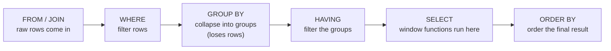

# Lab 12 – Window Functions

**Database:** `AdventureWorksENG`

Lab 11 produced subtotals and grand totals in one query — but every one of `ROLLUP`, `CUBE`, and `GROUPING SETS` *collapses* rows. Each group becomes one output row; the detail is gone. That's fine for a report. It's no help when you want to see every product **and** its category's total on the same row, or rank rows without losing the rows themselves, or compute a running total that updates on every row.

This lab covers the tool built for exactly that: the window function. It aggregates across a set of rows **without collapsing them**.

> [!IMPORTANT]
> **Core idea:** `OVER (PARTITION BY ... ORDER BY ...)` lets each row see its own neighborhood. Every input row survives; each one gets an extra column summarizing the rows around it.

---

## Learning objectives

After completing this lab, you should be able to:

- describe the three parts of a window function's `OVER` clause, and which are mandatory for which function family;
- use `ROW_NUMBER`, `RANK`, `DENSE_RANK`, and `NTILE`, and explain how they treat ties differently;
- use `SUM`/`AVG`/`COUNT`/`MIN`/`MAX` with `OVER`, and explain why adding `ORDER BY` turns a constant into a running total;
- use `LAG` and `LEAD` to compare a row to its neighbors in an ordered partition;
- explain why `LAST_VALUE` needs an explicit frame, and write that frame correctly;
- choose between `ROWS` and `RANGE` framing, and write the four most common frame idioms.

> [!NOTE]
> **Prerequisites:** comfort with `SELECT`, `JOIN`, `GROUP BY`, and the aggregate functions. [Lab 11 – Advanced Grouping](lab11-advanced-grouping.md) is not required, but the two labs pair naturally — both are about asking richer questions of data already in the database. No stored procedures, functions, or triggers are used here; almost every query is a plain `SELECT` with one extra clause, `OVER (...)`.

---

# Section 1 – The Anatomy of a Window Function

## 1.1 The killer comparison

```sql
-- Grouped: one row per color, detail gone
SELECT Color, SUM(PriceWithoutVAT) AS ColorTotal
FROM Product
GROUP BY Color;
```

```sql
-- Windowed: every product, plus its color's total
SELECT Name, Color, PriceWithoutVAT,
       SUM(PriceWithoutVAT) OVER (PARTITION BY Color) AS ColorTotal
FROM Product;
```

Same aggregate, same partitioning by color. `GROUP BY` loses the individual rows. The window function keeps every row **and** adds the aggregate as an extra column, living on every row of the partition it applies to. Everything in this lab is a variation on that one pattern.

## 1.2 The shape of every window function

```
funcName(<args>)
OVER
(
    [ PARTITION BY <cols> ]
    [ ORDER BY <cols>
        [ frame ] ]
)
```

A function, the keyword `OVER`, and up to three optional pieces inside the parentheses: `PARTITION BY` slices the rows into independent strips; `ORDER BY` orders the rows within each strip; a frame (Section 5) defines a sliding window inside the ordered strip.

Which pieces you need depends on the function:

| Function family | `PARTITION BY` | `ORDER BY` | Frame |
|---|:---:|:---:|:---:|
| Ranking | optional | **mandatory** | n/a |
| Aggregate | optional | optional | optional |
| Analytical | optional | **mandatory** | optional |

A ranking function without `ORDER BY` makes no sense — ranked by what? Same for `LAG`/`LEAD`/`FIRST_VALUE` — "previous" and "first" are meaningless without an order. An aggregate *without* `ORDER BY` means "across the whole partition, same value on every row"; *with* `ORDER BY`, it means "up to and including this row" (Section 3).

## 1.3 Where it runs in the query



*Diagram 1 – Window functions run inside the `SELECT`, after `JOIN`/`WHERE`/`GROUP BY` have already shaped the rows, and before the outer `ORDER BY` reorders the result.*

If a query has a `GROUP BY`, the window function sees the **aggregated** rows, not the original table — usually not what you want, since the whole point of a window function is to keep individual rows. Most window-function queries have no `GROUP BY` at all.

## 1.4 Check your understanding

1. What are the three optional pieces of an `OVER` clause?
2. Which piece is mandatory for a ranking function?
3. If a query has a `GROUP BY`, what rows does a window function in that query's `SELECT` see?

<details>
<summary>Show answers</summary>

1. `PARTITION BY` (slice into strips), `ORDER BY` (order within each strip), and a frame (a sliding window inside the ordered strip).
2. `ORDER BY`. `PARTITION BY` is optional.
3. The aggregated rows produced by `GROUP BY`, not the original rows — usually not what you want, since window functions exist to preserve individual rows.

</details>

---

# Section 2 – Ranking Functions

## 2.1 The four functions

```
ROW_NUMBER()    unique row number per partition (1, 2, 3, 4, ...)
RANK()          rank; ties share; then skip     (1, 2, 2, 4)
DENSE_RANK()    rank; ties share; no skip        (1, 2, 2, 3)
NTILE(n)        bucket rows into n groups
```

`ROW_NUMBER` breaks every tie arbitrarily — every row gets a unique number. `RANK` gives tied rows the same number, then skips ahead (two 2nd-place rows means the next is 4th). `DENSE_RANK` also shares the rank on a tie, but never skips. `NTILE(n)` buckets the rows into `n` roughly-equal groups — quartiles, deciles, percentiles.

## 2.2 Demo: all four side by side

```sql
SELECT
    p.Name,
    p.Color,
    p.PriceWithoutVAT,
    ROW_NUMBER() OVER (ORDER BY p.PriceWithoutVAT DESC) AS RN,
    RANK()       OVER (ORDER BY p.PriceWithoutVAT DESC) AS RK,
    DENSE_RANK() OVER (ORDER BY p.PriceWithoutVAT DESC) AS DR,
    NTILE(4)     OVER (ORDER BY p.PriceWithoutVAT DESC) AS Quartile
FROM Product p
WHERE p.PriceWithoutVAT > 0
ORDER BY p.PriceWithoutVAT DESC;
```

Look at the tied prices (there are several): `ROW_NUMBER` gives them consecutive numbers; `RANK` gives them the same number, then skips; `DENSE_RANK` gives them the same number, no skip; `NTILE(4)` assigns each row to one of four price-based quartiles.

## 2.3 Restarting per partition

```sql
SELECT
    p.Name,
    p.Color,
    p.PriceWithoutVAT,
    ROW_NUMBER() OVER (PARTITION BY p.Color
                       ORDER BY p.PriceWithoutVAT DESC) AS RankInColor
FROM Product p
WHERE p.Color IS NOT NULL
ORDER BY p.Color, p.PriceWithoutVAT DESC;
```

Adding `PARTITION BY p.Color` makes `RankInColor` restart at `1` for every new color — "the most expensive Crna product", "the most expensive Plava product", all in one query. The same pattern applies to `RANK`, `DENSE_RANK`, and `NTILE`.

## 2.4 When to use each

| Function | Use for |
|---|---|
| `ROW_NUMBER` | Pagination, de-duplication ("give me the first one") |
| `RANK` | Classical leaderboards |
| `DENSE_RANK` | Grouped-by-value listings ("top 5 distinct prices") |
| `NTILE(n)` | Percentiles, deciles, cohort analysis |

## 2.5 Check your understanding

1. What does `RANK` do differently from `ROW_NUMBER`?
2. What does `DENSE_RANK` do differently from `RANK`?
3. You want the top 3 rows per partition, and you don't want ties to give you more or fewer than 3. Which function do you use?

<details>
<summary>Show answers</summary>

1. `ROW_NUMBER` gives every row a unique number, breaking ties arbitrarily. `RANK` gives tied rows the same number and then skips the following numbers (`1, 2, 2, 4`).
2. `DENSE_RANK` also shares a rank across ties, but does not skip — the next distinct value gets the next integer (`1, 2, 2, 3`).
3. `ROW_NUMBER`, filtered to `<= 3` in an outer query — it guarantees exactly 3 rows per partition regardless of ties. `RANK` could return more or fewer than 3 if there's a tie at the boundary.

</details>

## Exercise 1 — Row number by (LastName, FirstName)

List all customers ordered by `LastName` then `FirstName`. Add a row number based on the same ordering.

<details>
<summary>Show solution</summary>

```sql
SELECT
    c.IDCustomer, c.LastName, c.FirstName,
    ROW_NUMBER() OVER (ORDER BY c.LastName, c.FirstName) AS RN
FROM Customer c
ORDER BY c.LastName, c.FirstName;
```

</details>

## Exercise 2 — Per-city row number

Same as Exercise 1, but the row number restarts for each city.

<details>
<summary>Show solution</summary>

```sql
SELECT
    ci.Name AS City, c.LastName, c.FirstName,
    ROW_NUMBER() OVER (PARTITION BY ci.Name
                       ORDER BY c.LastName, c.FirstName) AS RankInCity
FROM Customer c
JOIN City ci ON ci.IDCity = c.CityID
ORDER BY ci.Name, c.LastName, c.FirstName;
```

`PARTITION BY` is the entire trick — everything else is identical to Exercise 1.

</details>

## Exercise 3 — Rank invoice items by quantity

Rank invoice items with the highest quantity first. Ties should share a rank (use `RANK`).

<details>
<summary>Show solution</summary>

```sql
SELECT
    ii.InvoiceID, ii.ProductID, ii.Quantity,
    RANK() OVER (ORDER BY ii.Quantity DESC) AS QuantityRank
FROM InvoiceItem ii
ORDER BY QuantityRank, ii.InvoiceID, ii.ProductID;
```

</details>

## Exercise 4 — Salesman 284's invoices, bucketed into groups of 3

Order salesman 284's invoices by date then invoice number. The first 3 are group 1, the next 3 are group 2, and so on.

<details>
<summary>Show solution</summary>

```sql
SELECT
    i.IDInvoice, i.InvoiceNumber, i.InvoiceDate,
    (ROW_NUMBER() OVER (ORDER BY i.InvoiceDate, i.InvoiceNumber) - 1) / 3 + 1
      AS BucketOf3
FROM Invoice i
WHERE i.SalesmanID = 284
ORDER BY i.InvoiceDate, i.InvoiceNumber;
```

`NTILE(n)` also looks tempting here, but it only works if you know `n` up front, and it distributes rows as evenly as possible across `n` buckets rather than making fixed-size buckets of 3. For "buckets of exactly 3 rows", the `ROW_NUMBER` plus integer-division trick is the direct tool.

</details>

---

# Section 3 – Aggregate Window Functions and Running Totals

## 3.1 Two shapes

```
SUM(col) OVER (PARTITION BY x)              -- constant over each partition
SUM(col) OVER (PARTITION BY x ORDER BY y)   -- running total, resets per partition
```

The same aggregate functions you already know — `SUM`, `AVG`, `COUNT`, `MIN`, `MAX` — become window functions with `OVER`. Without `ORDER BY`, the aggregate is computed across the whole partition and every row sees the same value. With `ORDER BY`, it becomes a running total: each row sees the aggregate of every row up to and including itself, in the given order.

## 3.2 Demo: a grand total on every row

```sql
SELECT
    p.Name,
    p.PriceWithoutVAT,
    SUM(p.PriceWithoutVAT) OVER () AS TotalOfAllPrices
FROM Product p
WHERE p.PriceWithoutVAT > 0;
```

An empty `OVER ()` means no partition and no order — the window is the entire result set, so the same total appears on every row.

## 3.3 Demo: running total per year

```sql
SELECT
    i.InvoiceDate,
    ii.TotalPrice,
    SUM(ii.TotalPrice) OVER
    (
        PARTITION BY YEAR(i.InvoiceDate)
        ORDER BY i.InvoiceDate, i.IDInvoice
    ) AS RunningTotalThisYear
FROM InvoiceItem ii
JOIN Invoice i ON i.IDInvoice = ii.InvoiceID
ORDER BY i.InvoiceDate, i.IDInvoice;
```

The running total climbs as the rows go by in date order, then resets to zero on January 1st of the next year — because the partition is `YEAR(InvoiceDate)`, and a new year is a new partition. One query; no cursor needed for a running total ever again.

## 3.4 Why ORDER BY inside OVER produces a running total

The default frame when `ORDER BY` is present is:

```
RANGE BETWEEN UNBOUNDED PRECEDING AND CURRENT ROW
```

— "aggregate every row from the start of the partition up to and including this one." That is the running-total definition. Section 5 covers frames directly; for now, this explains why "aggregate + `ORDER BY`" behaves the way it does.

## 3.5 Check your understanding

1. What is the difference between `SUM(col) OVER ()` and `SUM(col) OVER (ORDER BY x)`?
2. What does `PARTITION BY YEAR(date) ORDER BY date` give you inside an aggregate window?
3. Why is a running total called "running"?

<details>
<summary>Show answers</summary>

1. Without `ORDER BY`, the aggregate is computed across the whole window — every row sees the same value. With `ORDER BY`, it's computed from the start of the partition up to and including each row — a running total.
2. A running total per calendar year, resetting every January 1st; each row shows the year-to-date total as of its own date.
3. The value grows monotonically as you move down the ordered rows — each row is a snapshot of the total "so far", the same shape as adding numbers on a calculator without pressing equals.

</details>

## Exercise 5 — Running total of revenue per year

Invoice items with a running total that resets every calendar year.

<details>
<summary>Show solution</summary>

```sql
SELECT
    i.InvoiceDate, ii.TotalPrice,
    SUM(ii.TotalPrice) OVER
    (
        PARTITION BY YEAR(i.InvoiceDate)
        ORDER BY i.InvoiceDate, i.IDInvoice, ii.ProductID
    ) AS RunningRevenueThisYear
FROM InvoiceItem ii
JOIN Invoice i ON i.IDInvoice = ii.InvoiceID
ORDER BY i.InvoiceDate, i.IDInvoice, ii.ProductID;
```

</details>

## Exercise 6 — Products with a count of same-color products

Every product, with a count of how many products share its color.

<details>
<summary>Show solution</summary>

```sql
SELECT
    p.Name, p.Color, p.PriceWithoutVAT,
    COUNT(*) OVER (PARTITION BY p.Color) AS ProductsInColor
FROM Product p
ORDER BY p.Color, p.Name;
```

No `ORDER BY` inside `OVER`, so `COUNT(*)` is computed across the whole partition — every product of a given color gets the same count. This is the "constant per partition" case from 3.1.

</details>

## Exercise 7 — Distance from the most expensive product

For every product with a price greater than zero, show how much cheaper it is than the single most expensive product overall.

<details>
<summary>Show solution</summary>

```sql
SELECT
    p.Name, p.PriceWithoutVAT,
    MAX(p.PriceWithoutVAT) OVER () - p.PriceWithoutVAT AS CheaperThanMaxBy
FROM Product p
WHERE p.PriceWithoutVAT > 0
ORDER BY CheaperThanMaxBy;
```

The empty `OVER ()` computes the `MAX` across the whole result; every row's `CheaperThanMaxBy` is `(global max) - (this row's price)`. The most expensive product's own row shows `0`.

</details>

---

# Section 4 – Analytical Functions: LAG, LEAD, FIRST_VALUE, LAST_VALUE

## 4.1 The four functions

```
FIRST_VALUE(col)   value of col in the FIRST row of the window
LAST_VALUE(col)    value of col in the LAST row of the window    *
LAG(col, n)        value of col from n rows BEFORE the current row
LEAD(col, n)       value of col from n rows AFTER the current row

ORDER BY       mandatory — "first"/"last"/"previous"/"next" need an order
PARTITION BY   optional — restarts per partition

* LAST_VALUE has a default-frame trap. See 4.4.
```

`LAG` and `LEAD` are the two you will reach for most often: `LAG(col, 1)` is the value of `col` in the previous row; `LEAD(col, 1)` is the value in the next row.

## 4.2 Demo: LAG for a time-series diff

```sql
SELECT
    p.Name,
    p.PriceWithoutVAT,
    LAG(p.PriceWithoutVAT, 1) OVER (ORDER BY p.PriceWithoutVAT) AS PrevPrice,
    p.PriceWithoutVAT
      - LAG(p.PriceWithoutVAT, 1) OVER (ORDER BY p.PriceWithoutVAT) AS DeltaFromPrev
FROM Product p
WHERE p.PriceWithoutVAT > 0
ORDER BY p.PriceWithoutVAT;
```

`PrevPrice` is the previous product's price on every row; the first row's `PrevPrice` is `NULL`, because nothing precedes it — that's `LAG`'s default at the edge of a partition. `DeltaFromPrev` is how much more this product costs than the one before it. "Compare each row to the one before it" is one of the most common analytical patterns in real code.

## 4.3 LEAD: the mirror

```sql
SELECT
    p.Name,
    p.PriceWithoutVAT,
    LEAD(p.PriceWithoutVAT, 1) OVER (ORDER BY p.PriceWithoutVAT) AS NextPrice
FROM Product p
WHERE p.PriceWithoutVAT > 0
ORDER BY p.PriceWithoutVAT;
```

Same idea, mirrored: the last row's `NextPrice` is `NULL`, since nothing follows it. Common use: "when does the next event happen after this one" — timestamps, schedules, version history.

## 4.4 FIRST_VALUE and the LAST_VALUE trap

```sql
SELECT
    p.Name,
    p.PriceWithoutVAT,
    FIRST_VALUE(p.Name) OVER (ORDER BY p.PriceWithoutVAT) AS CheapestProduct
FROM Product p
WHERE p.PriceWithoutVAT > 0
ORDER BY p.PriceWithoutVAT;
```

Every row shows the name of the cheapest product — the first row of the ordered window. `LAST_VALUE` looks symmetric, but is not, with default settings:

```sql
SELECT
    p.Name, p.PriceWithoutVAT,
    LAST_VALUE(p.Name) OVER (ORDER BY p.PriceWithoutVAT) AS LastValueDefault
FROM Product p
WHERE p.PriceWithoutVAT > 0
ORDER BY p.PriceWithoutVAT;
```

`LastValueDefault` on every row turns out to equal that row's own `Name`. That is not "the last value in the partition" — it is "the last value seen so far". The default frame when `ORDER BY` is present is `RANGE BETWEEN UNBOUNDED PRECEDING AND CURRENT ROW` (Section 3.4), so "the last row of the window" is the current row itself.

The fix is an explicit frame covering the whole partition:

```sql
SELECT
    p.Name, p.PriceWithoutVAT,
    LAST_VALUE(p.Name) OVER
    (
        ORDER BY p.PriceWithoutVAT
        ROWS BETWEEN UNBOUNDED PRECEDING AND UNBOUNDED FOLLOWING
    ) AS ActuallyMostExpensive
FROM Product p
WHERE p.PriceWithoutVAT > 0
ORDER BY p.PriceWithoutVAT;
```

> [!IMPORTANT]
> Whenever you use `LAST_VALUE`, add the explicit `ROWS BETWEEN UNBOUNDED PRECEDING AND UNBOUNDED FOLLOWING` frame. Always.

## 4.5 Check your understanding

1. What does `LAG(col, 1)` return in the first row of a partition?
2. Give one real-world use for `LEAD`.
3. Why does `LAST_VALUE` need an explicit frame to behave as its name suggests?

<details>
<summary>Show answers</summary>

1. `NULL` — there is no previous row to reach back to. A third argument overrides this: `LAG(col, 1, 0)` returns `0` instead of `NULL` at the edge.
2. "When does the next event happen after this one" — time until the next login, order, or state change; also gap detection, by filtering on an abnormally large difference between a row and its `LEAD`.
3. The default frame with `ORDER BY` is `RANGE UNBOUNDED PRECEDING TO CURRENT ROW`, so "the last value in the window" is "the last value seen so far" — the current row. The fix is `ROWS BETWEEN UNBOUNDED PRECEDING AND UNBOUNDED FOLLOWING`.

</details>

## Exercise 8 — Delta from the previous product

Products with a price greater than zero, cheapest first. Show how much more expensive each one is than the previous.

<details>
<summary>Show solution</summary>

```sql
SELECT
    p.Name, p.PriceWithoutVAT,
    p.PriceWithoutVAT - LAG(p.PriceWithoutVAT, 1) OVER (ORDER BY p.PriceWithoutVAT)
      AS DeltaFromPrev
FROM Product p
WHERE p.PriceWithoutVAT > 0
ORDER BY p.PriceWithoutVAT;
```

</details>

## Exercise 9 — A train schedule with LEAD

Create a small table and show, next to each station, how many minutes until the next station's departure.

<details>
<summary>Show solution</summary>

```sql
DROP TABLE IF EXISTS dbo.Lab12TrainSchedule;
GO

CREATE TABLE dbo.Lab12TrainSchedule
(
    IDStation int IDENTITY(1, 1) PRIMARY KEY,
    Station   nvarchar(50) NOT NULL,
    Departure time         NOT NULL
);
GO

INSERT INTO dbo.Lab12TrainSchedule (Station, Departure)
VALUES
    (N'Zagreb',    '11:00'),
    (N'Dugo Selo', '11:35'),
    (N'Kutina',    '13:15'),
    (N'Novska',    '13:45');

SELECT
    s.IDStation, s.Station, s.Departure,
    LEAD(s.Departure, 1) OVER (ORDER BY s.Departure) AS NextDeparture,
    DATEDIFF(minute,
             s.Departure,
             LEAD(s.Departure, 1) OVER (ORDER BY s.Departure)) AS MinutesToNext
FROM dbo.Lab12TrainSchedule s
ORDER BY s.Departure;
```

The last row's `MinutesToNext` is `NULL` — there is no next station. This is the same shape you'd use for "how long is each concert set", "how long between website events", or "how long between server heartbeats" — any time-series diff.

Clean up the table once you're done with this exercise:

```sql
DROP TABLE dbo.Lab12TrainSchedule;
```

</details>

---

# Section 5 – Frames

## 5.1 The third piece of OVER

A frame is a sliding window inside the ordered partition, used only by aggregate and analytical functions — ranking functions don't use frames.

```
ROWS  BETWEEN <start> AND <end>       -- row-count based
RANGE BETWEEN <start> AND <end>       -- value based on the ORDER BY column

Endpoints:
    UNBOUNDED PRECEDING     from the start of the partition
    N PRECEDING             N rows/values before the current one
    CURRENT ROW             this row
    N FOLLOWING             N rows/values ahead
    UNBOUNDED FOLLOWING     to the end of the partition
```

`ROWS` counts physical rows — predictable. `RANGE` uses the values in the `ORDER BY` column, so rows that tie on that value are all included together, which can surprise you. Rule of thumb: use `ROWS` unless you specifically need value-based semantics.

## 5.2 Four idioms worth memorizing

```
"The whole partition":
    ROWS BETWEEN UNBOUNDED PRECEDING AND UNBOUNDED FOLLOWING

"Moving window of size N+1 ending on this row":
    ROWS BETWEEN N PRECEDING AND CURRENT ROW

"Everything from here forward":
    ROWS BETWEEN CURRENT ROW AND UNBOUNDED FOLLOWING

"Everything up to but not including this row":
    ROWS BETWEEN UNBOUNDED PRECEDING AND 1 PRECEDING
```

Together these four cover most of what you'll write in real code.

## 5.3 Demo: a moving 3-item average

```sql
SELECT
    p.Name,
    p.PriceWithoutVAT,
    AVG(p.PriceWithoutVAT) OVER
    (
        ORDER BY p.PriceWithoutVAT
        ROWS BETWEEN 2 PRECEDING AND CURRENT ROW
    ) AS Moving3Avg
FROM Product p
WHERE p.PriceWithoutVAT > 0
ORDER BY p.PriceWithoutVAT;
```

The first row's window has just 1 row (nothing precedes it), so the average equals that row's own price. The second row's window has 2 rows; the third row onward, 3. This is the standard shape for smoothing a time series with a moving average.

## 5.4 The default frame, revisited

Recall from Section 3.4: when `ORDER BY` is present inside `OVER` with no explicit frame, the default is `RANGE BETWEEN UNBOUNDED PRECEDING AND CURRENT ROW`. That default is why "aggregate + `ORDER BY`" gives a running total (Section 3), and why `LAST_VALUE` without an explicit frame looks broken (Section 4.4) — the frame ends at the current row, so "the last value" is the current row. Always be explicit when using `LAST_VALUE`.

## 5.5 Check your understanding

1. What is the difference between `ROWS` and `RANGE`?
2. Write the frame that means "the whole partition".
3. How do you turn a running average into a fixed-size moving average over the current row plus the previous four?

<details>
<summary>Show answers</summary>

1. `ROWS` counts physical rows — `ROWS BETWEEN 2 PRECEDING AND CURRENT ROW` is exactly 3 rows. `RANGE` uses the `ORDER BY` column's values, so tied rows are all included together, which can surprise you.
2. `ROWS BETWEEN UNBOUNDED PRECEDING AND UNBOUNDED FOLLOWING`.
3. Specify the frame explicitly: `AVG(col) OVER (ORDER BY x ROWS BETWEEN 4 PRECEDING AND CURRENT ROW)` — a moving 5-item average (the current row plus 4 preceding).

</details>

---

# Section 6 – Common Mistakes and Final Review

## 6.1 Common mistakes

| Mistake | Why it matters | Better approach |
|---|---|---|
| Using `LAST_VALUE` without an explicit frame | Default frame ends at the current row — you get the row itself, not the true last value | Always add `ROWS BETWEEN UNBOUNDED PRECEDING AND UNBOUNDED FOLLOWING` |
| Forgetting `ORDER BY` on a ranking or analytical function | The function has nothing to rank or reach relative to — syntax error or meaningless result | Treat `ORDER BY` as mandatory for ranking and analytical functions |
| Mixing a `GROUP BY` into a window-function query without meaning to | The window function sees aggregated rows, not the originals | Drop the `GROUP BY` unless you specifically want to window over aggregated groups |
| Expecting `RANK` to give exactly `N` rows per partition when filtering top-`N` | Ties can produce more or fewer than `N` | Use `ROW_NUMBER` when you need exactly `N`, `RANK`/`DENSE_RANK` when ties should matter |
| Assuming `RANGE` and `ROWS` always behave the same | They agree only when there are no ties on the `ORDER BY` column | Default to `ROWS` unless you have a specific reason for value-based framing |

## 6.2 Final questions

1. In one sentence, what does a window function do that `GROUP BY` cannot?
2. Name the three families of window functions.
3. Which pieces of the `OVER` clause are mandatory for a ranking function?
4. Why does an aggregate with `ORDER BY` inside `OVER` produce a running total?

<details>
<summary>Show answers</summary>

1. It aggregates across a set of rows without collapsing those rows — every input row survives, with an extra column summarizing its neighborhood.
2. Ranking, aggregate, analytical.
3. `ORDER BY` is mandatory; `PARTITION BY` is optional.
4. Because the default frame is `RANGE BETWEEN UNBOUNDED PRECEDING AND CURRENT ROW` — "everything from the start of the partition up to this row" is exactly the running-total definition.

</details>

## 6.3 Key takeaways

- **Window functions aggregate without collapsing.** Every input row survives; each gets one extra column summarizing its neighborhood.
- **The shape is always `func(...) OVER (PARTITION BY ... ORDER BY ... frame)`.** Three optional pieces, each with a specific job.
- **Three families.** Ranking (`ROW_NUMBER`, `RANK`, `DENSE_RANK`, `NTILE`), aggregate (`SUM`/`AVG`/`COUNT`/`MIN`/`MAX` with `OVER`), analytical (`FIRST_VALUE`, `LAST_VALUE`, `LAG`, `LEAD`).
- **Aggregate + `ORDER BY` inside `OVER` = a running total**, reset at each partition boundary.
- **`LAG`/`LEAD` reach back and forward** — the two most-used analytical functions in real code.
- **`LAST_VALUE` needs an explicit frame.** Always write `ROWS BETWEEN UNBOUNDED PRECEDING AND UNBOUNDED FOLLOWING`.

Back to the opening comparison: `GROUP BY Color` loses every row but the aggregate. `SUM(...) OVER (PARTITION BY Color)` keeps every row **and** adds the aggregate. That single difference is the whole lab.

**Looking ahead:** Between advanced grouping and window functions, you now have the two tools that cover almost every analytical query written outside specialized BI tools.

---

# Additional Reading

The following topics extend the lab. They are not required for the main exercises.

## A. Statistical Window Functions

`PERCENT_RANK()`, `CUME_DIST()`, and `PERCENTILE_CONT()`/`PERCENTILE_DISC()` compute relative standing and percentiles directly as window or aggregate functions — useful once `NTILE` stops being precise enough. See [PERCENT_RANK (Transact-SQL)](https://learn.microsoft.com/en-us/sql/t-sql/functions/percent-rank-transact-sql) and [PERCENTILE_CONT (Transact-SQL)](https://learn.microsoft.com/en-us/sql/t-sql/functions/percentile-cont-transact-sql).

## B. References

- [OVER Clause (Transact-SQL)](https://learn.microsoft.com/en-us/sql/t-sql/queries/select-over-clause-transact-sql)
- [Ranking Functions (Transact-SQL)](https://learn.microsoft.com/en-us/sql/t-sql/functions/ranking-functions-transact-sql)
- [LAG (Transact-SQL)](https://learn.microsoft.com/en-us/sql/t-sql/functions/lag-transact-sql)
- [LEAD (Transact-SQL)](https://learn.microsoft.com/en-us/sql/t-sql/functions/lead-transact-sql)
- [FIRST_VALUE (Transact-SQL)](https://learn.microsoft.com/en-us/sql/t-sql/functions/first-value-transact-sql)
- [LAST_VALUE (Transact-SQL)](https://learn.microsoft.com/en-us/sql/t-sql/functions/last-value-transact-sql)
